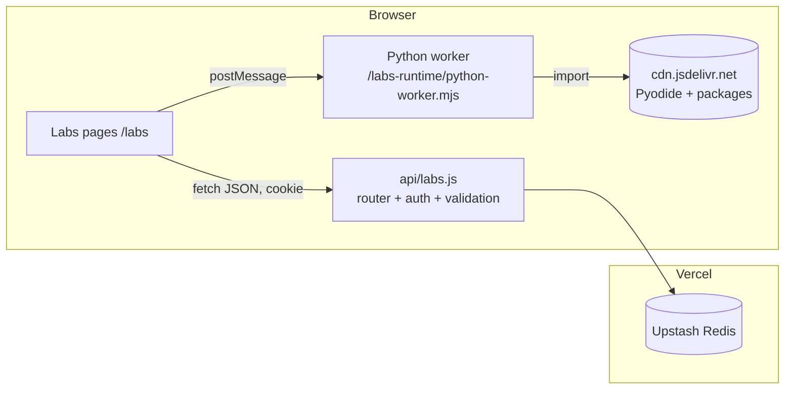

# Labs: technical decision record and architecture

Status: accepted, implemented in the first version. Date: 2026-10-18.

This file explains why Labs works the way it does. `LABS_GUIDE.md` explains how to use it, how to add a lab template, and how to deploy it.

## 1. What the project already had

| Area | What exists | What it means for Labs |
|---|---|---|
| Frontend | React 19, Vite 6, React Router 6, a comic design system (`comic.css`) and the notes styles (`notes.css`) | Labs is one more lazy route, `/labs/*`, styled with the same tokens. |
| Notes | `/notes/*` route. Notes are Markdown files in `src/content/notes/`. `plugins/vite-plugin-notes.js` compiles them at build time into `virtual:notes`. There is no runtime API for notes. | The notes pattern (files in the repo, compiled at build time) is right for read-only study text. It is wrong for lab work, which changes every minute and must persist online. Labs reuses the notes Markdown renderer for text cells, and the "content as Markdown files with frontmatter" idea for templates. |
| Backend | Vercel Functions in `api/` (`subscribe`, `confirm`, `unsubscribe`). Node handlers `(req, res)`, JSON `{ error }` responses, fail soft with 503 when not configured. | Labs adds one function, `api/labs.js`, in the same style. |
| Storage | Upstash Redis through `@upstash/redis` (`api/_lib/kv.js`), env vars `UPSTASH_REDIS_REST_URL` and `UPSTASH_REDIS_REST_TOKEN`. | Labs uses the same database. No new storage service. |
| Auth | None. The site is public. Private notes are removed at build time. | Labs needs an owner sign-in, because labs are private, editable data. |
| Deploy | Vercel, `vercel.json` rewrites every path to `index.html`. | Labs adds one rewrite for `/api/labs/*` and one security header block. |
| Tests | None. ESLint has 28 errors in older files. | Labs adds `node --test` unit and integration tests and a Playwright end-to-end test. New files pass ESLint. |

### What the earlier conversations decided

The earlier study plans (project doc `claude/context-engineering-plan.md` section 8, and `claude/agent-harness-study-map.md`) put lab code in local folders: `C:\Users\ASohi\Downloads\AI\context-engineering-lab` and `C:\Users\ASohi\Downloads\AI\agent-harness-lab`, one Jupyter notebook per lesson. More than 40 lesson pages still say "write your code in the lab folder". The agent-harness map records that the folder was never created. This design replaces that approach. I could read those project documents and the memory notes. I could not read the full text of earlier chats, so the requirements below come from the documents, the code and this request.

Requirements kept from those documents:

1. The learner writes the code. Templates give a task and a scaffold, not the solution.
2. Exercises are small, testable steps with acceptance checks.
3. Most exercises need no API key: NumPy, plain Python, matplotlib.
4. Work must be easy to push to GitHub later (so: export to `.ipynb`).

## 2. Approaches investigated

| Approach | Languages | Setup per lab | Security | Persistence | Ops and cost | Verdict |
|---|---|---|---|---|---|---|
| **A. Pyodide in a Web Worker** (CPython 3.14 compiled to WebAssembly) | Python, with NumPy 2.4, SciPy 1.18, matplotlib 3.10, pandas 3.0, scikit-learn 1.8, NetworkX, SymPy, pydantic; pure-Python wheels from PyPI through micropip | None | Code runs in the learner's browser, in a worker, never on the server | Code and outputs saved by our API | No server compute. About 10 MB download on first use, then browser cache | **Chosen** for the first runtime |
| B. JupyterLite | Python (Pyodide kernel) | Build and host a second static site | Same as A | Files stay in the browser's IndexedDB. No server sync without a custom drive extension | Large bundle, a second UI that does not match the site | Rejected: work would not follow the learner to another device, and the UI is a separate app |
| C. Remote sandbox (Vercel Sandbox, E2B, Modal) | Any, real processes and network | API key and server code | Strong (Firecracker microVMs) | Needs our API anyway | Vercel Sandbox Hobby: 5 active CPU-hours a month, 45-minute sessions, 10 at a time. Pay per use after that | Deferred: the right second runtime for labs that need real processes (an MCP server over stdio, a LangGraph agent that calls a model). Not needed for the first version |
| D. Binder or Thebe (remote Jupyter kernels) | Python | Repository with a `requirements.txt` | Public shared infrastructure | None | Free, but cold starts take minutes and capacity is not guaranteed | Rejected |
| E. Sandpack (CodeSandbox bundler) | JavaScript, React | Small | Iframe on another origin | Our API | Depends on a hosted bundler | Deferred: good for front-end labs later |
| F. Plain `<iframe sandbox>` with JavaScript | JavaScript | None | Opaque origin, no cookies | Our API | None | Deferred: the second browser runtime, for canvas visualisations |

Editor candidates: **CodeMirror 6** (modular, small, MIT, works on phones, accessible) and Monaco (several MB, weak on phones). CodeMirror 6 is chosen.

Storage candidates: **Upstash Redis** (already provisioned, 10 MB request limit, 100 MB record limit, 250 MB data and 500K commands a month on the free plan, Lua scripts for atomic updates), Vercel Blob or a Postgres database (new services, not needed for this data size). Redis is chosen.

## 3. Decision

1. **A lab is a notebook-like document**: an ordered list of cells. A cell is Markdown text (instructions, explanations, observations) or code. This one flexible shape covers the FFT, attention, embeddings, HNSW, RAG and algorithm examples without a custom component for each topic.
2. **The first runtime is Python on Pyodide 314.0.7**, in a module Web Worker on the site's own origin. Each open lab has its own Python process. Variables persist between cells until restart.
3. **Labs live online** in Upstash Redis, behind one Vercel Function, `api/labs.js`, with owner sign-in.
4. **Templates are Markdown files** in `src/labs/templates/`. A ` ```python ` fence becomes a code cell. Everything else becomes a text cell. Frontmatter holds the definition (title, objectives, tags, packages). Adding a template is adding one file.
5. **Learning features are small and reusable**, not per-topic code:
   - `# @param` comments turn a literal into a slider, number field, checkbox, dropdown or text field. Moving it rewrites the literal in the code and runs the cell again. The code stays the single source of truth.
   - **Pinned results**: pin a cell's output, change a parameter, and compare the new output with the pinned one side by side.
   - The `lab` Python helper: `lab.check(name, actual, expected)` shows a pass or fail badge; `lab.inspect(value)` shows type, shape, dtype and statistics.
   - **Versions**: named snapshots of the lab; restore at any time. Destructive actions take a snapshot first.
   - **Reset**: the lab keeps its starter content. Reset one cell or the whole lab.
   - **Objectives**: a checklist at the top of the lab.

## 4. Architecture



### The four parts of a lab

| Part | Where it lives | Example |
|---|---|---|
| Definition | Template frontmatter, copied into the lab metadata at creation | title, summary, objectives, tags, collection, runtime, packages |
| Content | The `cells` array | Markdown text, Python code, `# @param` lines |
| Runtime | `src/labs/runtimes/` registry, worker in `public/labs-runtime/` | `python` → Pyodide session |
| Progress | Saved content (with outputs and pins), versions, status, objectives done, last cell, opened time | |

### Data model (Redis, prefix `labs:v1:<userId>:`)

| Key | Type | Value |
|---|---|---|
| `index` | hash | field `<labId>` → user metadata JSON; field `<labId>:stats` → revision, updatedAt, cellCount, lastCellId, size; field `<labId>:opened` → ISO time |
| `content:<labId>` | string | content JSON (cells with outputs) |
| `starter:<labId>` | string | starter content JSON (no outputs) |
| `rev:<labId>` | string | integer revision |
| `versions:<labId>` | hash | `<versionId>` → version JSON (content without outputs) |
| `labs:v1:auth:fail:<ip>` | string with TTL | failed sign-in counter |

Each metadata field has one kind of writer, so a rename cannot overwrite a content save. A content save is one Lua script: compare the revision, write the content, write the stats, add one to the revision. A stale save gets HTTP 409, and the page offers a choice. The list page reads one hash (one Redis command).

### API

| Method and path | Purpose |
|---|---|
| `GET /api/labs/session` | Signed in or not, and whether storage is configured |
| `POST /api/labs/session` `{ password }` | Sign in. Sets the session cookie |
| `DELETE /api/labs/session` | Sign out |
| `GET /api/labs` | List lab metadata |
| `POST /api/labs` | Create (blank, template, note, import) or duplicate (`{ duplicateOf }`) |
| `GET /api/labs/:id` | Metadata, content and revision |
| `PATCH /api/labs/:id` | Rename, describe, tag, archive, status, objectives, settings, `opened` |
| `PUT /api/labs/:id/content` `{ baseRevision, content }` | Save content (409 on a stale revision) |
| `GET /api/labs/:id/starter` | Starter content, for reset |
| `DELETE /api/labs/:id` | Delete the lab and its versions |
| `GET, POST /api/labs/:id/versions` | List versions, make a snapshot |
| `GET, DELETE /api/labs/:id/versions/:versionId` | Read or delete one version |

Validation lives in `src/lib/labs/schema.js`. The API and the page both use it, so the rules exist once.

## 5. Security

| Threat | Control |
|---|---|
| Someone else reads or changes labs | Every lab route needs the session cookie. The cookie is HMAC-SHA256 signed with `LABS_SESSION_SECRET`, `HttpOnly`, `SameSite=Strict`, `Secure` in production, 30-day expiry. Keys contain the user id, so a second user cannot address the first user's keys. |
| Password guessing | 10 failed attempts per IP address in 15 minutes, then HTTP 429. Comparison in constant time. |
| Cross-site request forgery | `SameSite=Strict`, plus every write needs the `X-Labs-Request: 1` header (a cross-site page cannot send it without a CORS preflight, which the API never approves) and a matching `Origin` header when the browser sends one. |
| Lab code reaches the server | It cannot. Python runs only in the learner's browser. The server never runs lab code and holds no lab runtime. |
| Lab code calls the Labs API with the learner's cookie | The worker script is served with its own Content-Security-Policy: `connect-src` allows only the Pyodide CDN, PyPI and raw.githubusercontent.com, and not the site itself. The session cookie is `HttpOnly`, so code cannot read it. Workers have no DOM access. |
| Endless loops, heavy code | Each run has a time limit (default 120 s, set per lab from 10 s to 30 min). At the limit, or on Stop, the page terminates the worker. The Python state resets and the page says so. Memory is limited by the browser (WebAssembly 32-bit memory). A crashed worker is reported, not hidden. |
| Huge outputs freeze the page | Output is batched every 50 ms and capped (text 100,000 characters per run in the page, 20,000 saved; images 1.5 MB each, 8 per cell). Content over 3.5 MB is refused with HTTP 413 and a clear message. |
| HTML from Python (pandas tables) | Rendered through an allow-list sanitizer: table elements and simple text tags only, no attributes except `colspan` and `rowspan`. |
| Secrets | No secret reaches the browser. Lab code has no environment variables except the Pyodide defaults. |

What this does not protect against: code that the signed-in owner runs on purpose in their own browser (it has the same power as any page they open), and a browser that ignores a worker's own CSP header (the CSP specification and MDN say a worker uses the policy sent with its script; the end-to-end test checks this in Chromium; in a browser that ignores it, code in the worker still cannot read the cookie, but it could call the Labs API with it).

## 6. Deployment

| Variable | Required | Purpose |
|---|---|---|
| `UPSTASH_REDIS_REST_URL`, `UPSTASH_REDIS_REST_TOKEN` | Yes (already set for subscriptions) | Storage |
| `LABS_PASSWORD` | Yes | The owner password. At least 12 characters (the API refuses shorter); use 16 or more random characters. |
| `LABS_SESSION_SECRET` | Yes | At least 32 random characters. Changing it signs everyone out. |
| `VITE_LABS_PYODIDE_URL` | No | Load Pyodide from a self-hosted copy instead of jsDelivr (for networks that block the CDN). Its origin must be added to the worker CSP. |

No migration is needed: keys are new and have their own prefix. Without the variables, `/labs` shows a "not configured" message and the rest of the site is unchanged.

Local development: `npm run dev` serves `/api/labs` through `plugins/vite-plugin-labs-api.js`. With the variables in `.env.local` it uses the real database. Without them it uses an in-memory store and signs you in automatically, and says so on the page. That mode exists only in `npm run dev`.

## 7. Changes to existing files

| File | Change |
|---|---|
| `src/App.jsx` | Lazy route `/labs/*` |
| `src/components/QuickNav.jsx` | Hidden on `/labs` (the Labs top bar has the same links; the badge covered cell controls) |
| `src/pages/NotesPage.jsx` | `LABS` link in the top bar; `OPEN A LAB` link on each note page |
| `src/styles/notes.css` | Style for that link |
| `plugins/vite-plugin-notes.js` | Also serves `virtual:notes-index` (titles and summaries only) for "start from a note" |
| `vite.config.js` | Registers `plugins/vite-plugin-labs-api.js` |
| `vercel.json` | Rewrite for `/api/labs/*`; CSP header for the worker |
| `eslint.config.js` | Node globals for `api/`, `plugins/`, `scripts/`, `tests/` (this also removes 4 old lint errors) |
| `package.json` | CodeMirror 6 packages; `test` and `test:e2e` scripts |
| `NOTES_PROTOCOL.md` | Section 11: learner code goes into Labs |

## 8. Verification (2026-10-18)

| Check | Result |
|---|---|
| `npm test` (node --test) | 63 tests pass: schema, controls, formats, `.ipynb`, API routes (auth, CSRF, rate limit, isolation, conflict, 413, versions), autosave logic, and the store contract on the memory store and on a real Redis through the real `@upstash/redis` client and Lua script |
| `npm run lint` | No problem in new files. 24 older errors in unrelated files remain (28 before) |
| `vite build` | Passes. Labs is a separate 475 kB chunk (155 kB gzip); the main bundle grew by 1 kB |
| End-to-end, Chromium + real Pyodide 314.0.7 + Redis | 80 checks pass: sign-in, create from template, run, figures, controls re-run, pins, checks, tracebacks, autosave and reload, text cells, stop, time limit, `input()`, CSP block of `/api/labs` (with an allowed-origin control), HTML sanitizer (XSS payload), pandas tables, versions and restore, failed save and retry, two-tab conflict, list/search/duplicate/archive/delete, rename, objectives, mark done, reset to starter, `.ipynb` export and re-import, keyboard shortcuts, every template runs until its first exercise, notes page and "open a lab", sign-out, phone layout without horizontal scroll |
| Template solutions | Every template was solved with reference solutions (not in the repository): 57 of 57 checks pass |

## 9. Deferred, and how to add it

| Capability | Path |
|---|---|
| JavaScript and canvas labs | A `javascript` runtime in `src/labs/runtimes/` that runs code in `<iframe sandbox="allow-scripts">` and returns the same output items |
| Labs that need real processes or network servers | A `remote-python` runtime that calls a new API route, which creates a Vercel Sandbox microVM per run. Needs `VERCEL_OIDC_TOKEN` or a team token, per-run time limits and a monthly budget |
| Stop without losing state | Pyodide interrupt buffer. Needs `SharedArrayBuffer`, so the whole site would need cross-origin isolation headers (COOP and COEP), which can break third-party embeds |
| Sharing a lab read-only | A `published` flag and a public read route |
| More users | Replace the password sign-in in `api/_lib/labs/auth.js` with OAuth (for example GitHub). Keys already include the user id |

## 10. Sources

- Pyodide 314.0 release notes: https://blog.pyodide.org/posts/314-release
- Pyodide in a web worker: https://pyodide.org/en/stable/usage/webworker.html
- Pyodide packages: https://pyodide.org/en/stable/usage/packages-in-pyodide.html
- Pyodide interrupts: https://pyodide.org/en/stable/usage/keyboard-interrupts.html
- Upstash Redis limits: https://upstash.com/pricing/redis
- Lua on Upstash Redis: https://upstash.com/blog/lua-scripting-on-upstash-redis-atomic-operations-over-http
- Vercel `vercel.json` (rewrites pass named parameters as query parameters; the filesystem wins over rewrites): https://vercel.com/docs/project-configuration/vercel-json
- Vite on Vercel: https://vercel.com/docs/frameworks/frontend/vite
- Vercel Sandbox pricing and limits: https://vercel.com/docs/sandbox/pricing
- JupyterLite storage: https://jupyterlite.readthedocs.io/en/stable/howto/configure/storage.html
- CSP and workers (MDN): https://developer.mozilla.org/en-US/docs/Web/HTTP/Reference/Headers/Content-Security-Policy
- HTTP cache partitioning (dedicated workers share their frame's cache key): https://developer.chrome.com/blog/http-cache-partitioning
