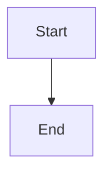

# Notes guide

This file describes the exact format of the files in `src/content/notes/`. It matches the code in `plugins/vite-plugin-notes.js`, `src/lib/notes.js` and `src/components/markdown/`.

Read `NOTES_PROTOCOL.md` for the teaching rules and the note-writing rules. This file covers only the format.

## 1. Folders and URLs

| File | What it becomes |
|---|---|
| `src/content/notes/_index.md` | The notes home page at `/notes` |
| `<folder>/_folder.md` | The title, order, summary and body of that folder page |
| Any other `<path>.md` | A note at `/notes/<path>` (the path without `.md`) |

1. Folders can nest to any depth. The first level holds areas (for example `maths`). The second level holds subjects (for example `maths/fft-signal-processing`).
2. A folder without `_folder.md` still works. Its title comes from its folder name.
3. A folder with no visible notes, at any depth, is hidden, unless it has its own `_folder.md`. So a planned part folder shows in the tree before its first note exists.
4. Items in a folder sort by `order`, then by file name. Items without `order` go last.
5. `/notes/review` is reserved. Do not create a root-level note named `review.md`.
6. Media files live in `public/notes/media/<subject>/`. Use them with absolute paths, for example `/notes/media/fft-signal-processing/course/02_What_Frequency_Means.mp4`.

## 2. Frontmatter

Every file starts with a frontmatter block between two `---` lines.

```yaml
---
title: "L2: Period and frequency"
order: 2
summary: "How to count cycles in a list of samples."
status: in-progress
confidence: 3
learned: 2026-10-11
reviewDue: 2026-10-12
tags: [signals, frequency]
private: false
---
```

| Field | Rule |
|---|---|
| `title` | Required. Always put it in double quotes. The site parser does not need quotes, but standard YAML tools (for example Obsidian) fail on an unquoted colon. |
| `order` | A number. |
| `summary` | One sentence. It shows in lists and in search. |
| `status` | `not-started`, `in-progress`, `mastered` or `review`. Any other value is ignored. |
| `confidence` | A whole number from 1 to 5. |
| `learned`, `reviewDue` | `YYYY-MM-DD`. Any other format is ignored. |
| `tags` | An inline list `[a, b]`, or a `- item` list on the next lines. |
| `private` | `true` or `false`. A private note shows only in `npm run dev`. The build removes it before any code is made. |

The parser is simple. Use one `key: value` per line. Do not use nested YAML objects.

## 3. Markdown that renders

1. Normal Markdown: headings, lists, links, tables, bold, code.
2. A table of contents appears when the page has two or more `##` or `###` headings.
3. Links that start with `/notes/` open inside the site.
4. GFM task lists (`- [ ]` and `- [x]`) render as read-only checkboxes.
5. Code blocks with a language tag get a label and a COPY button.

## 4. Math (KaTeX)

- Inline: `$f = 1/T$`
- Block: put `$$` on its own line before and after the formula.

## 5. Mermaid diagrams

````text

````

## 6. Function graphs (`plot`)

````text
```plot
{
  "title": "2 Hz and 6 Hz over one second",
  "xAxis": { "domain": [0, 1] },
  "yAxis": { "domain": [-1.5, 1.5] },
  "disableZoom": true,
  "data": [{ "fn": "sin(12.566*x)" }, { "fn": "sin(37.699*x)" }]
}
```
````

The body is JSON for the function-plot library. Write the value of 2π as a number (for example 12.566 for 2π·2). Set `xAxis.domain` and `yAxis.domain` every time.

To show a list of samples as dots, use point data. Give each list two entries in the same color: a `polyline` that joins the dots and a `scatter` that draws them.

````text
```plot
{
  "title": "A (red): 8 samples",
  "xAxis": { "label": "sample number n", "domain": [-0.5, 7.5] },
  "yAxis": { "label": "sample value", "domain": [-1.5, 1.5] },
  "disableZoom": true,
  "data": [
    { "points": [[0, 0], [1, 1], [2, 0], [3, -1]], "fnType": "points", "graphType": "polyline", "color": "#C81D25", "skipTip": true },
    { "points": [[0, 0], [1, 1], [2, 0], [3, -1]], "fnType": "points", "graphType": "scatter", "color": "#C81D25", "skipTip": true }
  ]
}
```
````

The site colors are red `#C81D25`, blue `#1E6091`, gold `#B8860B`, ink `#100D12` and purple `#6A4C93`. Name the colors in the title, because the graph has no legend.

## 7. Video clips (`video`)

````text
```video
{
  "src": "/notes/media/fft-signal-processing/course/02_What_Frequency_Means.mp4",
  "start": "0:00",
  "end": "0:20",
  "caption": "A 2 Hz wave and a 6 Hz wave in the same second."
}
```
````

| Key | Rule |
|---|---|
| `src` | Required. An absolute path under `/notes/media/`. |
| `start`, `end` | Optional. `"m:ss"`, `"h:mm:ss"` or a number of seconds. `end` must be later than `start`. |
| `caption` | Optional. One sentence. |

The video opens at `start` and pauses once when playback passes `end`. Press play again to continue the full video. The reader can move the slider anywhere, and nothing jumps back. A REPLAY CLIP button plays the lesson clip again.

## 8. Check questions (`check`)

````text
```check
{
  "question": "A wave completes 10 cycles in 2 seconds. What is its frequency?",
  "hint": "Frequency counts the cycles in ONE second.",
  "answer": "10 / 2 = 5 Hz."
}
```
````

| Key | Rule |
|---|---|
| `question` | Required. |
| `hint` | Optional. |
| `answer` | Required. |

All three render as Markdown with KaTeX. The answer stays hidden until the reader clicks REVEAL ANSWER. The Review page at `/notes/review` collects the check blocks of every note that is due.

## 9. Callouts

```text
> [!trap] Optional title
> Body text, with **Markdown** and $math$.
```

| Type | Use it for |
|---|---|
| `key` | The main idea to remember |
| `trap` | A place where readers often go wrong |
| `mistake` | A correction of a learner mistake |
| `analogy` | An analogy, and where it stops working |
| `example` | A worked example |
| `note` | Any other remark |

The rest of the marker line becomes the title. Any other `[!type]` stays a normal blockquote.

## 10. Format traps

1. **Pipes in tables.** A `|` character inside a table cell starts a new cell. Write the absolute value $|x|$ as `$\lvert x \rvert$`.
2. **Backslashes in JSON.** In a `check` or `plot` block, write every backslash twice: `\\frac`, not `\frac`.
3. **Dollar signs.** `$` starts math. Write money as "USD 5", or escape the sign as `\$`.
4. **Colons in titles.** Always put the title in double quotes. Standard YAML tools fail on an unquoted colon.
5. **Media paths.** Use an absolute path that starts with `/notes/media/`.

## 11. Check the files

Run this command from the repository root:

```bash
node scripts/check-notes.mjs
```

It checks every note file: frontmatter, math, the JSON in `video`, `check` and `plot` blocks, callout types, table cell counts and `/notes/` links. It also checks Mermaid syntax when the `jsdom` package is installed. It ends with "All files pass." or with a list of errors.
