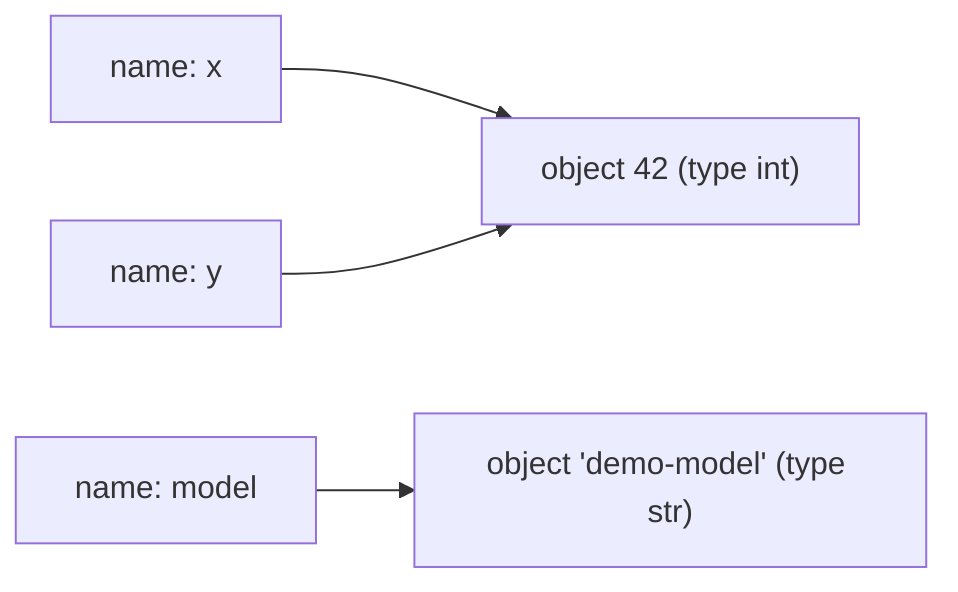

## 1. The question this idea answers

An AI application moves data all day. A model name is text. A token count is a whole number. A temperature is a decimal number. A missing field is "nothing". Each of these is a value, and Python treats each kind in a different way.

Many bugs in AI code come from one wrong belief about values:

- "Two names hold two copies." They can point to the same object, so a change through one name shows through the other.
- "`0.1 + 0.2` is `0.3`." On a computer it is `0.30000000000000004`.
- "`"5" + 1` gives 6." Python stops with a `TypeError`.
- "The text `"false"` is false." Any text that is not empty counts as true.

This lesson answers four questions. What is a value? What is a name? What is a type? How do you check if two names point to the same thing?

## 2. Mental model

> [!analogy] Boxes in a warehouse and labels on strings
> Think of memory as a warehouse. Each value is a box on a shelf. The box has a printed kind on its side: "whole number", "text", "list". A name is a paper label on a string. You tie the label to one box.
>
> - `x = 42` puts a box with 42 on a shelf and ties the label `x` to it.
> - `y = x` ties a second label `y` to the same box. It does not copy the box.
> - `x = 43` moves the label `x` to a new box. The label `y` stays on the old box.
>
> **Where it stops working:** a real box can hold only one label without help. In Python, one object can have any number of names. Also, you never see the shelf address. `id()` gives a number for the address, but you never use that number to reach the box.



## 3. Terms

| Term | Plain meaning |
|---|---|
| program | A text file of instructions that a computer follows. |
| interpreter | The program that reads Python code and runs it. The usual one is called CPython. |
| REPL | Read, Evaluate, Print, Loop. An interactive prompt (`>>>`) that runs one line at a time and shows the result. |
| value | One piece of data, for example `42` or `"hello"`. |
| object | The thing in memory that holds a value. Every value in Python is an object. |
| type | The kind of an object. It decides which operations work. `type(x)` gives it. |
| name (variable) | A label that points to one object. Assignment with `=` ties the label. |
| assignment | The statement `name = value`. It makes the name point to the object on the right. |
| identity | Which exact object a name points to. `a is b` is true when both names point to the same object. |
| equality | Whether two objects have the same value. `a == b` checks it. |
| `int` | A whole number of any size, for example `1024`. |
| `float` | A number with a decimal point, stored in binary with limited precision, for example `0.7`. |
| `str` | Text: a sequence of characters, for example `"demo-model"`. |
| `bool` | `True` or `False`. |
| `None` | The single object that means "no value". Its type is `NoneType`. |
| dynamic typing | A name has no fixed type. The object has the type, and a name can point to an object of any type. |
| f-string | A string with `f` before the quote. Expressions in `{}` are inserted, for example `f"{n} tokens"`. |
| immutable | An object that you cannot change after it exists. `int`, `float`, `str`, `bool` and `None` are immutable. |

## 4. How it works

All the outputs on this page come from a sandbox run on 2026-10-19 with Python 3.13.16. The browser lab runs Python 3.14 and gives the same results for this lesson.

### 4.1 A program, the interpreter and the REPL

A Python program is a text file, for example `main.py`. The interpreter reads the file from the top, line by line. CPython first compiles the text to bytecode, a compact list of steps. Then it runs the bytecode. You start it with a command such as `python main.py`, or `uv run main.py` in a uv project ([lesson 1.9](/notes/ai/ai-engineering/01-software-engineering-fundamentals/m01-python-foundations/l9-modules-packages-and-uv)).

The REPL is the interactive mode. You type one expression after `>>>`, and the REPL prints its value at once. A lab cell in the browser works in a similar way: the value of the last line of a cell is shown.

```text
>>> 1 + 2
3
>>> "ab" * 3
'ababab'
>>> type(3.5)
<class 'float'>
```

> [!note] Expression and statement
> An expression gives a value, for example `1 + 2`. A statement does an action, for example `x = 3` or `print(x)`. The REPL prints the value of an expression. It prints nothing for an assignment.

### 4.2 Every value is an object with a type

The settings of one model request show five common types:

```python
model = "demo-model"
max_tokens = 1024
temperature = 0.7
stream = True
stop_reason = None

for value in [model, max_tokens, temperature, stream, stop_reason]:
    print(repr(value), "->", type(value).__name__)
```

```text
'demo-model' -> str
1024 -> int
0.7 -> float
True -> bool
None -> NoneType
```

`repr(value)` shows a value the way you write it in code, with quotes around text. `type(value).__name__` gives the short name of the type.

The type decides what an operation does. `+` adds two numbers, but it joins two strings. `*` multiplies numbers, but `"ab" * 3` repeats text.

### 4.3 A name is a label, not a box

Assignment never copies an object. It ties a name to an object.

```python
a = [1, 2, 3]
b = a          # b is a second label on the same list
c = [1, 2, 3]  # c labels a new list with equal contents
print(a == b, a is b)
print(a == c, a is c)
b.append(4)
print(a)
print(id(a) == id(b), id(a) == id(c))
```

```text
True True
True False
[1, 2, 3, 4]
True False
```

Read the four lines of output:

1. `a == b` and `a is b` are both true. One list has two names.
2. `a == c` is true, because the contents are equal. `a is c` is false, because `c` is a different list.
3. `b.append(4)` changed the list. `a` shows the change, because `a` and `b` point to the same list.
4. `id()` returns a number that is unique for each object that exists at the same time. Equal ids mean the same object.

> [!key] `==` asks "same value?", `is` asks "same object?"
> Use `==` to compare values. Use `is` only to compare with a single special object, mostly `None`: write `if result is None`. Lesson 1.4 shows the bugs that come from two names on one list.

### 4.4 Dynamic typing: the object has the type, the name does not

```python
count = "5"
print(type(count).__name__)
try:
    total = count + 1
except TypeError as error:
    print("TypeError:", error)
total = int(count) + 1
print(total)
count = 5
print(type(count).__name__)
```

```text
str
TypeError: can only concatenate str (not "int") to str
6
int
```

Three facts come from this example:

1. A value from outside (an environment variable, a form field, a JSON string) is often text. `"5"` is a `str`, not an `int`.
2. Python does not change types for you. `"5" + 1` is an error, not `6` and not `"51"`.
3. `int(count)` makes a new `int` object from the text. You convert values on purpose.

The last two lines show dynamic typing. The name `count` first pointed to a `str`, then to an `int`. This is legal. Type annotations ([lesson 1.8](/notes/ai/ai-engineering/01-software-engineering-fundamentals/m01-python-foundations/l8-type-annotations-and-pydantic)) let a separate tool warn you about such changes before the program runs.

### 4.5 Numbers: int and float

```python
print(7 / 2, 7 // 2, 7 % 2)
print(-7 // 2, -7 % 2)
print(0.1 + 0.2)
print(0.1 + 0.2 == 0.3)
import math
print(math.isclose(0.1 + 0.2, 0.3))
print(2 ** 100)
print(int(3.99), int(-3.99), round(3.5), round(4.5))
```

```text
3.5 3 1
-4 1
0.30000000000000004
False
True
1267650600228229401496703205376
3 -3 4 4
```

| Expression | Result | Rule |
|---|---|---|
| `7 / 2` | `3.5` | `/` always gives a `float`. |
| `7 // 2` | `3` | `//` is floor division: it rounds down to the next whole number. |
| `-7 // 2` | `-4` | Rounding down goes away from zero for negative numbers. |
| `7 % 2` | `1` | `%` gives the remainder. |
| `0.1 + 0.2` | `0.30000000000000004` | A `float` stores a binary fraction. Most decimal fractions have no exact binary form. |
| `2 ** 100` | 31 digits | An `int` has no fixed size limit. |
| `int(3.99)` | `3` | `int()` cuts off the fraction. It does not round. |
| `round(4.5)` | `4` | `round()` sends a value that is exactly halfway to the even neighbor. |

> [!example] Worked example: the cost of one model call
> A call used 12,500 input tokens and 830 output tokens. The prices are USD 3.00 per million input tokens and USD 15.00 per million output tokens.
>
> 1. Input cost: 12,500 × 3.00 = 37,500 millionths of a dollar.
> 2. Output cost: 830 × 15.00 = 12,450 millionths of a dollar.
> 3. Total: (37,500 + 12,450) / 1,000,000 = 0.04995 dollars.
>
> ```python
> input_tokens = 12_500
> output_tokens = 830
> price_in_per_million = 3.00
> price_out_per_million = 15.00
>
> cost = (input_tokens * price_in_per_million
>         + output_tokens * price_out_per_million) / 1_000_000
> print(f"input={input_tokens:,} output={output_tokens:,} cost=USD {cost:.4f}")
> print(f"{cost=}")
> ```
>
> ```text
> input=12,500 output=830 cost=USD 0.0500
> cost=0.04995
> ```
>
> The underscore in `12_500` only helps you read the number. `{cost:.4f}` rounds to 4 decimal places for display. The stored value stays `0.04995`. `{cost=}` prints the name and the value, which helps when you debug.

> [!trap] Money and exact sums
> Use `float` for measurements and estimates. Never compare two floats with `==`. Use `math.isclose()`. For exact money totals in billing code, use the `decimal` module or count whole units (for example micro-dollars as an `int`).

### 4.6 Text: str

```python
key = "demo-key-0000-1111-2222"
print(len(key))
print(key[:4] + "..." + key[-4:])
header = "  Bearer abc123  "
print(repr(header.strip()))
print("user,assistant,tool".split(","))
print(" / ".join(["user", "assistant"]))
print("Hello".upper(), "hello" * 2)
try:
    key[0] = "X"
except TypeError as error:
    print("TypeError:", error)
```

```text
23
demo...2222
'Bearer abc123'
['user', 'assistant', 'tool']
user / assistant
HELLO hellohello
TypeError: 'str' object does not support item assignment
```

1. `len()` counts characters.
2. `key[:4]` is a slice: characters 0, 1, 2 and 3. `key[-4:]` is the last four characters. A negative index counts from the end.
3. `.strip()` removes spaces at both ends. Values from HTTP headers and files often have extra spaces or a newline.
4. `.split(",")` makes a list of parts. `" / ".join(...)` makes one string from a list.
5. A `str` is immutable. Methods such as `.upper()` return a new string. The old string does not change.

> [!trap] Never print a full secret
> An API key in a log line is a leak. Show at most a short prefix and suffix, as in line 2. Lesson 1.7 shows where keys live: in environment variables, not in code.

### 4.7 bool and truthiness

```python
print(bool(""), bool("false"), bool("0"), bool(0), bool(None), bool([]))
print(True + True, isinstance(True, int))
print(None == False, None is None)
```

```text
False True True False False False
2 True
False True
```

`bool(x)` tells how Python treats `x` in an `if`. These values count as false: `False`, `None`, `0`, `0.0`, the empty string `""`, and empty containers such as `[]` and `{}`. Every other value counts as true. This rule is called truthiness.

> [!trap] The text "false" is true
> An environment variable `STREAM=false` arrives as the string `"false"`. `bool("false")` is `True`, because the string is not empty. Compare the text instead: `os.environ.get("STREAM", "false").lower() == "true"`.

`bool` is a subtype of `int`, so `True + True` is `2`. Do not use this in real code. It only explains some strange results.

### 4.8 None: the value for "nothing"

A function that finds nothing often returns `None`.

```python
def find_model(name):
    if name == "demo-model":
        return {"max_tokens": 4096}

result = find_model("other-model")
print(result)
print(result is None)
```

```text
None
True
```

The function has no `return` for the second case. A function without a `return` gives `None` ([lesson 1.2](/notes/ai/ai-engineering/01-software-engineering-fundamentals/m01-python-foundations/l2-control-flow-and-functions)). There is only one `None` object in a program, so `is None` is the correct check. In LLM payloads, a JSON `null` becomes `None` in Python ([lesson 1.7](/notes/ai/ai-engineering/01-software-engineering-fundamentals/m01-python-foundations/l7-files-paths-env-and-json)).

### 4.9 Production view

| Situation | What goes wrong | What to do |
|---|---|---|
| Config from the environment | Every value is a `str`. `"2048"` is not `2048`. | Convert once at startup with `int(...)`. Fail with a clear message if it is not a number. |
| Cost and usage reports | Float sums drift by tiny amounts. | Round only for display. Store whole units for billing. |
| Flags such as `STREAM=false` | `bool("false")` is `True`. | Compare the text. Or use a settings library ([lesson 4.3](/notes/ai/ai-engineering/01-software-engineering-fundamentals/m04-fastapi-services/l3-dependencies-lifespan-config-and-middleware)). |
| Missing fields | Code treats `None` as a real value. | Check `is None` and decide what the default is. |
| Logs | A secret appears in a log line. | Show only a short prefix or nothing. |

## 5. Code walkthrough

The cost example of section 4.5 is the first real piece of AI-engineering code in this course. Read it line by line.

| Line | What it does | Data in | Data out | Without it |
|---|---|---|---|---|
| `input_tokens = 12_500` | Ties a name to an `int`. | the literal `12_500` | name `input_tokens` points to 12500 | no input count |
| `price_in_per_million = 3.00` | Ties a name to a `float`. | the literal `3.00` | a float 3.0 | no price |
| `cost = (... + ...) / 1_000_000` | Multiplies, adds, then divides. `/` makes a `float`. | four numbers | `0.04995` | no total |
| `print(f"... {cost:.4f}")` | Builds text with an f-string. `:,` adds thousands separators. `:.4f` shows 4 decimals. | the numbers | the line `input=12,500 output=830 cost=USD 0.0500` | no report |
| `print(f"{cost=}")` | Prints `cost=` and the full value. | `cost` | `cost=0.04995` | harder debugging |

The parentheses around the sum let the expression continue on the next line. Python joins lines inside open brackets.

## 6. Exercises

Runs in: browser lab. [Open a lab for this lesson](/labs/new?note=ai/ai-engineering/01-software-engineering-fundamentals/m01-python-foundations/l1-values-names-and-types)

Hints come in three levels in chat: idea, pseudocode, partial code.

**Exercise 1.1.1: describe values.** Write a function `describe(value)` that returns a string such as `"int: 1024"` or `"NoneType: None"`.

Acceptance tests:

- `describe(1024) == "int: 1024"`
- `describe("demo-model") == "str: 'demo-model'"` (the text keeps its quotes)
- `describe(None) == "NoneType: None"`
- `describe(True) == "bool: True"`

**Exercise 1.1.2: cost of a call.** Write `call_cost(input_tokens, output_tokens, price_in, price_out)` that returns the cost in dollars as a `float`. The prices are per million tokens.

Acceptance tests:

- `math.isclose(call_cost(12_500, 830, 3.0, 15.0), 0.04995)`
- `call_cost(0, 0, 3.0, 15.0) == 0`
- `math.isclose(call_cost(1_000_000, 1_000_000, 3.0, 15.0), 18.0)`

**Exercise 1.1.3: read a flag.** Write `read_flag(text)`. It turns `"true"`, `"True"`, `" yes "` and `"1"` into `True`. It turns `"false"`, `"0"` and `""` into `False`. Any other text raises `ValueError`.

Acceptance tests:

- `read_flag("false") is False` and `read_flag(" TRUE ") is True`
- `read_flag("") is False`
- `read_flag("maybe")` raises `ValueError`

**Exercise 1.1.4: predict, then run.** Before you run each line, write your prediction in a comment: `0.1 * 3 == 0.3`, `7 // -2`, `round(2.5)`, `int("  42 ")`, `"3" * 3`, `[] is []`, `None is None`. Then run the lines. Write one sentence for each line that you predicted wrong.

## 7. Common mistakes

1. **"Assignment copies."** `b = a` makes a second name for the same object. Lesson 1.4 shows the bugs.
2. **`is` for values.** `x is 1000` can be false even when `x == 1000`. Use `==` for values and `is` only for `None`.
3. **Float equality.** `0.1 + 0.2 == 0.3` is `False`. Use `math.isclose()`.
4. **Text from outside is text.** Environment variables, CLI arguments and form fields are `str`. Convert them.
5. **`bool("false")`.** It is `True`. Compare the text.
6. **`int()` rounds.** It does not. `int(3.99)` is `3`.
7. **Printing a secret.** Mask it, or do not print it.

## 8. One-minute explanation

Every piece of data in Python is an object, and every object has a type. The type decides what operations do: `+` adds numbers but joins strings. A name is only a label that points to an object. Assignment ties the label and never copies the object, so two names can point to one object. `==` compares values, and `is` compares identity, which you use mostly for `None`. Names have no fixed type, which is called dynamic typing. Python never converts types for you, so text from the environment must be converted on purpose. Floats store binary fractions, so `0.1 + 0.2` is not exactly `0.3`. Empty values count as false in an `if`, and every non-empty string, even `"false"`, counts as true.

## 9. Check questions

```check
{
  "question": "After `a = [1, 2]`, `b = a` and `b.append(3)`, what does `print(a)` show, and why?",
  "answer": "`[1, 2, 3]`. `b = a` did not copy the list. It tied a second name to the same list object, so the change through `b` is visible through `a`. `a is b` is `True`."
}
```

```check
{
  "question": "An app reads `MAX_TOKENS=2048` from the environment and computes `max_tokens + 100`. It crashes. What is the error, and what is the fix?",
  "hint": "What type does every environment variable have?",
  "answer": "Environment variables are strings, so `\"2048\" + 100` raises `TypeError: can only concatenate str (not \"int\") to str`. Convert once at startup: `max_tokens = int(os.environ[\"MAX_TOKENS\"])`, and fail with a clear message if the text is not a number."
}
```

```check
{
  "question": "Why is `0.1 + 0.2 == 0.3` false, and how do you compare two floats?",
  "answer": "A float stores a binary fraction with limited precision. 0.1 and 0.2 have no exact binary form, so their sum is `0.30000000000000004`. Compare with `math.isclose(a, b)`, which allows a tiny relative difference."
}
```

```check
{
  "question": "A flag arrives as the text `\"false\"`. The code says `if flag:` and runs the branch. Why?",
  "answer": "Truthiness: any non-empty string counts as true, and `\"false\"` has five characters. Only the empty string is false. Compare the text, for example `flag.strip().lower() == \"true\"`."
}
```

```check
{
  "question": "Which check is correct: `if result == None` or `if result is None`? Why?",
  "answer": "`if result is None`. There is exactly one `None` object, so the identity check is exact and fast. `==` can be changed by a class with its own `__eq__` method, so it can give a wrong answer for some objects."
}
```

## 10. Links

- Next: [1.2 Control flow and functions](/notes/ai/ai-engineering/01-software-engineering-fundamentals/m01-python-foundations/l2-control-flow-and-functions)
- Two names on one list, in depth: [1.4 Mutability, references and scope](/notes/ai/ai-engineering/01-software-engineering-fundamentals/m01-python-foundations/l4-mutability-references-and-scope)
- Converting text from files and the environment: [1.7 Files, paths, environment variables and JSON](/notes/ai/ai-engineering/01-software-engineering-fundamentals/m01-python-foundations/l7-files-paths-env-and-json)
- Telling a checker what type a name should have: [1.8 Type annotations, typed models and Pydantic](/notes/ai/ai-engineering/01-software-engineering-fundamentals/m01-python-foundations/l8-type-annotations-and-pydantic)
- Numbers in memory for models (FP32, BF16): [Numbers in memory](/notes/ai/llm-systems/01-math-and-hardware/l4-numbers-in-memory)
- [Module M1](/notes/ai/ai-engineering/01-software-engineering-fundamentals/m01-python-foundations) and the [glossary](/notes/ai/ai-engineering/glossary)
