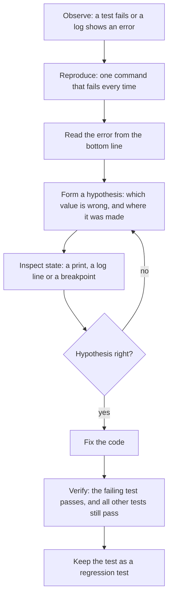

## 1. The question this idea answers

A coding agent writes a function in ten seconds. It looks right. Is it right?

You cannot answer that by reading alone. Code that looks right can lose the last item of a list, round money wrongly or fail on empty input. You need three skills:

1. **Tests:** small programs that call your code with known inputs and check the outputs. They answer "does it work?" every time you change something.
2. **Logging:** lines that a running program writes about what it does. They answer "what happened?" after a problem in production.
3. **Debugging:** stopping a program in the middle and reading its variables. It answers "why does it do that?" when a test fails.

The roadmap says it plainly: you need these to verify code that you, or an agent, did not fully write ([8.1](/notes/ai/ai-engineering/01-software-engineering-fundamentals/m08-ai-assisted-development/l1-from-autocomplete-to-agents)).

## 2. Mental model

> [!analogy] A factory with quality checks, a flight recorder and a pause button
> - A **test** is a quality check at the end of the line. A known part goes in, and the inspector compares the result with the drawing. A failed check stops the line before the product reaches a customer.
> - A **log** is the flight recorder. It writes short facts while the machine runs. After a crash, you read the recorder, not your memory.
> - A **debugger** is the pause button on the line. You stop the machine at one station and measure each part on it.
>
> **Where it stops working:** a factory check tests every product. A test checks only the inputs that you wrote. A function can pass 100 tests and fail on input number 101. Choose test inputs with care: normal cases, edge cases and bad input.

## 3. Terms

| Term | Plain meaning |
|---|---|
| test | A function that calls your code with a known input and checks the output. |
| assertion | A statement that must be true: `assert result == 113.0`. If it is false, the test fails. |
| pytest | The most common Python test tool. It finds tests, runs them and reports failures. |
| test discovery | How pytest finds tests: by default, files named `test_*.py` or `*_test.py`, functions named `test*`, and `test*` methods in classes named `Test*`. |
| fixture | A function that prepares something a test needs, for example a temporary file. pytest gives it to the test by name. |
| `tmp_path` | A built-in pytest fixture: a new, empty temporary folder for each test. |
| parametrize | Run one test function with several sets of inputs. |
| `pytest.raises` | Checks that a block raises a given exception. |
| edge case | An input at the limit of what the code handles: empty, zero, one item, very large. |
| regression test | A test that you add after a bug, so the same bug cannot come back silently. |
| log record | One event that the program writes: a time, a level, a source and a message. |
| log level | How important a log record is: DEBUG, INFO, WARNING, ERROR, CRITICAL. |
| logger | A named object that makes log records, usually one per module: `logging.getLogger(__name__)`. |
| debugger | A tool that stops a running program and lets you read and step through it. |
| pdb | The debugger in the Python standard library. |
| breakpoint | A place where the debugger stops the program. `breakpoint()` makes one. |

## 4. How it works

### 4.1 A first test

A test is a normal function with an `assert`. pytest finds it by its name and runs it.

```python
# src/pricing/__init__.py
def with_tax(amount: float, rate: float = 0.13) -> float:
    """Return the amount with tax, rounded to cents."""
    if amount < 0:
        raise ValueError("amount must not be negative")
    return round(amount * (1 + rate), 2)
```

```python
# tests/test_pricing.py
from pricing import with_tax

def test_with_tax_adds_13_percent():
    assert with_tax(100) == 113.0
```

The project tells pytest where the code is, in `pyproject.toml`:

```toml
[tool.pytest.ini_options]
pythonpath = ["src"]
```

Run `uv run pytest` in the project folder ([1.9](/notes/ai/ai-engineering/01-software-engineering-fundamentals/m01-python-foundations/l9-modules-packages-and-uv)). pytest then does four things:

1. It searches the project for files named `test_*.py` or `*_test.py`.
2. In each file, it collects every function whose name starts with `test`, and every `test` method of a class whose name starts with `Test`.
3. It runs each function. A function that ends without an error passes. A failed `assert` or an unexpected exception fails it.
4. It prints one character per test (`.` pass, `F` fail) and then the details of every failure.

### 4.2 Three tools inside pytest

**parametrize** runs one test with a table of inputs:

```python
@pytest.mark.parametrize(
    ("amount", "expected"),
    [(0, 0.0), (10, 11.3), (19.99, 22.59)],
)
def test_with_tax_table(amount, expected):
    assert with_tax(amount) == expected
```

**`pytest.raises`** checks that bad input fails in the right way:

```python
def test_negative_amount_is_rejected():
    with pytest.raises(ValueError, match="negative"):
        with_tax(-1)
```

**A fixture** prepares data for a test. `tmp_path` is a built-in fixture: a new empty folder for each test.

```python
@pytest.fixture
def prices_file(tmp_path):
    path = tmp_path / "prices.json"
    path.write_text(json.dumps({"a": 10, "b": 20}), encoding="utf-8")
    return path


def test_prices_from_file(prices_file):
    prices = json.loads(prices_file.read_text(encoding="utf-8"))
    assert [with_tax(v) for v in prices.values()] == [11.3, 22.6]
```

The test asks for `prices_file` by naming it as a parameter. pytest runs the fixture first and passes its return value in. The test never writes into your real folders.

### 4.3 A test finds a bug that reading missed

Here is a helper that an agent wrote. It splits a list into chunks, for example to send rows to an API in batches:

```python
def chunk(items: list[str], size: int) -> list[list[str]]:
    """Split items into lists of at most `size` items (an agent wrote this)."""
    return [items[i:i + size] for i in range(0, len(items) - size, size)]
```

It reads like correct code. A test with 5 items and size 2 disagrees:

```python
def test_chunk_keeps_every_item():
    items = ["a", "b", "c", "d", "e"]
    assert chunk(items, 2) == [["a", "b"], ["c", "d"], ["e"]]
```

The sandbox ran the whole file with pytest 9.1.1 on Python 3.13.16:

```text
......F                                                                  [100%]
=================================== FAILURES ===================================
_________________________ test_chunk_keeps_every_item __________________________

    def test_chunk_keeps_every_item():
        items = ["a", "b", "c", "d", "e"]
>       assert chunk(items, 2) == [["a", "b"], ["c", "d"], ["e"]]
E       AssertionError: assert [['a', 'b'], ['c', 'd']] == [['a', 'b'], ..., 'd'], ['e']]
E         
E         Right contains one more item: ['e']
E         Use -v to get more diff

tests/test_pricing.py:39: AssertionError
=========================== short test summary info ============================
FAILED tests/test_pricing.py::test_chunk_keeps_every_item - AssertionError: a...
1 failed, 6 passed in 0.06s
```

> [!example] Worked example: read the failure
> 1. `......F`: six tests passed, the seventh failed.
> 2. The `>` line shows the failed assertion.
> 3. The `E` lines show both sides. The left side is what `chunk` returned: `[['a', 'b'], ['c', 'd']]`. The right side is what the test expected.
> 4. "Right contains one more item: ['e']". The last chunk is missing.
> 5. The cause: `range(0, len(items) - size, size)` is `range(0, 3, 2)`, which gives the starts 0 and 2. The start 4 is missing. The correct range is `range(0, len(items), size)`, which gives 0, 2 and 4.
>
> After the fix, `pytest -v` listed each test by name, and all 7 passed. Part of the output:
>
> ```text
> tests/test_pricing.py::test_with_tax_table[0-0.0] PASSED                 [ 28%]
> tests/test_pricing.py::test_with_tax_table[10-11.3] PASSED               [ 42%]
> tests/test_pricing.py::test_with_tax_table[19.99-22.59] PASSED           [ 57%]
> tests/test_pricing.py::test_chunk_keeps_every_item PASSED                [100%]
> ============================== 7 passed in 0.03s ===============================
> ```

pytest rewrites `assert` statements so that a failure shows both values. You do not need special methods such as `assertEqual`. A plain `assert` gives a detailed report.

### 4.4 Which inputs to test

A test is only as good as its inputs. For each function, write tests in four groups:

| Group | Example for `chunk(items, size)` | Why |
|---|---|---|
| Normal case | 6 items, size 2 | The main use |
| Edge cases | 0 items, 1 item, a length that is not a multiple of `size`, `size` larger than the list | Off-by-one bugs live here. The bug of section 4.3 was one. |
| Bad input | `size = 0`, a negative size | The function must fail clearly, not loop forever or return nonsense |
| A known bug | the 5-items case after the fix | A regression test keeps the bug from coming back |

> [!key] Test behavior, not the code line by line
> A good test says what the function must do, in terms of input and output. It does not copy the implementation. If the expected value comes from the same formula as the code, the test cannot find a bug in the formula. Compute expected values by hand or from a trusted source.

### 4.5 Logging: one useful line per event

`print` writes to the screen with no time, no level and no source. In a service, use the `logging` module.

```python
import logging
import time

logging.basicConfig(
    level=logging.INFO,
    format="%(asctime)s %(levelname)s %(name)s %(message)s",
    datefmt="%H:%M:%S",
)
logger = logging.getLogger("orders_api.routes")

logger.debug("not shown: DEBUG is below INFO")
start = time.perf_counter()
time.sleep(0.05)
logger.info("method=%s path=%s status=%d duration_ms=%.0f", "GET", "/orders/7", 200, (time.perf_counter() - start) * 1000)
logger.warning("slow model call: %.1f s", 12.3)
try:
    {}["model"]
except KeyError:
    logger.exception("config is missing a key")
api_key = "sk-not-a-real-key"
logger.info("API key present: %s", bool(api_key))
```

```text
14:29:40 INFO orders_api.routes method=GET path=/orders/7 status=200 duration_ms=50
14:29:40 WARNING orders_api.routes slow model call: 12.3 s
14:29:40 ERROR orders_api.routes config is missing a key
Traceback (most recent call last):
  File "log_a.py", line 17, in <module>
    {}["model"]
    ~~^^^^^^^^^
KeyError: 'model'
14:29:40 INFO orders_api.routes API key present: True
```

| Detail in the output | Lesson |
|---|---|
| The DEBUG line is absent | The level is INFO, so DEBUG records are dropped. Change the level, not the code, to see more. |
| Each line has a time, a level and a logger name | You can filter by level and by module in a log tool. |
| `method=... path=... status=... duration_ms=...` | One line per request, with `key=value` fields. The capstone requires exactly this ([10.1](/notes/ai/ai-engineering/01-software-engineering-fundamentals/m10-capstone/l1-capstone-spec-and-checklist)). |
| `logger.exception` added the traceback | Use it inside `except`. It logs at ERROR level and appends the traceback. |
| `API key present: True` | Log that a secret exists, never its value ([1.7](/notes/ai/ai-engineering/01-software-engineering-fundamentals/m01-python-foundations/l7-files-paths-env-and-json)). |

| Level | Use it for | Example |
|---|---|---|
| DEBUG | Details for a developer | "tool arguments: {...}" |
| INFO | Normal events | one line per request, "agent run finished" |
| WARNING | Something odd that did not fail | a retry, a slow call |
| ERROR | A failure of one operation | a request that returned 500 |
| CRITICAL | The service cannot continue | no database at start |

Write `logger.info("status=%d", code)` with `%` placeholders and separate arguments. The logging module builds the text only if the record passes the level. An f-string builds the text every time, also for dropped DEBUG records.

### 4.6 Stop the program with a debugger

When a test fails and the reason is not clear, stop the program and read its state. `breakpoint()` starts pdb at that line.

```python
def average_latency(samples):
    total = 0
    for s in samples:
        total += s["ms"]
    breakpoint()
    return total / len(samples)

print(average_latency([{"ms": 120}, {"ms": 80}]))
```

The sandbox sent the commands `p total`, `p len(samples)`, `p samples[0]`, `l`, `n` and `c` to pdb:

```text
> dbg.py(5)average_latency()
-> breakpoint()
(Pdb) 200
(Pdb) 2
(Pdb) {'ms': 120}
(Pdb)   1  	def average_latency(samples):
  2  	    total = 0
  3  	    for s in samples:
  4  	        total += s["ms"]
  5  ->	    breakpoint()
  6  	    return total / len(samples)
  7  	
  8  	print(average_latency([{"ms": 120}, {"ms": 80}]))
[EOF]
(Pdb) > dbg.py(6)average_latency()
-> return total / len(samples)
(Pdb) 100.0
```

| Command | Does |
|---|---|
| `p expr` | Prints the value of an expression |
| `l` | Lists the code around the current line (`->` marks it) |
| `n` | Runs the current line and stops at the next line in this function |
| `s` | Steps into a function call on the current line |
| `c` | Continues until the next breakpoint or the end |
| `w` | Prints the stack of calls (where you are) |
| `q` | Quits the program |

With the environment variable `PYTHONBREAKPOINT=0`, every `breakpoint()` call does nothing. The same program then printed only `100.0`. Never commit a `breakpoint()` line. With an open terminal, it stops the process and waits for input. In a CI job, stdin is often closed. Then pdb reads the end of input and raises `bdb.BdbQuit`. The job fails with exit code 1. A sandbox run with `python bp.py < /dev/null` showed `(Pdb)`, then `bdb.BdbQuit`, and exit code 1. So the line hangs or crashes the process. Editors such as VS Code give the same controls with a click: set a breakpoint in the margin, then run the test in debug mode.

### 4.7 The debugging method



The order matters. A fix without a reproduction is a guess. A fix without the verification step can break something else.

### 4.8 Verify code that you did not write

An agent can write code faster than you can read it. Your job moves from writing to verifying. Use this checklist for every change:

1. **Read the diff**, not only the summary of the agent ([7.1](/notes/ai/ai-engineering/01-software-engineering-fundamentals/m07-git/l1-repositories-commits-and-branches)).
2. **Ask "what are the edge cases?"** for every new function. Write tests for them yourself, or check that the agent's tests cover them.
3. **Run the tests.** A green run of tests that the agent wrote for its own code is weak evidence. Add at least one test with an expected value that you computed by hand.
4. **Run the type checker** ([1.8](/notes/ai/ai-engineering/01-software-engineering-fundamentals/m01-python-foundations/l8-type-annotations-and-pydantic)) and the linter.
5. **Check the logs** of one real run. Every request has its line, and no line holds a secret.
6. **Explain the code in your own words.** If you cannot, it is not done.

## 5. Code walkthrough

The test file of section 4.3, read line by line:

```python
import json

import pytest                                   # 1

from pricing import chunk, with_tax             # 2


@pytest.mark.parametrize(                       # 3
    ("amount", "expected"),
    [(0, 0.0), (10, 11.3), (19.99, 22.59)],
)
def test_with_tax_table(amount, expected):
    assert with_tax(amount) == expected         # 4


def test_negative_amount_is_rejected():
    with pytest.raises(ValueError, match="negative"):   # 5
        with_tax(-1)


@pytest.fixture
def prices_file(tmp_path):                      # 6
    path = tmp_path / "prices.json"
    path.write_text(json.dumps({"a": 10, "b": 20}), encoding="utf-8")
    return path


def test_prices_from_file(prices_file):         # 7
    prices = json.loads(prices_file.read_text(encoding="utf-8"))
    assert [with_tax(v) for v in prices.values()] == [11.3, 22.6]
```

| Mark | What it does | Why | Without it |
|---|---|---|---|
| 1 | Imports pytest for its decorators and helpers | `parametrize`, `raises` and `fixture` come from it | Plain `assert` tests still work, but without these tools |
| 2 | Imports the code under test by its package name | `pythonpath = ["src"]` lets pytest find the `src` layout | `ModuleNotFoundError: No module named 'pricing'` |
| 3 | One test, three input rows | Each row is reported as its own test, for example `[19.99-22.59]` | Three copies of the same test function |
| 4 | The assertion | pytest shows both sides when it fails | |
| 5 | The block must raise `ValueError` with "negative" in its message | It tests the error path, not only the happy path | A bug that accepts negative amounts goes unnoticed |
| 6 | A fixture that writes a temporary JSON file | Each test gets its own fresh folder, so tests cannot affect each other | Tests write into real folders and leave files behind |
| 7 | The test names the fixture as a parameter | pytest calls the fixture and passes the path in | |

The expected values were computed by hand:

- 10 × 1.13 = 11.3
- 19.99 × 1.13 = 22.5887, which rounds to 22.59
- 20 × 1.13 = 22.6

## 6. Exercises

Runs in: your local practice project (pytest and pdb need a terminal). Use `uv add --dev pytest`.

**Exercise 10.1: test the chunk helper.** Write tests for `chunk(items, size)` in the four groups of section 4.4. Use the buggy version of section 4.3 first.

Acceptance tests:

- At least one of your tests fails on the buggy version.
- On the fixed version, every test passes.
- `chunk([], 3)` returns `[]`, and `chunk(items, 0)` raises `ValueError` (change the function to make this true).
- Use `parametrize` for the normal and edge cases.

**Exercise 10.2: a request log line.** Write a function `handle(path: str) -> int`. It pretends to serve a request: it waits a random 10 to 50 ms and returns a status code.

Acceptance tests:

- Each call writes exactly one INFO line with `method`, `path`, `status` and `duration_ms`.
- With the level set to WARNING, no line appears for status 200.
- A status 500 path writes an ERROR line with a traceback from `logger.exception`.
- A test captures the log with pytest's built-in `caplog` fixture and checks the fields.

**Exercise 10.3: debug a wrong average.** Make `average_latency` return a wrong value on purpose (for example, divide by a wrong count). Find the bug only with `breakpoint()`, `p`, `n` and `w`.

Acceptance test: write down the pdb commands that you used and the value that showed the bug. Then add a regression test that fails on the bug.

Hints come in three levels in chat: idea, pseudocode, partial code.

## 7. Common mistakes

1. **Only happy-path tests.** Most bugs live at the edges: empty input, one item, the last item, zero.
2. **Expected values from the same formula as the code.** The test then repeats the bug. Compute expected values by hand.
3. **Trusting a green run of the agent's own tests.** Add tests with values that you checked yourself.
4. **Tests that write into real folders or call real APIs.** They are slow, they fail without network and they leave state behind. Use `tmp_path` and fakes ([3.5](/notes/ai/ai-engineering/01-software-engineering-fundamentals/m03-http-rest-json/l5-inspecting-apis-with-curl-and-httpx)).
5. **`print` instead of `logging` in a service.** No time, no level, no filter.
6. **Secrets or full prompts in logs.** Log presence, sizes and ids, not values.
7. **f-strings in log calls at DEBUG level.** The text is built even when the record is dropped. Use `%` placeholders.
8. **A committed `breakpoint()`.** It hangs the process, or crashes it with `bdb.BdbQuit` when stdin is closed.
9. **Fixing before reproducing.** Without a failing test, you cannot prove that the fix works.

## 8. One-minute explanation

A test is a function that calls your code with a known input and asserts the expected output. pytest finds files named `test_*.py` or `*_test.py` and functions named `test*`, runs them and shows both sides of every failed `assert`. `parametrize` runs one test with many inputs, `pytest.raises` checks error paths, and fixtures such as `tmp_path` prepare clean data for each test. Good tests cover normal cases, edge cases, bad input and every bug that you fixed, with expected values computed by hand. Logging writes one record per event with a time, a level and a logger name. Use one INFO line per request with method, path, status and duration, `logger.exception` inside `except`, and never a secret. When a test fails and the reason is unclear, `breakpoint()` stops the program in pdb. There, `p`, `l`, `n`, `s` and `c` let you read the state and step through the code. Debug in order: observe, reproduce, read the error, form a hypothesis, inspect, fix and verify. These skills turn agent-written code from "looks right" into "proved to work".

## 9. Check questions

```check
{
  "question": "chunk(items, size) uses range(0, len(items) - size, size). For 7 items and size 3, which start indexes does it produce, which items are lost, and what is the correct range?",
  "hint": "Write out range(0, 4, 3).",
  "answer": "range(0, 7 - 3, 3) = range(0, 4, 3) gives 0 and 3. The chunks are items[0:3] and items[3:6]. Item 6 (the seventh item) is lost. The correct range is range(0, len(items), size) = range(0, 7, 3), which gives 0, 3 and 6."
}
```

```check
{
  "question": "An agent wrote with_tax and also a test: assert with_tax(19.99) == round(19.99 * 1.13, 2). Why is this a weak test, and how do you make it strong?",
  "answer": "The expected value uses the same formula as the code, so a wrong formula (for example a wrong rate or a missing round) would appear on both sides and the test would still pass. Compute the expected value independently, by hand: 19.99 × 1.13 = 22.5887, which rounds to 22.59. Write assert with_tax(19.99) == 22.59, and add edge cases such as 0 and a negative amount."
}
```

```check
{
  "question": "Your service logs with level INFO. A developer adds logger.debug(f\"prompt={prompt}\") in a hot path. Name two problems with this line.",
  "answer": "1. The f-string builds the full text on every call, even though DEBUG records are dropped at INFO level, so it wastes time on large prompts. Use logger.debug(\"prompt=%s\", prompt), or log only its length. 2. A full prompt can hold user data or secrets. If someone switches the level to DEBUG, the logs then hold that data. Log ids and sizes instead of contents."
}
```

```check
{
  "question": "A program stops at breakpoint(). Which pdb command shows the value of a variable, which one runs the current line and stops at the next one, and why must breakpoint() never reach production?",
  "answer": "p name prints the value. n runs the current line and stops at the next line of the same function. In production nobody types commands, so a breakpoint() call stops the server process: it waits for input if a terminal is attached, or raises bdb.BdbQuit and crashes if stdin is closed. (PYTHONBREAKPOINT=0 turns breakpoint() off, but the line should not be committed at all.)"
}
```

## 10. Links

- Previous: [1.9 Modules, packages and uv projects](/notes/ai/ai-engineering/01-software-engineering-fundamentals/m01-python-foundations/l9-modules-packages-and-uv)
- Next module: [M2 Callbacks, threads, generators and asyncio](/notes/ai/ai-engineering/01-software-engineering-fundamentals/m02-concurrency-foundations)
- Deeper pytest: [pytest fixtures and monkeypatch](/notes/software-engineering/python/03-tooling/l2-pytest-fixtures-and-monkeypatch)
- Reading a traceback: [1.6 Exceptions and context managers](/notes/ai/ai-engineering/01-software-engineering-fundamentals/m01-python-foundations/l6-exceptions-and-context-managers)
- Testing HTTP code without a network: [3.5 Inspecting APIs with curl and httpx](/notes/ai/ai-engineering/01-software-engineering-fundamentals/m03-http-rest-json/l5-inspecting-apis-with-curl-and-httpx)
- The verification loop with an agent: [8.1 From autocomplete to coding agents](/notes/ai/ai-engineering/01-software-engineering-fundamentals/m08-ai-assisted-development/l1-from-autocomplete-to-agents)
- Source: pytest documentation: https://docs.pytest.org
- Source: Python docs, Logging HOWTO: https://docs.python.org/3/howto/logging.html
- Source: Python docs, `pdb`: https://docs.python.org/3/library/pdb.html
- [Glossary](/notes/ai/ai-engineering/glossary)
