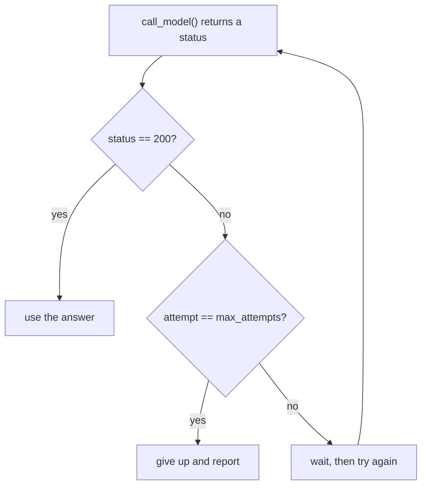
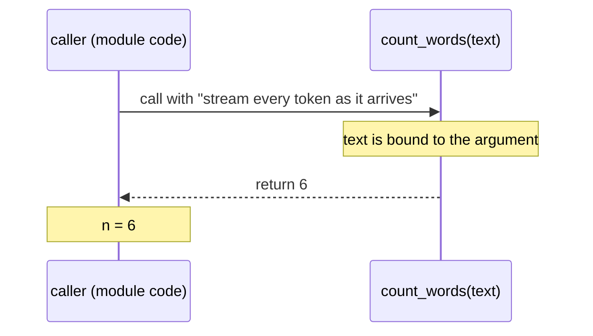

## 1. The question this idea answers

A program that runs every line once, from top to bottom, can do very little. Real AI code must make choices and repeat work:

- If the API returns status 429, wait and try again. If it returns 200, continue.
- For each message in a conversation, count its tokens.
- While the model asks for a tool, run the tool and call the model again.

Real code also uses the same steps in many places. A request to a model is built the same way every time, so you write the steps once and give them a name.

This lesson answers two questions. How does a program choose and repeat? How does a function take inputs and give back a result?

## 2. Mental model

> [!analogy] A recipe card with steps and sub-recipes
> A program is a recipe card. Control flow is the set of rules about the steps. Examples: "if the dough is dry, add water", "stir 10 times", "bake while the top is pale". A function is a sub-recipe on its own card, such as "make the sauce". The main recipe says "make the sauce with 2 tomatoes". You go to the sauce card, follow it with those tomatoes, and come back with the sauce.
>
> **Where it stops working:** a cook can do two sub-recipes at once. A normal Python function call stops the caller until the function returns. Module 2 shows threads and `async` code, where work can overlap.



## 3. Terms

| Term | Plain meaning |
|---|---|
| control flow | The order in which lines run. `if`, `for` and `while` change it. |
| condition | An expression that Python treats as true or false. |
| `if` / `elif` / `else` | Run one block of lines when a condition is true, another block otherwise. |
| block | Lines with the same indentation under a statement that ends with `:`. Indentation is part of the syntax. |
| comparison operators | `==`, `!=`, `<`, `<=`, `>`, `>=`. Each gives a `bool`. |
| boolean operators | `and`, `or`, `not`. They combine conditions. |
| short-circuit | `and` and `or` stop as soon as they know the answer. The right side may not run. |
| loop | A block that runs again and again. |
| `for` loop | Runs the block once for each item of a sequence. |
| `while` loop | Runs the block while a condition is true. |
| `break` / `continue` | `break` leaves the loop. `continue` goes to the next round of the loop. |
| `range(start, stop, step)` | A sequence of whole numbers from `start` up to, not including, `stop`. |
| function | A named block of code that runs when you call it. |
| `def` | The statement that makes a function. |
| parameter | A name in the function definition, for example `text` in `def count_words(text)`. |
| argument | The value that you give in a call, for example `"hi"` in `count_words("hi")`. |
| `return` | Ends the function and gives a value back to the caller. |
| default value | A value that a parameter gets when the call gives no argument for it. |
| keyword argument | An argument given with its name, for example `max_tokens=200`. |
| keyword-only parameter | A parameter after `*` in the definition. A call must give it by name. |
| `*args` | Collects extra positional arguments into a tuple. |
| `**kwargs` | Collects extra keyword arguments into a dict. |
| docstring | A string as the first line of a function. It describes the function. `help()` shows it. |

## 4. How it works

All the outputs on this page come from a sandbox run on 2026-10-19 with Python 3.13.16.

### 4.1 Choices with if, elif and else

```python
def status_family(code):
    if 200 <= code < 300:
        return "success"
    elif 400 <= code < 500:
        return "client error"
    elif 500 <= code < 600:
        return "server error"
    else:
        return "other"

for code in [200, 201, 404, 429, 503, 302]:
    print(code, status_family(code))
```

```text
200 success
201 success
404 client error
429 client error
503 server error
302 other
```

Python tests the conditions from the top. The first true condition wins, and Python skips the other branches. `200 <= code < 300` is a chained comparison. It means `200 <= code and code < 300`.

> [!key] Indentation is syntax
> The lines under `if ...:` belong to the `if` because they have more indentation. Use 4 spaces. A wrong indent changes which lines run, or Python stops with an `IndentationError`.

### 4.2 and, or and short-circuit evaluation

```python
def expensive():
    print("expensive() ran")
    return True

print(False and expensive())
print(True or expensive())
print(True and expensive())
name = "" or "default-model"
print(name)
temperature = 0 or 0.7
print(temperature)
user_temperature = 0
temperature = 0.7 if user_temperature is None else user_temperature
print(temperature)
```

```text
False
True
expensive() ran
True
default-model
0.7
0
```

1. `False and ...` is false whatever the right side is, so `expensive()` did not run.
2. `True or ...` is true whatever the right side is, so `expensive()` did not run.
3. `True and expensive()` needs the right side, so it ran.
4. `or` returns the first true value, or the last value. `"" or "default-model"` gives `"default-model"`.

> [!trap] `x or default` replaces a valid zero
> A user sets `temperature = 0`, which is a valid value. `0 or 0.7` gives `0.7`, because `0` counts as false. The user's choice is lost without an error. Write `0.7 if user_temperature is None else user_temperature`. This is a conditional expression: `A if condition else B`.

### 4.3 for loops, range, continue

A `for` loop takes one item at a time from a sequence.

```python
messages = ["hi", "", "   ", "what is SSE?"]
for text in messages:
    if not text.strip():
        continue
    print("send:", text)
print(list(range(5)), list(range(2, 10, 3)))
```

```text
send: hi
send: what is SSE?
[0, 1, 2, 3, 4] [2, 5, 8]
```

`text.strip()` removes spaces. An empty result counts as false, so `not text.strip()` is true for empty and blank messages. `continue` skips the rest of the block for that item. `range(5)` gives 0 to 4. The stop value 5 is not included. `range(2, 10, 3)` starts at 2 and goes up in steps of 3.

### 4.4 while loops and a retry loop

A `while` loop runs while its condition is true. `while True` runs until a `break`. A retry loop is the classic use in AI code, because model APIs often return 429 (rate limit) or 503 (overloaded) for a short time.

```python
replies = iter([503, 429, 200])

def call_api():
    return next(replies)

attempt = 0
max_attempts = 5
while True:
    attempt += 1
    status = call_api()
    print(f"attempt {attempt}: status {status}")
    if status == 200:
        print("done")
        break
    if attempt == max_attempts:
        print("giving up")
        break
```

```text
attempt 1: status 503
attempt 2: status 429
attempt 3: status 200
done
```

`call_api` here is a fake. It returns the next status from a fixed list, so the output is the same on every run. `iter()` and `next()` are explained in [lesson 1.3](/notes/ai/ai-engineering/01-software-engineering-fundamentals/m01-python-foundations/l3-core-data-structures). `attempt += 1` is short for `attempt = attempt + 1`.

> [!trap] Every loop needs an exit
> A `while True` loop without a limit runs forever when the API never recovers. The `max_attempts` check is the exit. A real retry loop also waits between attempts, and waits longer each time. [Lesson 3.2](/notes/ai/ai-engineering/01-software-engineering-fundamentals/m03-http-rest-json/l2-methods-status-codes-and-retries) explains backoff and which requests are safe to repeat.

A `for` loop can have an `else` block. The `else` block runs only when the loop ends without `break`:

```python
def call_api():
    return 503

for attempt in range(1, 4):
    status = call_api()
    print(f"attempt {attempt}: status {status}")
    if status == 200:
        break
else:
    print("no attempt succeeded")
```

```text
attempt 1: status 503
attempt 2: status 503
attempt 3: status 503
no attempt succeeded
```

### 4.5 Functions: def, parameters, return

```python
def count_words(text):
    return len(text.split())

def log_line(text):
    print("LOG:", text)

n = count_words("stream every token as it arrives")
r = log_line("started")
print(n, r)
```

```text
LOG: started
6 None
```

When Python runs a call such as `count_words("...")`, four steps happen:

1. Python evaluates the arguments. Here the argument is a string.
2. It makes a new local namespace for the call and binds the parameter `text` to the argument.
3. It runs the function body.
4. `return` ends the call and gives the value to the caller. A function with no `return` gives `None`.

`log_line` printed a line but returned nothing, so `r` is `None`. Printing is not returning. A test can check a returned value. It cannot easily check a printed line.



### 4.6 Default values, keyword arguments and keyword-only parameters

A function that builds a model request has two required inputs and many optional ones.

```python
def build_request(model, messages, *, max_tokens=1024, temperature=1.0, **extra):
    """Return a request dict for a chat API."""
    request = {"model": model, "messages": messages,
               "max_tokens": max_tokens, "temperature": temperature}
    request.update(extra)
    return request

print(build_request("demo-model", [{"role": "user", "content": "hi"}]))
print(build_request("demo-model", [], max_tokens=200, stream=True))
try:
    build_request("demo-model", [], 200)
except TypeError as error:
    print("TypeError:", error)
print(build_request.__doc__)
```

```text
{'model': 'demo-model', 'messages': [{'role': 'user', 'content': 'hi'}], 'max_tokens': 1024, 'temperature': 1.0}
{'model': 'demo-model', 'messages': [], 'max_tokens': 200, 'temperature': 1.0, 'stream': True}
TypeError: build_request() takes 2 positional arguments but 3 were given
Return a request dict for a chat API.
```

| Part of the definition | Meaning |
|---|---|
| `model, messages` | Required. The call gives them by position or by name. |
| `*` | Every parameter after it is keyword-only. |
| `max_tokens=1024` | Keyword-only, with a default value. |
| `**extra` | Collects every other keyword argument, here `stream=True`, into a dict. |

The bare `*` stops a common bug. A call `build_request("demo-model", [], 200)` is unclear: is 200 the token limit or the temperature? Python refuses it with a `TypeError`. The caller must write `max_tokens=200`.

> [!trap] A mutable default value
> Never write `def f(history=[])`. Python makes the default list once, when it runs the `def`, and every call shares it. [Lesson 1.4](/notes/ai/ai-engineering/01-software-engineering-fundamentals/m01-python-foundations/l4-mutability-references-and-scope) shows the bug and the fix.

### 4.7 *args and **kwargs, in calls and in definitions

```python
def total_tokens(*counts):
    print("counts is", counts)
    return sum(counts)

print(total_tokens(120, 30, 7))
print(total_tokens())
usage = [512, 41]
print(total_tokens(*usage))
options = {"max_tokens": 50, "stop": ["\n\n"]}
def show(**kwargs):
    print("kwargs is", kwargs)
show(**options)
```

```text
counts is (120, 30, 7)
157
counts is ()
0
counts is (512, 41)
553
kwargs is {'max_tokens': 50, 'stop': ['\n\n']}
```

The star has two jobs:

- In a **definition**, `*counts` collects extra positional arguments into a tuple. `**kwargs` collects extra keyword arguments into a dict.
- In a **call**, `*usage` spreads a list into separate positional arguments. `**options` spreads a dict into keyword arguments.

SDKs use `**kwargs` a lot. `client.create(**request)` sends every key of a dict as a keyword argument.

### 4.8 Returning more than one value

```python
def split_usage(usage):
    return usage["input_tokens"], usage["output_tokens"]

inp, out = split_usage({"input_tokens": 512, "output_tokens": 41})
print(inp, out, type(split_usage({"input_tokens": 1, "output_tokens": 2})).__name__)
```

```text
512 41 tuple
```

`return a, b` returns one tuple. `inp, out = ...` unpacks it into two names ([lesson 1.3](/notes/ai/ai-engineering/01-software-engineering-fundamentals/m01-python-foundations/l3-core-data-structures)).

### 4.9 Production view

| Concern | Rule |
|---|---|
| Retries | Every retry loop has a maximum count, a wait between attempts and a log line per attempt. |
| Optional settings | Use keyword-only parameters for options. Callers cannot mix up their order. |
| Defaults | Use `None` as the default for "not given". Decide the real default inside the function. |
| Return, do not print | Return values from functions. Print or log only at the edges of the program. |
| Small functions | One function does one job. A function that is easy to name is easy to test. |

## 5. Code walkthrough

The retry loop of section 4.4 is the shape of every "call a flaky service" function in this course.

| Line | Why it exists | What breaks without it |
|---|---|---|
| `attempt = 0` | Counts the attempts. It starts before the loop, so it keeps its value across rounds. | Inside the loop, it resets every round, and the limit never triggers. |
| `while True:` | Repeats until a `break`. | One attempt only. |
| `attempt += 1` | Increases the count at the start of each round. | The limit check never becomes true. |
| `status = call_api()` | Calls the service and keeps the result in a name. | You cannot check the result. |
| `if status == 200: ... break` | Leaves the loop on success. | The loop calls the API again after success. |
| `if attempt == max_attempts: ... break` | Leaves the loop when the budget is spent. | An infinite loop when the service stays down. |

Two parts are missing on purpose, because lesson 3.2 adds them. The first is a wait between attempts. The second is a check that the request is safe to repeat (idempotency).

## 6. Exercises

Runs in: browser lab. [Open a lab for this lesson](/labs/new?note=ai/ai-engineering/01-software-engineering-fundamentals/m01-python-foundations/l2-control-flow-and-functions)

Hints come in three levels in chat: idea, pseudocode, partial code.

**Exercise 1.2.1: classify a response.** Write `should_retry(status)` that returns `True` for 429 and for every 5xx status, and `False` for every other status.

Acceptance tests:

- `should_retry(429)` and `should_retry(503)` and `should_retry(500)` are `True`.
- `should_retry(200)`, `should_retry(400)` and `should_retry(404)` are `False`.
- `[s for s in range(100, 600) if should_retry(s)]` has exactly 101 items.

**Exercise 1.2.2: a retry function.** Write `call_with_retry(call, max_attempts)`. `call` is a function with no parameters that returns a status code. Call it until it returns 200 or until `max_attempts` calls are done. Return a tuple `(final_status, attempts_used)`.

Acceptance tests (use `next` on a fixed list as the fake call, as in section 4.4):

- With replies `[503, 429, 200]` and `max_attempts=5`, the result is `(200, 3)`.
- With replies `[503, 503, 503, 503]` and `max_attempts=3`, the result is `(503, 3)`, and the fourth reply is never taken.
- With `max_attempts=0`, the function raises `ValueError`.

**Exercise 1.2.3: a request builder.** Write `make_request(model, prompt, *, system=None, max_tokens=1024, **extra)`. It returns a dict with `model`, `max_tokens`, `messages` (one user message) and every key of `extra`. It adds the key `system` only when `system` is not `None`.

Acceptance tests:

- `make_request("m", "hi")` has no `system` key.
- `make_request("m", "hi", system="")` has the key `system` with the value `""`.
- `make_request("m", "hi", 50)` raises `TypeError`.
- `make_request("m", "hi", stream=True)["stream"] is True`.

**Exercise 1.2.4: predict, then run.** Predict the output of `print(0 or [] or "x")`, `print(1 and 0)` and `print(list(range(10, 0, -3)))`. Also predict a `for` loop with `else` that breaks on the first item. Then run them.

## 7. Common mistakes

1. **Wrong indentation.** A line with less indentation is outside the `if` or the loop.
2. **`=` instead of `==` in a condition.** `if status = 200:` is a `SyntaxError`. `=` assigns and `==` compares.
3. **`x or default` with a valid zero or empty string.** Use `is None`.
4. **A loop with no exit.** Every `while True` needs a `break` that always becomes reachable.
5. **Printing instead of returning.** The caller receives `None`.
6. **`range(1, 5)` includes 5.** It does not. It gives 1, 2, 3, 4.
7. **Positional options.** `build_request("m", [], 200)` hides the meaning of 200. Make options keyword-only.

## 8. One-minute explanation

Control flow decides which lines run. `if`, `elif` and `else` choose one branch: the first true condition wins. `and` and `or` short-circuit, so their right side may never run, and `or` returns the first true value, which silently replaces a valid zero. A `for` loop runs once per item of a sequence, and `range` gives numbers up to but not including the stop value. A `while` loop runs while its condition is true, so a retry loop needs a counter and a limit. A function is a named block made with `def`. A call binds the parameters to the arguments, runs the body, and `return` gives one value back. No `return` means `None`. Parameters after `*` must be given by name, which keeps option calls clear. `*args` and `**kwargs` collect extra arguments in a definition and spread them in a call.

## 9. Check questions

```check
{
  "question": "A user sets `top_k = 0` to turn a feature off. The code says `top_k = user_top_k or 40`. What value does the code use, and how do you fix it?",
  "answer": "It uses 40, because 0 counts as false and `or` returns the right side. The user's choice is lost with no error. Fix: `top_k = 40 if user_top_k is None else user_top_k`."
}
```

```check
{
  "question": "What does `def f(a, b, *, c=1, **rest)` accept, and what happens with `f(1, 2, 3)`?",
  "answer": "`a` and `b` are required and can be given by position. `c` is keyword-only with default 1. `rest` collects any other keyword arguments into a dict. `f(1, 2, 3)` raises `TypeError`, because only two positional arguments are allowed. The caller must write `c=3`."
}
```

```check
{
  "question": "A retry loop sets `attempt = 0` as the first line inside `while True:`. The service is down. What happens?",
  "hint": "When does the limit check become true?",
  "answer": "The counter resets to 0 every round, so it never reaches `max_attempts`. The loop never ends and calls the service forever. Set the counter before the loop."
}
```

```check
{
  "question": "A function prints its result but has no `return`. What does `x = f()` put in `x`, and why does this matter for tests?",
  "answer": "`x` is `None`, because a function without `return` returns `None`. A test can only check returned values easily, so the function cannot be tested well. Return the value and let the caller print or log it."
}
```

## 10. Links

- Previous: [1.1 Values, names and types](/notes/ai/ai-engineering/01-software-engineering-fundamentals/m01-python-foundations/l1-values-names-and-types)
- Next: [1.3 Lists, tuples, sets, dicts and comprehensions](/notes/ai/ai-engineering/01-software-engineering-fundamentals/m01-python-foundations/l3-core-data-structures)
- Functions are also values that you can pass around: [2.1 Functions as values and callbacks](/notes/ai/ai-engineering/01-software-engineering-fundamentals/m02-concurrency-foundations/l1-functions-as-values-and-callbacks)
- Which failed requests are safe to retry: [3.2 Methods, status codes, idempotency and safe retries](/notes/ai/ai-engineering/01-software-engineering-fundamentals/m03-http-rest-json/l2-methods-status-codes-and-retries)
- [Module M1](/notes/ai/ai-engineering/01-software-engineering-fundamentals/m01-python-foundations) and the [glossary](/notes/ai/ai-engineering/glossary)
