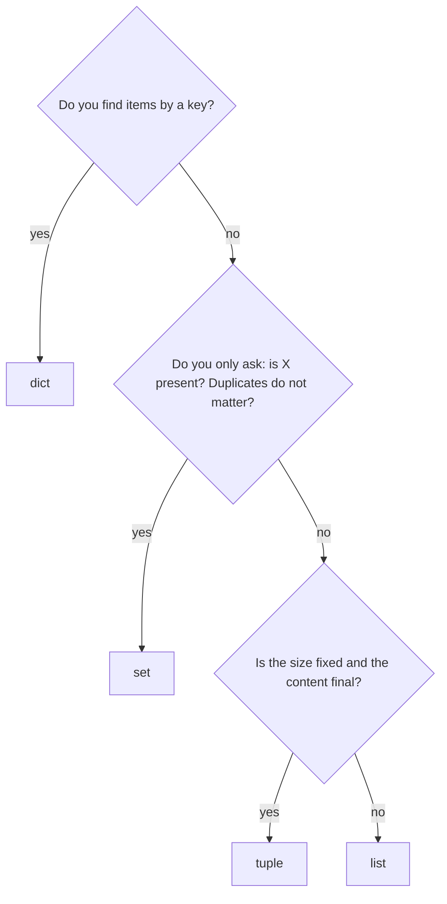
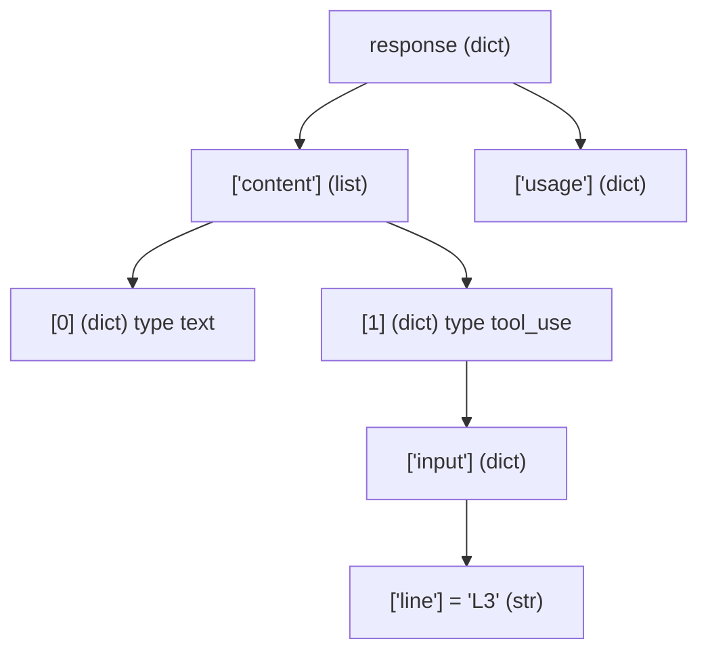

## 1. The question this idea answers

A model API does not return one number. It returns a structure: a dict with an id, a list of content blocks, and inside each block more dicts. A tool call has a name and a dict of arguments. A conversation is a list of messages.

To work with this data you need to answer three questions:

1. Which container fits the job: a list, a tuple, a set or a dict?
2. How do you reach a value deep inside a nested payload without guessing?
3. How do you build a new list or dict from an old one in one clear line?

If you guess, you get `KeyError`, `IndexError` and `TypeError` at run time, often in the middle of an agent run.

## 2. Mental model

> [!analogy] Four kinds of storage
> - A **list** is a numbered row of lockers. The order matters. You can add, remove and replace lockers. You find a locker by its position.
> - A **tuple** is a sealed envelope with a fixed number of slots. You read it, but you cannot change it.
> - A **set** is a bag of name tags with no duplicates. You ask "is this name in the bag?" and get an answer at once. The bag has no order.
> - A **dict** is a phone book. You find a value by its key, not by its position.
>
> **Where it stops working:** real lockers hold things. Python containers hold references to objects ([lesson 1.1](/notes/ai/ai-engineering/01-software-engineering-fundamentals/m01-python-foundations/l1-values-names-and-types)). Two lists can hold the same object, and a change to that object shows in both.



## 3. Terms

| Term | Plain meaning |
|---|---|
| container | An object that holds other objects. |
| `list` | An ordered, changeable sequence. Written `[a, b, c]`. |
| `tuple` | An ordered sequence that cannot change. Written `(a, b)`. One item needs a comma: `(a,)`. |
| `set` | An unordered collection with no duplicates. Written `{a, b}`. The empty set is `set()`. |
| `dict` | A mapping from keys to values. Written `{"key": value}`. Keeps the order in which keys were added. |
| index | The position of an item in a sequence. The first index is 0. `-1` is the last item. |
| slice | A part of a sequence: `items[start:stop]`. The stop position is not included. |
| key | The name that finds a value in a dict. Keys must be hashable. |
| hashable | An object that has a fixed hash number, so a set or dict can find it fast. `str`, `int` and `tuple` of hashable items are hashable. `list` and `dict` are not. |
| `KeyError` | The error when a dict has no such key. |
| `IndexError` | The error when a sequence has no such position. |
| unpacking | Giving the items of a sequence to several names at once: `x, y = point`. |
| comprehension | A short expression that builds a list, set or dict from an iterable: `[f(x) for x in items if cond(x)]`. |
| iterable | Any object that a `for` loop can walk through. |
| iterator | An object that gives the next item each time you call `next()` on it. |
| payload | The data inside a request or a response, for example the JSON body of an API reply. |

## 4. How it works

All the outputs on this page come from a sandbox run on 2026-10-19 with Python 3.13.16.

### 4.1 list: an ordered row that can change

```python
roles = ["system", "user", "assistant"]
roles.append("user")
print(roles, len(roles))
print(roles[0], roles[-1], roles[1:3])
print("tool" in roles)
roles[0] = "developer"
print(roles)
latencies = [820, 120, 450]
print(sorted(latencies), latencies)
latencies.sort()
print(latencies)
```

```text
['system', 'user', 'assistant', 'user'] 4
system user ['user', 'assistant']
False
['developer', 'user', 'assistant', 'user']
[120, 450, 820] [820, 120, 450]
[120, 450, 820]
```

1. `.append(x)` adds one item at the end. The list changes in place.
2. `roles[1:3]` is a slice of positions 1 and 2. Position 3 is not included.
3. `in` checks membership. For a list, Python compares the items one by one.
4. `sorted(x)` returns a new sorted list and leaves `x` as it was. `x.sort()` sorts `x` in place and returns `None`.

A conversation history is a list of messages, because order matters: the model must see the turns in the order they happened.

### 4.2 tuple: a fixed record

```python
point = (3, 4)
x, y = point
print(x, y)
try:
    point[0] = 5
except TypeError as error:
    print("TypeError:", error)
a, b = 1, 2
a, b = b, a
print(a, b)
cache = {("demo-model", "hi"): "cached answer"}
print(cache[("demo-model", "hi")])
one = (5,)
not_a_tuple = (5)
print(type(one).__name__, type(not_a_tuple).__name__)
```

```text
3 4
TypeError: 'tuple' object does not support item assignment
2 1
cached answer
tuple int
```

Use a tuple when the number of parts is fixed and each position has a meaning, for example `(model, prompt)`. A tuple of strings is hashable, so it can be a dict key, as in the small cache above. `a, b = b, a` swaps two values: the right side makes a tuple first, then Python unpacks it.

> [!trap] The comma makes the tuple
> `(5)` is the number 5 in parentheses. `(5,)` is a tuple with one item. A trailing comma after a value, as in `x = 5,`, also makes a tuple by accident.

### 4.3 set: fast membership, no duplicates

```python
called = ["search", "count_orders", "search", "search"]
unique = set(called)
print(unique == {"search", "count_orders"}, len(unique))
allowed = {"search", "count_orders", "read_file"}
requested = {"search", "delete_table"}
print(sorted(requested - allowed))
print(sorted(requested & allowed))
print(sorted(allowed | {"write_file"}))
empty = set()
print(type({}).__name__, type(empty).__name__)
```

```text
True 2
['delete_table']
['search']
['count_orders', 'read_file', 'search', 'write_file']
dict set
```

| Operation | Meaning | Example result |
|---|---|---|
| `a - b` | in `a` but not in `b` | tools that are requested but not allowed |
| `a & b` | in both | tools that are requested and allowed |
| `a \| b` | in either | the union |

A set has no order, so the example prints `sorted(...)` to get a stable output. `{}` is an empty dict, not an empty set.

> [!example] Worked example: a tool allow list
> An agent may call only `search`, `count_orders` and `read_file`. The model asks for `search` and `delete_table`. `requested - allowed` gives `{"delete_table"}`. The agent refuses that call before anything runs. A set makes this check one line, and the check stays fast with thousands of names.

### 4.4 How fast is `in`?

```python
import timeit
items_list = [f"doc-{i}" for i in range(100_000)]
items_set = set(items_list)
t_list = timeit.timeit(lambda: "doc-99999" in items_list, number=200)
t_set = timeit.timeit(lambda: "doc-99999" in items_set, number=200)
print(f"list: {t_list / 200 * 1e6:.1f} us per lookup")
print(f"set:  {t_set / 200 * 1e6:.3f} us per lookup")
```

```text
list: 661.0 us per lookup
set:  0.101 us per lookup
```

The times change from run to run (a second run gave 1300.1 for the list), but the gap stays huge. A list checks the items one by one, so the time grows with the length. A set computes the hash of the value and goes to one place, so the time stays about the same for any size. A dict finds a key in the same way.

### 4.5 dict: values by key

```python
usage = {"input_tokens": 512, "output_tokens": 41}
print(usage["input_tokens"])
usage["cache_read_input_tokens"] = 0
print(list(usage.keys()))
print(usage.get("cache_creation_input_tokens"))
print(usage.get("cache_creation_input_tokens", 0))
try:
    usage["cache_creation_input_tokens"]
except KeyError as error:
    print("KeyError:", error)
for key, value in usage.items():
    print(f"{key} = {value}")
print("input_tokens" in usage, 512 in usage)
```

```text
512
['input_tokens', 'output_tokens', 'cache_read_input_tokens']
None
0
KeyError: 'cache_creation_input_tokens'
input_tokens = 512
output_tokens = 41
cache_read_input_tokens = 0
True False
```

| Access | When the key is missing |
|---|---|
| `d["k"]` | raises `KeyError` |
| `d.get("k")` | returns `None` |
| `d.get("k", 0)` | returns the default `0` |

`in` on a dict checks the keys, not the values. That is why `512 in usage` is `False`. A dict keeps keys in the order you added them.

> [!key] Required keys and optional keys
> Use `d["k"]` for a key that must exist. A `KeyError` then tells you at once that the payload is wrong. Use `d.get("k", default)` for a key that is optional. Do not use `.get()` everywhere to "be safe": it hides a broken payload until much later.

### 4.6 Walking a nested model response

A chat model reply is a dict. Its `content` is a list of blocks, and each block is a dict. This shape follows the Anthropic Messages API ([messages and content blocks](/notes/ai/llm-apis/01-messages-api/l1-messages-and-content-blocks)). Other providers use similar nesting.

```python
response = {
    "id": "msg_01",
    "role": "assistant",
    "content": [
        {"type": "text", "text": "I will count the orders."},
        {"type": "tool_use", "id": "toolu_01", "name": "count_orders",
         "input": {"line": "L3", "date": "2026-10-19"}},
    ],
    "stop_reason": "tool_use",
    "usage": {"input_tokens": 512, "output_tokens": 41},
}
print(response["content"][1]["input"]["line"])
texts = [block["text"] for block in response["content"] if block["type"] == "text"]
calls = [block for block in response["content"] if block["type"] == "tool_use"]
print(texts)
print([(c["name"], c["input"]) for c in calls])
print(response.get("error"))
print(response["usage"].get("cache_read_input_tokens", 0))
```

```text
L3
['I will count the orders.']
[('count_orders', {'line': 'L3', 'date': '2026-10-19'})]
None
0
```



> [!example] Worked example: read one path step by step
> The path `response["content"][1]["input"]["line"]` has four steps. Say the type after each step:
>
> 1. `response["content"]`: a dict key gives a **list** of blocks.
> 2. `[1]`: a list index gives the second block, a **dict**.
> 3. `["input"]`: a dict key gives the tool arguments, a **dict**.
> 4. `["line"]`: a dict key gives the **str** `"L3"`.
>
> A fixed index such as `[1]` is fragile. The model can put the tool block first, or send two tool blocks. Filter by `type`, as the comprehensions above do.

### 4.7 Unpacking, enumerate and zip

```python
blocks = ["text", "tool_use", "text"]
for i, kind in enumerate(blocks):
    print(i, kind)
names = ["search", "count_orders"]
times_ms = [310, 95]
for name, ms in zip(names, times_ms):
    print(f"{name}: {ms} ms")
print(dict(zip(names, times_ms)))
```

```text
0 text
1 tool_use
2 text
search: 310 ms
count_orders: 95 ms
{'search': 310, 'count_orders': 95}
```

`enumerate(items)` gives pairs `(index, item)`. `zip(a, b)` gives pairs from two sequences, and it stops at the end of the shorter one. `for i, kind in ...` unpacks each pair into two names.

### 4.8 Comprehensions

A comprehension builds a container from an iterable in one expression.

```python
prices = {"model-a": 3.0, "model-b": 15.0, "model-c": 0.8}
cheap = {name: p for name, p in prices.items() if p < 5}
print(cheap)
squares = [n * n for n in range(5)]
print(squares)
content = [{"type": "text"}, {"type": "tool_use"}, {"type": "text"}]
kinds = {block["type"] for block in content}
print(sorted(kinds))
```

```text
{'model-a': 3.0, 'model-c': 0.8}
[0, 1, 4, 9, 16]
['text', 'tool_use']
```

Read `[n * n for n in range(5)]` from the middle: "for each `n` in `range(5)`, put `n * n` in the new list". The `if` part filters. Square brackets make a list, braces with `key: value` make a dict, braces with one value make a set.

> [!trap] Long comprehensions hide logic
> A comprehension with two `for` parts and two `if` parts is hard to read and hard to debug. Write a normal `for` loop when the line does not fit on one screen line.

### 4.9 A first look at iterators

```python
it = iter(["a", "b"])
print(next(it), next(it))
try:
    next(it)
except StopIteration:
    print("StopIteration")
```

```text
a b
StopIteration
```

A `for` loop does this for you. It calls `iter()` on the container, then calls `next()` again and again, and it stops when `StopIteration` comes. This protocol is the base of generators and streams ([lesson 2.5](/notes/ai/ai-engineering/01-software-engineering-fundamentals/m02-concurrency-foundations/l5-generators-and-yield)).

### 4.10 Production view

| Situation | Choice | Reason |
|---|---|---|
| Conversation history | `list` of message dicts | Order matters. |
| Tool allow list, seen ids, dedupe | `set` | Fast membership, no duplicates. |
| Config, usage counters, payloads | `dict` | Values by name. Maps directly to JSON. |
| A fixed pair, a cache key | `tuple` | Cannot change, hashable. |
| Content blocks | Filter by `type`, never trust a fixed index | The model decides the order. |
| Optional fields | `.get(key, default)` | Providers add and omit fields over time. |
| Required fields | `d[key]` | A missing key must fail at once and loudly. |

## 5. Code walkthrough

The two comprehensions of section 4.6 do the most common job in agent code: split a model reply into text and tool calls.

| Piece | What it does |
|---|---|
| `for block in response["content"]` | Walks the list of blocks in order. `block` is one dict each time. |
| `if block["type"] == "text"` | Keeps only text blocks. Every block has a `type` key, so `[]` is correct here. |
| `block["text"]` | The value to keep for a text block: its text. |
| `[ ... ]` | Collects the kept values into a new list. The response does not change. |
| `calls = [block for block in ... if block["type"] == "tool_use"]` | Keeps the whole block for tool calls, because the agent needs the `id`, the `name` and the `input`. |

Data in: one dict. Data out: a list of strings and a list of dicts. If you remove the `if` filter, `block["text"]` raises `KeyError` on the tool block, because a tool block has no `text` key.

## 6. Exercises

Runs in: browser lab. [Open a lab for this lesson](/labs/new?note=ai/ai-engineering/01-software-engineering-fundamentals/m01-python-foundations/l3-core-data-structures)

Hints come in three levels in chat: idea, pseudocode, partial code.

**Exercise 1.3.1: split a reply.** Write `split_reply(response)` that returns a tuple `(text, calls)`. `text` is all the text blocks joined with a newline. `calls` is a list of `(id, name, input)` tuples in the order of the blocks.

Acceptance tests (use the `response` dict of section 4.6 and two variants):

- For the section 4.6 dict: `text == "I will count the orders."` and `calls == [("toolu_01", "count_orders", {"line": "L3", "date": "2026-10-19"})]`.
- For a reply with only one text block, `calls == []`.
- For a reply with two tool blocks and no text, `text == ""` and `len(calls) == 2`.

**Exercise 1.3.2: total usage.** Write `total_usage(replies)`. It takes a list of reply dicts and returns one dict with the sum of every counter in their `usage` dicts. A counter that is missing in one reply counts as 0.

Acceptance tests:

- Two replies whose `usage` dicts are `{"input_tokens": 10, "output_tokens": 2}` and `{"input_tokens": 5, "output_tokens": 1, "cache_read_input_tokens": 7}` give `{"input_tokens": 15, "output_tokens": 3, "cache_read_input_tokens": 7}`.
- An empty list gives `{}`.
- The input dicts do not change (compare them with copies made before the call).

**Exercise 1.3.3: allow list.** Write `check_calls(calls, allowed)`. `calls` is a list of tool names, `allowed` is a set. Return a dict `{"run": [...], "refused": [...]}`. Each list keeps the order of `calls`, and it has no duplicates.

Acceptance tests:

- `check_calls(["search", "drop", "search"], {"search"}) == {"run": ["search"], "refused": ["drop"]}`
- `check_calls([], {"search"}) == {"run": [], "refused": []}`

**Exercise 1.3.4: measure.** Repeat the timing of section 4.4 for sizes 1,000, 10,000 and 100,000. Write the three list times and the three set times in a table, and write one sentence about how each one grows.

## 7. Common mistakes

1. **A fixed index for content blocks.** `content[0]["text"]` breaks when the first block is a tool call. Filter by `type`.
2. **`.get()` for required keys.** It hides a broken payload. Use `[]` for required keys.
3. **`{}` as an empty set.** It is an empty dict. Use `set()`.
4. **`x = items.sort()`.** `.sort()` returns `None`. Use `sorted(items)` for a new list.
5. **A list for membership checks on large data.** Each check reads the whole list. Use a set.
6. **A list as a dict key.** It raises `TypeError: unhashable type: 'list'`. Use a tuple.
7. **`value in some_dict` to search values.** It checks keys only. Use `value in some_dict.values()`.

## 8. One-minute explanation

Four containers hold most data. A list is an ordered sequence that can change, so a conversation history is a list. A tuple is a fixed sequence that cannot change, so it works as a record or a dict key. A set has no order and no duplicates, and its membership test is fast at any size, because it uses hashing. A dict maps keys to values, keeps insertion order and maps directly to JSON. Square brackets with a key raise `KeyError` for a missing key, and `.get()` returns a default. Use the first for required fields and the second for optional ones. A model reply is a dict that holds a list of block dicts. Walk it one level at a time, and filter blocks by their `type`, never by a fixed index. Comprehensions build a new list, set or dict in one expression, and `for` loops work through the `iter` and `next` protocol.

## 9. Check questions

```check
{
  "question": "A reply's content is `[tool_use block, text block]`. The code reads `reply[\"content\"][0][\"text\"]`. What happens, and what is the correct way?",
  "answer": "It raises `KeyError: 'text'`, because block 0 is a tool block and has no `text` key. The model decides the order of blocks. Filter by type: `[b[\"text\"] for b in reply[\"content\"] if b[\"type\"] == \"text\"]`."
}
```

```check
{
  "question": "Why is `\"doc-99999\" in big_set` more than 6,000 times faster than the same check on a list of 100,000 strings?",
  "answer": "The list compares the value with the items one by one, so the time grows with the length. The set computes the hash of the value and goes directly to one slot, so the time stays about the same for any size. In the sandbox run the list took 661.0 microseconds and the set 0.101 microseconds per check."
}
```

```check
{
  "question": "When do you write `usage[\"input_tokens\"]` and when `usage.get(\"cache_read_input_tokens\", 0)`?",
  "answer": "Use square brackets for a field that must exist. A missing field then fails at once with a clear `KeyError`. Use `.get` with a default for a field that is optional, for example a counter that a provider sends only when caching was used."
}
```

```check
{
  "question": "What does `{n: n * n for n in range(4) if n % 2 == 0}` give?",
  "hint": "Which values of n pass the filter?",
  "answer": "`{0: 0, 2: 4}`. `range(4)` gives 0, 1, 2, 3. The filter keeps even numbers 0 and 2. Each becomes a key with its square as the value."
}
```

## 10. Links

- Previous: [1.2 Control flow and functions](/notes/ai/ai-engineering/01-software-engineering-fundamentals/m01-python-foundations/l2-control-flow-and-functions)
- Next: [1.4 Mutability, references and scope](/notes/ai/ai-engineering/01-software-engineering-fundamentals/m01-python-foundations/l4-mutability-references-and-scope)
- The real shape of model replies: [Messages and content blocks](/notes/ai/llm-apis/01-messages-api/l1-messages-and-content-blocks) and [tool_use and tool_result](/notes/ai/llm-apis/01-messages-api/l2-tool-use-and-tool-result)
- JSON text to dicts and back: [1.7 Files, paths, environment variables and JSON](/notes/ai/ai-engineering/01-software-engineering-fundamentals/m01-python-foundations/l7-files-paths-env-and-json)
- Iterators become generators: [2.5 Generators, yield, close() and GeneratorExit](/notes/ai/ai-engineering/01-software-engineering-fundamentals/m02-concurrency-foundations/l5-generators-and-yield)
- [Module M1](/notes/ai/ai-engineering/01-software-engineering-fundamentals/m01-python-foundations) and the [glossary](/notes/ai/ai-engineering/glossary)
