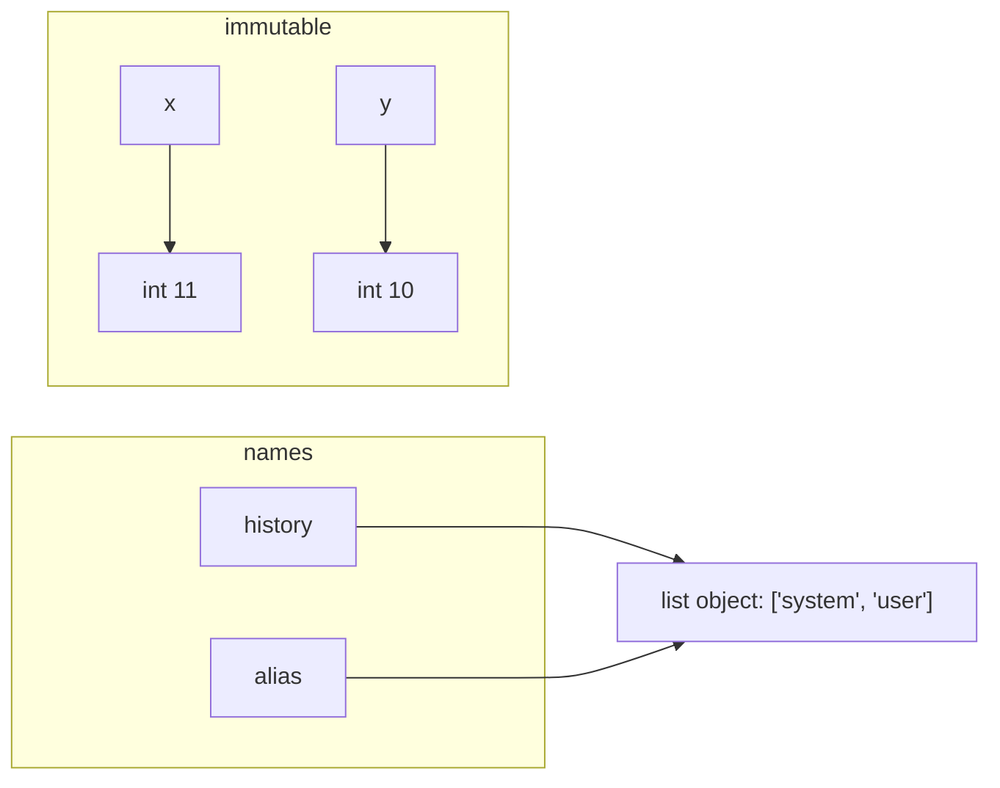
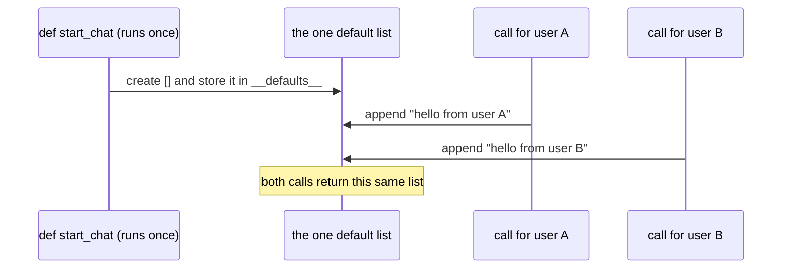
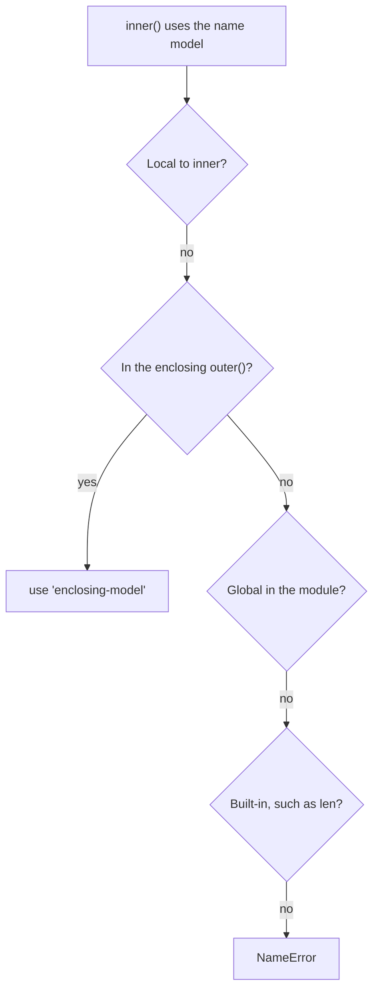

## 1. The question this idea answers

An agent works well for the first user. The second user gets an answer that mentions the first user's question. Nobody changed the prompt. The model "remembers" something that it should not know.

Very often the model is not the cause. A Python list was shared by two requests, and one request added a message to it. This lesson explains how that happens. It answers four questions:

1. Which objects can change in place, and which cannot?
2. What happens when you pass a list to a function?
3. Why does `def f(history=[])` share one list between calls?
4. When a function uses a name, which variable does it get? This is the question of scope.

## 2. Mental model

> [!analogy] One shared document and many links
> A mutable object is a shared online document. A name is a link to it. If you send the link to a colleague, you do not send a copy. When the colleague edits the document, you see the edit. An immutable object is a printed page. Nobody can edit it. To "change" it, you print a new page and move your link to the new page.
>
> **Where it stops working:** a shared document shows who edited it. Python shows nothing. A list that two parts of a program share gives no warning when one part changes it.



## 3. Terms

| Term | Plain meaning |
|---|---|
| mutable | An object that can change in place: `list`, `dict`, `set`, most class instances. |
| immutable | An object that cannot change: `int`, `float`, `str`, `bool`, `None`, `tuple`. An operation on it makes a new object. |
| reference | What a name holds: the address of an object, never the object itself. |
| aliasing | Two or more names refer to the same object. |
| in place | A change to the object itself, for example `list.append`. Every name that refers to the object sees it. |
| rebinding | Making a name refer to a different object, for example `x = x + 1`. Other names do not change. |
| shallow copy | A new outer container that holds the same inner objects. `dict(d)`, `list(l)`, `copy.copy(x)`. |
| deep copy | A new container with new copies of all inner objects. `copy.deepcopy(x)`. |
| default value | The value a parameter gets when the call does not give one. Python evaluates it once, when it runs the `def`. |
| scope | The region of code where a name is visible. |
| namespace | A table that maps names to objects. Each function call has its own local namespace. |
| LEGB | The order in which Python searches for a name: Local, Enclosing, Global, Built-in. |
| `global` | A statement that makes a name inside a function refer to the module-level name. |
| `nonlocal` | A statement that makes a name inside a nested function refer to the name of the enclosing function. |
| `UnboundLocalError` | The error when a function reads a local name before it assigns it. |
| shadowing | A local or global name hides a name with the same spelling at a later level, for example a variable named `list`. |

## 4. How it works

All the outputs on this page come from a sandbox run on 2026-10-19 with Python 3.13.16.

### 4.1 Rebinding vs changing in place

```python
x = 10
y = x
x = x + 1
print(x, y)
history = ["system"]
alias = history
history.append("user")
print(history, alias, history is alias)
```

```text
11 10
['system', 'user'] ['system', 'user'] True
```

Two different things happened:

1. `x = x + 1` made a new `int` object 11 and moved the name `x` to it. This is rebinding. `y` still refers to 10.
2. `history.append("user")` changed the list object in place. `alias` refers to the same list, so it shows the change.

An `int` cannot change in place, so the first case can never cause a surprise. A `list` can, so the second case can.

```python
s = "abc"
t = s.upper()
print(s, t)
```

```text
abc ABC
```

String methods return a new string. `s` is still `"abc"`. Every operation on an immutable object works this way.

### 4.2 Passing an object to a function

Python passes a reference to the object. The parameter becomes one more name for the caller's object. Some books call this "pass by assignment" or "call by sharing".

```python
def add_user_message(messages, text):
    messages.append({"role": "user", "content": text})
    return messages

chat = []
result = add_user_message(chat, "hi")
print(chat)
print(result is chat)
def rebind_inside(messages):
    messages = ["new list"]
    return messages
kept = ["old"]
rebind_inside(kept)
print(kept)
```

```text
[{'role': 'user', 'content': 'hi'}]
True
['old']
```

1. `add_user_message` changed the caller's list in place. The caller sees the new message even without using the return value.
2. `result is chat` is `True`. The function returned the same list, not a copy.
3. `rebind_inside` only moved its local name `messages` to a new list. The caller's list did not change.

> [!key] A function can change your object only through in-place operations
> `append`, `extend`, `pop`, `d[key] = value`, `del d[key]`, `.update()` and `.clear()` change the shared object. Assignment to the parameter name (`messages = ...`) never touches the caller's object.

### 4.3 The shared mutable default trap

```python
def start_chat(first_message, history=[]):
    history.append(first_message)
    return history

a = start_chat("hello from user A")
b = start_chat("hello from user B")
print(a)
print(a is b)
print(start_chat.__defaults__)
```

```text
['hello from user A', 'hello from user B']
True
(['hello from user A', 'hello from user B'],)
```

Python evaluates `[]` once, when it runs the `def` line. It stores that one list in `start_chat.__defaults__`. Every call that does not pass `history` gets the same list. User B's chat now holds user A's message. In a web service the list lives as long as the process. It grows with every request, and every user sees the messages of earlier users.



The fix uses `None` as a marker and makes a new list inside the call:

```python
def start_chat(first_message, history=None):
    if history is None:
        history = []
    history.append(first_message)
    return history

a = start_chat("hello from user A")
b = start_chat("hello from user B")
print(a, b, a is b)
```

```text
['hello from user A'] ['hello from user B'] False
```

> [!trap] The same trap in classes and dataclasses
> A class attribute `messages = []` is shared by every instance in the same way ([lesson 1.5](/notes/ai/ai-engineering/01-software-engineering-fundamentals/m01-python-foundations/l5-classes-and-dataclasses)). A `@dataclass` refuses a mutable default and asks for `field(default_factory=list)`.

### 4.4 Shallow copy vs deep copy

A request template is a common source of this bug. A function copies the template, adds the user's message and sends it.

```python
import copy
TEMPLATE = {"model": "demo-model",
            "messages": [{"role": "system", "content": "Be brief."}]}

req1 = dict(TEMPLATE)
req1["messages"].append({"role": "user", "content": "question 1"})
print(len(TEMPLATE["messages"]), req1["messages"] is TEMPLATE["messages"])

TEMPLATE["messages"].pop()
req2 = copy.deepcopy(TEMPLATE)
req2["messages"].append({"role": "user", "content": "question 2"})
print(len(TEMPLATE["messages"]), len(req2["messages"]))
req3 = copy.copy(TEMPLATE)
print(req3 is TEMPLATE, req3["messages"] is TEMPLATE["messages"])
```

```text
2 True
1 2
False True
```

1. `dict(TEMPLATE)` is a shallow copy. The outer dict is new, but its `"messages"` value is the same list. The append changed the template, which now holds 2 messages.
2. The `pop()` line repairs the template for the next step.
3. `copy.deepcopy` copies every level. The append changed only `req2`. The template still holds 1 message.
4. `copy.copy` is also shallow: a new outer dict, the same inner list.

> [!example] Worked example: which copy do you need?
> A function receives `request` and must add one message without changing the caller's data.
>
> - Option A: `new = dict(request)` then `new["messages"].append(m)`. Wrong: it changes the caller's list.
> - Option B: `new = dict(request)` then `new["messages"] = request["messages"] + [m]`. Correct: `+` makes a new list, and the new dict gets the new list. The message dicts inside stay shared, which is fine when nobody changes them.
> - Option C: `new = copy.deepcopy(request)`. Correct and simple. It costs more time and memory for long histories.

### 4.5 `+=` behaves differently for mutable and immutable objects

```python
t = (1, 2)
t2 = t
t += (3,)
print(t, t2)
l = [1, 2]
l2 = l
l += [3]
print(l, l2)
```

```text
(1, 2, 3) (1, 2)
[1, 2, 3] [1, 2, 3]
```

For a tuple, `t += (3,)` makes a new tuple and rebinds `t`. For a list, `l += [3]` extends the list in place, so `l2` changes too. The same operator does two different things.

### 4.6 Changing a list while you loop over it

```python
blocks = ["text", "tool_use", "tool_use", "text"]
for block in blocks:
    if block == "tool_use":
        blocks.remove(block)
print(blocks)
blocks = ["text", "tool_use", "tool_use", "text"]
blocks = [b for b in blocks if b != "tool_use"]
print(blocks)
```

```text
['text', 'tool_use', 'text']
['text', 'text']
```

The loop walks the list by position. When it removes the item at position 1, the next item moves to position 1, and the loop goes on to position 2. So it skips one `tool_use`. Build a new list instead, as the comprehension does.

### 4.7 Scope: where Python finds a name

When code uses a name, Python searches four namespaces in a fixed order: **L**ocal, **E**nclosing, **G**lobal, **B**uilt-in. The first match wins.

```python
model = "global-model"

def outer():
    model = "enclosing-model"
    def inner():
        return model
    return inner()

def local_wins():
    model = "local-model"
    return model

print(outer(), local_wins(), model)
print(len("abc"))
```

```text
enclosing-model local-model global-model
3
```



`len` was found in the built-in namespace. A function that assigns a name makes it local for the whole function, which leads to the next trap.

### 4.8 UnboundLocalError, global and nonlocal

```python
counter = 0
def bump():
    counter += 1
try:
    bump()
except UnboundLocalError as error:
    print("UnboundLocalError:", error)
```

```text
UnboundLocalError: cannot access local variable 'counter' where it is not associated with a value
```

Python decides the scope of each name when it compiles the function. `counter += 1` assigns `counter`, so `counter` is local in the whole function. The read on the right side then finds a local name that has no value yet.

```python
calls = 0
def bump_global():
    global calls
    calls += 1
bump_global(); bump_global()
print(calls)

def make_counter():
    count = 0
    def bump():
        nonlocal count
        count += 1
        return count
    return bump
c = make_counter()
c(); c()
print(c())
```

```text
2
3
```

`global calls` says "`calls` is the module-level name". `nonlocal count` says "`count` is the name of the enclosing function". The inner function `bump` keeps `count` alive after `make_counter` returned. That is a closure, the subject of [lesson 2.2](/notes/ai/ai-engineering/01-software-engineering-fundamentals/m02-concurrency-foundations/l2-lambdas-and-closures).

> [!trap] Global mutable state in a server
> A web server handles many requests in one process, sometimes at the same time. A module-level variable such as `CURRENT_USER` or a global history list is shared by all of them. One request can overwrite or read the data of another. Pass per-request data as arguments, or keep it in a closure or an object made for that request.

### 4.9 Shadowing a built-in name

```python
list = ["oops"]
try:
    print(list("abc"))
except TypeError as error:
    print("TypeError:", error)
del list
print(list("abc"))
```

```text
TypeError: 'list' object is not callable
['a', 'b', 'c']
```

The global name `list` hid the built-in `list`. `del list` removed the global name, and the search found the built-in again. Do not name variables `list`, `dict`, `str`, `type`, `id`, `input` or `max`.

### 4.10 Production view

| Bug pattern | Symptom in an AI app | Prevention |
|---|---|---|
| Mutable default `history=[]` | Users see other users' messages. The history grows forever. | Default `None`, new list inside. |
| Shallow copy of a request template | The system prompt list grows with every request. | Build new lists (`a + [m]`) or `copy.deepcopy`. |
| Helper changes its argument | A message appears twice in the history. | Do not change arguments in place. Return a new object, or say clearly in the name and docstring that the function changes it. |
| Global per-request variable | Data leaks between concurrent requests. | Pass data as arguments or closures. |
| Loop that removes items | One tool call is not removed. | Build a new list with a comprehension. |

## 5. Code walkthrough

The fixed `start_chat` of section 4.3 has four lines. Each one has a reason.

| Line | Why it exists | What breaks without it |
|---|---|---|
| `def start_chat(first_message, history=None):` | `None` is immutable. Sharing it between calls is harmless. | With `[]`, all calls share one list. |
| `if history is None:` | Tells "the caller gave no list" apart from "the caller gave an empty list". | `if not history:` would replace a caller's empty list with a new one, so the caller would not see the append. |
| `history = []` | Makes a new list for this call only. | No list to append to. |
| `history.append(first_message)` | Changes the list of this call, or the caller's list if the caller passed one. | No message. |

The second row is subtle. `if not history:` looks the same, but it treats an empty list as "missing". A caller that passes its own empty list on purpose would then get a different list back.

## 6. Exercises

Runs in: browser lab. [Open a lab for this lesson](/labs/new?note=ai/ai-engineering/01-software-engineering-fundamentals/m01-python-foundations/l4-mutability-references-and-scope)

Hints come in three levels in chat: idea, pseudocode, partial code.

**Exercise 1.4.1: find the leak.** This function has a bug that leaks history between users:

```python
def build_messages(user_text, base=[{"role": "system", "content": "Be brief."}]):
    base.append({"role": "user", "content": user_text})
    return base
```

Write a fixed version `build_messages_fixed(user_text, base=None)`.

Acceptance tests:

- Two calls `build_messages_fixed("a")` and `build_messages_fixed("b")` each return a list of exactly 2 messages.
- A caller's list passed as `base` does not change: compare it with a copy made before the call.
- First show that the original function returns 3 messages on its second call. Keep that test in the lab as proof of the bug.

**Exercise 1.4.2: safe template.** Write `make_request(template, user_text)` that returns a new request dict with one extra user message.

Acceptance tests:

- After 100 calls with the same template, `len(template["messages"])` is unchanged.
- `make_request(t, "x")["messages"] is not t["messages"]`
- The `model` key of the result equals the template's `model`.

**Exercise 1.4.3: predict, then run.** Predict the output of each snippet, then run it. Write one sentence for each prediction that was wrong.

1. `a = [[0] * 2] * 2` then `a[0][0] = 1` then `print(a)`.
2. `d = {"k": [1]}` then `e = d.copy()` then `e["k"].append(2)` then `print(d)`.
3. `s = "abc"` then `t = s` then `s += "d"` then `print(t)`.

**Exercise 1.4.4: scope.** Write `make_rate_limiter(limit)` that returns a function `allow()`. `allow()` returns `True` for the first `limit` calls and `False` after that. Use `nonlocal`, not a global.

Acceptance tests:

- `allow = make_rate_limiter(2)` gives `[allow() for _ in range(4)] == [True, True, False, False]`.
- Two limiters made by two calls of `make_rate_limiter` count separately.

## 7. Common mistakes

1. **`def f(x=[])` or `def f(x={})`.** The default is shared by every call. Use `None`.
2. **"`dict(d)` copies everything."** It copies only the outer level.
3. **Changing an argument in place without saying so.** The caller's data changes behind its back.
4. **Removing items from a list while looping over it.** Items get skipped.
5. **`counter += 1` in a function without `global` or `nonlocal`.** `UnboundLocalError`.
6. **Per-request data in a module-level variable.** It leaks between requests.
7. **Naming a variable `list`, `dict` or `id`.** The built-in disappears in that scope.

## 8. One-minute explanation

Every name holds a reference to an object, and assignment never copies. Immutable objects such as numbers, strings and tuples cannot change, so every operation makes a new object and moves only one name. Mutable objects such as lists and dicts can change in place, and every name that refers to them sees the change. A function parameter is one more name for the caller's object, so `append` inside the function changes the caller's list. A default value is evaluated once, when Python runs the `def`, so `history=[]` gives every call the same list, and users see each other's messages. Use `None` and make a new list inside. `dict(d)` and `copy.copy` copy only the outer level, and `copy.deepcopy` copies everything. Python finds a name by searching local, enclosing, global, then built-in scope. A function that assigns a name makes it local, unless `global` or `nonlocal` says otherwise.

## 9. Check questions

```check
{
  "question": "A FastAPI endpoint calls `def answer(q, history=[])`. After a day in production, responses are slow and mention old questions. Explain the cause.",
  "answer": "The default list was created once, when the `def` ran at import time. Every call without a `history` argument appends to the same list, and the list lives as long as the server process. So the prompt grows with every request (slow, expensive) and holds earlier users' questions (a data leak). Fix: `history=None`, then `if history is None: history = []`."
}
```

```check
{
  "question": "`new = dict(template)` then `new[\"messages\"].append(m)`. Does `template` change? Why?",
  "answer": "Yes. `dict(template)` is a shallow copy: the outer dict is new, but `new[\"messages\"]` is the same list object as `template[\"messages\"]`. `append` changes that list in place. Use `new[\"messages\"] = template[\"messages\"] + [m]` or `copy.deepcopy`."
}
```

```check
{
  "question": "Why does `def bump(): counter += 1` raise `UnboundLocalError` when a module-level `counter = 0` exists?",
  "hint": "When does Python decide whether a name is local?",
  "answer": "Python decides the scope of each name when it compiles the function. `counter += 1` assigns `counter`, so `counter` is local in the whole function. The read part of `+=` then finds a local name that has no value yet. Add `global counter`, or better, pass and return the value."
}
```

```check
{
  "question": "`l2 = l` then `l += [3]` changes `l2`, but `t2 = t` then `t += (3,)` does not change `t2`. Why?",
  "answer": "A list is mutable, so `+=` extends the list in place, and `l2` refers to the same list. A tuple is immutable, so `+=` makes a new tuple and rebinds only `t`. `t2` still refers to the old tuple."
}
```

## 10. Links

- Previous: [1.3 Lists, tuples, sets, dicts and comprehensions](/notes/ai/ai-engineering/01-software-engineering-fundamentals/m01-python-foundations/l3-core-data-structures)
- Next: [1.5 Classes, objects and dataclasses](/notes/ai/ai-engineering/01-software-engineering-fundamentals/m01-python-foundations/l5-classes-and-dataclasses)
- Names and identity: [1.1 Values, names and types](/notes/ai/ai-engineering/01-software-engineering-fundamentals/m01-python-foundations/l1-values-names-and-types)
- Closures keep enclosing variables alive: [2.2 Lambdas and closures](/notes/ai/ai-engineering/01-software-engineering-fundamentals/m02-concurrency-foundations/l2-lambdas-and-closures)
- Shared state between threads: [2.3 Threads](/notes/ai/ai-engineering/01-software-engineering-fundamentals/m02-concurrency-foundations/l3-threads)
- Per-request data in a global, as a security bug: [Self-asserted identity](/notes/software-engineering/security-and-operations/01-access-control/l1-self-asserted-identity)
- [Module M1](/notes/ai/ai-engineering/01-software-engineering-fundamentals/m01-python-foundations) and the [glossary](/notes/ai/ai-engineering/glossary)
