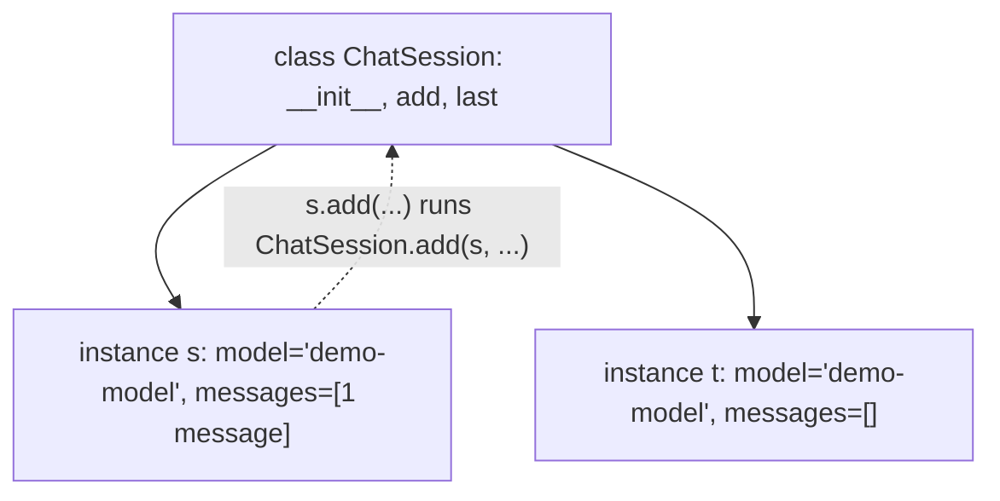
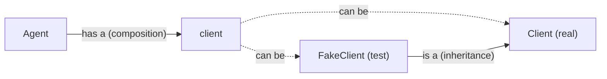

## 1. The question this idea answers

A chat session has data: a model name and a list of messages. It also has actions: add a message, read the last message, count tokens. You can keep the data in a dict and the actions in separate functions. After a while, it is not clear which functions work with which dicts.

A class puts the data and the actions together. Every SDK that you use in AI work is built from classes: a client object, a message object, a settings object. You must read them, and you must write your own.

This lesson answers four questions:

1. What are a class, an instance and `self`?
2. How do special methods such as `__repr__` and `__eq__` change how objects print and compare?
3. When do you inherit from a class, and when do you hold another object inside yours?
4. What does `@dataclass` write for you?

## 2. Mental model

> [!analogy] A form template and filled-in forms
> A class is a blank form template, for example "Tool call: name ___, arguments ___". Each instance is one filled-in copy of the form. The methods are the instructions printed on the back of the template. The instructions are the same for every copy, but each copy has its own data.
>
> `self` is "this copy". When an instruction says "read the name on this form", `self.name` reads the name on the copy in your hand.
>
> **Where it stops working:** a paper form cannot hold another form inside it. A Python object can hold any object, including other instances. Also, data that you put on the template itself (a class attribute) is shared by every copy, which paper forms do not do.



## 3. Terms

| Term | Plain meaning |
|---|---|
| class | A template for objects. It defines their data and their methods. Made with the `class` statement. |
| instance | One object made from a class, for example `s = ChatSession("demo-model")`. |
| attribute | A name attached to an object, read with a dot: `s.model`. |
| instance attribute | An attribute stored on one instance, usually set in `__init__` as `self.x = ...`. |
| class attribute | An attribute stored on the class. Every instance shares it. |
| method | A function defined inside a class. Its first parameter receives the instance. |
| `self` | The usual name of the first method parameter: the instance that the method works on. |
| `__init__` | The method that Python calls to fill in a new instance. |
| dunder method | A "double underscore" method such as `__repr__` or `__eq__`. Python calls it for built-in operations. |
| `__repr__` | Returns the text that shows an object in the REPL, in logs and in `repr()`. |
| `__eq__` | Defines what `==` means for the class. |
| bound method | A method taken from an instance, for example `s.add`. It remembers the instance in `__self__`. |
| inheritance | A class that extends another class and reuses its methods. Written `class FakeClient(Client):`. |
| subclass / base class | The new class and the class that it extends. |
| `super()` | Gives access to the methods of the base class, for example `super().__init__(...)`. |
| composition | An object that holds other objects as attributes and uses them, for example an agent that holds a client. |
| `@dataclass` | A decorator that writes `__init__`, `__repr__` and `__eq__` from the class annotations. |
| `field(default_factory=...)` | Gives each new instance a fresh default value, for example a new empty list. |
| frozen dataclass | A dataclass whose fields cannot change after creation. |
| `@property` | Makes a method readable like an attribute, for example `usage.total`. |
| decorator | A line `@name` above a `def` or `class`. It passes the function or class to `name` and uses the result. |

## 4. How it works

All the outputs on this page come from a sandbox run on 2026-10-19 with Python 3.13.16.

### 4.1 A first class

```python
class ChatSession:
    """One conversation with a model."""

    def __init__(self, model):
        self.model = model
        self.messages = []

    def add(self, role, content):
        self.messages.append({"role": role, "content": content})

    def last(self):
        return self.messages[-1] if self.messages else None

s = ChatSession("demo-model")
s.add("user", "hi")
print(s.model, len(s.messages), s.last())
print(type(s).__name__, isinstance(s, ChatSession))
t = ChatSession("demo-model")
print(len(t.messages), s.messages is t.messages)
```

```text
demo-model 1 {'role': 'user', 'content': 'hi'}
ChatSession True
0 False
```

What happens at `s = ChatSession("demo-model")`:

1. Python makes a new, empty `ChatSession` object.
2. It calls `__init__(new_object, "demo-model")`. Inside, `self` is the new object.
3. `self.model = model` stores the model name on this object. `self.messages = []` makes a new list for this object.
4. The new object is returned and gets the name `s`.

`t` is a second instance. It has its own `messages` list, so `s.messages is t.messages` is `False`. Each call of `__init__` ran `[]` again. This is the safe place to make mutable data ([lesson 1.4](/notes/ai/ai-engineering/01-software-engineering-fundamentals/m01-python-foundations/l4-mutability-references-and-scope)).

### 4.2 What `self` is, and bound methods

```python
s = ChatSession("demo-model")
ChatSession.add(s, "user", "same as s.add(...)")
s.add("assistant", "hello")
print([m["role"] for m in s.messages])
method = s.add
print(method.__self__ is s)
method("user", "called through the bound method")
print(len(s.messages))
```

```text
['user', 'assistant']
True
3
```

`s.add("assistant", "hello")` is short for `ChatSession.add(s, "assistant", "hello")`. Python passes the instance as the first argument. That is all that `self` is: a normal parameter that receives the instance.

`method = s.add` does not call anything. It makes a **bound method**: the function `add` plus the instance `s`, stored in `method.__self__`. You can call it later, and it still works on `s`. This fact is important in module 2: code such as `build_server(q.put)` passes a bound method of a queue as a callback ([lesson 2.1](/notes/ai/ai-engineering/01-software-engineering-fundamentals/m02-concurrency-foundations/l1-functions-as-values-and-callbacks)).

### 4.3 The class attribute trap

```python
class BadSession:
    messages = []
    def add(self, text):
        self.messages.append(text)

a = BadSession()
b = BadSession()
a.add("from a")
print(b.messages, a.messages is b.messages)
```

```text
['from a'] True
```

`messages = []` at class level runs once, when Python runs the `class` statement. There is one list on the class. `self.messages` finds no instance attribute, so it finds the class attribute. Both instances share it. This is the same bug as the mutable default of lesson 1.4. Make per-instance data in `__init__`.

> [!key] Class attributes for constants, instance attributes for state
> A class attribute is fine for a constant that never changes, such as `MAX_RETRIES = 3`. State that belongs to one object goes in `__init__` as `self.name = ...`.

### 4.4 Dunder methods: how objects print and compare

```python
class ToolCall:
    def __init__(self, name, arguments):
        self.name = name
        self.arguments = arguments

c = ToolCall("count_orders", {"line": "L3"})
print(repr(c).split(" at ")[0] + " at 0x...>")
print(c == ToolCall("count_orders", {"line": "L3"}))
```

```text
<__main__.ToolCall object at 0x...>
False
```

The default `repr` shows only the class name and a memory address (the address changes from run to run, so the page shows `0x...`). The default `==` compares identity, so two equal-looking tool calls are "not equal". Both defaults are bad for logs and tests. Define the dunder methods:

```python
class ToolCall:
    def __init__(self, name, arguments):
        self.name = name
        self.arguments = arguments
    def __repr__(self):
        return f"ToolCall(name={self.name!r}, arguments={self.arguments!r})"
    def __eq__(self, other):
        if not isinstance(other, ToolCall):
            return NotImplemented
        return (self.name, self.arguments) == (other.name, other.arguments)

c = ToolCall("count_orders", {"line": "L3"})
print(c)
print(c == ToolCall("count_orders", {"line": "L3"}))
```

```text
ToolCall(name='count_orders', arguments={'line': 'L3'})
True
```

`{self.name!r}` inserts `repr(self.name)`, so text keeps its quotes. `NotImplemented` tells Python "I cannot compare with that type". Python then tries the other object's `__eq__`, and finally falls back to identity.

| Built-in operation | Dunder method Python calls |
|---|---|
| `repr(x)`, the REPL, logs | `x.__repr__()` |
| `str(x)`, `print(x)` | `x.__str__()`, or `__repr__` if there is no `__str__` |
| `x == y` | `x.__eq__(y)` |
| `len(x)` | `x.__len__()` |
| `for item in x` | `x.__iter__()` |
| `with x:` | `x.__enter__()` and `x.__exit__(...)` ([lesson 1.6](/notes/ai/ai-engineering/01-software-engineering-fundamentals/m01-python-foundations/l6-exceptions-and-context-managers)) |

### 4.5 @dataclass writes the boilerplate

Most classes in AI code mainly hold data: a tool call, a message, a usage record, settings. `@dataclass` reads the annotated class attributes and writes `__init__`, `__repr__` and `__eq__` for you.

```python
from dataclasses import dataclass, field, asdict

@dataclass
class ToolCall:
    name: str
    arguments: dict = field(default_factory=dict)
    call_id: str = ""

c1 = ToolCall("count_orders", {"line": "L3"})
c2 = ToolCall("count_orders", {"line": "L3"})
print(c1)
print(c1 == c2, c1 is c2)
print(asdict(c1))
print(ToolCall(name=123))
```

```text
ToolCall(name='count_orders', arguments={'line': 'L3'}, call_id='')
True False
{'name': 'count_orders', 'arguments': {'line': 'L3'}, 'call_id': ''}
ToolCall(name=123, arguments={}, call_id='')
```

1. `name: str` is an annotation. It makes `name` a field. A field with no default is a required argument.
2. `field(default_factory=dict)` calls `dict()` for each new instance, so every instance gets its own dict.
3. `==` compares the fields in order. `is` still compares identity.
4. `asdict()` turns the instance into a plain dict, which is useful before you write JSON.
5. `ToolCall(name=123)` worked. A dataclass does **not** check types at run time. The annotation `str` is information for people and for type checkers ([lesson 1.8](/notes/ai/ai-engineering/01-software-engineering-fundamentals/m01-python-foundations/l8-type-annotations-and-pydantic)). Pydantic models check types. Dataclasses do not.

```python
from dataclasses import dataclass
try:
    @dataclass
    class Broken:
        arguments: dict = {}
except ValueError as error:
    print("ValueError:", error)
```

```text
ValueError: mutable default <class 'dict'> for field arguments is not allowed: use default_factory
```

The dataclass decorator refuses a `list`, `dict` or `set` default. It protects you from the shared default trap.

### 4.6 Frozen dataclasses for settings

```python
from dataclasses import dataclass, FrozenInstanceError

@dataclass(frozen=True)
class Settings:
    model: str
    max_tokens: int = 1024

settings = Settings("demo-model")
print(settings)
try:
    settings.max_tokens = 5
except FrozenInstanceError as error:
    print("FrozenInstanceError:", error)
```

```text
Settings(model='demo-model', max_tokens=1024)
FrozenInstanceError: cannot assign to field 'max_tokens'
```

Settings that load once at startup should not change in the middle of a request. `frozen=True` makes every assignment to a field an error. A frozen dataclass whose fields are all hashable is also hashable, so it can be a dict key or a set item.

### 4.7 @property: a computed attribute

```python
class Usage:
    def __init__(self, input_tokens, output_tokens):
        self.input_tokens = input_tokens
        self.output_tokens = output_tokens

    @property
    def total(self):
        return self.input_tokens + self.output_tokens

u = Usage(512, 41)
print(u.total)
u.output_tokens = 59
print(u.total)
```

```text
553
571
```

`u.total` looks like an attribute, but Python calls the method each time. The value is always up to date. No second copy of the total exists that could disagree with the parts.

### 4.8 Inheritance vs composition

```python
class Client:
    def send(self, request):
        return {"status": 200, "text": "real answer to " + request["prompt"]}

class FakeClient(Client):
    def send(self, request):
        return {"status": 200, "text": "fake answer"}

class Agent:
    def __init__(self, client):
        self.client = client
    def ask(self, prompt):
        return self.client.send({"prompt": prompt})["text"]

print(Agent(Client()).ask("hi"))
print(Agent(FakeClient()).ask("hi"))
print(isinstance(FakeClient(), Client), issubclass(FakeClient, Client))
```

```text
real answer to hi
fake answer
True True
```

Two relations appear here:

- **Inheritance ("is a"):** `FakeClient` is a `Client`. It overrides `send`. Code that expects a `Client` accepts it.
- **Composition ("has a"):** `Agent` has a client. It does not inherit from `Client`. It receives a client in `__init__` and calls it.

Composition made the test easy. The same `Agent` class worked with a real client and with a fake one, and the agent code did not change. This idea is called dependency injection. FastAPI uses it for databases and HTTP clients ([lesson 4.3](/notes/ai/ai-engineering/01-software-engineering-fundamentals/m04-fastapi-services/l3-dependencies-lifespan-config-and-middleware)).



> [!key] Prefer composition
> Inherit when the new class truly is a kind of the base class and keeps its contract. For most other cases, hold the other object as an attribute. Deep inheritance trees are hard to read, because a method can come from any level.

### 4.9 super() and the method resolution order

```python
class Client:
    def __init__(self, base_url):
        self.base_url = base_url

class LoggingClient(Client):
    def __init__(self, base_url, log):
        super().__init__(base_url)
        self.log = log

lc = LoggingClient("https://api.example.com", log=[])
print(lc.base_url, lc.log)
print([k.__name__ for k in LoggingClient.__mro__])
```

```text
https://api.example.com []
['LoggingClient', 'Client', 'object']
```

`super().__init__(base_url)` runs the base class `__init__`, so `base_url` is set. Without it, `lc.base_url` would raise `AttributeError`. The method resolution order (`__mro__`) is the list of classes that Python searches for an attribute. It starts at the class itself and ends at `object`, the base of every class.

### 4.10 Production view

| Situation | Choice |
|---|---|
| A record of data: a tool call, an event, a usage row | `@dataclass` (or a Pydantic model when the data comes from outside and needs validation) |
| Settings loaded once | `@dataclass(frozen=True)` or a settings library |
| An object with state and behavior: a session, a client | A normal class with state made in `__init__` |
| A test double | A fake class with the same methods, passed by composition |
| Logs and errors | A `__repr__` that shows the important fields, never a secret |
| Shared mutable data | Never a class attribute. Make it in `__init__` or with `default_factory`. |

> [!trap] A repr can leak a secret
> A dataclass `Settings(api_key: str)` prints the key in every log line and every traceback that shows the object. Use `field(repr=False)` for secret fields, or keep secrets out of such objects.

## 5. Code walkthrough

The `Agent` and `FakeClient` example of section 4.8 shows the pattern that makes AI code testable.

| Line | What it does | Why it matters |
|---|---|---|
| `class FakeClient(Client):` | Makes a subclass. | Any code that accepts a `Client` accepts the fake. |
| `def send(self, request): return {...}` | Overrides `send` with a fixed answer. | Tests run with no network, no cost and the same result every time. |
| `def __init__(self, client): self.client = client` | The agent receives its client from outside. | The caller decides which client. The agent does not create it. |
| `self.client.send({"prompt": prompt})["text"]` | Calls the method of whatever client it holds. | The agent depends only on the method `send` and the key `text`. |
| `Agent(FakeClient()).ask("hi")` | Builds an agent with the fake. | One line changes the agent from production mode to test mode. |

If `Agent.__init__` made its own `Client()` inside, a test could not replace it without tricks. Receiving dependencies is the main design rule of this course.

## 6. Exercises

Runs in: browser lab. [Open a lab for this lesson](/labs/new?note=ai/ai-engineering/01-software-engineering-fundamentals/m01-python-foundations/l5-classes-and-dataclasses)

Hints come in three levels in chat: idea, pseudocode, partial code.

**Exercise 1.5.1: a message dataclass.** Write `@dataclass class Message` with fields `role: str`, `content: str` and `tool_calls: list` (default: a new empty list for each instance). Add a method `to_dict()` that returns a plain dict without the `tool_calls` key when the list is empty.

Acceptance tests:

- `Message("user", "hi").to_dict() == {"role": "user", "content": "hi"}`
- `Message("user", "a") == Message("user", "a")`
- Two instances made without `tool_calls` do not share the list: append to one, and the other stays empty.

**Exercise 1.5.2: a chat session.** Write `class ChatSession` with `__init__(self, model, system=None)` and `add(self, role, content)`. Add a property `turns` that counts user messages. Add a `__repr__` that shows the model and the number of messages, but never the content.

Acceptance tests:

- After `add("user", "a")`, `add("assistant", "b")`, `add("user", "c")`: `session.turns == 2`.
- `repr(session) == "ChatSession(model='demo-model', messages=3)"` for that session.
- Two sessions never share their message lists.
- With `system="Be brief."`, the first message has the role `system`, and `turns` does not count it.

**Exercise 1.5.3: a fake client by composition.** Write `class Summarizer`. It receives a client in `__init__` and has a method `summarize(text) -> str`. The method sends `{"prompt": "Summarize: " + text}` and returns the `text` key of the reply. Then write `class RecordingFakeClient`. Its `send` stores every request in a list `requests` and returns `{"text": "short"}`.

Acceptance tests:

- `Summarizer(fake).summarize("long text") == "short"`
- `fake.requests == [{"prompt": "Summarize: long text"}]`
- The test file contains no real network call.

**Exercise 1.5.4: frozen settings.** Write a frozen dataclass `Settings(model: str, max_tokens: int = 1024, api_key: str = "")` where `api_key` never appears in `repr`.

Acceptance tests:

- `"secret" not in repr(Settings("m", api_key="secret"))`
- Assigning `settings.model = "x"` raises `FrozenInstanceError`.

## 7. Common mistakes

1. **Forgetting `self` in a method definition.** `def add(role, content)` raises `TypeError` when called as `s.add("user", "hi")`, because Python passes three arguments.
2. **Mutable class attributes.** `messages = []` in the class body is shared by all instances.
3. **No `__repr__`.** Logs show `<object at 0x...>` and tell you nothing.
4. **"A dataclass checks types."** It does not. `ToolCall(name=123)` works.
5. **Forgetting `super().__init__(...)`.** The base class attributes are missing.
6. **Inheritance to reuse one helper.** Use composition or a plain function.
7. **Creating dependencies inside `__init__`.** Tests cannot replace them. Pass them in.
8. **A secret in a field that `repr` shows.** Use `field(repr=False)`.

## 8. One-minute explanation

A class is a template that bundles data with the methods that use it. Calling the class makes an instance and runs `__init__`, where `self` is the new instance and `self.x = ...` stores data on it. A method call `s.add(x)` is short for `ChatSession.add(s, x)`, and `s.add` alone is a bound method that remembers `s`. Data in the class body is shared by every instance, so mutable state goes in `__init__`. Dunder methods connect a class to Python operations: `__repr__` controls how it shows in logs, and `__eq__` controls `==`. A dataclass writes `__init__`, `__repr__` and `__eq__` from annotated fields. It refuses mutable defaults, offers `default_factory`, can be frozen, and does not check types at run time. Inheritance means "is a", and composition means "has a". Prefer composition, because it lets tests pass a fake client into the same code.

## 9. Check questions

```check
{
  "question": "Two `BadSession()` instances share messages. The class body has `messages = []`. Explain the cause and the fix.",
  "answer": "The class body runs once, so there is one list stored on the class. `self.messages` finds no instance attribute and falls back to the class attribute, so every instance appends to the same list. Fix: make the list in `__init__` with `self.messages = []`, so each instance gets its own list."
}
```

```check
{
  "question": "What is `m` after `m = session.add`, and what does `m(\"user\", \"hi\")` do?",
  "answer": "`m` is a bound method: the function `ChatSession.add` together with the instance `session`, stored in `m.__self__`. Calling `m(\"user\", \"hi\")` runs `ChatSession.add(session, \"user\", \"hi\")`, so it adds a message to that session. This is how `q.put` can be passed as a callback that still knows its queue."
}
```

```check
{
  "question": "A dataclass has `name: str`. `ToolCall(name=123)` runs without an error. Why, and what would check the type?",
  "answer": "Annotations are not checked at run time. The dataclass decorator only uses them to know which fields exist. A static type checker (mypy, pyright, ty) can report the wrong type before the program runs, and a Pydantic model validates types at run time."
}
```

```check
{
  "question": "Why does `Agent(client)` make testing easier than an `Agent` that creates `Client()` inside `__init__`?",
  "hint": "Who decides which client the agent uses?",
  "answer": "With composition, the caller decides which client the agent holds. A test passes a fake client with the same `send` method, so the test needs no network, costs nothing and gives the same result every time. If the agent creates its own client, the test cannot replace it without patching."
}
```

## 10. Links

- Previous: [1.4 Mutability, references and scope](/notes/ai/ai-engineering/01-software-engineering-fundamentals/m01-python-foundations/l4-mutability-references-and-scope)
- Next: [1.6 Exceptions and context managers](/notes/ai/ai-engineering/01-software-engineering-fundamentals/m01-python-foundations/l6-exceptions-and-context-managers)
- Annotations, type checkers and Pydantic models: [1.8 Type annotations, typed models and Pydantic](/notes/ai/ai-engineering/01-software-engineering-fundamentals/m01-python-foundations/l8-type-annotations-and-pydantic)
- Bound methods as callbacks: [2.1 Functions as values and callbacks](/notes/ai/ai-engineering/01-software-engineering-fundamentals/m02-concurrency-foundations/l1-functions-as-values-and-callbacks)
- Dependency injection in a web service: [4.3 Dependencies, lifespan, settings and middleware](/notes/ai/ai-engineering/01-software-engineering-fundamentals/m04-fastapi-services/l3-dependencies-lifespan-config-and-middleware)
- Fakes in tests: [Fake model vs real model](/notes/ai/evaluation/01-test-design/l1-fake-model-vs-real-model)
- [Module M1](/notes/ai/ai-engineering/01-software-engineering-fundamentals/m01-python-foundations) and the [glossary](/notes/ai/ai-engineering/glossary)
