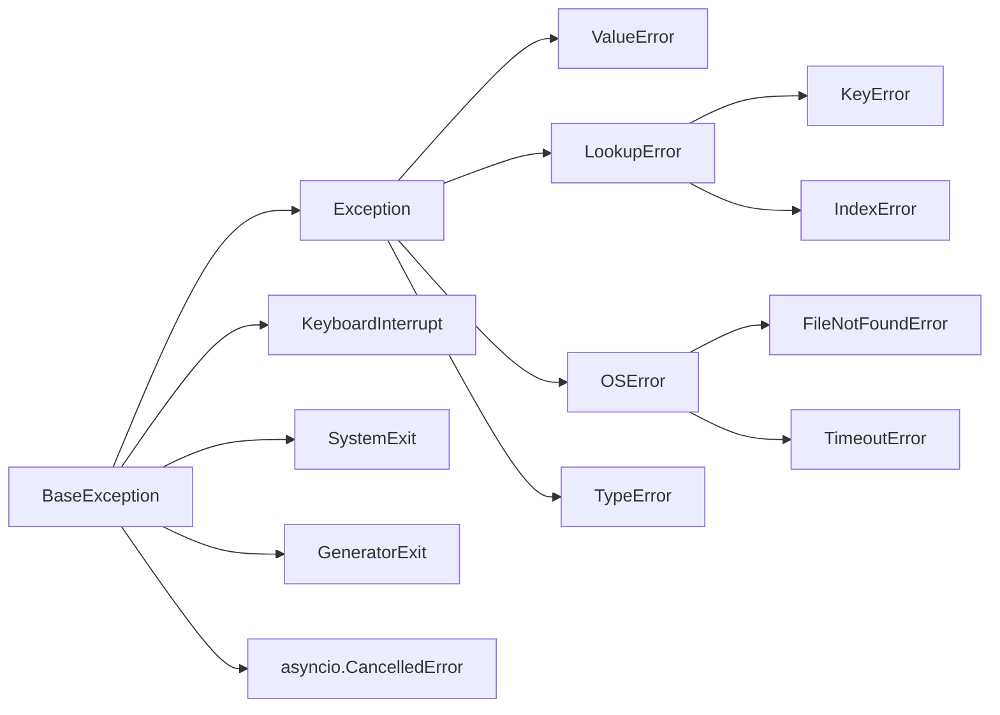
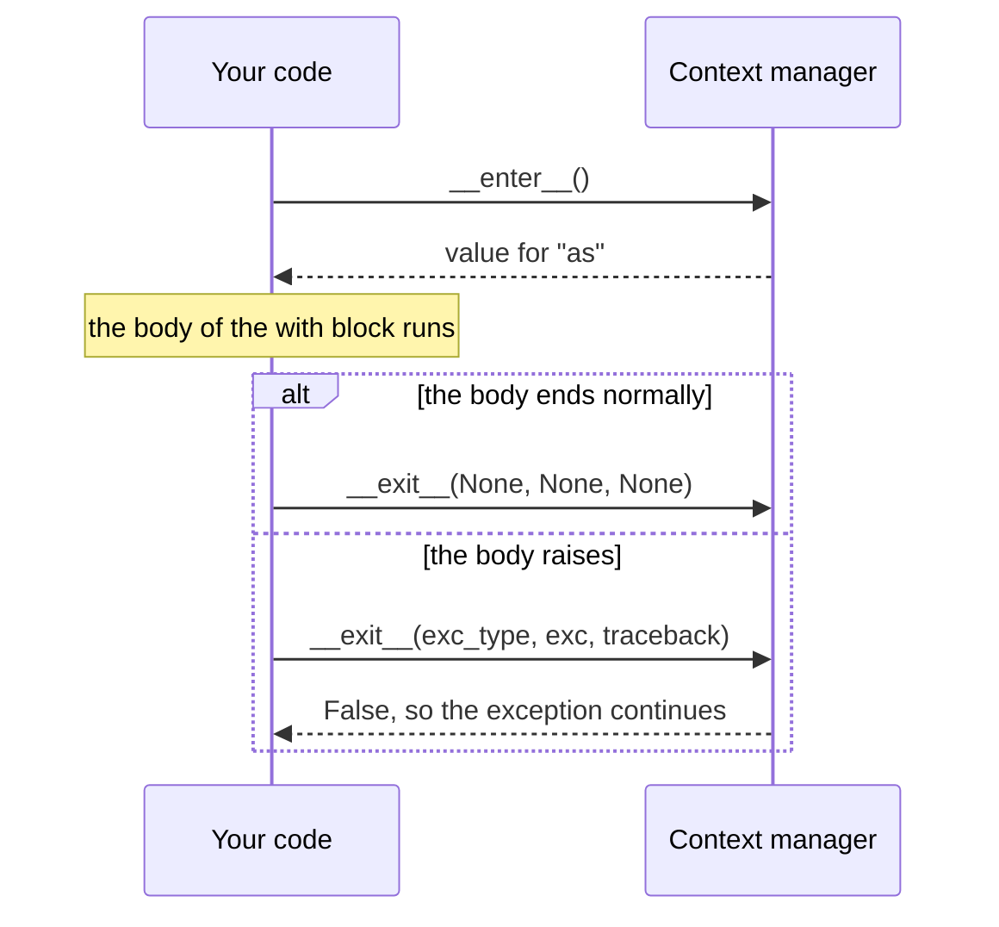

## 1. The question this idea answers

A program reads a file, calls an API and writes a result. Each step can fail. The file can be missing. The API can time out. The JSON can be broken.

Two questions follow:

1. When a step fails, how does the program tell the code above it what went wrong?
2. When a step fails halfway, how does the program still close the file, release the lock or close the network connection?

Python answers the first question with **exceptions**. It answers the second question with **`finally`** and **context managers** (the `with` statement).

These ideas matter a lot in AI services. An agent run has many steps that can fail. A worker thread must send its error to the main thread ([2.4](/notes/ai/ai-engineering/01-software-engineering-fundamentals/m02-concurrency-foundations/l4-queues-and-producer-consumer)). A stream must close its connection when the user leaves ([5.2](/notes/ai/ai-engineering/01-software-engineering-fundamentals/m05-streaming-and-agent-events/l2-fastapi-streaming-responses)). All of that uses the tools of this lesson.

## 2. Mental model

> [!analogy] A fire alarm in an office building
> An exception is a fire alarm. When a worker on floor 3 finds a fire, the worker does not continue the normal job. The alarm travels from floor to floor until a person who knows what to do answers it (an `except` block). If nobody answers, the building closes (the program stops and prints a traceback).
>
> `finally` is the rule "close the fire doors on your way out". It runs if the day was normal and also if the alarm rang.
>
> A context manager is a door with an automatic closer. You open it with `with`. When you leave the room, for any reason, the door closes.
>
> **Where it stops working:** a real alarm rings in every room at the same time. A Python exception travels only up the chain of function calls in one thread. Another thread does not hear it ([2.3](/notes/ai/ai-engineering/01-software-engineering-fundamentals/m02-concurrency-foundations/l3-threads)).

## 3. Terms

| Term | Plain meaning |
|---|---|
| exception | An object that describes an error. Python creates it and stops the normal flow of the code. |
| raise | Start an exception. `raise ValueError("bad row")`. |
| catch | Stop an exception in an `except` block and handle it. |
| propagate | An exception that nobody catches travels to the function that called this one. |
| traceback | The report that Python prints for an uncaught exception: the chain of calls and the error. |
| exception class | The type of an exception, for example `ValueError`. Classes form a tree. |
| `BaseException` | The root of the exception tree. |
| `Exception` | The class for normal errors. Almost all errors inherit from it. |
| custom exception | An exception class that you write, as a subclass of `Exception`. |
| exception chaining | One exception keeps a link to the exception that caused it (`raise ... from ...`). |
| `finally` | A block that always runs after its `try` block, with or without an error. |
| resource | Something that you must give back: an open file, a network connection, a lock. |
| context manager | An object that prepares a resource at the start of a `with` block and releases it at the end. |
| `__enter__` / `__exit__` | The two methods that make an object a context manager. |

## 4. How it works

### 4.1 An error stops the normal flow

`int("forty")` cannot make a number. Python raises a `ValueError`. Every line after the error in that block does not run.

```python
n = int("forty")
print("this line never runs")
```

```text
ValueError: invalid literal for int() with base 10: 'forty'
```

An exception is an object. It has a class (`ValueError`) and a message. Code can catch it and read both.

### 4.2 try, except, else and finally

The full statement has four parts. Each part has one job.

| Part | Runs when |
|---|---|
| `try:` | Always. It holds the code that can fail. |
| `except SomeError as e:` | Only when the `try` block raised `SomeError` or a subclass of it. `e` is the exception object. |
| `else:` | Only when the `try` block raised nothing. |
| `finally:` | Always, as the last part. Also when a `return` or a new error leaves the block. |

```python
def parse_count(text):
    print("  try: start")
    try:
        n = int(text)
    except ValueError as e:
        print(f"  except: {type(e).__name__}: {e}")
        return None
    else:
        print(f"  else: no error, n = {n}")
        return n
    finally:
        print("  finally: always runs")

print("call 1 ->", parse_count("42"))
print("call 2 ->", parse_count("forty"))
```

```text
  try: start
  else: no error, n = 42
  finally: always runs
call 1 -> 42
  try: start
  except: ValueError: invalid literal for int() with base 10: 'forty'
  finally: always runs
call 2 -> None
```

> [!example] Worked example: the order of the four parts
> Call 1 gets "42". `int` succeeds, so `except` is skipped and `else` runs. `else` returns 42. Before the function really returns, `finally` prints its line. Only then does `print` show `call 1 -> 42`.
>
> Call 2 gets "forty". `int` raises. `except` runs and returns `None`. `finally` runs again before the return completes.
>
> So `finally` runs even when the block leaves with `return`. That is why it is the right place for cleanup.

Put only the line that can fail inside `try`. Code in `else` runs only on success, and the `except` above it does not catch its errors. The Python tutorial gives the reason (checked on 2026-10-19): the `else` clause "avoids accidentally catching an exception that wasn't raised by the code being protected".

> [!trap] A return inside finally replaces the real result
> If `finally` has its own `return`, that value wins over the `return` of the `try` block. It also hides an exception that was on its way out. The tutorial calls this confusing and discouraged. From Python 3.14 the compiler gives a `SyntaxWarning` for it (PEP 765). Use `finally` for cleanup only.

### 4.3 The exception tree

Exception classes form a tree. An `except` clause catches its class and every class below it.



A sandbox run checked each class (Python 3.13.16):

```text
ValueError         Exception? True   BaseException? True
KeyError           Exception? True   BaseException? True
TimeoutError       Exception? True   BaseException? True
KeyboardInterrupt  Exception? False  BaseException? True
SystemExit         Exception? False  BaseException? True
GeneratorExit      Exception? False  BaseException? True
CancelledError     Exception? False  BaseException? True
KeyError mro:      ['KeyError', 'LookupError', 'Exception', 'BaseException', 'object']
```

The classes outside `Exception` are not errors in the normal sense. They are control signals:

| Class | What it means |
|---|---|
| `KeyboardInterrupt` | The user pressed Ctrl+C. |
| `SystemExit` | The code called `sys.exit()`. |
| `GeneratorExit` | Someone closed a generator ([2.5](/notes/ai/ai-engineering/01-software-engineering-fundamentals/m02-concurrency-foundations/l5-generators-and-yield)). |
| `asyncio.CancelledError` | Someone cancelled a task ([2.6](/notes/ai/ai-engineering/01-software-engineering-fundamentals/m02-concurrency-foundations/l6-asyncio-and-the-event-loop)). |

> [!key] `except Exception` does not catch control signals
> `except Exception` catches normal errors. It does not catch Ctrl+C, `sys.exit()`, a closed generator or a cancelled task. This is on purpose: those signals must reach the code that sent them. The case study in [5.5](/notes/ai/ai-engineering/01-software-engineering-fundamentals/m05-streaming-and-agent-events/l5-case-study-the-run-bridge) shows a bug that comes from this rule.

### 4.4 Catch narrow, not wide

A wide `except` catches errors that you did not expect. It can hide a real bug.

```python
def total_price(items):
    try:
        return sum(item["price"] * item["qty"] for item in itmes)   # typo: itmes
    except Exception:
        return 0                                                    # hides the bug

print("total:", total_price([{"price": 5, "qty": 2}]))
```

```text
total: 0
```

The typo `itmes` raises `NameError`. The wide `except` turns the bug into a wrong answer: 0. Nobody sees the bug. With `except KeyError`, the `NameError` passes through, and the traceback shows the typo at once:

```text
narrow except lets the real bug through: name 'itmes' is not defined
```

Rules for `except`:

1. Name the exact class that you expect.
2. Handle it, or raise a clearer error. Do not write `except: pass`.
3. A bare `except:` catches `BaseException`, so it also catches Ctrl+C. Never use it.
4. A wide `except Exception` is correct at a boundary only: the top of a request handler or a worker thread. There it logs the error and sends a safe message. The case study in [5.5](/notes/ai/ai-engineering/01-software-engineering-fundamentals/m05-streaming-and-agent-events/l5-case-study-the-run-bridge) has such a boundary.

### 4.5 Custom exceptions and chaining

A custom exception gives an error a name that your code owns. It can also carry extra data.

```python
class ToolError(Exception):
    """A tool failed. It keeps the tool name for the log."""

    def __init__(self, tool: str, message: str):
        super().__init__(f"{tool}: {message}")
        self.tool = tool


def read_config(text):
    import json
    try:
        return json.loads(text)
    except json.JSONDecodeError as e:
        raise ToolError("read_config", "the config is not valid JSON") from e


try:
    read_config("{bad json")
except ToolError as err:
    print("caught:", err)
    print("err.tool:", err.tool)
    print("err.__cause__:", repr(err.__cause__))
```

```text
caught: read_config: the config is not valid JSON
err.tool: read_config
err.__cause__: JSONDecodeError('Expecting property name enclosed in double quotes: line 1 column 2 (char 1)')
```

`raise NewError(...) from e` is **exception chaining**. The new exception keeps the old one in `__cause__`. The traceback then shows both, with this line between them:

```text
The above exception was the direct cause of the following exception:
```

If you raise a new exception inside `except` without `from`, Python still keeps the old one, but in `__context__`. The traceback line is different:

```text
During handling of the above exception, another exception occurred:
```

That second line tells a reader "a new bug happened while the code handled the first error". `from e` tells the reader "this is on purpose: I changed the error type". `raise NewError(...) from None` hides the old exception. Use it only when the old one gives no useful information.

### 4.6 Read a traceback from the bottom

When nobody catches an exception, Python prints a traceback and the program stops.

```python
def load_rows(path):
    return parse(open_file(path))

def open_file(path):
    return {"rows": None}

def parse(doc):
    return len(doc["rows"])

load_rows("orders.json")
```

```text
Traceback (most recent call last):
  File "m01_l6_d.py", line 10, in <module>
    load_rows("orders.json")
    ~~~~~~~~~^^^^^^^^^^^^^^^
  File "m01_l6_d.py", line 2, in load_rows
    return parse(open_file(path))
  File "m01_l6_d.py", line 8, in parse
    return len(doc["rows"])
TypeError: object of type 'NoneType' has no len()
```

> [!example] Worked example: read it in four steps
> 1. **Last line first.** `TypeError: object of type 'NoneType' has no len()`. Some value was `None`, and code asked for its length.
> 2. **The frame just above it.** File line 8, in `parse`: `len(doc["rows"])`. So `doc["rows"]` was `None`.
> 3. **Read one frame higher.** Line 2, in `load_rows`: `parse(open_file(path))`. The `doc` came from `open_file`.
> 4. **Find where the bad value was made.** `open_file` returns `{"rows": None}`. The error shows in `parse`, but the cause is in `open_file`.
>
> "Most recent call last" means the top frame is the first call and the bottom frame is the place of the error. The cause of a bug is often one or two frames above the bottom line.

### 4.7 Resources and leaks

A resource is something that you must give back. A file handle is a resource. The operating system gives each process a limited number of them.

```python
def count_lines_leaky(path):
    f = open(path, encoding="utf-8")
    return len(f.readlines())            # f is never closed

def count_lines(path):
    with open(path, encoding="utf-8") as f:
        return len(f.readlines())        # closed when the block ends, also on an error
```

Run with warnings on (`python -W default`), the leaky version gives:

```text
ResourceWarning: unclosed file <_io.TextIOWrapper name='demo.txt' mode='r' encoding='utf-8'>
```

Without `with`, the file closes only when the last reference to it goes away. In CPython that is often at once: here the warning appeared on the call line, before the next `print`. But other references can keep the file open for a long time. A sandbox run (Python 3.13.16) opened a file, and `json.load` raised before `f.close()`. The caller kept the exception:

```text
caught; the traceback still holds the frame, so the file is open
ResourceWarning: unclosed file <_io.TextIOWrapper name='bad.json' mode='r' encoding='utf-8'>
```

The warning came only at `del saved`, the line that dropped the exception. The traceback held the frame, and the frame held `f`. A reference cycle, a stored reference or another Python implementation can delay the close in the same way. Do not depend on it. A server that leaks one file or one connection for each request can run out of handles after some hours. The error then appears far from its cause.

### 4.8 The with statement

`with` calls two methods for you:

1. At the start, `__enter__()`. Its return value goes to the name after `as`.
2. At the end, `__exit__(exc_type, exc_value, traceback)`. It runs for a normal end, a `return`, a `break` and an exception.

```python
class Timer:
    def __enter__(self):
        print("  __enter__: start the timer")
        return self                      # this value goes to the name after "as"

    def __exit__(self, exc_type, exc_value, tb):
        print(f"  __exit__: exc_type={exc_type.__name__ if exc_type else None}")
        return False                     # False: do not hide the exception

print("normal block:")
with Timer() as t:
    print("  body runs, t is the Timer:", isinstance(t, Timer))

print("block that raises:")
try:
    with Timer():
        print("  body runs")
        raise ValueError("bad row")
except ValueError as e:
    print("  caught outside the with:", e)
```

```text
normal block:
  __enter__: start the timer
  body runs, t is the Timer: True
  __exit__: exc_type=None
block that raises:
  __enter__: start the timer
  body runs
  __exit__: exc_type=ValueError
  caught outside the with: bad row
```



If `__exit__` returns `True`, Python hides the exception. That is rarely what you want. Return `False` (or `None`) unless the job of the context manager is to handle that error.

### 4.9 contextlib.contextmanager: a context manager from a generator

Writing a class with two methods is long. The standard library offers a short form. You write a generator function with one `yield` ([2.5](/notes/ai/ai-engineering/01-software-engineering-fundamentals/m02-concurrency-foundations/l5-generators-and-yield)):

```python
import time
from contextlib import contextmanager

@contextmanager
def timed(label):
    start = time.perf_counter()
    print(f"  start {label}")
    try:
        yield                                  # the body of the with block runs here
    finally:
        print(f"  end {label}: {time.perf_counter() - start:.2f} s")

with timed("load"):
    time.sleep(0.2)

try:
    with timed("parse"):
        raise KeyError("rows")
except KeyError as e:
    print("  caught:", repr(e))
```

```text
  start load
  end load: 0.20 s
  start parse
  end parse: 0.00 s
  caught: KeyError('rows')
```

The code before `yield` is the `__enter__` part. The code after it is the `__exit__` part. The `contextlib` docs say (checked on 2026-10-19): "If an unhandled exception occurs in the block, it is reraised inside the generator at the point where the yield occurred." So the `try`/`finally` around `yield` is necessary. Without it, the "end" line does not print when the body raises.

### 4.10 Where these ideas appear later

| Later lesson | What it uses from here |
|---|---|
| [2.3 Threads](/notes/ai/ai-engineering/01-software-engineering-fundamentals/m02-concurrency-foundations/l3-threads) | An exception in a thread does not reach the code that started the thread. |
| [2.4 Queues](/notes/ai/ai-engineering/01-software-engineering-fundamentals/m02-concurrency-foundations/l4-queues-and-producer-consumer) | A producer puts its exception object in a queue, and the consumer raises it again. A sentinel goes in `finally`. |
| [2.5 Generators](/notes/ai/ai-engineering/01-software-engineering-fundamentals/m02-concurrency-foundations/l5-generators-and-yield) | `close()` raises `GeneratorExit` at a paused `yield`. `finally` runs. |
| [2.6 asyncio](/notes/ai/ai-engineering/01-software-engineering-fundamentals/m02-concurrency-foundations/l6-asyncio-and-the-event-loop) | `async with`, and `CancelledError` as a `BaseException`. |
| [4.2 Error responses](/notes/ai/ai-engineering/01-software-engineering-fundamentals/m04-fastapi-services/l2-validation-and-error-responses) | Exception handlers turn exceptions into safe HTTP responses. |

## 5. Code walkthrough

The function below reads a JSON config file. It uses every idea of this lesson. Read each line and its comment.

```python
import json
from pathlib import Path


class ConfigError(Exception):                      # 1
    """The config file is missing or broken."""


def load_config(path: Path) -> dict:
    try:
        with path.open(encoding="utf-8") as f:     # 2
            data = json.load(f)                    # 3
    except FileNotFoundError as e:                 # 4
        raise ConfigError(f"no config file at {path}") from e
    except json.JSONDecodeError as e:              # 5
        raise ConfigError(f"{path} is not valid JSON: line {e.lineno}") from e
    else:
        if "model" not in data:                    # 6
            raise ConfigError(f"{path} has no 'model' field")
        return data
```

| Mark | What the line does | Why it is there | What breaks without it |
|---|---|---|---|
| 1 | Defines one error type for every config problem | The caller catches one class, `ConfigError`, and does not need to know about files or JSON | The caller must catch `FileNotFoundError`, `JSONDecodeError` and more |
| 2 | Opens the file inside `with` | The file closes when the block ends, also when `json.load` raises | A broken file leaks one handle each time |
| 3 | Parses the text into Python objects | This is the line that can fail with `JSONDecodeError` | |
| 4 | Turns "no file" into `ConfigError` with `from e` | The message says what to fix. `__cause__` keeps the original error for the log | The user sees a raw `FileNotFoundError` from deep inside the code |
| 5 | Turns "bad JSON" into `ConfigError` and gives the line number | `e.lineno` is an attribute of `JSONDecodeError` | The user must guess where the JSON is broken |
| 6 | Checks the content after a successful parse | It is in `else`, so it runs only when the parse worked | A missing key causes a `KeyError` later, far from the cause |

Data in: a `Path`. Data out: a `dict`, or a `ConfigError` with a clear message. The function never returns a half-loaded config.

A sandbox run with one good file and three bad ones gave:

```text
{'model': 'm1'}
ConfigError: no config file at missing.json | cause: FileNotFoundError
ConfigError: bad.json is not valid JSON: line 2 | cause: JSONDecodeError
ConfigError: nomodel.json has no 'model' field | cause: None
```

The last error has no cause because the code raised it directly, not inside an `except` block.

## 6. Exercises

Runs in: a browser lab. [Open a lab for this lesson](/labs/new?note=ai/ai-engineering/01-software-engineering-fundamentals/m01-python-foundations/l6-exceptions-and-context-managers)

**Exercise 6.1: safe parse.** Write `parse_price(text: str) -> float`. It raises `PriceError` (your own class) for empty text, text that is not a number and negative numbers. Each message names the problem.

Acceptance tests:

- `parse_price("12.50")` returns `12.5`.
- `parse_price("")`, `parse_price("abc")` and `parse_price("-3")` each raise `PriceError`. The three messages are different.
- For `"abc"`, the `PriceError` has `__cause__` set to a `ValueError`.

**Exercise 6.2: a context manager two ways.** Write a context manager that prints `enter <name>` and `exit <name> ok` or `exit <name> failed: <ExceptionClass>`. Write it once as a class with `__enter__`/`__exit__` and once with `@contextmanager`.

Acceptance tests:

- A normal block prints the "ok" line.
- A block that raises `KeyError` prints the "failed: KeyError" line, and the `KeyError` still reaches the code outside the `with`.
- Both versions give the same output for the same blocks.

**Exercise 6.3: read a traceback.** Write three small functions that call each other. Make the bottom one fail because of a bad value that the top one made. Run it. In a text cell, write the four reading steps of section 4.6 for your traceback.

Acceptance test: your text names the line where the bad value was made, not only the line where the error appeared.

Hints come in three levels in chat: idea, pseudocode, partial code.

## 7. Common mistakes

1. **`except: pass` or `except Exception: pass`.** The error disappears, and the program gives a wrong result. Catch a narrow class and handle it.
2. **Too much code inside `try`.** The `except` then catches errors from lines that you did not mean. Put only the risky line in `try`. Put the rest in `else`.
3. **Cleanup after the risky line, not in `finally`.** When the risky line raises, the cleanup never runs. Use `finally` or `with`.
4. **`raise NewError` without `from e` inside `except`.** The traceback says "During handling ... another exception occurred", which reads like a second bug. Write `from e` when the change of type is on purpose.
5. **Reading only the top of a traceback.** The top is the first call. The error is at the bottom.
6. **`open()` without `with`.** A file or connection leaks when an error happens before `close()`.
7. **`__exit__` that returns `True` by accident.** It hides every exception from the block.
8. **"`except Exception` catches everything."** It does not catch `KeyboardInterrupt`, `SystemExit`, `GeneratorExit` or `asyncio.CancelledError`.

## 8. One-minute explanation

When an operation fails, Python raises an exception: an object with a class and a message. The normal flow stops. The exception travels back through the chain of calls until an `except` block catches it. That block must name the class of the exception or a parent class. If nobody catches it, Python prints a traceback. Read a traceback from the last line to the first. `try` holds the risky line, `except` handles an expected error, `else` runs only on success and `finally` always runs, also on `return`. Catch narrow classes, and use `raise NewError(...) from e` to change the error type without losing the cause. Normal errors inherit from `Exception`. Control signals such as Ctrl+C, a closed generator and a cancelled task inherit only from `BaseException`, so `except Exception` does not catch them. A context manager, used with `with`, prepares a resource in `__enter__` and always releases it in `__exit__`, even when the body raises. `@contextmanager` builds one from a generator with a single `yield` inside `try`/`finally`.

## 9. Check questions

```check
{
  "question": "A function has try, except ValueError, else and finally. The try block succeeds and the else block executes return 5. In which order do the parts run, and what does the caller receive?",
  "hint": "finally runs before the return completes.",
  "answer": "try, then else, then finally, then the caller receives 5. The except block does not run because nothing was raised. finally runs after else starts the return and before the value reaches the caller."
}
```

```check
{
  "question": "A worker loop has except Exception around its body. A user presses Ctrl+C, and an asyncio task is cancelled in another part of the program. Does the except Exception block catch either of them? Why is that good?",
  "answer": "It catches neither. KeyboardInterrupt and asyncio.CancelledError inherit from BaseException, not from Exception. This is good because these are control signals: Ctrl+C must stop the program, and a cancellation must reach the code that cancelled the task. If normal error handling swallowed them, the program could not stop or cancel cleanly."
}
```

```check
{
  "question": "A traceback ends with KeyError: 'model'. The frame above it is in build_request, and the frame above that is in load_config. Where do you search first for the cause, and why?",
  "answer": "Read the bottom line first: a dict had no 'model' key. The error appeared in build_request, but the dict probably came from load_config, one frame up. So check what load_config returned: a config file without a model field, or a parse that gave a different shape. The cause is often one or two frames above the line where the error appears."
}
```

```check
{
  "question": "Why does a with block close a file even when json.load raises inside it, while f = open(path) followed by f.close() does not?",
  "answer": "with calls the file's __exit__ method for every way out of the block, including an exception. In the second form, the exception stops the normal flow before the f.close() line, so close never runs. The handle stays open until the last reference to the file goes away, and a traceback that keeps the frame alive can delay that for a long time."
}
```

## 10. Links

- Previous: [1.5 Classes, objects and dataclasses](/notes/ai/ai-engineering/01-software-engineering-fundamentals/m01-python-foundations/l5-classes-and-dataclasses)
- Next: [1.7 Files, paths, environment variables and JSON](/notes/ai/ai-engineering/01-software-engineering-fundamentals/m01-python-foundations/l7-files-paths-env-and-json)
- Exceptions across threads: [2.4 Queues and the producer-consumer pattern](/notes/ai/ai-engineering/01-software-engineering-fundamentals/m02-concurrency-foundations/l4-queues-and-producer-consumer)
- `GeneratorExit`: [2.5 Generators, yield, close() and GeneratorExit](/notes/ai/ai-engineering/01-software-engineering-fundamentals/m02-concurrency-foundations/l5-generators-and-yield)
- Errors as HTTP responses: [4.2 Validation, status codes and error responses](/notes/ai/ai-engineering/01-software-engineering-fundamentals/m04-fastapi-services/l2-validation-and-error-responses)
- Source: Python tutorial, "Errors and Exceptions": https://docs.python.org/3/tutorial/errors.html (checked on 2026-10-19)
- Source: Python docs, `contextlib`: https://docs.python.org/3/library/contextlib.html (checked on 2026-10-19)
- [Glossary](/notes/ai/ai-engineering/glossary)
