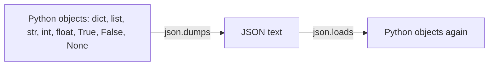

## 1. The question this idea answers

A program lives longer than one run only when it uses things outside itself. An AI service needs at least three of them:

1. **Files.** Prompts, evaluation datasets and saved results live in files.
2. **Configuration.** The model name, the database address and the API key change between your laptop and production. They must not live in the code.
3. **A data format.** Every model API sends and receives JSON. Many datasets arrive as CSV.

This lesson answers three questions. How does Python find and read a file on any operating system? Where does configuration come from? How does Python data become JSON text and come back?

## 2. Mental model

> [!analogy] A house address, a notice board and a shipping box
> - A **path** is a house address. It says where a file is. It is not the file. An address can point to a house that does not exist yet.
> - An **environment variable** is a note on the notice board at the entrance of a building. Every program that starts in the building can read the board. The note says, for example, "the database is at host X". You change the note, not the program.
> - **JSON** is a standard shipping box. Any program, in any language, can pack data into it and unpack it. But the box takes only some shapes: objects, lists, strings, numbers, true, false and null.
>
> **Where it stops working:** a real notice board is the same for everybody. Each process gets its own **copy** of the environment variables when it starts. A change inside one process does not reach a process that is already running.

## 3. Terms

| Term | Plain meaning |
|---|---|
| file | A named sequence of bytes on a disk. |
| path | The address of a file or a folder, for example `data/prompts/system.txt`. |
| relative path | A path that starts from the current working directory. |
| absolute path | A path that starts from the root of the disk, for example `/home/ana/app` or `C:\Users\ana\app`. |
| current working directory | The folder that a process treats as "here". Relative paths start from it. |
| `pathlib.Path` | The standard Python class for paths. It works on Windows, macOS and Linux. |
| encoding | The rule that turns text into bytes and back. UTF-8 is the standard. |
| file mode | How `open` uses a file: `"r"` read, `"w"` write (empties first), `"a"` append, `"b"` bytes. |
| environment variable | A name and a text value that a process receives from the process that started it. |
| `os.environ` | The environment variables of the current process, as a dict-like object of strings. |
| secret | A value that gives access, for example an API key or a database password. |
| `.env` file | A text file with `NAME=value` lines that a library loads into the environment for local development. |
| serialize | Turn Python objects into text or bytes for storage or transport. |
| deserialize | Turn that text or bytes back into Python objects. |
| JSON | JavaScript Object Notation: a text format for objects, arrays, strings, numbers, true, false and null. |
| CSV | Comma-separated values: a text format for tables, one row per line. |

## 4. How it works

### 4.1 Paths with pathlib

Folder separators differ: Windows uses `\`, Linux and macOS use `/`. `pathlib.Path` hides this difference. You join parts with the `/` operator.

```python
from pathlib import Path

data_dir = Path("data")
prompt_file = data_dir / "prompts" / "system.txt"      # the / operator joins parts
print("path:", prompt_file)
print("name:", prompt_file.name, "| stem:", prompt_file.stem, "| suffix:", prompt_file.suffix)
print("parent:", prompt_file.parent)
print("exists before:", prompt_file.exists())

prompt_file.parent.mkdir(parents=True, exist_ok=True)  # make data/ and data/prompts/
prompt_file.write_text("You answer questions about orders.\n", encoding="utf-8")
print("exists after:", prompt_file.exists(), "| is_file:", prompt_file.is_file())
print("text:", repr(prompt_file.read_text(encoding="utf-8")))
print("absolute:", prompt_file.resolve().is_absolute())
print("all .txt files:", sorted(str(p) for p in data_dir.rglob("*.txt")))
```

```text
path: data/prompts/system.txt
name: system.txt | stem: system | suffix: .txt
parent: data/prompts
exists before: False
exists after: True | is_file: True
text: 'You answer questions about orders.\n'
absolute: True
all .txt files: ['data/prompts/system.txt']
```

Each line of the output teaches one method:

| Method or attribute | Gives |
|---|---|
| `.name`, `.stem`, `.suffix` | The last part, the last part without its suffix, and the suffix |
| `.parent` | The folder that holds the path |
| `.exists()`, `.is_file()`, `.is_dir()` | Whether something is at the address, and what kind |
| `.mkdir(parents=True, exist_ok=True)` | Makes the folder and its missing parents. No error if it exists. |
| `.read_text(encoding=...)`, `.write_text(text, encoding=...)` | Reads or writes the whole file as text |
| `.resolve()` | The absolute path |
| `.rglob("*.txt")` | Every matching file in the folder and its sub-folders |

> [!trap] A relative path depends on where you start the program
> `Path("data")` means "data inside the current working directory". Start the same script from another folder and it reads another place, or nothing. For files that belong to your code, build the path from the location of the module: `Path(__file__).parent / "prompts" / "system.txt"`.

### 4.2 Text, bytes and the encoding

A disk stores bytes. Text needs an encoding to become bytes. UTF-8 stores the letters of English in one byte each and other characters in two to four bytes.

```python
from pathlib import Path
p = Path("cafe.txt")
p.write_text("café ✓", encoding="utf-8")
print("bytes on disk:", p.read_bytes())
print("read as utf-8:", p.read_text(encoding="utf-8"))
try:
    print("read as ascii:", p.read_text(encoding="ascii"))
except UnicodeDecodeError as e:
    print("UnicodeDecodeError:", e)
print("read as cp1252:", p.read_text(encoding="cp1252"))
```

```text
bytes on disk: b'caf\xc3\xa9 \xe2\x9c\x93'
read as utf-8: café ✓
UnicodeDecodeError: 'ascii' codec can't decode byte 0xc3 in position 3: ordinal not in range(128)
read as cp1252: café ✓
```

> [!example] Worked example: count the bytes
> "café ✓" has 6 characters. On disk it has 9 bytes: `c`, `a`, `f` are 1 byte each (3), `é` is 2 bytes (`\xc3\xa9`), the space is 1 byte, and `✓` is 3 bytes (`\xe2\x9c\x93`). 3 + 2 + 1 + 3 = 9.
>
> Read with the wrong encoding, the same bytes give an error (ASCII) or wrong letters (cp1252, a common Windows encoding). Wrong letters are worse than an error, because nothing stops the program.

Always write `encoding="utf-8"`. Without it, Python uses a default that depends on the operating system and its settings. A file written on one machine can then read wrong on another.

### 4.3 open() and file modes

`read_text` and `write_text` handle a whole file at once. For large files or line-by-line work, use `open` inside `with` ([1.6](/notes/ai/ai-engineering/01-software-engineering-fundamentals/m01-python-foundations/l6-exceptions-and-context-managers)).

```python
from pathlib import Path

with open("log.txt", "w", encoding="utf-8") as f:
    f.write("line 1\n")
with open("log.txt", "a", encoding="utf-8") as f:
    f.write("line 2\n")
with open("log.txt", encoding="utf-8") as f:
    for line in f:                     # a file object is an iterator of lines
        print(repr(line))
with open("log.txt", "w", encoding="utf-8") as f:
    f.write("new\n")                   # "w" empties the file first
print(Path("log.txt").read_text(encoding="utf-8").splitlines())
```

```text
'line 1\n'
'line 2\n'
['new']
```

| Mode | Opens for | If the file exists | If the file does not exist |
|---|---|---|---|
| `"r"` (default) | reading | reads it | `FileNotFoundError` |
| `"w"` | writing | **empties it first** | makes it |
| `"a"` | appending | writes at the end | makes it |
| `"x"` | exclusive creation | `FileExistsError` | makes it |
| add `"b"`, for example `"rb"` | bytes, no encoding | | |

The `for line in f` loop reads one line at a time. The whole file never sits in memory. Lesson [2.5](/notes/ai/ai-engineering/01-software-engineering-fundamentals/m02-concurrency-foundations/l5-generators-and-yield) explains why this works: a file object is an iterator.

### 4.4 Environment variables

Every process receives a set of environment variables from the process that started it. A terminal passes its variables to the Python process. Docker and cloud platforms pass the variables that you configure.

```python
import os

print("HOME is set:", "HOME" in os.environ)
print("type of a value:", type(os.environ["HOME"]).__name__)
print("get with default:", os.environ.get("APP_MODEL", "small-model"))
try:
    os.environ["API_KEY"]
except KeyError as e:
    print("missing variable -> KeyError:", e)

os.environ["DEBUG"] = "false"
print("bool('false') =", bool(os.environ["DEBUG"]), "<- a non-empty string is truthy")
debug = os.environ.get("DEBUG", "false").lower() in {"1", "true", "yes"}
print("parsed debug =", debug)
os.environ["MAX_TOKENS"] = "800"
print("MAX_TOKENS + 1 =", int(os.environ["MAX_TOKENS"]) + 1)
```

```text
HOME is set: True
type of a value: str
get with default: small-model
missing variable -> KeyError: 'API_KEY'
bool('false') = True <- a non-empty string is truthy
parsed debug = False
MAX_TOKENS + 1 = 801
```

Three facts come from this output:

1. **Every value is a string.** `"800"` must become `int("800")`. `"false"` is a non-empty string, so `bool("false")` is `True`. Parse booleans by comparing text.
2. **`os.environ["NAME"]` raises `KeyError` when the name is missing.** Use it for values without which the program must not start, for example a database URL. The program then fails at once with a clear name.
3. **`os.environ.get("NAME", default)` returns the default.** Use it only for values with a safe default, for example a log level. Never give a secret a default.

A process can change its own `os.environ`. A child process that it starts after the change receives the new value. A sandbox run started a child Python process after `os.environ["APP_MODE"] = "test"`, and the child printed `test`. A process that is already running elsewhere never sees the change.

### 4.5 Secrets stay out of code

An API key in the source code reaches every copy of the repository, every backup and every log of a build. A leaked provider key can cost money within hours.

| Where the secret is | Who can read it | Verdict |
|---|---|---|
| In a `.py` file in Git | Everybody with the repository, forever (Git keeps history) | Never |
| In a URL, for example `?key=...` | Web server logs, proxies, browser history | Never |
| In front-end JavaScript | Every visitor of the site | Never |
| In an environment variable set by the platform | The process and the platform admins | Yes |
| In a secret manager that sets the variable | The process, with an audit log | Best for production |

For local development, many projects keep a `.env` file with `NAME=value` lines. The `.env` file is listed in `.gitignore`, so Git never stores it ([7.3](/notes/ai/ai-engineering/01-software-engineering-fundamentals/m07-git/l3-history-gitignore-readme-and-review)). A library loads it into `os.environ` at start.

```python
import os
from dotenv import load_dotenv

os.environ["APP_MODEL"] = "from-the-shell"
loaded = load_dotenv(".env")          # reads the file into os.environ
print("load_dotenv returned:", loaded)
print("APP_MODEL:", os.environ["APP_MODEL"], "<- the shell value wins by default")
print("MAX_TOKENS:", os.environ["MAX_TOKENS"])
print("API_KEY set:", "API_KEY" in os.environ)
```

```text
load_dotenv returned: True
APP_MODEL: from-the-shell <- the shell value wins by default
MAX_TOKENS: 800
API_KEY set: True
```

The `.env` file in that run held `APP_MODEL=small-model`, `MAX_TOKENS=800` and a fake `API_KEY`. python-dotenv 1.2.4 did not replace `APP_MODEL`, because the variable already existed. So a value from the real environment wins over the file. Lesson [4.3](/notes/ai/ai-engineering/01-software-engineering-fundamentals/m04-fastapi-services/l3-dependencies-lifespan-config-and-middleware) shows `pydantic-settings`, which reads, checks and converts all settings in one class.

> [!key] Never print a secret
> Log that a secret is present (`API_KEY set: True`), never its value. A log line with a key is a leaked key.

### 4.6 JSON: the shape of every model API

A model API request and its response are JSON text. Python's `json` module converts in both directions.



| Python | JSON |
|---|---|
| `dict` | object `{...}` |
| `list`, `tuple` | array `[...]` |
| `str` | string `"..."` |
| `int`, `float` | number |
| `True` / `False` | `true` / `false` |
| `None` | `null` |

The table comes from the `json` docs (checked on 2026-10-19). Some types change on the trip. A sandbox run sent a reply-like dict through `dumps` and `loads`:

```python
import json
reply = {
    "id": "msg_01",
    "role": "assistant",
    "content": [{"type": "text", "text": "3 open orders"}],
    "usage": {"input_tokens": 120, "output_tokens": 9},
    "stop": None,
    "done": True,
    "score": 0.5,
    "pair": (1, 2),
    7: "int key",
}
text = json.dumps(reply)
print(text)
back = json.loads(text)
print("pair is now:", back["pair"], type(back["pair"]).__name__)
print("int key 7 present?", 7 in back, "| string key '7' present?", "7" in back)
print("round trip equal?", back == reply)
```

```text
{"id": "msg_01", "role": "assistant", "content": [{"type": "text", "text": "3 open orders"}], "usage": {"input_tokens": 120, "output_tokens": 9}, "stop": null, "done": true, "score": 0.5, "pair": [1, 2], "7": "int key"}
pair is now: [1, 2] list
int key 7 present? False | string key '7' present? True
round trip equal? False
```

> [!example] Worked example: why the round trip is not equal
> 1. `None` became `null`, and `True` became `true`. They come back as `None` and `True`. No change.
> 2. The tuple `(1, 2)` became the array `[1, 2]`. It comes back as the **list** `[1, 2]`. A tuple and a list are never equal.
> 3. The key `7` became the string `"7"`. JSON object keys are always strings. The docs say: "`loads(dumps(x)) != x` if x has non-string keys."
>
> So two values changed type. Code that reads the data back must expect a list and string keys.

More rules from the same run. The lines come from, in order: `json.dumps({"text": "café"})`, the same call with `ensure_ascii=False`, `json.dumps` of a dict with a `datetime`, the same with `default=str`, the same with `default=lambda o: o.isoformat()`, `json.loads("{'role': 'user'}")` and `json.loads('{"n": NaN}')`.

```text
{"text": "caf\u00e9"}
{"text": "café"}
TypeError: Object of type datetime is not JSON serializable
{"at": "2026-10-19 14:00:00+00:00"}
{"at": "2026-10-19T14:00:00+00:00"}
JSONDecodeError: Expecting property name enclosed in double quotes | line 1 col 2
{'n': nan} <- Python accepts NaN, strict JSON does not
```

| Situation | What to do |
|---|---|
| You want readable output in a file | `json.dumps(obj, indent=2)`, and `sort_keys=True` for stable diffs |
| The text has non-English letters | `ensure_ascii=False`, and write the file as UTF-8 |
| A `datetime` or another custom type | `default=` a function that returns a JSON type, for example an ISO 8601 string |
| A model returned `{'role': 'user'}` with single quotes | It is not JSON. `json.loads` raises `JSONDecodeError` with a line and a column |
| A float is `nan` or `inf` | Python writes `NaN` and accepts it, but the JSON standard does not. Another system can reject it. Use `allow_nan=False` to fail early |

### 4.7 CSV: tables as text

CSV stores one row per line, with commas between fields. The `csv` module handles commas and quotes inside fields.

```python
import csv
from pathlib import Path

rows = [
    {"order": 1, "line": "L3", "note": "rush, call first"},
    {"order": 2, "line": "L4", "note": 'said "ok"'},
]
with Path("orders.csv").open("w", encoding="utf-8", newline="") as f:
    writer = csv.DictWriter(f, fieldnames=["order", "line", "note"])
    writer.writeheader()
    writer.writerows(rows)
print(Path("orders.csv").read_text(encoding="utf-8"))
with Path("orders.csv").open(encoding="utf-8", newline="") as f:
    for row in csv.DictReader(f):
        print(row, "| order type:", type(row["order"]).__name__)
```

```text
order,line,note
1,L3,"rush, call first"
2,L4,"said ""ok"""

{'order': '1', 'line': 'L3', 'note': 'rush, call first'} | order type: str
{'order': '2', 'line': 'L4', 'note': 'said "ok"'} | order type: str
```

Three details matter:

1. The writer put quotes around `rush, call first`, because the field holds a comma. It doubled the quotes inside `said "ok"`. Never build CSV lines with `",".join(...)`: one comma in the data breaks every column after it.
2. The `csv` docs tell you to open the file with `newline=""`. Without it, Windows can write empty lines between rows.
3. **Every value comes back as a string.** `order` was the int 1. It came back as `'1'`. CSV has no types. Convert each column yourself, or validate the rows with a typed model ([1.8](/notes/ai/ai-engineering/01-software-engineering-fundamentals/m01-python-foundations/l8-type-annotations-and-pydantic)).

### 4.8 Production view

| Concern | Rule |
|---|---|
| Portability | Use `pathlib` and build code-relative paths from `__file__`. |
| Encoding | Write `encoding="utf-8"` on every text read and write. |
| Startup | Read required configuration at start and fail with the variable name when it is missing. |
| Secrets | Environment variables or a secret manager. Never in code, URLs, front-end code or logs. |
| Data at the edge | Treat every JSON or CSV input as untrusted. Validate its shape before use ([1.8](/notes/ai/ai-engineering/01-software-engineering-fundamentals/m01-python-foundations/l8-type-annotations-and-pydantic)). |
| Large files | Iterate line by line. Do not read gigabytes with one `read_text`. |

## 5. Code walkthrough

This function loads a JSON Lines dataset: one JSON object per line. Evaluation datasets for models often use this format.

```python
import json
from pathlib import Path

DATA_DIR = Path(__file__).parent / "data"           # 1


def load_cases(name: str) -> list[dict]:
    path = DATA_DIR / f"{name}.jsonl"                # 2
    cases = []
    with path.open(encoding="utf-8") as f:          # 3
        for line_no, line in enumerate(f, start=1): # 4
            if not line.strip():                     # 5
                continue
            try:
                case = json.loads(line)              # 6
            except json.JSONDecodeError as e:
                raise ValueError(f"{path}:{line_no}: {e.msg}") from e
            if "question" not in case:               # 7
                raise ValueError(f"{path}:{line_no}: no 'question' field")
            cases.append(case)
    return cases
```

| Mark | What it does | Why | Without it |
|---|---|---|---|
| 1 | Builds the data folder from the module's own location | The path is the same from any working directory | The function reads another folder when you start it from elsewhere |
| 2 | Joins the folder and the file name with `/` | Works on every operating system | Hand-joined strings break on Windows |
| 3 | Opens with `with` and UTF-8 | The file closes on every exit, and non-English text reads right | Handle leaks, wrong letters |
| 4 | Iterates the lines and counts them from 1 | One line in memory at a time, and a line number for the error | No position in the error message |
| 5 | Skips empty lines | A last empty line is common in such files | `json.loads("")` raises |
| 6 | Parses one line | Each line is one complete JSON object | |
| 7 | Checks one required field | Fails early at the bad line | A `KeyError` later, far from the data |

Data in: a dataset name. Data out: a list of dicts, or a `ValueError` that names the file and the line.

A sandbox run used two small files. `smoke.jsonl` held two objects and one empty line. `broken.jsonl` held `{bad}` on line 2. The script was in `/tmp/fix2/jl/`, and the run started from another folder (`/`):

```text
[{'question': 'a'}, {'question': 'b', 'x': 1}]
ValueError: /tmp/fix2/jl/data/broken.jsonl:2: Expecting property name enclosed in double quotes
```

The path in the error is absolute, because `__file__` of a script is an absolute path (since Python 3.9). The function found its data although the working directory was `/`.

> [!trap] There is no `__file__` in a lab cell or a notebook
> `__file__` exists only in a module that Python loaded from a file. In a browser-lab cell, a notebook cell or `python -c`, it raises `NameError: name '__file__' is not defined`. There, pass the folder as a parameter, or use `Path.cwd()` on purpose.

## 6. Exercises

Runs in: a browser lab. The lab has an in-memory disk, so `pathlib` works there. [Open a lab for this lesson](/labs/new?note=ai/ai-engineering/01-software-engineering-fundamentals/m01-python-foundations/l7-files-paths-env-and-json)

**Exercise 7.1: settings from the environment.** Write `read_settings() -> dict`. It returns three settings and requires `API_KEY`:

- `model`: a string, default `"small-model"`.
- `max_tokens`: an `int`, default 800.
- `debug`: a `bool`, default `False`.

Acceptance tests:

- With no variables except `API_KEY`, it returns the three defaults.
- `MAX_TOKENS="1200"` gives the int 1200. `MAX_TOKENS="abc"` raises `ValueError` with the variable name in the message.
- `DEBUG="false"` gives `False`, and `DEBUG="TRUE"` gives `True`.
- Without `API_KEY`, it raises an error that names `API_KEY`. No test output ever shows the key's value.

**Exercise 7.2: a JSON round trip that keeps types.** Write `save_run(path, run)` and `load_run(path)`. The `run` dict has a `datetime` field `started_at`, a tuple field `pair` and normal fields.

Acceptance tests:

- The file is valid JSON with `indent=2`, and it holds `started_at` as an ISO 8601 string.
- `load_run(save_run(...))` returns a dict where `started_at` is a `datetime` again and `pair` is a tuple again.
- A file that holds `{'a': 1}` with single quotes raises an error that names the file.

**Exercise 7.3: CSV in, JSON out.** Convert a CSV file of orders into a JSON list. The columns are `order`, `line` and `qty`. In the JSON, `order` and `qty` are ints.

Acceptance tests:

- A field that holds a comma survives.
- `qty` is an int in the JSON.
- A row with `qty` = `"x"` raises an error that names its row number.

Hints come in three levels in chat: idea, pseudocode, partial code.

## 7. Common mistakes

1. **No `encoding=` argument.** The default depends on the machine. Write `encoding="utf-8"`.
2. **Relative paths in library code.** The result depends on the folder where the program starts. Build paths from `__file__`.
3. **`"w"` when you meant `"a"`.** `"w"` empties the file before it writes.
4. **`bool(os.environ["DEBUG"])`.** Any non-empty string is `True`, also `"false"`. Compare the text.
5. **A default value for a secret.** The program then starts without the real key and fails later, or uses a test key in production.
6. **Secrets in code, URLs or logs.** Git history keeps them after you delete the line. Rotate a leaked key first.
7. **Expecting tuples and int keys back from JSON.** They come back as lists and string keys.
8. **Building CSV or JSON with string formatting.** One comma or quote in the data breaks the format. Use `csv` and `json`.
9. **`json.loads` on model output without `try`.** Model text is not always valid JSON. Catch `JSONDecodeError` and report the position.

## 8. One-minute explanation

A path is an address. `pathlib.Path` builds addresses that work on every operating system. Join parts with `/`, check them with `exists()`, and read and write with `read_text` and `write_text`. Always give `encoding="utf-8"`. A disk stores bytes, and the wrong encoding gives an error or, worse, wrong letters. Use `open` inside `with` for line-by-line work, and remember that `"w"` empties a file. Configuration comes from environment variables. Each process receives a copy of them, and every value is a string. So convert numbers, and parse booleans by their text. Use `os.environ["X"]` for required values and `.get("X", default)` for values with a safe default. Never give a secret a default, and never print it. For local work, a `.env` file loads into the environment, and Git never stores it. JSON is the format of every model API. `json.dumps` and `json.loads` convert dicts, lists, strings, numbers, booleans and None. But tuples come back as lists, and keys come back as strings. CSV stores tables as text, so every value comes back as a string.

## 9. Check questions

```check
{
  "question": "A file was written with encoding=\"utf-8\" and holds the text naïve. A program on another machine reads it with open(path) and no encoding argument, and shows naïve. What happened, and what is the fix?",
  "answer": "The reader used a different default encoding (for example cp1252 on Windows). The ï is two bytes in UTF-8, and cp1252 reads each byte as a separate character, so the text shows ï. No error stops the program. The fix is to pass encoding=\"utf-8\" on every text read and write."
}
```

```check
{
  "question": "Your service reads os.environ.get(\"API_KEY\", \"test-key\"). Why is this dangerous, and what should the code do instead?",
  "answer": "If the variable is missing in production, the service starts with the test key and fails later, or uses the wrong account, and nobody sees the configuration error at start. A secret has no safe default. Read it with os.environ[\"API_KEY\"] (or a settings class that requires it), so the service stops at start with an error that names API_KEY."
}
```

```check
{
  "question": "x = {\"ids\": (1, 2), 3: \"three\"}. Is json.loads(json.dumps(x)) == x? Give the exact value that comes back.",
  "hint": "JSON has arrays, not tuples, and object keys are always strings.",
  "answer": "No. The value that comes back is {\"ids\": [1, 2], \"3\": \"three\"}. The tuple became a list, and the int key 3 became the string key \"3\". The json docs state that loads(dumps(x)) != x when x has non-string keys."
}
```

```check
{
  "question": "A CSV file has the row 7,L3,12. csv.DictReader gives {\"order\": ...}. What is the type of the order value, and why?",
  "answer": "It is the string \"7\". CSV is plain text with no types, so the csv module returns every field as a string. Convert it with int(), or validate the row with a typed model."
}
```

## 10. Links

- Previous: [1.6 Exceptions and context managers](/notes/ai/ai-engineering/01-software-engineering-fundamentals/m01-python-foundations/l6-exceptions-and-context-managers)
- Next: [1.8 Type annotations, typed models and Pydantic](/notes/ai/ai-engineering/01-software-engineering-fundamentals/m01-python-foundations/l8-type-annotations-and-pydantic)
- Keep `.env` out of Git: [7.3 History, .gitignore, README and code review](/notes/ai/ai-engineering/01-software-engineering-fundamentals/m07-git/l3-history-gitignore-readme-and-review)
- Settings classes: [4.3 Dependencies, lifespan, settings and middleware](/notes/ai/ai-engineering/01-software-engineering-fundamentals/m04-fastapi-services/l3-dependencies-lifespan-config-and-middleware)
- JSON over HTTP: [3.4 JSON and REST resource design](/notes/ai/ai-engineering/01-software-engineering-fundamentals/m03-http-rest-json/l4-json-and-rest-design)
- Source: Python docs, `json`: https://docs.python.org/3/library/json.html (checked on 2026-10-19)
- Source: Python docs, `pathlib`: https://docs.python.org/3/library/pathlib.html
- Source: Python docs, `csv`: https://docs.python.org/3/library/csv.html
- [Glossary](/notes/ai/ai-engineering/glossary)
