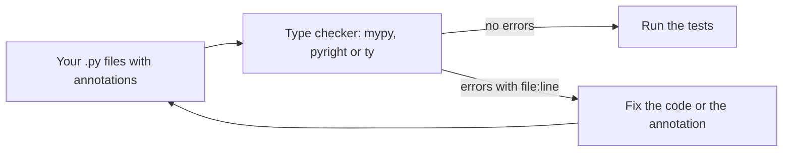
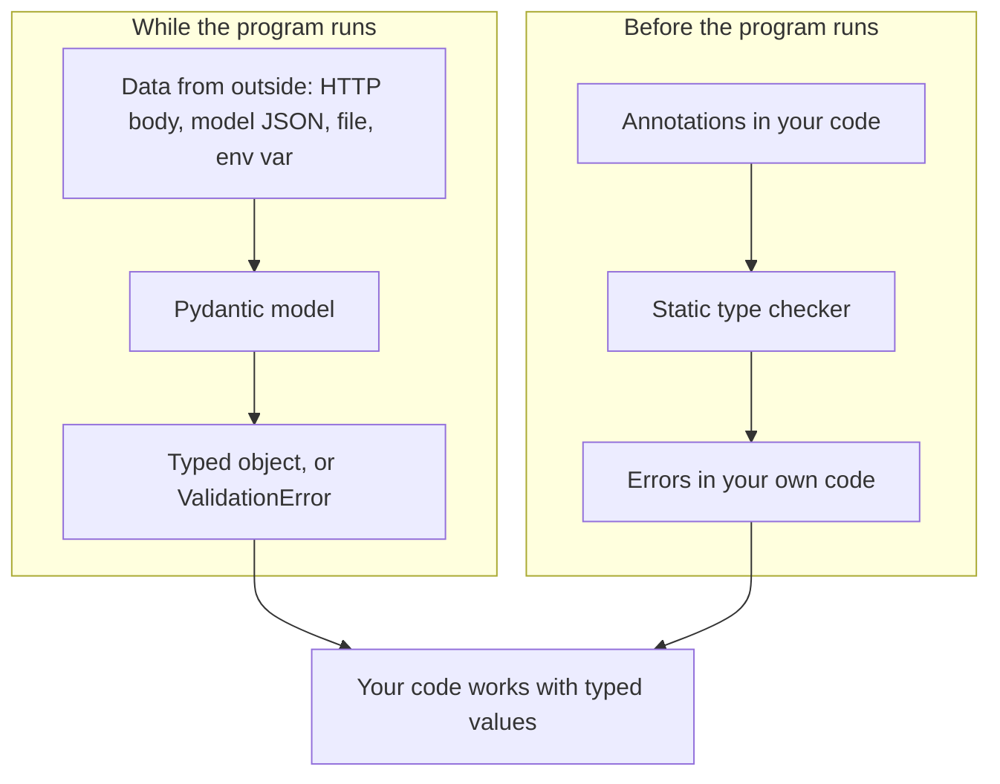

## 1. The question this idea answers

Python does not ask you to say what type a value has. `def build(prompt, ctx, session_id, resume)` runs with any four values. That is fast for a small script and dangerous for a service.

Three questions show the danger:

1. A function receives `ctx`. Can it be `None`? Must the code check for it?
2. A model API returns JSON. Does it really hold the fields that the code reads next?
3. An agent wrote 200 lines. How do you find the place where it passes a string where a number belongs, before a user finds it?

**Type annotations** answer the first question for readers and for tools. A **static type checker** answers the third question without running the code. **Pydantic models** answer the second question at run time, on real data. This lesson teaches all three and shows where each one stops.

## 2. Mental model

> [!analogy] Labels on boxes, and a customs officer
> An annotation is a label on a box: "this box holds glasses". The label helps every person who carries the box. But the label does not stop anybody from putting shoes in the box.
>
> A static type checker is an inspector who reads all the labels and all the plans **before** the trucks leave. The inspector finds plans that put shoes in a box labeled "glasses".
>
> A Pydantic model is a customs officer at the border. Every box that arrives from outside (a JSON reply, a request body, a CSV row) is opened and checked. Wrong boxes are stopped with a written report.
>
> **Where it stops working:** a real inspector sees every truck. A type checker sees only code that it can read. Data that arrives at run time (the reply of a model, a file) is invisible to it. That is why you need both the inspector and the customs officer.

## 3. Terms

| Term | Plain meaning |
|---|---|
| type | The kind of a value: `int`, `str`, `list`, your own class. |
| type annotation (type hint) | Text after a name that says which type it should hold: `x: int`, `def f(s: str) -> bool`. |
| return annotation | The type after `->`: what the function returns. |
| union type | "One of these types". `str \| None` means a `str` or `None`. |
| generic type | A container type with the type of its contents: `list[str]`, `dict[str, int]`. |
| `Any` | "Any type". The checker stops checking this value. |
| `Callable[[A, B], R]` | A function that takes an `A` and a `B` and returns an `R`. |
| `Iterator[T]` | An object that gives values of type `T`, one by one ([2.5](/notes/ai/ai-engineering/01-software-engineering-fundamentals/m02-concurrency-foundations/l5-generators-and-yield)). |
| `Generator[Y, S, R]` | A generator object: it yields `Y`, receives `S` through `send()` and returns `R`. |
| `TypedDict` | A type for a dict with fixed keys and a type for each key. |
| `Literal["a", "b"]` | A type that allows only these exact values. |
| type alias | A short name for a long type, for example `type Emit = Callable[[Event], None]`. |
| static type checker | A program that reads your code without running it and reports type errors. Examples: mypy, pyright, ty. |
| narrowing | The checker learns a more exact type after a test, for example after `if x is None: return`. |
| run-time validation | Checking real data while the program runs. |
| Pydantic model | A class that inherits from `pydantic.BaseModel`. It checks and converts data when you create an instance. |
| `ValidationError` | The exception that Pydantic raises when data does not match the model. It lists every problem. |
| coercion | Pydantic converts compatible input to the field type, for example the string `"3"` to the int 3. |

## 4. How it works

### 4.1 Annotation syntax

An annotation has three places:

```python
max_tokens: int = 800                         # a variable

def shout(name: str, times: int = 1) -> str:  # parameters and the return value
    return (name.upper() + "!") * times
```

Read `name: str` as "name should be a str". Read `-> str` as "this function returns a str". The default value comes after the annotation: `times: int = 1`.

### 4.2 Python does not enforce annotations

This is the most important fact of the lesson. Python stores the annotations and ignores them when it runs the code.

```python
def add(a: int, b: int) -> int:
    return a + b

print(add(2, 3))
print(add("2", "3"))          # Python runs it: the annotations are not checked
print(add.__annotations__)
```

```text
5
23
{'a': <class 'int'>, 'b': <class 'int'>, 'return': <class 'int'>}
```

`add("2", "3")` returned the string `"23"`. No error appeared. The annotations sit in `__annotations__`, where tools can read them.

> [!note] Annotations are evaluated lazily since Python 3.14
> In Python 3.13, a name in an annotation must exist when the `def` line runs. Otherwise `def` raises `NameError`. Python 3.14 changed this (PEP 649 and PEP 749). The What's New page says (checked on 2026-10-19): "The annotations on functions, classes, and modules are no longer evaluated eagerly." A sandbox test confirmed it. On 3.13.16, `def h(x: NotDefinedYet)` raised `NameError` at once. On 3.15.0b4, the `def` worked, and only reading `h.__annotations__` raised `NameError`.

### 4.3 A static type checker reads the annotations

A type checker reads the code and compares every use of a value with its annotation. It never runs the code. The sandbox ran mypy 2.4.0 on this file:

```python
def add(a: int, b: int) -> int:
    return a + b

total: int = add(2, 3)
label: str = add(2, 3)
print(add("2", "3"))
```

```text
b.py:5: error: Incompatible types in assignment (expression has type "int", variable has type "str")  [assignment]
b.py:6: error: Argument 1 to "add" has incompatible type "str"; expected "int"  [arg-type]
b.py:6: error: Argument 2 to "add" has incompatible type "str"; expected "int"  [arg-type]
Found 3 errors in 1 file (checked 1 source file)
```

Each error names the file, the line, the problem and an error code in brackets. Line 4 has no error: `add` returns `int`, and `total` is an `int`.

Three checkers are common. **mypy** is the oldest. **pyright** runs inside many editors. **ty** is a newer checker from Astral, the company that makes uv and Ruff. They mostly agree, and they differ in details. Pick one per project, and run it in CI ([10.1](/notes/ai/ai-engineering/01-software-engineering-fundamentals/m10-capstone/l1-capstone-spec-and-checklist)).



### 4.4 Optional values: `str | None` and narrowing

`str | None` means "a string, or `None`". The `|` syntax for types exists since Python 3.10 (PEP 604). Older code writes `Optional[str]`, which means the same thing.

The checker forces you to handle `None`:

```python
def shout(name: str | None) -> str:
    return name.upper()

def shout_safe(name: str | None) -> str:
    if name is None:
        return "NO NAME"
    reveal_type(name)
    return name.upper()
```

```text
c.py:2: error: Item "None" of "str | None" has no attribute "upper"  [union-attr]
c.py:7: note: Revealed type is "str"
Found 1 error in 1 file (checked 1 source file)
```

> [!example] Worked example: narrowing in two steps
> 1. In `shout`, `name` can be `None`. `None.upper()` raises `AttributeError` at run time. The checker reports it on line 2, before any user sees it.
> 2. In `shout_safe`, the `if name is None: return` line removes `None`. After it, the checker knows that `name` is a `str`. `reveal_type(name)` is a checker-only helper. It prints `Revealed type is "str"`.
>
> So `str | None` is a promise and a duty. The value may be absent, and every user of it must handle that case.

### 4.5 Containers, functions and generators as types

| Annotation | Means | Example value |
|---|---|---|
| `list[str]` | a list of strings | `["L3", "L4"]` |
| `dict[str, int]` | a dict from strings to ints | `{"input_tokens": 120}` |
| `dict[str, Any]` | a dict with string keys and any values | a raw JSON object |
| `tuple[int, str]` | exactly two items: an int, then a str | `(7, "L3")` |
| `tuple[int, ...]` | any number of ints | `(1, 2, 3)` |
| `set[str]` | a set of strings | `{"a", "b"}` |
| `Callable[[str, int], bool]` | a function `(str, int) -> bool` | `lambda s, n: len(s) > n` |
| `Callable[[object], None]` | a function that takes any value and returns nothing | `q.put` of a `Queue[object]`, `append` of a `list[object]` |
| `Iterator[str]` | gives strings one by one | a generator object |
| `Generator[str, None, None]` | yields `str`, receives nothing, returns nothing | a generator object |
| `AsyncIterator[str]` | gives strings with `async for` | an async generator object |

A function that accepts less is not a match. For `events: list[Event]`, mypy 2.4.0 rejects `events.append` where a `Callable[[object], None]` is expected: `Argument 1 ... has incompatible type "Callable[[Event], None]"; expected "Callable[[object], None]"`. The caller may pass any object, and `events.append` accepts only an `Event`. Write `Callable[[Event], None]` for that callback.

Import `Callable`, `Iterator`, `Generator` and `AsyncIterator` from `collections.abc`. Import `Any`, `Literal` and `TypedDict` from `typing`. The built-in names `list`, `dict`, `tuple` and `set` take brackets since Python 3.9.

### 4.6 TypedDict, Literal and type aliases

JSON-like data is often a dict with fixed keys. `TypedDict` describes it. `Literal` limits a field to fixed values. A type alias gives a long type a short name. The `type` statement for aliases exists since Python 3.12.

```python
from collections.abc import Callable
from typing import Literal, TypedDict


class Event(TypedDict):
    type: Literal["status", "table"]
    text: str


type Emit = Callable[[Event], None]


def report(emit: Emit) -> None:
    emit({"type": "status", "text": "Looking up orders"})
    emit({"type": "chart", "text": "x"})
    emit({"type": "status"})


events: list[Event] = []
report(events.append)
print(events)
```

mypy found both bad events:

```text
i.py:15: error: Incompatible types (expression has type "Literal['chart']", TypedDict item "type" has type "Literal['status', 'table']")  [typeddict-item]
i.py:16: error: Missing key "text" for TypedDict "Event"  [typeddict-item]
Found 2 errors in 1 file (checked 1 source file)
```

Python ran the same file and printed all three events, also the two bad ones:

```text
[{'type': 'status', 'text': 'Looking up orders'}, {'type': 'chart', 'text': 'x'}, {'type': 'status'}]
```

A `TypedDict` is a normal dict at run time. Only the checker knows its shape. The type `Emit` returns in [2.1](/notes/ai/ai-engineering/01-software-engineering-fundamentals/m02-concurrency-foundations/l1-functions-as-values-and-callbacks), where `emit` is a callback that publishes user-visible events.

### 4.7 Reading the annotations of a real function

Lesson [5.5](/notes/ai/ai-engineering/01-software-engineering-fundamentals/m05-streaming-and-agent-events/l5-case-study-the-run-bridge) studies this code line by line. Here we read only its annotations.

```python
def _run(prompt: str, ui_context: str | None, session_id: str, resume: bool):
    q: queue.Queue = queue.Queue()
    end = object()
    ...
    while (item := q.get()) is not end:
        if isinstance(item, Exception):
            raise item
        yield item
```

| Annotation | What it says | What the checker does with it |
|---|---|---|
| `prompt: str` | The user's text is a string. | Rejects `_run(1, ...)`. |
| `ui_context: str \| None` | Extra context from the UI is a string, or absent. | Every use of `ui_context` must handle `None`. |
| `session_id: str` | A session id is a string. | Rejects an int id. |
| `resume: bool` | Resume a session, yes or no. | Rejects `"yes"`. A string is not a bool. |
| no `->` annotation | Nothing is said about the result. | mypy gives the function the return type `Any`, so callers get no checks. |
| `q: queue.Queue` | `q` is a queue. The type of its items is not given. | The item type becomes `Any`. |
| `end = object()` | No annotation needed. | The checker infers the type `object`. |

The sandbox ran mypy with `reveal_type` on this function:

```text
d.py:15: note: Revealed type is "queue.Queue[Any]"
d.py:16: note: Revealed type is "object"
d.py:25: note: Revealed type is "Any"
d.py:29: note: Revealed type is "def (prompt: str, ui_context: str | None, session_id: str, resume: bool) -> Any"
```

Line 15 is `q`, line 16 is `end`, line 25 is `item` inside the loop, and line 29 is the function itself.

Why does `q` need an annotation at all? Without it, mypy cannot know what the queue will hold:

```text
e.py:2: error: Need type annotation for "q"  [var-annotated]
```

The bare `queue.Queue` annotation stops this error. But it means `queue.Queue[Any]`. A more exact form is `queue.Queue[object]`: the queue holds messages, events, exceptions and the sentinel, so `object` is honest. Then `item` has the type `object`, and the checker makes you test it with `isinstance` before you use it as an exception.

**Which return annotation fits?** `_run` contains `yield`, so it is a generator function. Calling it returns a generator object ([2.5](/notes/ai/ai-engineering/01-software-engineering-fundamentals/m02-concurrency-foundations/l5-generators-and-yield)). Three annotations were tested with mypy 2.4.0:

| Return annotation | mypy result | When to use it |
|---|---|---|
| `-> Iterator[object]` | accepted | The caller only iterates. This is the simplest honest form. |
| `-> Generator[object, None, None]` | accepted | The caller may also call `close()` or `send()`. It says "yields object, receives nothing, returns nothing". |
| `-> Generator[object]` | accepted | The same as above. The last two parameters default to `None` in current type stubs, and Python 3.13 accepted it at run time. |
| `-> list[object]` | error: "The return type of a generator function should be "Generator" or one of its supertypes" | Never. A generator function does not return a list. |

Replace `object` with a precise union when you know the item types, for example `Iterator[Message \| Event]`, where `Message` and `Event` are your own types. The checker then helps every consumer of the stream.

### 4.8 dataclass vs Pydantic: who checks the data?

A `@dataclass` ([1.5](/notes/ai/ai-engineering/01-software-engineering-fundamentals/m01-python-foundations/l5-classes-and-dataclasses)) writes `__init__` for you. It does not check types. A Pydantic model checks and converts every field when you create it.

```python
from dataclasses import dataclass
from pydantic import BaseModel, Field, ValidationError


@dataclass
class OrderDC:
    order_id: int
    qty: int
    note: str | None = None


class Order(BaseModel):
    order_id: int
    qty: int = Field(gt=0)
    note: str | None = None


print("dataclass:", OrderDC(order_id="7", qty="three"))      # no check at all
print("pydantic: ", Order(order_id="7", qty="3"))            # converts "7" -> 7
try:
    Order(order_id="seven", qty=0)
except ValidationError as e:
    print("ValidationError with", e.error_count(), "errors")
    for err in e.errors():
        print("  ", err["loc"], "|", err["type"], "|", err["msg"])
```

```text
dataclass: OrderDC(order_id='7', qty='three', note=None)
pydantic:  order_id=7 qty=3 note=None
ValidationError with 2 errors
   ('order_id',) | int_parsing | Input should be a valid integer, unable to parse string as an integer
   ('qty',) | greater_than | Input should be greater than 0
```

| | `@dataclass` | Pydantic `BaseModel` |
|---|---|---|
| Checks types at run time | No | Yes |
| Converts `"7"` to `7` | No | Yes (lax mode, the default) |
| Extra rules (`gt=0`, length, patterns) | No | Yes, with `Field(...)` |
| Error report | None. Bad data passes. | `ValidationError` with every problem, its location and a type code |
| Reads JSON text | No | `model_validate_json` |
| Writes a JSON Schema | No | `model_json_schema()` |
| Speed and dependencies | Standard library, very fast | A dependency, validation costs some time |
| Use it for | Internal data that your own code makes | Data from outside: requests, model output, files, settings |

The Pydantic docs (checked on 2026-10-19) state the guarantee: Pydantic "guarantees the types and constraints of the output, not the input data". They also warn that it "may cast input data to force it to conform to model field types".

### 4.9 Validate model output before you trust it

A model can return JSON that misses a field, has a wrong value or holds a string instead of a number. Validate it at the border.

```python
from typing import Literal
from pydantic import BaseModel, ValidationError


class Answer(BaseModel):
    intent: Literal["count", "list", "unknown"]
    line: str
    count: int | None = None


good = '{"intent": "count", "line": "L3", "count": 12, "extra": "ignored"}'
a = Answer.model_validate_json(good)
print(repr(a))
print("model_dump:", a.model_dump())
print("model_dump_json:", a.model_dump_json())
print("from a dict:", Answer.model_validate({"intent": "list", "line": "L4"}))

bad = '{"intent": "sum", "count": "many"}'
try:
    Answer.model_validate_json(bad)
except ValidationError as e:
    for err in e.errors():
        print("  ", err["loc"], "|", err["type"], "|", err["msg"])
```

```text
Answer(intent='count', line='L3', count=12)
model_dump: {'intent': 'count', 'line': 'L3', 'count': 12}
model_dump_json: {"intent":"count","line":"L3","count":12}
from a dict: intent='list' line='L4' count=None
   ('intent',) | literal_error | Input should be 'count', 'list' or 'unknown'
   ('line',) | missing | Field required
   ('count',) | int_parsing | Input should be a valid integer, unable to parse string as an integer
```

> [!example] Worked example: read the three errors
> The bad JSON was `{"intent": "sum", "count": "many"}`.
>
> 1. `intent` is `"sum"`. The `Literal` allows only three values, so the type is `literal_error`.
> 2. `line` is not in the JSON. It has no default, so it is `missing`.
> 3. `count` is `"many"`. It cannot become an int, so it is `int_parsing`.
>
> Pydantic reports all three at once. You can send this list back to the model and ask it to fix its answer. Lesson L2 of the roadmap (structured outputs) builds on this.

Two more facts from the same run:

1. The good JSON held `"extra": "ignored"`. The model has no such field, and Pydantic dropped it without an error. The docs say: "By default, Pydantic models won't error when you provide extra data." Set `model_config = ConfigDict(extra="forbid")` when extra fields must fail.
2. In strict mode (`class StrictAnswer(Answer, strict=True)`), the string `"12"` for `count` failed with `int_type | Input should be a valid integer`. Lax mode converts it. Choose strict mode when a wrong type must be an error.

`Answer.model_json_schema()` returns a JSON Schema of the model:

```text
{'properties': {'intent': {'enum': ['count', 'list', 'unknown'], 'title': 'Intent', 'type': 'string'}, 'line': {'title': 'Line', 'type': 'string'}, 'count': {'anyOf': [{'type': 'integer'}, {'type': 'null'}], 'default': None, 'title': 'Count'}}, 'required': ['intent', 'line'], 'title': 'Answer', 'type': 'object'}
```

FastAPI builds its API docs from such schemas ([4.5](/notes/ai/ai-engineering/01-software-engineering-fundamentals/m04-fastapi-services/l5-testing-and-openapi)). MCP tools describe their arguments with the same kind of schema ([5.3](/notes/ai/ai-engineering/01-software-engineering-fundamentals/m05-streaming-and-agent-events/l3-mcp-tools-and-tool-execution)).

### 4.10 Two checks at two times



| Question | Tool | When |
|---|---|---|
| Does my code pass a `str` where an `int` belongs? | Type checker | Before run time, in the editor and in CI |
| Does this JSON from the model hold an int `count`? | Pydantic | At run time, on each piece of data |
| Is `None` handled everywhere? | Type checker with `str \| None` annotations | Before run time |
| Did the user send a negative quantity? | Pydantic `Field(gt=0)` | At run time |

## 5. Code walkthrough

This small module validates a model reply and returns typed data. Read each marked line.

```python
from typing import Literal

from pydantic import BaseModel, ConfigDict, Field, ValidationError


class ToolCall(BaseModel):                                   # 1
    model_config = ConfigDict(extra="forbid")                # 2
    name: Literal["count_orders", "list_orders"]             # 3
    line: str = Field(min_length=1)                          # 4
    limit: int | None = Field(default=None, ge=1, le=100)    # 5


def parse_tool_call(text: str) -> ToolCall | list[str]:      # 6
    try:
        return ToolCall.model_validate_json(text)            # 7
    except ValidationError as e:
        return [f"{'.'.join(map(str, err['loc']))}: {err['msg']}" for err in e.errors()]  # 8
```

| Mark | What it does | Why | Without it |
|---|---|---|---|
| 1 | A Pydantic model for one tool call | The shape lives in one place, with types | Every caller checks keys by hand |
| 2 | Forbids unknown fields | A misspelled field (`limt`) must fail, not vanish | The typo is silently dropped, and the default limit is used |
| 3 | Only two tool names are valid | The model cannot invent a tool | Any string passes, and a later dict lookup fails |
| 4 | `line` must be a non-empty string | An empty line id is useless | `""` passes |
| 5 | `limit` is optional, and between 1 and 100 when present | A safe range for a database query | A model can ask for 10 million rows |
| 6 | The return annotation says: a typed call, or a list of error texts | The caller must handle both cases | The checker cannot help the caller |
| 7 | Parses and validates the JSON text in one step | It also reports broken JSON as a `ValidationError` | Two separate error paths |
| 8 | Turns each error into `field: message` | Short text that a log or a model can read | The caller gets a raw exception |

The sandbox ran it on four inputs. mypy 2.4.0 reported no issues in the file.

```text
name='count_orders' line='L3' limit=10
['limit: Input should be less than or equal to 100']
['limt: Extra inputs are not permitted', "name: Input should be 'count_orders' or 'list_orders'"]
[': Invalid JSON: expected ident at line 1 column 2']
```

The inputs were, in order:

1. `{"name": "count_orders", "line": "L3", "limit": 10}`: valid.
2. The same with `"limit": 500`: out of range.
3. `{"name": "delete_all", "line": "L3", "limt": 5}`: an unknown tool and a misspelled field. Both errors appear.
4. `not json`: the text is not JSON at all. The error has an empty location, so the line starts with `:`. Mark 7 handled it in the same path as the other errors.

## 6. Exercises

**Exercise 8.1: annotate and check.** Runs in: your local practice project (a static checker needs a terminal). Take the ten functions of exercises 6.1 to 7.3. Add full annotations, including return types. Run mypy (or pyright, or ty).

Acceptance tests:

- The checker reports 0 errors.
- Then add one deliberate bug per function (a wrong argument type, a missing `None` check). The checker reports each bug with the right line.
- No annotation uses `Any`, except for raw JSON before validation.

**Exercise 8.2: a typed event stream.** Runs in: a browser lab. [Open a lab for this lesson](/labs/new?note=ai/ai-engineering/01-software-engineering-fundamentals/m01-python-foundations/l8-type-annotations-and-pydantic). Define two Pydantic models:

- `StatusEvent`: `type` is the literal `"status"`, and `text` is a non-empty string.
- `TableEvent`: `type` is the literal `"table"`, and `rows` is a list of dicts.

Write `parse_event(text: str) -> StatusEvent | TableEvent`. It picks the right model from the `type` field.

Acceptance tests:

- A status JSON gives a `StatusEvent`, and a table JSON gives a `TableEvent`.
- `{"type": "chart"}` raises `ValidationError`.
- `{"type": "status", "text": ""}` raises `ValidationError` that names `text`.
- An extra field fails.

**Exercise 8.3: the return annotation of a generator.** Runs in: your local practice project. Write a generator function `numbered(lines: list[str])` that yields `(1, first_line)`, `(2, second_line)` and so on. Give it the most exact return annotation.

Acceptance tests: mypy accepts it. Change the annotation to `-> list[tuple[int, str]]`, and mypy reports the generator error. A caller that adds the yielded tuple to an int gets a checker error.

Hints come in three levels in chat: idea, pseudocode, partial code.

## 7. Common mistakes

1. **"Annotations make Python check types."** They do not. `add("2", "3")` returned `"23"`. Only a checker or a validator checks.
2. **No return annotation.** The function returns `Any` to the checker, and every caller loses checks.
3. **`str | None` without a `None` check.** The checker reports it. Do not silence it with `# type: ignore`. Handle the `None` case.
4. **`Any` everywhere.** `Any` turns the checker off for that value. Use `object` when you mean "any value, but test it before use".
5. **Trusting model output because the prompt asked for JSON.** Validate it with a model every time.
6. **A dataclass for outside data.** A dataclass accepts `qty="three"`. Use Pydantic at the borders.
7. **Forgetting that lax mode converts.** `"3"` becomes `3` silently. Use strict mode or `extra="forbid"` where silent changes are dangerous.
8. **`-> list[...]` on a generator function.** A generator function returns a generator object. Use `Iterator[...]` or `Generator[...]`.

## 8. One-minute explanation

A type annotation is a label. `name: str` says that `name` should hold a string, and `-> str` says what a function returns. Python stores annotations and ignores them at run time, so `add("2", "3")` runs and returns `"23"`. A static type checker such as mypy, pyright or ty reads the code without running it. It reports every value that does not match its label, with the file and the line. `str | None` means "a string or nothing", and the checker forces every user to handle `None`. Containers carry their item types (`list[str]`), functions have `Callable[[args], result]`, and a generator function returns `Iterator[T]` or `Generator[T, None, None]`. `TypedDict` and `Literal` describe JSON-like dicts. But a checker never sees the data that arrives at run time. For that data, use a Pydantic model. It checks and converts every field, and it raises a `ValidationError` that lists every problem with its location. Use dataclasses for your own internal data. Use Pydantic at every border: requests, files, settings and model output.

## 9. Check questions

```check
{
  "question": "def f(n: int) -> int: return n * 2. What does f(\"ab\") return at run time, and which tool would have caught the problem first?",
  "answer": "It returns \"abab\": Python ignores the annotations at run time, and string * 2 repeats the string. A static type checker (mypy, pyright or ty) reports Argument 1 has incompatible type \"str\"; expected \"int\" before the code runs."
}
```

```check
{
  "question": "The example _run has no return annotation and contains yield. What return type does mypy give it, and which annotation would you write instead?",
  "hint": "A function that contains yield returns a generator object.",
  "answer": "mypy gives it the return type Any (it reported def (...) -> Any), so callers get no checks. Write -> Iterator[object] if callers only iterate, or -> Generator[object, None, None] if they may also call close() or send(). Replace object with a precise union of the item types when you know them. -> list[object] is wrong: mypy reports that a generator function should return Generator or one of its supertypes."
}
```

```check
{
  "question": "Why is q: queue.Queue[object] a better annotation than q: queue.Queue in code that puts messages, events, exceptions and a sentinel into the queue?",
  "answer": "The bare queue.Queue means queue.Queue[Any], so every item that comes out has the type Any, and the checker stops checking it. queue.Queue[object] says honestly that items can be anything, and the checker then requires an isinstance test (for example isinstance(item, Exception)) before the code uses an item as a specific type."
}
```

```check
{
  "question": "A model returns {\"intent\": \"count\", \"line\": \"L3\", \"cuont\": 5}. Your Pydantic model has intent, line and count: int | None = None, with the default config. What do you get, and how do you make the typo fail?",
  "answer": "You get a valid object with count=None. Pydantic ignores extra fields by default, so the misspelled cuont is dropped silently. Set model_config = ConfigDict(extra=\"forbid\"). Then validation fails with an \"Extra inputs are not permitted\" error for cuont."
}
```

## 10. Links

- Previous: [1.7 Files, paths, environment variables and JSON](/notes/ai/ai-engineering/01-software-engineering-fundamentals/m01-python-foundations/l7-files-paths-env-and-json)
- Next: [1.9 Modules, packages and uv projects](/notes/ai/ai-engineering/01-software-engineering-fundamentals/m01-python-foundations/l9-modules-packages-and-uv)
- `Callable` and `emit`: [2.1 Functions as values and callbacks](/notes/ai/ai-engineering/01-software-engineering-fundamentals/m02-concurrency-foundations/l1-functions-as-values-and-callbacks)
- Generator objects: [2.5 Generators, yield, close() and GeneratorExit](/notes/ai/ai-engineering/01-software-engineering-fundamentals/m02-concurrency-foundations/l5-generators-and-yield)
- The full `_run` example: [5.5 Case study: the _run bridge, line by line](/notes/ai/ai-engineering/01-software-engineering-fundamentals/m05-streaming-and-agent-events/l5-case-study-the-run-bridge)
- Request models in an API: [4.1 Routes, parameters and response models](/notes/ai/ai-engineering/01-software-engineering-fundamentals/m04-fastapi-services/l1-routes-parameters-and-response-models)
- Source: Pydantic docs, Models: https://pydantic.dev/docs/validation/latest/concepts/models/ (checked on 2026-10-19)
- Source: What's New in Python 3.14, deferred annotations: https://docs.python.org/3.14/whatsnew/3.14.html (checked on 2026-10-19)
- Source: mypy documentation: https://mypy.readthedocs.io
- [Glossary](/notes/ai/ai-engineering/glossary)
