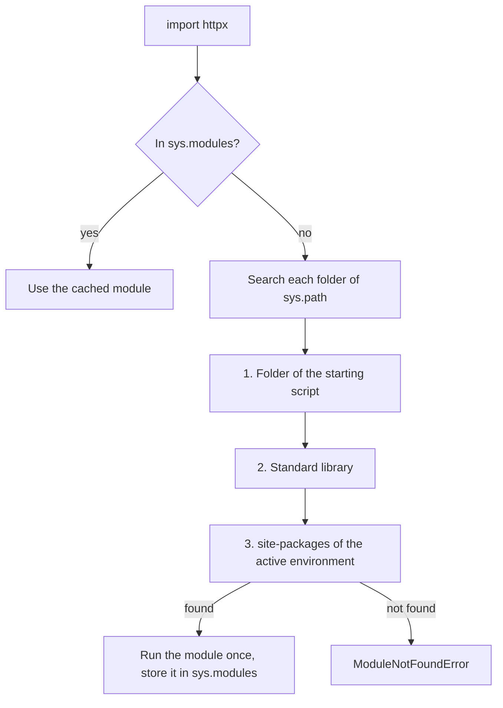

## 1. The question this idea answers

A first program is one file. A real service is 20 or 200 files, and it uses code from other people: an HTTP client, a web framework, a database driver. Two problems appear:

1. **Inside the code:** how does one file use a function from another file? How do you keep the API layer, the business logic and the model client apart?
2. **Outside the code:** your laptop, a colleague's laptop, the CI server and the production container must run the same Python and the same package versions. How do you make sure of that?

Python answers the first problem with **modules** and **packages**. The second problem needs a **virtual environment**, a **project file** (`pyproject.toml`) and a **lock file**. The tool **uv** manages all three. A project that installs the same way everywhere is the base of CI ([10.1](/notes/ai/ai-engineering/01-software-engineering-fundamentals/m10-capstone/l1-capstone-spec-and-checklist)) and of Docker images ([9.2](/notes/ai/ai-engineering/01-software-engineering-fundamentals/m09-docker-and-deployment/l2-dockerfiles-layers-and-uv)).

## 2. Mental model

> [!analogy] A kitchen with recipe binders and a shopping list
> - A **module** is one recipe card. A **package** is a binder of cards with a table of contents (`__init__.py`).
> - `import` takes a card out of the binder. The first time, the cook reads the whole card. After that the card stays on the counter (`sys.modules`), and nobody reads it again.
> - A **virtual environment** is a private pantry for one kitchen. Ingredients bought for this kitchen do not mix with the ingredients of other kitchens.
> - `pyproject.toml` is the shopping list with rules: "flour, any brand, version 2 or newer". The **lock file** is the receipt: the exact brand, size and batch number that you bought last time. With the receipt, a second kitchen buys exactly the same things.
>
> **Where it stops working:** a real recipe card does nothing when you read it. A Python module **runs** its top-level code when it is first imported. A `print` or a network call at the top of a module runs at import time.

## 3. Terms

| Term | Plain meaning |
|---|---|
| module | One `.py` file. Its name is the file name without `.py`. |
| package | A folder of modules that Python imports as one name, usually with an `__init__.py` file. |
| `import` | Find a module, run it once, and give your code a name for it. |
| `sys.modules` | The dict of modules that are already imported in this process. A second import uses it. |
| `sys.path` | The list of folders where `import` searches for modules. |
| `__name__` | A variable in each module. It is `"__main__"` in the file that started the program, and the module name in imported files. |
| standard library | The modules that come with Python, for example `json`, `pathlib` and `asyncio`. |
| third-party package | A package from somebody else, installed from PyPI, for example `httpx`. |
| PyPI | The Python Package Index: the public server that hosts third-party packages. |
| dependency | A package that your project needs. |
| virtual environment | A folder (often `.venv`) with its own Python link and its own installed packages, separate from other projects. |
| `pyproject.toml` | The project file: name, version, required Python, dependencies, entry points, build settings. |
| version constraint | A rule for allowed versions, for example `httpx>=0.28`. |
| lock file | A file with the exact resolved version of every package, including the dependencies of dependencies. uv writes `uv.lock`. |
| transitive dependency | A dependency of a dependency. `httpx` needs `httpcore`, so `httpcore` is transitive for you. |
| build backend | The tool that turns your project into an installable package. uv projects use `uv_build`. |
| entry point | A command name in `[project.scripts]` that runs one function of your package. |
| `src` layout | The code lives in `src/<package_name>/`, not next to `pyproject.toml`. |
| uv | A tool from Astral that installs Python, makes virtual environments, resolves and locks dependencies, and runs commands. |

## 4. How it works

### 4.1 A module runs once, then Python reuses it

A sandbox folder held a package `shop` with a module `prices.py`, and a `main.py` next to it:

```text
imp/
├── main.py
└── shop/
    ├── __init__.py        print("  running shop/__init__.py")
    └── prices.py          TAX = 0.13, with_tax(), and an if __name__ == "__main__" block
```

```python
# shop/prices.py
print("  running shop/prices.py, __name__ =", __name__)
TAX = 0.13

def with_tax(amount: float) -> float:
    return round(amount * (1 + TAX), 2)

if __name__ == "__main__":
    print("  prices.py started as a script:", with_tax(100))
```

```python
# main.py
import sys
print("first import:")
import shop.prices
print("second import (cached, nothing runs):")
import shop.prices
from shop.prices import with_tax
print("with_tax(100) =", with_tax(100))
print("'shop.prices' in sys.modules:", "shop.prices" in sys.modules)
print("main.py __name__ =", __name__)
```

```text
first import:
  running shop/__init__.py
  running shop/prices.py, __name__ = shop.prices
second import (cached, nothing runs):
with_tax(100) = 113.0
'shop.prices' in sys.modules: True
main.py __name__ = __main__
```

> [!example] Worked example: what each import did
> 1. `import shop.prices` first imports the package `shop`. Python runs `shop/__init__.py`. Then it runs `shop/prices.py` from top to bottom. The top-level `print` runs, and `TAX` and `with_tax` come into existence.
> 2. Python stores the module in `sys.modules["shop.prices"]`.
> 3. The second `import shop.prices` finds it in `sys.modules`. Nothing runs again.
> 4. `from shop.prices import with_tax` takes one name from the module that is already loaded.
> 5. Inside `prices.py`, `__name__` was `"shop.prices"`, so the `if __name__ == "__main__"` block did not run.

### 4.2 The `__main__` check

The same `prices.py` gave a different result when it was the starting file:

```text
$ python shop/prices.py
  running shop/prices.py, __name__ = __main__
  prices.py started as a script: 113.0
$ python -m shop.prices
  running shop/__init__.py
  running shop/prices.py, __name__ = __main__
  prices.py started as a script: 113.0
```

The file that starts the program gets `__name__ == "__main__"`. So `if __name__ == "__main__":` holds code that must run only when the file is started directly, for example a small demo. It never runs on import. `python -m shop.prices` runs the module by its package name, and it imports the package first. That is why `__init__.py` printed only in the second run.

> [!trap] Work at import time slows down and breaks things
> Code at the top level of a module runs on the first import. A network call, a database connection or a large file read there makes every import slow, and it fails in tests that have no network. Put such work inside functions. Call them from `main()` or from a startup step ([4.3](/notes/ai/ai-engineering/01-software-engineering-fundamentals/m04-fastapi-services/l3-dependencies-lifespan-config-and-middleware)).

### 4.3 Where import searches

`import x` searches the folders in `sys.path`, in order. The first entry is the folder of the starting script (in the run above, `imp`). Then come the standard library and the `site-packages` folder of the active environment. When nothing matches, Python raises `ModuleNotFoundError`.



Point 3 explains a common error. The project's `.venv` had `httpx` installed. The system Python of the same machine did not:

```text
$ /usr/bin/python3 -c "import httpx"
ModuleNotFoundError: No module named 'httpx'
```

The package was installed, but in another environment. The fix is to run the code with the project's environment (`uv run`, section 4.7), not to install it again in a random place.

### 4.4 Packages and boundaries

A package lets you split a growing service by job. One possible layout for an API service:

```text
src/orders_api/
├── __init__.py
├── main.py          the web app and its routes (HTTP only)
├── service.py       business rules (no HTTP, no SQL)
├── repository.py    database queries
├── clients/
│   ├── __init__.py
│   └── weather.py   one outside API client
└── models.py        Pydantic models shared by the layers
```

The rule: each module imports only from layers below it. `main.py` imports `service.py`. `service.py` imports `repository.py`. `repository.py` never imports `main.py`.

When two modules import names from each other at the top level, the import fails. This is a **circular import**. A sandbox package had `pkg/a.py` with `from pkg.b import helper_b` and `pkg/b.py` with `from pkg.a import helper_a`:

```text
ImportError: cannot import name 'helper_a' from partially initialized module 'pkg.a' (most likely due to a circular import)
```

Python started to run `a.py`, which started `b.py`, which asked `a.py` for a name that did not exist yet. A circular import is often a sign that one module does two jobs. Move the shared part into a third module that both import.

### 4.5 Virtual environments

Without isolation, every project on a machine shares one set of packages. Project A needs `httpx` 0.28 and project B needs an old version. Only one can be installed.

A virtual environment is a folder, usually `.venv` in the project. The sandbox one held:

```text
.venv/
├── bin/                 python, and the commands of the installed packages
├── lib/python3.13/site-packages/
│   ├── httpx/  httpcore/  h11/  anyio/  idna/  certifi/  ...
│   └── orders_api.pth   points to src/, so your own package imports too
└── pyvenv.cfg           include-system-site-packages = false
```

`include-system-site-packages = false` means: this environment sees only its own packages. Never commit `.venv` to Git. It is large, it depends on the operating system, and the lock file can rebuild it.

### 4.6 pyproject.toml and the lock file

uv 0.13.1 made this project with `uv init orders-api`:

```text
orders-api/
├── .git/
├── .gitignore
├── .python-version      3.13
├── README.md
├── pyproject.toml
└── src/
    └── orders_api/
        └── __init__.py  def main() -> None: print("Hello from orders-api!")
```

```toml
[project]
name = "orders-api"
version = "0.1.0"
description = "Add your description here"
readme = "README.md"
requires-python = ">=3.13"
dependencies = []

[project.scripts]
orders-api = "orders_api:main"

[build-system]
requires = ["uv_build>=0.13.1,<0.14.0"]
build-backend = "uv_build"
```

(uv also wrote an `authors` line from the Git settings of the machine. It is left out here.)

| Section | Meaning |
|---|---|
| `[project]` | The name, version and description of the project. `requires-python` limits the Python versions. |
| `dependencies` | The packages that the project needs, with version constraints. |
| `[project.scripts]` | The command `orders-api` runs the function `main` in the package `orders_api`. |
| `[build-system]` | How to build the package. Because there is a build system, uv installs your own package into `.venv`. |

> [!note] The default of uv init changed in uv 0.12
> The uv docs say (checked on 2026-10-19): "Prior to v0.12, uv did not define a build system for applications by default." The current default for an application is the `src` layout with a build system and a `[project.scripts]` entry, as above. `uv init --no-package` gives the old flat layout. The sandbox run of `uv init --no-package flat-app` made `main.py`, `pyproject.toml`, `README.md` and `.python-version`, with no `src` folder. Older tutorials show the flat layout.

Then `uv add "httpx>=0.28"` did three things:

1. It wrote `"httpx>=0.28"` into `dependencies`.
2. It resolved the exact versions of `httpx` and all its transitive dependencies, and wrote them to `uv.lock`.
3. It installed them into `.venv`.

```text
 + h11==0.16.0
 + httpcore==1.0.9
 + httpx==0.28.1
 + idna==3.20
 + orders-api==0.1.0 (from file:///.../orders-api)
 + typing-extensions==4.16.0
```

(Lines for `anyio` and `certifi` came before these.) One direct dependency gave 8 locked packages, counting `orders-api` itself. The start of `uv.lock`:

```toml
version = 1
revision = 5
requires-python = ">=3.13"

[[package]]
name = "anyio"
version = "4.15.1"
source = { registry = "https://pypi.org/simple" }
dependencies = [
    { name = "idna" },
    { name = "typing-extensions", marker = "python_full_version < '3.15'" },
]
```

> [!example] Worked example: constraint vs lock
> `pyproject.toml` says `httpx>=0.28`. That allows 0.28.1, 0.29 and every later version. Today it resolved to 0.28.1. If a colleague installs in three months from `pyproject.toml` alone, they can get a newer version with new behavior.
>
> `uv.lock` says `httpx` 0.28.1, `httpcore` 1.0.9, `h11` 0.16.0, and so on. With the lock file, the colleague gets exactly these versions. So commit `uv.lock` to Git for every application.

### 4.7 The everyday uv commands

| Command | What it does |
|---|---|
| `uv init <name>` | Makes a new project (section 4.6). |
| `uv add <package>` | Adds a dependency, updates the lock file and installs it. |
| `uv add --dev pytest` | Adds a dependency for development only (tests, checkers). |
| `uv remove <package>` | Removes a dependency. |
| `uv lock` | Resolves and writes `uv.lock` again. |
| `uv sync` | Makes `.venv` match the lock file. Installs what is missing, removes what is extra. |
| `uv sync --locked` | The same, but stops with an error if `uv.lock` does not match `pyproject.toml`. |
| `uv run <command>` | Runs a command inside the project environment. It syncs first. |
| `uv python install 3.13` | Downloads a Python version that uv manages. |

`uv run` uses the project's environment, so the import problem of section 4.3 cannot happen:

```text
$ uv run orders-api
Hello from orders-api!
$ uv run python -c "import sys, httpx; print(sys.prefix.endswith('.venv'), httpx.__version__)"
True 0.28.1
```

`uv sync --locked` protects CI and Docker builds. The sandbox added `"rich"` to `dependencies` by hand, without `uv lock`, and ran it:

```text
error: The lockfile at `uv.lock` needs to be updated, but `--locked` was provided.

hint: To update the lockfile, run `uv lock`.
```

> [!key] Why `--locked` matters
> A build with `--locked` installs exactly the reviewed versions, or it stops. Without it, a changed `pyproject.toml` can resolve new versions during the build, and production can run code that nobody tested. The Docker lesson ([9.2](/notes/ai/ai-engineering/01-software-engineering-fundamentals/m09-docker-and-deployment/l2-dockerfiles-layers-and-uv)) uses `uv sync --locked`.

### 4.8 What goes into Git

The `.gitignore` file that `uv init` wrote:

```text
# Python-generated files
__pycache__/
*.py[oc]
build/
dist/
wheels/
*.egg-info

# Virtual environments
.venv
```

| File | In Git? | Why |
|---|---|---|
| `pyproject.toml` | Yes | The rules for the project |
| `uv.lock` | Yes | The exact versions, for every machine |
| `.python-version` | Yes | The Python version for this project |
| `src/...`, `tests/...` | Yes | The code |
| `.venv/` | No | Rebuilt from the lock file, large, specific to one machine |
| `__pycache__/` | No | Bytecode that Python makes again |
| `.env` | No (add it yourself) | It holds secrets ([1.7](/notes/ai/ai-engineering/01-software-engineering-fundamentals/m01-python-foundations/l7-files-paths-env-and-json)) |

## 5. Code walkthrough

The command line `uv run orders-api` connects many ideas of this lesson. Follow it step by step.

1. `uv run` finds `pyproject.toml` in the current folder or a parent folder. That folder is the project root.
2. It checks that `.venv` matches `uv.lock`. If not, it syncs (section 4.7).
3. It reads `[project.scripts]`: `orders-api = "orders_api:main"`.
4. The command `orders-api` is a small script that uv wrote into `.venv/bin/`. In the sandbox it held `from orders_api import main` and then `sys.exit(main())`.
5. `import orders_api` searches `sys.path`. The `orders_api.pth` file in `site-packages` points to `src/`, so Python finds `src/orders_api/__init__.py` (section 4.3).
6. Python runs `__init__.py` once and stores it in `sys.modules` (section 4.1).
7. `main()` prints `Hello from orders-api!`.

If step 5 fails, the error is `ModuleNotFoundError: No module named 'orders_api'`. The usual causes are:

- The code is not in `src/orders_api/`.
- The folder name has a hyphen (`orders-api`). A hyphen is not valid in a module name.
- The command ran outside the project environment.

## 6. Exercises

Runs in: your local practice project. A browser lab has no terminal and no uv. Make the project outside the Downloads folder. It becomes the capstone repository in [10.1](/notes/ai/ai-engineering/01-software-engineering-fundamentals/m10-capstone/l1-capstone-spec-and-checklist).

**Exercise 9.1: a packaged project.** Make a uv project named `notes-service`. Add `httpx` and `pydantic` as dependencies and `pytest` as a development dependency.

Acceptance tests:

- `uv run notes-service` prints a line from your `main()`.
- `uv.lock` exists and lists `httpx`, `httpcore` and `pydantic`.
- After you delete `.venv`, `uv sync --locked` rebuilds it, and `uv run notes-service` works again.
- `git status` does not show `.venv`.

**Exercise 9.2: layers as modules.** Split the project into `models.py`, `service.py` and `main.py` inside `src/notes_service/`.

Acceptance tests:

- `service.py` does not import `main.py`. Show it with a search of the imports.
- Importing `notes_service.service` prints nothing and makes no network call.
- A small `if __name__ == "__main__":` block in `service.py` runs only with `uv run python -m notes_service.service`.

**Exercise 9.3: break the lock on purpose.** Add a dependency by editing `pyproject.toml` by hand.

Acceptance test: `uv sync --locked` fails with the "needs to be updated" error. `uv lock` and then `uv sync --locked` succeed. Write one sentence on why CI uses `--locked`.

Hints come in three levels in chat: idea, pseudocode, partial code.

## 7. Common mistakes

1. **`pip install` into a random Python.** The package lands in another environment, and the project still fails with `ModuleNotFoundError`. Use `uv add` and `uv run`.
2. **Not committing `uv.lock`.** Each machine resolves its own versions. "It works on my machine" follows.
3. **Committing `.venv`.** It is large and machine-specific. The lock file rebuilds it.
4. **Network or database work at the top level of a module.** It runs at import time, also in tests.
5. **A hyphen in a package folder name.** `import orders-api` is not valid Python. The folder is `orders_api`. The project name can keep the hyphen.
6. **Circular imports between layers.** Keep imports in one direction: routes, then service, then repository.
7. **Following an old tutorial.** Before uv 0.12, `uv init` made a flat `main.py`. Read the current docs for tools that change fast.

## 8. One-minute explanation

A module is one `.py` file, and a package is a folder of modules with an `__init__.py`. `import` searches the folders in `sys.path`. It runs the module once, from top to bottom, and caches it in `sys.modules`. A second import runs nothing. The starting file has `__name__ == "__main__"`, so code under that check runs only when you start the file directly. Do slow work inside functions, not at the top level of a module. Keep imports in one direction between layers. Outside the code, a virtual environment gives each project its own installed packages. `pyproject.toml` lists the dependencies with version rules. The lock file `uv.lock` records the exact version of every package, including transitive ones. uv manages all of it. `uv init` makes a `src`-layout project with a build system, which is the default since uv 0.12. `uv add` adds and locks a dependency. `uv run` runs a command in the project environment. `uv sync --locked` installs exactly the locked versions, or it stops with an error. Commit `pyproject.toml` and `uv.lock`, never `.venv`.

## 9. Check questions

```check
{
  "question": "A module has print(\"loading\") at its top level. A program imports it three times, in three different files. How many times does \"loading\" print, and why?",
  "answer": "Once. The first import runs the module and stores it in sys.modules. The later imports find it there and run nothing. (Running the same file as the starting script is the one exception: then it runs as __main__, separately from an import by name.)"
}
```

```check
{
  "question": "pyproject.toml says httpx>=0.28. Your laptop has 0.28.1. CI installs without the lock file and gets a newer version that changed a default timeout. Which file prevents this, and which command makes CI fail instead of installing new versions?",
  "answer": "uv.lock records the exact versions (httpx 0.28.1 and every transitive dependency). Commit it, and run uv sync --locked in CI. With --locked, uv installs exactly the locked versions, and it stops with an error if the lock file does not match pyproject.toml."
}
```

```check
{
  "question": "uv run python app.py works, but python app.py raises ModuleNotFoundError: No module named 'httpx'. httpx is installed. Explain.",
  "hint": "Which site-packages folder does each command use?",
  "answer": "httpx is installed in the project's .venv. uv run uses that environment. The plain python command uses another Python, whose sys.path has a different site-packages folder without httpx. The fix is to run the code with uv run (or activate .venv), not to install httpx again into the other Python."
}
```

```check
{
  "question": "Name three files that a uv application commits to Git and two that it must not commit.",
  "answer": "Commit: pyproject.toml, uv.lock, .python-version (and the src and tests code). Do not commit: .venv (rebuilt from the lock file, machine-specific) and .env (holds secrets). __pycache__ also stays out."
}
```

## 10. Links

- Previous: [1.8 Type annotations, typed models and Pydantic](/notes/ai/ai-engineering/01-software-engineering-fundamentals/m01-python-foundations/l8-type-annotations-and-pydantic)
- Next: [1.10 Tests, logging and debugging](/notes/ai/ai-engineering/01-software-engineering-fundamentals/m01-python-foundations/l10-tests-and-debugging)
- More depth on uv and pyproject.toml: [uv and pyproject.toml](/notes/software-engineering/python/03-tooling/l1-uv-and-pyproject)
- uv in Docker: [9.2 Dockerfiles, layers, caching and uv](/notes/ai/ai-engineering/01-software-engineering-fundamentals/m09-docker-and-deployment/l2-dockerfiles-layers-and-uv)
- `.gitignore` in depth: [7.3 History, .gitignore, README and code review](/notes/ai/ai-engineering/01-software-engineering-fundamentals/m07-git/l3-history-gitignore-readme-and-review)
- Source: uv docs, Creating projects: https://docs.astral.sh/uv/concepts/projects/init/ (checked on 2026-10-19)
- Source: Python tutorial, Modules: https://docs.python.org/3/tutorial/modules.html
- [Glossary](/notes/ai/ai-engineering/glossary)
