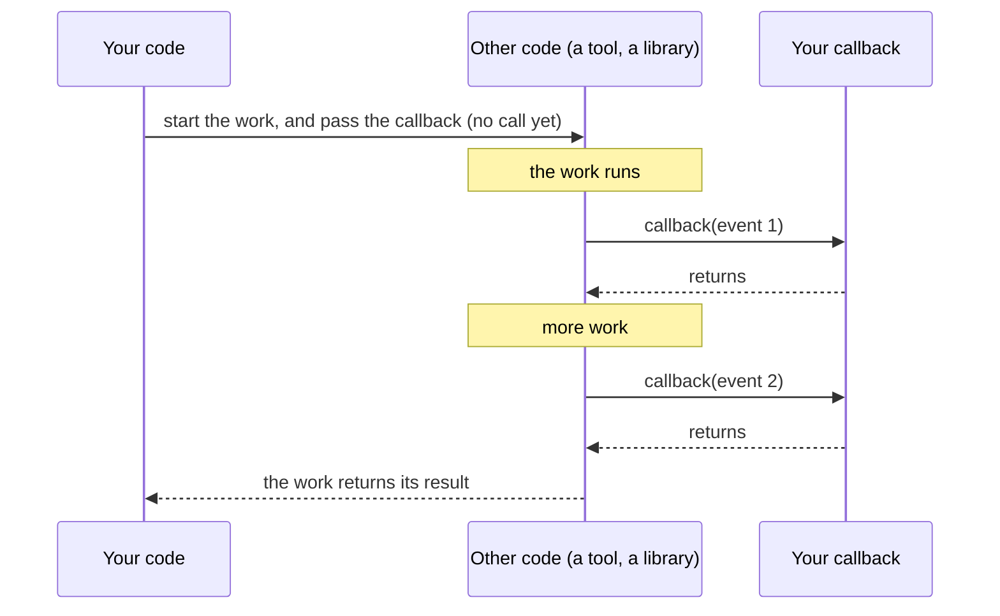

> [!note] Step 1 of 8 in the learning order
> This lesson is step 1 of the [learning order](/notes/ai/ai-engineering/01-software-engineering-fundamentals/roadmap) for concurrency and streaming. Every later step uses callbacks.

## 1. The question this idea answers

An agent calls a tool. The tool runs a slow database query. The user looks at an empty screen and does not know what happens. The tool must tell the user: "Counting rows in the orders table".

But the tool does not know the web page. It does not know the HTTP connection or the queue that carries messages to the page. How can a function that knows nothing about the user interface send a message to the user?

The answer: the code that starts the tool gives the tool a function. The tool calls that function when it has news. That function is a **callback**. This lesson explains the idea from zero:

1. A function is a value, like a number or a string.
2. You can pass a function to other code without calling it.
3. A method of an object, for example `q.put`, is also a value. It remembers its object.
4. A callback named `emit` lets a tool publish events without knowing where they go.

## 2. Mental model

> [!analogy] Your phone number on a work order
> You ask a plumber to repair a pipe. You do not wait in the kitchen. You write your phone number on the work order. The plumber calls the number when the work is done, or when there is a problem.
>
> - The phone number is the callback.
> - Writing the number on the order is "passing the function".
> - The plumber's call is "calling the callback".
>
> **Where it stops working:** a phone call reaches another person, who acts at the same time as the plumber. A Python callback is different. It runs **inside** the code that calls it, on the same thread, and that code waits until the callback returns. A slow callback makes the caller slow.

## 3. Terms

| Term | Plain meaning |
|---|---|
| function object | The object that `def` makes. It holds the code of the function. A name points to it. |
| call | Running a function: write its name, then parentheses with arguments, for example `shout("hi")`. |
| reference to a function | The function name without parentheses, for example `shout`. It does not run the code. |
| first-class function | A function that the language treats as a normal value: you can store it, pass it and return it. All Python functions are first-class. |
| higher-order function | A function that takes a function as an argument, or returns a function. `sorted(..., key=len)` is one. |
| callback | A function that you give to other code, so that the other code can call it later. |
| bound method | A method that you take from one object, for example `q.put`. It remembers that object as `self`. |
| event | A small piece of data that says "something happened", for example `{"type": "status", "text": "Done"}`. |
| `emit` | A common name for a callback that publishes an event. The caller decides where the event goes. |
| `Callable` | The type for "something you can call". `Callable[[int], str]` takes one `int` and returns a `str`. |
| dispatch table | A dict that maps a key to a function, for example an event type to its handler function. |

## 4. How it works

### 4.1 A name points to a function object

The statement `def` does two things. It makes a function object, and it binds a name to that object. So a function name works like any other variable ([1.1](/notes/ai/ai-engineering/01-software-engineering-fundamentals/m01-python-foundations/l1-values-names-and-types)).

```python
def shout(text):
    return text.upper() + "!"

alias = shout            # no parentheses: no call, only a second name
print(type(shout).__name__, shout.__name__, alias is shout, alias("hi"))
```

Output of a sandbox run (Python 3.13.16, 2026-10-19):

```text
function shout True HI!
```

Read the output part by part:

1. `type(shout).__name__` is `function`. A function is an object of type `function`.
2. `shout.__name__` is `shout`. The object remembers the name from `def`.
3. `alias is shout` is `True`. Both names point to the same object. Nothing was copied.
4. `alias("hi")` runs the same code and returns `HI!`.

> [!key] Parentheses decide everything
> `shout` is the function. `shout("hi")` is the result of a call. Pass `shout` when the other code must call it later. Write `shout(...)` only when you want the result now.

### 4.2 Store functions in data structures

A function is a value, so you can put it in a list or a dict. A dict from a name to a function is a **dispatch table**. Agent frameworks use the same idea to find a tool by its name.

```python
def on_status(e): return f"status: {e['text']}"
def on_table(e): return f"table with {len(e['rows'])} rows"

handlers = {"status": on_status, "table": on_table}

for e in [{"type": "status", "text": "hi"}, {"type": "table", "rows": [1, 2]}]:
    print(handlers[e["type"]](e))
```

```text
status: hi
table with 2 rows
```

The expression `handlers[e["type"]](e)` has two steps:

1. `handlers[e["type"]]` finds the function in the dict. For the first event, the key is `"status"`, so the result is the function `on_status`.
2. `(e)` calls that function with the event.

### 4.3 Pass a function as an argument

Many standard functions take a function as an argument. They are **higher-order functions**.

```python
print(sorted(["bb", "a", "ccc"], key=len))
print(list(map(str.upper, ["x", "y"])))
```

```text
['a', 'bb', 'ccc']
['X', 'Y']
```

> [!example] Worked example: what `sorted` does with `key=len`
> `sorted` must compare the strings. You give it `len`, not `len(...)`.
>
> 1. `sorted` calls `len("bb")` and gets 2. It calls `len("a")` and gets 1. It calls `len("ccc")` and gets 3.
> 2. It sorts by these keys: 1, 2, 3.
> 3. It returns the original strings in that order: `['a', 'bb', 'ccc']`.
>
> You wrote no loop. `sorted` called your function three times, at the moment that it needed a key.

`len` is a built-in function, and `str.upper` is a method of the class `str`. Both are callable objects. `callable(on_status)` returns `True`, and `callable(42)` returns `False`.

### 4.4 A callback: "do not call us, we call you"

A **callback** is a function that you pass to other code. The other code decides **when** to call it, and **how many times**.



Two separate things travel back to your code:

1. **The return value** of the work. It comes back once, at the end.
2. **The calls to the callback.** They come during the work, zero or more times.

This difference is the root of [5.4 Tool results vs user-visible events](/notes/ai/ai-engineering/01-software-engineering-fundamentals/m05-streaming-and-agent-events/l4-user-visible-event-channels). A tool returns its tool result to the model once. It can send user-visible events through a callback many times.

### 4.5 A bound method is a callback that remembers its object

A class defines methods ([1.5](/notes/ai/ai-engineering/01-software-engineering-fundamentals/m01-python-foundations/l5-classes-and-dataclasses)). When you read a method from an **object**, Python gives you a **bound method**. The bound method holds two things: the function of the class, and the object.

```python
import queue

q = queue.Queue()
emit = q.put                     # read the method, do not call it
print("emit:", emit)
print("emit.__self__ is q:", emit.__self__ is q, "| emit.__func__:", emit.__func__.__qualname__)
emit({"type": "tool_event"})     # now call it
print("q.get_nowait():", q.get_nowait())
```

```text
emit: <bound method Queue.put of <queue.Queue object at 0x7fc438d91fd0>>
emit.__self__ is q: True | emit.__func__: Queue.put
q.get_nowait(): {'type': 'tool_event'}
```

So `emit(x)` does the same work as `q.put(x)`. Python turns it into `Queue.put(q, x)`: the class function, with the remembered object as the first argument `self`. A sandbox run put three items in three ways, and the queue held all three: `['a', 'b', 'c']`.

```python
q2.put("a")                 # normal method call
queue.Queue.put(q2, "b")    # the class function, with self passed by hand
emit = q2.put; emit("c")    # a bound method stored in a name, called later
```

> [!key] `q.put` is a complete callback
> The receiver of `q.put` does not need the queue. It calls one function with one argument. The bound method already knows which queue to use.

### 4.6 `emit`: a callback that publishes events

`emit` is not a Python keyword. It is a common name for "the function that publishes an event". Node.js uses `emitter.emit(...)`. Many agent frameworks give tools a similar writer function. The idea is the same everywhere:

1. The **producer** of events (here, a tool) receives `emit` as an argument.
2. The producer calls `emit(event)` each time it has news.
3. The code that **made** the producer decides what `emit` does. It can put the event in a queue, append it to a list in a test, or send it to a websocket.

A type alias ([1.8](/notes/ai/ai-engineering/01-software-engineering-fundamentals/m01-python-foundations/l8-type-annotations-and-pydantic)) documents the contract:

```python
from collections.abc import Callable
from typing import Any

Event = dict[str, Any]
Emit = Callable[[Event], None]      # takes one event, returns nothing
```

### 4.7 The thread of a callback

A callback runs on the thread of the code that **calls** it, not on the thread of the code that **made** it. Threads come in [2.3](/notes/ai/ai-engineering/01-software-engineering-fundamentals/m02-concurrency-foundations/l3-threads). For now, a thread is one line of execution in a program.

```python
seen = []
def emit(event):
    seen.append((event, threading.current_thread().name))

def tool_body(emit):
    emit("status: started")

tool_body(emit)                                    # call from the main thread
t = threading.Thread(target=tool_body, args=(emit,), name="worker-1")
t.start(); t.join()                                # call from a second thread
```

```text
('status: started', 'MainThread')
('status: started', 'worker-1')
```

The same function ran on two threads. This fact gives four rules for every callback:

1. **Keep it fast.** The caller waits. In a sandbox run, a tool that called a 0.3 s callback two times took 0.60 s.
2. **Do not block** inside it. A callback that waits for a network reply stops the caller for that time.
3. **Make it safe for the caller's thread.** `queue.Queue.put` is safe from any thread ([2.4](/notes/ai/ai-engineering/01-software-engineering-fundamentals/m02-concurrency-foundations/l4-queues-and-producer-consumer)). A plain `list.append` shared between threads needs more care.
4. **Expect its exceptions in the caller.** A sandbox callback raised `ValueError("UI channel closed")`, and the tool that called it raised the same error.

## 5. Code walkthrough

This small program is the pattern that later lessons build on. A tool reports progress through `emit`, and returns its result.

```python
from collections.abc import Callable
from typing import Any

Event = dict[str, Any]
Emit = Callable[[Event], None]

def count_rows(table: str, emit: Emit) -> int:
    emit({"type": "status", "text": f"Counting rows in {table}"})
    rows = 3                                   # stands for a database query
    emit({"type": "status", "text": "Done"})
    return rows

events: list[Event] = []
n = count_rows("orders", events.append)       # a test: collect the events in a list
print(n)
print(events)
```

```text
3
[{'type': 'status', 'text': 'Counting rows in orders'}, {'type': 'status', 'text': 'Done'}]
```

| Line | What it does | Why it exists | What breaks without it |
|---|---|---|---|
| `Event = dict[str, Any]` | Names the shape of one event. | Readers and type checkers see the contract. | Nothing at run time. The code is harder to read. |
| `Emit = Callable[[Event], None]` | Names the callback type. | The signature of `count_rows` says "give me a function". | A caller can pass a wrong object, and the error appears only at the first call. |
| `def count_rows(table, emit)` | The producer. It receives the callback as a normal argument. | The tool does not import a queue or a web framework. | Without the parameter, the tool must use a global, which breaks with two users at the same time. |
| `emit({...})` | Calls the callback with one event. | The user sees progress before the result. | The user sees nothing until `return`. |
| `return rows` | Gives the result to the caller once. | The result and the events are separate channels. | |
| `count_rows("orders", events.append)` | Passes the bound method `append` of a list. | In a test, a list is the simplest event destination. | |

In production the same tool gets a different callback, and the tool code does not change:

```python
q = queue.Queue()
print(count_rows("lines", q.put), q.qsize(), q.get_nowait())
```

```text
3 2 {'type': 'status', 'text': 'Counting rows in lines'}
```

> [!key] The caller chooses the destination
> The tool calls `emit`. The caller decides whether `emit` is `events.append`, `q.put` or something else. This makes the tool easy to test and easy to reuse.

### 5.1 Where this appears in the _run example

The [case study 5.5](/notes/ai/ai-engineering/01-software-engineering-fundamentals/m05-streaming-and-agent-events/l5-case-study-the-run-bridge) analyzes a function `_run`. Three lines of it use the ideas of this lesson:

```python
server, allowed = build_server(q.put)                   # passes a bound method as a callback
threading.Thread(target=worker, daemon=True).start()    # passes a function as a callback
q.put(msg)                                              # calls the method now
```

1. `build_server(q.put)` passes the bound method `q.put` without parentheses. The tools inside the server receive it as their `emit` callback. When a tool calls it, the event goes into the queue `q`.
2. `target=worker` passes the function `worker` without parentheses. The thread calls it later, on the new thread.
3. `q.put(msg)` has parentheses. It runs now and puts one message in the queue.

## 6. Exercises

Runs in: a browser lab. [Open a lab for this lesson](/labs/new?note=ai/ai-engineering/01-software-engineering-fundamentals/m02-concurrency-foundations/l1-functions-as-values-and-callbacks)

Hints come in three levels in chat: idea, pseudocode, partial code.

**Exercise 2.1.1: apply a list of functions.** Write `apply_all(funcs, value)`. It returns a list with the result of each function applied to `value`, in order.

Acceptance tests:

- `apply_all([len, str.upper], "abc")` returns `[3, "ABC"]`.
- `apply_all([], 5)` returns `[]`.
- `apply_all([abs], -2)` returns `[2]`.

**Exercise 2.1.2: a tool that reports progress.** Write `sum_column(values: list[float], emit: Emit) -> float`. It emits `{"type": "status", "text": "Adding N values"}` first, where N is the length of the list. It emits `{"type": "done", "total": <total>}` last. It returns the total.

Acceptance tests:

- With `events = []` and `emit=events.append`, `sum_column([1.0, 2.5], events.append)` returns `3.5`, and `events` has exactly two items, in the order above.
- An empty list returns `0.0` and still emits both events, with `N` equal to 0.
- A callback that raises `RuntimeError` makes `sum_column` raise `RuntimeError`. Test it with `try`/`except`.

**Exercise 2.1.3: a dispatch table.** Write `route(event, handlers)`. It calls `handlers[event["type"]](event)` and returns the result. For an unknown type, it calls `handlers["unknown"]` if that key exists. Otherwise it raises `KeyError`.

Acceptance tests:

- A `"status"` event goes to the status handler.
- A `"chart"` event with a `"unknown"` handler goes to the unknown handler.
- A `"chart"` event without an `"unknown"` handler raises `KeyError`.

## 7. Common mistakes

1. **Calling instead of passing.** `count_rows("orders", q.put())` calls `put` with no item. The sandbox error: `TypeError: Queue.put() missing 1 required positional argument: 'item'`. Pass `q.put`, without parentheses.
2. **`Thread(target=worker())`.** The parentheses run `worker` at once, on the **current** thread (the sandbox printed `worker runs on MainThread`). The thread then gets `None` as its target and does nothing.
3. **A slow callback.** The caller waits for each callback call. Never wait for the network inside `emit`.
4. **A callback that is not safe for the caller's thread.** The callback runs on the caller's thread, not on yours. Use a thread-safe destination such as `queue.Queue`.
5. **Silent failures.** An exception inside a callback goes back into the caller. Decide on purpose whether the caller must stop or must continue.
6. **Loops that make callbacks.** A function made inside a loop can see the last loop value only. [2.2](/notes/ai/ai-engineering/01-software-engineering-fundamentals/m02-concurrency-foundations/l2-lambdas-and-closures) explains this trap and the `name=name` fix.

## 8. One-minute explanation

In Python a function is an object. `def` makes the object and binds a name to it. Without parentheses, the name is only a reference: you can store it, pass it to other code or return it. With parentheses, the code runs. A callback is a function that you give to other code, so that the other code calls it later, when something happens. `sorted(key=len)` and `Thread(target=worker)` take callbacks. A method read from an object, for example `q.put`, is a bound method. It remembers the object, so the receiver needs only one function to call. Tools often receive such a callback under the name `emit`. The tool calls `emit(event)` to publish user-visible events. The caller decides where the events go: a list in a test, or a queue in production. A callback runs on the thread of the code that calls it. So it must be fast, must not block and must be thread-safe.

## 9. Check questions

```check
{
  "question": "What is the difference between `build_server(q.put)` and `build_server(q.put())`?",
  "hint": "Look at the parentheses after put.",
  "answer": "`build_server(q.put)` passes the bound method. The server can call it later, many times, with one event each time. `build_server(q.put())` calls `put` now, with no item, so it raises `TypeError: Queue.put() missing 1 required positional argument: 'item'`. Even with an argument, it would pass the return value of put, which is None, not a function."
}
```

```check
{
  "question": "`emit = q.put`. Which two things does the object `emit` remember, and how does Python run `emit(event)`?",
  "answer": "A bound method remembers the class function `Queue.put` (in `emit.__func__`) and the object `q` (in `emit.__self__`). Python runs `emit(event)` as `Queue.put(q, event)`, so the event goes into the queue `q`."
}
```

```check
{
  "question": "A tool runs on a worker thread named worker-1. It calls `emit(event)`, and `emit` is a function that the main thread made. On which thread does the body of `emit` run, and why does this matter?",
  "hint": "A callback is a normal function call.",
  "answer": "On worker-1, the thread of the code that calls it. A function call does not move to another thread. So the body of emit must be safe to run on worker-1 (for example `queue.Queue.put`, which is thread-safe), must be fast, and must not block, because the tool waits until emit returns."
}
```

```check
{
  "question": "Why is `emit` a better design than a tool that imports a global queue and puts events in it directly?",
  "answer": "With emit, the caller chooses the destination. A test passes `events.append` and checks the list. Production passes `q.put`. Two requests can pass two different queues, so the events of two users never mix. A global queue is shared by every request in the process, so events of two users can mix, and tests must reset global state."
}
```

## 10. Links

- Next: [2.2 Lambdas and closures](/notes/ai/ai-engineering/01-software-engineering-fundamentals/m02-concurrency-foundations/l2-lambdas-and-closures)
- Module: [M2 Callbacks, threads, generators and asyncio](/notes/ai/ai-engineering/01-software-engineering-fundamentals/m02-concurrency-foundations)
- Where callbacks carry events: [5.4 Tool results vs user-visible events](/notes/ai/ai-engineering/01-software-engineering-fundamentals/m05-streaming-and-agent-events/l4-user-visible-event-channels)
- The full example: [5.5 Case study: the _run bridge](/notes/ai/ai-engineering/01-software-engineering-fundamentals/m05-streaming-and-agent-events/l5-case-study-the-run-bridge)
- [Glossary](/notes/ai/ai-engineering/glossary)

Sources (checked on 2026-10-19): [Python docs, queue](https://docs.python.org/3/library/queue.html). Further reading: [Python tutorial, Defining functions](https://docs.python.org/3/tutorial/controlflow.html#defining-functions), [typing, annotating callable objects](https://docs.python.org/3/library/typing.html#annotating-callable-objects). Measured outputs come from sandbox runs with Python 3.13.16. The basic generator, closure, queue and asyncio checks gave the same results on Python 3.15.0b4.
