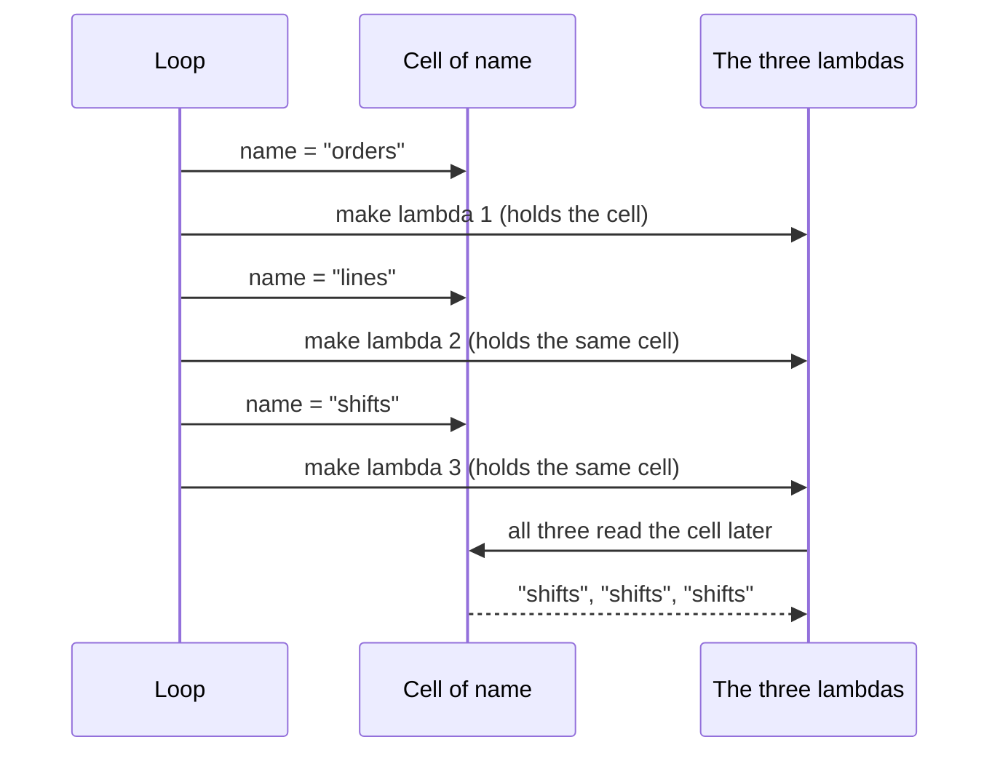

> [!note] Step 2 of 8 in the learning order
> This lesson is step 2 of the [learning order](/notes/ai/ai-engineering/01-software-engineering-fundamentals/roadmap). It needs [2.1 Functions as values and callbacks](/notes/ai/ai-engineering/01-software-engineering-fundamentals/m02-concurrency-foundations/l1-functions-as-values-and-callbacks).

## 1. The question this idea answers

In [2.1](/notes/ai/ai-engineering/01-software-engineering-fundamentals/m02-concurrency-foundations/l1-functions-as-values-and-callbacks) you passed ready-made functions such as `len` or `q.put`. Often the callback needs extra data that the caller does not pass. For example:

- A tool must know which user it serves. The model must not choose the user.
- A thread target must know which item it handles.
- A small sort key is too small to deserve a `def` with a name.

Two Python features solve this: **lambdas** (small functions written in one expression) and **closures** (functions that remember variables of the code around them).

Closures also cause one of the most common bugs in callback code. You make three callbacks in a loop, and all three see the **last** loop value. This lesson shows why, with sandbox output, and gives three fixes, including `name=name`.

## 2. Mental model

> [!analogy] A backpack with labels, not photos
> When Python makes an inner function, the function gets a backpack. In the backpack are **labels** that point to the variables of the outer function. The function does not take a photo of the values. It takes the labels.
>
> When the function runs, it reads each label and looks at the variable **now**. If the variable changed after the function was made, the function sees the new value.
>
> **Where it stops working:** a real backpack belongs to one person. In Python, many functions can share the **same** label to the same variable. That sharing is the reason for the loop bug in section 4.4.

## 3. Terms

| Term | Plain meaning |
|---|---|
| lambda | An expression that makes a function without a name: `lambda x: x * x`. Its body is one expression. |
| anonymous function | A function without its own name. A lambda's `__name__` is `<lambda>`. |
| outer function | A function that contains the `def` or `lambda` of another function. |
| inner function | A function defined inside another function. |
| free variable | A name that a function uses but does not define. It belongs to an outer function. |
| closure | An inner function plus the free variables that it keeps alive after the outer function returned. |
| cell | The small box in which Python keeps a free variable. The inner function holds the cell, not the value. |
| late binding | A closure reads the variable's value when it **runs**, not when it is made. |
| default argument | A value after `=` in a parameter list, for example `def f(name="x")`. Python evaluates it once, when the function is made. |
| `nonlocal` | A statement that lets an inner function assign a new value to a variable of the outer function. |
| `functools.partial` | A function that makes a new callable with some arguments already filled in. |
| factory function | A function whose job is to make and return another function. |

## 4. How it works

### 4.1 A lambda is a small function expression

```python
square = lambda x: x * x
def square_def(x):
    return x * x
print(square(4), square_def(4), square.__name__, square_def.__name__)
print(sorted([("b", 2), ("a", 3), ("c", 1)], key=lambda pair: pair[1]))
```

Output of a sandbox run (Python 3.13.16, 2026-10-19):

```text
16 16 <lambda> square_def
[('c', 1), ('b', 2), ('a', 3)]
```

A lambda and a `def` make the same kind of function object. There are three differences:

1. A lambda has no name. Tracebacks show `<lambda>`, which is harder to debug.
2. A lambda body is **one expression**. It cannot hold statements such as `return`, `try` or a loop. `lambda x: return x` is a `SyntaxError`.
3. A lambda is an expression, so you can write it at the place where you pass it, for example after `key=`.

> [!key] Use a lambda only for a tiny callback
> A sort key or a one-line adapter is a good lambda. Anything that needs a name in a traceback, a docstring or a second line deserves a `def`.

### 4.2 A closure remembers the outer variables

```python
def make_greeter(greeting):
    def greet(name):
        return f"{greeting}, {name}"
    return greet

hello = make_greeter("Hello")
print(hello("Ana"), "| free vars:", hello.__code__.co_freevars, "| cell:", hello.__closure__[0].cell_contents)
```

```text
Hello, Ana | free vars: ('greeting',) | cell: Hello
```

Follow the steps:

1. `make_greeter("Hello")` runs. Its local variable `greeting` holds `"Hello"`.
2. Inside it, `def greet` makes a function. `greet` uses `greeting`, which it does not define. So `greeting` is a free variable of `greet`.
3. Python puts `greeting` in a **cell** and gives `greet` a reference to the cell.
4. `make_greeter` returns `greet`. The outer function is finished, but the cell stays alive, because `greet` holds it.
5. `hello("Ana")` runs `greet`. It reads the cell and finds `"Hello"`.

`hello.__code__.co_freevars` lists the free variables. `hello.__closure__` is the tuple of cells. You rarely read these in real code, but they show that the closure is real data, not magic.

### 4.3 nonlocal: change an outer variable

A closure can read an outer variable without help. To **assign** to it, the inner function needs `nonlocal`.

```python
def counter():
    count = 0
    def bump():
        nonlocal count
        count += 1
        return count
    return bump

c = counter(); c(); c()
print("third call:", c())
```

```text
third call: 3
```

Without `nonlocal`, the line `count += 1` makes `count` a **local** variable of `bump`, and Python reads it before it has a value ([1.4](/notes/ai/ai-engineering/01-software-engineering-fundamentals/m01-python-foundations/l4-mutability-references-and-scope)):

```text
UnboundLocalError: cannot access local variable 'count' where it is not associated with a value
```

### 4.4 The loop trap: late binding

This is the bug that the learning order names. Three tools are made in a loop. Each one must remember its own table name.

```python
def make_all():
    hs = []
    for name in ["orders", "lines", "shifts"]:
        hs.append(lambda: f"tool for {name}")
    return hs

hs = make_all()
print([h() for h in hs], "| same cell:", hs[0].__closure__[0] is hs[2].__closure__[0], "| cell value:", hs[0].__closure__[0].cell_contents)
```

```text
['tool for shifts', 'tool for shifts', 'tool for shifts'] | same cell: True | cell value: shifts
```

All three tools say `shifts`. The reason, step by step:

1. The loop has **one** variable `name`. Each loop pass assigns a new value to the same variable.
2. Each lambda captures the **cell** of `name`, not its value at that moment. The output shows `same cell: True`.
3. When the loop ends, the cell holds `"shifts"`.
4. The lambdas run after the loop. Each one reads the cell and finds `"shifts"`.



The same trap appears with threads. A sandbox run made three threads in a loop with `target=lambda: results.append(i)` and started them after the loop. The result was `[2, 2, 2]`, not `[0, 1, 2]`. A list comprehension gave the same `[2, 2, 2]`.

> [!trap] At module level the trap looks different, but it is the same
> At the top level of a script, the loop variable is a global variable, not a cell. A lambda then reads the global variable when it runs. The sandbox gave `['tool for shifts', 'tool for shifts', 'tool for shifts']` there too. The mechanism differs, but the rule is the same: the function reads the name when it runs.

### 4.5 Fix 1: `name=name`

```python
def make_all_fixed():
    hs = []
    for name in ["orders", "lines", "shifts"]:
        hs.append(lambda name=name: f"tool for {name}")
    return hs

fixed = make_all_fixed()
print([h() for h in fixed], "| defaults:", [h.__defaults__ for h in fixed], "| closure:", fixed[0].__closure__)
print("caller can override the default:", fixed[0](name="OOPS"))
```

```text
['tool for orders', 'tool for lines', 'tool for shifts'] | defaults: [('orders',), ('lines',), ('shifts',)] | closure: None
caller can override the default: tool for OOPS
```

Why it works:

1. `lambda name=name: ...` declares a **parameter** called `name` with a **default value**.
2. The right side of `=` is evaluated **once, when the lambda is made**. At that moment the loop variable holds `"orders"`, then `"lines"`, then `"shifts"`.
3. Each lambda stores its own default in `__defaults__`. The output shows three different tuples.
4. Inside the body, `name` now means the parameter, not the loop variable. The closure is `None`: there is no shared cell.

Read the two `name` words separately: the left `name` is the new parameter, and the right `name` is the loop variable now.

> [!trap] The default is a public parameter
> A caller can pass `name="OOPS"` and replace the value. For a tool, that is a risk. Never use this fix for values that must stay fixed, for example the identity of the user. Use a factory function instead.

### 4.6 Fix 2: a factory function

```python
def make_tool(name):
    return lambda: f"tool for {name}"

print([make_tool(n)() for n in ["orders", "lines", "shifts"]])
```

```text
['tool for orders', 'tool for lines', 'tool for shifts']
```

Each call of `make_tool` has its **own** local variable `name`, so each lambda gets its own cell. The caller cannot replace the value. This is the cleanest fix for real code.

### 4.7 Fix 3: `functools.partial`, or pass the value as an argument

```python
import functools

def query(table, limit, emit=None):
    return f"SELECT * FROM {table} LIMIT {limit}"

top10 = functools.partial(query, limit=10)
print(top10("orders"), "|", top10.func.__name__, top10.args, top10.keywords)
```

```text
SELECT * FROM orders LIMIT 10 | query () {'limit': 10}
```

`functools.partial(func, *args, **kwargs)` returns a new callable. When you call it, it calls `func` with the stored arguments plus the new ones. It stores the **values**, so it has no late binding. For threads, the simplest fix is the `args` parameter: `threading.Thread(target=results.append, args=(i,))` gave `[0, 1, 2]` in the sandbox.

> [!note] Another meaning of "partial"
> `functools.partial` is **partial application**: some arguments are filled in now, the rest later. It is not related to partial outputs in streaming. [5.6 What "partial" means](/notes/ai/ai-engineering/01-software-engineering-fundamentals/m05-streaming-and-agent-events/l6-what-partial-means) lists every meaning of the word.

### 4.8 Closures give a tool its per-request context

A tool must know facts that the model does not choose, for example the plant of the user who asked. A factory function makes one tool per request:

```python
def make_lookup_tool(user_plant):
    def lookup(args):
        return f"orders for plant {user_plant}, line {args['line']}"
    return lookup

a = make_lookup_tool("A"); b = make_lookup_tool("B")
print(a({"line": "L3"}), "|", b({"line": "L3"}))
```

```text
orders for plant A, line L3 | orders for plant B, line L3
```

Two requests ran the same tool code with two different plants. The model gives `args`, and the closure gives `user_plant`. The existing note [In-process MCP tools](/notes/ai/claude-agent-sdk/03-custom-tools/l1-in-process-mcp-tools) shows the same pattern with real SDK tools. It also shows why a global variable for the user breaks with two parallel requests.

### 4.9 Where this appears in the _run example

The function `_run` in the [case study 5.5](/notes/ai/ai-engineering/01-software-engineering-fundamentals/m05-streaming-and-agent-events/l5-case-study-the-run-bridge) defines two inner functions:

```python
def _run(prompt: str, ui_context: str | None, session_id: str, resume: bool):
    q: queue.Queue = queue.Queue()
    end = object()

    async def pump(options):                               # closure over prompt and q
        async for msg in query(prompt=prompt, options=options):
            q.put(msg)

    def worker():                                          # closure over q, end, ui_context, session_id, resume
        ...
```

1. `pump` uses `prompt` and `q`. Both are free variables from `_run`. `pump` is a closure.
2. `worker` uses `q`, `end`, `ui_context`, `session_id`, `resume` and `pump`. It is a closure too.
3. `threading.Thread(target=worker)` passes the closure. The new thread calls `worker()` with **no arguments**, and the closure supplies every value.
4. Late binding is safe here. `_run` never assigns a new value to these variables after it makes the closures. Each call of `_run` has its own variables, so two parallel calls never share a queue.

## 5. Code walkthrough

The three fixes side by side, for one loop that makes thread targets:

```python
results = []
threads = []
for i in range(3):
    threads.append(threading.Thread(target=lambda i=i: results.append(i)))   # fix 1: i=i
for t in threads: t.start()
for t in threads: t.join()
print("with i=i:", sorted(results))
```

```text
with i=i: [0, 1, 2]
```

| Version | What the thread runs | Result in the sandbox | Why |
|---|---|---|---|
| `target=lambda: results.append(i)` | reads `i` when the thread runs | `[2, 2, 2]` | late binding: one shared variable |
| `target=lambda i=i: results.append(i)` | uses its own default | `[0, 1, 2]` | the default was evaluated at each loop pass |
| `target=results.append, args=(i,)` | the thread passes the stored value | `[0, 1, 2]` | `args` stores the value, not the name |
| `target=make_target(i)` (a factory) | uses its own cell | `[0, 1, 2]` | each factory call has its own variable |

The `args=(i,)` version is the normal style for `threading.Thread`. Note the comma: `(i,)` is a tuple with one item, and `(i)` is only `i`.

## 6. Exercises

Runs in: a browser lab, except exercise 2.2.3, which uses threads. [Open a lab for this lesson](/labs/new?note=ai/ai-engineering/01-software-engineering-fundamentals/m02-concurrency-foundations/l2-lambdas-and-closures)

Hints come in three levels in chat: idea, pseudocode, partial code.

**Exercise 2.2.1: predict, then run.** Before you run each cell, write your prediction in a text cell.

```python
fs = [lambda: k * 10 for k in range(4)]
print([f() for f in fs])

gs = [lambda k=k: k * 10 for k in range(4)]
print([g() for g in gs])
```

Acceptance tests: both predictions are right, and a text cell explains each result in two sentences with the words "cell" and "default".

**Exercise 2.2.2: a tool factory.** Write `make_tools(tables: list[str]) -> dict[str, Callable[[], str]]`. Each value returns `"rows of <table>"` for its own table.

Acceptance tests:

- `make_tools(["a", "b"])["a"]()` returns `"rows of a"`, and `["b"]()` returns `"rows of b"`.
- Calling a tool with an argument, for example `tools["a"]("x")`, raises `TypeError`. (So no caller can replace the table.)
- An empty list gives an empty dict.

**Exercise 2.2.3: thread targets.** Runs in: your local practice project (the browser lab has no threads). Start five threads in a loop. Each thread appends its own index to a list. Write the code three ways: `args=`, a default argument, and `functools.partial`.

Acceptance tests: after `join()`, `sorted(results) == [0, 1, 2, 3, 4]` for all three versions, and a version with a bare lambda that you also wrote shows the late-binding bug.

## 7. Common mistakes

1. **Callbacks made in a loop that all see the last value.** The cause is late binding. Fix it with a factory function, `functools.partial`, `args=` or `name=name`.
2. **`name=name` for a value that must not change.** The caller can override a default. Use a factory function for identity or permissions.
3. **A long lambda.** If it needs a statement or a name in tracebacks, write a `def`.
4. **Assigning to an outer variable without `nonlocal`.** The result is `UnboundLocalError`.
5. **A mutable value in a closure, shared by many callbacks.** All of them see every change. This is the aliasing problem of [1.4](/notes/ai/ai-engineering/01-software-engineering-fundamentals/m01-python-foundations/l4-mutability-references-and-scope).
6. **`args=(i)` instead of `args=(i,)`.** Without the comma, it is not a tuple.

## 8. One-minute explanation

A lambda is a function written as one expression, without a name, for tiny callbacks such as a sort key. A closure is an inner function that uses variables of its outer function. Python keeps those variables in cells, and the inner function holds the cells, so the values stay alive after the outer function returns. A closure reads a variable when it runs, not when it was made. This is late binding. In a loop, all callbacks share one loop variable, so they all see its last value. Three fixes give each callback its own value. A factory function gives each call its own variable. `functools.partial` and the `args=` parameter of a thread store values. `name=name` stores a default that Python evaluates when the lambda is made, but a caller can override it. Closures are the clean way to give a tool per-request data, such as the user's identity, that the model must not choose.

## 9. Check questions

```check
{
  "question": "Why does `[lambda: n for n in range(3)]` give functions that all return 2?",
  "hint": "What does each lambda capture: the value or the variable?",
  "answer": "Each lambda captures the variable n (its cell), not the value at that moment. All three share the same variable. The functions run after the loop, when n holds 2, so all return 2. This is late binding."
}
```

```check
{
  "question": "Explain both words in `lambda name=name: ...`. When is the right-hand `name` evaluated?",
  "answer": "The left `name` is a new parameter of the lambda. The right `name` is the loop variable. Python evaluates a default value once, when it makes the function, so at each loop pass the lambda stores the current value in its `__defaults__`. Inside the body, `name` refers to the parameter, so later changes to the loop variable do not matter."
}
```

```check
{
  "question": "`worker` in the _run example is passed to `threading.Thread(target=worker)` and takes no arguments. How does it get `q`, `end` and `session_id`?",
  "answer": "worker is a closure. It is defined inside `_run` and uses variables of `_run`, so Python keeps those variables in cells that worker holds. When the thread calls `worker()` with no arguments, worker reads q, end and session_id from its cells. Each call of `_run` makes new variables and a new worker, so two calls do not share a queue."
}
```

```check
{
  "question": "A developer fixes a tool factory with `lambda user=user: run_query(user)`. Why is this a security risk for a tool that the model calls, and what is a safer fix?",
  "answer": "A default argument is a normal parameter. Any caller can pass `user=...` and replace it, so the identity is not fixed. A factory function, `def make_tool(user): return lambda: run_query(user)`, keeps user in a cell that no caller can replace."
}
```

## 10. Links

- Previous: [2.1 Functions as values and callbacks](/notes/ai/ai-engineering/01-software-engineering-fundamentals/m02-concurrency-foundations/l1-functions-as-values-and-callbacks)
- Next: [2.3 Threads](/notes/ai/ai-engineering/01-software-engineering-fundamentals/m02-concurrency-foundations/l3-threads)
- Scope rules: [1.4 Mutability, references and scope](/notes/ai/ai-engineering/01-software-engineering-fundamentals/m01-python-foundations/l4-mutability-references-and-scope)
- Closures in real tools: [In-process MCP tools](/notes/ai/claude-agent-sdk/03-custom-tools/l1-in-process-mcp-tools)
- The full example: [5.5 Case study: the _run bridge](/notes/ai/ai-engineering/01-software-engineering-fundamentals/m05-streaming-and-agent-events/l5-case-study-the-run-bridge)
- [Glossary](/notes/ai/ai-engineering/glossary)

Sources (checked on 2026-10-19): [Python docs, functools.partial](https://docs.python.org/3/library/functools.html#functools.partial), [Python FAQ, lambdas in a loop](https://docs.python.org/3/faq/programming.html#why-do-lambdas-defined-in-a-loop-with-different-values-all-return-the-same-result) ("`n=x` creates a new variable `n` local to the lambda and computed when the lambda is defined"). Further reading: [Python reference, Naming and binding](https://docs.python.org/3/reference/executionmodel.html#naming-and-binding). Measured outputs come from sandbox runs with Python 3.13.16. The basic generator, closure, queue and asyncio checks gave the same results on Python 3.15.0b4.
