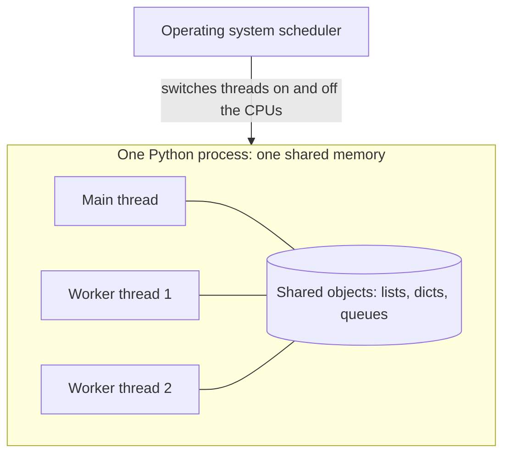
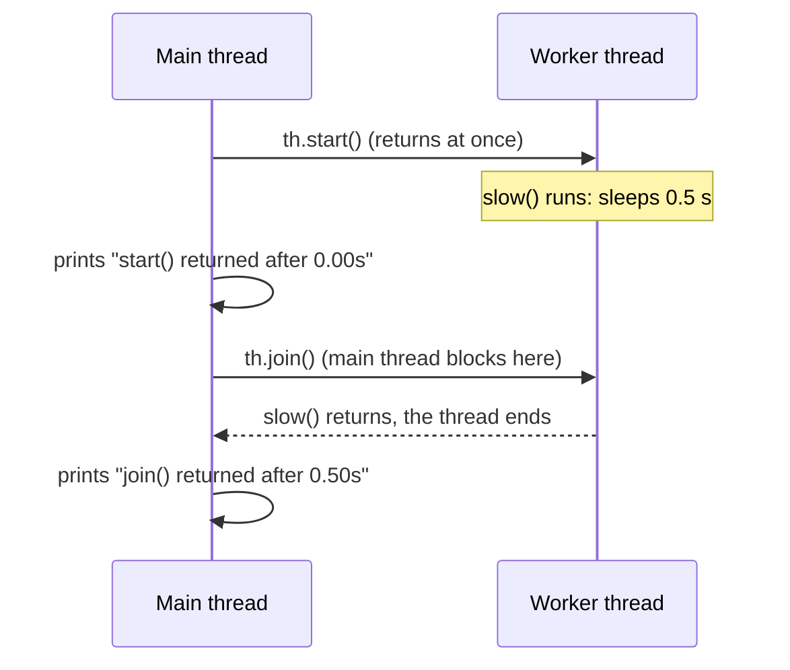

> [!note] Step 3 of 8 in the learning order (part 1 of 2)
> This lesson is the first half of step 3 of the [learning order](/notes/ai/ai-engineering/01-software-engineering-fundamentals/roadmap). The second half is [2.4 Queues and the producer-consumer pattern](/notes/ai/ai-engineering/01-software-engineering-fundamentals/m02-concurrency-foundations/l4-queues-and-producer-consumer).

## 1. The question this idea answers

A normal Python program does one thing at a time. Line 2 runs after line 1 ends. That is a problem when one line **waits**: for a network reply, for a database, for an AI model that thinks for 20 seconds.

Two situations from agent services:

1. A sync web framework must stream the messages of an agent to the user. The agent library is async and must run in its own event loop. The streaming code must stay free to send each message as it arrives.
2. A service must call three slow APIs. One after another, the waits add up.

A **thread** lets a program run a second piece of work while the first one waits. This lesson explains what a thread is, how to start one and how to wait for it. It also shows four dangers: daemon threads, lost exceptions, race conditions and the GIL.

## 2. Mental model

> [!analogy] Cooks in one kitchen
> A process is a kitchen. It has one fridge, one set of pans and one recipe book: the memory of the program. A thread is a cook. Two cooks in the same kitchen can work at the same time, and both use the same fridge.
>
> - A cook who waits for water to boil does not stop the other cook.
> - Two cooks who take the last egg at the same moment cause trouble. This is a race condition.
> - In the default CPython build, only one cook can hold the knife (the GIL) at a time. Cooks who only wait do not need the knife, so waiting work still runs in parallel.
>
> **Where it stops working:** a real cook can be told to stop and leave. Python has no safe way to stop a thread from outside. A thread stops only when its function returns, or when the whole process ends.

## 3. Terms

| Term | Plain meaning |
|---|---|
| process | A running program, with its own memory. The operating system starts it. |
| thread | One line of execution inside a process. All threads of a process share its memory. |
| main thread | The thread that starts when the program starts. Its name is `MainThread`. |
| worker thread | An extra thread that runs one function next to the main thread. |
| operating system scheduler | The part of the operating system that decides which thread runs on which CPU, and when. |
| `threading.Thread` | The class that describes a thread: its target function, its arguments, its name and its daemon flag. |
| target | The function that a thread calls when it starts. It is a callback ([2.1](/notes/ai/ai-engineering/01-software-engineering-fundamentals/m02-concurrency-foundations/l1-functions-as-values-and-callbacks)). |
| `start()` | Starts the thread. It returns at once. You can call it once per thread object. |
| `join()` | Blocks the calling thread until the other thread ends, or until a timeout. |
| daemon thread | A thread that does not keep the program alive. At exit, Python stops it abruptly. |
| I/O-bound work | Work that mostly waits for input or output: network, disk, a database. |
| CPU-bound work | Work that mostly calculates. The CPU is busy the whole time. |
| GIL | Global Interpreter Lock. In the default CPython build, a lock that lets only one thread run Python bytecode at a time. |
| free-threaded build | A separate CPython build without the GIL. Supported since Python 3.14, but not the default. |
| race condition | A bug where the result depends on the exact timing of two threads. |
| `threading.Lock` | An object that only one thread can hold at a time. It protects a shared value. |
| `threading.Event` | A flag that one thread sets and other threads wait for. A simple stop signal. |

## 4. How it works

### 4.1 A process, its threads and the scheduler



1. The operating system starts the process with one thread, the main thread.
2. The program asks for more threads. Each one gets its own stack: its own local variables and its own position in the code.
3. All threads see the **same** objects. A list that one thread changes is the changed list for every thread.
4. The scheduler switches between threads. You cannot predict the exact moment of a switch.

### 4.2 Start a thread and wait for it

```python
import threading, time

def slow():
    time.sleep(0.5)

t0 = time.perf_counter()
th = threading.Thread(target=slow)
th.start()
print(f"start() returned after {time.perf_counter() - t0:.2f}s, alive={th.is_alive()}")
th.join()
print(f"join() returned after {time.perf_counter() - t0:.2f}s, alive={th.is_alive()}")
```

Output of a sandbox run (Python 3.13.16, 2026-10-19):

```text
start() returned after 0.00s, alive=True
join() returned after 0.50s, alive=False
```



The constructor takes these arguments (Python threading docs, checked on 2026-10-19):

| Argument | Meaning |
|---|---|
| `target` | The function to call. Pass it without parentheses. |
| `args` | A tuple of positional arguments for the target, for example `args=(i,)`. |
| `kwargs` | A dict of keyword arguments for the target. |
| `name` | A name for logs. The default looks like `Thread-1 (slow)`. |
| `daemon` | `True` for a daemon thread. `None`, the default, copies the flag of the current thread. The main thread is not a daemon. |

Two rules from the docs:

1. `start()` "must be called at most once per thread object". A second call raised `RuntimeError: threads can only be started once` in the sandbox.
2. `join()` always returns `None`. With a timeout, check `is_alive()` afterward. A sandbox `join(timeout=0.1)` on a thread that slept 1 s returned `None`, and `is_alive()` was `True`.

### 4.3 Threads help when work waits

```python
def wait_io():
    time.sleep(0.5)        # stands for a network call

# one after another
for _ in range(3):
    wait_io()

# three threads
ts = [threading.Thread(target=wait_io) for _ in range(3)]
for th in ts: th.start()
for th in ts: th.join()
```

```text
one after another: 1.50s
three threads:     0.50s
```

> [!example] Worked example: three API calls
> Each call waits 0.5 s for the network.
>
> 1. One after another: 0.5 + 0.5 + 0.5 = 1.5 s.
> 2. In three threads, all three waits overlap: about 0.5 s in total.
> 3. With 30 calls in 30 threads, the total is still about 0.5 s. But 30 threads use memory, and the server on the other side may limit you ([3.2](/notes/ai/ai-engineering/01-software-engineering-fundamentals/m03-http-rest-json/l2-methods-status-codes-and-retries)).

### 4.4 The GIL: threads do not speed up CPU work

```python
def burn():
    n = 0
    for i in range(3_000_000):
        n += i
    return n
```

```text
2 x burn one after another: 0.18s | 2 threads: 0.22s | GIL enabled: True
```

Two threads were not faster than one thread. The reason is the **GIL**. The threading docs (checked on 2026-10-19) say: "In CPython, due to the Global Interpreter Lock, only one thread can execute Python code at once". The same note says that threading "is still an appropriate model if you want to run multiple I/O-bound tasks simultaneously".

Why does waiting work still overlap? A thread **releases** the GIL while it waits in `time.sleep`, in a socket read or in many database drivers. Another thread can run Python code in that time.

> [!note] The free-threaded build
> PEP 779 (status Final, checked on 2026-10-19) makes the free-threaded CPython build officially supported in Python 3.14. It is still optional. The default build keeps the GIL, and the PEP leaves "the decision to make free-threaded Python the default" to a future PEP. `sys._is_gil_enabled()` tells you which mode runs. The sandbox printed `True`.

| Work | Example | Threads help? (default build) | Better tool |
|---|---|---|---|
| I/O-bound | HTTP calls, SQL queries, model API calls | Yes | threads or asyncio ([2.6](/notes/ai/ai-engineering/01-software-engineering-fundamentals/m02-concurrency-foundations/l6-asyncio-and-the-event-loop)) |
| CPU-bound in pure Python | loops over numbers, parsing large text | No | processes (`multiprocessing`, `ProcessPoolExecutor`) |
| CPU-bound in C libraries that release the GIL | NumPy on large arrays | Often | threads can work |

### 4.5 Race conditions and locks

Threads share memory, so two threads can change the same value at the same time.

```python
balance = 0
def deposit():
    global balance
    for _ in range(1000):
        current = balance
        time.sleep(0)          # let another thread run here
        balance = current + 1
```

Four threads ran `deposit`. Each one added 1 a thousand times.

```text
expected 4000, got 1002
with a Lock: expected 4000, got 4000
```

What went wrong, with two threads A and B:

1. A reads `balance`: 10.
2. The scheduler switches to B. B reads `balance`: also 10.
3. B writes 11.
4. A writes 11. One deposit is lost.

The `time.sleep(0)` makes a switch at the worst place very likely. Without it the bug still exists, but it appears less often, and that makes it harder to find. The fix is a `Lock`:

```python
lock = threading.Lock()
def deposit_locked():
    global balance
    for _ in range(1000):
        with lock:                     # only one thread at a time inside this block
            current = balance
            time.sleep(0)
            balance = current + 1
```

> [!key] Share less, or share safely
> The best design passes data between threads through a thread-safe queue ([2.4](/notes/ai/ai-engineering/01-software-engineering-fundamentals/m02-concurrency-foundations/l4-queues-and-producer-consumer)) instead of sharing changing variables. A queue has its locks inside.

### 4.6 An exception in a thread does not reach you

```python
def boom():
    raise ValueError("inside the thread")

th = threading.Thread(target=boom)
th.start(); th.join()      # join returns normally
```

```text
join() returned normally; excepthook saw: ['ValueError: inside the thread']
```

The exception ends the worker thread. Python calls `threading.excepthook`, which by default prints the traceback to `sys.stderr`. The main thread gets **no** exception. `join()` returns as if all was well.

This is a serious problem for a stream: the consumer can wait forever for data that never comes. [2.4](/notes/ai/ai-engineering/01-software-engineering-fundamentals/m02-concurrency-foundations/l4-queues-and-producer-consumer) shows the fix: catch the exception in the thread and send it to the consumer through a queue.

### 4.7 Daemon threads and the end of the program

A program ends when its last **non-daemon** thread ends. Daemon threads do not count. The sandbox ran one script two times. A worker sleeps 1 s and has a `finally` block. The main thread ends after 0.1 s.

```text
== daemon
  thread: started
  main: end of script
  process exit after 0.13s
== normal
  thread: started
  main: end of script
  thread: finished its work
  thread: finally ran
  process exit after 1.04s
```

The daemon thread was stopped in the middle of its sleep. Its `finally` block **did not run**. The docs (checked on 2026-10-19) say: "Daemon threads are abruptly stopped at shutdown. Their resources (such as open files, database transactions, etc.) may not be released properly."

| Flag | Keeps the program alive? | Cleanup at exit | Use it for |
|---|---|---|---|
| `daemon=False` (main thread default) | Yes | Runs normally | Work that must finish, for example a write to a database |
| `daemon=True` | No | May not run | Helper work that can be lost, for example a stream that nobody reads anymore |

### 4.8 Stop a thread with a signal

Python has no `thread.kill()`. To stop a thread early, the thread itself must check a signal. `threading.Event` is the simple tool:

```python
stop = threading.Event()

def poller():
    n = 0
    while not stop.is_set():
        n += 1
        stop.wait(0.1)           # sleeps 0.1 s, but wakes at once when stop is set
    print(f"  poller stopped after {n} rounds")
```

```text
  poller stopped after 4 rounds
  join returned 0.000s after stop.set()
```

A thread that is inside one long blocking call, for example a 60 s database query, sees the signal only after the call returns. Plan for that limit.

### 4.9 Where this appears in the _run example

The [case study 5.5](/notes/ai/ai-engineering/01-software-engineering-fundamentals/m05-streaming-and-agent-events/l5-case-study-the-run-bridge) uses one line for the whole thread:

```python
threading.Thread(target=worker, daemon=True).start()
```

1. `target=worker` passes the closure `worker` ([2.2](/notes/ai/ai-engineering/01-software-engineering-fundamentals/m02-concurrency-foundations/l2-lambdas-and-closures)). The new thread calls it with no arguments.
2. `daemon=True` means that this thread does not keep the program alive. If the process exits, the agent run stops abruptly, and its `finally` block may not run.
3. `.start()` returns at once. The code continues to the `while` loop, which reads the queue.
4. The code never calls `join()` and keeps no name for the thread object. The thread ends when `worker` returns.
5. `worker` catches `Exception` and sends it through the queue. Section 4.6 explains why: otherwise the consumer would never learn about the error.

## 5. Code walkthrough

A small fan-out that runs three slow calls in threads and collects the results in order:

```python
import threading, time

def fetch(name: str, results: dict[str, str]) -> None:
    time.sleep(0.5)                                   # the slow, waiting part
    results[name] = f"{name}: ok on {threading.current_thread().name}"

results: dict[str, str] = {}
names = ["orders", "lines", "shifts"]
threads = [threading.Thread(target=fetch, args=(n, results), name=f"fetch-{n}") for n in names]
for t in threads:
    t.start()
for t in threads:
    t.join()
print([results[n] for n in names])
```

| Line | What it does | Why it exists |
|---|---|---|
| `def fetch(name, results)` | The target. It writes its result into a shared dict. | A thread target cannot `return` a value to the starter. `join()` returns `None`. |
| `results[name] = ...` | Each thread writes a **different** key. | Separate keys avoid a race on one value. A shared counter would need a lock. |
| `args=(n, results)` | Passes the values. | Avoids the late-binding trap of [2.2](/notes/ai/ai-engineering/01-software-engineering-fundamentals/m02-concurrency-foundations/l2-lambdas-and-closures). |
| `name=f"fetch-{n}"` | Names each thread. | Logs and tracebacks show which thread did what. |
| first loop `t.start()` | Starts all threads before any wait. | If you start and join in one loop, the calls run one after another. |
| second loop `t.join()` | Waits for all threads. | Without it, the main thread reads `results` too early. |
| `[results[n] for n in names]` | Reads results in the input order. | Threads finish in any order. The dict keys restore the order. |

> [!trap] This code hides errors
> If one `fetch` raises, that thread prints a traceback and ends, and the main thread gets a `KeyError` later. A real fan-out uses `concurrent.futures.ThreadPoolExecutor`, whose `future.result()` re-raises the error in the caller, or asyncio ([2.7](/notes/ai/ai-engineering/01-software-engineering-fundamentals/m02-concurrency-foundations/l7-blocking-calls-and-to-thread)).

## 6. Exercises

Runs in: your local practice project. The browser lab cannot start threads: the Pyodide docs (checked on 2026-10-19) say "Pyodide does not support threading or multiprocessing". Use `uv run python file.py`.

Hints come in three levels in chat: idea, pseudocode, partial code.

**Exercise 2.3.1: measure the overlap.** Write `run_parallel(funcs) -> float`. It runs each function in its own thread, waits for all of them, and returns the elapsed seconds.

Acceptance tests:

- Three functions that each sleep 0.4 s finish in less than 0.6 s.
- Two CPU-bound functions (a loop of 3,000,000 additions) are not faster in threads than one after another. Print both times.
- An empty list returns a time below 0.01 s.

**Exercise 2.3.2: make the race visible, then fix it.** Write a shared counter. Four threads increase it 1,000 times each, with `time.sleep(0)` between the read and the write.

Acceptance tests:

- Without a lock, at least one run of five gives a total below 4,000. Print every total.
- With `threading.Lock`, all five runs give exactly 4,000.

**Exercise 2.3.3: a stoppable worker.** Write a worker that prints a line every 0.2 s until a `threading.Event` is set.

Acceptance tests:

- After `stop.set()`, `join(timeout=0.5)` returns and `is_alive()` is `False`.
- The worker logs how many rounds it ran, and the number is between 3 and 6 for a 1 s run.

**Exercise 2.3.4: daemon or not.** Run the daemon experiment of section 4.7 yourself. Then explain in three sentences which flag you would choose for a thread that writes an audit log, and why.

## 7. Common mistakes

1. **`start()` and `join()` in the same loop.** The threads then run one after another. Start all, then join all.
2. **Expecting `join()` to raise the thread's exception.** It never does. Send errors through a queue, or use `ThreadPoolExecutor`.
3. **A daemon thread for work that must finish.** At exit it stops without cleanup.
4. **Threads for CPU-bound Python code.** With the GIL, they give no speed. Use processes.
5. **Shared changing variables without a lock.** Use a queue or a lock. A test that passes ten times can still hide a race.
6. **Waiting for a thread to stop "by itself".** Give it a stop signal, and remember that a blocking call delays the signal.
7. **Calling `start()` twice.** It raises `RuntimeError: threads can only be started once`. Make a new `Thread` object.

## 8. One-minute explanation

A thread is a second line of execution inside the same process, and all threads share the same memory. `threading.Thread(target=f, args=(...))` describes the thread, `start()` begins it and returns at once, and `join()` waits until it ends. Threads help when work waits for the network or a disk, because a waiting thread releases the GIL. In the default CPython build, the GIL lets only one thread run Python code at a time. So threads do not speed up pure Python calculations. Python 3.14 supports a free-threaded build, but it is not the default. Shared memory gives race conditions, so protect shared values with a lock, or better, pass data through a queue. An exception in a thread does not reach the starter, so catch it inside and send it on. Daemon threads do not keep the program alive and stop abruptly at exit, without cleanup. You cannot kill a thread from outside. It must check a signal such as a `threading.Event`.

## 9. Check questions

```check
{
  "question": "Three threads each call an API that takes 0.5 s, and you start and join them correctly. About how long does it take, and why does the GIL not make it 1.5 s?",
  "hint": "What does a thread do with the GIL while it waits for the network?",
  "answer": "About 0.5 s. The waits overlap. A thread that waits for I/O (here the network) releases the GIL, so the other threads can run their Python code during that time. The GIL serializes only the running of Python bytecode, not the waiting."
}
```

```check
{
  "question": "A worker thread raises ValueError. The main thread called `t.join()`. What does the main thread see?",
  "answer": "Nothing. join() returns None normally. The exception ends only the worker thread, and threading.excepthook prints the traceback to stderr. To deliver the error, catch it inside the thread and pass it to the main thread, for example by putting the exception object into a queue."
}
```

```check
{
  "question": "Why can a `daemon=True` thread lose data at program exit? Give one kind of work where you would not use a daemon thread.",
  "answer": "At shutdown Python stops daemon threads abruptly, in the middle of their work. Their finally blocks may not run, and the docs say that open files or database transactions may not be released properly. In the sandbox the finally block did not run. Do not use a daemon thread for work that must finish, for example writing an audit log or committing a database transaction."
}
```

```check
{
  "question": "In `threading.Thread(target=worker, daemon=True).start()`, what happens if you write `target=worker()` instead?",
  "answer": "worker() runs at once on the current thread, and the code waits for it there. Its return value (None) becomes the target, so the new thread does nothing. The work is no longer parallel."
}
```

## 10. Links

- Previous: [2.2 Lambdas and closures](/notes/ai/ai-engineering/01-software-engineering-fundamentals/m02-concurrency-foundations/l2-lambdas-and-closures)
- Next: [2.4 Queues and the producer-consumer pattern](/notes/ai/ai-engineering/01-software-engineering-fundamentals/m02-concurrency-foundations/l4-queues-and-producer-consumer)
- Each worker thread can run its own event loop: [Sync code calling async code](/notes/software-engineering/python/01-asyncio/l3-sync-code-calling-async-code)
- The full example: [5.5 Case study: the _run bridge](/notes/ai/ai-engineering/01-software-engineering-fundamentals/m05-streaming-and-agent-events/l5-case-study-the-run-bridge)
- [Glossary](/notes/ai/ai-engineering/glossary)

Sources (checked on 2026-10-19): [Python docs, threading](https://docs.python.org/3/library/threading.html), [PEP 779](https://peps.python.org/pep-0779/), [Pyodide Python compatibility](https://pyodide.org/en/latest/usage/wasm-constraints.html). Measured outputs come from sandbox runs with Python 3.13.16. The basic generator, closure, queue and asyncio checks gave the same results on Python 3.15.0b4.
