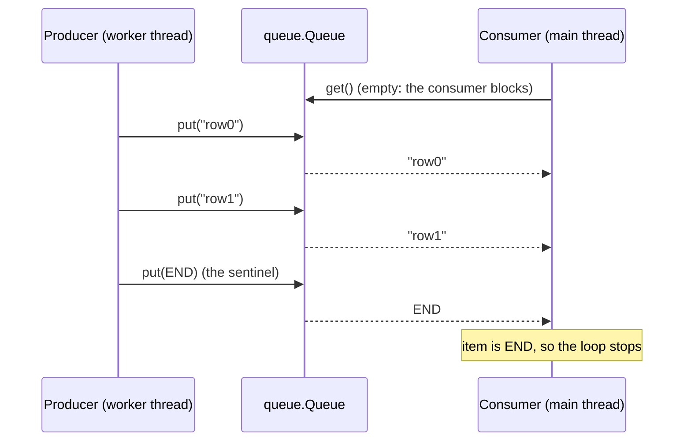
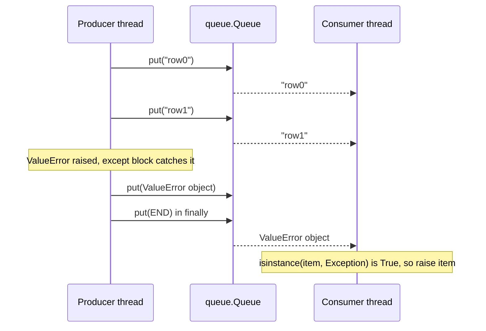

> [!note] Step 3 of 8 in the learning order (part 2 of 2)
> This lesson is the second half of step 3 of the [learning order](/notes/ai/ai-engineering/01-software-engineering-fundamentals/roadmap). It needs [2.3 Threads](/notes/ai/ai-engineering/01-software-engineering-fundamentals/m02-concurrency-foundations/l3-threads).

## 1. The question this idea answers

[2.3](/notes/ai/ai-engineering/01-software-engineering-fundamentals/m02-concurrency-foundations/l3-threads) left three problems open:

1. Shared variables between threads cause race conditions.
2. A thread cannot `return` a value to the code that started it.
3. An exception in a thread never reaches the starter.

A streaming agent adds a fourth problem. One thread **makes** messages over 30 seconds. Another thread must **send** each message to the user as soon as it exists, and must know when the stream is over.

One standard tool solves all four: `queue.Queue`, used in the **producer-consumer pattern**. This lesson explains the queue and its two blocking calls, `put()` and `get()`. It also explains the **sentinel** that marks the end, and the way to carry an exception from one thread to another.

## 2. Mental model

> [!analogy] A conveyor belt between two rooms
> A cook (the producer) puts plates on a conveyor belt. A waiter (the consumer) takes plates from the other end and carries them to the guests.
>
> - If the belt is empty, the waiter waits at the end of the belt. He does not walk around the kitchen.
> - If the belt is full, the cook waits until there is space.
> - At the end of the night, the cook puts a red card on the belt. When the waiter sees the red card, he knows that no more plates will come. The red card is the **sentinel**.
> - If the kitchen has a fire, the cook puts a note "fire" on the belt, then the red card. The waiter reads the note and tells the guests.
>
> **Where it stops working:** a real waiter sees the cook and knows when the cook leaves. A Python consumer sees only the belt. If the producer dies without the red card, the consumer waits at the belt forever.

## 3. Terms

| Term | Plain meaning |
|---|---|
| queue | A container where items come out in the order they went in: first in, first out (FIFO). |
| `queue.Queue` | The standard thread-safe queue. All its locks are inside it. |
| thread-safe | Safe to use from many threads at the same time, with no extra lock. |
| producer | The code that makes items and puts them in the queue. |
| consumer | The code that takes items from the queue and uses them. |
| `put(item)` | Adds an item. It blocks when the queue is full. |
| `get()` | Removes and returns the oldest item. It blocks when the queue is empty. |
| block | Wait inside a call, without using CPU, until a condition is true. |
| `maxsize` | The maximum number of items in the queue. 0 or less means no limit. |
| backpressure | A full queue makes a fast producer wait for a slow consumer. |
| sentinel | A unique object that the producer puts in the queue to say "no more items". Another name is "poison pill". |
| identity check | `a is b`: true only when both names point to the same object. |
| exception propagation | Carrying an error from the place where it happened to the code that must handle it. |
| `Queue.shutdown()` | A method (Python 3.13 and later) that closes the queue. Later `get()` calls on an empty queue raise `queue.ShutDown`. |

## 4. How it works

### 4.1 The producer-consumer pattern



The two sides never touch each other. They touch only the queue. So:

1. There is no shared variable to protect. The queue has its own locks.
2. The producer can be in a different thread, a different library, or a different event loop.
3. The consumer receives items in the same order that the producer put them.

### 4.2 put() and get() block

The queue docs (checked on 2026-10-19) say: "The `Queue` class in this module implements all the required locking semantics."

The docs describe `get()` like this. If *block* is true and *timeout* is `None` (the default), it will "block if necessary until an item is available".

Blocking does not use CPU. A sandbox consumer waited 1.00 s for an item and used 0.000 s of CPU time. The thread sleeps inside the operating system until the producer puts an item.

| Call | Queue state | What happens |
|---|---|---|
| `q.get()` | empty | waits until an item arrives |
| `q.get(timeout=0.3)` | stays empty | raises `queue.Empty` after 0.3 s (sandbox: `queue.Empty after 0.30s`) |
| `q.get_nowait()` | empty | raises `queue.Empty` at once |
| `q.put(x)` | no `maxsize` | adds at once, never waits |
| `q.put(x)` | full (`maxsize` reached) | waits until a consumer takes an item |
| `q.put(x, timeout=0.2)` | stays full | raises `queue.Full` after 0.2 s |

### 4.3 maxsize and backpressure

`queue.Queue()` without arguments has no limit. The docs say: "If *maxsize* is less than or equal to zero, the queue size is infinite."

With a limit, a fast producer must wait for a slow consumer.

```python
q = queue.Queue(maxsize=2)
# producer: puts 0..4 as fast as it can, then END
# consumer: takes one item, works 0.2 s on it, takes the next
```

```text
0.00s put 0 (size now 1)
0.00s put 1 (size now 2)
0.00s put 2 (size now 2)
0.20s consumer handled 0
0.20s put 3 (size now 2)
0.40s consumer handled 1
0.40s put 4 (size now 2)
0.60s consumer handled 2
0.80s consumer handled 3
1.01s consumer handled 4
```

Read the timeline:

1. The consumer took item 0 at once and started its 0.2 s of work. So `put 2` still found space.
2. Then the queue held 2 items. `put 3` waited until the consumer finished item 0 and took item 1, at 0.20 s.
3. The queue never held more than 2 items. Memory stays bounded.

> [!trap] A bounded queue can block the wrong thread
> If the producer runs inside an event loop ([2.6](/notes/ai/ai-engineering/01-software-engineering-fundamentals/m02-concurrency-foundations/l6-asyncio-and-the-event-loop)), a blocking `put()` on a full `queue.Queue` freezes the whole loop. An unbounded queue never blocks in `put()`, so it is safe to call from async code. The price is memory when the consumer is slow.

### 4.4 The end of the stream: a sentinel

The consumer loop needs a way to stop. The producer puts a special item last. The consumer checks each item for it.

**Why not `None`?** Because `None` can be real data. A sandbox producer put `"a"`, `None`, `"b"` and then `None` as the end marker:

```python
while (item := q.get()) is not None:
    got.append(item)
```

```text
consumer got: ['a'] <- 'b' was lost
```

The consumer stopped at the first `None`, which was data. The fix is a new, unique object:

```python
END = object()
...
while (item := q.get()) is not END:
    got.append(item)
```

```text
consumer got: ['a', None, 'b']
object() == object(): False
```

`object()` makes a new object with no data. No other object is ever **the same object**, so `item is END` is true only for the sentinel. Use `is`, not `==`. `is` checks identity, and a class can change what `==` means.

> [!key] Three rules for the sentinel
> 1. Make it with `object()` (or a dedicated class), never with `None`, a string or a number.
> 2. Compare with `is` / `is not`.
> 3. Put it in a `finally` block, so that it reaches the consumer on every path, also after an error.

### 4.5 What happens without the sentinel

```python
def producer_no_end():
    q.put("a")
    raise RuntimeError("crash before the end marker")
```

```text
got: a
no sentinel: consumer waited 1.0 s and would wait forever without a timeout
```

The producer crashed. Its thread printed a traceback and ended ([2.3](/notes/ai/ai-engineering/01-software-engineering-fundamentals/m02-concurrency-foundations/l3-threads)). The consumer had no way to know. It waited at the empty queue. In a web server, that request would hang until a proxy or the client stops it with a timeout.

### 4.6 Exception propagation through the queue

The producer catches the exception and puts the **exception object** in the queue. The consumer checks each item, and raises it again in its own thread.

```python
END = object()
q = queue.Queue()

def producer():
    try:
        for i in range(3):
            time.sleep(0.1)
            if i == 2:
                raise ValueError("bad row 2")
            q.put(f"row{i}")
    except Exception as e:
        q.put(e)              # 1. send the error as an item
    finally:
        q.put(END)            # 2. always send the end marker

threading.Thread(target=producer, daemon=True).start()
try:
    while (item := q.get()) is not END:
        if isinstance(item, Exception):
            raise item        # 3. raise it again, now in the consumer's thread
        print(f"consumer got {item}")
except ValueError as e:
    print(f"consumer raised ValueError: {e}")
```

```text
0.10s consumer got row0
0.20s consumer got row1
0.30s consumer raised ValueError: bad row 2
```



The re-raised exception keeps its traceback. A sandbox run printed the frames of the error after it was raised in the consumer: `['<module>', 'producer2', 'parse_rows']`. So the log still shows the producer function where the error started.

> [!trap] `except Exception` does not catch everything
> `KeyboardInterrupt`, `SystemExit` and `asyncio.CancelledError` are `BaseException` subclasses, not `Exception` subclasses ([1.6](/notes/ai/ai-engineering/01-software-engineering-fundamentals/m01-python-foundations/l6-exceptions-and-context-managers)). If one of them ends the producer, the `except` block does not run, but `finally` still puts `END`. The consumer then sees a normal end, with fewer items. The case study [5.5](/notes/ai/ai-engineering/01-software-engineering-fundamentals/m05-streaming-and-agent-events/l5-case-study-the-run-bridge) measures exactly this "silent truncation".

### 4.7 More than one consumer

One sentinel stops **one** consumer, because `get()` removes it from the queue.

```text
alive after ONE sentinel: [False, True]
alive after TWO sentinels: [False, False] | totals: 6
```

Two consumer threads read 6 items. After one sentinel, one consumer stopped and the other one kept waiting. Rule: put one sentinel for each consumer.

### 4.8 Two more end signals: task_done/join and shutdown

`task_done()` and `join()` answer a different question: "Did the consumers **finish** every item?"

```text
q.join() returned after 0.30s: all 3 items were handled
```

A worker called `q.task_done()` after each of 3 items of 0.1 s work. `q.join()` waited until the count of unfinished items was 0.

Python 3.13 added `Queue.shutdown()`. The docs (checked on 2026-10-19): "Once the queue is empty, future calls to `get()` will raise `ShutDown`." The sandbox:

```text
consumer got [0, 1, 2] then queue.ShutDown
put after shutdown raises queue.ShutDown
```

| End signal | Works on | Carries an error? | Many consumers |
|---|---|---|---|
| sentinel object | every Python version | no, but an exception item before it can | one sentinel per consumer |
| `Queue.shutdown()` | Python 3.13 and later | no | stops all of them |
| `task_done()` + `join()` | every version | no | tells the producer that work is done, not the consumer that items ended |

The browser lab runs Python 3.14, and your local project uses a current Python, so `shutdown()` is available. Many libraries still use a sentinel because it works on every version.

### 4.9 queue.Queue is not asyncio.Queue

| | `queue.Queue` | `asyncio.Queue` |
|---|---|---|
| For | threads | coroutines on one event loop |
| `get()` | blocks the thread | `await q.get()` pauses the coroutine |
| Thread-safe | yes | no ("not thread-safe" in the asyncio docs) |
| From another thread | call `put()` directly | use `loop.call_soon_threadsafe(q.put_nowait, item)` |

A program that has a thread on one side and an event loop on the other side uses `queue.Queue`. The existing note [Sync code calling async code](/notes/software-engineering/python/01-asyncio/l3-sync-code-calling-async-code) shows both directions.

### 4.10 Where this appears in the _run example

The [case study 5.5](/notes/ai/ai-engineering/01-software-engineering-fundamentals/m05-streaming-and-agent-events/l5-case-study-the-run-bridge) is a producer-consumer program:

```python
q: queue.Queue = queue.Queue()          # the event channel, no maxsize
end = object()                          # the sentinel
...
            q.put(msg)                  # producer 1: agent messages
...
            server, allowed = build_server(q.put)   # producer 2: tools get q.put as emit
...
        except Exception as e:
            q.put(e)                    # an exception becomes an item
        finally:
            q.put(end)                  # the sentinel on every path
...
    while (item := q.get()) is not end: # the consumer: blocks, stops at the sentinel
        if isinstance(item, Exception):
            raise item                  # the error is raised in the consumer
        yield item
```

1. The queue has no `maxsize`, so `q.put` never blocks. That matters because `q.put` runs inside an event loop in the worker thread.
2. `end = object()` follows the three sentinel rules: it is unique, the loop compares it with `is not`, and `finally` sends it.
3. There is one consumer, so one sentinel is enough.
4. The walrus operator `:=` assigns the result of `q.get()` to `item` and tests it in one expression.

## 5. Code walkthrough

The consumer loop is short, but every word matters:

```python
while (item := q.get()) is not END:
    if isinstance(item, Exception):
        raise item
    handle(item)
```

| Part | What it does | What breaks without it |
|---|---|---|
| `q.get()` | Blocks until an item exists, then returns the oldest one. | With `get_nowait()` in a loop, the thread burns CPU and needs extra code for "empty". |
| `item := ...` | Stores the item in `item` and gives it to the comparison. | You need a `while True:` loop with a separate `if ...: break`. |
| `is not END` | An identity check against the sentinel. | `!= END` calls `__eq__`, which an item can change. `is not None` loses real `None` items. |
| `isinstance(item, Exception)` | Finds the error item. | The consumer would treat the exception object as normal data and hide the error. |
| `raise item` | Raises the original exception object, with its traceback, in the consumer's thread. | The caller never learns that the stream failed. |
| `handle(item)` | Uses one normal item. | |

> [!trap] Data that is an exception
> The check `isinstance(item, Exception)` treats **every** exception object as an error. If a producer ever sends an exception as normal data, the consumer raises it by mistake. A safer design wraps errors in a small dedicated class and checks for that class:
>
> ```python
> from dataclasses import dataclass
>
> @dataclass
> class Failed:
>     exc: BaseException      # the producer puts Failed(e), the consumer checks isinstance(item, Failed)
> ```

## 6. Exercises

Runs in: your local practice project (threads do not work in the browser lab). Use `uv run python file.py` or pytest.

Hints come in three levels in chat: idea, pseudocode, partial code.

**Exercise 2.4.1: a stream of lines.** Write `iter_lines(path) -> Iterator[str]` in a main thread that starts a producer thread. The producer reads a text file line by line and puts each line in a `queue.Queue`. The consumer side yields the lines.

Acceptance tests:

- For a 5-line file, `list(iter_lines(path))` equals the 5 lines in order.
- For an empty file, the result is `[]`, and the call returns (no hang).
- For a path that does not exist, `list(iter_lines(path))` raises `FileNotFoundError` in the main thread.

**Exercise 2.4.2: prove the sentinel rules.** Write two consumer functions: one that stops at `None`, and one that stops at an `object()` sentinel.

Acceptance tests:

- The input `["a", None, "b"]` gives `["a"]` for the first version and `["a", None, "b"]` for the second.
- A producer that raises before its last item still ends the consumer loop within 0.5 s, because the sentinel is in `finally`.

**Exercise 2.4.3: two consumers.** Start two consumer threads on one queue of 20 items.

Acceptance tests:

- Both consumers stop, and `join(timeout=1)` returns with `is_alive()` false for both.
- The two consumers together handled exactly 20 items, with no item twice.
- Repeat it with `Queue.shutdown()` instead of sentinels. The same tests pass.

**Exercise 2.4.4: backpressure.** Use `maxsize=3`, a producer of 10 items with no delay, and a consumer that sleeps 0.1 s per item.

Acceptance tests: `q.qsize()` is never above 3 (record it after each `put`), and the total time is about 1 s.

## 7. Common mistakes

1. **`None` as the sentinel.** Real `None` data stops the stream early.
2. **The sentinel outside `finally`.** An error before it leaves the consumer waiting forever.
3. **`==` instead of `is`.** Use the identity check.
4. **One sentinel for many consumers.** Put one per consumer, or use `shutdown()`.
5. **A blocking `put()` inside an event loop.** A full bounded queue freezes the loop. Use an unbounded queue there, or `put_nowait` with a plan for `queue.Full`.
6. **`get()` with no timeout in a server.** If the producer can die without the sentinel (for example a killed process), the request hangs. A timeout turns a hang into an error that you can log.
7. **Checking `q.empty()` to decide that the stream ended.** An empty queue can mean "the producer is slow". Only the sentinel means "the end".
8. **Using `asyncio.Queue` between threads.** It is not thread-safe.

## 8. One-minute explanation

The producer-consumer pattern connects two threads through a queue. `queue.Queue` is thread-safe: its locks are inside it, so the two threads never share any other variable. `put()` adds an item, and `get()` removes the oldest one. Both can block: `get()` waits while the queue is empty, and `put()` waits while a bounded queue is full. That waiting gives backpressure and uses no CPU. The consumer must know when to stop, so the producer puts a sentinel last: a unique `object()`, checked with `is not`. `None` is a bad sentinel, because it can be real data. The producer puts the sentinel in a `finally` block, so it arrives even after an error. Errors cross threads in the same way: the producer catches the exception, puts the exception object in the queue, and the consumer raises it again. `except Exception` does not catch `BaseException` types such as `CancelledError`, so those end the stream silently.

## 9. Check questions

```check
{
  "question": "Why is `end = object()` a better sentinel than `None` or the string \"END\"?",
  "answer": "A new object() is unique. No data item can be the same object, so `item is end` is true only for the sentinel. None and \"END\" can be real data. In the sandbox, a None in the data stopped the stream early and lost the item 'b'."
}
```

```check
{
  "question": "The producer puts the sentinel at the end of its try block instead of in finally. What happens when the producer raises an exception halfway?",
  "hint": "Which line never runs?",
  "answer": "The exception skips the rest of the try block, so the sentinel is never put. If the except block also does not put the error in the queue, the consumer blocks forever in q.get(). Putting the sentinel in finally makes it arrive on every path."
}
```

```check
{
  "question": "A producer thread raises ValueError. How does the error reach the consumer in the pattern of this lesson, and in which thread is it raised at the end?",
  "answer": "The producer catches it with `except Exception as e`, puts the exception object e in the queue, and puts the sentinel in finally. The consumer gets e from the queue, sees that `isinstance(item, Exception)` is True, and runs `raise item`. The ValueError is raised in the consumer's thread, with its original traceback frames."
}
```

```check
{
  "question": "The producer runs inside an event loop and calls `q.put(msg)` on a `queue.Queue(maxsize=10)`. The consumer stops reading. What happens to the event loop?",
  "answer": "After 10 items the queue is full. The next q.put blocks the thread, and that thread runs the event loop, so the whole loop freezes: no other coroutine or tool on that loop can run. An unbounded queue avoids the block (at the cost of memory), or the code must use put_nowait and handle queue.Full."
}
```

## 10. Links

- Previous: [2.3 Threads](/notes/ai/ai-engineering/01-software-engineering-fundamentals/m02-concurrency-foundations/l3-threads)
- Next: [2.5 Generators, yield, close() and GeneratorExit](/notes/ai/ai-engineering/01-software-engineering-fundamentals/m02-concurrency-foundations/l5-generators-and-yield)
- A thread and a queue that bridge async to sync, with measurements: [Sync code calling async code](/notes/software-engineering/python/01-asyncio/l3-sync-code-calling-async-code)
- One channel for SDK messages and tool events: [5.4 Tool results vs user-visible events](/notes/ai/ai-engineering/01-software-engineering-fundamentals/m05-streaming-and-agent-events/l4-user-visible-event-channels)
- The full example: [5.5 Case study: the _run bridge](/notes/ai/ai-engineering/01-software-engineering-fundamentals/m05-streaming-and-agent-events/l5-case-study-the-run-bridge)
- [Glossary](/notes/ai/ai-engineering/glossary)

Sources (checked on 2026-10-19): [Python docs, queue](https://docs.python.org/3/library/queue.html) (`shutdown()` added in 3.13), [Python docs, asyncio queues](https://docs.python.org/3/library/asyncio-queue.html) ("Although asyncio queues are not thread-safe, they are designed to be used specifically in async/await code."). Measured outputs come from sandbox runs with Python 3.13.16. The basic generator, closure, queue and asyncio checks gave the same results on Python 3.15.0b4.
