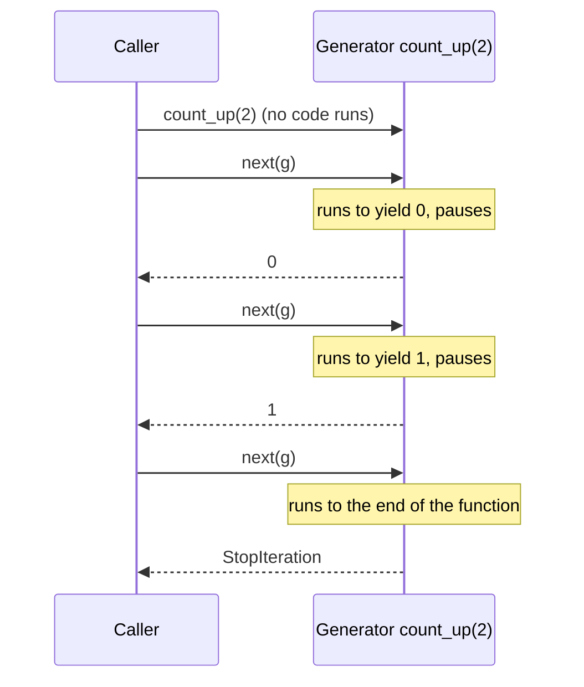
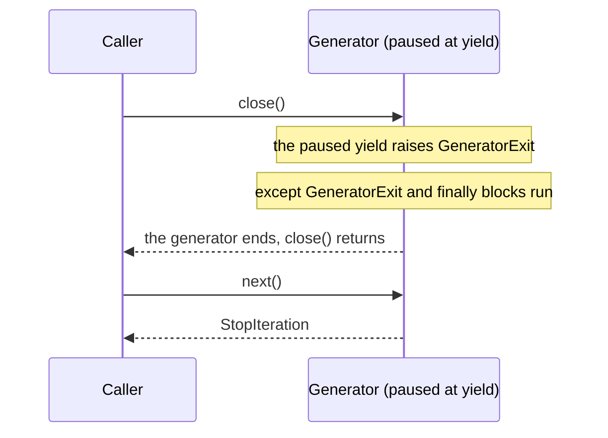

> [!note] Step 4 of 8 in the learning order
> This lesson is step 4 of the [learning order](/notes/ai/ai-engineering/01-software-engineering-fundamentals/roadmap). Generators are how Python code streams items to its caller, one at a time.

## 1. The question this idea answers

A function with `return` gives its caller **one** result, at the end. That is a problem for a stream:

- An agent produces 40 messages over 30 seconds. The user must see message 1 after 1 second, not all 40 after 30 seconds.
- A log file has 10 million lines. A list of all lines does not fit in memory.
- A web framework sends each piece of a response as soon as it exists.

Python solves this with **generators**. A generator function uses `yield` instead of `return`. Each `yield` hands one item to the caller and **pauses** the function. The caller asks for the next item when it is ready.

The second question is just as important for a server. What happens when the caller **stops** in the middle, for example when a user closes the browser tab? The answer is `close()` and `GeneratorExit`. This lesson shows both with measured output.

## 2. Mental model

> [!analogy] A book with a bookmark
> A normal function reads a whole book aloud and then stops. A generator reads until the end of one page, puts a bookmark there and waits. Each `next()` says "read one more page". The generator opens the book at the bookmark and continues.
>
> `close()` says "we are done with this book". The reader removes the bookmark and puts the book back on the shelf. That is the `finally` block: the place for cleanup.
>
> **Where it stops working:** a real reader can stop at any word. A generator pauses only at a `yield`. If the generator waits inside a slow call between two `yield` lines, it cannot pause or close until that call returns.

## 3. Terms

| Term | Plain meaning |
|---|---|
| iterable | An object that can give an iterator, for example a list, a string or a dict. `iter(x)` works on it. |
| iterator | An object that gives the next item with `next(it)` and raises `StopIteration` at the end. |
| iterator protocol | The two methods `__iter__` and `__next__`. A `for` loop uses them. |
| `StopIteration` | The exception that tells `next()` callers "there are no more items". |
| generator function | A function defined with `def` that contains `yield`. Calling it does not run its body. |
| generator object | The object that a generator function returns. It is an iterator. |
| `yield` | Gives one value to the caller and pauses the generator at that line. |
| suspended | The state of a generator that waits at a `yield`. |
| lazy | Work happens only when the caller asks for the next item. |
| `yield from` | Gives every item of another iterator, one by one, and receives its return value. |
| generator expression | A compact generator: `(x * 2 for x in data)`. |
| `send(value)` | Resumes the generator and makes the paused `yield` expression return `value`. |
| `close()` | Asks a generator to finish. Python raises `GeneratorExit` at the paused `yield`. |
| `GeneratorExit` | The exception that `close()` raises inside the generator. It is a `BaseException`, not an `Exception`. |
| finalized | The moment when Python frees a generator object. If it is still suspended, Python calls `close()` first. |
| garbage collector | The part of CPython that frees objects in reference cycles. It runs from time to time, not at once. |

## 4. How it works

### 4.1 Iterables and iterators

A `for` loop needs an **iterator**. It gets one from an **iterable** with `iter()`, then calls `next()` until `StopIteration`.

```python
nums = [1, 2, 3]
it = iter(nums)
print(type(nums).__name__, type(it).__name__, iter(it) is it, next(it), next(it))
```

Output of a sandbox run (Python 3.13.16, 2026-10-19):

```text
list list_iterator True 1 2
```

The list is iterable. `iter(nums)` gives a separate `list_iterator`, which remembers its position. An iterator returns itself from `iter()`: `iter(it) is it` is `True`.

### 4.2 A generator function returns a paused generator

```python
def count_up(n):
    print("  body starts")
    for i in range(n):
        print(f"  about to yield {i}")
        yield i
    print("  body ends")

g = count_up(2)
print("after call:", type(g).__name__)
print("next ->", next(g))
print("next ->", next(g))
try:
    next(g)
except StopIteration:
    print("StopIteration")
```

```text
after call: generator
  body starts
  about to yield 0
next -> 0
  about to yield 1
next -> 1
  body ends
StopIteration
```

Follow the output line by line:

1. `count_up(2)` printed **nothing**. The call made a generator object and ran no code of the body.
2. The first `next(g)` started the body. It ran until `yield 0`, gave 0 to the caller and paused.
3. The second `next(g)` continued after `yield 0`, ran one loop pass and paused at `yield 1`.
4. The third `next(g)` continued, left the loop, printed `body ends` and reached the end of the function. Python raised `StopIteration`.



> [!key] Calling a generator function starts nothing
> All the code of the body, also the code before the first `yield`, waits for the first `next()`. A `for` loop, `list()` or a web framework calls `next()` for you.

### 4.3 The return value and StopIteration

A generator can also `return` a value. The value travels inside `StopIteration`:

```text
['a', 'b']
StopIteration.value: the return value goes into StopIteration.value
```

A `for` loop ignores that value. `yield from` receives it:

```python
def inner():
    yield 1
    yield 2
    return "inner done"

def outer():
    result = yield from inner()
    yield f"inner returned: {result}"

print(list(outer()))
```

```text
[1, 2, 'inner returned: inner done']
```

### 4.4 Lazy and small

```text
made a generator for 10**9 numbers; size in bytes: 200
list of 10**6 ints size (bytes, list object only): 8000056
sum of first 5 via generator: 10
```

A generator for one billion numbers used 200 bytes, because it makes each number only when asked. A list of one million numbers used about 8 MB for the list object alone (the numbers themselves need more). A generator expression is lazy too:

```text
calls before next(): []
0 calls after one next(): [0]
```

A generator can be used **once**. `list(g)` twice on the same generator gave `[0, 2, 4] []`: the second call found it already finished.

### 4.5 send(): a value back into the generator

`yield` is also an expression. `next()` makes it return `None`. `send(value)` makes it return `value`.

```python
def running_total():
    total = 0
    while True:
        x = yield total
        total += x

rt = running_total()
print(next(rt), rt.send(5), rt.send(3))
```

```text
0 5 8
```

You need `next()` first, to run the body to the first `yield`. You will rarely write `send()` in application code. It matters because coroutines in asyncio grew out of this idea ([2.6](/notes/ai/ai-engineering/01-software-engineering-fundamentals/m02-concurrency-foundations/l6-asyncio-and-the-event-loop)).

### 4.6 close() raises GeneratorExit at the paused yield

```python
def stream():
    try:
        for i in range(10):
            yield i
    except GeneratorExit:
        print("  GeneratorExit seen at the yield")
        raise
    finally:
        print("  finally: clean up")

s = stream()
print(next(s), next(s))
print("close() returns:", s.close())
```

```text
0 1
  GeneratorExit seen at the yield
  finally: clean up
close() returns: None
next after close: StopIteration
close() again is a no-op: None
```

What `close()` does, step by step:

1. The generator is paused at `yield i`, with `i == 1`.
2. `close()` resumes it, but instead of a value, the `yield` line **raises** `GeneratorExit`.
3. The exception travels through the generator like any exception. `except GeneratorExit` sees it, and `finally` runs.
4. The generator re-raises `GeneratorExit` (or simply ends). `close()` sees that the generator finished and returns.
5. Later `next()` calls raise `StopIteration`. A second `close()` does nothing.



> [!trap] Do not yield after GeneratorExit
> A generator that catches `GeneratorExit` and then yields again breaks the rule. The sandbox:
>
> ```text
> RuntimeError: generator ignored GeneratorExit
> ```
>
> Clean up in `finally`, then end. Never `yield` in a cleanup path.

Two more facts from the sandbox:

1. **A fresh generator.** `close()` on a generator that never started runs **no** code. Its `finally` does not run, because the body never began.
2. **A return value (Python 3.13 and later).** A generator that catches `GeneratorExit` and returns a value gives that value to `close()`. A running-sum generator returned `7` from `close()`.

### 4.7 When does Python call close() for you?

The language reference (checked on 2026-10-19) says: "If the generator is not resumed before it is finalized (by reaching a zero reference count or by being garbage collected), the generator-iterator's `close()` method will be called, allowing any pending `finally` clauses to execute."

So there are three cases:

| Case | When `finally` runs | Sandbox result |
|---|---|---|
| You call `close()` | At once | `finally: clean up` at the `close()` line |
| The last reference goes away (`del g`, the function that held it returns) | At once in CPython, which counts references | `del s2` printed the `GeneratorExit` and `finally` lines before `after del` |
| The generator is part of a reference cycle | Only when the garbage collector runs | With a cycle, nothing printed after `del`. `finally` ran at `gc.collect()` |

`break` in a `for` loop does **not** close the generator if a name still holds it. The sandbox kept `s3` after a `break`, and `s3.gi_frame is not None` was `True`: the generator was still paused. The `finally` ran only at the explicit `s3.close()`.

> [!trap] Cleanup that waits for the garbage collector is not prompt
> A web server holds a streaming generator in objects with cycles (tasks, tracebacks). When a client leaves, the server may not call `close()` at once. Lesson [5.2](/notes/ai/ai-engineering/01-software-engineering-fundamentals/m05-streaming-and-agent-events/l2-fastapi-streaming-responses) measures this: a sync generator's `finally` ran only at a `gc.collect()`, seconds after the disconnect. Never depend on `GeneratorExit` alone to stop expensive work.

### 4.8 close() cannot interrupt a generator that is running

A generator runs only while someone calls `next()`. If `next()` runs in one thread, and another thread calls `close()` at that moment, Python refuses:

```python
def stream():
    try:
        while True:
            item = q.get()           # blocks inside the generator
            yield item
    finally:
        print("  stream: finally")

g = stream()
# thread A: next(g) -> blocks in q.get()
# main thread: g.close()
```

```text
  close() from the main thread: ValueError generator already executing
  next -> x
  stream: finally
  after the item, close() works
```

`close()` works only on a **paused** generator. A generator that waits inside `q.get()` is executing, not paused. This is why a stream that waits for the next agent message cannot be closed until that message arrives.

### 4.9 Where this appears in the _run example

The function `_run` in the [case study 5.5](/notes/ai/ai-engineering/01-software-engineering-fundamentals/m05-streaming-and-agent-events/l5-case-study-the-run-bridge) contains `yield`, so it is a generator function:

```python
def _run(prompt: str, ui_context: str | None, session_id: str, resume: bool):
    ...
    threading.Thread(target=worker, daemon=True).start()

    while (item := q.get()) is not end:
        if isinstance(item, Exception):
            raise item
        yield item
```

1. `_run(...)` returns a generator object. It does **not** start the thread. The sandbox measured `threads before: 1 | after call: 1`. The thread started at the first `next()`.
2. Each `yield item` gives one message to the caller and pauses `_run` until the caller wants the next one. This is how the messages **stream**.
3. `raise item` inside a generator ends it. The caller's `next()` raises that exception.
4. `_run` has no `try`/`finally`. When a caller calls `close()`, `GeneratorExit` rises at `yield item` and ends the generator, but nothing tells the worker thread to stop. The sandbox measured that the worker kept running for 1.2 s more.

## 5. Code walkthrough

A generator that streams the lines of a file, with cleanup:

```python
from collections.abc import Iterator

def read_lines(path: str) -> Iterator[str]:
    f = open(path, encoding="utf-8")
    try:
        for line in f:
            yield line.rstrip("\n")
    finally:
        f.close()
        print("file closed")
```

| Line | What it does | Why it exists |
|---|---|---|
| `-> Iterator[str]` | The return type of the **call**: an iterator of strings ([1.8](/notes/ai/ai-engineering/01-software-engineering-fundamentals/m01-python-foundations/l8-type-annotations-and-pydantic)). | `Generator[str, None, None]` is also correct and more exact. |
| `f = open(...)` | Runs at the first `next()`, not at the call. | Opening late is lazy. A caller that never iterates never opens the file. |
| `for line in f` | A file object is itself an iterator of lines. | Only one line is in memory at a time. |
| `yield line.rstrip("\n")` | Gives one line and pauses. | The caller controls the speed. |
| `finally: f.close()` | Runs at the end, after an error, or at `close()`. | Without it, a caller that stops early leaks an open file. |

A `with open(...) as f:` block around the loop does the same cleanup ([1.6](/notes/ai/ai-engineering/01-software-engineering-fundamentals/m01-python-foundations/l6-exceptions-and-context-managers)), because `GeneratorExit` leaves the `with` block like any exception.

## 6. Exercises

Runs in: a browser lab. [Open a lab for this lesson](/labs/new?note=ai/ai-engineering/01-software-engineering-fundamentals/m02-concurrency-foundations/l5-generators-and-yield)

Hints come in three levels in chat: idea, pseudocode, partial code.

**Exercise 2.5.1: predict the prints.** Write a generator with a `print` before the loop, inside the loop and after the loop. Before you run each step, write your prediction for: the call, the first `next()`, a `for` loop over the rest.

Acceptance tests: all predictions are right, and a text cell explains why the call printed nothing.

**Exercise 2.5.2: chunks.** Write `chunks(items, size) -> Iterator[list]` that yields lists of up to `size` items.

Acceptance tests:

- `list(chunks([1, 2, 3, 4, 5], 2)) == [[1, 2], [3, 4], [5]]`.
- `list(chunks([], 3)) == []`.
- `chunks(range(10**12), 3)` returns at once, and `next(...)` gives `[0, 1, 2]` (laziness).
- `size=0` raises `ValueError` at the first `next()`. Explain in a text cell why it is not at the call.

**Exercise 2.5.3: cleanup.** Write `tracked(items, log: list)`. It yields the items, and in `finally` it appends `"closed"` to `log`.

Acceptance tests:

- After `list(tracked([1, 2], log))`, `log == ["closed"]`.
- After one `next()` and then `g.close()`, `log == ["closed"]`.
- After `close()` on a generator that never started, `log == []`.
- A version that yields in its `except GeneratorExit` block raises `RuntimeError` at `close()`.

**Exercise 2.5.4: a stream with a done marker.** Write `stream_with_total(numbers)` that yields `{"type": "item", "value": n}` for each number, then `{"type": "done", "total": sum}`.

Acceptance tests: the last event is always `done`, the total is right, and an empty input yields only `{"type": "done", "total": 0}`. This prepares the "complete vs incomplete" idea of [5.6](/notes/ai/ai-engineering/01-software-engineering-fundamentals/m05-streaming-and-agent-events/l6-what-partial-means).

## 7. Common mistakes

1. **Expecting the call to run the body.** `gen_func()` only makes the generator. Errors in the first lines appear at the first `next()`.
2. **Iterating twice.** A generator is used once. The second pass gives nothing. Make a new generator, or store a list.
3. **Cleanup outside `finally`.** Code after the loop does not run when the caller stops early.
4. **Yielding during cleanup.** It gives `RuntimeError: generator ignored GeneratorExit`.
5. **`except Exception` to catch `GeneratorExit`.** It does not work: `GeneratorExit` is a `BaseException`. That is a good thing, because a broad `except Exception` does not block `close()`.
6. **Depending on the garbage collector.** A generator in a reference cycle closes only when the collector runs. Call `close()` yourself, or design a separate stop signal.
7. **Calling `close()` from another thread while `next()` runs.** It raises `ValueError: generator already executing`.

## 8. One-minute explanation

A generator function is a `def` that contains `yield`. Calling it runs nothing. It returns a generator object, which is an iterator. Each `next()` runs the body until the next `yield`, hands that value to the caller and pauses. At the end of the body, `next()` raises `StopIteration`, which a `for` loop handles. This makes streams lazy: one item at a time, in small memory, at the speed of the caller. `close()` ends a paused generator: Python raises `GeneratorExit` at the paused `yield`, so `finally` blocks clean up. Never yield again after that. CPython also calls `close()` when the last reference to a suspended generator goes away. A generator in a reference cycle closes only when the garbage collector runs, so that cleanup can be late. `close()` cannot stop a generator that is running in another thread at that moment.

## 9. Check questions

```check
{
  "question": "`g = _run(\"hi\", None, \"s1\", False)`. Is the worker thread running after this line? Why?",
  "hint": "_run contains yield.",
  "answer": "No. _run contains yield, so it is a generator function. Calling it only makes a generator object and runs none of its body. The thread starts at the first next(g), for example when a for loop or a web framework asks for the first item. The sandbox showed 1 thread after the call and 2 after the first next()."
}
```

```check
{
  "question": "A generator is paused at `yield item` inside a try block with a finally. The caller calls `close()`. List what happens, in order.",
  "answer": "1. Python resumes the generator, but the paused yield raises GeneratorExit. 2. The exception moves up through the generator: matching except blocks and the finally block run. 3. The generator ends (re-raising GeneratorExit or returning). 4. close() returns. Later next() calls raise StopIteration. If the generator yields again during this, close() raises RuntimeError: generator ignored GeneratorExit."
}
```

```check
{
  "question": "Why can a `finally` block in a streaming generator run seconds after a client disconnects, instead of at once?",
  "answer": "Python calls close() automatically only when the generator is finalized. In CPython that is immediate when its reference count reaches zero, but a generator inside a reference cycle (for example through task or traceback objects in a server) is freed only when the garbage collector runs. Until then the generator stays suspended, so finally waits. Code that must stop work promptly needs an explicit stop signal."
}
```

```check
{
  "question": "A thread is blocked in `next(g)`, because the generator waits in `q.get()`. The main thread calls `g.close()`. What happens?",
  "answer": "close() raises ValueError: generator already executing. A generator can be closed only while it is paused at a yield. Here it is running inside q.get(). After the item arrives and the generator pauses at yield, close() works."
}
```

## 10. Links

- Previous: [2.4 Queues and the producer-consumer pattern](/notes/ai/ai-engineering/01-software-engineering-fundamentals/m02-concurrency-foundations/l4-queues-and-producer-consumer)
- Next: [2.6 asyncio, async def, await and the event loop](/notes/ai/ai-engineering/01-software-engineering-fundamentals/m02-concurrency-foundations/l6-asyncio-and-the-event-loop)
- Generators as HTTP responses: [5.2 FastAPI streaming responses](/notes/ai/ai-engineering/01-software-engineering-fundamentals/m05-streaming-and-agent-events/l2-fastapi-streaming-responses)
- The async version: [Async generators](/notes/software-engineering/python/01-asyncio/l2-async-generators)
- The full example: [5.5 Case study: the _run bridge](/notes/ai/ai-engineering/01-software-engineering-fundamentals/m05-streaming-and-agent-events/l5-case-study-the-run-bridge)
- [Glossary](/notes/ai/ai-engineering/glossary)

Sources (checked on 2026-10-19): [Python reference, Yield expressions and generator-iterator methods](https://docs.python.org/3/reference/expressions.html#yield-expressions). Further reading: [Python glossary, generator](https://docs.python.org/3/glossary.html#term-generator). Measured outputs come from sandbox runs with Python 3.13.16. The basic generator, closure, queue and asyncio checks gave the same results on Python 3.15.0b4.
