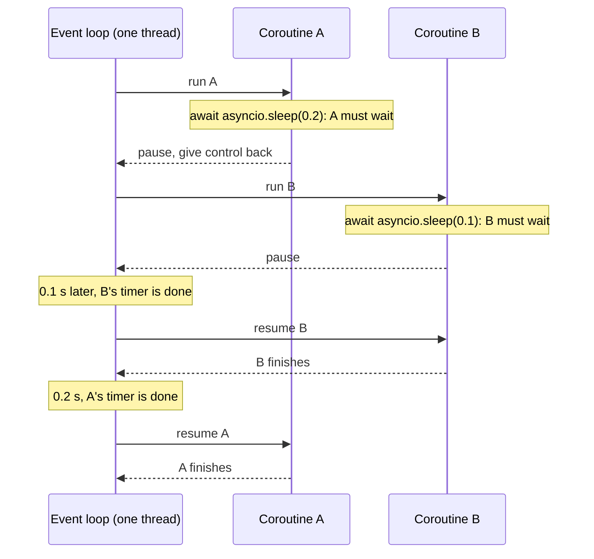

> [!note] Step 5 of 8 in the learning order
> This lesson is step 5 of the [learning order](/notes/ai/ai-engineering/01-software-engineering-fundamentals/roadmap). It uses generators ([2.5](/notes/ai/ai-engineering/01-software-engineering-fundamentals/m02-concurrency-foundations/l5-generators-and-yield)) and threads ([2.3](/notes/ai/ai-engineering/01-software-engineering-fundamentals/m02-concurrency-foundations/l3-threads)) as comparisons.

## 1. The question this idea answers

An AI service waits most of the time. It waits for the model API, for a database, for a tool's HTTP call. Threads ([2.3](/notes/ai/ai-engineering/01-software-engineering-fundamentals/m02-concurrency-foundations/l3-threads)) let waits overlap, but each thread costs memory, and shared memory gives race conditions.

**asyncio** is a second way to let waits overlap. It runs many tasks on **one** thread. A task says "I wait now" at each `await`, and the loop runs another task in that time. Modern AI libraries use it. The Claude Agent SDK's `query()` is an async generator. `httpx.AsyncClient` is async. FastAPI runs `async def` endpoints on an event loop.

This lesson answers four questions:

1. What do `async def` and `await` mean, exactly?
2. What is the event loop, and what does `asyncio.run()` do?
3. How do you run several coroutines at the same time, and stop them on errors or timeouts?
4. Why does `asyncio.run()` fail inside code that already runs on a loop?

## 2. Mental model

> [!analogy] One cook, many pots
> A cook (the one thread) makes five dishes. A pot of water takes 10 minutes to boil. The cook does not stand next to the pot. He puts it on the fire, says "call me when it boils", and cuts vegetables for the next dish.
>
> - Each dish is a coroutine.
> - "Call me when it boils" is an `await`.
> - The kitchen timer that tells the cook which pot is ready is the event loop.
>
> **Where it stops working:** a real cook can stop cutting when a pot boils over. The asyncio cook cannot. He switches **only** at an `await`. If one dish says "knead this dough for 5 minutes" without an `await`, all other dishes wait. That is a blocking call, the subject of [2.7](/notes/ai/ai-engineering/01-software-engineering-fundamentals/m02-concurrency-foundations/l7-blocking-calls-and-to-thread).

## 3. Terms

| Term | Plain meaning |
|---|---|
| asyncio | The standard library package for asynchronous code: an event loop, tasks, timeouts, queues. |
| I/O | Input and output: network, disk, database. Most of the waiting in a service. |
| cooperative multitasking | Tasks give control back voluntarily, at `await`. Nothing interrupts them. Threads, in contrast, are switched by the operating system at any moment. |
| coroutine function | A function defined with `async def`. Calling it runs nothing. |
| coroutine object | What a coroutine function returns: a paused piece of work. Also called a coroutine. |
| `await` | Runs an awaitable, and pauses the current coroutine until it has a result. Only allowed inside `async def`. |
| awaitable | An object that `await` accepts: a coroutine, a task or a future. |
| event loop | The scheduler that runs coroutines on one thread and resumes each one when its wait is over. |
| running loop | The event loop that runs in the current thread at this moment. |
| `asyncio.run()` | Makes a new event loop, runs one awaitable to its end, then closes the loop. |
| task | A coroutine that the loop runs on its own schedule. `asyncio.create_task()` makes one. |
| `asyncio.gather()` | Runs several awaitables at the same time and returns all results in order. |
| `asyncio.TaskGroup` | A block that owns tasks. It waits for all of them and cancels the others when one fails. |
| cancellation | Asking a task to stop. The task receives `asyncio.CancelledError` at its current `await`. |
| `asyncio.timeout()` | A block that cancels its work after a time limit and raises `TimeoutError`. |
| `asyncio.Semaphore` | A counter that limits how many coroutines enter a block at the same time. |
| async generator | An `async def` that contains `yield`. It is used with `async for`. |
| `async with` | A `with` block for objects whose enter and exit steps must `await`, for example `httpx.AsyncClient`. |

## 4. How it works

### 4.1 async def returns a coroutine object

```python
async def fetch(name, delay):
    await asyncio.sleep(delay)
    return name

c = fetch("x", 0)
print(type(c).__name__)
print("await ->", await c)
```

Output of a sandbox run (Python 3.13.16, 2026-10-19):

```text
coroutine
await -> x
```

This is the same idea as a generator ([2.5](/notes/ai/ai-engineering/01-software-engineering-fundamentals/m02-concurrency-foundations/l5-generators-and-yield)): calling `fetch("x", 0)` runs **nothing**. It makes a coroutine object. The code runs only when something awaits it, or when the loop runs it as a task.

> [!trap] A missing await
> Without `await`, you get the object, not the result:
>
> ```text
> without await you get: <coroutine object fetch at 0x7f980161f6b0>
> ```
>
> Python also warns later: `RuntimeWarning: coroutine '...' was never awaited`. That warning always means a missing `await`.

### 4.2 What await does

`await x` means: "start or continue `x`. If `x` must wait, pause **this** coroutine, and give the thread back to the event loop. Resume me when `x` has a result."



All of this happens on one thread. The loop keeps a list of coroutines that are ready to run and a list of timers and sockets that it watches. When a wait ends, the loop puts that coroutine back in the ready list.

### 4.3 asyncio.run: the entry point

The Runners docs (checked on 2026-10-19) describe `asyncio.run(coro)` in four parts:

1. It will "Execute *coro* in an asyncio event loop and return the result."
2. It runs the awaitable, "taking care of managing the asyncio event loop, *finalizing asynchronous generators*, and closing the executor".
3. It makes the loop with `asyncio.new_event_loop()`, or with a `loop_factory` that you pass.
4. "The loop is closed at the end."

```text
asyncio.run(answer()) -> 42
```

Three more rules from the same page:

1. "This function cannot be called when another asyncio event loop is running in the same thread."
2. It "should be used as a main entry point for asyncio programs, and should ideally only be called once".
3. Since Python 3.14, the argument "can be any awaitable object".

The sandbox tested rule 1. A coroutine that already ran on a loop called `asyncio.run` again:

```text
RuntimeError: asyncio.run() cannot be called from a running event loop
RuntimeWarning: coroutine 'async_caller.<locals>.pump_direct' was never awaited
```

Plain sync code has no running loop. `asyncio.get_running_loop()` there raised `RuntimeError: no running event loop`.

| Where your code runs | A loop already runs here? | What to write |
|---|---|---|
| A script, `def main()` | No | `asyncio.run(main())` |
| Inside `async def` | Yes | `await coro` |
| A browser lab cell (Pyodide) | The lab supports top-level `await` | `await main()` |
| A new worker thread | No, until you start one | `asyncio.run(...)` inside the thread works |

The last row is the key to the `_run` example (section 4.10).

### 4.4 One after another, or at the same time

`await` runs one coroutine to its end before the next line. Three awaits in a row add up their waits:

```text
1.50s sequential awaits of 3 x 0.5 s
['a', 'b', 'c'] 0.50s with gather
```

`asyncio.gather(fetch("a", 0.5), fetch("b", 0.5), fetch("c", 0.5))` wraps each coroutine in a task. The three waits overlap. The results come back in the order of the arguments, not in the order of completion.

### 4.5 Tasks: the loop runs them on its own schedule

`asyncio.create_task(coro)` puts a coroutine on the loop **now**. It starts when the current coroutine gives control back to the loop: at an `await` that waits, for example `await asyncio.sleep(0)`. An `await` of a coroutine that returns at once does not give control back. A sandbox run created a task, then awaited a coroutine that returned at once, then awaited `asyncio.sleep(0)`. The order was `['after await noop()', 'child ran', 'after sleep(0)']`.

```python
async def step(name, delay):
    print(f"  {name} starts")
    await asyncio.sleep(delay)
    print(f"  {name} ends")

async def main():
    t1 = asyncio.create_task(step("A", 0.2))
    t2 = asyncio.create_task(step("B", 0.1))
    print("  tasks created, nothing printed by them yet")
    await t1
    await t2
```

```text
  tasks created, nothing printed by them yet
  A starts
  B starts
  B ends
  A ends
```

> [!example] Worked example: predict the order
> 1. `create_task` twice. The tasks are scheduled, but `main` still holds the thread. So the first line printed is from `main`.
> 2. `await t1` pauses `main`. The loop runs the ready tasks in order: A prints "starts" and waits 0.2 s. B prints "starts" and waits 0.1 s.
> 3. At 0.1 s, B's wait ends first. B prints "ends".
> 4. At 0.2 s, A prints "ends". `await t1` returns. `await t2` returns at once, because B is done.

The Coroutines and tasks docs (checked on 2026-10-19) warn: "Save a reference to the result of this function, to avoid a task disappearing mid-execution. The event loop only keeps weak references to tasks."

### 4.6 Errors, cancellation and TaskGroup

`gather()` and `TaskGroup` behave differently when one task fails.

```text
=== A5. TaskGroup cancels the siblings when one task fails ===
ExceptionGroup: ['w1 failed']
['w2 cancelled']

=== A6. gather without return_exceptions: siblings keep running ===
gather raised: g1 failed
['g2 done']
```

| | `gather(...)` (default) | `async with asyncio.TaskGroup()` |
|---|---|---|
| One task fails | The first exception goes to the caller at once | The others are cancelled |
| The other tasks | "won't be cancelled and will continue to run" (docs) | receive `CancelledError` |
| What the caller catches | the first exception, for example `ValueError` | an `ExceptionGroup` that holds all errors, caught with `except*` |
| Added in | long ago | Python 3.11. `TaskGroup.cancel()` is new in 3.15 |

The docs on `TaskGroup` (checked on 2026-10-19) say:

> "The first time any of the tasks belonging to the group fails with an exception other than `asyncio.CancelledError`, the remaining tasks in the group are cancelled."

Cancellation is an exception. The loop throws `asyncio.CancelledError` into the task at its current `await`. `finally` blocks run, so cleanup works. `CancelledError` is a `BaseException`, not an `Exception`:

```text
issubclass(asyncio.CancelledError, Exception): False
issubclass(asyncio.CancelledError, BaseException): True
```

So `except Exception` does not swallow a cancellation. That is on purpose. It is also why the `_run` example misses a `CancelledError` (section 4.10).

### 4.7 Timeouts and limits

```python
async with asyncio.timeout(0.2):
    await asyncio.sleep(5)
```

```text
TimeoutError after 0.2 s (builtin TimeoutError: True )
```

The docs explain what happens when the work takes too long:

> "the context manager will cancel the current task and handle the resulting `asyncio.CancelledError` internally, transforming it into a `TimeoutError`"

A `Semaphore(3)` lets at most 3 coroutines into a block at the same time:

```text
10 jobs, limit 3: peak in flight = 3, time 0.40s
```

> [!example] Worked example: why 0.40 s
> Each job waits 0.1 s. With a limit of 3, the 10 jobs run in waves: 3 + 3 + 3 + 1. That is ceil(10 / 3) = 4 waves of 0.1 s, so 0.4 s.

Use a semaphore to respect an API rate limit. Use a timeout so that one slow call cannot hold a request forever.

### 4.8 Async generators and async with

An `async def` with `yield` is an **async generator**. You read it with `async for`. Each step may `await`.

```python
async def ticks(n):
    for i in range(n):
        await asyncio.sleep(0.05)
        yield i

print([i async for i in ticks(3)])
```

```text
[0, 1, 2]
```

The Agent SDK's `query()` is an async generator of messages: `async for msg in query(prompt=..., options=...)`. The existing note [Async generators](/notes/software-engineering/python/01-asyncio/l2-async-generators) goes deeper, including `aclose()`.

`async with` is the async version of `with`. A client such as `httpx.AsyncClient` must `await` when it opens and closes connections, so it uses `async with httpx.AsyncClient() as client:`.

### 4.9 Threads or asyncio?

| | Threads | asyncio |
|---|---|---|
| How many run at once | many OS threads | many coroutines on one thread |
| Who switches | the OS, at any moment | the code, only at `await` |
| Race conditions | possible at any line | only around `await` |
| Cost per unit | an OS thread with its own stack | a small Python object |
| Library needs | works with any blocking library | needs async libraries, or `to_thread` for blocking ones |
| Typical use in AI services | wrap a sync SDK, a sync driver | many parallel model and HTTP calls, streaming |

Real services mix both. The next lesson shows the bridge: `asyncio.to_thread`.

### 4.10 Where this appears in the _run example

The [case study 5.5](/notes/ai/ai-engineering/01-software-engineering-fundamentals/m05-streaming-and-agent-events/l5-case-study-the-run-bridge) uses one coroutine function and one `asyncio.run`:

```python
    async def pump(options):
        async for msg in query(prompt=prompt, options=options):
            q.put(msg)

    def worker():
        try:
            ...
            asyncio.run(pump(_options(
                foundry_token(), ui_context, server, allowed,
                session_id, resume
            )))
```

1. `pump` is a coroutine function. `pump(...)` makes a coroutine object and runs nothing.
2. `async for msg in query(...)` reads the SDK's async generator. Each step awaits the next message, so the loop can run other work in that time, for example the in-process tool handlers ([5.3](/notes/ai/ai-engineering/01-software-engineering-fundamentals/m05-streaming-and-agent-events/l3-mcp-tools-and-tool-execution)).
3. `asyncio.run(...)` runs **inside** `worker`, on the worker thread. That thread has no running loop yet, so `asyncio.run` is allowed. It makes a new loop that belongs to this thread only.
4. If the caller of `_run` is itself inside a running loop, `asyncio.run` in the caller's thread would fail with the `RuntimeError` of section 4.3. The worker thread avoids that problem.
5. `except Exception` in `worker` does not catch `CancelledError`, because it is a `BaseException`.

## 5. Code walkthrough

The pattern that later lessons use for parallel model or HTTP calls:

```python
import asyncio

async def call_model(prompt: str) -> str:
    await asyncio.sleep(0.5)                  # stands for the network wait
    return f"answer to {prompt!r}"

async def main() -> list[str]:
    sem = asyncio.Semaphore(2)

    async def limited(p: str) -> str:
        async with sem:
            async with asyncio.timeout(2.0):
                return await call_model(p)

    async with asyncio.TaskGroup() as tg:
        tasks = [tg.create_task(limited(p)) for p in ["a", "b", "c"]]
    return [t.result() for t in tasks]

print(asyncio.run(main()))
```

| Line | What it does | Why it exists |
|---|---|---|
| `async def call_model` | A coroutine function. | Its wait can overlap with other waits. |
| `await asyncio.sleep(0.5)` | A non-blocking wait. | Stands for `await client.post(...)`. |
| `asyncio.Semaphore(2)` | At most 2 calls at the same time. | Respect a rate limit. |
| `async with asyncio.timeout(2.0)` | A limit for each call. | One slow call cannot hold the request forever. |
| `async with asyncio.TaskGroup() as tg` | Owns the tasks, waits for all of them at the end of the block. | If one call fails, the others are cancelled, and the caller gets an `ExceptionGroup`. |
| `tg.create_task(...)` | Schedules each call. | Keeps a reference in `tasks`. |
| `t.result()` | Reads each result after the block. | The results keep the input order. |
| `asyncio.run(main())` | The single entry point. | Makes and closes the loop. |

The sandbox printed `["answer to 'a'", "answer to 'b'", "answer to 'c'"]`. With a limit of 2 and three 0.5 s calls, the run takes about 1.0 s: two waves.

## 6. Exercises

Runs in: a browser lab. In a lab cell, write `await main()`, not `asyncio.run(main())`: the lab supports top-level `await`. [Open a lab for this lesson](/labs/new?note=ai/ai-engineering/01-software-engineering-fundamentals/m02-concurrency-foundations/l6-asyncio-and-the-event-loop)

Hints come in three levels in chat: idea, pseudocode, partial code.

**Exercise 2.6.1: predict the order.** Write three coroutines with different sleeps and prints, and run them with `create_task`. Write your predicted output in a text cell first.

Acceptance tests: the prediction matches, and a text cell explains why the first line printed comes from the code that created the tasks.

**Exercise 2.6.2: gather vs TaskGroup.** Write `run_all_gather(coros)` and `run_all_group(coros)`. One coroutine fails after 0.1 s, and another one takes 1 s and appends `"done"` to a list.

Acceptance tests:

- With gather, the caller gets the `ValueError` after about 0.1 s, and after 1.2 s the list holds `"done"`.
- With TaskGroup, the caller gets an `ExceptionGroup` that contains the `ValueError`, and the list stays empty because the slow task was cancelled.

**Exercise 2.6.3: a timeout per call.** Write `with_timeout(coro, seconds)` that returns the result, or the string `"timeout"`.

Acceptance tests: a 0.1 s coroutine with a 1 s limit returns its value. A 5 s coroutine with a 0.2 s limit returns `"timeout"` after about 0.2 s, not 5 s.

**Exercise 2.6.4: an async generator of events.** Write `async def events(n)` that yields `{"type": "token", "i": k}` every 0.05 s, and a final `{"type": "done"}`.

Acceptance tests: `[e async for e in events(3)]` has 4 items, the last one is `done`, and the run takes about 0.15 s.

## 7. Common mistakes

1. **A missing `await`.** You get a coroutine object and a "never awaited" warning.
2. **`asyncio.run()` inside `async def`.** It raises `RuntimeError: asyncio.run() cannot be called from a running event loop`. Use `await`.
3. **Awaiting one by one when the calls are independent.** The waits add up. Use `gather` or a `TaskGroup`.
4. **A task with no saved reference.** The loop keeps only weak references, so the task can disappear.
5. **`except Exception` around code that must react to cancellation.** It does not see `CancelledError`. Use `finally` for cleanup.
6. **A blocking call inside `async def`.** It freezes every coroutine on the loop. See [2.7](/notes/ai/ai-engineering/01-software-engineering-fundamentals/m02-concurrency-foundations/l7-blocking-calls-and-to-thread).
7. **Many `asyncio.run()` calls in a long-lived process.** Each call makes and closes a new loop, and objects bound to an old loop break. The existing note [Sync code calling async code](/notes/software-engineering/python/01-asyncio/l3-sync-code-calling-async-code) measures this.

## 8. One-minute explanation

asyncio runs many coroutines on one thread. `async def` defines a coroutine function, and calling it only makes a coroutine object. `await` runs an awaitable and pauses the current coroutine while it waits, so the event loop can run another coroutine in that time. The switch happens only at `await`, which is why it is called cooperative. `asyncio.run(coro)` is the entry point: it makes a new loop, runs the coroutine, finalizes async generators, closes the loop and returns the result. It refuses to run when a loop already runs in the same thread. So inside async code you write `await`, and a new worker thread can call `asyncio.run` for itself. `gather` and `TaskGroup` run coroutines at the same time. A TaskGroup also cancels the others when one fails. `asyncio.timeout` limits time and `Semaphore` limits how many run at once. Cancellation arrives as `CancelledError`, a `BaseException`.

## 9. Check questions

```check
{
  "question": "What does `fetch(\"x\", 0.5)` do when fetch is an async def function, and what does `await fetch(\"x\", 0.5)` do?",
  "answer": "The call alone makes a coroutine object and runs none of the body. `await` runs it: the current coroutine pauses at the inner `await asyncio.sleep(0.5)`, the event loop runs other work, and after 0.5 s the coroutine resumes and returns its value to the awaiting code."
}
```

```check
{
  "question": "Three independent model calls of 0.5 s each: why does `for p in prompts: r.append(await call(p))` take about 1.5 s, and what takes about 0.5 s?",
  "answer": "Each await waits for its call to finish before the loop goes to the next prompt, so the waits add up: 3 x 0.5 = 1.5 s. Running them as tasks, for example `await asyncio.gather(*(call(p) for p in prompts))` or a TaskGroup, lets the three waits overlap, so the total is about 0.5 s."
}
```

```check
{
  "question": "Why does `asyncio.run(pump(...))` work inside `worker()` in the _run example, but fail when an `async def` endpoint calls it directly?",
  "hint": "Count the running loops in each thread.",
  "answer": "asyncio.run cannot run when another event loop is running in the same thread. The new worker thread has no loop, so asyncio.run makes one for it and works. An async def endpoint already runs on the server's event loop in that thread, so asyncio.run raises RuntimeError: asyncio.run() cannot be called from a running event loop. There, write `await` instead."
}
```

```check
{
  "question": "A TaskGroup holds tasks A and B. A raises ValueError after 0.1 s. What happens to B, and what does the caller catch?",
  "answer": "B is cancelled: it receives asyncio.CancelledError at its current await, and its finally blocks run. The caller catches an ExceptionGroup that contains the ValueError (use `except* ValueError`). With plain gather, B would keep running and the caller would catch the ValueError itself."
}
```

## 10. Links

- Previous: [2.5 Generators, yield, close() and GeneratorExit](/notes/ai/ai-engineering/01-software-engineering-fundamentals/m02-concurrency-foundations/l5-generators-and-yield)
- Next: [2.7 Blocking calls, asyncio.to_thread and when to use async def](/notes/ai/ai-engineering/01-software-engineering-fundamentals/m02-concurrency-foundations/l7-blocking-calls-and-to-thread)
- Deeper, with measurements: [The event loop and coroutines](/notes/software-engineering/python/01-asyncio/l1-event-loop-and-coroutines), [Async generators](/notes/software-engineering/python/01-asyncio/l2-async-generators), [Sync code calling async code](/notes/software-engineering/python/01-asyncio/l3-sync-code-calling-async-code)
- The full example: [5.5 Case study: the _run bridge](/notes/ai/ai-engineering/01-software-engineering-fundamentals/m05-streaming-and-agent-events/l5-case-study-the-run-bridge)
- [Glossary](/notes/ai/ai-engineering/glossary)

Sources (checked on 2026-10-19): [Python docs, Coroutines and tasks](https://docs.python.org/3/library/asyncio-task.html), [Python docs, Runners](https://docs.python.org/3/library/asyncio-runner.html). Measured outputs come from sandbox runs with Python 3.13.16. The basic generator, closure, queue and asyncio checks gave the same results on Python 3.15.0b4.
