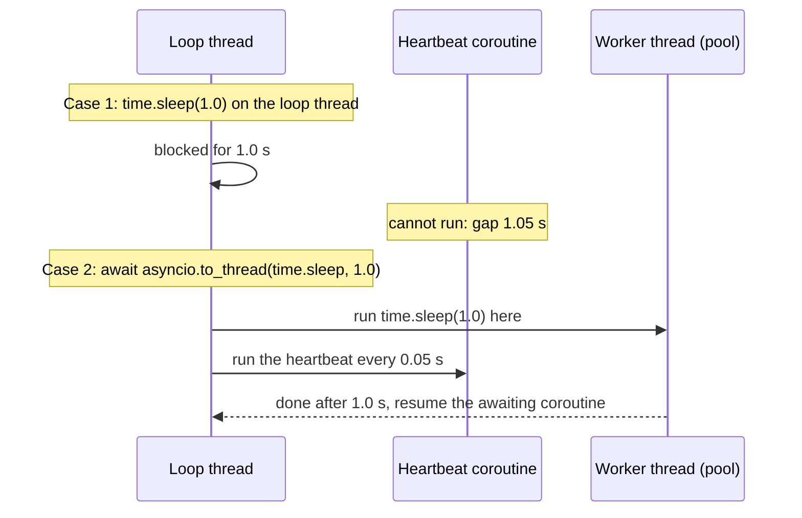

> [!note] Step 6 of 8 in the learning order
> This lesson is step 6 of the [learning order](/notes/ai/ai-engineering/01-software-engineering-fundamentals/roadmap). It joins [2.3 Threads](/notes/ai/ai-engineering/01-software-engineering-fundamentals/m02-concurrency-foundations/l3-threads) and [2.6 asyncio](/notes/ai/ai-engineering/01-software-engineering-fundamentals/m02-concurrency-foundations/l6-asyncio-and-the-event-loop). Steps 7 and 8 come after the HTTP and FastAPI modules.

## 1. The question this idea answers

[2.6](/notes/ai/ai-engineering/01-software-engineering-fundamentals/m02-concurrency-foundations/l6-asyncio-and-the-event-loop) showed that the event loop switches between coroutines only at `await`. So what happens when a coroutine calls a function that waits **without** `await`? For example:

- a sync database driver that waits 0.8 s for the server,
- `requests.get(...)`, which waits for the network,
- `time.sleep(1)`,
- `q.get()` on a `queue.Queue` that is empty.

The answer: the whole loop stops. Every other coroutine, every other request of the web server and every tool handler on that loop waits. This lesson measures the damage, shows the fix (`asyncio.to_thread`), and gives a clear rule for the question "should this function be `async def`?".

## 2. Mental model

> [!analogy] The cook who answers the phone
> The asyncio cook of [2.6](/notes/ai/ai-engineering/01-software-engineering-fundamentals/m02-concurrency-foundations/l6-asyncio-and-the-event-loop) switches between pots at each "call me when it boils". Now the phone rings, and the caller says "hold the line for 5 minutes". If the cook holds the phone, nothing else in the kitchen happens. All pots wait.
>
> `asyncio.to_thread` is a helper in the next room. The cook gives the phone to the helper and says "tell me when the call is over". The cook goes back to the pots.
>
> **Where it stops working:** the helpers are few. The default pool has a fixed number of threads. If all helpers already hold phones, the next call waits for a free helper. Also, you cannot take the phone back from a helper in the middle of a call: a cancelled `to_thread` call still runs to its end.

## 3. Terms

| Term | Plain meaning |
|---|---|
| blocking call | A call that holds its thread until it finishes, for example `time.sleep(1)` or a sync database query. |
| non-blocking call | A call that gives control back while it waits. In asyncio, an awaitable such as `await asyncio.sleep(1)`. |
| freeze the loop | A blocking call on the loop thread, so no other coroutine can run until it returns. |
| heartbeat | A small coroutine that wakes every 50 ms. The longest gap between its wake-ups shows how long the loop was frozen. |
| `asyncio.to_thread(func, *args)` | Runs a sync function in a worker thread of the loop's default pool, and returns a coroutine that gives its result. |
| default executor | The thread pool of an event loop. `to_thread` and `run_in_executor(None, ...)` use it. |
| `loop.run_in_executor(executor, func, *args)` | The older, lower-level way to run a sync function in a pool. |
| async library | A library whose waiting functions are coroutines, for example `httpx.AsyncClient` or an async database driver. |
| I/O-bound | Work that mostly waits for the network or a disk. |
| CPU-bound | Work that mostly calculates. |

## 4. How it works

### 4.1 Measure the freeze

A heartbeat coroutine wakes every 0.05 s and records the gap since its last wake-up. Then the main coroutine does a wait of 1 s in two ways.

```python
time.sleep(1.0)                          # blocking, on the loop thread
...
await asyncio.to_thread(time.sleep, 1.0) # the same wait, in a worker thread
```

Output of a sandbox run (Python 3.13.16, 2026-10-19):

```text
1.00s after time.sleep(1.0) in the loop thread
longest heartbeat gap: 1.05s
1.00s after await asyncio.to_thread(time.sleep, 1.0)
longest heartbeat gap: 0.05s
```

Both versions waited 1 s. The difference is what **else** could run:

1. With `time.sleep(1.0)`, the heartbeat did not wake for 1.05 s. The loop was frozen.
2. With `to_thread`, the heartbeat kept its 0.05 s rhythm. The loop was free.



> [!key] One blocking call stops everything on the loop
> In a web server, the loop serves every request. In an agent, the loop also reads the model's messages and runs the in-process tools. A blocking call in any of them stops all of them.

### 4.2 What counts as blocking

| Call | Blocks the loop? | Non-blocking choice |
|---|---|---|
| `time.sleep(1)` | yes | `await asyncio.sleep(1)` |
| `requests.get(url)` | yes | `await client.get(url)` with `httpx.AsyncClient` |
| a sync database driver query | yes | an async driver, or `await asyncio.to_thread(conn.execute, sql)` |
| `subprocess.run([...])` | yes | `await asyncio.create_subprocess_exec(...)` |
| a long pure-Python loop | yes, for its whole run | split the work, or a process pool |
| `q.get()` on an empty `queue.Queue` | yes, until an item arrives | `asyncio.Queue` inside one loop, or `await asyncio.to_thread(q.get)` |
| `q.put(x)` on an **unbounded** `queue.Queue` | no, it returns at once | fine as it is |
| reading a small local file | very short, usually acceptable | `to_thread` for large files |

The question is never "is this function sync?". The question is "does this call **wait** while it holds the thread?".

### 4.3 asyncio.to_thread

The docs (checked on 2026-10-19): `to_thread` will "Asynchronously run function *func* in a separate thread." It was added in Python 3.9.

```python
print("loop thread:", threading.current_thread().name,
      "| to_thread thread:", await asyncio.to_thread(lambda: threading.current_thread().name))
```

```text
loop thread: MainThread | to_thread thread: asyncio_0
```

`to_thread(func, *args, **kwargs)` does three things:

1. It sends `func(*args, **kwargs)` to the default executor, a thread pool that belongs to the loop.
2. It returns a coroutine. Awaiting it pauses only the current coroutine.
3. When the worker thread finishes, the loop resumes the coroutine with the return value, or raises the exception of `func`.

Pass the function and its arguments separately: `to_thread(conn.execute, sql)`, not `to_thread(conn.execute(sql))`. The second form runs the query **now**, on the loop thread, and then fails, because the result is not callable ([2.1](/notes/ai/ai-engineering/01-software-engineering-fundamentals/m02-concurrency-foundations/l1-functions-as-values-and-callbacks)).

### 4.4 The pool has a size

In CPython 3.13 the default pool has `min(32, os.process_cpu_count() + 4)` threads. The sandbox had 2 CPUs, so 6 threads:

```text
cpus: 2 -> min(32, cpus + 4) = 6
 6 blocking calls of 0.5 s through to_thread: 0.51s
 7 blocking calls of 0.5 s through to_thread: 1.00s
```

The seventh call had to wait for a free thread, so the total became two rounds.

> [!example] Worked example: size the wait
> A container has 4 CPUs. The pool has min(32, 4 + 4) = 8 threads. 20 requests each make one blocking call of 0.5 s through `to_thread`.
>
> 1. Rounds: ceil(20 / 8) = 3.
> 2. The last request finishes after about 3 x 0.5 = 1.5 s.
> 3. The loop stays free the whole time. Only the blocking calls wait in line.

### 4.5 Cancelling a to_thread call does not stop the thread

```text
awaiting task: CancelledError
['thread finished anyway']
```

A task awaited a 0.6 s blocking job through `to_thread` and was cancelled after 0.1 s. The awaiting coroutine received `CancelledError`, but the job finished in its thread anyway. Python cannot stop a running thread ([2.3](/notes/ai/ai-engineering/01-software-engineering-fundamentals/m02-concurrency-foundations/l3-threads)). Give long sync work its own stop flag.

### 4.6 CPU-bound work and the GIL

The docs add a limit:

> "Due to the GIL, `asyncio.to_thread()` can typically only be used to make IO-bound functions non-blocking."

A pure-Python calculation in a worker thread still competes for the GIL with the loop thread, so the loop gets slower. For heavy calculation, use a process pool (`loop.run_in_executor(ProcessPoolExecutor(), func)`), or a library that releases the GIL.

### 4.7 When to write async def

| Situation | Write | Why |
|---|---|---|
| The function awaits async calls (`httpx.AsyncClient`, an async driver, `asyncio.sleep`, another coroutine) | `async def`, and `await` them | The waits give the loop back. No thread is needed. |
| The function must run inside an async framework, but its work is a blocking library call | `async def`, with `await asyncio.to_thread(blocking_func, ...)` | The loop stays free. One pool thread holds the wait. |
| The function only calculates for a short time and never waits | plain `def` | Nothing to await. Making it `async` adds nothing. |
| The function is called from sync code only (a script, a sync framework) | plain `def`. Call async code through a worker thread or `asyncio.run` | A sync caller cannot `await`. |
| A long CPU-bound calculation | `def`, run in a process pool | Threads do not help with the GIL. |

> [!key] The rule for tools
> Use `async def` when the tool's own operations are asynchronous, for example `httpx.AsyncClient` requests or an async database driver. Then the tool does not need a worker thread for those operations. Use `asyncio.to_thread` only for the parts that block. Lesson [5.3](/notes/ai/ai-engineering/01-software-engineering-fundamentals/m05-streaming-and-agent-events/l3-mcp-tools-and-tool-execution) applies this rule to Agent SDK tools.

A sandbox test called three versions of an SDK tool handler. Each one waited 0.8 s, and a heartbeat ran on the same loop:

```text
sync_inside     took 0.80s, longest heartbeat gap 0.85s
sync_in_thread  took 0.80s, longest heartbeat gap 0.05s
async_native    took 0.80s, longest heartbeat gap 0.05s
```

| Version | Handler body | Loop frozen? |
|---|---|---|
| `sync_inside` | `blocking_db_call()` directly | yes, 0.85 s |
| `sync_in_thread` | `await asyncio.to_thread(blocking_db_call)` | no |
| `async_native` | `async with httpx.AsyncClient(...)` and `await c.get(...)` | no, and no worker thread |

### 4.8 Where this appears in the _run example

The [case study 5.5](/notes/ai/ai-engineering/01-software-engineering-fundamentals/m05-streaming-and-agent-events/l5-case-study-the-run-bridge) is a bridge in the **other** direction: sync code that must consume async code. Two lines relate to this lesson:

```python
            q.put(msg)                           # inside async pump(): non-blocking, the queue has no maxsize
...
    while (item := q.get()) is not end:          # in the sync caller: blocking, but on the caller's own thread
```

1. `q.put(msg)` runs inside the coroutine `pump`, on the worker thread's event loop. On an unbounded `queue.Queue`, `put` never waits, so it does not freeze that loop. A bounded queue could freeze it.
2. `q.get()` blocks, but it blocks the **caller's** thread, which is a sync generator and has no loop. That is allowed. Inside an `async def` caller, the same line would freeze the caller's loop. An async caller should use `async for` on the SDK directly, or `await asyncio.to_thread(q.get)`.
3. The tools that `build_server` makes run on the worker thread's loop. If a tool calls a blocking driver directly, it freezes the loop that also reads the agent's messages. The tool must use an async client or `asyncio.to_thread`.

## 5. Code walkthrough

A blocking driver inside an async tool, fixed with `to_thread`:

```python
import asyncio, time

def blocking_db_call(sql: str) -> int:        # a sync driver: holds its thread for 0.8 s
    time.sleep(0.8)
    return 3

async def count_rows(args: dict) -> dict:     # the tool handler: must be async
    n = await asyncio.to_thread(blocking_db_call, args["sql"])
    return {"content": [{"type": "text", "text": f"{n} rows"}]}
```

| Line | What it does | What breaks without it |
|---|---|---|
| `def blocking_db_call` | Stands for any sync library call that waits. | |
| `async def count_rows` | A coroutine function, so the async framework can await it. | |
| `await asyncio.to_thread(blocking_db_call, args["sql"])` | Runs the call in a pool thread. The handler pauses, and the loop serves other work. | `n = blocking_db_call(...)` freezes the loop for 0.8 s (measured gap 0.85 s). |
| `blocking_db_call, args["sql"]` | The function and its argument, separate. | `to_thread(blocking_db_call(args["sql"]))` runs the call on the loop thread first. |
| `return {...}` | The tool result for the model. | |

The same handler with an async driver needs no thread at all: `n = await pool.fetchval(sql)`.

## 6. Exercises

Runs in: a browser lab for 2.7.1 and 2.7.2. The lab has no threads, so `to_thread` cannot run there: do 2.7.3 in your local practice project. [Open a lab for this lesson](/labs/new?note=ai/ai-engineering/01-software-engineering-fundamentals/m02-concurrency-foundations/l7-blocking-calls-and-to-thread)

Hints come in three levels in chat: idea, pseudocode, partial code.

**Exercise 2.7.1: a heartbeat probe.** Write `async def heartbeat(stop: asyncio.Event, gaps: list[float])` that wakes every 0.05 s and records the gaps. Use it to measure `time.sleep(0.5)` and `await asyncio.sleep(0.5)` inside a coroutine.

Acceptance tests: the longest gap is at least 0.45 s for `time.sleep`, and below 0.1 s for `asyncio.sleep`.

**Exercise 2.7.2: classify the calls.** Each line below runs inside a coroutine. For each line, write "blocks the loop" or "does not block", with a one-sentence reason.

1. `time.sleep(2)`
2. `await asyncio.sleep(2)`
3. `requests.get(url)`
4. `await client.get(url)` with `httpx.AsyncClient`
5. `q.put(x)` on `queue.Queue()`
6. `q.put(x)` on a full `queue.Queue(maxsize=1)`
7. `json.loads(small_text)`
8. `subprocess.run(["sleep", "2"])`

Acceptance tests: all eight are right, and the reasons name the thread that waits.

**Exercise 2.7.3: the roadmap's fetch_all.** Runs in: your local practice project. Write `async def fetch_all(urls: list[str], limit: int, timeout_s: float) -> list[Result]`, where `Result` is a Pydantic model with `url`, `status`, `elapsed_ms` and `error: str | None`. Use `httpx.AsyncClient`, `asyncio.Semaphore(limit)` and `asyncio.timeout()`.

Acceptance tests (pytest, with `httpx.MockTransport`, so no real network is used):

- 10 URLs with `limit=3` never have more than 3 requests in flight. Count them in the mock handler.
- One URL that sleeps longer than `timeout_s` gives a `Result` with an `error`, and the other 9 still succeed.
- The results keep the input order.
- A second version that uses `requests` inside `asyncio.to_thread` passes the same tests. Write two sentences on which version you would deploy and why.

## 7. Common mistakes

1. **A blocking call inside `async def`.** The code works in a test with one request, and fails under load. Measure with a heartbeat, or run asyncio debug mode, which logs slow callbacks.
2. **`to_thread(func(args))`.** The parentheses run the call on the loop thread. Pass `func, args`.
3. **`to_thread` around an async function.** `to_thread` is for sync functions. An `async def` function is awaited directly.
4. **Expecting cancellation to stop the thread.** The thread finishes its work. Plan a stop flag for long work.
5. **`to_thread` for CPU-bound Python code.** The GIL limits it. Use a process pool.
6. **`queue.Queue.get()` inside a coroutine.** It blocks the loop until an item arrives. Use `asyncio.Queue`, or `to_thread(q.get)`.
7. **A bounded `queue.Queue` that a coroutine fills.** A full queue blocks `put`, and the loop freezes.
8. **Making everything `async def` "to be fast".** `async def` helps only when the body awaits. A pure calculation does not become faster.

## 8. One-minute explanation

The event loop switches between coroutines only at `await`. A blocking call, such as `time.sleep`, `requests.get` or a sync database query, holds the loop thread while it waits, so every other coroutine stops. In the sandbox, one `time.sleep(1.0)` froze a heartbeat for 1.05 s. `asyncio.to_thread(func, *args)` sends the blocking call to a worker thread of the loop's default pool and returns a coroutine, so the loop stays free. The pool is limited, to min(32, CPUs + 4) threads in CPython 3.13, and a cancelled call still finishes in its thread. Because of the GIL, `to_thread` helps I/O-bound work, not CPU-bound work. The rule: write `async def` when the function's own operations are asynchronous, for example `httpx.AsyncClient` requests or an async database driver. Then no worker thread is needed. Wrap only the parts that block in `to_thread`.

## 9. Check questions

```check
{
  "question": "An async def endpoint calls a sync SQL client that takes 0.8 s. Ten requests arrive at once. What happens with the call made directly, and with `await asyncio.to_thread(client.run, sql)` on a 2-CPU container?",
  "hint": "Pool size = min(32, CPUs + 4).",
  "answer": "Directly: each call freezes the loop, so the requests run one after another, about 10 x 0.8 = 8 s for the last one, and nothing else is served. With to_thread: the pool has min(32, 2 + 4) = 6 threads, so ceil(10 / 6) = 2 rounds, about 1.6 s for the last request, and the loop stays free during that time."
}
```

```check
{
  "question": "A tool handler uses `httpx.AsyncClient` and an async database driver. Does it need `asyncio.to_thread`? Why?",
  "answer": "No. Its own operations are asynchronous: each network or database wait is an await, which gives the loop back. So the handler needs no worker thread for them. to_thread is only for parts that block, for example a sync library call."
}
```

```check
{
  "question": "In the _run example, `q.put(msg)` runs inside `async def pump`. Why does it not freeze the loop, and when would it?",
  "answer": "The queue is `queue.Queue()` with no maxsize, so put never waits: it adds the item and returns at once. With a bounded queue that is full, put would block the thread that runs the loop, and the loop would freeze."
}
```

```check
{
  "question": "A task awaits `asyncio.to_thread(export_report)` and is cancelled after 0.2 s. export_report takes 5 s. What happens to the export?",
  "answer": "The awaiting task receives CancelledError at once, but the worker thread keeps running export_report until it ends, after 5 s. Python cannot stop a running thread. Nobody reads the result. To stop it early, export_report must check a stop signal, for example a threading.Event."
}
```

## 10. Links

- Previous: [2.6 asyncio, async def, await and the event loop](/notes/ai/ai-engineering/01-software-engineering-fundamentals/m02-concurrency-foundations/l6-asyncio-and-the-event-loop)
- Next module: [M3 HTTP, REST and JSON](/notes/ai/ai-engineering/01-software-engineering-fundamentals/m03-http-rest-json). Step 7 of the learning order is [5.1 Streaming over HTTP and server-sent events](/notes/ai/ai-engineering/01-software-engineering-fundamentals/m05-streaming-and-agent-events/l1-streaming-and-server-sent-events).
- `def` vs `async def` endpoints in FastAPI: [4.4 def vs async def endpoints](/notes/ai/ai-engineering/01-software-engineering-fundamentals/m04-fastapi-services/l4-def-vs-async-def-endpoints)
- The rule for tools: [5.3 MCP tools and how a tool call runs](/notes/ai/ai-engineering/01-software-engineering-fundamentals/m05-streaming-and-agent-events/l3-mcp-tools-and-tool-execution)
- Deeper, with pool and FastAPI measurements: [Sync code calling async code](/notes/software-engineering/python/01-asyncio/l3-sync-code-calling-async-code)
- [Glossary](/notes/ai/ai-engineering/glossary)

Sources (checked on 2026-10-19): [Python docs, asyncio.to_thread](https://docs.python.org/3/library/asyncio-task.html#running-in-threads). The default pool size `min(32, (os.process_cpu_count() or 1) + 4)` is in the CPython 3.13 and 3.15 source, `concurrent/futures/thread.py`. Further reading: [ThreadPoolExecutor docs](https://docs.python.org/3/library/concurrent.futures.html#threadpoolexecutor), [httpx async client](https://www.python-httpx.org/async/). Measured outputs come from sandbox runs with Python 3.13.16. The basic generator, closure, queue and asyncio checks gave the same results on Python 3.15.0b4.
