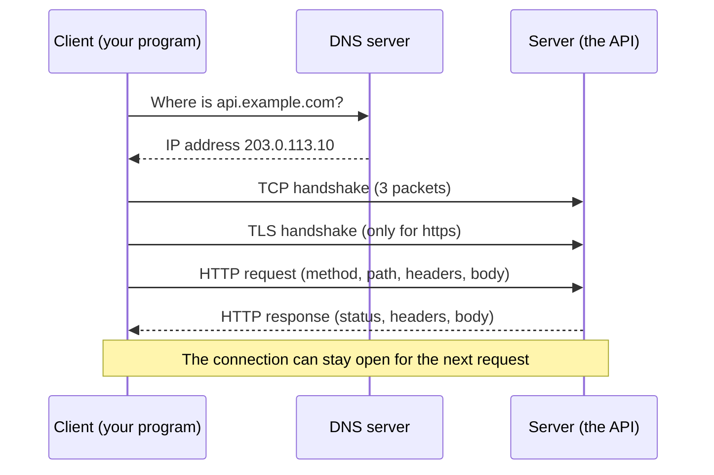

## 1. The question this idea answers

Your Python program wants an answer from a model. The model runs on a computer in another building, maybe on another continent. How does a question travel from your program to that computer, and how does the answer come back?

The answer is HTTP. HTTP is a set of rules for two programs that talk over a network. One program asks, the other program answers. Every model provider API, every MCP server over HTTP, and every web service that you build in this level uses these rules.

When an SDK hides the request, you cannot see why a call failed. This lesson shows the real bytes that travel on the network. After this lesson, you can read any request and any response by eye.

## 2. Mental model

> [!analogy] A letter and its reply
> A request is a letter. The envelope has an address (the URL), a type of letter (the method, for example "please read" or "please create") and labels (the headers). Inside the envelope is the content (the body). The server reads the letter, does the work, and sends a reply. The reply has a stamp with a result number (the status code), its own labels and its own content.
>
> **Where it stops working:** a real letter can take days and can arrive out of order. An HTTP request travels on one open connection, and the reply comes back on the same connection, usually within milliseconds or seconds. Also, a letter can wait in a mailbox. An HTTP client waits on the line, and if no reply arrives in time, the client stops waiting (a timeout).

## 3. Terms

| Term | Plain meaning |
|---|---|
| client | The program that sends the request, for example your Python script, a browser or curl. |
| server | The program that receives the request and sends the response, for example a FastAPI app. |
| HTTP | HyperText Transfer Protocol. The rules for the format of requests and responses. |
| request | The message from the client: a method, a target, headers and an optional body. |
| response | The message from the server: a status code, headers and an optional body. |
| URL | The address of a resource, for example `https://api.example.com/v1/notes?tag=home`. |
| scheme | The first part of a URL: `http` or `https`. It tells the client which rules and which port to use. |
| host | The name of the server computer, for example `api.example.com`. |
| port | A number that selects one program on the host. The defaults are 80 for `http` and 443 for `https`. |
| path | The part after the host, for example `/v1/notes`. It names the resource. |
| query string | The part after `?`, for example `tag=home&limit=3`. It holds extra parameters. |
| method | The verb of the request, for example `GET` (read) or `POST` (create). Lesson 3.2 covers all of them. |
| header | One `Name: value` line of metadata, for example `Content-Type: application/json`. |
| body | The content of the message. It can be empty. For APIs it is often JSON. |
| status code | A three-digit number in the response, for example `200` (success) or `404` (not found). |
| DNS | Domain Name System. It turns a host name into an IP address. |
| TCP | Transmission Control Protocol. It gives a reliable, ordered stream of bytes between two computers. |
| TLS | Transport Layer Security. It encrypts the TCP stream. `https` means HTTP inside TLS. |
| connection | One open TCP (or TLS) channel between a client and a server. It can carry many requests one after another. |
| timeout | The longest time a client waits for a step, for example for the server to send data. |

## 4. How it works

### 4.1 The parts of a URL

A URL tells the client where to send the request. Take this URL:

```text
https://api.example.com:443/v1/notes?tag=home&limit=3
```

| Part | Value | What the client does with it |
|---|---|---|
| scheme | `https` | Use TLS. Use port 443 if no port is given. |
| host | `api.example.com` | Ask DNS for the IP address. |
| port | `443` | Open the TCP connection to this port. |
| path | `/v1/notes` | Put it in the request line. The server uses it to find the route. |
| query string | `tag=home&limit=3` | Put it after the path in the request line. |

The path and the query string travel inside the request. The scheme, the host and the port decide where the connection goes.

### 4.2 The steps before the first byte of HTTP

Before the client sends HTTP, three things happen. Each one costs time.

1. **DNS lookup.** The client asks a DNS server for the IP address of `api.example.com`. The answer is often cached, so the next lookup is fast.
2. **TCP connection.** The client and the server exchange three small packets (the TCP handshake). After this, both sides have an ordered, reliable byte stream.
3. **TLS handshake (only for `https`).** The client checks the certificate of the server and both sides agree on encryption keys. After this, every byte is encrypted.

Then the client writes the HTTP request into the stream, and the server writes the response back into the same stream.



A client that keeps the connection open for the next request skips steps 1 to 3 the next time. This is why a long-lived HTTP client object is faster than a new client for each call (lesson 3.5 and lesson 4.3).

### 4.3 The request on the wire

HTTP/1.1 is text. A sandbox run sent a request with a raw TCP socket to a small FastAPI server on the same machine. So you can see every byte. These are the exact bytes that the client sent:

```text
POST /notes HTTP/1.1
Host: 127.0.0.1:8771
Content-Type: application/json
Content-Length: 21
Connection: close

{"title": "buy milk"}
```

Read it line by line:

1. **The request line**: `POST /notes HTTP/1.1`. It holds the method (`POST`), the target (`/notes`, the path plus any query string) and the protocol version.
2. **The headers**: one `Name: value` per line. `Host` names the server. `Content-Type` says that the body is JSON. `Content-Length` says that the body is 21 bytes long. `Connection: close` asks the server to close the connection after the response.
3. **An empty line.** It ends the headers. On the wire the line ends are `\r\n` (carriage return and line feed), and the empty line is `\r\n\r\n`.
4. **The body**: `{"title": "buy milk"}`. The server reads exactly `Content-Length` bytes.

> [!key] The server knows where the body ends only from the headers
> `Content-Length` (or chunked transfer, which lesson 5.1 covers) tells the server how many bytes to read. A wrong length makes the server wait for bytes that never come, or cut the body short.

### 4.4 The response on the wire

These are the exact bytes that the server sent back in the same run:

```text
HTTP/1.1 201 Created
date: Mon, 19 Oct 2026 18:18:39 GMT
server: uvicorn
content-length: 27
content-type: application/json
Connection: close

{"id":1,"title":"buy milk"}
```

1. **The status line**: `HTTP/1.1 201 Created`. `201` is the status code. `Created` is the reason phrase, a human label that programs ignore.
2. **The headers**: the server is uvicorn, the body is JSON and 27 bytes long.
3. **An empty line**, then **the body**: the new note with the id that the server gave it.

Header names are case-insensitive. uvicorn writes `content-type` in lower case, curl writes `Content-Type`. Both mean the same header.

### 4.5 The same exchange from curl

curl is a command-line HTTP client. With `-v` (verbose) it prints the request lines with `>` and the response lines with `<`. The sandbox run (curl 8.5.0) gave:

```text
> GET /search?q=open%20orders&limit=3 HTTP/1.1
> Host: 127.0.0.1:8772
> User-Agent: curl/8.5.0
> Accept: */*
>
< HTTP/1.1 200 OK
< date: Mon, 19 Oct 2026 18:18:49 GMT
< server: uvicorn
< content-length: 67
< content-type: application/json
<
{"q":"open orders","limit":3,"raw_query":"q=open%20orders&limit=3"}
```

The space in "open orders" travelled as `%20`. A URL cannot hold a raw space, so the client encodes it (lesson 3.3). The server decoded it back into `open orders`.

### 4.6 One LLM API call is the same cycle

A model provider API is an HTTP API. The SDK builds the request for you, but the request has the same parts. This is the shape of a call to the Anthropic Messages API. The header names come from the provider documentation. The key is a placeholder.

```text
POST /v1/messages HTTP/1.1
Host: api.anthropic.com
x-api-key: <your key>
anthropic-version: 2023-06-01
content-type: application/json

{"model": "<model id>", "max_tokens": 256,
 "messages": [{"role": "user", "content": "How many orders are open?"}]}
```

The response is a status line, headers and a JSON body with the model's content blocks. When the provider is busy, the status is not 200, and the body explains the error. The lesson [Messages and content blocks](/notes/ai/llm-apis/01-messages-api/l1-messages-and-content-blocks) shows the body in detail. Lesson 3.2 explains which errors you can retry.

> [!example] Worked example: find each part in a request
> A client sends `GET https://api.example.com/v1/orders?status=open` with the header `Authorization: Bearer abc123`.
>
> 1. Scheme `https`, so TLS on port 443.
> 2. Host `api.example.com`, so DNS gives the IP address.
> 3. Request line: `GET /v1/orders?status=open HTTP/1.1`.
> 4. Headers: `Host: api.example.com` and `Authorization: Bearer abc123`.
> 5. Body: empty. A `GET` request usually has no body.
>
> The secret token travels in a header, inside TLS. It is not in the URL, so it does not appear in server access logs or browser history (lesson 3.3).

### 4.7 HTTP versions

| Version | Format on the wire | What changes for you |
|---|---|---|
| HTTP/1.1 | Text lines, as in section 4.3 | One request at a time on one connection. Clients open several connections for parallel calls. |
| HTTP/2 | Binary frames | Many requests at the same time on one connection. The method, path, headers and body stay the same. |
| HTTP/3 | Binary frames on QUIC (UDP) | Faster connection start on bad networks. The meaning stays the same. |

The meaning of methods, status codes and headers is the same in every version. RFC 9110 ("HTTP Semantics") defines that shared meaning. This level uses HTTP/1.1 text because you can read it by eye.

### 4.8 Where time goes in one call

| Step | Typical cost | How to avoid it |
|---|---|---|
| DNS lookup | 1 to 100 ms the first time | Cached by the OS and by long-lived clients |
| TCP + TLS handshakes | One or more network round trips | Keep the connection open: reuse one client object |
| Sending the request | Small for a short JSON body | Keep request bodies small |
| Server work | Milliseconds for a database read, seconds for an LLM | Stream the output (lesson 5.1) |
| Receiving the response | Depends on the body size | Ask only for the data you need |

The numbers in the second column are typical ranges, not measurements of this run. For an LLM API, server work dominates. This is why streaming (module 5) matters more than handshake time.

## 5. Code walkthrough

The raw request of section 4.3 came from this short script. It uses only the standard library, so nothing is hidden.

```python
import json
import socket

body = json.dumps({"title": "buy milk"}).encode()           # 1
request = (
    b"POST /notes HTTP/1.1\r\n"                                 # 2
    b"Host: 127.0.0.1:8771\r\n"
    b"Content-Type: application/json\r\n"
    b"Content-Length: " + str(len(body)).encode() + b"\r\n"     # 3
    b"Connection: close\r\n"
    b"\r\n" + body                                              # 4
)
s = socket.create_connection(("127.0.0.1", 8771))             # 5
s.sendall(request)                                              # 6
raw = b""
while chunk := s.recv(4096):                                    # 7
    raw += chunk
s.close()
print(raw.decode())
```

| Line | What it does | Why it exists | What breaks without it |
|---|---|---|---|
| 1 | Turns a dict into JSON text, then into bytes | The network carries bytes, not Python objects | `sendall` needs bytes. A `str` raises `TypeError`. |
| 2 | Writes the request line | The server reads the method and the path from it | No route is found. The server returns 400. |
| 3 | Writes the body length | The server must know where the body ends | The server waits for more bytes, or cuts the body |
| 4 | Writes the empty line, then the body | The empty line ends the headers | The server treats the body as more headers |
| 5 | Opens a TCP connection to port 8771 | HTTP travels inside a connection | Nothing is sent |
| 6 | Sends all bytes | `send` can send only part of the data, `sendall` sends everything | A partial request |
| 7 | Reads until the server closes the connection | `Connection: close` makes the server close after the response | With a kept-open connection, the loop waits until the server's keep-alive timeout ends. In a sandbox run, uvicorn closed it after 5.0 s (its default `timeout_keep_alive` is 5 s). |

You never write this in production. An HTTP client library (lesson 3.5) does it for you. But after you read it once, an error such as "Content-Length mismatch" or "connection reset" has a clear meaning.

## 6. Exercises

Runs in: your local practice project (a uv project in a Git repository, outside the Downloads folder).

**Exercise 3.1.1: read raw HTTP.** Start any small local server (for example `python -m http.server 8000` in a folder with one text file). Send a `GET` request for the file with a raw socket, as in section 5.

Acceptance tests:

- You print the status line, and it is `HTTP/1.0 200 OK` or `HTTP/1.1 200 OK`.
- You parse the headers into a dict with lower-case names, and `content-length` equals the number of body bytes that you received.
- A request for a missing file gives a 404 status line, and your code reports it without a crash.

**Exercise 3.1.2: compare with curl.** Run `curl -v` against the same URL. Mark each `>` line and each `<` line with its part: request line, header, status line, body.

Acceptance test: you can explain each line that curl printed in one sentence.

Hints come in three levels in chat: idea, pseudocode, partial code.

## 7. Common mistakes

1. **"The URL is the request."** The URL only gives the address. The method, the headers and the body are separate parts, and they change the meaning.
2. **Secrets in the query string.** URLs appear in logs, proxies and browser history. Put tokens in headers.
3. **A new client for every call.** Each new client repeats DNS, TCP and TLS. Reuse one client.
4. **Ignoring the status code.** A response with a body is not always a success. Check the status before you read the body.
5. **Treating header names as case-sensitive.** `Content-Type` and `content-type` are the same header.
6. **No timeout.** A client without a timeout can wait forever on a server that never answers.

## 8. One-minute explanation

HTTP is a request-response protocol. A client opens a connection to a server: DNS finds the address, TCP makes a reliable byte stream, and TLS encrypts it for `https`. Then the client writes a request. It has a request line with the method and the path, header lines such as `Content-Type`, an empty line and an optional body. The server writes a response: a status line with a code such as 201, headers, an empty line and a body. The server knows where a body ends from `Content-Length` or from chunked transfer. A model API call is exactly this: a `POST` with a JSON body and an API key header, and a JSON response. HTTP/2 and HTTP/3 change the bytes on the wire, but not the meaning of methods, status codes and headers.

## 9. Check questions

```check
{
  "question": "Name the five parts of the URL https://api.example.com:8443/v1/runs?limit=5 and say which ones travel inside the HTTP request line.",
  "hint": "Some parts decide where the connection goes. Others travel inside the request.",
  "answer": "Scheme https, host api.example.com, port 8443, path /v1/runs, query string limit=5. The path and the query string travel in the request line: GET /v1/runs?limit=5 HTTP/1.1. The scheme, host and port decide where the TLS connection goes. The host also travels in the Host header."
}
```

```check
{
  "question": "A request has the header Content-Length: 30, but the body is only 21 bytes. What happens on an HTTP/1.1 server, and why?",
  "answer": "The server reads the headers, sees 30, and waits for 9 more body bytes that never come. The request hangs until a timeout, or the server reports an error. The server knows where the body ends only from Content-Length (or from chunked transfer encoding)."
}
```

```check
{
  "question": "Your service makes 100 calls to the same API, and each call creates a new HTTP client object. Which steps repeat on every call, and what is the fix?",
  "answer": "Each new client opens a new connection, so the DNS lookup (unless cached by the OS), the TCP handshake and the TLS handshake repeat 100 times. The fix is one long-lived client that keeps connections open and reuses them, for example one httpx client created at startup."
}
```

```check
{
  "question": "Where does an API key belong: in the URL query string or in a header? Give two reasons.",
  "answer": "In a header, for example Authorization: Bearer <key> or x-api-key. Reason 1: URLs are written to server access logs, proxy logs and browser history, so a key in a URL leaks. Reason 2: URLs are often copied and shared, for example in bug reports. Headers travel inside the encrypted TLS stream and are not shown in those places."
}
```

## 10. Links

- Next: [3.2 Methods, status codes, idempotency and safe retries](/notes/ai/ai-engineering/01-software-engineering-fundamentals/m03-http-rest-json/l2-methods-status-codes-and-retries)
- Module: [M3 HTTP, REST and JSON](/notes/ai/ai-engineering/01-software-engineering-fundamentals/m03-http-rest-json)
- The model API body: [Messages and content blocks](/notes/ai/llm-apis/01-messages-api/l1-messages-and-content-blocks)
- Streaming responses: [5.1 Streaming over HTTP and server-sent events](/notes/ai/ai-engineering/01-software-engineering-fundamentals/m05-streaming-and-agent-events/l1-streaming-and-server-sent-events)
- [Glossary](/notes/ai/ai-engineering/glossary)
- Source (checked on 2026-10-19): RFC 9110 HTTP Semantics, https://www.rfc-editor.org/rfc/rfc9110.
- Measured: the raw bytes in sections 4.3 to 4.5 come from a sandbox run with FastAPI 0.149.0, uvicorn 0.54.0 and curl 8.5.0.
