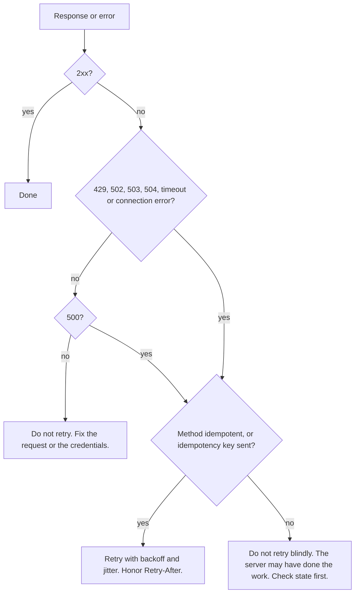

## 1. The question this idea answers

An LLM call fails. The provider returns `429`, or `503`, or the connection drops before any answer arrives. Should your code try again?

Sometimes a retry is correct and harmless. Sometimes a retry creates a second order, sends a second email, or charges a card twice. The difference depends on two things: the **method** of the request and the **status code** of the response. This lesson gives you the rules to decide, and a plan for retries that do not make an overload worse.

## 2. Mental model

> [!analogy] A light switch and a doorbell
> An idempotent request is like a switch with two marked positions: "ON". Press "ON" once or five times, and the light is on. The end state is the same. A non-idempotent request is like a doorbell. Press it five times, and it rings five times.
>
> **Where it stops working:** a switch has no side effects that you can count. A server can log each idempotent request, and a response can change between calls (the first `DELETE` returns 204, the second returns 404). Idempotency is about the **intended effect on the server state**, not about identical responses.

## 3. Terms

| Term | Plain meaning |
|---|---|
| safe method | A method that only reads. The client asks for no change on the server. |
| idempotent method | A method where one request and several identical requests have the same intended effect on the server. |
| status code | The three-digit result number in the response. |
| status class | The first digit of the status code: 1xx, 2xx, 3xx, 4xx or 5xx. |
| retry | Sending the same request again after a failure. |
| transient error | An error that can disappear without any change to the request, for example an overloaded server. |
| permanent error | An error that repeats on every retry until the request changes, for example a missing field. |
| backoff | A wait before a retry that grows after each failure. |
| jitter | A random part of the wait, so that many clients do not retry at the same moment. |
| `Retry-After` | A response header that tells the client how long to wait before the next try. |
| rate limit | A limit on how many requests a client may send in a time window. |
| idempotency key | A unique id that the client sends with a non-idempotent request, so that the server can detect a repeat. |

## 4. How it works

### 4.1 The methods

The method is the verb of the request. These definitions are from MDN (checked on 2026-10-19):

| Method | MDN definition (short) | Typical use in an API | Body? |
|---|---|---|---|
| `GET` | "requests a representation of the specified resource" | Read a note or a list of notes | No |
| `HEAD` | Same as `GET` "but without a response body" | Check that a resource exists, read its headers | No |
| `POST` | "submits an entity to the specified resource, often causing a change in state or side effects" | Create a note, start a job, call a model | Yes |
| `PUT` | "replaces all current representations of the target resource" | Replace a whole note | Yes |
| `PATCH` | "applies partial modifications to a resource" | Change one field of a note | Yes |
| `DELETE` | "deletes the specified resource" | Delete a note | Usually no |
| `OPTIONS` | "describes the communication options for the target resource" | Browser checks before cross-origin calls | No |

Most model provider APIs use `POST` for generation, because the request carries a large body and every call does new work.

### 4.2 Safe and idempotent

MDN gives this table (checked on 2026-10-19). It follows RFC 9110.

| Method | Safe | Idempotent |
|---|---|---|
| `GET` | Yes | Yes |
| `HEAD` | Yes | Yes |
| `OPTIONS` | Yes | Yes |
| `PUT` | No | Yes |
| `DELETE` | No | Yes |
| `POST` | No | No |
| `PATCH` | No | No |

The MDN glossary defines idempotent: "An HTTP method is idempotent if the intended effect on the server of making a single request is the same as the effect of making several identical requests." It adds: "All safe methods are idempotent, as well as PUT and DELETE. The POST and PATCH methods are not guaranteed to be idempotent."

Two words matter in these sentences:

1. **Intended.** The server may still log each request. The log is not the intended effect.
2. **Guaranteed.** A `POST` is not forbidden to be idempotent. A server can make it idempotent (section 4.6). But the client cannot assume it.

A sandbox run showed both cases against a small notes API (FastAPI 0.149.0):

```text
=== R2. POST twice -> two resources (not idempotent) ===
201 {'id': 2, 'title': 'pay rent'} | 201 {'id': 3, 'title': 'pay rent'}

=== R3. DELETE twice -> same server state, different status ===
first DELETE: 204 | second DELETE: 404 | note 2 exists: False
```

Two identical `POST` requests made two notes. Two identical `DELETE` requests left the server in one state: note 2 is gone. The second `DELETE` returned 404, but the state did not change. That is idempotent.

> [!trap] Idempotent does not mean "same response"
> The `DELETE` example returned 204 and then 404. A retry logic that treats the 404 of a retried `DELETE` as a failure is wrong. The first try already did the work.

### 4.3 Status code classes

The first digit tells the class. MDN names them (checked on 2026-10-19):

| Class | MDN name | What it tells the client |
|---|---|---|
| 1xx | Informational responses | The server received the request and continues. Rare in APIs. |
| 2xx | Successful responses | It worked. |
| 3xx | Redirection messages | Look somewhere else. HTTP clients can follow redirects. |
| 4xx | Client error responses | The request is wrong. The same request usually fails again. 429 and 408 are exceptions: a later retry can work. |
| 5xx | Server error responses | The server failed. A retry may work. |

### 4.4 The codes you meet most often

| Code | Name | Meaning (MDN, shortened) | Retry the same request? |
|---|---|---|---|
| 200 | OK | "The request succeeded." | No need |
| 201 | Created | "a new resource was created as a result" | No need |
| 204 | No Content | Success, and there is no body | No need |
| 400 | Bad Request | The server cannot process it, "perceived to be a client error" | No. Fix the request. |
| 401 | Unauthorized | MDN: "semantically this response means unauthenticated" | No. Send valid credentials. |
| 403 | Forbidden | "The client does not have access rights to the content" | No. Get permission. |
| 404 | Not Found | "The server cannot find the requested resource." | No (except for eventual consistency) |
| 409 | Conflict | "a request conflicts with the current state of the server" | Only after you resolve the conflict |
| 422 | Unprocessable Content | "well-formed but was unable to be followed due to semantic errors" | No. FastAPI uses it for validation errors (lesson 4.2). |
| 429 | Too Many Requests | "too many requests in a given amount of time (rate limiting)" | Yes, after a wait |
| 500 | Internal Server Error | "a situation it does not know how to handle" | Maybe, with care (section 4.5) |
| 502 | Bad Gateway | A gateway "got an invalid response" from the server behind it | Yes, with backoff |
| 503 | Service Unavailable | "The server is not ready to handle the request." | Yes, with backoff |
| 504 | Gateway Timeout | A gateway "cannot get a response in time" | Yes for idempotent methods, with care for `POST` |

> [!key] 401 vs 403
> 401 means "I do not know who you are". The fix is to authenticate: send a valid key or token. 403 means "I know who you are, and you may not do this". A new token for the same user does not help.

> [!key] 400 vs 422
> 400 means the server could not read the request at all, for example broken JSON. 422 means the server read it, but the content breaks a rule, for example a missing field or a wrong type. FastAPI returns 422 for a body that fails Pydantic validation.
>
> FastAPI also returns 422 for broken JSON, not 400. A sandbox run (FastAPI 0.149.0) sent `{"title": "x",` with `Content-Type: application/json` and got `422 json_invalid ['body', 14]`. So in a FastAPI app, expect 422 for both cases. Other servers may send 400 for broken JSON.

429 comes from RFC 6585, section 4 (MDN, checked on 2026-10-19). MDN adds: "A Retry-After header may be included to this response to indicate how long a client should wait before making the request again."

### 4.5 Decide: retry or not

A retry is safe when two conditions are both true:

1. **The error can be transient.** 429, 502, 503 and 504, connection errors and timeouts can pass. 400, 401, 403, 404 and 422 do not pass by themselves.
2. **A repeat cannot cause harm.** The method is idempotent, or the server has a way to detect repeats (an idempotency key).

The hard case is a `POST` that fails with a timeout or a 500. You do not know if the server did the work before it failed.



> [!example] Worked example: six responses
> | Request | Response | Decision | Reason |
> |---|---|---|---|
> | `GET /notes/7` | 200 | Done | Success |
> | `POST /notes` | 201 | Done | Created |
> | `GET /notes/99` | 404 | No retry | The note does not exist. A retry gives 404 again. |
> | `POST /v1/messages` | 429, `Retry-After: 2` | Retry after 2 s | Rate limit. The server did not do the work. |
> | `GET /notes` | 503 | Retry with backoff | Transient, and `GET` is safe |
> | `POST /payments` | 500 | No blind retry | The payment may exist. Check first, or use an idempotency key. |

Why is a 429 `POST` safe to retry, when a 500 `POST` is not? A 429 says the server rejected the request because of the rate. A 500 says something failed during the work, so part of the work may be done. This is a rule of thumb. The API documentation of each provider is the final word.

### 4.6 Idempotency keys make a POST safe to repeat

Some APIs accept a header such as `Idempotency-Key: 2b8f...`. The client creates one random key per logical operation and sends the same key on every retry. The server stores the key with the first result. A repeat with the same key returns the stored result and does no new work.

This pattern is used by payment APIs, for example. An IETF draft (`draft-ietf-httpapi-idempotency-key-header`) describes the header. It is a draft, not a finished standard, so check each API's documentation.

### 4.7 Backoff, jitter and Retry-After

A naive retry loop retries at once, many times. If 1,000 clients do that against an overloaded server, the overload grows. Three rules prevent this:

1. **Honor `Retry-After`.** If the server says "wait 2 seconds", wait 2 seconds.
2. **Exponential backoff.** Otherwise wait longer after each failure: base × 2^attempt, with a cap.
3. **Full jitter.** Pick a random wait between 0 and that value, so that clients spread out.

$$
\text{wait}_{a} = \text{random}\left(0,\ \min(\text{cap},\ \text{base} \cdot 2^{a})\right)
$$

Here $a$ is the attempt number, starting at 0. With base 0.2 s and cap 2.0 s, the upper limit of the wait grows like this (computed in the sandbox):

```text
full-jitter caps for attempts 0..4 with base 0.2 s, cap 2.0 s: [0.2, 0.4, 0.8, 1.6, 2.0]
```

```plot
{
  "title": "Upper limit of the wait (blue) for base 0.2 s and cap 2.0 s",
  "xAxis": { "label": "attempt a", "domain": [-0.5, 5.5] },
  "yAxis": { "label": "seconds", "domain": [0, 2.4] },
  "disableZoom": true,
  "data": [
    { "points": [[0, 0.2], [1, 0.4], [2, 0.8], [3, 1.6], [4, 2.0], [5, 2.0]], "fnType": "points", "graphType": "polyline", "color": "#1E6091", "skipTip": true },
    { "points": [[0, 0.2], [1, 0.4], [2, 0.8], [3, 1.6], [4, 2.0], [5, 2.0]], "fnType": "points", "graphType": "scatter", "color": "#1E6091", "skipTip": true }
  ]
}
```

A sandbox run retried a `GET` against a fake server that returned 503 twice and then 200 (httpx 0.28.1 with a mock transport):

```text
attempt 1: 503, wait 0.00s
attempt 2: 503, wait 0.00s
final: 200 after 3 calls
```

The waits are 0.00 s because the fake server sent `Retry-After: 0`. The loop honored the header instead of its own backoff.

### 4.8 Limits on retries

| Limit | Why |
|---|---|
| A maximum number of attempts (for example 3 to 5) | A permanent failure must surface, not loop forever |
| A total time budget | The user waits for the whole sequence, not one try |
| Retry only at one layer | If the SDK makes 3 attempts and your code makes 3 attempts, one call can become 3 × 3 = 9 requests. With 3 retries at each layer (4 attempts each), it can become 4 × 4 = 16. |
| Log each retry with the status and the wait | You must see retry storms in the logs |

Many SDKs already retry. Read the SDK documentation and set its retry count before you add your own loop.

## 5. Code walkthrough

The retry loop of section 4.7, line by line:

```python
import random
import time

RETRYABLE = {429, 500, 502, 503, 504}                       # 1

def get_with_retry(client, url, attempts=4, base=0.2, cap=2.0):
    for attempt in range(attempts):                           # 2
        r = client.get(url)                                    # 3
        if r.status_code not in RETRYABLE:                     # 4
            return r
        ra = r.headers.get("Retry-After")                      # 5
        wait = float(ra) if ra is not None else random.uniform(0, min(cap, base * 2 ** attempt))  # 6
        time.sleep(wait)                                       # 7
    return r                                                   # 8
```

| Line | What it does | Why |
|---|---|---|
| 1 | Lists the codes that may pass by themselves | 4xx codes except 429 repeat on every try |
| 2 | Bounds the number of tries | A permanent failure must end the loop |
| 3 | Sends a `GET` | This loop is safe only because `GET` is safe. Do not reuse it for `POST` without an idempotency key. |
| 4 | Returns success and non-retryable errors at once | The caller must see a 404 at once, not after four tries |
| 5 | Reads the server's hint | The server knows its own load |
| 6 | Uses the hint, or a full-jitter backoff | Spreads clients out in time |
| 7 | Waits | This is a blocking wait. In async code use `await asyncio.sleep(wait)` (lesson 2.7). |
| 8 | Returns the last failure | The caller decides what to do with it |

This loop is a teaching version. It has one gap: `Retry-After` can also be an HTTP date instead of seconds. A production version handles both forms, and caps a very large value.

## 6. Exercises

Runs in: your local practice project.

**Exercise 3.2.1: `describe_response` (from the roadmap, M0.2).** Without any SDK, call one public JSON API that needs no key, with `httpx`. Then write `describe_response(resp) -> dict` that returns:

- the status family (`"success"`, `"client error"`, `"server error"`, ...)
- whether a retry is safe, based on the method and the status
- the content type
- the `Retry-After` value, if present

Acceptance tests (pytest): build 6 `httpx.Response` objects by hand, each with a `request=httpx.Request(method, url)`:

1. 200 for `GET`
2. 201 for `POST`
3. 404 for `GET`
4. 429 for `POST` with `Retry-After: 2`
5. 503 for `GET`
6. 500 for `POST`

Assert the expected dict for each. The `POST` that got 500 must be marked "not safe to blindly retry".

**Exercise 3.2.2: a retry policy object.** Write a function that returns the wait for attempt `a`, with base, cap and full jitter, and honors `Retry-After` in seconds.

Acceptance tests: with `random.seed(0)`, 1,000 waits for attempt 3 (base 0.2, cap 2.0) all lie in [0, 1.6]. With `Retry-After: 5`, the wait is 5. With a cap of 2.0, attempt 10 never waits more than 2.0 s.

Hints come in three levels in chat: idea, pseudocode, partial code.

## 7. Common mistakes

1. **Retrying every error.** A 400 or 422 fails the same way every time. The retry only wastes time and quota.
2. **Retrying a `POST` blindly after a timeout.** The server may have done the work. Use an idempotency key or check the state first.
3. **Retrying without backoff.** Instant retries make an overload worse.
4. **Ignoring `Retry-After`.** The server told you the right wait.
5. **Two retry layers.** SDK retries times your retries multiply the calls.
6. **Mixing 401 and 403.** 401 needs credentials. 403 needs permission.
7. **Treating the 404 of a repeated `DELETE` as a failure.** The first try already deleted the resource.

## 8. One-minute explanation

The method says what the client wants, and the status code says what happened. GET, HEAD and OPTIONS are safe: they only read. Safe methods plus PUT and DELETE are idempotent: one request or many identical requests have the same intended effect. POST and PATCH are not guaranteed to be idempotent. Status codes come in five classes: 2xx success, 3xx redirect, 4xx the client's fault, 5xx the server's fault. A retry is reasonable only when two things are true. The error can pass by itself (429, 502, 503, 504, timeouts). A repeat cannot harm, because the method is idempotent or the request has an idempotency key. Wait between retries with exponential backoff and jitter. Honor Retry-After, limit the attempts, and retry at one layer only.

## 9. Check questions

```check
{
  "question": "A POST /v1/messages call to a model provider times out after 30 s. You do not know if the server finished the work. Is an automatic retry safe? What changes your answer?",
  "hint": "Think about the method, the cost of a repeat, and how a server can detect a repeat.",
  "answer": "Not guaranteed. POST is not idempotent, so a repeat can do the work twice. For a pure generation call the harm is usually only cost: you pay for two generations, and you keep the second answer. For a POST with side effects (create an order, send an email) a blind retry can duplicate them. An idempotency key that the server supports makes the retry safe, because the server returns the stored result of the first try."
}
```

```check
{
  "question": "Classify each code as 'retry with backoff' or 'do not retry': 400, 401, 422, 429, 503, 504 (for a GET).",
  "answer": "Do not retry: 400 (bad request), 401 (send valid credentials first), 422 (validation error). Retry with backoff: 429 (after Retry-After), 503 (service unavailable), 504 for a GET (gateway timeout, and GET is safe)."
}
```

```check
{
  "question": "Why is DELETE idempotent even though the first call returns 204 and the second returns 404?",
  "answer": "Idempotency is about the intended effect on the server state, not about the response. After one DELETE or after five, the resource is gone. The status changes because the second call finds nothing to delete, but the state is the same."
}
```

```check
{
  "question": "Your SDK retries 2 times by default, and your own code wraps each call in a loop of 3 attempts. How many requests can one logical call send in the worst case, and what is the fix?",
  "answer": "Each of your 3 attempts can make 1 + 2 = 3 requests, so 3 × 3 = 9 requests. The fix is to retry at one layer only: set the SDK retries to 0 and keep your loop, or keep the SDK retries and remove your loop."
}
```

## 10. Links

- Previous: [3.1 The HTTP request-response cycle](/notes/ai/ai-engineering/01-software-engineering-fundamentals/m03-http-rest-json/l1-the-request-response-cycle)
- Next: [3.3 Headers, parameters, bodies, cookies and auth](/notes/ai/ai-engineering/01-software-engineering-fundamentals/m03-http-rest-json/l3-headers-parameters-bodies-and-auth)
- FastAPI's 422 body: [4.2 Validation, status codes and error responses](/notes/ai/ai-engineering/01-software-engineering-fundamentals/m04-fastapi-services/l2-validation-and-error-responses)
- Async waits: [2.7 Blocking calls, asyncio.to_thread and when to use async def](/notes/ai/ai-engineering/01-software-engineering-fundamentals/m02-concurrency-foundations/l7-blocking-calls-and-to-thread)
- [Glossary](/notes/ai/ai-engineering/glossary)
- Sources (checked on 2026-10-19): MDN HTTP request methods, https://developer.mozilla.org/en-US/docs/Web/HTTP/Reference/Methods. MDN Idempotent, https://developer.mozilla.org/en-US/docs/Glossary/Idempotent. MDN status codes, https://developer.mozilla.org/en-US/docs/Web/HTTP/Reference/Status. MDN 429, https://developer.mozilla.org/docs/Web/HTTP/Reference/Status/429. RFC 9110, https://www.rfc-editor.org/rfc/rfc9110.
