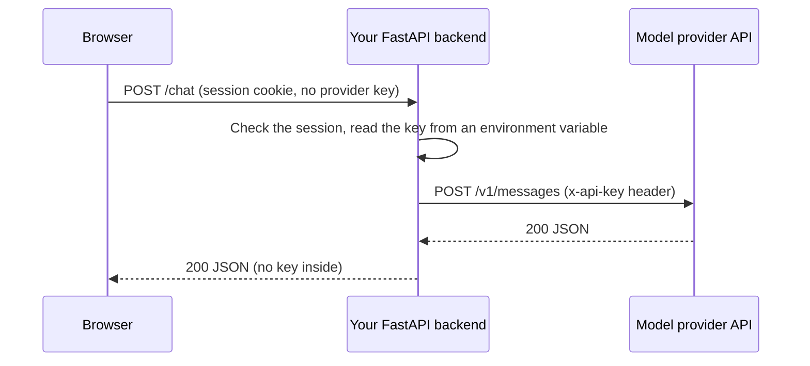

## 1. The question this idea answers

A request carries several kinds of data: which note you want, how many results, who you are, what format you send, and the content itself. Each kind has its own place in the request. Put a value in the wrong place and the server ignores it, rejects it, or leaks it.

The most expensive mistake is a secret in the wrong place. A provider API key in a URL reaches the logs. A key in front-end code reaches the browser of every visitor. This lesson shows where every value belongs, and why.

## 2. Mental model

> [!analogy] A parcel at a post office
> The **path** is the street address: it names the one resource. The **query string** is a note on the address line: "only the red ones, at most three". The **headers** are the labels on the box: "fragile", "contents: books", "sender: account 42". The **body** is what is inside the box. A **cookie** is a ticket that the post office gave you last time, and you show it again on each visit.
>
> **Where it stops working:** a post office label is private between you and the clerk. In HTTP, the URL (path and query string) is copied into many places: server access logs, proxy logs, browser history. Headers and bodies are not copied there by default. So "where" also decides "who can see it".

## 3. Terms

| Term | Plain meaning |
|---|---|
| path parameter | A value that is part of the path, for example `42` in `/notes/42`. It selects one resource. |
| query parameter | A `name=value` pair in the query string, for example `tag=home`. It filters, sorts or pages. |
| URL encoding | Writing characters that a URL cannot hold as `%` plus two hex digits, for example a space as `%20`. Also called percent-encoding. |
| request header | A `Name: value` line that the client sends. |
| response header | A `Name: value` line that the server sends back. |
| `Content-Type` | A header that says the format of the body, for example `application/json`. |
| `Accept` | A request header that says which formats the client can read. |
| media type | A format name such as `application/json` or `text/event-stream`. Also called MIME type. |
| request body | The content that the client sends, for example a JSON object. |
| form body | A body in the format `application/x-www-form-urlencoded`, the format of HTML forms. |
| cookie | A small `name=value` item that a server asks the browser to store and send back on later requests. |
| authentication | Proving who the client is, for example with an API key. |
| authorization | Deciding what an authenticated client may do. |
| API key | A long secret string that identifies a client to an API. |
| bearer token | A token sent as `Authorization: Bearer <token>`. Whoever holds it can use it. |
| request id | A unique id for one request, sent in a header, so that both sides can find it in their logs. |

## 4. How it works

### 4.1 Path parameters and query parameters

Use a **path parameter** to name one resource. Use **query parameters** to describe what you want from a collection.

| Request | Path parameter | Query parameters | Meaning |
|---|---|---|---|
| `GET /notes/42` | `42` | none | The note with id 42 |
| `GET /notes?tag=home&limit=3` | none | `tag=home`, `limit=3` | At most 3 notes with the tag "home" |
| `GET /users/7/notes?sort=-created` | `7` | `sort=-created` | The notes of user 7, newest first |

A path parameter is required: without it, the path is a different route. A query parameter is usually optional, with a default on the server.

### 4.2 URL encoding

A URL may hold only a limited set of characters. Other characters travel as `%` plus their byte value in hex. A sandbox run sent `q=open orders` with curl:

```text
> GET /search?q=open%20orders&limit=3 HTTP/1.1
...
{"q":"open orders","limit":3,"raw_query":"q=open%20orders&limit=3"}
```

The space became `%20` on the wire. The FastAPI server decoded it, so the function received `"open orders"`. `limit=3` arrived as the text `3`, and FastAPI converted it to the integer `3` because the function declared `limit: int`.

| Character | Encoded | Why it needs encoding |
|---|---|---|
| space | `%20` in a path. `%20` or `+` in a query string or a form body. | A space ends the target in the request line |
| `&` | `%26` | `&` separates query parameters |
| `=` | `%3D` | `=` separates a name from its value |
| `/` in a value | `%2F` | `/` separates path segments |
| `é` | `%C3%A9` | Non-ASCII text travels as UTF-8 bytes |

Both forms of the space are valid in a query string, and libraries pick one. A sandbox run (httpx 0.28.1, Python 3.13.16) encoded the same value twice:

```text
httpx params      -> https://api.example.com/search?q=L3+%26+L4+%2F+%22night+shift%22
urlencode         -> q=L3+%26+L4+%2F+%22night+shift%22
both decode to    -> L3 & L4 / "night shift"
```

httpx and `urllib.parse.urlencode` write `+` for a space in a query string. The server decodes `+` and `%20` to the same space.

> [!trap] Do not build URLs with string concatenation
> `"/search?q=" + user_text` breaks when the text holds `&` or `#`, and it can let a user inject extra parameters. Pass parameters to the client library instead: `client.get("/search", params={"q": user_text})`. The library encodes every value.

### 4.3 Headers

Headers carry metadata about the request or the response. These are the headers you meet in every API:

| Header | Direction | Example | Purpose |
|---|---|---|---|
| `Host` | request | `api.example.com` | Which site on the server |
| `Content-Type` | both | `application/json` | The format of the body |
| `Content-Length` | both | `27` | The size of the body in bytes |
| `Accept` | request | `application/json` | The formats the client accepts |
| `Authorization` | request | `Bearer sk-...` | Credentials |
| `User-Agent` | request | `curl/8.5.0` | The client program |
| `Retry-After` | response | `2` | Seconds to wait before a retry (lesson 3.2) |
| `Cache-Control` | both | `no-cache` | Caching rules. SSE responses use `no-cache` (lesson 5.2). |
| `X-Request-Id` (name varies) | both | `req_01H...` | A request id for logs and support tickets |
| rate-limit headers (names vary) | response | `x-ratelimit-remaining: 12` | How much quota is left |

Header names that start with `X-` are a convention, not a standard. Each provider names its own request-id and rate-limit headers. Read the provider documentation for the exact names.

> [!example] Worked example: why the request id matters
> A user reports "the assistant failed at 14:02". Your log line has `request_id=req_abc` and the provider's response header carried the same id. The provider's support team can find the exact call from that id. Without it, they search by time and guess. Log the request id of every failed upstream call.

### 4.4 Bodies and Content-Type

The body is the content. `Content-Type` tells the server how to read it.

| `Content-Type` | Body example | Used for |
|---|---|---|
| `application/json` | `{"title": "buy milk"}` | Almost every modern API |
| `application/x-www-form-urlencoded` | `title=buy+milk&tag=home` | HTML forms, OAuth token requests |
| `multipart/form-data` | Several parts, each with its own headers | File uploads |
| `text/event-stream` | `data: {...}` lines | Server-sent events (lesson 5.1) |

FastAPI parses a body as JSON only when the `Content-Type` is `application/json` or ends with `+json`. The FastAPI 0.149.0 source (`fastapi/routing.py`) shows this rule. A body with any other type, for example `text/plain`, reaches the model as a raw string. A sandbox run sent valid JSON with the wrong header `Content-Type: text/plain`:

```text
JSON body sent as text/plain -> 422 {'detail': [{'type': 'model_attributes_type', 'loc': ['body'], 'msg': 'Input should be a valid dictionary or object to extract fields from', 'input': '{"title": "x"}'}]}
```

The server did not parse the text as JSON. It saw a plain string where a JSON object should be, and rejected it with 422.

A second rule is about a body with **no** `Content-Type` header. FastAPI 0.132.0 added the setting `strict_content_type`, and its default is `True` (roadmap research, 2026-10-18). Then FastAPI refuses to parse such a body as JSON. The sandbox run compared both settings:

```text
strict_content_type=True:  text/plain -> 422 model_attributes_type | no header -> 422 model_attributes_type
strict_content_type=False: text/plain -> 422 model_attributes_type | no header -> 201 {'title': 'x'}
```

`strict_content_type=False` changes only the case with no header. A `text/plain` body fails in both cases. With `httpx`, `json=...` sets the correct header for you. With curl, `--json` sets it.

### 4.5 Cookies

A server sends `Set-Cookie: session=abc; HttpOnly; Secure` in a response. The browser stores it and sends `Cookie: session=abc` on later requests to that site. Cookies are how browser logins keep state.

APIs that programs call (not browsers) rarely use cookies. They use a header such as `Authorization` on every request. You meet cookies when your FastAPI app serves a browser front end.

| Cookie attribute | Meaning |
|---|---|
| `HttpOnly` | JavaScript in the page cannot read the cookie. This limits theft by injected scripts. |
| `Secure` | The browser sends the cookie only over `https`. |
| `SameSite` | Limits sending the cookie with requests that start on other sites. |

### 4.6 Authentication with API keys and bearer tokens

An API must know who calls it. The common ways:

| Method | Header | Who uses it |
|---|---|---|
| API key in a custom header | `x-api-key: <key>` | Some model providers |
| Bearer token | `Authorization: Bearer <token>` | Most APIs, OAuth access tokens |
| Basic auth | `Authorization: Basic <base64 of user:password>` | Old systems, some internal tools |

A sandbox run sent `Authorization: Bearer sk-test-123456` to a small endpoint that splits the header:

```text
{"scheme":"Bearer","token_length":14}
```

The endpoint returned only the scheme and the length. A real service never echoes a secret back, and never writes it to a log.

> [!key] Three rules for secrets
> 1. **Never in a URL.** URLs go to access logs, proxy logs, browser history and bug reports.
> 2. **Never in front-end code.** Code that runs in a browser is visible to every visitor. The browser calls your backend, and your backend holds the provider key.
> 3. **Never in Git.** Read keys from environment variables (lesson 1.7). Lesson 7.3 shows what to do when a key reaches a commit: rotate it first.

Base64 in Basic auth is an encoding, not encryption. Anyone can decode it. Only TLS (`https`) protects the header on the network.



### 4.7 Authentication vs authorization

**Authentication** answers "who is this?". **Authorization** answers "may this client do this action?". A valid API key passes authentication. A request to delete another user's note must still fail authorization.

| Failure | Status code |
|---|---|
| No credentials, or invalid credentials | 401 |
| Valid credentials, but the action is not allowed | 403 |

Take identity from the credentials that your app checked, never from a field that the client writes. The lesson [Self-asserted identity](/notes/software-engineering/security-and-operations/01-access-control/l1-self-asserted-identity) shows what goes wrong when a service trusts a user id in the body.

## 5. Code walkthrough

The endpoint behind the curl examples:

```python
from fastapi import FastAPI, Header, Request

app = FastAPI()

@app.get("/search")
def search(q: str, limit: int = 10, request: Request = None):          # 1
    return {"q": q, "limit": limit, "raw_query": request.url.query}     # 2

@app.get("/whoami")
def whoami(authorization: str | None = Header(default=None)):           # 3
    if authorization is None:
        return {"auth": None}
    scheme, _, token = authorization.partition(" ")                      # 4
    return {"scheme": scheme, "token_length": len(token)}               # 5
```

| Line | What it does | Data in, data out |
|---|---|---|
| 1 | Declares two query parameters. `q` has no default, so it is required. `limit` defaults to 10. | In: the query string. Out: `q` as `str`, `limit` converted to `int`. A request without `q` gets 422. |
| 2 | Returns the decoded values and the raw query string | Shows that `%20` arrived and was decoded |
| 3 | Reads the `Authorization` header. FastAPI maps the parameter name `authorization` to the header name. | In: the header text or nothing. Out: `str` or `None`. |
| 4 | Splits `"Bearer sk-test-123456"` at the first space | Out: `"Bearer"`, `" "`, `"sk-test-123456"` |
| 5 | Returns only the scheme and the length | The secret itself never leaves the server |

Lesson 4.3 shows a better way to read credentials: a dependency that checks the token once and gives the route a user object.

## 6. Exercises

Runs in: your local practice project.

**Exercise 3.3.1: encode by hand, then by library.** Take the value `L3 & L4 / "night shift"`. Write its URL-encoded form by hand. Then build the URL with `httpx.URL("https://example.test/search", params={"q": value})`.

Acceptance tests: write the space as `+`, as httpx does. Then your hand-encoded string equals the query string that httpx built (compare `str(url)`). Decoding your string with `urllib.parse.parse_qs` gives back the exact original value. A second hand version with `%20` for each space decodes to the same value.

**Exercise 3.3.2: find the secret leaks.** Write a list of five places where an API key could leak in a small web app (for example a log line or a URL). For each place, write the fix.

Acceptance test: the list covers URLs, logs, front-end code, Git history and error messages.

Hints come in three levels in chat: idea, pseudocode, partial code.

## 7. Common mistakes

1. **A secret in a query parameter.** It reaches access logs. Use a header.
2. **A provider key in browser code.** Every visitor can read it. Call your own backend.
3. **String concatenation for URLs.** Special characters break the URL. Use `params=`.
4. **The wrong `Content-Type`.** FastAPI rejects a JSON body with a non-JSON content type.
5. **Logging full headers.** The `Authorization` header goes into the log. Mask it.
6. **Confusing authentication and authorization.** A valid key does not mean "may do anything".
7. **Trusting Base64 as protection.** Basic auth is readable by anyone who sees it. Only TLS protects it.

## 8. One-minute explanation

Each value in a request has a place. The path names one resource, for example `/notes/42`. The query string filters or pages a collection, for example `?tag=home&limit=3`, and special characters in it are percent-encoded. Headers carry metadata: the body format in `Content-Type`, accepted formats in `Accept`, credentials in `Authorization`, and ids and limits in provider headers. The body carries the content, usually JSON. Browsers keep login state in cookies. Programs send a key or a bearer token in a header on every request. Secrets never go in URLs, browser code or Git, because URLs are logged and browser code is public. Authentication says who you are (401 when it fails). Authorization says what you may do (403 when it fails).

## 9. Check questions

```check
{
  "question": "Design the request for: 'the 20 newest notes of user 7 that have the tag urgent'. Which values go in the path and which in the query string?",
  "answer": "GET /users/7/notes?tag=urgent&sort=-created&limit=20. The user id 7 names a resource, so it goes in the path. The tag, the sort order and the page size describe what you want from the collection, so they are query parameters."
}
```

```check
{
  "question": "A front-end developer wants to call the model provider directly from the browser with the provider key in the JavaScript code, 'to save a server'. What is the problem, and what is the usual design?",
  "answer": "Code that runs in the browser is visible to every visitor, so the key leaks and anyone can spend your quota. The usual design: the browser calls your own backend (with its session cookie or token), the backend checks the user, reads the provider key from an environment variable, calls the provider, and returns only the result."
}
```

```check
{
  "question": "A client sends valid JSON in the body but with Content-Type: text/plain to a FastAPI 0.149 endpoint that expects a Pydantic model. What status does it get, and why?",
  "answer": "422. FastAPI parses a body as JSON only when the Content-Type is application/json or ends with +json. A text/plain body reaches the model as a string instead of an object, so validation fails with type model_attributes_type. The setting strict_content_type (default True since 0.132.0) does not change this. It controls only bodies with no Content-Type header."
}
```

```check
{
  "question": "A request has a valid bearer token for user A, and it asks to delete a note of user B. Which status code fits, 401 or 403? Explain the difference.",
  "answer": "403. Authentication succeeded: the server knows the caller is user A. Authorization failed: user A may not delete user B's note. 401 is for missing or invalid credentials."
}
```

## 10. Links

- Previous: [3.2 Methods, status codes, idempotency and safe retries](/notes/ai/ai-engineering/01-software-engineering-fundamentals/m03-http-rest-json/l2-methods-status-codes-and-retries)
- Next: [3.4 JSON and REST resource design](/notes/ai/ai-engineering/01-software-engineering-fundamentals/m03-http-rest-json/l4-json-and-rest-design)
- Environment variables: [1.7 Files, paths, environment variables and JSON](/notes/ai/ai-engineering/01-software-engineering-fundamentals/m01-python-foundations/l7-files-paths-env-and-json)
- Secrets in Git: [7.3 History, .gitignore, README and code review](/notes/ai/ai-engineering/01-software-engineering-fundamentals/m07-git/l3-history-gitignore-readme-and-review)
- Identity from the right source: [Self-asserted identity](/notes/software-engineering/security-and-operations/01-access-control/l1-self-asserted-identity)
- [Glossary](/notes/ai/ai-engineering/glossary)
- Measured: the curl output and the 422 body come from a sandbox run with FastAPI 0.149.0, uvicorn 0.54.0 and curl 8.5.0 on 2026-10-19.
