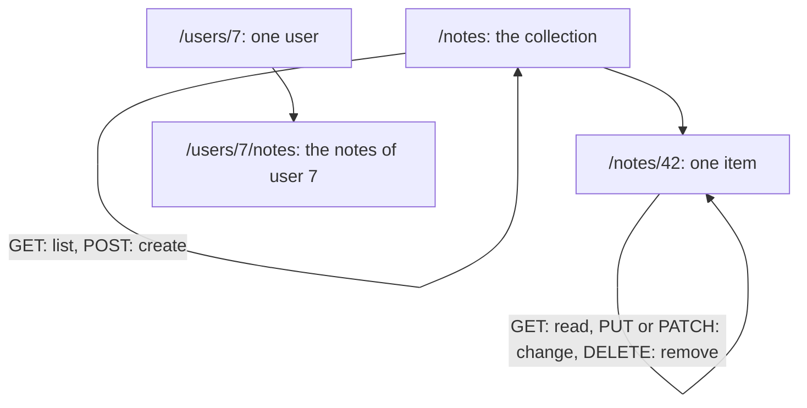

## 1. The question this idea answers

Two questions come together here.

1. **How does data travel?** A Python dict cannot cross a network. It must become text, travel, and become a value again on the other side. For APIs that text is almost always JSON. Model messages, tool arguments and tool results are JSON too.
2. **How should an API look?** A client developer must guess your URLs, methods and errors from a few examples. A design with clear rules makes the guess right. REST is the most common set of such rules.

This lesson teaches both. Your capstone API (module 10) follows these rules.

## 2. Mental model

> [!analogy] A library catalog
> In a library, every book has a shelf address (a URL). You can do a small fixed set of things with any book (the methods). You can read it, add a new one, replace it, change a detail or remove it. Every catalog card has the same layout (one JSON shape). If the library cannot help, you get the same kind of slip every time, with a code and a reason (one error shape).
>
> **Where it stops working:** a library has only books. An API often has actions that are not things, for example "start a job" or "send a message to the model". REST models such actions as new resources (a job, a message) that you create with `POST`. Some actions fit badly, and a pragmatic API accepts a few action endpoints.

## 3. Terms

| Term | Plain meaning |
|---|---|
| JSON | JavaScript Object Notation. A text format for objects, arrays, strings, numbers, booleans and null. |
| serialize | Turn a value in memory into text or bytes, for example a dict into JSON text. |
| deserialize | Turn text or bytes back into a value in memory. Also called parse. |
| JSON object | An unordered set of `"name": value` pairs inside `{}`. It becomes a Python `dict`. |
| JSON array | An ordered list of values inside `[]`. It becomes a Python `list`. |
| payload | The data that a request or a response carries in its body. |
| REST | Representational State Transfer. A style of API design: resources at URLs, standard methods, stateless requests. |
| resource | A thing that the API exposes, for example a note or a user. It has a URL. |
| collection | The set of resources of one kind, for example `/notes`. |
| item | One resource in a collection, for example `/notes/42`. |
| representation | The JSON that the server sends for a resource. It is a view, not the database row itself. |
| stateless | Each request carries everything the server needs. The server keeps no conversation memory between requests. |
| pagination | Returning a large collection in pages. |
| cursor | An opaque token that marks where the next page starts. |
| error shape | The one fixed JSON layout of every error body. |
| API version | A label, for example `/v1/`, that lets the API change without breaking old clients. |

## 4. How it works

### 4.1 JSON in five rules

1. Objects use `{}` with keys in **double quotes**: `{"title": "buy milk"}`.
2. Arrays use `[]`: `["home", "urgent"]`.
3. Values are strings, numbers, `true`, `false`, `null`, objects or arrays.
4. No comments, no trailing commas, no single quotes.
5. Text is Unicode, usually sent as UTF-8.

The Python `json` module maps types like this:

| JSON | Python after `json.loads` | Python before `json.dumps` |
|---|---|---|
| object | `dict` | `dict` |
| array | `list` | `list` or `tuple` |
| string | `str` | `str` |
| number (integer) | `int` | `int` |
| number (with a fraction) | `float` | `float` |
| `true` / `false` | `True` / `False` | `True` / `False` |
| `null` | `None` | `None` |

### 4.2 What changes on a round trip

A sandbox run (Python 3.13.16) sent a dict through `dumps` and back through `loads`:

```text
dumps: {"id": 7, "ok": true, "score": 0.5, "tags": ["a", "b"], "owner": null, "1": "int key"}
loads: {'id': 7, 'ok': True, 'score': 0.5, 'tags': ['a', 'b'], 'owner': None, '1': 'int key'}
tuple became: list | int key became: '1'
```

Two things changed. The tuple came back as a list. The integer key `1` came back as the string `'1'`, because JSON object keys are always strings.

The same run showed four errors that you will meet:

```text
TypeError: Object of type datetime is not JSON serializable
default=str: {"at": "2026-10-19 09:30:00"}
NaN: {"x": NaN} | allow_nan=False -> ValueError: Out of range float values are not JSON compliant: nan
JSONDecodeError: Expecting property name enclosed in double quotes: line 1 column 2 (char 1)
JSONDecodeError (trailing comma): Illegal trailing comma before end of object: line 1 column 8 (char 7)
```

| Error | Cause | Fix |
|---|---|---|
| `datetime is not JSON serializable` | JSON has no date type | Send an ISO 8601 string, for example with `default=str` or `.isoformat()`. Pydantic does this for you (lesson 1.8). |
| `NaN` in the output | Python writes `NaN`, which is not valid JSON | Use `allow_nan=False` to catch it, or send `null` |
| single quotes | A Python `repr` is not JSON | Use `json.dumps`, never `str(dict)` |
| trailing comma | JSON forbids it | Fix the producer. Models sometimes write it, so validate model output. |

> [!trap] Model output is not guaranteed to be valid JSON
> A model that "writes JSON" can add a trailing comma, a comment or text around the object. Parse it with a validator (Pydantic, lesson 1.8), and handle the failure. Structured-output features of providers reduce this risk. Level 2 covers them.

### 4.3 Moving through nested payloads

LLM responses are nested dicts and lists. The run extracted the tool calls from a payload shaped like a model response:

```python
payload = {"content": [{"type": "text", "text": "Hello"},
                       {"type": "tool_use", "id": "toolu_1", "name": "lookup", "input": {"line": "L3"}}],
           "stop_reason": "tool_use"}
tool_calls = [b for b in payload["content"] if b["type"] == "tool_use"]
print("tool calls:", [(b["name"], b["input"]["line"]) for b in tool_calls])
print("missing key with .get:", payload.get("usage", {}).get("input_tokens"))
```

```text
tool calls: [('lookup', 'L3')]
missing key with .get: None
```

`payload["usage"]` would raise `KeyError`, because the key is absent. `.get("usage", {})` returns an empty dict instead, and the second `.get` returns `None`. Use `[]` when a missing key is a bug that must fail loudly. Use `.get` when the key is optional. The real block types of model responses are in [tool_use and tool_result](/notes/ai/llm-apis/01-messages-api/l2-tool-use-and-tool-result).

### 4.4 Resources, collections and items

REST design starts with **nouns**. List the things that your API exposes. Give each kind a collection URL and each item a URL.



| URL | Resource |
|---|---|
| `/notes` | The collection of notes |
| `/notes/42` | Note 42 |
| `/users/7` | User 7 |
| `/users/7/notes` | The notes of user 7 (a sub-collection) |

Then use the standard methods on these URLs:

| Operation | Method and URL | Success status | Body of the response |
|---|---|---|---|
| List | `GET /notes` | 200 | A page of notes |
| Read one | `GET /notes/42` | 200 | The note |
| Create | `POST /notes` | 201, with a `Location` header | The new note with its id |
| Replace | `PUT /notes/42` | 200 | The note |
| Change some fields | `PATCH /notes/42` | 200 | The note |
| Delete | `DELETE /notes/42` | 204 | Empty |

> [!example] Worked example: verbs in URLs
> A first draft has `POST /createNote`, `GET /getNote?id=42` and `POST /deleteNote`. Each URL has a verb, and the method repeats it or contradicts it.
>
> 1. List the noun: note. Collection `/notes`, item `/notes/{id}`.
> 2. Map each verb to a method: create → `POST /notes`, get → `GET /notes/42`, delete → `DELETE /notes/42`.
> 3. Check idempotency: `DELETE /notes/42` is now idempotent by its method, so a client may retry it (lesson 3.2). The old `POST /deleteNote` gave no such signal.

### 4.5 Actions that are not things

Some operations are actions: "summarize this note", "send this message to the model". Two common designs:

| Design | Example | When it fits |
|---|---|---|
| The action creates a resource | `POST /notes/42/summaries` returns a summary with an id | The result is worth keeping, or the work is long and needs a status URL |
| An action endpoint | `POST /notes/42:summarize` or `POST /notes/42/summarize` | A short action with no lasting result |

Model provider APIs use the first design: `POST /v1/messages` creates a message (the model's reply).

### 4.6 Pagination and filtering

A collection can grow to millions of items. Never return all of them.

| Style | Request | Weakness |
|---|---|---|
| Offset | `GET /notes?limit=20&offset=40` | Slow for large offsets. Items can shift between pages when new items arrive. |
| Cursor | `GET /notes?limit=20&cursor=eyJpZCI6NDJ9` | The client cannot jump to page 50 |

A cursor response often looks like this:

```json
{
  "data": [{"id": 43, "title": "pay rent"}],
  "next_cursor": "eyJpZCI6NDN9",
  "has_more": true
}
```

Filters and sorting are query parameters: `?tag=home&sort=-created_at`. Set a maximum `limit` on the server, so that one request cannot ask for everything.

### 4.7 One error shape

Clients write code against your errors. Give every error the same shape, with a stable machine-readable code and a human message:

```json
{"error": {"code": "not_found", "message": "note 99 not found"}}
```

| Field | Rule |
|---|---|
| `code` | Short, stable, documented. Clients branch on it. Never change it for an existing case. |
| `message` | For humans. Can change. Never holds a stack trace, a file path or a secret. |
| status code | Matches the case (404 for `not_found`, 422 for `validation_error`) |

Lesson 4.2 builds exception handlers in FastAPI that give every failure this shape, including validation errors and unexpected crashes.

### 4.8 Versioning

Some changes break clients: you remove a field, rename a field or change a type. For such a change, give the new form a new version. The simplest way is a path prefix: `/v1/notes` and `/v2/notes`. Adding a new optional field is not a breaking change, so it does not need a new version.

## 5. Code walkthrough

The round-trip experiment of section 4.2, with the reason for each line:

```python
import json, datetime
data = {"id": 7, "ok": True, "score": 0.5, "tags": ("a", "b"), "owner": None, 1: "int key"}   # 1
text = json.dumps(data)                                                                       # 2
back = json.loads(text)                                                                       # 3
json.dumps({"at": datetime.datetime(2026, 10, 19, 9, 30)})                                    # 4 raises TypeError
json.dumps({"at": datetime.datetime(2026, 10, 19, 9, 30)}, default=str)                       # 5
json.dumps({"x": float("nan")}, allow_nan=False)                                               # 6 raises ValueError
```

| Line | Data in | Data out | Lesson |
|---|---|---|---|
| 1 | Python values of 7 types | a `dict` | A tuple and an int key are legal in Python |
| 2 | the dict | a `str` of JSON text | `True` becomes `true`, `None` becomes `null`, the tuple becomes an array, the key `1` becomes `"1"` |
| 3 | the text | a new dict | It is not equal to `data`: the tuple is now a list and the key is a string |
| 4 | a `datetime` | `TypeError` | JSON has no date type |
| 5 | the same, with `default=str` | `"2026-10-19 09:30:00"` | `default` is called for each unknown object |
| 6 | NaN | `ValueError` | Strict mode refuses values that JSON does not allow |

## 6. Exercises

Runs in: your local practice project. Exercise 3.4.1 can also run in a browser lab: [Open a lab for this lesson](/labs/new?note=ai/ai-engineering/01-software-engineering-fundamentals/m03-http-rest-json/l4-json-and-rest-design).

**Exercise 3.4.1: extract from a nested payload.** Write `tool_calls(payload: dict) -> list[tuple[str, dict]]` that returns the name and the input of every `tool_use` block in a model-response payload.

Acceptance tests: a payload with 0, 1 and 3 tool-use blocks gives lists of length 0, 1 and 3, in order. A payload with no `content` key gives an empty list, not a crash. A block with `"type": "text"` is ignored.

**Exercise 3.4.2: design the capstone API on paper.** Pick the domain of your capstone (module 10). Write the table of section 4.4 for it: every URL, method, success status and body. Add the error shape and a pagination style.

Acceptance tests: no URL contains a verb, and every method matches its operation. Every error case has a code and a status. The list endpoint has a maximum `limit`.

Hints come in three levels in chat: idea, pseudocode, partial code.

## 7. Common mistakes

1. **`str(dict)` instead of `json.dumps`.** It writes single quotes and `True`, which is not JSON.
2. **Expecting tuples and int keys back.** JSON has no tuples, and object keys are strings.
3. **Trusting model JSON without validation.** Validate it, and handle a parse failure.
4. **Verbs in URLs.** The method is the verb. The URL is the noun.
5. **Returning a whole collection.** Page it, and cap the page size.
6. **A different error shape on each endpoint.** Clients then need special code for each one.
7. **Stack traces in error messages.** They leak internals (lesson 4.2).

## 8. One-minute explanation

JSON is text for objects, arrays, strings, numbers, booleans and null. Python's `json.dumps` turns values into JSON and `json.loads` turns JSON back, but tuples become lists, keys become strings, and dates and NaN need care. Model outputs, tool arguments and tool results are JSON, so you validate them. In nested dicts, use `[]` for required keys and `.get` for optional ones. REST design starts from nouns: a collection like `/notes` and items like `/notes/42`. The standard methods do list, read, create, replace, change and delete, each with its status code. Large collections come in pages with a capped size. Every error has one shape with a stable code and a safe message. Breaking changes get a new version prefix.

## 9. Check questions

```check
{
  "question": "json.loads(json.dumps({1: (2, 3)})) returns what, exactly? Explain both changes.",
  "answer": "{'1': [2, 3]}. JSON object keys are always strings, so the int key 1 becomes '1'. JSON has no tuple type, so the tuple becomes an array, which loads as a list."
}
```

```check
{
  "question": "Rewrite these endpoints in REST style: POST /createUser, GET /getUserNotes?user=7, POST /removeNote?id=42.",
  "answer": "POST /users (create, 201). GET /users/7/notes (list the notes of user 7, 200). DELETE /notes/42 (204). The URLs are nouns, the methods carry the verbs, and DELETE now tells clients that a retry is safe."
}
```

```check
{
  "question": "Why do APIs put a stable machine-readable code in the error body, when the HTTP status already says 404 or 422?",
  "answer": "Many different cases share one status. 422 can mean a missing field, a too-long title or an unknown tag. Clients need to branch on the exact case, for example to show a message next to the right form field. A stable code such as title_too_long gives them that, and the human message can change without breaking client code."
}
```

```check
{
  "question": "Offset pagination returns duplicates when new notes arrive between page requests. Explain why, and name the alternative.",
  "answer": "With offset=20 the server skips the first 20 items of the list as it is now. If 3 new notes arrive at the top after page 1, the old items 18 to 20 move to positions 21 to 23 and appear again on page 2. A cursor marks the last item seen (for example its id or its timestamp), so the next page starts after that item, whatever arrived in between."
}
```

## 10. Links

- Previous: [3.3 Headers, parameters, bodies, cookies and auth](/notes/ai/ai-engineering/01-software-engineering-fundamentals/m03-http-rest-json/l3-headers-parameters-bodies-and-auth)
- Next: [3.5 Inspecting APIs with curl and httpx](/notes/ai/ai-engineering/01-software-engineering-fundamentals/m03-http-rest-json/l5-inspecting-apis-with-curl-and-httpx)
- Validation with Pydantic: [1.8 Type annotations, typed models and Pydantic](/notes/ai/ai-engineering/01-software-engineering-fundamentals/m01-python-foundations/l8-type-annotations-and-pydantic)
- Error handlers: [4.2 Validation, status codes and error responses](/notes/ai/ai-engineering/01-software-engineering-fundamentals/m04-fastapi-services/l2-validation-and-error-responses)
- Model payloads: [tool_use and tool_result](/notes/ai/llm-apis/01-messages-api/l2-tool-use-and-tool-result)
- [Glossary](/notes/ai/ai-engineering/glossary)
- Measured: the JSON outputs come from a sandbox run with Python 3.13.16 on 2026-10-19.
