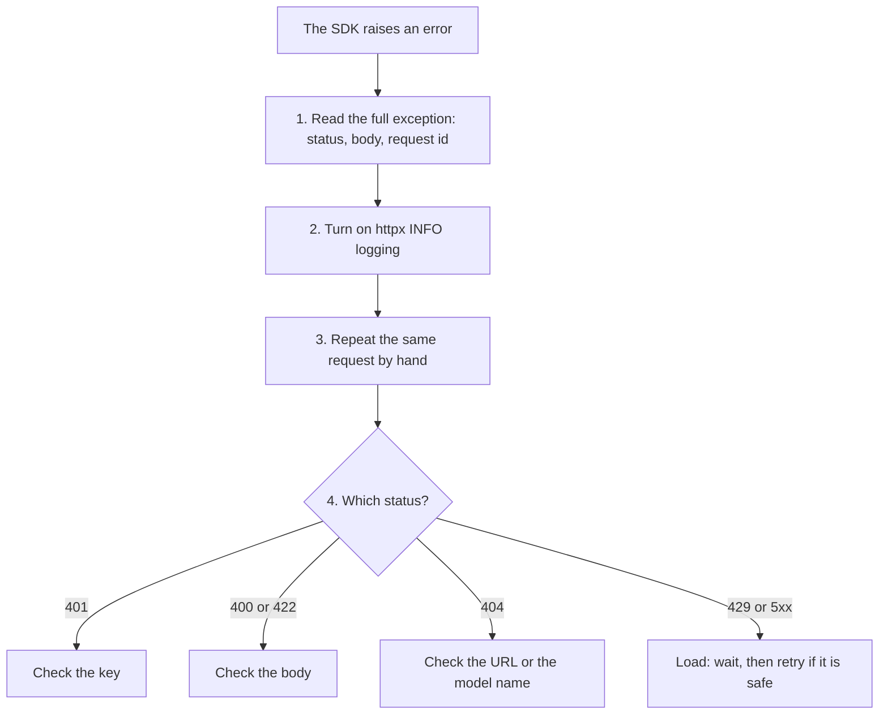

## 1. The question this idea answers

An SDK call fails with a short message, for example "connection error" or "bad request". Is the key wrong? The body? The URL? Is the server down, or did it answer with an error body that the SDK did not show?

You need a way to send the same request yourself and see everything that comes back. Two tools do this. **curl** sends requests from the command line and prints the raw exchange. **httpx** sends requests from Python. It gives the control you need in real code: timeouts, status checks, and a fake transport for tests that need no network.

## 2. Mental model

> [!analogy] A phone call on speaker
> An SDK is a friend who calls a company for you and later tells you "it did not work". curl is the same call on speaker: you hear every word. httpx is a phone that your own program dials, with a timer that hangs up if nobody answers. A mock transport is a recorded voice that answers in tests, so no real call happens.
>
> **Where it stops working:** a speaker call shows only one call. Production problems often come from many calls together: rate limits, pool limits, slow responses under load. For those you need logs and metrics (lesson 1.10), not one manual request.

## 3. Terms

| Term | Plain meaning |
|---|---|
| curl | A command-line HTTP client. It sends one request and prints the response. |
| verbose mode | curl's `-v` flag. It prints the request lines (`>`) and the response lines (`<`). |
| Postman, Bruno | Desktop apps that send HTTP requests from a form and save them in collections. |
| httpx | A Python HTTP client with a sync API (`httpx.Client`) and an async API (`httpx.AsyncClient`). |
| client object | One `httpx.Client` or `httpx.AsyncClient`. It keeps connections open and holds default settings. |
| connection pool | The set of open connections that a client object reuses. |
| timeout | The longest wait for one step of a request. httpx has connect, read, write and pool timeouts. |
| `raise_for_status()` | An httpx method that raises `HTTPStatusError` for every status that is not 2xx: 1xx, 3xx, 4xx and 5xx. |
| transport | The part of httpx that really sends bytes. You can replace it. |
| `MockTransport` | An httpx transport that calls your Python function instead of the network. |
| base URL | A URL prefix that a client object adds to every relative path. |

## 4. How it works

### 4.1 curl in six flags

| Flag | Meaning | Example |
|---|---|---|
| `-v` | Verbose: print the request and the response headers | `curl -v https://api.example.com/health` |
| `-i` | Include the response headers in the output | `curl -i .../notes/42` |
| `-X` | Set the method | `curl -X DELETE .../notes/42` |
| `-H` | Add a header | `curl -H "Authorization: Bearer $TOKEN" ...` |
| `-d` | Send a body (and use POST by default) | `curl -d 'title=x' ...` |
| `--json` | Send a JSON body, set `Content-Type` and `Accept` to JSON | `curl --json '{"title":"x"}' .../notes` |

The `$TOKEN` in the `-H` example is a shell variable. Keep keys in environment variables, not typed into commands that go to the shell history.

A sandbox run (curl 8.5.0) sent a JSON `POST` to a route that accepts only `GET`:

```text
HTTP/1.1 405 Method Not Allowed
date: Mon, 19 Oct 2026 18:18:49 GMT
server: uvicorn
allow: GET
content-length: 31
content-type: application/json

{"detail":"Method Not Allowed"}
```

The `allow: GET` header tells you exactly which method the route accepts. An SDK error message would often hide this header. With `-i` you see it at once.

### 4.2 httpx: the sync client

```python
import httpx

with httpx.Client(base_url="https://api.example.com", timeout=10.0) as client:   # 1
    r = client.get("/notes", params={"tag": "home"})                               # 2
    r.raise_for_status()                                                            # 3
    notes = r.json()                                                                # 4
```

1. The `with` block makes one client and closes its connections at the end. `base_url` is added to every path. `timeout` limits each wait.
2. `params=` encodes the query string for you (lesson 3.3).
3. `raise_for_status()` turns every status that is not 2xx into an exception, so a failure cannot pass as data. This includes a redirect (3xx), because httpx does not follow redirects unless you set `follow_redirects=True`.
4. `.json()` parses the body.

A sandbox run (httpx 0.28.1) showed `raise_for_status` on a 429:

```text
429 Too Many Requests Retry-After = 2
raise_for_status -> HTTPStatusError Client error '429 Too Many Requests' for url 'http://127.0.0.1:8771/limited'
```

The exception carries the response: `e.response.status_code` and `e.response.headers["Retry-After"]`. Your retry code (lesson 3.2) reads them.

A redirect also raises. A second run returned a 301 from a `MockTransport`:

```text
status 301 | follow_redirects default: False
raise_for_status -> Redirect response '301 Moved Permanently' for url 'https://api.example.com/v1/notes'
```

The httpx 0.28.1 source (`Response.raise_for_status`) returns only when `is_success` is true, that is for a 2xx status. Set `follow_redirects=True` on the client when an API may move a resource.

### 4.3 Timeouts

A request without a limit can wait forever. httpx sets a default. The sandbox printed it:

```text
default timeout of a new Client: Timeout(timeout=5.0)
```

So every step waits at most 5 seconds unless you change it. The httpx timeout page (checked on 2026-10-19, `pydantic.dev/docs/httpx2/advanced/timeouts/`) names four kinds:

| Timeout | It limits | Exception |
|---|---|---|
| connect | The time to open the connection | `ConnectTimeout` |
| read | The wait for the next chunk of the response | `ReadTimeout` |
| write | The wait to send the next chunk of the request | `WriteTimeout` |
| pool | The wait for a free connection from the pool | `PoolTimeout` |

All four are subclasses of `httpx.TimeoutException`. The sandbox run called a route that sleeps 2 s, with a 0.5 s timeout:

```text
httpx.ReadTimeout after 0.50s (subclass of TimeoutException: True)
```

> [!trap] A read timeout is not a total timeout
> The read timeout restarts after each chunk. A server that sends one byte every 4 seconds never trips a 5 s read timeout. For an upper limit on the whole call, wrap it in `asyncio.timeout()` in async code (lesson 2.6). For LLM calls that stream for a minute, set the read timeout above the longest gap between chunks, not above the whole answer.

### 4.4 httpx: the async client

`httpx.AsyncClient` has the same methods, but each one is a coroutine function, so you `await` it.

```python
async with httpx.AsyncClient(base_url="https://api.example.com", timeout=10.0) as client:
    r = await client.get("/notes/42")
```

While one request waits for the network, the event loop runs other work (lesson 2.6). Many requests can wait at the same time on one thread. Lesson 2.7 builds `fetch_all` with a semaphore and a timeout. Lesson 4.3 creates one shared `AsyncClient` for a whole FastAPI app.

### 4.5 MockTransport: tests with no network

Tests must not call real APIs. A real API costs money, changes, and fails for reasons that have nothing to do with your code. `httpx.MockTransport` takes a function from request to response. The sandbox run simulated an overloaded model provider:

```python
def handler(request: httpx.Request) -> httpx.Response:
    if request.url.path == "/v1/messages":
        return httpx.Response(529, json={"type": "error", "error": {"type": "overloaded_error"}})
    return httpx.Response(200, json={"ok": True})

with httpx.Client(transport=httpx.MockTransport(handler), base_url="https://api.example.test") as c:
    r = c.post("/v1/messages", json={"model": "x"})
```

```text
529 {'type': 'error', 'error': {'type': 'overloaded_error'}} | request URL was https://api.example.test/v1/messages
```

No network was used. The host `api.example.test` does not even exist. The handler can count calls, check headers, or sleep to imitate a slow server (for an async client, use an `async def` handler).

> [!trap] MockTransport does not enforce timeouts
> A sandbox run used an async `MockTransport` handler that slept 1.0 s with a client timeout of 0.3 s. The call returned 200 after 1.0 s, with no `ReadTimeout`. The timeouts live in the real network transport, which the mock replaces. To test your timeout handling, use a real local server that sleeps (lesson 4.4 does this), or wrap the call in `asyncio.timeout()`.

### 4.6 Reading the error that an SDK hides

When an SDK call fails, do these steps:

1. **Read the full exception.** Many SDK exceptions carry the status code, the response body and a request id. Print them all.
2. **Enable HTTP logging.** httpx writes one log line per request at the INFO level of the `httpx` logger. `logging.basicConfig(level=logging.INFO)` shows them.
3. **Repeat the call by hand.** Build the same request with curl or httpx: same URL, same headers (with the key from an environment variable), same body.
4. **Compare the status and the body.** A 401 points to the key. A 400 or 422 points to the body. A 404 points to the URL or the model name. A 429 or 5xx points to load.



> [!example] Worked example: a "bad request" from an SDK
> An SDK raises `BadRequestError` with no detail. A manual httpx call with the same body returns 400 with the body `{"error": {"message": "max_tokens: must be at most 8192"}}`. The cause is the request body, not the network and not the key. The fix is one number in the request.

### 4.7 Postman and Bruno

Postman and Bruno send requests from a form and save them as a collection. Bruno stores the collection as plain files in your repository, so the requests go into Git with the code. Use them for exploration and for sharing example calls with your team. Use curl and httpx for anything you want to repeat in a script or a test.

## 5. Code walkthrough

The timeout experiment of section 4.3:

```python
with httpx.Client(base_url="http://127.0.0.1:8771") as c:         # 1
    t0 = time.perf_counter()
    try:
        c.get("/slow", timeout=0.5)                                   # 2
    except httpx.ReadTimeout as e:                                    # 3
        print(f"httpx.ReadTimeout after {time.perf_counter() - t0:.2f}s")
```

| Line | What it does | Why |
|---|---|---|
| 1 | One client for all calls in the block | Reuses the connection |
| 2 | Overrides the timeout for this call only | `/slow` sleeps 2 s, so 0.5 s must trip |
| 3 | Catches the specific timeout | A connect timeout and a read timeout need different fixes, so catch the specific class when you can |

The server finished its 2-second sleep anyway. The client stopped waiting, but the server did not know. For a `POST`, this is the "did it happen?" problem of lesson 3.2.

## 6. Exercises

Runs in: your local practice project.

**Exercise 3.5.1: curl a public API.** Pick a public JSON API that needs no key. Send one `GET` with `curl -v` and one with `curl -i`. Then send a request for a path that does not exist.

Acceptance tests: you can name the status line, three response headers and the content type of each response. You can explain the error response of the missing path.

**Exercise 3.5.2: test a client function with MockTransport.** Write `fetch_note(client: httpx.Client, note_id: int) -> dict | None` that returns the note for 200, `None` for 404, and raises for any other status.

Acceptance tests (pytest, `MockTransport`, no network):

- 200 returns the dict.
- 404 returns `None`.
- 503 raises `httpx.HTTPStatusError`.
- The handler records the request, and the test asserts the path `/notes/{note_id}` and the `Accept: application/json` header.

Hints come in three levels in chat: idea, pseudocode, partial code.

## 7. Common mistakes

1. **No timeout, or a huge one.** A stuck upstream holds your request forever.
2. **Catching every exception as "network error".** A 401, a 422 and a timeout need different fixes. Catch specific classes.
3. **Forgetting `raise_for_status()`.** The error body is then treated as data.
4. **Real network calls in tests.** Tests become slow, costly and flaky. Use `MockTransport`.
5. **Expecting a mock to time out.** `MockTransport` skips the transport timeouts.
6. **Keys typed into curl commands.** They go into the shell history. Use an environment variable.
7. **A new client per call.** Each call repeats the connection setup (lesson 3.1).

## 8. One-minute explanation

When an SDK hides an error, send the request yourself. `curl -v` prints the raw request and response, `-i` shows response headers, `-X` sets the method, `-H` adds a header and `--json` sends JSON. In Python, `httpx.Client` and `httpx.AsyncClient` send requests with a base URL, encoded parameters and a timeout. The default timeout is 5 seconds, split into connect, read, write and pool. `raise_for_status()` turns every status that is not 2xx into an exception that carries the response. In tests, `httpx.MockTransport` answers from a Python function, so no network is used, but it also skips timeouts. Debug an SDK failure by printing the full exception, enabling HTTP logs, repeating the call by hand and reading the status and the body.

## 9. Check questions

```check
{
  "question": "A streaming LLM call takes 90 s in total and sends a chunk at least every 3 s. Your httpx client has timeout=5.0. Does the call fail? Why or why not?",
  "hint": "Which kind of timeout restarts after each chunk?",
  "answer": "It does not fail on the read timeout. The 5 s read timeout limits the wait for the next chunk, and each gap is at most 3 s. The total time of 90 s is not limited by the httpx timeout. Use asyncio.timeout() or a similar wrapper if you need a limit on the whole call."
}
```

```check
{
  "question": "Your test uses an async MockTransport handler that sleeps 2 s, and the client timeout is 0.5 s. The test expects httpx.ReadTimeout but gets a 200. Why?",
  "answer": "The httpx timeouts are enforced by the real network transport. MockTransport replaces that transport and calls your handler directly, so no timeout applies. Test the timeout with a real local server that sleeps, or wrap the call in asyncio.timeout()."
}
```

```check
{
  "question": "curl -i shows HTTP/1.1 405 Method Not Allowed with the header allow: GET. What did the client do wrong, and what does the header tell you?",
  "answer": "The client used a method that the route does not accept, for example POST on a read-only route. The allow header lists the methods that the route accepts, here only GET. Fix the method or the URL."
}
```

```check
{
  "question": "Name four steps to debug an SDK call that fails with a vague message, in order.",
  "answer": "1. Print the full exception: status code, response body, request id. 2. Enable HTTP logging (the httpx logger at INFO). 3. Repeat the same request by hand with curl or httpx: same URL, headers and body, key from an environment variable. 4. Read the status and the error body: 401 key, 400 or 422 body, 404 URL or model name, 429 or 5xx load."
}
```

## 10. Links

- Previous: [3.4 JSON and REST resource design](/notes/ai/ai-engineering/01-software-engineering-fundamentals/m03-http-rest-json/l4-json-and-rest-design)
- Next module: [M4 FastAPI services](/notes/ai/ai-engineering/01-software-engineering-fundamentals/m04-fastapi-services)
- Many requests at once: [2.7 Blocking calls, asyncio.to_thread and when to use async def](/notes/ai/ai-engineering/01-software-engineering-fundamentals/m02-concurrency-foundations/l7-blocking-calls-and-to-thread)
- Retries: [3.2 Methods, status codes, idempotency and safe retries](/notes/ai/ai-engineering/01-software-engineering-fundamentals/m03-http-rest-json/l2-methods-status-codes-and-retries)
- Test fixtures: [pytest fixtures and monkeypatch](/notes/software-engineering/python/03-tooling/l2-pytest-fixtures-and-monkeypatch)
- [Glossary](/notes/ai/ai-engineering/glossary)
- Measured: all outputs come from a sandbox run on 2026-10-19 with httpx 0.28.1, curl 8.5.0, FastAPI 0.149.0 and uvicorn 0.54.0.
- Note on versions (checked on 2026-10-19): httpx 0.28.1 is the stable httpx release. Pydantic now maintains a continuation named httpx2 (version 2.14.0, `import httpx2`), and Starlette 1.9.0 uses it for its test client (lesson 4.5). This course uses httpx 0.28.1 in examples.
