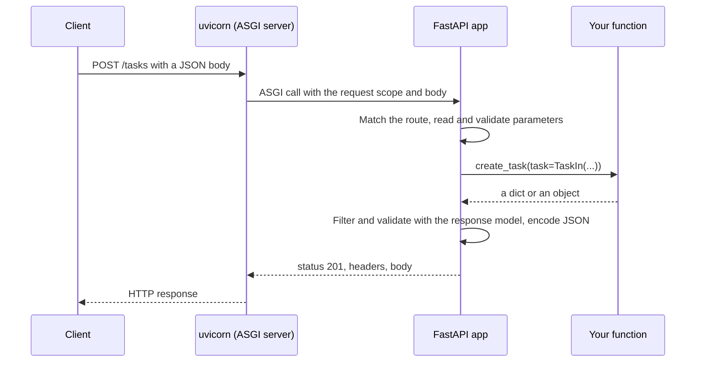

## 1. The question this idea answers

Module 3 showed requests and responses as text. Now you are the server. A request arrives as bytes: `POST /tasks` with a JSON body. Which Python function should run? How does the text `"5"` in the URL become the integer `5`? How do you make sure the response never contains a field that the client must not see?

FastAPI answers all three with one tool: Python type hints. You write a normal function with annotated parameters. FastAPI reads the annotations, finds each value in the request, converts it, validates it, and documents it. The same annotations later define LLM tool schemas (lesson 4.5), so this skill carries into every agent you build.

## 2. Mental model

> [!analogy] A restaurant with an order form
> The server program is a restaurant. Each **route** is one dish on the menu: "POST /tasks" or "GET /tasks/{id}". The **parameters** are the boxes on the order form: table number (path), "no onions" (query), the full order sheet (body). The waiter (FastAPI) checks that every box is filled in the right way before the kitchen (your function) starts. The **response model** is the plate layout. The kitchen may have extra things on the counter, but only the items in the layout go on the plate.
>
> **Where it stops working:** a waiter can ask the customer a question. FastAPI cannot. It rejects a wrong order at once with 422 and a list of the errors.

## 3. Terms

| Term | Plain meaning |
|---|---|
| web framework | A library that receives HTTP requests, calls your code, and sends HTTP responses. FastAPI is one. |
| ASGI | Asynchronous Server Gateway Interface. The Python standard for how a server program talks to an async web app. |
| uvicorn | An ASGI server. It owns the network socket and the event loop, and it calls your FastAPI app for each request. |
| app | The `FastAPI()` object. It holds every route and setting. |
| route | One method plus one path pattern, linked to one function. |
| path operation function | FastAPI's name for the function of a route. Also called an endpoint. |
| decorator | A line such as `@app.get("/tasks")` above a function. Here it registers the function as a route. |
| path parameter | A value taken from the path, for example `{task_id}` in `/tasks/{task_id}`. |
| query parameter | A value taken from the query string, for example `?limit=20`. |
| request body | The JSON that the client sends. FastAPI reads it into a Pydantic model. |
| Pydantic model | A class that describes the shape and the rules of data, and validates input against them (lesson 1.8). |
| response model | The Pydantic model that describes the response. FastAPI filters and validates the return value with it. |
| `Annotated` | A typing tool that attaches extra information (for example `Query(le=100)`) to a type hint. |
| validation | Checking that a value has the right type and follows the rules, before your code uses it. |

## 4. How it works

### 4.1 Who does what



uvicorn handles the network: sockets, HTTP parsing, the event loop. FastAPI handles routing, parameters, validation and JSON. Your function handles only the business logic. During development, `fastapi dev main.py` starts uvicorn with auto-reload. In production, `fastapi run main.py` starts it without reload (lesson 9.2). Both commands come with `fastapi[standard]`.

### 4.2 A route is a decorator on a function

```python
from fastapi import FastAPI

app = FastAPI()

@app.get("/health")
def health():
    return {"ok": True}
```

`@app.get("/health")` is a decorator. When Python runs the `def`, the decorator receives the function and stores it in the app's route table under `GET /health`. It returns the same function, so you can still call `health()` in a test. Lesson 2.1 explains that a function is a value you can pass around. Here the framework keeps it and calls it later.

The return value `{"ok": True}` becomes the JSON body `{"ok":true}` with status 200.

### 4.3 Where each parameter comes from

FastAPI decides the source of each parameter from the declaration:

| Declaration | Source | Example request |
|---|---|---|
| A name that appears in the path, for example `{task_id}` | The path | `GET /tasks/7` |
| A simple type (`int`, `str`, `bool`, ...) not in the path | The query string | `GET /tasks?limit=5` |
| A Pydantic model | The JSON body | `POST /tasks` with `{"title": "..."}` |
| `Header()`, `Cookie()` | A header or a cookie | lesson 3.3 |

A parameter with a default value is optional. A parameter without a default is required.

### 4.4 A small tasks API

This example ran in the sandbox with FastAPI 0.149.0 and the `TestClient` (lesson 4.5):

```python
from typing import Annotated
from fastapi import FastAPI, Path, Query
from pydantic import BaseModel, Field

app = FastAPI()

class TaskIn(BaseModel):
    title: str = Field(min_length=1, max_length=200)
    priority: int = Field(default=3, ge=1, le=5)

class TaskOut(BaseModel):
    id: int
    title: str
    priority: int

ROWS = {}

@app.post("/tasks", response_model=TaskOut, status_code=201)
def create_task(task: TaskIn):
    row = {"id": len(ROWS) + 1, **task.model_dump(), "internal_note": "do not show"}
    ROWS[row["id"]] = row
    return row

@app.get("/tasks/{task_id}", response_model=TaskOut)
def read_task(task_id: Annotated[int, Path(ge=1)]):
    return ROWS[task_id]

@app.get("/tasks", response_model=list[TaskOut])
def list_tasks(min_priority: Annotated[int, Query(ge=1, le=5)] = 1,
               limit: Annotated[int, Query(le=100)] = 20):
    rows = [r for r in ROWS.values() if r["priority"] >= min_priority]
    return rows[:limit]
```

The outputs:

```text
POST /tasks -> 201 {'id': 1, 'title': 'fix the oven', 'priority': 5}
POST /tasks (default priority) -> 201 {'id': 2, 'title': 'order flour', 'priority': 3}
GET /tasks/1 -> 200 {'id': 1, 'title': 'fix the oven', 'priority': 5}
GET /tasks?min_priority=4 -> 200 [{'id': 1, 'title': 'fix the oven', 'priority': 5}]
GET /tasks?limit=500 -> 422 Input should be less than or equal to 100
GET /tasks/0 -> 422 Input should be greater than or equal to 1
priority='high' -> 422 int_parsing | Input should be a valid integer, unable to parse string as an integer
priority='4' (a string) -> 201 {'id': 3, 'title': 'x', 'priority': 4}
```

Read four results closely:

1. **The response model removed a field.** The stored row has `internal_note`. The response does not, because `TaskOut` has no such field.
2. **The default applied.** The second task had no `priority`, so it got 3.
3. **The limits worked before your code ran.** `limit=500` and `task_id=0` failed with 422. Your function never saw them.
4. **Pydantic converted a string.** `"4"` became the integer `4`, because Pydantic's default (lax) mode converts compatible values. `"high"` cannot become an integer, so it failed.

> [!key] The response model is your contract
> Clients depend on the response shape. The response model fixes it, filters out internal fields, and documents it in OpenAPI. Return database rows or dicts freely inside your code, and let the response model decide what leaves the server.

### 4.5 Annotated: type plus rules

`Annotated[int, Query(le=100)]` says two things: the value is an `int`, and it is a query parameter with a maximum of 100. The FastAPI docs prefer `Annotated` because the plain default stays a plain default (`= 20`), and the same annotation can be reused in many routes.

Common rule arguments:

| Argument | Meaning | Works for |
|---|---|---|
| `ge`, `le`, `gt`, `lt` | Greater or equal, less or equal, greater than, less than | numbers |
| `min_length`, `max_length` | Length limits | strings, lists |
| `pattern` | A regular expression that the string must match | strings |
| `alias` | A different name in the request, for example `alias="item-query"` | query, header |

### 4.6 Status codes per route

`status_code=201` on the decorator sets the success status. Use the codes of lesson 3.4: 201 for create, 204 for delete with no body, 200 for the rest. Error codes come from exceptions (lesson 4.2).

> [!example] Worked example: trace one request
> The client sends `GET /tasks?min_priority=4&limit=abc`.
>
> 1. uvicorn parses the request line and passes it to the app.
> 2. FastAPI matches `GET /tasks` to `list_tasks`.
> 3. It reads `min_priority="4"` and converts it to `4`. The rule `ge=1, le=5` passes.
> 4. It reads `limit="abc"`. It cannot convert it to an `int`.
> 5. It returns 422 with an error that has `loc: ["query", "limit"]`. `list_tasks` never runs.

## 5. Code walkthrough

The create route, line by line:

```python
@app.post("/tasks", response_model=TaskOut, status_code=201)        # 1
def create_task(task: TaskIn):                                      # 2
    row = {"id": len(ROWS) + 1, **task.model_dump(), "internal_note": "do not show"}   # 3
    ROWS[row["id"]] = row                                            # 4
    return row                                                       # 5
```

| Line | What it does | Data in | Data out | Without it |
|---|---|---|---|---|
| 1 | Registers the route `POST /tasks`, with the response model and status 201 | the function | the same function, stored in the app | No route: 404 for every client. No `response_model`: `internal_note` leaks. No `status_code`: 200 instead of 201. |
| 2 | Declares one body parameter of type `TaskIn` | the JSON body | a validated `TaskIn` object | Your code must parse and check the JSON itself |
| 3 | Builds a row with a new id, the task fields and an internal field | `TaskIn` | a `dict` | |
| 4 | Stores the row in memory | the dict | | Data is lost at once. (A real service uses a database, module 6. This dict is lost at every restart.) |
| 5 | Returns the row | the dict with 4 keys | JSON with 3 keys | |

`len(ROWS) + 1` is a teaching shortcut. It gives a duplicate id after a delete, and two parallel requests can get the same id. A database creates ids safely (lesson 6.1).

## 6. Exercises

Runs in: your local practice project. Add FastAPI with `uv add "fastapi[standard]"` (lesson 1.9). The `standard` extra brings uvicorn and the `fastapi` command.

**Exercise 4.1.1: a bookmarks API.** Build `POST /bookmarks` (body: `url`, optional `tags`), `GET /bookmarks/{id}` and `GET /bookmarks?tag=&limit=`. Store bookmarks in a dict. The response model must not show a field `owner_secret` that you store with each bookmark.

Acceptance tests (pytest with `TestClient`):

- Create returns 201 and the bookmark with an id.
- `owner_secret` never appears in any response body.
- `limit=0` and `limit=101` return 422. `limit=100` returns 200.
- A request with `id=abc` returns 422 with `loc` equal to `["path", "id"]`.

**Exercise 4.1.2: run it for real.** Start the app with `fastapi dev` and call it with curl (lesson 3.5).

Acceptance test: `curl -i` shows `HTTP/1.1 201 Created` and `content-type: application/json` for a create.

Hints come in three levels in chat: idea, pseudocode, partial code.

## 7. Common mistakes

1. **No response model.** Internal fields (password hashes, notes, keys) leak to clients.
2. **Checking types by hand in the function.** Declare the types and rules. FastAPI checks them first.
3. **Reading `request.json()` instead of a model parameter.** You lose validation and documentation.
4. **Path parameters that are not in the path string.** If the name is not in `{...}`, FastAPI treats it as a query parameter.
5. **Expecting strict types.** Pydantic converts `"4"` to `4` in lax mode. Use strict types if you must reject that.
6. **Ids from `len()`.** They repeat after a delete and race under load. Use the database.

## 8. One-minute explanation

uvicorn is the ASGI server: it owns the socket and the event loop and calls the FastAPI app for each request. A route is a decorator such as `@app.post("/tasks")` that stores a function under a method and a path. FastAPI reads the function's type hints. A name in the path is a path parameter. A simple type is a query parameter. A Pydantic model is the JSON body. It converts and validates each value before your code runs, and answers 422 when a value is wrong. `Annotated[int, Query(le=100)]` adds rules to a type. The `response_model` is the contract of the response: it filters out fields that are not in the model, validates the output and documents it.

## 9. Check questions

```check
{
  "question": "A route is declared as def read(task_id: int, verbose: bool = False) with the path /tasks/{task_id}. Where does FastAPI look for each parameter, and which one is required?",
  "answer": "task_id appears in the path string, so it comes from the path, and it is required. verbose is a simple type that is not in the path, so it is a query parameter (?verbose=true). It has a default, so it is optional."
}
```

```check
{
  "question": "Your function returns a dict with the keys id, title and password_hash. The route has response_model=UserOut, and UserOut has id and title. What does the client receive, and why does this matter?",
  "answer": "The client receives only id and title. FastAPI filters the return value through the response model, so password_hash is removed. This protects internal fields even when the function returns a full database row."
}
```

```check
{
  "question": "A client sends GET /tasks?limit=500 to a route with limit: Annotated[int, Query(le=100)] = 20. Does your function run? What does the client get?",
  "answer": "The function does not run. FastAPI validates the parameter first, sees 500 > 100, and returns 422 with an error at loc [\"query\", \"limit\"] and the message Input should be less than or equal to 100."
}
```

```check
{
  "question": "What is the job of uvicorn, and what is the job of FastAPI, in one request?",
  "answer": "uvicorn is the ASGI server: it accepts the TCP connection, parses HTTP, runs the event loop and passes each request to the app. FastAPI matches the route, reads and validates the parameters, calls your function, applies the response model and encodes the JSON response."
}
```

## 10. Links

- Module: [M4 FastAPI services](/notes/ai/ai-engineering/01-software-engineering-fundamentals/m04-fastapi-services)
- Next: [4.2 Validation, status codes and error responses](/notes/ai/ai-engineering/01-software-engineering-fundamentals/m04-fastapi-services/l2-validation-and-error-responses)
- Pydantic models: [1.8 Type annotations, typed models and Pydantic](/notes/ai/ai-engineering/01-software-engineering-fundamentals/m01-python-foundations/l8-type-annotations-and-pydantic)
- Functions as values: [2.1 Functions as values and callbacks](/notes/ai/ai-engineering/01-software-engineering-fundamentals/m02-concurrency-foundations/l1-functions-as-values-and-callbacks)
- REST design: [3.4 JSON and REST resource design](/notes/ai/ai-engineering/01-software-engineering-fundamentals/m03-http-rest-json/l4-json-and-rest-design)
- [Glossary](/notes/ai/ai-engineering/glossary)
- Measured: the outputs come from a sandbox run on 2026-10-19 with FastAPI 0.149.0, Starlette 1.9.0 and Pydantic 2.14.1.
- Sources (checked on 2026-10-19): FastAPI tutorial, https://fastapi.tiangolo.com/tutorial/ (path parameters, query parameters, request body, response model).
