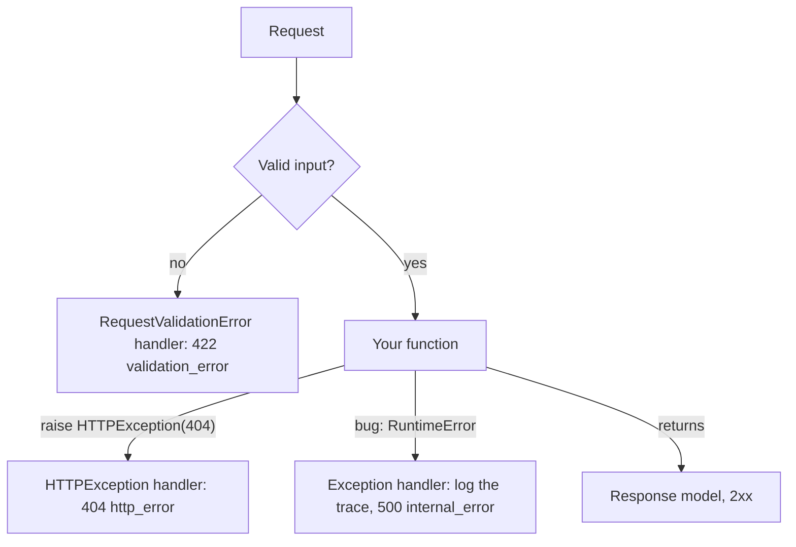

## 1. The question this idea answers

Things go wrong in four ways in a web service:

1. The client sends bad input: a missing field, a wrong type.
2. The client asks for something that does not exist.
3. A rule of your business fails: a limit is reached, a name is taken.
4. Your code crashes: a bug, a lost database connection.

For each case the client needs the right status code and an error body that it can read with code. For the fourth case, the client must **not** see your stack trace, which can hold file paths, SQL or even secrets. This lesson builds one error shape for all four cases in FastAPI.

## 2. Mental model

> [!analogy] A help desk with one form
> Every complaint at a good help desk ends on the same form. The form has a reason code from a fixed list and a short message in plain words. A customer never receives the internal incident report, which stays in the back office. Exception handlers are the clerk who fills the form, whatever went wrong.
>
> **Where it stops working:** a clerk can use judgment for a new kind of problem. An exception handler matches by exception class. A failure with a class that no handler covers falls to the most general handler. Register a catch-all handler, or that failure gets the framework's default body.

## 3. Terms

| Term | Plain meaning |
|---|---|
| exception | A Python object that a `raise` statement sends up the call stack (lesson 1.6). |
| `HTTPException` | A FastAPI exception that carries a status code and a `detail`. Raise it to return an HTTP error. |
| `RequestValidationError` | The exception that FastAPI raises when the request fails validation. Its default response is 422. |
| exception handler | A function that FastAPI calls for one exception class. It returns the response. |
| error shape | The one JSON layout of every error body (lesson 3.4). |
| stack trace | The list of function calls that led to an exception. Also called a traceback. |
| information leak | Internal details (paths, SQL, versions, secrets) that reach a client. |
| `JSONResponse` | A response class that encodes a Python value as a JSON body with a status code. |
| server-side log | A log record that stays on the server, for example in the container logs. |

## 4. How it works

### 4.1 FastAPI's default error bodies

A sandbox run (FastAPI 0.149.0, Pydantic 2.14.1) sent bad requests to an app with no custom handlers. A body with a missing `title`:

```text
422 {
 "detail": [
  {
   "type": "missing",
   "loc": [
    "body",
    "title"
   ],
   "msg": "Field required",
   "input": {
    "tags": [
     "a"
    ]
   }
  }
 ]
}
```

A path parameter that is not an integer, and a missing resource:

```text
422 {"detail": [{"type": "int_parsing", "loc": ["path", "item_id"], "msg": "Input should be a valid integer, unable to parse string as an integer", "input": "abc"}]}
404 {'detail': 'Item not found'}
```

| Field | Meaning |
|---|---|
| `type` | A machine code for the kind of failure, for example `missing` or `int_parsing` |
| `loc` | Where the bad value is: the source (`body`, `path`, `query`, `header`) and the field name |
| `msg` | A human message |
| `input` | The value that failed |

The FastAPI docs (checked on 2026-10-19) show older type names such as `type_error.integer`. Pydantic v2 uses `int_parsing`. The sandbox output is the current form.

Two shapes come back: a list of errors under `detail` for 422, and a string under `detail` for `HTTPException`. Clients must handle both. One custom shape is easier to use.

> [!trap] The `input` field echoes the client's data
> The default 422 body repeats what the client sent. For a password field or a token, the error body then contains the secret. In your own handler, decide what to repeat.

### 4.2 Raise HTTPException for expected errors

The docs say it plainly: "Because it's a Python exception, you don't `return` it, you `raise` it." When you raise it, FastAPI stops the function and sends the error.

```python
@app.get("/tasks/{task_id}", response_model=TaskOut)
def read_task(task_id: int, store: StoreDep):
    if task_id not in store.rows:
        raise HTTPException(status_code=404, detail=f"task {task_id} not found")
    return store.rows[task_id]
```

Raise it also from a helper function. The request ends at the `raise`, even deep inside other calls.

| Case | Status | Example `detail` |
|---|---|---|
| The resource does not exist | 404 | `task 99 not found` |
| A business rule blocks the action | 409 | `task limit reached` |
| The caller has no valid credentials | 401 | `missing or invalid token` |
| The caller may not do this | 403 | `not your task` |

### 4.3 Exception handlers make one shape

Register a handler for each exception class with `@app.exception_handler(...)`. The handler receives the request and the exception, and returns a response.

```python
from starlette.exceptions import HTTPException as StarletteHTTPException

def error_body(code: str, message: str) -> dict:
    return {"error": {"code": code, "message": message}}

@app.exception_handler(RequestValidationError)                     # 1
async def on_validation_error(request: Request, exc: RequestValidationError):
    first = exc.errors()[0]
    where = ".".join(str(p) for p in first["loc"])
    return JSONResponse(status_code=422, content=error_body("validation_error", f"{where}: {first['msg']}"))

@app.exception_handler(StarletteHTTPException)                     # 2
async def on_http_error(request: Request, exc: StarletteHTTPException):
    return JSONResponse(status_code=exc.status_code, content=error_body("http_error", str(exc.detail)))

@app.exception_handler(Exception)                                  # 3
async def on_unexpected(request: Request, exc: Exception):
    log.exception("unexpected error on %s", request.url.path)        # 4
    return JSONResponse(status_code=500, content=error_body("internal_error", "Something went wrong."))
```

1. Validation errors get the custom shape with the first error's location and message.
2. Every HTTP error gets the custom shape with its own status. The handler is registered for Starlette's `HTTPException` class (see the trap below).
3. Every other exception (a bug) gets a 500 with a fixed, safe message.
4. The full details go to the server-side log, with the stack trace.

FastAPI's `HTTPException` inherits from Starlette's. The FastAPI docs say: "when you register an exception handler, you should register it for Starlette's `HTTPException`." The reason: Starlette itself raises its own class, for example for an unknown path or a wrong method.

> [!trap] A handler for FastAPI's class misses 404 and 405 from routing
> A sandbox run registered the handler both ways and sent three requests:
>
> ```text
> handler for fastapi.HTTPException:
>   unknown path   -> 404 {'detail': 'Not Found'}
>   wrong method   -> 405 {'detail': 'Method Not Allowed'}
>   raised in route-> 404 {'error': {'code': 'http_error', 'message': 'custom not found'}}
> handler for starlette HTTPException:
>   unknown path   -> 404 {'error': {'code': 'http_error', 'message': 'Not Found'}}
>   wrong method   -> 405 {'error': {'code': 'http_error', 'message': 'Method Not Allowed'}}
>   raised in route-> 404 {'error': {'code': 'http_error', 'message': 'custom not found'}}
> ```
>
> With the FastAPI class, routing errors kept the default `detail` shape. With the Starlette class, all three errors got the custom shape. A handler matches by the class of the raised exception and its parent classes. A Starlette exception is not an instance of the FastAPI subclass.

### 4.4 The handlers in action

The same sandbox run, on a tasks API with the three handlers:

```text
422 {'error': {'code': 'validation_error', 'message': 'body.title: Field required'}}
201 {'id': 1, 'title': 'buy milk', 'tags': ['home']}
404 {'error': {'code': 'http_error', 'message': 'task 99 not found'}}
200 [{'id': 1, 'title': 'buy milk', 'tags': ['home']}]
500 {'error': {'code': 'internal_error', 'message': 'Something went wrong.'}} | 'Traceback' in body: False | 'hunter2' in body: False
```

The route `/boom` raised `RuntimeError("database password is hunter2 at /srv/app/db.py")`. The client got a safe message. The server log got the details:

```text
ERROR tasks-api unexpected error on /boom
Traceback (most recent call last):
  ...
RuntimeError: database password is hunter2 at /srv/app/db.py
```

The log shows the problem: the error message itself held a password. The handler kept it away from the client, but the log has it. Exception messages are part of your output. Never put secrets in them.



> [!example] Worked example: choose the status
> | Situation | Status and code |
> |---|---|
> | `POST /tasks` with `{"title": ""}` and a rule `min_length=1` | 422 `validation_error` |
> | `GET /tasks/99` and task 99 does not exist | 404 `http_error` (better: a specific code such as `task_not_found`) |
> | `POST /tasks` when the user already has the maximum number of tasks | 409 `http_error` (better: `task_limit_reached`) |
> | The database driver raises `OperationalError` | 500 `internal_error`, details only in the log |
>
> A real API gives each case its own stable code (lesson 3.4). A small `ApiError(status, code, message)` exception class with its own handler does that.

### 4.5 Where to log and what to log

| Put in the client response | Put in the server-side log |
|---|---|
| The status code | The full stack trace |
| A stable error code | The request method and path |
| A short safe message | The request id |
| A request id, so support can find the log line | The exception message (with secrets masked) |

`log.exception(...)` inside an `except` block or an exception handler writes the message and the current stack trace at level ERROR. Lesson 1.10 covers logging levels.

## 5. Code walkthrough

The catch-all handler is the security boundary. Read it slowly:

```python
@app.exception_handler(Exception)                                   # 1
async def on_unexpected(request: Request, exc: Exception):          # 2
    log.exception("unexpected error on %s", request.url.path)        # 3
    return JSONResponse(                                             # 4
        status_code=500,
        content=error_body("internal_error", "Something went wrong."),
    )
```

| Line | What it does | Why it exists | Without it |
|---|---|---|---|
| 1 | Registers the function for `Exception` and every subclass that has no closer handler | Catches every bug | The default 500 response, and in debug setups possibly a trace |
| 2 | Receives the request and the exception object | The handler needs the path for the log | |
| 3 | Logs the message and the stack trace on the server, with your logger name and the request path | You need the details to fix the bug, in your own log format | Under uvicorn the trace still reaches the server log (see the note below), but without your context |
| 4 | Returns a fixed, safe body | The client gets the same shape as for other errors, with no internals | |

The message `"Something went wrong."` is fixed text, not `str(exc)`. `str(exc)` would send the exception message, with its password, to the client.

> [!note] Starlette raises the exception again after your handler
> The catch-all handler runs inside Starlette's `ServerErrorMiddleware`. After it sends your response, that middleware raises the exception again. The Starlette 1.9.0 source says: "We always continue to raise the exception. This allows servers to log the error, or allows test clients to optionally raise the error within the test case." A sandbox run under uvicorn 0.54.0 logged `ERROR: Exception in ASGI application` with the full traceback, including the line `RuntimeError: secret detail`. Three results follow:
>
> 1. With `log.exception` in the handler, the trace appears twice in the log.
> 2. The exception message always reaches the server log. Never put a secret in an exception message.
> 3. A default `TestClient(app)` raises the exception inside the test. Use `TestClient(app, raise_server_exceptions=False)` to test the 500 response (lesson 4.5).

## 6. Exercises

Runs in: your local practice project.

**Exercise 4.2.1: the notes API with one error shape (from the roadmap, M0.3).** Build a `notes` API with `POST /notes`, `GET /notes/{id}` and `GET /notes?tag=`. Define one error model `{"error": {"code": str, "message": str}}` and register exception handlers so every failure uses it.

Acceptance tests (pytest with `TestClient`, lesson 4.5):

- (a) A missing field returns 422 in your error shape, not FastAPI's default shape.
- (b) An unknown id returns 404 in your shape.
- (c) A route that raises `RuntimeError` returns 500, and the body contains no file paths and no "Traceback". Use `TestClient(app, raise_server_exceptions=False)` for this test.
- (d) `/openapi.json` lists all three routes.

**Exercise 4.2.2: specific error codes.** Add an `ApiError` exception with `status`, `code` and `message`, and a handler for it. Use codes such as `note_not_found` and `note_limit_reached`.

Acceptance test: a test asserts the exact code for each error case, and no route raises a bare `HTTPException` any more.

Hints come in three levels in chat: idea, pseudocode, partial code.

## 7. Common mistakes

1. **`return HTTPException(...)`.** It is an exception. Raise it. A returned exception becomes a 200 response with a strange body.
2. **`str(exc)` in the response.** It leaks internal messages. Use a fixed message, and log the details.
3. **A handler for FastAPI's `HTTPException` only.** Unknown paths and wrong methods keep the default shape. Register Starlette's class.
4. **No catch-all handler.** Unexpected errors get the default body, a different shape from all other errors.
5. **Logging only the message.** Use `log.exception` to keep the stack trace.
6. **Secrets in exception messages.** They reach logs and sometimes clients.
7. **Two error shapes.** FastAPI's default `detail` shape plus your own shape forces clients to handle both.
8. **Status 200 with `{"error": ...}`.** Clients and proxies read the status first. Errors need error statuses.

## 8. One-minute explanation

FastAPI validates every input before your function runs. A bad input raises `RequestValidationError`, and the default response is 422 with a `detail` list of `type`, `loc`, `msg` and `input`. For expected errors such as a missing resource, raise `HTTPException` with a status: you raise it, you do not return it. Exception handlers, registered with `@app.exception_handler`, turn each exception class into a response. Register three: one for validation errors, one for HTTP errors and one catch-all for `Exception`. Give them all one error shape with a stable code and a safe message. The catch-all logs the full stack trace on the server and sends a fixed 500 message. So file paths, SQL and secrets never reach the client.

## 9. Check questions

```check
{
  "question": "A teammate writes: except Exception as e: return JSONResponse(status_code=500, content={'error': str(e)}). What is the risk, and what should the handler do instead?",
  "answer": "str(e) sends the internal exception message to the client. It can contain file paths, SQL, hostnames or secrets, for example a connection string with a password. Instead, log the full exception with log.exception on the server and return a fixed safe message with a stable code, for example {\"error\": {\"code\": \"internal_error\", \"message\": \"Something went wrong.\"}}."
}
```

```check
{
  "question": "Read this default error: {\"type\": \"missing\", \"loc\": [\"body\", \"title\"], \"msg\": \"Field required\"}. What did the client do wrong, and which status came back?",
  "answer": "The JSON body of the request had no title field, and title is required. The status is 422 (Unprocessable Content), because FastAPI read the body but the content broke the model's rules."
}
```

```check
{
  "question": "Why does the FastAPI documentation recommend registering your HTTP error handler for Starlette's HTTPException, not FastAPI's?",
  "answer": "FastAPI's HTTPException inherits from Starlette's. Starlette's routing raises its own HTTPException, for example 404 for an unknown path and 405 for a wrong method. A handler matches by the class of the raised exception and its parents, so a handler for the FastAPI subclass never sees those errors. In the sandbox run they kept the default detail shape. A handler for Starlette's class catches both kinds."
}
```

```check
{
  "question": "Name four things that belong in the server-side log of an unexpected error and two things that belong in the client response.",
  "answer": "Log: the stack trace, the method and path, the request id, and the exception message with secrets masked. Client response: the 500 status with a stable code such as internal_error and a short safe message. A request id in the response also helps support find the log line."
}
```

## 10. Links

- Previous: [4.1 Routes, parameters and response models](/notes/ai/ai-engineering/01-software-engineering-fundamentals/m04-fastapi-services/l1-routes-parameters-and-response-models)
- Next: [4.3 Dependencies, lifespan, settings and middleware](/notes/ai/ai-engineering/01-software-engineering-fundamentals/m04-fastapi-services/l3-dependencies-lifespan-config-and-middleware)
- Exceptions in Python: [1.6 Exceptions and context managers](/notes/ai/ai-engineering/01-software-engineering-fundamentals/m01-python-foundations/l6-exceptions-and-context-managers)
- Status codes: [3.2 Methods, status codes, idempotency and safe retries](/notes/ai/ai-engineering/01-software-engineering-fundamentals/m03-http-rest-json/l2-methods-status-codes-and-retries)
- One error shape: [3.4 JSON and REST resource design](/notes/ai/ai-engineering/01-software-engineering-fundamentals/m03-http-rest-json/l4-json-and-rest-design)
- [Glossary](/notes/ai/ai-engineering/glossary)
- Measured: the outputs come from a sandbox run on 2026-10-19 with FastAPI 0.149.0, Starlette 1.9.0 and Pydantic 2.14.1.
- Source (checked on 2026-10-19): FastAPI, Handling Errors, https://fastapi.tiangolo.com/tutorial/handling-errors/
