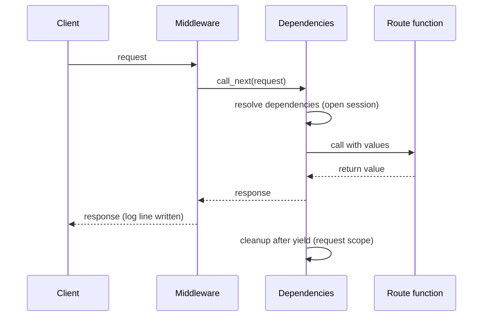

## 1. The question this idea answers

Real routes need more than request data. They need a database session, the settings, the current user, and an HTTP client for an upstream API such as a model provider. Four questions follow:

1. How does each route get these objects without copy-pasted setup code?
2. Which objects should live for one request, and which for the whole life of the server?
3. Where do configuration values come from, so that the same code runs on a laptop and in production?
4. How do you run code around **every** request, for example one log line with the duration?

FastAPI has one tool for each question: dependencies, lifespan, settings and middleware.

## 2. Mental model

> [!analogy] A hotel
> **Lifespan** is opening and closing the hotel: the kitchen, the laundry and the phone lines start once in the morning and stop once at night. **Dependencies** are room service: each guest (request) asks for what it needs, and staff bring it, then clean the room after the guest leaves. **Settings** are the house rules printed on a card, different in each branch of the chain, but read the same way. **Middleware** is the front desk: every guest passes it when they arrive and when they leave.
>
> **Where it stops working:** hotel staff can serve guests one by one. A server handles many requests at the same time. A shared object from lifespan must be safe for many requests at once. An `httpx.AsyncClient` is designed for that. A plain Python list that requests change is not.

## 3. Terms

| Term | Plain meaning |
|---|---|
| dependency | A function that FastAPI calls to give a route a value, for example a session or the current user. |
| dependency injection | A design where code receives the objects it needs from outside, instead of creating them itself. |
| `Depends` | The FastAPI marker that says "call this function and pass its result here". |
| yield dependency | A dependency with `yield`. The code before `yield` sets the value. The code after `yield` cleans it. |
| sub-dependency | A dependency that itself has dependencies. FastAPI resolves the whole tree. |
| dependency override | Replacing a dependency in tests with `app.dependency_overrides[original] = fake`. |
| lifespan | Code that runs once when the app starts and once when it stops. |
| async context manager | An object used with `async with`. Here, a function with one `yield` and `@asynccontextmanager`. |
| shared client | One long-lived client object, for example `httpx.AsyncClient`, used by all requests. |
| settings | The configuration values of the app: limits, URLs, flags, keys. |
| pydantic-settings | A library that reads settings from environment variables into a typed Pydantic model. |
| middleware | A function that runs around every request: before the route and after it. |

## 4. How it works

### 4.1 A dependency is a function that FastAPI calls for you

```python
from typing import Annotated
from fastapi import Depends

def get_store() -> Store:
    return STATE["store"]

StoreDep = Annotated[Store, Depends(get_store)]

@app.get("/tasks/{task_id}")
def read_task(task_id: int, store: StoreDep):
    ...
```

For each request to `read_task`, FastAPI calls `get_store()` and passes the result as `store`. The route does not know where the store comes from. That is the point: the route depends on an interface, and the app decides what to give it.

`StoreDep = Annotated[Store, Depends(get_store)]` is a type alias. You write it once and use it in every route. The FastAPI docs prefer this `Annotated` form.

Dependencies can be `def` or `async def`. The FastAPI docs (checked on 2026-10-19): "If a dependency is a standard `def` function instead of `async def`, it is run in the external threadpool." Lesson 4.4 explains that thread pool.

### 4.2 Yield dependencies: set a value, then clean it

A database session must close after the request, even when the route fails. A yield dependency does both:

```python
def get_session():
    s = Session()
    try:
        yield s                 # the route runs while the dependency is paused here
    except Exception:
        # roll back here
        raise
    finally:
        s.close()
```

This is a generator function (lesson 2.5): FastAPI calls `next()` to get the value, and later resumes it to run the cleanup. A sandbox run (FastAPI 0.149.0) recorded the order of events, with a middleware around the request:

```text
/ok -> 200
    middleware: before
    dependency: open session
    route: runs, session open=True
    middleware: after call_next
    dependency: close session
/fail -> 404
    middleware: before
    dependency: open session
    route: raises HTTPException(404)
    dependency: saw HTTPException, roll back
    dependency: close session
    middleware: after call_next
```

Two results:

1. **On success, the cleanup ran after the response.** The middleware saw the response before the dependency closed the session. FastAPI 0.149.0 has a `scope` argument on `Depends`. Its docstring says: `"function"` ends the dependency "after the path operation function ends, but before the response is sent". `"request"` ends it "after the response is sent back to the client". The run shows the request-scope order for the default.
2. **On an error, the dependency saw the exception.** The `except` block ran, so a rollback is possible. Then the exception went on to the error handler (lesson 4.2).

> [!trap] Do not use a session after the route returns
> With request scope, the session closes after the response is sent. For a streaming response (lesson 5.2), the stream runs after the route function returns. Check which scope you need when a dependency's value is used inside a stream.

### 4.3 Overrides: swap a dependency in tests

Because routes receive their objects from dependencies, a test can replace one:

```python
app.dependency_overrides[get_settings] = lambda: Settings(max_tasks=1)
r = c.post("/tasks", json={"title": "second"})
app.dependency_overrides.clear()
```

```text
with max_tasks=1 -> 409 {'error': {'code': 'http_error', 'message': 'task limit reached'}}
```

The route code did not change. Only the dependency did.

Pass the test value as an argument, as above. In pydantic-settings, an argument wins over an environment variable, but a class default does not. A sandbox run with `TASKS_MAX_TASKS=5` in the environment:

```text
Tiny().max_tasks with TASKS_MAX_TASKS=5 -> 5
Settings(max_tasks=1).max_tasks with TASKS_MAX_TASKS=5 -> 1
```

Here `Tiny` is a subclass of `Settings` with the default `max_tasks: int = 1`. The environment variable replaced that default, so the test would test the wrong limit. The same trick swaps a real model client for a fake one in tests (lesson 4.5).

### 4.4 Lifespan: create shared objects once

Some objects are expensive to create and safe to share: an HTTP client with a connection pool, a database connection pool, a loaded model. Create them once at startup, not in every request.

```python
from contextlib import asynccontextmanager
import httpx

@asynccontextmanager
async def lifespan(app: FastAPI):
    app.state.http = httpx.AsyncClient(                 # before yield: startup
        base_url="https://weather.example", timeout=5.0
    )
    yield                                               # the app serves requests here
    await app.state.http.aclose()                       # after yield: shutdown

app = FastAPI(lifespan=lifespan)
```

`app.state` is the place for app-wide objects. The dependency of section 5 reads the client from there. `base_url` lets routes call a relative path such as `/v1/now`. Without it, httpx refuses a relative URL. A sandbox run sent `/v1/now` with a client that had no `base_url`:

```text
real transport, relative URL -> UnsupportedProtocol: Request URL is missing an 'http://' or 'https://' protocol.
```

The FastAPI docs (checked on 2026-10-19): the code before `yield` runs "once, before the application starts receiving requests", and the code after `yield` runs "once, after having handled possibly many requests". The docs also warn that if you give a `lifespan`, the old `startup` and `shutdown` event handlers "will no longer be called". Lifespan runs only for the main app, not for mounted sub-applications.

The sandbox log showed both ends:

```text
INFO tasks-api startup: create the shared store and HTTP client
...
INFO tasks-api shutdown: closed the shared HTTP client
```

> [!key] One shared AsyncClient for the whole app
> A new `httpx.AsyncClient` per request repeats DNS, TCP and TLS for every call (lesson 3.1) and leaks connections if you forget to close it. One client from lifespan keeps a connection pool for all requests. Give routes access to it with a dependency, for example one that returns `request.app.state.http`.

### 4.5 Settings from environment variables

The same code runs on your laptop, in CI and in production. Only the configuration changes. Keep configuration in environment variables (lesson 1.7) and read it into a typed model with pydantic-settings:

```python
from pydantic_settings import BaseSettings, SettingsConfigDict

class Settings(BaseSettings):
    model_config = SettingsConfigDict(env_prefix="TASKS_")
    app_name: str = "tasks-api"
    max_tasks: int = 100
```

The sandbox run (pydantic-settings 2.16.0) set environment variables and built the model:

```text
TASKS_MAX_TASKS=5     ->  app_name='tasks-api' max_tasks=5
TASKS_MAX_TASKS=five  ->  ValidationError 1 validation error for Settings | max_tasks
```

The value `"5"` became the integer 5. The value `"five"` failed at startup with a clear error. A bad configuration should stop the app at once, not fail at the first request an hour later. Lesson 9.3 uses this to make a container fail fast when `DATABASE_URL` is missing.

### 4.6 Middleware: code around every request

Middleware wraps every request. The common first use is one log line per request:

```python
@app.middleware("http")
async def log_requests(request: Request, call_next):
    t0 = time.perf_counter()
    response = await call_next(request)            # the rest of the app runs here
    ms = (time.perf_counter() - t0) * 1000
    log.info("%s %s %s %.1fms", request.method, request.url.path, response.status_code, ms)
    return response
```

The sandbox log:

```text
INFO tasks-api POST /tasks 422 6.8ms
INFO tasks-api POST /tasks 201 3.3ms
INFO tasks-api GET /tasks/99 404 1.6ms
INFO tasks-api GET /tasks 200 2.2ms
```

One line per request with the method, the path, the status and the duration is a done-when item of the capstone (module 10).

> [!trap] A request that crashes skips the code after call_next
> The catch-all `Exception` handler of lesson 4.2 runs in Starlette's `ServerErrorMiddleware`. That middleware is outside your own middleware. So for a route that raises, `await call_next(request)` raises too, and the lines after it never run. A sandbox run (FastAPI 0.149.0) called `/ok` and a route `/boom` that raises `RuntimeError`:
>
> ```text
> INFO tasks-api GET /ok 200 1.7ms id=d2faa69e
> /ok -> 200 x-request-id=d2faa69e
> /boom -> 500 x-request-id=None
> ```
>
> The crashing request got no log line and no request id: exactly the request that you most need to find.

The fix catches the exception in the middleware, writes the log line, and raises it again, so the 500 handler still runs. The middleware also stores the id on `request.state`, so the 500 handler can add it to its response:

```python
import logging, time, uuid
from fastapi import Request
from fastapi.responses import JSONResponse

log = logging.getLogger("tasks-api")

@app.middleware("http")
async def log_requests(request: Request, call_next):
    t0 = time.perf_counter()
    rid = uuid.uuid4().hex[:8]
    request.state.request_id = rid                 # the 500 handler reads it
    try:
        response = await call_next(request)
    except Exception:
        ms = (time.perf_counter() - t0) * 1000
        log.info("%s %s 500 %.1fms id=%s", request.method, request.url.path, ms, rid)
        raise                                      # the catch-all handler still answers
    ms = (time.perf_counter() - t0) * 1000
    log.info("%s %s %s %.1fms id=%s", request.method, request.url.path, response.status_code, ms, rid)
    response.headers["X-Request-Id"] = rid
    return response

@app.exception_handler(Exception)
async def unhandled(request: Request, exc: Exception):
    rid = getattr(request.state, "request_id", None)
    return JSONResponse(
        status_code=500,
        content={"error": {"code": "internal_error", "message": "Internal server error"}},
        headers={"X-Request-Id": rid} if rid else None,
    )
```

The same run with the fixed middleware:

```text
INFO tasks-api GET /ok 200 1.0ms id=4a4a0651
/ok -> 200 x-request-id=4a4a0651
INFO tasks-api GET /boom 500 0.9ms id=4d3a6e99
/boom -> 500 x-request-id=4d3a6e99
```

Now every request has one line, and the id in the 500 response matches the id in the log.



> [!trap] Middleware sees the whole stream as one response
> `call_next` returns when the response starts, not when a streaming body ends. A sandbox run streamed three chunks, 0.4 s apart, through this middleware:
>
> ```text
> middleware: call_next returned after 0.00s
> client: full body after 1.21s
> ```
>
> So for a stream (lesson 5.2), the logged duration is only the time until the response starts.

### 4.7 Which tool for which need

| Need | Tool | Lifetime |
|---|---|---|
| A DB session for one request | yield dependency | one request |
| The current user from a token | dependency (with sub-dependencies) | one request |
| An HTTP client, a DB pool, a loaded model | lifespan, exposed by a dependency | the whole server |
| Limits, URLs, flags, keys | settings model from environment variables, through a dependency | the whole server |
| A log line, a request id, timing | middleware with `try` around `call_next` | every request, also one that crashes |
| A fake for tests | `app.dependency_overrides` | one test |

## 5. Code walkthrough

A dependency that gives routes the shared client, from lesson 4.4's sandbox app:

```python
def get_http(request: Request) -> httpx.AsyncClient:              # 1
    return request.app.state.http                                  # 2

@app.get("/weather")
async def weather(city: str, http: Annotated[httpx.AsyncClient, Depends(get_http)]):   # 3
    r = await http.get("/v1/now", params={"city": city})          # 4
```

| Line | What it does | Why |
|---|---|---|
| 1 | A dependency that asks FastAPI for the `Request` | FastAPI passes the request to any parameter of type `Request` |
| 2 | Returns the client that lifespan stored on `app.state` | `app.state` is a place for app-wide objects. The client has a `base_url`, so line 4 can use a relative path. |
| 3 | The route declares that it needs the client | The route does not know how the client was made, so a test can override `get_http` |
| 4 | Uses the shared client | The connection pool is reused across requests |

## 6. Exercises

Runs in: your local practice project.

**Exercise 4.3.1: settings and a limit.** Add a `Settings` model with `env_prefix` to your notes API from 4.2. Add a setting `max_notes`. `POST /notes` returns 409 with your error shape when the limit is reached.

Acceptance tests:

- With the environment variable set to 2, the third create returns 409.
- A test overrides the settings dependency with `max_notes=0`, and the first create returns 409.
- Starting the app with the variable set to `"two"` fails at startup with a validation error.

**Exercise 4.3.2: one log line per request.** Add a middleware that logs the method, the path, the status and the duration in milliseconds, and adds a response header `X-Request-Id` with a new random id.

Acceptance tests: each request gives exactly one log line (use pytest's `caplog` fixture), also a request to a route that raises (use `TestClient(app, raise_server_exceptions=False)`). Two requests get two different ids. The id in the header matches the id in the log line, also in the 500 response.

**Exercise 4.3.3: a yield dependency.** Write a dependency that yields a fake session object and records "closed" in its `finally`.

Acceptance test: after a request that succeeds and a request that raises, both sessions are closed.

Hints come in three levels in chat: idea, pseudocode, partial code.

## 7. Common mistakes

1. **A new HTTP client in every request.** Slow, and it leaks connections. Create one in lifespan.
2. **Shared mutable state without care.** Many requests run at the same time. A shared dict that requests change can lose updates.
3. **Settings read with `os.environ[...]` all over the code.** Read them once into a typed model, and validate at startup.
4. **Secrets as defaults in the settings class.** A default key in code ends in Git. Give secrets no default, so a missing secret fails at startup.
5. **Cleanup outside `finally`.** On an error, the cleanup does not run.
6. **Forgetting to clear `dependency_overrides`.** The override leaks into the next test.
7. **Middleware that reads the full request body.** It can break streaming and double the memory. Keep middleware small.

## 8. One-minute explanation

A dependency is a function that FastAPI calls to give a route what it needs. You declare it with `Annotated[Type, Depends(func)]`, and tests swap it with `app.dependency_overrides`. A yield dependency sets a value before `yield` and cleans it after. It sees exceptions, and by default it closes after the response is sent. Lifespan is an async context manager that runs once at startup and once at shutdown. Create shared, expensive objects there, such as one `httpx.AsyncClient` with its connection pool. Settings come from environment variables through a typed pydantic-settings model, so a bad value fails at startup. Middleware runs around every request and is the place for one log line with the method, path, status and duration. A request that crashes skips the code after `call_next`, so wrap that call in `try`.

## 9. Check questions

```check
{
  "question": "Why should an httpx.AsyncClient for an upstream API be created in lifespan and not inside each request?",
  "answer": "One client keeps a connection pool. Requests reuse open connections, so DNS, TCP and TLS happen once instead of per request. A client per request is slower, and if a code path forgets aclose(), connections leak. The lifespan code after yield closes the shared client once at shutdown."
}
```

```check
{
  "question": "In the sandbox run, the yield dependency wrote 'close session' after the middleware wrote 'after call_next' for a successful request. What does this order tell you?",
  "answer": "With the default (request) scope, the code after yield runs after the response is sent back to the client. The middleware already had the response when the session closed. FastAPI's Depends has scope=\"function\" for cleanup before the response is sent."
}
```

```check
{
  "question": "A test sets app.dependency_overrides[get_settings] = lambda: Settings(max_notes=0) and never clears it. What can go wrong?",
  "answer": "The override stays on the app object for the rest of the test session. Later tests that expect the normal limit then get 409 errors, and the failure looks unrelated to the test that caused it. Clear the overrides after each test, for example in a fixture's teardown."
}
```

```check
{
  "question": "Your settings class has max_tasks: int = 100 and the environment has TASKS_MAX_TASKS=five. When does the error appear, and why is that good?",
  "answer": "When the Settings object is created, which should be at startup. pydantic-settings converts and validates the value and raises a ValidationError because five is not an integer. A fast failure at startup shows the configuration error at once, instead of a strange failure at the first request that uses the setting."
}
```

## 10. Links

- Previous: [4.2 Validation, status codes and error responses](/notes/ai/ai-engineering/01-software-engineering-fundamentals/m04-fastapi-services/l2-validation-and-error-responses)
- Next: [4.4 def vs async def endpoints and calling other services](/notes/ai/ai-engineering/01-software-engineering-fundamentals/m04-fastapi-services/l4-def-vs-async-def-endpoints)
- Generators behind yield dependencies: [2.5 Generators, yield, close() and GeneratorExit](/notes/ai/ai-engineering/01-software-engineering-fundamentals/m02-concurrency-foundations/l5-generators-and-yield)
- Context managers: [1.6 Exceptions and context managers](/notes/ai/ai-engineering/01-software-engineering-fundamentals/m01-python-foundations/l6-exceptions-and-context-managers)
- Connection pools for PostgreSQL: [6.4 Connecting Python and FastAPI to PostgreSQL](/notes/ai/ai-engineering/01-software-engineering-fundamentals/m06-postgresql/l4-connecting-python-to-postgres)
- [Glossary](/notes/ai/ai-engineering/glossary)
- Measured: the outputs come from a sandbox run on 2026-10-19 with FastAPI 0.149.0, Starlette 1.9.0 and pydantic-settings 2.16.0.
- Sources (checked on 2026-10-19): FastAPI, Lifespan Events, https://fastapi.tiangolo.com/advanced/events/. FastAPI, Concurrency and async / await, https://fastapi.tiangolo.com/async/. The `scope` text comes from the docstring of `fastapi.Depends` in FastAPI 0.149.0.
