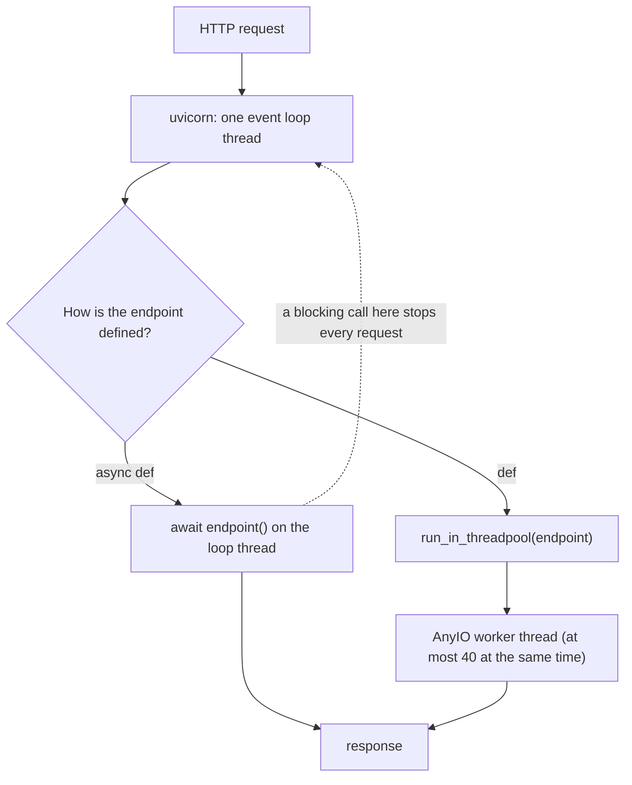

## 1. The question this idea answers

You write an endpoint. Should it start with `def` or with `async def`? The two words look like a style choice. They are not. They decide **where** your code runs: on the one event loop thread that serves every request, or in a worker thread.

The wrong choice gives one of the most common performance bugs in AI services: a single slow call freezes the whole server. A model call takes seconds. If it blocks the event loop, every other user waits too.

This lesson measures both kinds of endpoint under load and gives the rule for choosing. Then it shows how to call an upstream API, for example a model provider, safely from an async endpoint.

## 2. Mental model

> [!analogy] One waiter and a team of helpers
> The event loop is one fast waiter who serves every table. The waiter never waits: when a kitchen order takes time, the waiter serves other tables and comes back when the food is ready. That is `async def` with `await`. A `def` endpoint is a job that FastAPI gives to one of 40 helpers. A helper can stand and wait, and the waiter keeps working. The disaster is the waiter standing still at one table: a blocking call inside `async def`. Every other table waits.
>
> **Where it stops working:** a real restaurant hires more helpers when it is busy. FastAPI's helper pool has a fixed size of 40 by default. The 41st blocking job waits for a free helper.

## 3. Terms

| Term | Plain meaning |
|---|---|
| event loop | The loop in one thread that runs all coroutines of the server and switches between them at each `await` (lesson 2.6). |
| blocking call | A call that holds its thread until it finishes, for example `time.sleep(1)` or a sync database query. |
| non-blocking call | A call that gives the thread back while it waits, for example `await asyncio.sleep(1)`. |
| thread pool | A fixed set of worker threads that run sync functions (lesson 2.3). |
| AnyIO | The async library under Starlette and FastAPI. It owns the thread pool for `def` endpoints. |
| capacity limiter | AnyIO's counter that limits how many sync functions run in worker threads at once. The default is 40. |
| `run_in_threadpool` | The Starlette function that FastAPI uses to run a `def` endpoint in a worker thread. |
| upstream service | Another service that your endpoint calls, for example a model provider or a weather API. |
| 502 Bad Gateway | The status your service returns when the upstream answered with an error or an invalid response. |
| 504 Gateway Timeout | The status your service returns when the upstream did not answer in time. |

## 4. How it works

### 4.1 Where each kind of endpoint runs

The FastAPI docs (checked on 2026-10-19) say: "When you declare a *path operation function* with normal `def` instead of `async def`, it is run in an external threadpool that is then awaited, instead of being called directly (as it would block the server)."

| You write | FastAPI does | Your code runs on |
|---|---|---|
| `async def endpoint(): ...` | `await endpoint()` | The event loop thread |
| `def endpoint(): ...` | `await run_in_threadpool(endpoint)` | An AnyIO worker thread |

The traceback in lesson 4.2 shows the second path in FastAPI 0.149.0: `run_endpoint_function` → `run_in_threadpool` → `anyio.to_thread.run_sync`.



### 4.2 Four endpoints, five parallel requests

A sandbox run started a real uvicorn server (FastAPI 0.149.0, uvicorn 0.54.0, 2 CPUs). Each endpoint waits 1 second in a different way. A client sent 5 requests at the same time to each one, plus one request to a fast `/health` endpoint 0.1 s later.

```python
@app.get("/def-sleep")
def def_sleep():
    time.sleep(1.0)

@app.get("/async-blocking")
async def async_blocking():
    time.sleep(1.0)                          # blocking call inside async def

@app.get("/async-await")
async def async_await():
    await asyncio.sleep(1.0)

@app.get("/async-to-thread")
async def async_to_thread():
    await asyncio.to_thread(time.sleep, 1.0)
```

```text
/def-sleep         5 requests: 1.04s | /health waited 0.01s | threads: ['AnyIO worker thread']
/async-blocking    5 requests: 5.02s | /health waited 4.92s | threads: ['Thread-1 (run)']
/async-await       5 requests: 1.01s | /health waited 0.01s | threads: ['Thread-1 (run)']
/async-to-thread   5 requests: 1.02s | /health waited 0.01s | threads: ['Thread-1 (run)']
```

(`Thread-1 (run)` is the thread where the test started uvicorn. In a normal deployment the event loop runs in `MainThread`.)

| Endpoint | Total for 5 | `/health` waited | Why |
|---|---|---|---|
| `def` + `time.sleep` | 1.04 s | 0.01 s | 5 worker threads slept at the same time. The loop stayed free. |
| `async def` + `time.sleep` | 5.02 s | 4.92 s | The loop thread slept. Requests ran one after another, and `/health` waited behind them. |
| `async def` + `await asyncio.sleep` | 1.01 s | 0.01 s | Each request gave the loop back while it waited |
| `async def` + `await asyncio.to_thread` | 1.02 s | 0.01 s | The blocking call moved to a thread (lesson 2.7) |

> [!key] The bad mix is a blocking call inside async def
> `async def` promises "I give the loop back at every wait". A blocking call breaks the promise. The `/health` endpoint has nothing to do with the slow route, and it still waited 4.92 s. In production this looks like random latency across the whole service.

### 4.3 The pool has 40 threads

AnyIO creates the default limiter with `CapacityLimiter(40)` (source of AnyIO 4.15.1, `_backends/_asyncio.py`). The sandbox printed `default thread limiter tokens: 40`. A second run sent N parallel requests to the `def` endpoint that sleeps 1 s:

```text
 40 parallel requests to a def endpoint that sleeps 1 s: 1.19s
 41 parallel requests to a def endpoint that sleeps 1 s: 2.04s
 80 parallel requests to a def endpoint that sleeps 1 s: 2.22s
 81 parallel requests to a def endpoint that sleeps 1 s: 3.09s
```

40 requests took one round. The 41st waited for a free thread, so it needed a second round. 81 needed three rounds.

$$
\text{rounds} = \left\lceil \frac{N}{40} \right\rceil
$$

> [!example] Worked example: size the wait
> A `def` endpoint calls a sync model SDK that takes 3 s. 100 users send a request at the same moment.
>
> 1. Rounds: ceil(100 / 40) = 3.
> 2. The last users wait about 3 × 3 = 9 s, although each call takes 3 s.
> 3. With an async SDK in an `async def` endpoint, the waits overlap on the loop. All 100 finish after about 3 s, if the upstream accepts 100 parallel calls.
>
> The pool is shared: dependencies written with `def` and sync generators in streaming responses (lesson 5.2) use the same 40 threads.

### 4.4 The rule

The FastAPI docs give the rule (checked on 2026-10-19):

- If a library tells you to call it with `await`, declare the endpoint with `async def`.
- If a library "communicates with something (a database, an API, the file system, etc.) and doesn't have support for using `await`", declare the endpoint with plain `def`.
- If your code does not wait for anything else, use `async def`.
- "If you just don't know, use normal `def`."

| The endpoint body | Write | Why |
|---|---|---|
| Only `await` calls of async libraries (`httpx.AsyncClient`, an async DB driver) | `async def` | No thread needed. Thousands of waits share one loop. |
| Calls to a sync library (a sync DB driver, `requests`, a sync SDK) | `def` | FastAPI moves it to a worker thread |
| Mostly async, with one sync call | `async def` + `await asyncio.to_thread(sync_call)` | Only the sync part uses a thread |
| Pure computation for a few microseconds | `async def` | A thread hop would cost more than the work |
| Heavy CPU work (seconds) | Neither. Use a process pool or a job queue. | The GIL stops threads from running Python code in parallel in the default build (lesson 2.3) |

### 4.5 Calling an upstream service from an async endpoint

Calls to a model provider or another API are slow I/O, so they belong in `async def` with an async client. Use the shared client from lifespan (lesson 4.3), set a timeout, and turn upstream failures into your own status codes:

```python
@app.get("/weather")
async def weather(city: str, http: Annotated[httpx.AsyncClient, Depends(get_http)]):
    try:
        r = await http.get("/v1/now", params={"city": city})
        r.raise_for_status()
    except httpx.TimeoutException:
        raise HTTPException(status_code=504, detail="weather service timed out")
    except httpx.RequestError:
        raise HTTPException(status_code=502, detail="weather service unreachable")
    except httpx.HTTPStatusError as e:
        raise HTTPException(status_code=502, detail=f"weather service returned {e.response.status_code}")
    return r.json()
```

A sandbox run used a real local upstream server that answers normally, sleeps 1.0 s, or returns 500. The shared client had a 0.3 s timeout. For the last call, the run stopped the upstream server first:

```text
city=Toronto  -> 200 {'city': 'Toronto', 'temp_c': 21} (0.01s)
city=slow     -> 504 {'detail': 'weather service timed out'} (0.31s)
city=broken   -> 502 {'detail': 'weather service returned 500'} (0.01s)
upstream down -> 502 {'detail': 'weather service unreachable'} (0.01s)
```

The order of the `except` clauses matters. In httpx, `TimeoutException` and `ConnectError` are both subclasses of `RequestError`, so the timeout clause must come first. `HTTPStatusError` is not a `RequestError`. Without the `RequestError` clause, the same run gave `upstream down -> 500 'Internal Server Error'`: a refused connection is neither a timeout nor a status error.

| Upstream result | Your status | Reason |
|---|---|---|
| Success | 200 with your response model | |
| No answer in time | 504 Gateway Timeout | Your service is a gateway to the upstream |
| An upstream 5xx | 502 Bad Gateway | The upstream failed, not your client |
| No connection (refused, DNS failure) | 502 Bad Gateway | The upstream is unreachable. Lesson 3.2 treats it as a transient failure. |
| An upstream 4xx because of your request | 500 (your bug), or a 4xx if the client's input caused it | Decide case by case |
| An upstream 429 | 503 with `Retry-After`, or a retry first (lesson 3.2) | |

The client of your service must never see a raw upstream error body. It can hold upstream internals, and it is not in your error shape.

> [!trap] Timeouts in tests with MockTransport
> The same endpoint with `httpx.MockTransport` returned 200 for the slow case, because a mock transport does not apply httpx timeouts (lesson 3.5). Test timeout handling against a real local server, as above.

### 4.6 A client that leaves does not stop a normal endpoint

What happens to the work when the client stops waiting? A sandbox run called two endpoints that each work for 2 s. The client used a 0.3 s timeout, so it closed the connection early:

```text
/slow-async
   0.36s client gave up (ReadTimeout) and closed the connection
   2.06s async endpoint finished its work
/slow-def
   0.34s client gave up (ReadTimeout) and closed the connection
   2.07s def endpoint finished its work
```

Both endpoints ran to their end. A normal (non-streaming) endpoint is not cancelled when the client disconnects, in this setup (uvicorn 0.54.0, Starlette 1.9.0). The response was written to a closed connection. For a model call, you pay for the whole call even when nobody reads the answer.

Streaming responses behave differently: Starlette watches for the disconnect and cancels an async stream. Lesson 5.2 measures it.

## 5. Code walkthrough

The upstream call, line by line:

```python
async def weather(city: str, http: Annotated[httpx.AsyncClient, Depends(get_http)]):   # 1
    try:
        r = await http.get("/v1/now", params={"city": city})        # 2
        r.raise_for_status()                                         # 3
    except httpx.TimeoutException:                                   # 4
        raise HTTPException(status_code=504, detail="weather service timed out")
    except httpx.RequestError:                                       # 4b
        raise HTTPException(status_code=502, detail="weather service unreachable")
    except httpx.HTTPStatusError as e:                               # 5
        raise HTTPException(status_code=502, detail=f"weather service returned {e.response.status_code}")
    return r.json()                                                  # 6
```

| Line | What it does | Why | Without it |
|---|---|---|---|
| 1 | `async def` and a shared client from a dependency | The body only awaits, so it runs on the loop with no thread | `def` would hold one of 40 threads for the whole upstream wait |
| 2 | Awaits the upstream call | The loop serves other requests during the wait | A sync client here would block the loop (section 4.2) |
| 3 | Turns every upstream status that is not 2xx (also a 3xx redirect) into an exception | Failures must not pass as data | An upstream error body reaches your client as if it were weather data |
| 4 | Maps any upstream timeout to 504 | The client learns that a gateway timed out | The exception becomes a 500 from your catch-all handler |
| 4b | Maps any other transport failure (refused connection, DNS error) to 502 | The client learns that the upstream is unreachable | A `ConnectError` becomes a 500 |
| 5 | Maps upstream error statuses to 502 | The client learns that the upstream failed | Same as above |
| 6 | Returns the data | A response model would also validate it | |

## 6. Exercises

Runs in: your local practice project.

**Exercise 4.4.1: measure the four endpoints.** Build the four endpoints of section 4.2 and a `/health` endpoint. Run uvicorn. Send 5 parallel requests with `httpx.AsyncClient` and `asyncio.gather`, plus one `/health` request.

Acceptance tests:

- The `async def` + `time.sleep` version takes about 5 s, and `/health` waits more than 4 s.
- The other three versions take about 1 s, and `/health` answers in under 0.1 s.
- You print the thread name inside each endpoint and explain each one.

**Exercise 4.4.2: an upstream call with failure mapping.** Add `GET /quote` to your practice project. It calls a public API (or a second local server) with the shared client from lifespan.

Acceptance tests (against a local upstream server, not a mock):

- An upstream that sleeps longer than your timeout gives 504 in your error shape.
- An upstream 500 gives 502 in your error shape.
- No upstream error body appears in your response.

Hints come in three levels in chat: idea, pseudocode, partial code.

## 7. Common mistakes

1. **A sync SDK call inside `async def`.** The loop blocks, and every request waits. Use `def`, an async SDK, or `asyncio.to_thread`.
2. **`requests.get` inside `async def`.** `requests` is sync. Use `httpx.AsyncClient`.
3. **"async is always faster".** `async def` is faster only when every wait is an `await`.
4. **Ignoring the 40-thread limit.** Many slow `def` endpoints queue behind each other.
5. **A new client per upstream call.** Use the shared client from lifespan.
6. **No timeout on upstream calls.** One stuck upstream holds your requests forever.
7. **Passing upstream errors through.** Map them to 502 or 504 in your own error shape.

## 8. One-minute explanation

FastAPI awaits an `async def` endpoint on the event loop. It runs a `def` endpoint in an AnyIO worker thread, at most 40 at once by default. On a real uvicorn server, five requests to a `def` endpoint that slept 1 s took 1.04 s. Five requests to an `async def` endpoint that called the blocking `time.sleep` took 5.02 s. An unrelated health check waited 4.92 s, because the loop thread itself slept. `await asyncio.sleep` and `await asyncio.to_thread` both kept the loop free. So write `async def` when the body only awaits async libraries. Write plain `def` when it calls sync libraries. Use `to_thread` for one sync call in async code. Call upstream services with one shared `httpx.AsyncClient` with a timeout, and map an upstream timeout to 504 and an upstream error to 502.

## 9. Check questions

```check
{
  "question": "An async def endpoint calls a sync database driver that takes 0.5 s. Under load, even the /health endpoint becomes slow. Explain why, and give two fixes.",
  "answer": "The sync call blocks the event loop thread for 0.5 s per request. While it blocks, the loop cannot run any other coroutine, so every request, including /health, waits in line. Fix 1: declare the endpoint with def, so FastAPI runs it in a worker thread. Fix 2: keep async def and call the driver with await asyncio.to_thread(...), or switch to an async driver."
}
```

```check
{
  "question": "120 requests arrive at the same moment at a def endpoint that takes 2 s. With the default thread pool, about how long does the last request take?",
  "hint": "The default limiter has 40 tokens.",
  "answer": "ceil(120 / 40) = 3 rounds of 2 s, so about 6 s for the last request, although each call takes 2 s. In the sandbox, 41 requests to a 1 s endpoint took 2.04 s and 81 took 3.09 s."
}
```

```check
{
  "question": "Your endpoint calls a model provider with a 10 s timeout. The provider does not answer in time. Which status should your client get, and why not 500?",
  "answer": "504 Gateway Timeout. Your service acts as a gateway to the upstream, and the upstream did not answer in time. 500 says that your own code failed, which hides the real cause from clients and from your monitoring."
}
```

```check
{
  "question": "When is async def the wrong choice even if the body has no blocking I/O?",
  "answer": "When the body does heavy CPU work, for example seconds of parsing or computation. CPU work holds the loop thread the same way a blocking call does. A def endpoint does not help much either, because in the default build the GIL lets only one thread run Python code at a time. Move heavy CPU work to a process pool or a background job queue."
}
```

## 10. Links

- Previous: [4.3 Dependencies, lifespan, settings and middleware](/notes/ai/ai-engineering/01-software-engineering-fundamentals/m04-fastapi-services/l3-dependencies-lifespan-config-and-middleware)
- Next: [4.5 Testing endpoints and OpenAPI docs](/notes/ai/ai-engineering/01-software-engineering-fundamentals/m04-fastapi-services/l5-testing-and-openapi)
- Blocking calls and to_thread: [2.7 Blocking calls, asyncio.to_thread and when to use async def](/notes/ai/ai-engineering/01-software-engineering-fundamentals/m02-concurrency-foundations/l7-blocking-calls-and-to-thread)
- Threads and the GIL: [2.3 Threads](/notes/ai/ai-engineering/01-software-engineering-fundamentals/m02-concurrency-foundations/l3-threads)
- Streaming responses: [5.2 FastAPI StreamingResponse, EventSourceResponse and generators](/notes/ai/ai-engineering/01-software-engineering-fundamentals/m05-streaming-and-agent-events/l2-fastapi-streaming-responses)
- A deeper measurement of the FastAPI thread pool: [Sync code calling async code, section 4.6](/notes/software-engineering/python/01-asyncio/l3-sync-code-calling-async-code)
- [Glossary](/notes/ai/ai-engineering/glossary)
- Measured: the outputs come from sandbox runs on 2026-10-19 with FastAPI 0.149.0, Starlette 1.9.0, uvicorn 0.54.0, AnyIO 4.15.1 and httpx 0.28.1, on 2 CPUs.
- Source (checked on 2026-10-19): FastAPI, Concurrency and async / await, https://fastapi.tiangolo.com/async/
