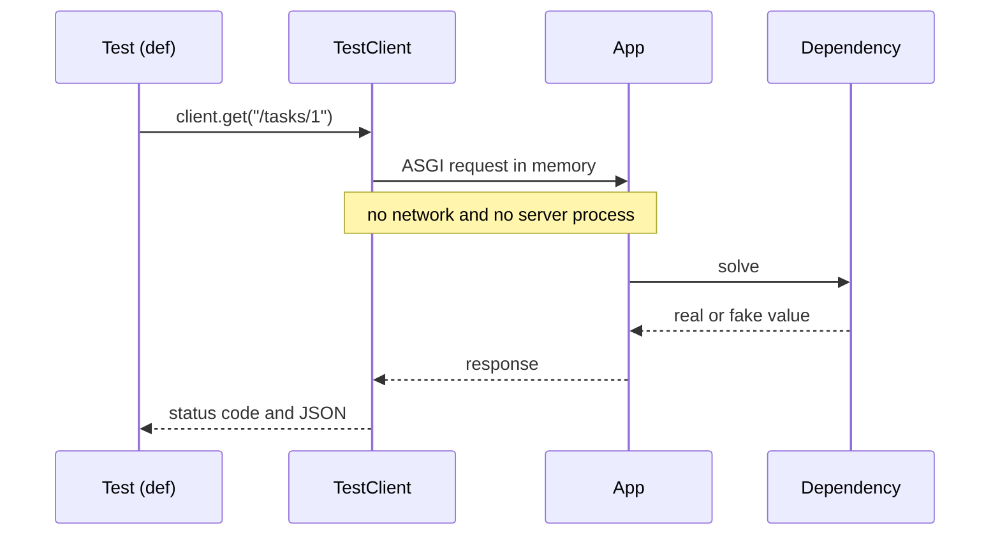

## 1. The question this idea answers

A coding agent writes a route for you. It looks right. How do you **know** it is right, and how do you know it stays right after the next change?

You test it. A test sends a request, reads the response and checks it. For a web service, the tests that matter most are the error paths. These are the 404, the 422, the upstream timeout and the 500 with a safe body. These are the paths that a quick manual check misses, and the paths that agents get wrong most often.

The second half of this lesson is the documentation that FastAPI writes for you. It comes from the same type hints, in a format called OpenAPI. Its schemas use JSON Schema, which is also the format of LLM tool parameters. So the skill you learn here returns in every agent you build.

## 2. Mental model

> [!analogy] A flight simulator
> `TestClient` is a flight simulator for your API. The pilot (the test) uses the real controls: real HTTP methods, paths, headers and bodies. The plane (your app) runs its real code. But nothing leaves the ground: no network, no port, no other server. Dependency overrides are the simulator's switches that replace the weather or the airport with a fake one.
>
> **Where it stops working:** a simulator does not show every real-world effect. `TestClient` runs the app in memory, so it does not test the real uvicorn server, a proxy, TLS, or the 40-thread limit under real load. Lesson 4.4 used a real uvicorn server for exactly that reason.

## 3. Terms

| Term | Plain meaning |
|---|---|
| test | A function that runs code and checks the result with `assert`. pytest finds and runs it (lesson 1.10). |
| `TestClient` | A FastAPI/Starlette class that sends HTTP requests to the app in memory, with an httpx-style API. |
| fixture | A pytest function that prepares something for a test, for example a client, and cleans it after. |
| `parametrize` | A pytest marker that runs one test with several inputs. |
| error path | A code path that handles a failure: bad input, a missing resource, an upstream error, a bug. |
| regression | A bug that returns after it was fixed. A test for the bug catches it. |
| OpenAPI | A standard JSON format that describes an HTTP API: its paths, methods, parameters, bodies and responses. |
| JSON Schema | A standard JSON format that describes the shape and rules of JSON data. OpenAPI 3.1 uses it for schemas. |
| Swagger UI | The interactive page at `/docs` that FastAPI builds from the OpenAPI document. |
| ReDoc | A second documentation page at `/redoc`. |

## 4. How it works

### 4.1 TestClient in three lines

The FastAPI testing docs (checked on 2026-10-19) show the basic form:

```python
from fastapi.testclient import TestClient

client = TestClient(app)

def test_read_main():
    response = client.get("/")
    assert response.status_code == 200
    assert response.json() == {"msg": "Hello World"}
```

The docs add: "Notice that the testing functions are normal `def`, not `async def`." The test calls look like httpx calls, without `await`, even when the endpoints are `async def`. `TestClient` runs the app's event loop for you.



### 4.2 Lifespan runs only inside `with`

A sandbox run (FastAPI 0.149.0) used an app whose lifespan records `startup` and `shutdown`:

```text
without with: {'events': []} | events: []
inside with: {'events': ['startup']}
after with: ['startup', 'shutdown']
```

Without `with`, the lifespan never ran. The shared clients and pools of lesson 4.3 did not exist, and a route that needs them would fail. Use `with TestClient(app) as client:` in a fixture.

### 4.3 A test file for the tasks API

This test file ran against the tasks API of lessons 4.2 and 4.3:

```python
import pytest
from fastapi.testclient import TestClient
from tasks_app import Settings, app, get_settings

@pytest.fixture
def client():
    with TestClient(app, raise_server_exceptions=False) as c:      # 1
        yield c
    app.dependency_overrides.clear()                               # 2

def test_create_then_read(client):
    r = client.post("/tasks", json={"title": "buy milk", "tags": ["home"]})
    assert r.status_code == 201
    task_id = r.json()["id"]
    r = client.get(f"/tasks/{task_id}")
    assert r.status_code == 200
    assert r.json()["title"] == "buy milk"

@pytest.mark.parametrize("body", [{}, {"title": ""}, {"title": 5}])  # 3
def test_bad_body_uses_our_error_shape(client, body):
    r = client.post("/tasks", json=body)
    assert r.status_code == 422
    assert set(r.json()) == {"error"}
    assert r.json()["error"]["code"] == "validation_error"

def test_unknown_id_is_404(client):
    r = client.get("/tasks/999")
    assert r.status_code == 404
    assert r.json()["error"]["code"] == "http_error"

def test_500_body_is_safe(client):
    r = client.get("/boom")
    assert r.status_code == 500
    assert "Traceback" not in r.text
    assert "/srv/" not in r.text

def test_limit_with_override(client):
    app.dependency_overrides[get_settings] = lambda: Settings(max_tasks=0)   # 4
    r = client.post("/tasks", json={"title": "x"})
    assert r.status_code == 409

def test_openapi_lists_routes(client):
    paths = client.get("/openapi.json").json()["paths"]
    assert {"/tasks", "/tasks/{task_id}"} <= set(paths)
```

The run (pytest 9.x, `pytest -v`):

```text
test_tasks.py::test_create_then_read PASSED
test_tasks.py::test_bad_body_uses_our_error_shape[body0] PASSED
test_tasks.py::test_bad_body_uses_our_error_shape[body1] PASSED
test_tasks.py::test_bad_body_uses_our_error_shape[body2] PASSED
test_tasks.py::test_unknown_id_is_404 PASSED
test_tasks.py::test_500_body_is_safe PASSED
test_tasks.py::test_limit_with_override PASSED
test_tasks.py::test_openapi_lists_routes PASSED
============================== 8 passed in 1.08s ===============================
```

Eight tests in about one second, with no network and no server process.

One input needs a closer look. `{"title": 5}` is not a string. Why is it a 422 and not converted, like `"4"` became `4` in lesson 4.1? Pydantic's lax mode converts a numeric **string** to a number, but it does not convert a number to a string. So the integer 5 fails the `str` field. Tests like this one document such details.

### 4.4 Four things that make tests useful

1. **`raise_server_exceptions=False`** (line 1). By default `TestClient` raises the app's exception inside the test, which is good for debugging. To test your 500 handler, you need the response instead, so turn the default off for that fixture.
2. **Clear the overrides** (line 2). The fixture removes every dependency override after each test, so one test cannot change the next one.
3. **`parametrize`** (line 3). One test checks three bad bodies. Each input shows as its own test in the output.
4. **Overrides instead of patches** (line 4). The test replaces the settings dependency. The route code stays the same.

> [!key] Test the error paths first
> A happy-path test proves that the route works once. The error-path tests prove the contract: the status, the error shape, and no leaks. Agents often write a correct happy path and a wrong error path. Read the error-path tests of agent-written code with special care.

### 4.5 A fake upstream in tests

Routes that call upstream APIs need a fake upstream in tests. Two ways:

| Way | How | Good for |
|---|---|---|
| Override the client dependency | `app.dependency_overrides[get_http] = lambda: fake`, where `fake = httpx.AsyncClient(base_url="https://weather.example", transport=httpx.MockTransport(handler))` | Status mapping, response shapes, counting calls |
| A local server that sleeps or fails | Start a tiny upstream app on a local port, as in lesson 4.4 | Timeouts, which `MockTransport` does not apply (lesson 3.5) |

The fake client needs the same `base_url` as the real one, because the route calls a relative path. A sandbox run put the lifespan, the `get_http` dependency, the route of lesson 4.4 and this override together:

```text
startup: client created, base_url = https://weather.example
city=Toronto  -> 200 {'city': 'Toronto', 'temp_c': 21}
city=broken   -> 502 {'detail': 'weather service returned 500'}
city=down     -> 502 {'detail': 'weather service unreachable'}
shutdown: client closed = True
upstream calls: 3 https://weather.example/v1/now?city=Toronto
```

The mock handler returned 500 for `broken` and raised `httpx.ConnectError` for `down`. The same override without `base_url` gave `no base_url -> 500 Internal Server Error`: the relative URL failed before any request, with an error that is neither a timeout nor a status error.

### 4.6 Which HTTP library TestClient uses

The FastAPI testing page (checked on 2026-10-19) says "To use `TestClient`, first install `httpx`", and that it "is based on HTTPX". The Starlette 1.9.0 source that the sandbox ran first tries `import httpx2`. If only `httpx` is present, it uses it and gives a deprecation warning that tells you to install `httpx2` instead. The Starlette release notes list "Support httpx2 in the test client" in 1.2.0 (2026-05-28). The sandbox log lines show it in use: `INFO httpx2 HTTP Request: POST http://testserver/items ...`.

So the docs and the code differ. The code wins at run time. `fastapi[standard]` 0.149.0 depends on both `httpx` and `httpx2`, so a project that installs the standard extra has both. Check again before you pin versions.

### 4.7 OpenAPI: the documentation FastAPI writes for you

FastAPI builds an OpenAPI document from your routes, parameters and models, and serves it at `/openapi.json`. The sandbox run printed parts of it:

```text
openapi version: 3.1.0
  /tasks ['get', 'post']
  /tasks/{task_id} ['get']
  /boom ['get']
TaskIn schema: {"properties": {"title": {"type": "string", "maxLength": 200, "minLength": 1, "title": "Title"}, "tags": {"items": {"type": "string"}, "type": "array", "title": "Tags", "default": []}}, "type": "object", "required": ["title"], "title": "TaskIn"}
```

Two pages render it:

| URL | What it shows |
|---|---|
| `/docs` | Swagger UI. You can send requests from the page. |
| `/redoc` | ReDoc, a read-only reference page |
| `/openapi.json` | The raw document, for code generators and tests |

The `TaskIn` schema came from the Pydantic model. `title` is a required string of 1 to 200 characters. `tags` is an array of strings with a default. Nobody wrote this schema by hand.

### 4.8 The same JSON Schema describes LLM tools

A model calls a tool by writing JSON arguments. The tool definition tells the model the shape of those arguments, in JSON Schema. An MCP tool has an `inputSchema` (lesson 5.3). In the sandbox, the in-process tool `lookup_orders` of the Agent SDK showed this input schema:

```text
input schema: {'type': 'object', 'properties': {'line': {'type': 'string'}}, 'required': ['line']}
```

It has the same keywords as the `TaskIn` schema above: `type`, `properties`, `required`. The rules you learned for request bodies (types, required fields, limits, descriptions) are the rules for tool arguments. A clear schema with good descriptions helps a client developer, and it helps a model in the same way.

> [!example] Worked example: one model, two uses
> `TaskIn` validates the body of `POST /tasks`. `TaskIn.model_json_schema()` returns the JSON Schema of section 4.7. You could pass that schema as the input schema of a tool named `create_task`. The model then writes `{"title": "...", "tags": [...]}`, and the same Pydantic model validates the arguments before your code runs.

## 5. Code walkthrough

The fixture is the base of every test file:

```python
@pytest.fixture
def client():
    with TestClient(app, raise_server_exceptions=False) as c:   # 1
        yield c                                                  # 2
    app.dependency_overrides.clear()                            # 3
```

| Line | What it does | Without it |
|---|---|---|
| 1 | Creates the client and enters `with`, so lifespan runs. Turns off re-raising, so tests see 500 responses. | No shared clients (lifespan did not run), and a 500 path raises inside the test instead of returning |
| 2 | Gives the client to the test, and pauses the fixture | |
| 3 | After the test, exits `with` (shutdown) and removes overrides | An override leaks into the next test |

This fixture is itself a generator (lesson 2.5): pytest runs it to the `yield`, runs the test, then resumes it.

## 6. Exercises

Runs in: your local practice project.

**Exercise 4.5.1: the full test suite for your notes API.** Write the tests of the roadmap exercise (lesson 4.2, Exercise 4.2.1) as pytest tests with a `TestClient` fixture.

Acceptance tests:

- (a) A missing field returns 422 in your error shape.
- (b) An unknown id returns 404 in your error shape.
- (c) A route that raises `RuntimeError` returns 500, and the body has no file paths and no "Traceback".
- (d) `/openapi.json` lists all three routes.
- `uv run pytest` passes with no network access.

**Exercise 4.5.2: an upstream fake.** For your `GET /quote` route of lesson 4.4, write a test that overrides the client dependency with a `MockTransport` client that returns 500. Give the fake client the same `base_url` as the real one.

Acceptance tests: the route returns 502 in your error shape. The mock handler counts exactly one call (no retries, unless you added retries on purpose).

**Exercise 4.5.3: read your own OpenAPI.** Open `/docs` and send one request from the page. Then open `/openapi.json` and find the schema of your request body.

Acceptance test: you can point at `required`, `type` and one limit (`maxLength` or `maximum`) and name the Python line that produced each one.

Hints come in three levels in chat: idea, pseudocode, partial code.

## 7. Common mistakes

1. **`TestClient(app)` without `with`.** Lifespan does not run, so shared objects are missing.
2. **Only happy-path tests.** The contract lives in the error paths.
3. **Tests that call real APIs.** Slow, costly and flaky. Override the client dependency.
4. **Leaking overrides between tests.** Clear them in the fixture.
5. **Asserting on full error messages.** Messages change. Assert the status and the stable code.
6. **`async def` tests with TestClient.** The docs use normal `def` tests. Mixing styles adds complexity for no gain.
7. **Trusting a green suite of agent-written tests without reading it.** A test that asserts nothing useful passes too.

## 8. One-minute explanation

`TestClient` sends real HTTP requests to your FastAPI app in memory: real routes, real validation, real handlers, no network. Tests are plain `def` functions that call `client.get` or `client.post` and assert on the status and the JSON. Use it inside `with`, so lifespan runs, and in a fixture that clears dependency overrides after each test. Set `raise_server_exceptions=False` to test your 500 handler. Write the error-path tests first: 422 shape, 404 shape, safe 500, upstream failures with a fake client. FastAPI also builds an OpenAPI 3.1 document from your type hints, served at `/openapi.json` and shown at `/docs`. Its schemas are JSON Schema, the same format that describes the arguments of LLM tools.

## 9. Check questions

```check
{
  "question": "A route reads app.state.http, which lifespan creates. The test does client = TestClient(app) and then client.get('/weather?city=x'), and it fails with an AttributeError. Why?",
  "answer": "Lifespan runs only when TestClient is used as a context manager (with TestClient(app) as client). Without with, the startup code never ran, so app.state.http does not exist. Use the client inside with, for example in a fixture."
}
```

```check
{
  "question": "Why does the safe-500 test need raise_server_exceptions=False?",
  "answer": "By default TestClient re-raises an exception from the app inside the test, so the test sees RuntimeError instead of a response. To check what a real client receives from the catch-all handler (status 500 and a safe body), the test needs the response, so it turns re-raising off."
}
```

```check
{
  "question": "Name three JSON Schema keywords that appear both in FastAPI's OpenAPI document for a request body and in an MCP tool's inputSchema, and say what each means.",
  "answer": "type (the JSON type, for example object or string), properties (the fields of an object and the schema of each field), required (the fields that must be present). Limits such as maxLength or minimum and a description also appear in both."
}
```

```check
{
  "question": "The FastAPI docs say TestClient is based on httpx, but the sandbox logs show httpx2. What is going on, and what should you do?",
  "answer": "Starlette, which provides the TestClient, added httpx2 support in 1.2.0 and in 1.9.0 tries httpx2 first. It warns that using plain httpx with the test client is deprecated. The docs page still says httpx. The code decides at run time, so install httpx2 for tests (fastapi[standard] 0.149.0 already depends on both), and check the release notes before you pin versions."
}
```

## 10. Links

- Previous: [4.4 def vs async def endpoints and calling other services](/notes/ai/ai-engineering/01-software-engineering-fundamentals/m04-fastapi-services/l4-def-vs-async-def-endpoints)
- Next module: [M5 Streaming, MCP tools and event channels](/notes/ai/ai-engineering/01-software-engineering-fundamentals/m05-streaming-and-agent-events)
- pytest basics: [1.10 Tests, logging and debugging](/notes/ai/ai-engineering/01-software-engineering-fundamentals/m01-python-foundations/l10-tests-and-debugging)
- Fixtures in depth: [pytest fixtures and monkeypatch](/notes/software-engineering/python/03-tooling/l2-pytest-fixtures-and-monkeypatch)
- Tool schemas: [5.3 MCP tools and how a tool call runs](/notes/ai/ai-engineering/01-software-engineering-fundamentals/m05-streaming-and-agent-events/l3-mcp-tools-and-tool-execution), [JSON Schema for tool arguments](/notes/ai/llm-systems/07-mcp/l7-json-schema-for-tool-arguments)
- [Glossary](/notes/ai/ai-engineering/glossary)
- Measured: the outputs come from sandbox runs on 2026-10-19 with FastAPI 0.149.0, Starlette 1.9.0, Pydantic 2.14.1, pytest 9 and claude-agent-sdk 0.2.168.
- Sources (checked on 2026-10-19): FastAPI, Testing, https://fastapi.tiangolo.com/tutorial/testing/. Starlette release notes, https://starlette.dev/release-notes/. httpx2 on PyPI, https://www.pypi.org/project/httpx2.
