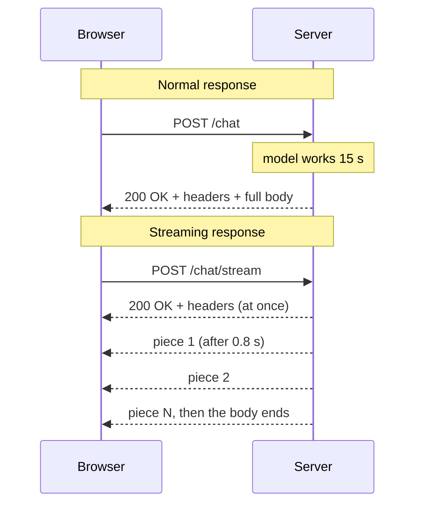
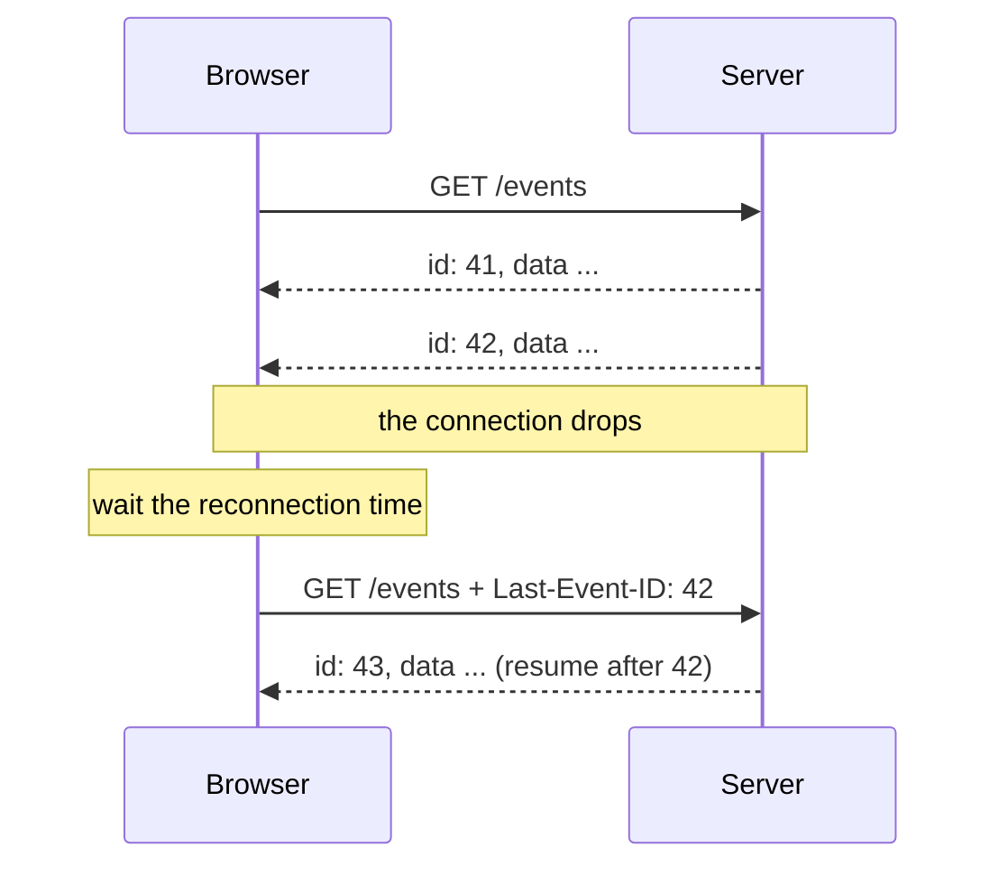

> [!note] Step 7 of 8 in the learning order
> This lesson starts step 7: SSE and FastAPI streaming. The [roadmap](/notes/ai/ai-engineering/01-software-engineering-fundamentals/roadmap) shows all 8 steps. You need [3.1 The HTTP request-response cycle](/notes/ai/ai-engineering/01-software-engineering-fundamentals/m03-http-rest-json/l1-the-request-response-cycle) first.

## 1. The question this idea answers

A user asks an agent a question. The model needs 15 seconds to write the full answer. It also calls two tools. In a normal HTTP response, the server sends the answer only when the answer is complete. So the user looks at an empty screen for 15 seconds or more.

The question: **how can the server send each part of the answer at the moment the part exists?** A second question follows. How does the browser know where one part ends and the next part starts?

The answer has two layers:

1. **Streaming over HTTP.** The server sends the response body in pieces, over one connection that stays open.
2. **Server-sent events (SSE).** A small text format that puts the pieces into named events. Browsers can read it with a built-in API. Most LLM APIs use it for their own streams.

## 2. Mental model

> [!analogy] A report by post or by phone
> A normal response is a report by post. The writer finishes all pages, puts them in one envelope, and the reader gets everything at one time.
>
> A streaming response is a phone call. The writer reads each paragraph aloud as soon as it is written. The reader hears the first paragraph after one second, not after one hour.
>
> SSE adds a rule for the call: after each message, the writer says "end of message" (a blank line). The reader writes down each message only after that signal.
>
> **Where it stops working:** in a phone call, both people can talk. An SSE stream goes in one direction only: from the server to the client. To send something back, the client makes a new HTTP request.

## 3. Terms

| Term | Plain meaning |
|---|---|
| streaming response | An HTTP response whose body the server sends in pieces while it still makes the rest. |
| chunk | One piece of a streaming body, as the network delivers it. Chunk edges do not match event edges. |
| chunked transfer encoding | The HTTP/1.1 way to send a body of unknown length: each chunk starts with its size, and a chunk of size 0 ends the body. |
| time to first token | The time from the request to the first visible piece of output. |
| server-sent events (SSE) | A text format and a browser API for a one-way stream of events from a server to a client, over HTTP. |
| event stream | The body of an SSE response. Its media type is `text/event-stream`. |
| field | One line of an event stream in the form `name: value`, for example `data: hello`. |
| dispatch | The moment the client turns the collected fields into one event. A blank line causes it. |
| comment line | A line that starts with `:`. The client ignores it. Servers use it to keep a quiet connection alive. |
| `EventSource` | The browser API that opens an SSE stream, parses it and reconnects when the connection drops. |
| reconnection time | How long the client waits before it reconnects. The `retry` field sets it, in milliseconds. |
| last event id | The value of the last `id` field that the client received. On reconnect, the browser sends it in the `Last-Event-ID` header. |
| keep-alive comment | A comment line that the server sends when it has no event, so that proxies do not close an idle connection. |
| proxy buffering | A proxy collects response bytes before it forwards them. It breaks streaming. |
| WebSocket | A different protocol: one connection that carries messages in both directions. |
| JSON Lines | A stream format with one JSON value on each line. |

## 4. How it works

### 4.1 A normal response and a streaming response

In a normal response, the server sends the status line, the headers and the full body. It sends the body only when the body is complete. In a streaming response, the server sends the status line and the headers at once. Then it sends the body in pieces, as each piece becomes ready. The connection stays open until the last piece.



How does the client know that the body is not complete yet? Two mechanisms exist:

1. **HTTP/1.1 chunked transfer encoding.** The server sends the header `Transfer-Encoding: chunked`. Each chunk starts with its size in hexadecimal. A chunk of size 0 marks the end.
2. **HTTP/2 and HTTP/3.** The protocol sends the body in DATA frames. In HTTP/2, the END_STREAM flag on the last frame marks the end. HTTP/3 frames have no flags: the end of the QUIC stream marks the end of the body. These versions do not use chunked encoding.

The application code does not write these markers. The web server writes them. The application only gives the server one piece at a time. Lesson [5.2](/notes/ai/ai-engineering/01-software-engineering-fundamentals/m05-streaming-and-agent-events/l2-fastapi-streaming-responses) shows how a Python generator does this.

> [!trap] A chunk is not a message
> The network can split one piece of your body into two chunks. It can also join two pieces into one chunk. A client must never treat one chunk as one message. It needs a format that marks where each message ends. SSE is such a format.

### 4.2 Why streaming matters for LLM applications

A model writes its answer one token at a time. A token is a small piece of text, often part of a word.

> [!example] Worked example: the felt wait (illustrative numbers)
> A model starts to write after 0.8 s. Then it writes 50 tokens each second. The answer has 600 tokens.
>
> 1. Time to write all tokens: 600 / 50 = 12 s.
> 2. Total time: 0.8 + 12 = 12.8 s.
> 3. Without streaming, the user sees the first word after 12.8 s.
> 4. With streaming, the user sees the first word after 0.8 s. The time to first token is 16 times shorter.
> 5. The total time does not change. Streaming changes what the user sees during the wait.

Agents add a second reason. During one answer, an agent calls tools. A user who sees "Querying the orders table..." knows that the agent works. A user who sees nothing for 40 seconds closes the tab.

### 4.3 The SSE wire format

The WHATWG HTML standard defines SSE (section "Server-sent events", checked on 2026-10-19). An event stream is UTF-8 text. The standard says: "Event streams in this format must always be encoded as UTF-8." The media type is `text/event-stream`.

The stream is a list of lines. A line ends with CRLF, LF or CR. Each line is one of three kinds:

| Line | Example | Meaning |
|---|---|---|
| A field | `data: {"n": 1}` | Name, colon, one optional space, value. |
| A comment | `: ping` | Starts with `:`. The client ignores it. |
| A blank line | (empty) | Dispatch: the collected fields become one event. |

The standard defines four field names. The client ignores any other name.

| Field | What the client does (WHATWG processing model) |
|---|---|
| `data` | Appends the value and one line feed to the data buffer. Several `data` lines make one value with line feeds between the parts. |
| `event` | Sets the event type. Without it, the type is `message`. |
| `id` | Sets the last event id, if the value has no NULL character. |
| `retry` | If the value has only ASCII digits, sets the reconnection time in milliseconds. Otherwise the client ignores it. |

Here is one stream with three events and one comment. Each line ends with a line feed. The empty lines are part of the format.

```text
event: status
data: {"text": "Querying the orders table"}

: ping

id: 7
data: line one
data: line two

data: {"type": "done"}

```

The client gets three events:

1. Type `status`, data `{"text": "Querying the orders table"}`.
2. Type `message`, data `line one` + line feed + `line two`, last event id `7`.
3. Type `message`, data `{"type": "done"}`.

Two rules decide the edges of events:

- **A blank line dispatches.** The standard says: "If the line is empty (a blank line) Dispatch the event". If the data buffer is empty at that moment, no event is dispatched.
- **An unfinished event is lost.** The standard says: "Once the end of the file is reached, any pending data must be discarded." So the server must end every event with a blank line, also the last one.

> [!key] One event = some field lines + one blank line
> Write `data: ...` and then an empty line. If you forget the empty line, the client never dispatches the event. If the stream ends after a `data` line with no blank line, the client drops it.

### 4.4 Worked example: chunks that cut events in half

A test fed a small SSE parser with four network chunks. The chunks cut the events at bad places on purpose. Measured in a sandbox run (Python 3.13.16, 2026-10-19):

```text
chunk 0: 'event: status\ndat'
   -> events dispatched: []
chunk 1: 'a: {"text": "querying"}'
   -> events dispatched: []
chunk 2: '\n\n: ping\n\ndata: line on'
   -> events dispatched: [('status', '{"text": "querying"}')]
chunk 3: 'e\ndata: line two\n\ndata: {"half": tr'
   -> events dispatched: [('message', 'line one\nline two')]
left in the buffer at the end: 'data: {"half": tr' | pending data lines: []
the stream ended without a blank line, so the last event is discarded
```

Read the output step by step:

1. Chunk 0 holds a full `event` line and half of the word `data`. The parser keeps the half line in its buffer. No event yet.
2. Chunk 1 completes the `data` line but holds no line feed. Still no event.
3. Chunk 2 starts with the line feed that ends the `data` line, then the blank line. Now the parser dispatches the `status` event. The comment `: ping` is ignored.
4. Chunk 3 completes `line one`, adds `line two` and a blank line. The parser dispatches one event with two lines of data.
5. The last text `data: {"half": tr` never gets its blank line. It is lost, as the standard requires.

The parser must therefore keep a buffer between chunks. Lesson [5.6](/notes/ai/ai-engineering/01-software-engineering-fundamentals/m05-streaming-and-agent-events/l6-what-partial-means) calls these pieces "partial chunks".

### 4.5 EventSource in the browser

A browser reads an event stream with `EventSource`:

```javascript
const source = new EventSource("/events");
source.onmessage = (e) => console.log("message", e.data, e.lastEventId);
source.addEventListener("status", (e) => showStatus(JSON.parse(e.data)));
source.onerror = () => console.log("connection lost, the browser will retry");
```

What the browser does for you:

1. It sends a GET request with the header `Accept: text/event-stream`.
2. It parses the stream as in section 4.3.
3. It calls `onmessage` for events without a type, and the listener of the type for typed events.
4. It reconnects when the connection drops.

Two limits matter for agents:

- The `EventSource` constructor takes a URL and one option, `withCredentials`. It cannot send a request body and it cannot set custom headers. A chat request has a JSON body and an `Authorization` header. So it uses `fetch()` and reads the body stream by hand, with a parser like the one in section 4.4.
- MDN warns: "When not used over HTTP/2, SSE suffers from a limitation to the maximum number of open connections". The limit is 6 for each browser and domain, across all tabs.

### 4.6 Reconnection, ids and retry

`EventSource` reconnects by itself. The WHATWG standard sets the rules:

1. The first reconnection time "must initially be an implementation-defined value, probably in the region of a few seconds".
2. A `retry: 5000` field changes the reconnection time to 5000 ms.
3. On reconnect, the browser sends the last event id in the `Last-Event-ID` request header.
4. "A client can be told to stop reconnecting using the HTTP 204 No Content response code." A status other than 200 also fails the connection.

The id is the server's tool to resume a stream. If every event has an id and the server keeps the events, the server can send only the events after `Last-Event-ID`. Without ids, a reconnect starts a new stream, and the user can miss events or see them twice.



> [!trap] A reconnect can start a second agent run
> If the stream endpoint also starts the agent, every automatic reconnect starts a new run. Keep the two jobs apart. One request starts the run. The stream endpoint only relays its events, and resumes from `Last-Event-ID`. The [Python subject](/notes/software-engineering/python/02-web-streaming/l1-fastapi-streaming-response-and-sse) shows this design.

### 4.7 Keep-alive comments and proxies

An agent can think for 30 seconds with no event. Some proxies and load balancers close a connection that is quiet for too long. The WHATWG standard advises: "authors can include a comment line (one starting with a ':' character) every 15 seconds or so." The client ignores the comment, but the bytes reset the idle timer of the proxy.

A proxy can also hold back the bytes. Nginx, for example, buffers a response by default. The stream then arrives in large late blocks, or at the end. Two response headers help:

| Header | Effect |
|---|---|
| `Cache-Control: no-cache` | A cache must not reuse the response without a check with the server first. (`no-store` is the directive that forbids storing.) |
| `X-Accel-Buffering: no` | Tells nginx not to buffer this response. |

FastAPI's own SSE support sends both headers and a keep-alive comment every 15 s ([5.2](/notes/ai/ai-engineering/01-software-engineering-fundamentals/m05-streaming-and-agent-events/l2-fastapi-streaming-responses)).

### 4.8 SSE, WebSocket, JSON Lines and polling

| Method | Direction | Browser API | Reconnect | Good for |
|---|---|---|---|---|
| SSE | server to client | `EventSource` or `fetch` | built in, with `Last-Event-ID` | token streams, progress events, agent events |
| WebSocket | both directions | `WebSocket` | you write it | live chat with typing signals, games, audio |
| JSON Lines over HTTP | server to client | `fetch` + a line parser | you write it | service-to-service streams, logs |
| Polling | client asks again and again | `fetch` | not needed | slow jobs where a delay of seconds is fine |

For an agent that answers one question, SSE is the usual choice. The client sends one request. The server sends events until the answer ends.

### 4.9 How an LLM API uses SSE

The Anthropic Messages API streams with SSE when the request has `"stream": true`. Each event has an `event` line and a JSON `data` line. A text piece looks like this (Anthropic streaming docs, checked on 2026-10-19):

```text
event: content_block_delta
data: {"type": "content_block_delta","index": 0,"delta": {"type": "text_delta", "text": "ello frien"}}

```

So the same format appears twice in an agent service. The model API streams SSE to your server. Your server streams SSE to the browser. Your events need not be the same as the model's events. [Stream events](/notes/ai/llm-apis/02-streaming-and-thinking/l1-stream-events) explains every event type of the model API.

## 5. Exercises

Runs in: a browser lab. [Open a lab for this lesson](/labs/new?note=ai/ai-engineering/01-software-engineering-fundamentals/m05-streaming-and-agent-events/l1-streaming-and-server-sent-events). Hints come in three levels in chat: idea, pseudocode, partial code.

**Exercise 5.1.1: an SSE formatter.** Write `format_sse(data: str, event: str | None = None, id: str | None = None) -> str`.

Acceptance tests (with `lab.check`):

- `format_sse("hi")` returns `"data: hi\n\n"`.
- `format_sse("a\nb", event="status")` returns `"event: status\ndata: a\ndata: b\n\n"`.
- `format_sse("x", id="7")` contains the line `id: 7`.
- An `event` value that contains a line feed raises `ValueError`.

**Exercise 5.1.2: an incremental SSE parser.** Write a class `SSEParser` with `feed(chunk: str) -> list[tuple[str, str]]` that returns the events completed by this chunk, as `(event_type, data)`.

Acceptance tests:

- Feed the stream of section 4.3 in one chunk. You get exactly 3 events, and the comment gives none.
- Feed the same stream split at every possible position into two chunks. Every split gives the same 3 events.
- A stream that ends without a final blank line gives no event for its last fields.
- `data:value` (no space) and `data: value` both give `value`.

## 6. Common mistakes

1. **One chunk = one message.** Chunk edges are random. Buffer the text and split on blank lines.
2. **No blank line after the last event.** The client discards it.
3. **A JSON value with line feeds in one `data` line.** The line feed ends the field. Use one `data` line for each line, or send compact JSON.
4. **`EventSource` for a POST chat request.** It sends only GET, with no body and no custom headers. Use `fetch` and a parser.
5. **No ids.** A reconnect cannot resume, and the user can miss events.
6. **The stream endpoint starts the agent.** An automatic reconnect starts a second run.
7. **No keep-alive during long thinking.** A proxy closes the idle connection.

## 7. One-minute explanation

An HTTP response can arrive in pieces over one open connection. HTTP/1.1 uses chunked encoding and HTTP/2 uses frames, but the web server writes those markers. A chunk is not a message, so the stream needs its own format. Server-sent events is that format: UTF-8 text with the media type `text/event-stream`. Each event is a few field lines, such as `event: status` and `data: ...`, and a blank line ends the event. Lines that start with a colon are comments, and servers send one about every 15 seconds to keep proxies from closing a quiet connection. The browser's `EventSource` parses the stream, reconnects by itself and sends the last `id` back in `Last-Event-ID`, so a server can resume. For an agent, the user sees the first token long before the full answer is ready. The user also sees each tool step.

## 8. Check questions

```check
{
  "question": "A server sends the bytes 'data: {\"n\": 1}\\n' and then the connection closes. What does an EventSource client deliver, and why?",
  "hint": "What triggers the dispatch of an event?",
  "answer": "Nothing. A blank line dispatches an event. This event has its data line but no blank line after it. The standard says that at the end of the stream any pending data must be discarded. The server must write 'data: {\"n\": 1}\\n\\n'."
}
```

```check
{
  "question": "Your stream works on your laptop, but behind the company proxy the events arrive all at once at the end. Name the most likely cause and two headers that help.",
  "answer": "The proxy buffers the response before it forwards it. Send 'X-Accel-Buffering: no' (for nginx) and 'Cache-Control: no-cache'. Also check the proxy configuration, because a header is only a request to the proxy."
}
```

```check
{
  "question": "An agent thinks for 40 s before the next event. The load balancer closes idle connections after 30 s. What does the server send, and why does the browser not show it?",
  "answer": "The server sends a comment line, for example ': ping' followed by a blank line, about every 15 s. The bytes reset the idle timer of the load balancer. The client ignores comment lines, so no event reaches the page."
}
```

```check
{
  "question": "Why does a chat front end often use fetch() with a stream reader instead of EventSource?",
  "answer": "EventSource sends only a GET request. Its constructor takes a URL and withCredentials only, so it cannot send a JSON body or an Authorization header. A chat request needs both, so the front end uses fetch() and parses the event stream itself."
}
```

## 9. Links

- Next: [5.2 FastAPI StreamingResponse, EventSourceResponse and generators](/notes/ai/ai-engineering/01-software-engineering-fundamentals/m05-streaming-and-agent-events/l2-fastapi-streaming-responses)
- Before: [3.1 The HTTP request-response cycle](/notes/ai/ai-engineering/01-software-engineering-fundamentals/m03-http-rest-json/l1-the-request-response-cycle), [3.3 Headers, parameters, bodies, cookies and auth](/notes/ai/ai-engineering/01-software-engineering-fundamentals/m03-http-rest-json/l3-headers-parameters-bodies-and-auth)
- Deeper: [FastAPI StreamingResponse and SSE](/notes/software-engineering/python/02-web-streaming/l1-fastapi-streaming-response-and-sse), [Stream events](/notes/ai/llm-apis/02-streaming-and-thinking/l1-stream-events)
- [Glossary](/notes/ai/ai-engineering/glossary)

Sources (checked on 2026-10-19): [WHATWG HTML, Server-sent events](https://html.spec.whatwg.org/multipage/server-sent-events.html), [MDN, Using server-sent events](https://developer.mozilla.org/en-US/docs/Web/API/Server-sent_events/Using_server-sent_events), [Anthropic streaming messages](https://platform.claude.com/docs/en/build-with-claude/streaming).
