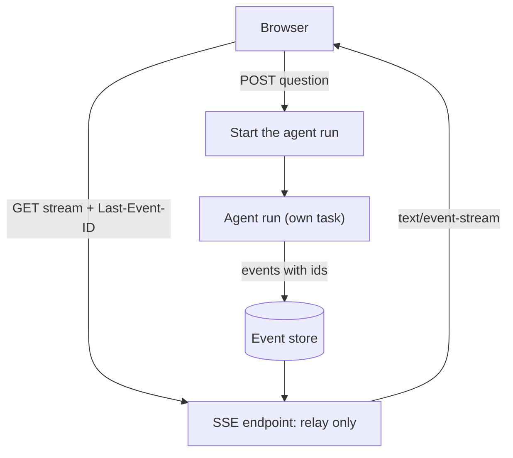

> [!note] Step 7 of 8 in the learning order
> This lesson ends step 7. It uses generators from step 4 ([2.5](/notes/ai/ai-engineering/01-software-engineering-fundamentals/m02-concurrency-foundations/l5-generators-and-yield)), the event loop from step 5 ([2.6](/notes/ai/ai-engineering/01-software-engineering-fundamentals/m02-concurrency-foundations/l6-asyncio-and-the-event-loop)) and worker threads from step 6 ([2.7](/notes/ai/ai-engineering/01-software-engineering-fundamentals/m02-concurrency-foundations/l7-blocking-calls-and-to-thread)). The [roadmap](/notes/ai/ai-engineering/01-software-engineering-fundamentals/roadmap) shows all 8 steps.

## 1. The question this idea answers

Lesson [5.1](/notes/ai/ai-engineering/01-software-engineering-fundamentals/m05-streaming-and-agent-events/l1-streaming-and-server-sent-events) showed the format of an event stream. Now the Python side: **how does a FastAPI endpoint give the web server one piece at a time?**

The answer is short. You give the framework an iterable, usually a generator. The framework takes one item, sends it, and asks for the next item. Three more questions follow, and they matter more:

1. Where does your generator run: on the event loop or in a worker thread?
2. What happens to your generator when the user closes the browser tab?
3. What do you do with the agent run at that moment: stop it, or let it finish?

## 2. Mental model

> [!analogy] A kitchen, a waiter and a guest
> The generator is a cook who prepares one dish at a time. The web server is a waiter. The waiter asks the cook for the next dish, carries it to the guest, and comes back.
>
> An **async generator** is a cook in the dining room. When the guest leaves, the waiter tells the cook at once, and the cook stops.
>
> A **sync generator** is a cook in a back kitchen, behind a door. The waiter sends each request through the door. When the guest leaves, nobody opens the door to tell the cook. The cook finishes the current dish. Much later, a cleaner (the garbage collector) finds the cook and sends him home.
>
> **Where it stops working:** a real cook in a back kitchen still hears the news after some minutes. A sync generator does not. In the test below, it closed only when the garbage collector ran, and the time of that run is not fixed.

## 3. Terms

| Term | Plain meaning |
|---|---|
| ASGI | The interface between a Python async web server (uvicorn) and a web app (Starlette, FastAPI). The server and the app exchange small messages, for example `http.response.body`. |
| Starlette | The web toolkit under FastAPI. Its `StreamingResponse` class does the streaming work. |
| `StreamingResponse` | A response whose body comes from an iterable. Each item becomes one piece of the body. |
| body iterator | The iterable that `StreamingResponse` reads. Starlette stores it in `response.body_iterator`. |
| async iterable | An object that `async for` can read, for example an async generator. |
| `iterate_in_threadpool` | A Starlette helper. It turns a sync iterable into an async one by running each `next()` call in an AnyIO worker thread. |
| AnyIO worker thread | A thread from AnyIO's shared pool. The default limit is 40 threads at the same time. |
| path operation | A FastAPI endpoint function, for example the function under `@app.get("/events")`. |
| `EventSourceResponse` | FastAPI's own SSE response class, in `fastapi.sse`, since FastAPI 0.135.0. |
| `ServerSentEvent` | A FastAPI model for one SSE event with the fields `data`, `raw_data`, `event`, `id`, `retry` and `comment`. |
| client disconnect | The client closes the connection before the body ends. |
| cancellation | asyncio stops a task by raising `CancelledError` inside it at its current `await`. |
| reference cycle | Objects that refer to each other. CPython's reference counting cannot free them. Only the cyclic garbage collector can. |
| garbage collector | The part of CPython that finds unreachable objects in cycles and frees them, at times that you do not control. |

## 4. How it works

### 4.1 A generator as the response body

The smallest streaming endpoint gives `StreamingResponse` a generator:

```python
import time
from fastapi import FastAPI
from fastapi.responses import StreamingResponse

app = FastAPI()

def numbers():                          # a sync generator function
    for i in range(3):
        time.sleep(0.5)                 # stands for slow work
        yield f"data: {i}\n\n"          # one SSE event per item

@app.get("/numbers")
def numbers_endpoint():
    return StreamingResponse(numbers(), media_type="text/event-stream")
```

`numbers()` returns a generator object. No line of its body runs yet ([2.5](/notes/ai/ai-engineering/01-software-engineering-fundamentals/m02-concurrency-foundations/l5-generators-and-yield)). The endpoint returns at once. Then Starlette sends the headers and starts to ask the generator for items.

What Starlette does, in Starlette 1.9.0 (source, `starlette/responses.py`, read on 2026-10-19):

```python
if isinstance(content, AsyncIterable):
    self.body_iterator = content
else:
    self.body_iterator = iterate_in_threadpool(content)
```

```python
async def stream_response(self, send: Send) -> None:
    await send({"type": "http.response.start", "status": self.status_code, "headers": self.raw_headers})
    async for chunk in self.body_iterator:
        if not isinstance(chunk, bytes | memoryview):
            chunk = chunk.encode(self.charset)
        await send({"type": "http.response.body", "body": chunk, "more_body": True})
    await send({"type": "http.response.body", "body": b"", "more_body": False})
```

Read it line by line:

1. An async iterable is used as it is. A sync iterable is wrapped.
2. The headers go out first, with the status.
3. Each item is encoded to bytes (UTF-8 by default) and sent with `more_body: True`. The server writes it to the network at once.
4. After the last item, an empty body with `more_body: False` ends the response.

### 4.2 Where a sync generator runs

The wrapper `iterate_in_threadpool` (Starlette 1.9.0, `starlette/concurrency.py`):

```python
async def iterate_in_threadpool(iterator):
    as_iterator = iter(iterator)
    while True:
        try:
            yield await anyio.to_thread.run_sync(_next, as_iterator)
        except _StopIteration:
            break
```

So each `next()` call on your sync generator runs in an AnyIO worker thread. The event loop stays free while your generator sleeps or waits. That is good. But each waiting `next()` holds one worker thread. The default AnyIO limit is 40 threads (measured: `current_default_thread_limiter().total_tokens` is `40` in AnyIO 4.15.1). FastAPI also uses this pool for every `def` endpoint ([4.4](/notes/ai/ai-engineering/01-software-engineering-fundamentals/m04-fastapi-services/l4-def-vs-async-def-endpoints)).

A test opened many streams at the same time. Each stream waited 1.0 s before each event, in a sync generator. During the streams, the test called a `def` endpoint `/health`. Measured in a sandbox run (FastAPI 0.149.0, Starlette 1.9.0, uvicorn 0.54.0, AnyIO 4.15.1):

```text
10 streams: first byte after 1.04s (fastest) to 1.05s (slowest); GET /health during the streams took 0.01s
60 streams: first byte after 1.08s (fastest) to 2.18s (slowest); GET /health during the streams took 0.88s
```

With 60 streams, 40 threads were busy, so 20 streams waited for a free thread. The small `/health` endpoint also waited 0.88 s, because it needed a thread from the same pool.

> [!key] A sync streaming body holds a worker thread for every wait
> A sync generator that waits on `queue.get()` or `time.sleep()` keeps one of the 40 pool threads for the whole wait. Many slow sync streams starve every `def` endpoint of the app.

### 4.3 Where an async generator runs

An async generator runs on the event loop thread, as one more coroutine step:

```python
import asyncio

async def numbers_async():
    for i in range(3):
        await asyncio.sleep(0.5)        # the loop runs other requests here
        yield f"data: {i}\n\n"

@app.get("/numbers-async")
async def numbers_async_endpoint():
    return StreamingResponse(numbers_async(), media_type="text/event-stream")
```

It uses no pool thread. A thousand quiet async streams cost a thousand small objects, not a thousand threads. The rule of step 6 applies: the body must never block. One `time.sleep(0.5)` in this generator would freeze every request of the process ([2.7](/notes/ai/ai-engineering/01-software-engineering-fundamentals/m02-concurrency-foundations/l7-blocking-calls-and-to-thread)).

### 4.4 FastAPI's own SSE support

FastAPI added SSE in version 0.135.0. The tutorial (checked on 2026-10-19) says: "To stream SSE with FastAPI, use `yield` in your *path operation function* and set `response_class=EventSourceResponse`."

```python
from collections.abc import AsyncIterable
from fastapi.sse import EventSourceResponse, ServerSentEvent

@app.post("/chat/stream", response_class=EventSourceResponse)
async def chat_stream() -> AsyncIterable[ServerSentEvent]:
    yield ServerSentEvent(comment="stream start")
    yield ServerSentEvent(data={"text": "Querying"}, event="status", id="1")
    yield {"type": "done"}              # a plain object: JSON in the data field
```

Facts from the tutorial and from the source of FastAPI 0.149.0 (`fastapi/sse.py` and `fastapi/routing.py`, read on 2026-10-19):

| Behavior | Detail |
|---|---|
| Plain objects | "Each yielded item is encoded as JSON and sent in the `data:` field." A string is JSON too: `"hello"` goes out as `data: "hello"`, with quotes. Use `raw_data` to send text without JSON. |
| Fields | `ServerSentEvent` has `data`, `raw_data`, `event`, `id`, `retry` (milliseconds, 0 or more) and `comment`. `event` and `id` must be one line. A `raw_data` or `comment` value with line feeds becomes several lines. A `data` value is JSON, and JSON escapes line feeds, so it always stays on one line. Measured: `data="line a\nline b"` gave one line, `data: "line a\nline b"`, and `raw_data="raw a\nraw b"` gave `data: raw a` and `data: raw b`. |
| Keep-alive | When no item comes for 15 s (`_PING_INTERVAL = 15.0`), FastAPI sends `: ping` and a blank line (`KEEPALIVE_COMMENT`). |
| Headers | `Cache-Control: no-cache` and `X-Accel-Buffering: no`. |
| Methods | "SSE works with **any HTTP method**, not just `GET`". This helps protocols like MCP that stream over POST. |
| `def` generators | Allowed. FastAPI wraps them with `iterate_in_threadpool`, so they use pool threads as in section 4.2. |
| Inside | A producer task reads your generator into a memory stream with a buffer of 1 item. A second task forwards items and adds the pings. A source comment explains that the timer must never wrap your generator's `__anext__` directly. |

FastAPI also streams JSON Lines when a path operation yields without an SSE response class (the SSE tutorial links the "Stream JSON Lines" page). This lesson uses SSE only.

### 4.5 What happens when the client disconnects

Starlette decides how to watch for a disconnect from the ASGI spec version that the server reports. In Starlette 1.9.0:

- **Spec version 2.4 or later:** Starlette only catches the `OSError` of a failed send. A silent generator notices nothing until its next send.
- **Below 2.4:** Starlette runs `listen_for_disconnect` in a task group next to the stream. When the server reports `http.disconnect`, the task group cancels the stream at once.

uvicorn 0.54.0 reports `"spec_version": "2.3"` in its HTTP protocols (source, read on 2026-10-19). So on uvicorn, the second rule applies.

A test streamed 8 events, one every 0.3 s. The client read 2 events and closed the connection. The generator logged its `finally` block. Measured in a sandbox run (same versions as above).

**Async generator** (`async def` path operation that yields, and `StreamingResponse` over an async generator gave the same result):

```text
0.37s query yields msg1
0.37s client got 'data: {"n": 1}'
0.67s query yields msg2
0.67s client got 'data: {"n": 2}'
0.67s client: connection closed
0.67s query: CancelledError at await -> the agent stops
0.67s query: finally
```

**Sync generator** that reads a thread-and-queue bridge (the design of [5.5](/notes/ai/ai-engineering/01-software-engineering-fundamentals/m05-streaming-and-agent-events/l5-case-study-the-run-bridge)), with `StreamingResponse`:

```text
0.68s client got 'data: {"n": 2}'
0.68s client: connection closed
0.98s query yields msg3
...
2.48s query yields msg8
2.48s query finished
2.48s worker: sentinel put, thread ends
3.71s _run: GeneratorExit at yield (consumer closed the generator)
3.71s _run: finally
3.71s gc.collect() -> 94 objects
```

The `EventSourceResponse` version with a `def` path operation gave the same pattern: `finally` at 3.67 s, again only after a manual `gc.collect()`.

| | Async generator | Sync generator |
|---|---|---|
| Runs on | the event loop thread | AnyIO worker threads, one `next()` at a time |
| After the disconnect | `CancelledError` at its current `await`, at once | the current `next()` finishes, then nothing |
| Its `finally` ran | at 0.67 s, the moment of the disconnect | at 3.71 s, only when the test called `gc.collect()` |
| The work behind it | stopped | the producer thread ran all 8 messages, until 2.48 s |

Why so late? The wrapper async generator is cancelled, but your sync generator object stays referenced inside a reference cycle (the cancelled task, its traceback and frames). Reference counting cannot free a cycle. Only the cyclic garbage collector can, and then CPython calls `close()` on the generator, which raises `GeneratorExit` at its paused `yield` ([2.5](/notes/ai/ai-engineering/01-software-engineering-fundamentals/m02-concurrency-foundations/l5-generators-and-yield)). The Python docs say that a generator that "is not resumed before it is finalized (by reaching a zero reference count or by being garbage collected)" gets `close()`. The docs do not say when the collector runs. The same result appears in the [Python subject](/notes/software-engineering/python/02-web-streaming/l1-fastapi-streaming-response-and-sse) with Starlette 1.6.0.

> [!trap] The finally of a sync streaming body is not a disconnect handler
> Under FastAPI, do not put "stop the agent" in the `finally` of a sync generator and expect it to run when the user leaves. It runs when the garbage collector runs. Use an async generator for a stream that must react to a disconnect.

### 4.6 close() and GeneratorExit in a streaming body

In plain Python, you control when a generator closes:

```python
gen = numbers()
next(gen)
gen.close()     # GeneratorExit at the paused yield, then finally runs, now
```

In a web server, the server controls it. So write streaming bodies with these rules:

1. Put cleanup that must happen (close a file, release a lock) in `finally`, and keep it short.
2. Never `yield` inside `except GeneratorExit` or inside `finally`. Python raises `RuntimeError: generator ignored GeneratorExit`.
3. For an async generator, expect `CancelledError` at an `await`. It is a `BaseException`. An `except Exception` does not catch it, and that is correct: let it pass.
4. Decide what the work behind the stream does when the stream ends early (section 4.7).

### 4.7 Stop on disconnect, or finish and store

The user closes the tab in the middle of an agent answer. Two designs are valid. Choose one on purpose.

| Design | When the user leaves | Good | Bad |
|---|---|---|---|
| The agent runs inside the stream | the agent stops (async body) | no tokens and no tool calls for nobody | the answer is lost, a page refresh starts again |
| The agent runs in its own task or job | the agent finishes and stores its events | the answer is saved, a reconnect can resume with `Last-Event-ID` | costs tokens even when nobody reads |
| A sync body over a thread bridge (5.5 as written) | the agent finishes, but nothing stores the events | none of the "good" points of the two rows above | costs tokens, and the result goes nowhere |



### 4.8 Production view

| Concern | What to do |
|---|---|
| Thread pool | Prefer async bodies. Each waiting sync body holds one of the 40 AnyIO threads (section 4.2). |
| Disconnect | Async bodies get `CancelledError` at once on uvicorn. Sync bodies close only at garbage collection. |
| Proxies | Send keep-alive comments and `X-Accel-Buffering: no`. `EventSourceResponse` does both. |
| Errors in the middle | The status 200 is already sent. Send an `error` event with a code and a short message, then end the stream. |
| Completion | Send a final `done` event, so the client can tell a complete answer from a cut stream ([5.6](/notes/ai/ai-engineering/01-software-engineering-fundamentals/m05-streaming-and-agent-events/l6-what-partial-means)). |
| Timeouts | Put a total time limit on the work behind the stream, for example with `asyncio.timeout`. |

## 5. Code walkthrough

An async SSE endpoint that relays an agent-like source, with an error event and a done event:

```python
import asyncio
from collections.abc import AsyncIterator
from fastapi import FastAPI
from fastapi.sse import EventSourceResponse, ServerSentEvent

app = FastAPI()

async def agent_events(question: str) -> AsyncIterator[dict]:   # 1
    for step in ["planning", "querying", "writing"]:
        await asyncio.sleep(0.3)                                # 2
        yield {"type": "status", "text": step}

@app.post("/ask", response_class=EventSourceResponse)            # 3
async def ask(question: str) -> AsyncIterator[ServerSentEvent]:
    n = 0
    try:
        async for ev in agent_events(question):                  # 4
            n += 1
            yield ServerSentEvent(data=ev, event=ev["type"], id=str(n))   # 5
        yield ServerSentEvent(data={"type": "done"}, event="done", id=str(n + 1))   # 6
    except Exception as exc:                                     # 7
        yield ServerSentEvent(data={"type": "error", "message": type(exc).__name__}, event="error")
    finally:
        print("stream closed after", n, "events")                # 8
```

| Mark | What it does | Why it is there |
|---|---|---|
| 1 | An async generator that produces events. | It runs on the event loop and uses no pool thread. |
| 2 | `await asyncio.sleep` stands for model and tool work. | Every wait is an `await`, so the loop stays free and cancellation can arrive here. |
| 3 | `response_class=EventSourceResponse` makes the yields an SSE stream. | FastAPI adds the headers and the 15 s pings. |
| 4 | `async for` reads the source one event at a time. | Each event goes out as soon as it exists. |
| 5 | A `ServerSentEvent` with `event` and `id`. | The browser can listen by type and resume by id. |
| 6 | A final `done` event. | The client can tell a complete answer from a cut one. |
| 7 | `except Exception` turns a failure into an `error` event. | The status 200 is already sent, so an HTTP error code is not possible anymore. `CancelledError` is not an `Exception`, so a disconnect still stops the generator. |
| 8 | `finally` logs the end. | On uvicorn it runs at the moment of a disconnect, because this body is async. |

## 6. Exercises

Runs in: your local practice project (a browser lab cannot run a web server or threads). Hints come in three levels in chat: idea, pseudocode, partial code.

**Exercise 5.2.1: measure both kinds of body.** Make two endpoints that send 10 events, one every 0.3 s. One uses an async generator. The other uses a sync generator. Log the time of each `yield` and of each `finally`. Read 2 events with `curl -N --max-time 0.8` or with `httpx`, then close.

Acceptance tests:

- The async body logs `finally` within 0.1 s of the client close.
- The sync body logs its remaining yields after the close, and its `finally` only after you call `gc.collect()` (add a debug endpoint for it). Write down the times.

**Exercise 5.2.2: the thread pool limit.** Use the sync body of 5.2.1 with a wait of 1.0 s per event. Open 50 streams at the same time with `httpx.AsyncClient`. During the streams, time a `def /health` endpoint.

Acceptance tests:

- With 50 streams, at least 10 streams get their first byte later than 1.5 s.
- `/health` is slower than 0.5 s during the streams, and faster than 0.05 s after them.
- Change the body to an async generator. All 50 first bytes arrive within 1.2 s, and `/health` stays fast.

**Exercise 5.2.3: EventSourceResponse on the wire.** Make a POST endpoint that yields one `ServerSentEvent` with `event`, `id` and `retry`, one plain dict, and one plain string. Read the raw bytes with `curl -N`.

Acceptance tests:

- The string appears as `data: "..."` with quotes.
- The lines of the first event appear in the order `event`, `data`, `id`, `retry`. This is the order of `format_sse_event` in FastAPI 0.149.0: comment, event, data, id, retry, then the blank line.
- A source that waits 20 s before its next item makes a `: ping` line appear after about 15 s.

## 7. Common mistakes

1. **A blocking call in an async body.** One `time.sleep` freezes the whole server. Use `await` or `asyncio.to_thread`.
2. **Many slow sync bodies.** They exhaust the 40 AnyIO threads, and every `def` endpoint waits.
3. **Cleanup that depends on `finally` in a sync body.** It runs at garbage collection, not at the disconnect.
4. **`except BaseException` around an async body.** It swallows `CancelledError`, and the body keeps running after the user left.
5. **A JSON string with `EventSourceResponse` when you want raw text.** Plain values are JSON-encoded. Use `raw_data`.
6. **No `done` event.** The client cannot tell a complete answer from a cut stream.
7. **No decision about the agent on disconnect.** Choose "stop" or "finish and store" on purpose.

## 8. One-minute explanation

A FastAPI endpoint streams by returning `StreamingResponse` with an iterable, usually a generator. Starlette sends the headers, then asks the iterable for one item at a time and sends each item at once. An async generator is used as it is and runs on the event loop, so it must never block. A sync generator is wrapped by `iterate_in_threadpool`, so each `next()` runs in an AnyIO worker thread, and the default pool has only 40 threads. FastAPI 0.135.0 added `EventSourceResponse`. You yield objects, and FastAPI writes SSE with JSON data. It adds `Cache-Control: no-cache` and `X-Accel-Buffering: no`, and sends a ping every 15 seconds. On a disconnect under uvicorn, an async body gets `CancelledError` at once. A sync body is not closed until the garbage collector runs, and the work behind it continues. So choose async bodies for streams that must react to a disconnect. Decide on purpose whether the agent stops, or finishes and stores its result.

## 9. Check questions

```check
{
  "question": "Your endpoint returns StreamingResponse(gen()) where gen is a def generator that waits on queue.get(). Where does each next() run, and what limit does that create?",
  "answer": "Starlette wraps a sync iterable with iterate_in_threadpool, so each next() runs in an AnyIO worker thread through anyio.to_thread.run_sync. A next() that waits on queue.get() holds that thread for the whole wait. The default AnyIO pool has 40 threads, shared with every def endpoint, so about 40 waiting streams block other def endpoints. In the test, 60 such streams made a def /health endpoint wait 0.88 s."
}
```

```check
{
  "question": "On uvicorn, a client disconnects in the middle of a stream. Compare what happens to an async generator body and to a sync generator body.",
  "hint": "uvicorn reports ASGI spec version 2.3.",
  "answer": "Below spec version 2.4, Starlette listens for http.disconnect in a task group and cancels the stream at once. An async generator gets CancelledError at its current await and its finally runs immediately (0.67 s in the test). A sync generator is not closed: the wrapper is cancelled, but the generator object stays in a reference cycle. Its GeneratorExit and finally came only when the garbage collector ran (3.71 s, after a manual gc.collect()), and the producer behind it ran to the end."
}
```

```check
{
  "question": "With EventSourceResponse you yield the string \"hello\". What appears on the wire, and how do you send the text without quotes?",
  "answer": "FastAPI JSON-encodes every data value, so the wire shows data: \"hello\" with quotes. To send plain text, yield ServerSentEvent(raw_data=\"hello\")."
}
```

```check
{
  "question": "The status line 200 is already sent when the agent fails in the middle of a stream. How does the client learn about the failure?",
  "answer": "The server cannot change the status anymore. It sends an error event in the stream, for example event: error with a JSON body that holds a code and a short message, and then ends the stream. The client also checks for a final done event: a stream that ends without done is incomplete."
}
```

## 10. Links

- Before: [5.1 Streaming over HTTP and server-sent events](/notes/ai/ai-engineering/01-software-engineering-fundamentals/m05-streaming-and-agent-events/l1-streaming-and-server-sent-events), [2.5 Generators, yield, close() and GeneratorExit](/notes/ai/ai-engineering/01-software-engineering-fundamentals/m02-concurrency-foundations/l5-generators-and-yield), [4.4 def vs async def endpoints](/notes/ai/ai-engineering/01-software-engineering-fundamentals/m04-fastapi-services/l4-def-vs-async-def-endpoints)
- Next: [5.3 MCP tools and how a tool call runs](/notes/ai/ai-engineering/01-software-engineering-fundamentals/m05-streaming-and-agent-events/l3-mcp-tools-and-tool-execution)
- Uses it: [5.5 Case study: the _run bridge](/notes/ai/ai-engineering/01-software-engineering-fundamentals/m05-streaming-and-agent-events/l5-case-study-the-run-bridge)
- Deeper: [FastAPI StreamingResponse and SSE](/notes/software-engineering/python/02-web-streaming/l1-fastapi-streaming-response-and-sse), [Async generators](/notes/software-engineering/python/01-asyncio/l2-async-generators)
- [Glossary](/notes/ai/ai-engineering/glossary)

Sources (checked on 2026-10-19): [FastAPI, Server-Sent Events](https://fastapi.tiangolo.com/tutorial/server-sent-events/), [Python docs, yield expressions](https://docs.python.org/3/reference/expressions.html), the source code of Starlette 1.9.0, FastAPI 0.149.0, uvicorn 0.54.0 and AnyIO 4.15.1.
