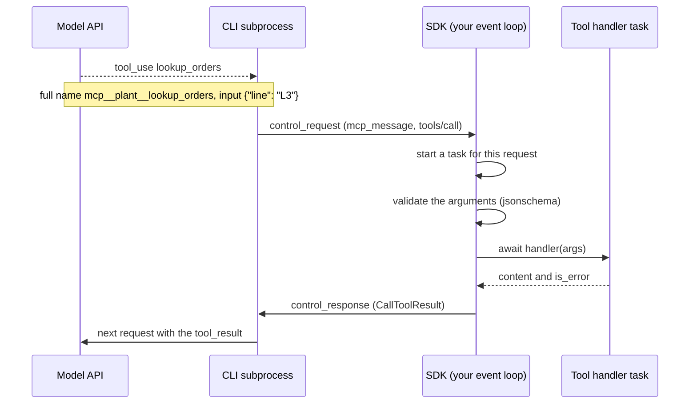

> [!note] Step 8 of 8 in the learning order
> This lesson starts step 8: MCP tools and user-visible event channels. It needs callbacks and closures ([2.1](/notes/ai/ai-engineering/01-software-engineering-fundamentals/m02-concurrency-foundations/l1-functions-as-values-and-callbacks), [2.2](/notes/ai/ai-engineering/01-software-engineering-fundamentals/m02-concurrency-foundations/l2-lambdas-and-closures)), the event loop ([2.6](/notes/ai/ai-engineering/01-software-engineering-fundamentals/m02-concurrency-foundations/l6-asyncio-and-the-event-loop)) and `asyncio.to_thread` ([2.7](/notes/ai/ai-engineering/01-software-engineering-fundamentals/m02-concurrency-foundations/l7-blocking-calls-and-to-thread)). The [roadmap](/notes/ai/ai-engineering/01-software-engineering-fundamentals/roadmap) shows all 8 steps.

## 1. The question this idea answers

A model can only write text. It cannot read your database, call your API or check a stock level. A **tool** gives it that power: a function in your program that the model can ask you to run. The Model Context Protocol (MCP) is a standard way to describe such tools and to call them.

This lesson answers five questions:

1. What is a tool, in exact terms?
2. How do you write one with the Claude Agent SDK, and what is an `SdkMcpTool`?
3. What happens, step by step, from "the model wants the tool" to "the model reads the result"?
4. What happens when a tool fails?
5. When does a tool need a worker thread, and when does it not?

## 2. Mental model

> [!analogy] A manager, a switchboard and a specialist
> The model is a manager who cannot leave the office. The manager has a directory of specialists (the tool list). Each entry has a name, a short description and a form (the input schema). The manager completes a form and gives it to the switchboard (the SDK and the CLI). The switchboard calls the specialist (your tool handler). The specialist writes a short answer (the tool result), and the switchboard gives it to the manager.
>
> With an in-process MCP server, the specialist sits at a desk inside your own office: your Python process. That desk is shared. It is the event loop.
>
> **Where it stops working:** a human specialist who waits on the phone does not stop other people. A tool handler that makes a blocking call stops every task on the same event loop, including the SDK's own work. Section 4.7 measures this.

## 3. Terms

| Term | Plain meaning |
|---|---|
| tool | A function that the model can ask the application to run. It has a name, a description and an input schema. |
| input schema | A JSON Schema that describes the arguments of a tool: names, types, required fields. |
| JSON Schema | A standard JSON format that describes the shape of JSON data. |
| MCP (Model Context Protocol) | An open protocol that lets an application (client) discover and call tools, resources and prompts of a server. |
| MCP client | The side that lists and calls tools. In an agent, the agent runtime is the client. |
| MCP server | The side that offers tools and runs them. |
| JSON-RPC | The message format of MCP: a request has `jsonrpc`, `id`, `method` and `params`, and the response has the same `id` and a `result` or an `error`. |
| `tools/list` | The MCP request that returns the tool definitions. |
| `tools/call` | The MCP request that runs one tool with arguments. |
| tool result | What a tool returns to the model. In MCP: `content` (a list of content blocks), `isError`, and optionally `structuredContent`. |
| content block | One item of `content`, for example `{"type": "text", "text": "..."}`. |
| protocol error | A JSON-RPC `error` object, for example for an unknown tool or a malformed request. |
| tool execution error | A normal result with `isError: true`. The model can read it and react. |
| in-process MCP server | An MCP server that runs inside your Python process. The Agent SDK calls it an SDK MCP server. |
| `SdkMcpTool` | The Agent SDK dataclass that holds one tool: name, description, input schema, handler and annotations. |
| tool handler | The `async def` function that does the work of a tool. |
| full tool name | The name that the model and `allowed_tools` use: `mcp__<server key>__<tool name>`. |
| control request | A message from the CLI subprocess to the SDK in your process, for example "call this in-process tool". |

## 4. How it works

### 4.1 MCP in one page

MCP has a client and a server. They exchange JSON-RPC messages. For tools, two requests matter. The examples come from the MCP specification, Tools page, versions 2025-06-18 and 2025-11-25 (checked on 2026-10-19). The two versions give the same messages:

```json
{"jsonrpc": "2.0", "id": 1, "method": "tools/list", "params": {}}
```

The response lists each tool with a `name`, a `description` and an `inputSchema`:

```json
{
  "name": "get_weather",
  "description": "Get current weather information for a location",
  "inputSchema": {
    "type": "object",
    "properties": {"location": {"type": "string", "description": "City name or zip code"}},
    "required": ["location"]
  }
}
```

The model sees these definitions in its context. When it wants a tool, the client sends:

```json
{"jsonrpc": "2.0", "id": 2, "method": "tools/call",
 "params": {"name": "get_weather", "arguments": {"location": "New York"}}}
```

The server runs the tool and answers with a tool result:

```json
{"jsonrpc": "2.0", "id": 2,
 "result": {"content": [{"type": "text", "text": "Current weather in New York: ..."}], "isError": false}}
```

The specification also defines `structuredContent`: "Structured content is returned as a JSON object in the `structuredContent` field of a result." A tool with an `outputSchema` must return structured results that match it. The current MCP version is 2026-07-28. Its Tools page was not checked for these notes. Check it before you depend on a detail ([what is new in MCP](/notes/ai/llm-systems/07-mcp/l12-whats-new-version-history)).

### 4.2 Two kinds of tool errors

The specification says: "Tools use two error reporting mechanisms". The lists changed between versions. Version 2025-06-18 put "Invalid arguments" under protocol errors. SEP-1303 (status Final) moved input validation errors to tool execution errors, so that the model can read them. Version 2025-11-25 (checked on 2026-10-19) has these lists:

| Kind | Example causes in spec 2025-11-25 | How it travels | Who sees it |
|---|---|---|---|
| Protocol error | unknown tool, malformed request (it does not match the `CallToolRequest` schema), server error | a JSON-RPC `error` object | the client |
| Tool execution error | API failure, input validation error (for example a date in the wrong format), business logic error | a normal `result` with `isError: true` | the model, as a tool result |

The reason for the change, in the words of the specification: "Tool Execution Errors contain actionable feedback that language models can use to self-correct and retry with adjusted parameters." And: "Clients SHOULD provide tool execution errors to language models to enable self-correction."

A tool execution error is useful. The model reads "Failed to fetch weather data: API rate limit exceeded" and can wait, change the arguments or tell the user. A crash tells the model nothing.

> [!note] The Agent SDK sends no protocol errors for tool calls
> The in-process server of the Agent SDK returns every failure of a tool call as a tool execution error. The comment in `run_tool` (claude-agent-sdk 0.2.168) says: "unknown tools, invalid arguments and handler failures all come back as isError results the model can read, never as protocol errors". A sandbox call of an unknown tool gave `isError True | Tool 'nope' not found`. Section 4.6 shows the other two cases.

### 4.3 A tool with the Claude Agent SDK

The Agent SDK has a decorator `@tool`. A decorator is a function that takes your function and returns a new object in its place. Here it returns an `SdkMcpTool`.

```python
import asyncio
from typing import Any
from claude_agent_sdk import tool

@tool("lookup_orders", "Count open orders for a production line", {"line": str})
async def lookup_orders(args: dict[str, Any]) -> dict[str, Any]:
    await asyncio.sleep(0.1)                       # stands for an async database call
    rows = [{"order": 1, "line": args["line"]}, {"order": 2, "line": args["line"]}]
    return {"content": [{"type": "text", "text": f"{len(rows)} open orders"}]}
```

The SDK source (claude-agent-sdk 0.2.168, `claude_agent_sdk/__init__.py`, read on 2026-10-19) defines the class:

```python
@dataclass
class SdkMcpTool(Generic[T]):
    """Definition for an SDK MCP tool."""

    name: str
    description: str
    input_schema: type[T] | dict[str, Any]
    handler: Callable[[T], Awaitable[dict[str, Any]]]
    annotations: _McpToolAnnotations | None = None
```

Read the type of `handler`: `Callable[[T], Awaitable[dict[str, Any]]]`. It is a function that takes one argument and returns something you can `await`, which gives a dict. That is exactly an `async def` function. The docstring of `@tool` says it in words:

- "The tool function must be async (defined with async def)"
- "The function receives a single dict argument with the input parameters"
- "Arguments are validated against the input schema before the function is called". Then: "invalid input is reported back to Claude as an error result"
- "Errors can be indicated by including "is_error": True in the response". And: "an exception raised by the function is reported the same way"

The third argument of `@tool` is the input schema. It can have three forms:

| Form | Example | Use it when |
|---|---|---|
| A dict of Python types | `{"line": str, "limit": int}` | the arguments are simple and all required |
| A `TypedDict` class | `class Args(TypedDict): line: str` | you want type hints for the handler too |
| A full JSON Schema dict | `{"type": "object", "properties": {...}, "required": [...]}` | you need optional fields, enums or descriptions |

`Annotated[str, "Production line code, for example L3"]` adds a description to a parameter in the first two forms. The SDK turns the simple form into JSON Schema. Measured for `{"line": str}`:

```text
input schema: {'type': 'object', 'properties': {'line': {'type': 'string'}}, 'required': ['line']}
```

### 4.4 Put tools into an in-process MCP server

`create_sdk_mcp_server` puts tools into a server object. Its signature in the Python reference (checked on 2026-10-19):

```python
def create_sdk_mcp_server(
    name: str,
    version: str = "1.0.0",
    tools: list[SdkMcpTool[Any]] | None = None
) -> McpSdkServerConfig
```

```python
from claude_agent_sdk import ClaudeAgentOptions, create_sdk_mcp_server

server = create_sdk_mcp_server("plant", tools=[lookup_orders])
options = ClaudeAgentOptions(
    mcp_servers={"plant": server},                     # the key "plant" names the server
    allowed_tools=["mcp__plant__lookup_orders"],       # full name: mcp__<key>__<tool>
)
```

Measured: the returned config is a dict with three keys.

```text
server config keys: ['instance', 'name', 'type'] | type: sdk | name: plant
```

`type` is `"sdk"`. `instance` is the MCP server object that lives in your process. The SDK sends only the type and the name to the CLI. The `instance` stays with you.

The model calls the tool by its full name. The key in `mcp_servers` becomes the server part of that name, not the `name=` argument ([in-process MCP tools](/notes/ai/claude-agent-sdk/03-custom-tools/l1-in-process-mcp-tools) shows a test of this). In this example both are `plant`, so the full name is `mcp__plant__lookup_orders`.

### 4.5 The path of one tool call

The Claude Agent SDK runs the Claude Code CLI as a subprocess. The CLI talks to the model API. Your Python process holds the SDK and your tools. One tool call crosses these parts:



What the source shows (claude-agent-sdk 0.2.168, read on 2026-10-19):

1. The SDK reads messages from the CLI in a reader task. A control request starts a new task: `self.spawn_task(self._handle_control_request(request))` in `_internal/query.py`.
2. The subtype `"mcp_message"` routes the JSON-RPC message to the in-process server of that key.
3. `run_tool` in `__init__.py` validates the arguments with `jsonschema.validate`, then runs `result = await tool_def.handler(arguments)`.
4. It builds the result from two keys only: `"content"` and `"isError": result.get("is_error", False)`. In this version, a `structuredContent` key in your returned dict does not reach the model.
5. `except Exception as e: return _tool_error_result(str(e))` turns an exception into a tool execution error.

> [!key] Your tool handler runs on the event loop that runs query()
> The handler is a task on the same event loop as the SDK's reader and your `async for msg in query(...)`. Whatever the handler does, it does on that loop. A blocking call inside it stops all of them.

### 4.6 Measured: results and errors

A test called the tools through a real MCP client over an in-memory transport, so each call passed through the SDK's own `run_tool`. Measured in a sandbox run (claude-agent-sdk 0.2.168, mcp 2.3.0, Python 3.13.16):

```text
type of the decorated object: SdkMcpTool | isinstance SdkMcpTool: True
tools the model sees: ['lookup_orders', 'fails']
TOOL RESULT (goes back to the model): ['2 open orders'] isError = False
bad argument -> isError = True | Input validation error: 7 is not of type 'string'
handler raised -> isError = True | database is down
```

A second test gave the decorator a `def` handler by mistake:

```text
def handler -> is_error = True | object dict can't be used in 'await' expression
```

| Situation | What the model receives | What you see |
|---|---|---|
| Normal return | the `content` blocks, `isError` false | nothing special |
| Arguments do not match the schema | `Input validation error: ...`, `isError` true | your handler never runs |
| The handler raises `ValueError("database is down")` | `database is down`, `isError` true | no traceback in your logs, unless you log it |
| The handler is a `def` function | `object dict can't be used in 'await' expression`, `isError` true | the tool always fails |

> [!trap] A tool exception does not reach your code
> The SDK converts a handler exception into a tool result for the model. Your `async for msg in query(...)` loop does not see it. Log the exception inside the handler, or you will not know that your tool fails.

### 4.7 The rule: async def, and a worker thread only for blocking work

Every SDK tool handler is `async def`, because the SDK awaits it. Inside the handler, look at each operation.

**Use `async def` when the tool's own operations are asynchronous, such as `httpx.AsyncClient` requests or an async database driver. In that case, the tool does not need a worker thread for those operations.** The handler awaits them directly, and the event loop runs other tasks during each wait.

When an operation is blocking, for example a sync database connector, `requests.get` or `time.sleep`, wrap only that operation in `asyncio.to_thread`. The blocking call then runs in a worker thread, and the event loop stays free.

A test called three tools. Each one waited 0.8 s. A heartbeat task on the same loop woke every 0.05 s and recorded the longest gap. Measured in a sandbox run (same versions as section 4.6):

```text
sync_inside     took 0.80s, longest heartbeat gap 0.85s
sync_in_thread  took 0.80s, longest heartbeat gap 0.05s
async_native    took 0.80s, longest heartbeat gap 0.05s
```

| Tool body | Each call took | Longest stop of the loop | Meaning |
|---|---|---|---|
| `n = blocking_db_call()` | 0.80 s | 0.85 s | The whole loop stopped: no SDK messages, no other tools, no other requests. |
| `n = await asyncio.to_thread(blocking_db_call)` | 0.80 s | 0.05 s | The wait moved to a worker thread. The loop stayed free. |
| `r = await client.get("/count")` with `httpx.AsyncClient` | 0.80 s | 0.05 s | The wait is an `await`. No thread is needed. |

The three tools in the test:

```python
def blocking_db_call():
    time.sleep(0.8)          # stands for a sync driver that waits for the network
    return 3

transport = httpx.MockTransport(lambda request: httpx.Response(200, json={"rows": 3}))

@tool("sync_inside", "Blocking call directly in the handler", {})
async def sync_inside(args):
    n = blocking_db_call()                         # BAD: blocks the event loop
    return {"content": [{"type": "text", "text": str(n)}]}

@tool("sync_in_thread", "Blocking call moved to a thread", {})
async def sync_in_thread(args):
    n = await asyncio.to_thread(blocking_db_call)  # the blocking part runs in a worker thread
    return {"content": [{"type": "text", "text": str(n)}]}

@tool("async_native", "Async client, no thread needed", {})
async def async_native(args):
    async with httpx.AsyncClient(transport=transport, base_url="http://db") as c:
        await asyncio.sleep(0.8)                   # in the test: stands for the network wait
        r = await c.get("/count")                  # async I/O: no worker thread
    return {"content": [{"type": "text", "text": str(r.json()["rows"])}]}
```

Decision table:

| The operation inside the tool | Write |
|---|---|
| An async HTTP request (`httpx.AsyncClient`) | `await client.get(...)` |
| An async database driver (for example psycopg's async connection) | `await cur.execute(...)` |
| A sync library call that waits on the network or disk | `await asyncio.to_thread(func, *args)` |
| `time.sleep` | `await asyncio.sleep(...)` |
| Heavy CPU work (large parsing, model inference) | a process pool or another service. With the default build of Python (with the GIL), a thread does not run Python code in parallel. |

> [!note] One shared client, created once
> Creating an `httpx.AsyncClient` for each call works, but it opens new connections each time. A service creates one client at startup and closes it at shutdown ([4.3](/notes/ai/ai-engineering/01-software-engineering-fundamentals/m04-fastapi-services/l3-dependencies-lifespan-config-and-middleware)). An async client belongs to one event loop. Use it only on the loop where it was created ([sync code calling async code](/notes/software-engineering/python/01-asyncio/l3-sync-code-calling-async-code)).

### 4.8 Several tool calls in one answer

A model can ask for several tools in one answer. The agent-loop page of the SDK docs says (as quoted in the in-process MCP tools note, checked on 2026-10-13): "Custom tools default to sequential execution. To enable parallel execution for a custom tool, set `readOnlyHint` in its annotations." The [in-process MCP tools](/notes/ai/claude-agent-sdk/03-custom-tools/l1-in-process-mcp-tools) note measured both cases with the real CLI. Parallel calls run as tasks on the same event loop, so a blocking handler also stops its parallel partner.

### 4.9 Safety rules for tools

The MCP specification lists rules (Tools page, Security considerations). Servers must "Validate all tool inputs", "Implement proper access controls", "Rate limit tool invocations" and "Sanitize tool outputs". For an agent service, three rules matter most:

1. **Identity never comes from tool arguments.** The model writes the arguments. Take the user's identity from your application, for example from a closure ([2.2](/notes/ai/ai-engineering/01-software-engineering-fundamentals/m02-concurrency-foundations/l2-lambdas-and-closures)) ([self-asserted identity](/notes/software-engineering/security-and-operations/01-access-control/l1-self-asserted-identity)).
2. **Keep tool results small.** A tool result enters the model's context and costs tokens on every later turn. Send big data to the user as an event, not to the model ([5.4](/notes/ai/ai-engineering/01-software-engineering-fundamentals/m05-streaming-and-agent-events/l4-user-visible-event-channels)).
3. **Treat tool output as untrusted text.** A web page or a database row can hold text that tries to give the model orders.

## 5. Code walkthrough

The tool from section 4.3, with a closure for per-request data and a shared async client:

```python
from typing import Annotated, Any
import httpx
from claude_agent_sdk import create_sdk_mcp_server, tool

def build_server(http: httpx.AsyncClient, plant_id: str):                     # 1
    @tool("lookup_orders", "Count open orders for a production line",
          {"line": Annotated[str, "Line code, for example L3"]})               # 2
    async def lookup_orders(args: dict[str, Any]) -> dict[str, Any]:            # 3
        try:
            r = await http.get("/orders", params={"plant": plant_id, "line": args["line"]})  # 4
            r.raise_for_status()
        except httpx.HTTPError as exc:
            return {"content": [{"type": "text", "text": f"Order service error: {exc}"}],
                    "is_error": True}                                           # 5
        n = len(r.json()["orders"])
        return {"content": [{"type": "text", "text": f"{n} open orders on {args['line']}"}]}  # 6

    return create_sdk_mcp_server("plant", tools=[lookup_orders])                 # 7
```

| Mark | What it does | Data in, data out | What breaks without it |
|---|---|---|---|
| 1 | A factory function that builds the server for one request. | In: a shared client and the user's plant. Out: a server config. | Without it, per-request data goes into a global, and two users can see each other's data. |
| 2 | The decorator with name, description and schema. `Annotated` adds a description. | In: the handler. Out: an `SdkMcpTool`. | Without a clear description, the model calls the tool at the wrong time. |
| 3 | The handler, `async def`, one dict argument. | In: `{"line": "L3"}`. Out: a result dict. | A `def` handler fails every call (section 4.6). |
| 4 | An awaited request with the shared async client. `plant_id` comes from the closure, not from the model. | In: the line code. Out: an HTTP response. | A blocking client here would stop the event loop. |
| 5 | A tool execution error with `is_error: True`. | Out: a short message for the model. | Without it, the exception text still reaches the model, but your code cannot shape it. |
| 6 | A short text result. | Out: one text block. | A full table here would fill the model's context. |
| 7 | The in-process MCP server. | Out: `{"type": "sdk", "name": "plant", "instance": ...}`. | Without it, the CLI has no route to your function. |

## 6. Exercises

Runs in: your local practice project. The Agent SDK starts a CLI subprocess, which a browser lab cannot do. You can still test tools without the CLI and without a model: call them through `mcp.client.client.Client(server["instance"])`, an in-memory MCP client. Hints come in three levels in chat: idea, pseudocode, partial code.

**Exercise 5.3.1: three tools, one heartbeat.** Write the three tools of section 4.7. Write a heartbeat task. Call each tool through the in-memory client.

Acceptance tests:

- The blocking tool gives a heartbeat gap of more than 0.5 s.
- The `to_thread` tool and the async tool give a gap below 0.1 s.
- All three return the same text result.

**Exercise 5.3.2: error paths.** Add a tool with the schema `{"line": str}` that raises `ValueError` when the line is `"X"`.

Acceptance tests:

- A call with `{"line": 7}` returns `is_error` true and a message that starts with `Input validation error`.
- A call with `{"line": "X"}` returns `is_error` true with the text of the `ValueError`.
- Your handler logs the exception with `logging.exception` before the SDK converts it. The log line appears in the test output.

**Exercise 5.3.3: identity from a closure.** Build two servers with `build_server(http, plant_id)` for two plants. Use `httpx.MockTransport` as the order service. The mock returns orders only for the plant in the query.

Acceptance tests:

- Each server returns only its own plant's count.
- A test that passes `{"line": "L3", "plant": "B"}` to the plant A server still uses plant A (the model cannot choose the plant).

## 7. Common mistakes

1. **A blocking call inside a tool handler.** The whole event loop stops: SDK messages, other tools and other requests.
2. **`asyncio.to_thread` around an async client call.** This is a bug. The worker thread only calls `client.get(...)`, and that call only makes a coroutine object. No request is sent, `to_thread` returns the coroutine instead of a response, and Python warns that the coroutine "was never awaited". Await async operations directly.
3. **A `def` handler.** The SDK awaits it and every call fails with "can't be used in 'await' expression".
4. **No logging inside the handler.** The SDK turns your exception into a tool result, and your logs stay empty.
5. **The server `name=` used in `allowed_tools`.** The full name uses the key of `mcp_servers`.
6. **Identity or permissions from tool arguments.** The model writes the arguments. Take identity from your app.
7. **Large data in the tool result.** It costs context tokens on every later turn. Send it to the user as an event.
8. **`structuredContent` in the returned dict.** In SDK 0.2.168, only `content` and `is_error` reach the model.

## 8. One-minute explanation

A tool is a function that the model can ask you to run. MCP describes each tool with a name, a description and a JSON Schema for its arguments. A `tools/call` request runs the tool and returns content blocks and an `isError` flag. MCP has two kinds of errors: protocol errors for malformed requests and unknown tools, and tool execution errors that the model reads. Since spec 2025-11-25, invalid arguments are tool execution errors. In the Claude Agent SDK, `@tool` turns an `async def` handler into an `SdkMcpTool`, and `create_sdk_mcp_server` puts tools into a server that runs inside your process. The model calls `mcp__<key>__<tool>`. The CLI sends a control request, the SDK starts a task on your event loop, validates the arguments, awaits your handler and returns the result. The SDK turns an unknown tool, invalid arguments and raised exceptions into error results. Because the handler runs on the event loop, it must never block. Use `async def` and await async libraries such as `httpx.AsyncClient` or an async database driver: those operations need no worker thread. Wrap only blocking work in `asyncio.to_thread`.

## 9. Check questions

```check
{
  "question": "A tool handler calls a sync database connector that waits 2 s. Two other things run on the same event loop: the SDK reader task and a second tool call. What happens, and what is the smallest fix?",
  "answer": "The blocking call holds the event loop thread for 2 s. The SDK reads no CLI messages, the second tool call cannot start, and any other coroutine on that loop waits. The smallest fix is to wrap only the connector call: rows = await asyncio.to_thread(conn_query, sql). The handler stays async def."
}
```

```check
{
  "question": "Your tool uses httpx.AsyncClient for all its work. A colleague wraps the call in asyncio.to_thread 'to be safe'. Is that needed? Why or why not?",
  "answer": "It is not needed, and it is a bug. The tool's own operation is asynchronous: await client.get(...) gives the event loop back during the network wait, so the tool needs no worker thread for it. asyncio.to_thread(client.get, url) runs client.get in a worker thread, but that call only makes a coroutine object. No request is sent, to_thread returns the coroutine instead of a response, and Python warns that the coroutine was never awaited. In a sandbox run, the value that came back had the type coroutine. to_thread is only for blocking calls."
}
```

```check
{
  "question": "The model calls your tool with {\"line\": 7}, but the schema says line is a string. Does your handler run? What does the model receive?",
  "answer": "The handler does not run. The SDK validates the arguments with jsonschema first and returns a tool execution error: isError true with the text 'Input validation error: 7 is not of type 'string''. The model can read it and call again with a string."
}
```

```check
{
  "question": "Name the two MCP error mechanisms and give one cause of each.",
  "answer": "Protocol errors are JSON-RPC error objects, for example for an unknown tool, a malformed request or a server error. Tool execution errors are normal results with isError true, for example an API failure, an input validation error (since spec 2025-11-25) or a business rule that rejects the input. The model can read the second kind and correct itself. The Agent SDK's in-process server returns all tool-call failures, also an unknown tool, as tool execution errors."
}
```

## 10. Links

- Before: [5.2 FastAPI StreamingResponse, EventSourceResponse and generators](/notes/ai/ai-engineering/01-software-engineering-fundamentals/m05-streaming-and-agent-events/l2-fastapi-streaming-responses), [2.7 Blocking calls and asyncio.to_thread](/notes/ai/ai-engineering/01-software-engineering-fundamentals/m02-concurrency-foundations/l7-blocking-calls-and-to-thread)
- Next: [5.4 Tool results vs user-visible events](/notes/ai/ai-engineering/01-software-engineering-fundamentals/m05-streaming-and-agent-events/l4-user-visible-event-channels)
- Deeper: [In-process MCP tools](/notes/ai/claude-agent-sdk/03-custom-tools/l1-in-process-mcp-tools), [Tools in depth](/notes/ai/llm-systems/07-mcp/l6-tools-in-depth), [JSON-RPC](/notes/ai/llm-systems/07-mcp/l2-json-rpc), [tool_use and tool_result](/notes/ai/llm-apis/01-messages-api/l2-tool-use-and-tool-result), [The agent loop](/notes/ai/claude-agent-sdk/01-foundations/l2-the-agent-loop)
- [Glossary](/notes/ai/ai-engineering/glossary)

Sources (checked on 2026-10-19): [MCP specification, Tools (2025-06-18)](https://modelcontextprotocol.io/specification/2025-06-18/server/tools), [MCP specification, Tools (2025-11-25)](https://modelcontextprotocol.io/specification/2025-11-25/server/tools), [SEP-1303](https://modelcontextprotocol.io/community/seps/1303-input-validation-errors-as-tool-execution-errors), [Agent SDK Python reference](https://code.claude.com/docs/en/agent-sdk/python), the source code of claude-agent-sdk 0.2.168 and mcp 2.3.0.
