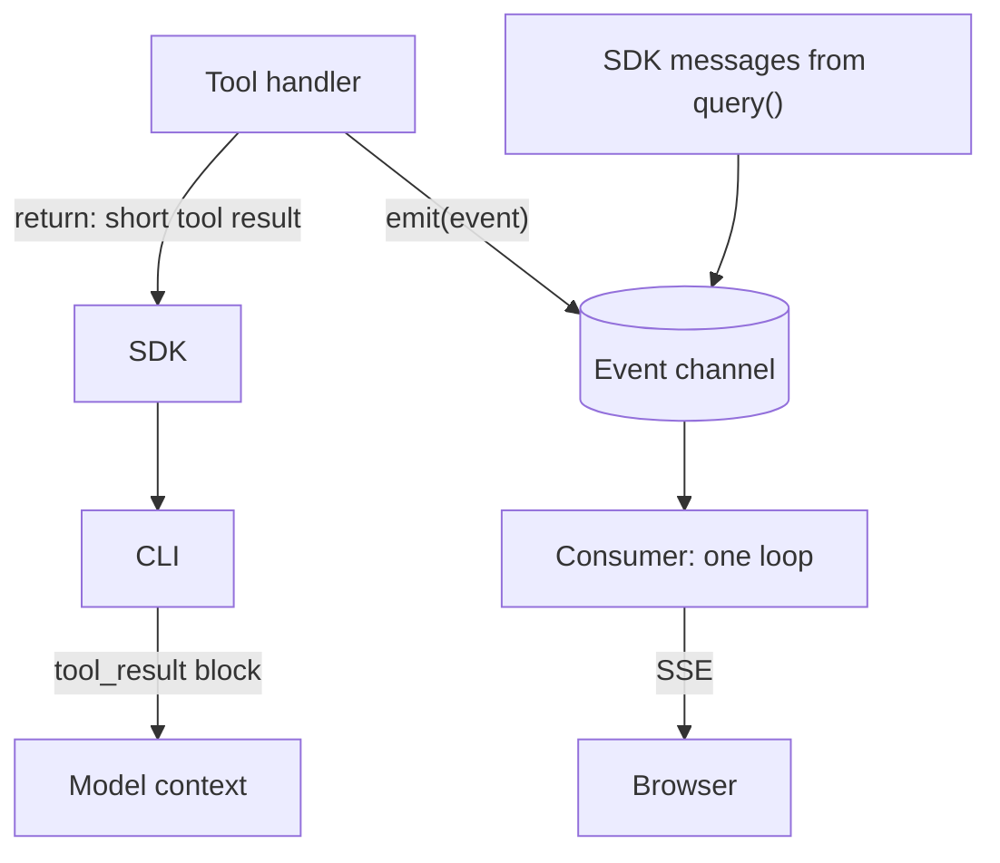

> [!note] Step 8 of 8 in the learning order
> This lesson ends step 8. It joins the emit callback of [2.1](/notes/ai/ai-engineering/01-software-engineering-fundamentals/m02-concurrency-foundations/l1-functions-as-values-and-callbacks), the closures of [2.2](/notes/ai/ai-engineering/01-software-engineering-fundamentals/m02-concurrency-foundations/l2-lambdas-and-closures), the queues of [2.4](/notes/ai/ai-engineering/01-software-engineering-fundamentals/m02-concurrency-foundations/l4-queues-and-producer-consumer) and the tools of [5.3](/notes/ai/ai-engineering/01-software-engineering-fundamentals/m05-streaming-and-agent-events/l3-mcp-tools-and-tool-execution). The [roadmap](/notes/ai/ai-engineering/01-software-engineering-fundamentals/roadmap) shows all 8 steps.

## 1. The question this idea answers

A user asks: "Which lines had the most stops this week?" The agent calls a tool. The tool reads 500 rows from the database.

Two parties want something from this tool call:

1. **The model** needs a short answer to continue its reasoning: "500 stops. Top lines: L3 (41), L7 (33), L1 (29)."
2. **The user** wants to see "Querying the stops table..." while the tool runs, then the full table and a chart.

If the tool sends all 500 rows to the model, the model's context fills with data that it does not need. Every later model call then costs more. If the tool sends only the short answer, the user never sees the table.

The question: **how does one tool send a short tool result to the model and rich user-visible events to the screen, at the same time, without blocking anything?**

## 2. Mental model

> [!analogy] A reporter in a live TV news show
> A reporter stands at the scene. Through the earpiece, the reporter gives the anchor in the studio a short summary: "Three trucks, no injuries." That is the tool result. The anchor (the model) uses it to decide what to say next.
>
> At the same time, the camera sends live pictures and the station shows a text ticker at the bottom of the screen. That is the stream of user-visible events. The viewers (the user) see them at once.
>
> **Where it stops working:** on TV, the anchor can also watch the live pictures. In an agent, the model never sees the events. The model sees only what the tool returns. If the model must know a fact, put that fact in the tool result.

## 3. Terms

| Term | Plain meaning |
|---|---|
| tool result | What a tool returns to the model. It enters the model's context. |
| user-visible event | A message for the user interface, not for the model: a status line, a progress value, a table, a chart. |
| emit callback | A function that a tool calls to publish one user-visible event, for example `emit({"type": "status", "text": "..."})`. |
| event channel | The queue or stream that carries events from all producers to the consumer. |
| fan-in | Many producers write into one channel. |
| event envelope | A fixed outer shape for every event: type, sequence number, ids and a payload. |
| sequence number | A counter that grows by 1 with every event. The client uses it to order events and to drop duplicates. |
| correlation id | An id that ties events together, for example the `tool_use_id` of one tool call. |
| backpressure | What a producer does when the consumer is slower: wait, drop or store. |
| thread-safe | Safe to call from several threads at the same time. |

## 4. How it works

### 4.1 Two audiences, two paths



The two paths have different rules:

| | Tool result | User-visible event |
|---|---|---|
| Reader | the model | the user |
| Path | return value of the handler, through the SDK and the CLI | `emit(...)`, the event channel, your stream endpoint |
| When it arrives | after the handler returns | at once, while the handler still runs |
| Cost | tokens in every later model call of the conversation | network bytes only |
| Size | small: counts, ids, a summary | can be large: tables, chart data |
| Format | MCP content blocks | your own JSON envelope |

### 4.2 What goes where

| Content | Tool result | User-visible event |
|---|---|---|
| "Querying the stops table..." | no | yes, as `status` |
| Progress "120 of 500 rows" | no | yes, as `progress` |
| The full 500-row table | no | yes, as `table` |
| A chart spec | no | yes, as `chart` |
| "500 stops. Top lines: L3 (41), L7 (33), L1 (29)." | yes | optional |
| An id the model can use in a later tool call, for example `report_id` | yes | optional |
| The SQL text that ran | no, unless the model must fix it | optional, for transparency |
| An error for the model to react to | yes, with `is_error` | yes, as `error` |

> [!example] Worked example: the cost of a large tool result (illustrative numbers)
> A tool returns 500 rows. Each row is about 30 tokens as text.
>
> 1. Size of the result: 500 × 30 = 15,000 tokens.
> 2. The agent then makes 4 more model calls in the same answer. Each call sends the full conversation again, including the tool result.
> 3. Extra input tokens: 15,000 × 4 = 60,000 tokens, before any later question of the user.
> 4. The same table as a `table` event costs 0 model tokens.
>
> Prompt caching can lower the price of repeated input, but the context window still fills ([prompt caching](/notes/ai/context-engineering/01-foundations/l7-prompt-caching)).

### 4.3 The emit callback, injected by a closure

A tool must call `emit`, but the tool must not know where events go. So the application gives `emit` to the code that builds the tools. A closure keeps it ([2.2](/notes/ai/ai-engineering/01-software-engineering-fundamentals/m02-concurrency-foundations/l2-lambdas-and-closures)).

```python
import asyncio
from typing import Any, Callable
from claude_agent_sdk import create_sdk_mcp_server, tool

Event = dict[str, Any]
Emit = Callable[[Event], None]                      # a function that takes one event and returns nothing

def build_server(emit: Emit):
    @tool("lookup_orders", "Count open orders for a line", {"line": str})
    async def lookup_orders(args: dict[str, Any]) -> dict[str, Any]:
        emit({"type": "status", "text": f"Looking up orders for {args['line']}"})   # to the user, now
        await asyncio.sleep(0.1)                                                     # stands for async DB work
        rows = [{"order": 1, "line": args["line"]}, {"order": 2, "line": args["line"]}]
        emit({"type": "table", "rows": rows})                                       # to the user: full data
        return {"content": [{"type": "text", "text": f"{len(rows)} open orders"}]}   # to the model: short

    server = create_sdk_mcp_server("plant", tools=[lookup_orders])
    return server, ["mcp__plant__lookup_orders"]
```

The caller decides what `emit` is. With a `queue.Queue` named `q`, the caller writes `build_server(q.put)`. `q.put` is a bound method: a function that remembers its queue ([2.1](/notes/ai/ai-engineering/01-software-engineering-fundamentals/m02-concurrency-foundations/l1-functions-as-values-and-callbacks)).

A test called the tool through an in-memory MCP client. Measured in a sandbox run (claude-agent-sdk 0.2.168, mcp 2.3.0, Python 3.13.16, 2026-10-19):

```text
TOOL RESULT (goes back to the model): ['2 open orders'] isError = False
EVENTS (go to the user, through the queue):
   {'type': 'status', 'text': 'Looking up orders for L3'}
   {'type': 'table', 'rows': [{'order': 1, 'line': 'L3'}, {'order': 2, 'line': 'L3'}]}
```

Why inject `emit` and not import a global queue:

1. **One channel for each request.** Two users who ask at the same time get two channels. A global queue would mix their events.
2. **Tests are simple.** A test passes `events.append` as `emit` and checks the list. No queue and no thread are needed.
3. **The tool does not know the transport.** The same tool works with a queue, a WebSocket, a log file or nothing (`lambda e: None`).

### 4.4 One event channel for many producers

In an agent service, at least two producers write into the channel:

1. The loop that reads `query()` and puts each SDK message.
2. Each tool handler that calls `emit`.

A tool can also call `emit` from a worker thread, for example inside a function that runs with `asyncio.to_thread`. A test made two producers on one event loop, plus one put from a worker thread, all into one `queue.Queue`. Each event got a sequence number at the moment of its put. Measured in a sandbox run:

```text
{'seq': 1, 'type': 'sdk_message', 'payload': 'msg1', 'thread': 'MainThread'}
{'seq': 2, 'type': 'status', 'payload': 'tool started', 'thread': 'MainThread'}
{'seq': 3, 'type': 'sdk_message', 'payload': 'msg2', 'thread': 'MainThread'}
{'seq': 4, 'type': 'status', 'payload': 'emitted from a worker thread', 'thread': 'asyncio_0'}
{'seq': 5, 'type': 'table', 'payload': [1, 2], 'thread': 'MainThread'}
{'seq': 6, 'type': 'sdk_message', 'payload': 'msg3', 'thread': 'MainThread'}
```

The consumer receives the events in the order of the `put` calls. Messages and tool events interleave. The put from the worker thread `asyncio_0` arrived safely, because `queue.Queue` is thread-safe. The Python docs say: "The Queue class in this module implements all the required locking semantics."

### 4.5 Which queue is safe from which thread

| Channel | Producer on the loop thread | Producer in another thread | Consumer |
|---|---|---|---|
| `queue.Queue` | `q.put(x)` is safe. It never waits when the queue is unbounded. | `q.put(x)` is safe. | a thread that calls `q.get()` |
| `asyncio.Queue` | `q.put_nowait(x)` or `await q.put(x)` | only through `loop.call_soon_threadsafe(q.put_nowait, x)` | a coroutine that does `await q.get()` |

The asyncio docs say that almost all asyncio objects are not thread-safe. A test called `asyncio.Queue.put_nowait` directly from another thread, while a coroutine waited in `await q.get()` with a 2 s timeout:

```text
threadsafe=False: consumer woke after 2.00s with 'event'
threadsafe=True: consumer woke after 0.20s with 'event'
```

The item went into the queue at 0.20 s in both cases. Without `call_soon_threadsafe`, the event loop did not know that it had work. It woke only when the 2 s timeout timer fired. With `call_soon_threadsafe`, the loop woke at once.

> [!trap] asyncio.Queue from another thread
> A direct `put_nowait` from another thread can leave the consumer asleep until something else wakes the loop. Use `queue.Queue` across threads, or send the put through `loop.call_soon_threadsafe`.

### 4.6 emit must never block

A tool handler runs on the event loop ([5.3](/notes/ai/ai-engineering/01-software-engineering-fundamentals/m05-streaming-and-agent-events/l3-mcp-tools-and-tool-execution)). So `emit` runs on the event loop too. If `emit` waits, the whole loop waits.

An unbounded `queue.Queue` never waits in `put`. The docs say: "If *maxsize* is less than or equal to zero, the queue size is infinite." A bounded queue waits when it is full. A test used `queue.Queue(maxsize=1)` with a slow consumer, and called `q.put` from a coroutine. Measured:

```text
longest heartbeat gap with maxsize=1 and a slow consumer: 0.60s
```

The loop stopped for 0.60 s inside `put`. Three designs handle a slow consumer:

| Design | How | Risk |
|---|---|---|
| Unbounded queue | `queue.Queue()` | Memory grows if the consumer stops reading. Watch `q.qsize()`. |
| Drop low-value events | `put_nowait` in a `try`, and on `queue.Full` drop a `progress` event | Never drop `table`, `error` or `done`. |
| Async backpressure | an `asyncio.Queue(maxsize=...)` with `await q.put(x)` in async code | The producer waits, but only that task, not the loop. |

### 4.7 An event envelope

Events from many producers need one shape, so that the client can handle them with one piece of code. A good envelope:

```json
{
  "seq": 17,
  "run_id": "run_8f2c",
  "type": "table",
  "tool_use_id": "toolu_01ABC",
  "ts": "2026-10-19T14:03:22.412Z",
  "payload": {"columns": ["line", "stops"], "rows": [["L3", 41], ["L7", 33]]}
}
```

| Field | Why |
|---|---|
| `seq` | order and de-duplication after a reconnect. It also becomes the SSE `id` ([5.1](/notes/ai/ai-engineering/01-software-engineering-fundamentals/m05-streaming-and-agent-events/l1-streaming-and-server-sent-events)). |
| `run_id` | events of two runs never mix |
| `type` | the client chooses the renderer: `status`, `progress`, `text_delta`, `table`, `chart`, `error`, `done` |
| `tool_use_id` | ties the event to one tool call in the transcript. Optional. |
| `ts` | timing and debugging |
| `payload` | the data of this type |

Two design rules:

1. **Convert SDK messages into your own event types.** SDK messages are Python dataclasses such as `AssistantMessage` with content blocks ([message and block types](/notes/ai/claude-agent-sdk/02-options-and-messages/l2-message-and-block-types)). Do not send them raw to a browser. Map a `TextBlock` to `text_delta` or `text`, and a `ToolUseBlock` to `tool_started`. Send only the fields the screen needs.
2. **End every run with `done` or `error`.** The client then knows that the answer is complete ([5.6](/notes/ai/ai-engineering/01-software-engineering-fundamentals/m05-streaming-and-agent-events/l6-what-partial-means)).

### 4.8 What the order guarantees, and what it does not

| Guaranteed | Not guaranteed |
|---|---|
| The channel is first in, first out. The consumer gets events in the order of the `put` calls. | The order between two producers. For example, the SDK message that holds the `ToolUseBlock` and the first `emit` of that tool are two separate tasks. |
| One task that emits A, then B, delivers A before B. | That an event arrives before the tool result reaches the model. The two paths are separate. |

To tie an event to its tool call, use an id. In the Agent SDK, a `ToolUseBlock` has an `id`, and the `ToolResultBlock` has the same value in `tool_use_id`. A tool handler receives only its arguments, not the id. Hooks such as `PreToolUse` receive a `tool_use_id` (the `HookCallback` type in the SDK source has the parameters `[HookInput, str | None, HookContext]`). If you need exact correlation, record the id in a hook and attach it to the events of that call ([hooks](/notes/ai/claude-agent-sdk/08-hooks-and-subagents/l1-hooks)).

### 4.9 The same idea in other frameworks

| Framework | Name of the emit callback |
|---|---|
| LangGraph | `get_stream_writer()` returns a writer for the `custom` stream mode ([stream modes and stream writer](/notes/ai/langchain-langgraph/05-streaming/l1-stream-modes-and-stream-writer)) |
| Node.js | `emitter.emit("event", data)` on an `EventEmitter` |
| Browsers | `dispatchEvent` on an element |

The idea is the same in each: the producer calls a function and does not know who listens.

### 4.10 Production view

| Concern | What to do |
|---|---|
| Privacy | Events reach the user's screen. Never put secrets, tokens or other users' data in them. |
| Size | Limit the rows of a `table` event. Send a link or a page id for more. |
| Rate | Throttle `progress` events, for example 1 for each 250 ms. |
| Resume | Store events with `seq` if a reconnect must resume ([5.2](/notes/ai/ai-engineering/01-software-engineering-fundamentals/m05-streaming-and-agent-events/l2-fastapi-streaming-responses)). |
| Facts for the model | If the model must know a fact, put it in the tool result. The model never sees events. |
| Errors | Send `error` to the user and an `is_error` result to the model. They need different words. |

## 5. Code walkthrough

A consumer that turns a mixed channel into envelopes. It assumes SDK messages and tool events share one `queue.Queue`, with a sentinel at the end ([2.4](/notes/ai/ai-engineering/01-software-engineering-fundamentals/m02-concurrency-foundations/l4-queues-and-producer-consumer)).

```python
import itertools
from claude_agent_sdk import AssistantMessage, ResultMessage, TextBlock, ToolUseBlock

def to_envelopes(items, run_id: str):                                   # 1
    seq = itertools.count(1)                                            # 2
    for item in items:                                                  # 3
        if isinstance(item, dict):                                      # 4
            yield {"seq": next(seq), "run_id": run_id, **item}
        elif isinstance(item, AssistantMessage):                        # 5
            for block in item.content:
                if isinstance(block, TextBlock):
                    yield {"seq": next(seq), "run_id": run_id, "type": "text", "text": block.text}
                elif isinstance(block, ToolUseBlock):
                    yield {"seq": next(seq), "run_id": run_id, "type": "tool_started",
                           "tool": block.name, "tool_use_id": block.id}
        elif isinstance(item, ResultMessage):                           # 6
            ok = not item.is_error and item.terminal_reason in ("completed", None)
            if ok:
                yield {"seq": next(seq), "run_id": run_id, "type": "done",
                       "stop_reason": item.stop_reason}
            else:
                yield {"seq": next(seq), "run_id": run_id, "type": "error",
                       "subtype": item.subtype, "terminal_reason": item.terminal_reason}
        # 7: other message types are not shown to the user
```

| Mark | What it does | Why |
|---|---|---|
| 1 | A generator that reads any iterable of items and yields envelopes. | It can read the `_run` bridge of [5.5](/notes/ai/ai-engineering/01-software-engineering-fundamentals/m05-streaming-and-agent-events/l5-case-study-the-run-bridge) and feed an SSE endpoint. |
| 2 | One counter for the run. | Every envelope gets the next `seq`. |
| 3 | Reads items one at a time. | It streams. It never collects the full list. |
| 4 | A dict is a tool event from `emit`. It gets `seq` and `run_id` and keeps its own fields. | Tool events already have a `type`. |
| 5 | An `AssistantMessage` becomes `text` and `tool_started` events. | The browser gets only the fields that it needs. |
| 6 | A `ResultMessage` ends the run. It becomes `done` only when `is_error` is false and `terminal_reason` is `"completed"` or `None`. Any other result becomes `error`, with its `subtype` and `terminal_reason`. | A failed or interrupted run also sends a `ResultMessage`, for example with the subtype `error_max_turns` or the terminal reason `aborted_streaming`. A plain `done` would mark it as complete. |
| 7 | Other types, for example `SystemMessage`, are skipped. | They are for the program, not for the user. |

## 6. Exercises

Runs in: a browser lab. [Open a lab for this lesson](/labs/new?note=ai/ai-engineering/01-software-engineering-fundamentals/m05-streaming-and-agent-events/l4-user-visible-event-channels). The lab has no threads, so use `asyncio` and an `asyncio.Queue`, and run with top-level `await main()`. Hints come in three levels in chat: idea, pseudocode, partial code.

**Exercise 5.4.1: one tool, two audiences.** Write `make_tool(emit)` that returns an `async def lookup(line: str) -> str`. It emits `status`, then `table` with 50 fake rows, and returns a one-line summary.

Acceptance tests:

- With `events = []` and `emit = events.append`, one call gives exactly 2 events, in the order `status`, `table`.
- The returned summary is shorter than 80 characters and contains the row count.
- The `table` event holds all 50 rows.

**Exercise 5.4.2: fan-in with an envelope.** Run two producers at the same time with `asyncio.gather`: a fake message stream (3 items, one each 0.1 s) and your tool. Both write into one `asyncio.Queue` through one function that adds `seq` and `run_id`.

Acceptance tests:

- The consumer receives 3 + 2 items, then a `done` envelope.
- The `seq` values are 1, 2, 3, ... with no gap and no repeat.
- Every envelope has the same `run_id`.

**Exercise 5.4.3: a drop policy.** Use `asyncio.Queue(maxsize=5)` and a slow consumer. Write `emit` so that it drops `progress` events when the queue is full, and never drops `table`, `error` or `done`.

Acceptance tests:

- With 100 `progress` events and 1 `table` event, the consumer gets the `table` event.
- At least one `progress` event is dropped, and the function counts the drops.
- `emit` never waits: each call returns in less than 1 ms.

## 7. Common mistakes

1. **Big data in the tool result.** It fills the context and costs tokens on every later call. Send it as an event.
2. **A fact only in an event.** The model never sees events. If it must reason about a fact, return it.
3. **A global event queue.** Two users' events mix. Inject `emit` for each request.
4. **A bounded `queue.Queue` with `put` on the event loop.** A full queue freezes the loop.
5. **`asyncio.Queue.put_nowait` from another thread.** The consumer may sleep. Use `call_soon_threadsafe` or `queue.Queue`.
6. **Raw SDK objects to the browser.** Convert them into your own envelope with only the needed fields.
7. **No `done` event.** The client cannot tell a full answer from a cut stream.
8. **Order between producers taken for granted.** Use `seq` and ids.

## 8. One-minute explanation

A tool has two audiences. The model gets the tool result: the return value, which enters the context and costs tokens on every later call, so keep it short. The user gets user-visible events: status lines, progress, tables and charts, which cost no model tokens. The tool publishes events with an emit callback, a function that the application injects through a closure, for example `build_server(q.put)`. The tool does not know where the events go, so tests can pass `events.append`. SDK messages and tool events share one event channel, and the consumer sees them in the order of the put calls. A `queue.Queue` is safe from any thread and never waits when it is unbounded. An `asyncio.Queue` needs `call_soon_threadsafe` from other threads. `emit` runs on the event loop, so it must never wait. Wrap every event in one envelope with `seq`, `run_id` and `type`. Map SDK messages to your own types. End every run with `done` or `error`.

## 9. Check questions

```check
{
  "question": "A tool fetched 2,000 rows. The user must see them in a table, and the model must say which line is worst. What goes into the tool result, and what goes into events?",
  "answer": "The tool result gets the small facts that the model needs: the row count and the worst lines with their numbers. The table event gets the full 2,000 rows for the screen, plus a status event while the query runs. The model never sees events, so any fact it must use belongs in the result."
}
```

```check
{
  "question": "Why does build_server take emit as a parameter instead of importing one global queue?",
  "answer": "Each request needs its own channel, so two users' events never mix. A parameter also makes tests simple: pass events.append and check the list. And the tool stays independent of the transport: queue, WebSocket, log or nothing."
}
```

```check
{
  "question": "A tool handler calls emit = q.put, where q = queue.Queue(maxsize=10). The browser is slow and the queue fills. What happens to the agent?",
  "hint": "Where does the handler run?",
  "answer": "q.put waits until a slot is free. The handler runs on the event loop, so the whole loop waits: the SDK reads no messages and other tools stop. Use an unbounded queue, or drop low-value events with put_nowait, or use an asyncio.Queue with await put so that only one task waits."
}
```

```check
{
  "question": "A worker thread calls aq.put_nowait(event) on an asyncio.Queue while a coroutine waits in await aq.get(). In the test, when did the coroutine wake, and why?",
  "answer": "It woke after 2.00 s, when its timeout timer fired, although the item was in the queue at 0.20 s. asyncio.Queue is not thread-safe: a put from another thread does not wake the event loop. loop.call_soon_threadsafe(aq.put_nowait, event) woke it at 0.20 s."
}
```

## 10. Links

- Before: [5.3 MCP tools and how a tool call runs](/notes/ai/ai-engineering/01-software-engineering-fundamentals/m05-streaming-and-agent-events/l3-mcp-tools-and-tool-execution), [2.4 Queues and the producer-consumer pattern](/notes/ai/ai-engineering/01-software-engineering-fundamentals/m02-concurrency-foundations/l4-queues-and-producer-consumer)
- Next: [5.5 Case study: the _run bridge, line by line](/notes/ai/ai-engineering/01-software-engineering-fundamentals/m05-streaming-and-agent-events/l5-case-study-the-run-bridge)
- Deeper: [Message and block types](/notes/ai/claude-agent-sdk/02-options-and-messages/l2-message-and-block-types), [Stream modes and stream writer](/notes/ai/langchain-langgraph/05-streaming/l1-stream-modes-and-stream-writer), [Tool results and errors](/notes/ai/context-engineering/06-tools-and-mcp/l4-tool-results-and-errors)
- [Glossary](/notes/ai/ai-engineering/glossary)

Sources (checked on 2026-10-19): [Python docs, queue](https://docs.python.org/3/library/queue.html), [Agent SDK Python reference](https://code.claude.com/docs/en/agent-sdk/python), the source code of claude-agent-sdk 0.2.168.
