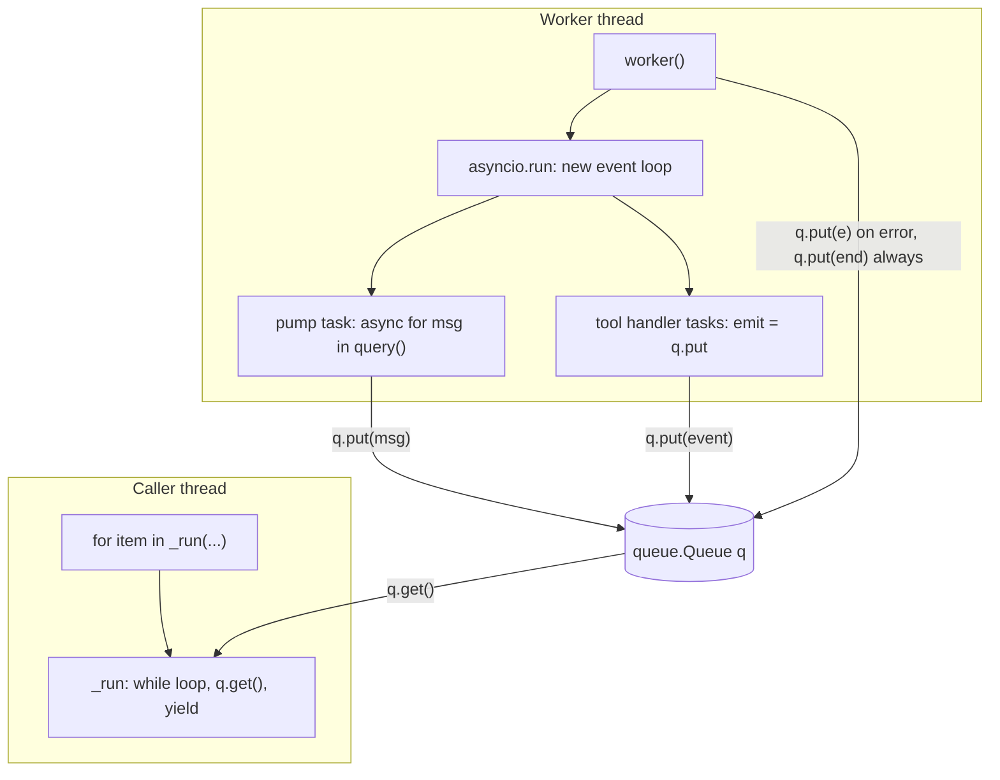
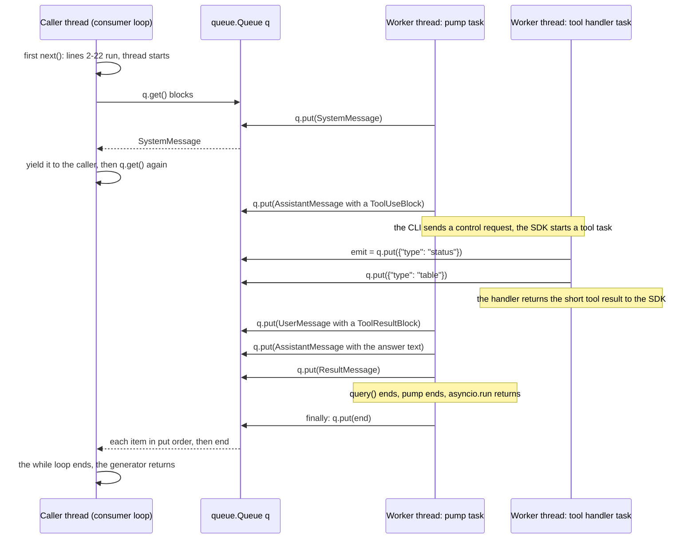
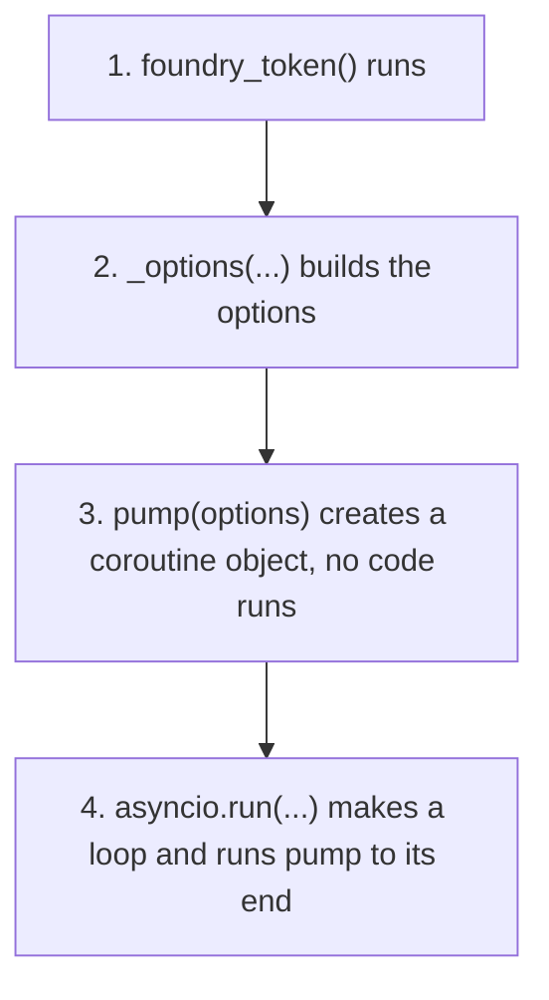

> [!note] This lesson uses all 8 steps of the learning order
> Read these lessons first. Each one gives one piece of the example.
>
> 1. [2.1 Functions as values and callbacks](/notes/ai/ai-engineering/01-software-engineering-fundamentals/m02-concurrency-foundations/l1-functions-as-values-and-callbacks): `q.put` is passed as a value.
> 2. [2.2 Lambdas and closures](/notes/ai/ai-engineering/01-software-engineering-fundamentals/m02-concurrency-foundations/l2-lambdas-and-closures): `pump` and `worker` use names of `_run`.
> 3. [2.3 Threads](/notes/ai/ai-engineering/01-software-engineering-fundamentals/m02-concurrency-foundations/l3-threads): `threading.Thread(...).start()` and `daemon=True`.
> 4. [2.4 Queues and the producer-consumer pattern](/notes/ai/ai-engineering/01-software-engineering-fundamentals/m02-concurrency-foundations/l4-queues-and-producer-consumer): `q.put`, `q.get` and the sentinel.
> 5. [2.5 Generators, yield, close() and GeneratorExit](/notes/ai/ai-engineering/01-software-engineering-fundamentals/m02-concurrency-foundations/l5-generators-and-yield): `yield item`.
> 6. [2.6 asyncio, async def, await and the event loop](/notes/ai/ai-engineering/01-software-engineering-fundamentals/m02-concurrency-foundations/l6-asyncio-and-the-event-loop): `async def`, `async for` and `asyncio.run`.
> 7. [2.7 Blocking calls and asyncio.to_thread](/notes/ai/ai-engineering/01-software-engineering-fundamentals/m02-concurrency-foundations/l7-blocking-calls-and-to-thread): why `q.get()` must not run on an event loop.
> 8. [5.1](/notes/ai/ai-engineering/01-software-engineering-fundamentals/m05-streaming-and-agent-events/l1-streaming-and-server-sent-events) and [5.2](/notes/ai/ai-engineering/01-software-engineering-fundamentals/m05-streaming-and-agent-events/l2-fastapi-streaming-responses): streams and generators in a web server.
> 9. [5.3](/notes/ai/ai-engineering/01-software-engineering-fundamentals/m05-streaming-and-agent-events/l3-mcp-tools-and-tool-execution) and [5.4](/notes/ai/ai-engineering/01-software-engineering-fundamentals/m05-streaming-and-agent-events/l4-user-visible-event-channels): tools, `emit` and the event channel.

## 1. The question this idea answers

This is the example:

```python
def _run(prompt: str, ui_context: str | None, session_id: str, resume: bool):
    q: queue.Queue = queue.Queue()
    end = object()

    async def pump(options):
        async for msg in query(prompt=prompt, options=options):
            q.put(msg)

    def worker():
        try:
            server, allowed = build_server(q.put)
            os.makedirs(WORK_DIR, exist_ok=True)
            asyncio.run(pump(_options(
                foundry_token(), ui_context, server, allowed,
                session_id, resume
            )))
        except Exception as e:
            q.put(e)
        finally:
            q.put(end)

    threading.Thread(target=worker, daemon=True).start()

    while (item := q.get()) is not end:
        if isinstance(item, Exception):
            raise item
        yield item
```

The line numbers in this lesson count the `def` line as line 1. Blank lines count too, so `yield item` is line 27.

The problem it solves: the Claude Agent SDK gives an **async** stream. `query()` is an async generator. The caller of `_run` is **sync** code: it wants a normal `for item in _run(...)` loop. The caller also wants the events that the tools publish while they run, in the same stream, in the right order.

So the question has three parts:

1. How can sync code read an async stream item by item, while the stream still runs?
2. How do the SDK messages and the tool events reach the same consumer?
3. How does the consumer know that the stream ended, or that it failed?

The example answers all three in 27 lines. This lesson explains each line, each name and each path that the code can take.

## 2. Mental model

> [!analogy] A night workshop, a conveyor belt and a shipping clerk
> The **worker thread** is a workshop in a separate building. It has its own manager: an **event loop**. The manager runs the agent and the tools, and switches between them while they wait.
>
> The **queue** is a conveyor belt from the workshop to the shipping desk. Everything that the workshop makes goes on the belt: SDK messages and the tool events. The belt is first in, first out.
>
> The **consumer loop** is a shipping clerk at the desk. The clerk takes one item from the belt, hands it to the customer (`yield`), and waits for the next item.
>
> When the shift ends, the workshop puts a red card on the belt: the **sentinel**. The clerk stops when the red card arrives. If a machine breaks, the workshop first puts the damage report on the belt (the exception object), then the red card. The clerk shows the report to the customer (`raise`).
>
> **Where it stops working:** in a real company, a clerk can phone the workshop and say "the customer left, stop". In this code, nothing travels from the desk back to the workshop. The belt goes in one direction only. Section 4.11 measures what that costs.

## 3. Terms

| Term | Plain meaning |
|---|---|
| bridge | Code that connects two worlds. Here: async code in a worker thread and sync code in the caller's thread. |
| sync generator | A `def` function with `yield`. Code reads it with a normal `for` loop. `_run` is one. |
| async generator | An `async def` function with `yield`. Code reads it with `async for`. `query()` is one. |
| worker thread | The extra thread that `threading.Thread` starts. It runs `worker()`. |
| event loop | The scheduler that runs coroutines. `asyncio.run` makes a new one inside the worker thread. |
| producer | The code that puts items into the queue: `pump` and the tools, through `q.put`. |
| consumer | The code that takes items: the `while` loop at the end of `_run`. |
| event channel | The queue `q`. It carries SDK messages, tool events, an exception and the sentinel. |
| sentinel | The unique object `end`. It marks "no more items". |
| emit callback | The function that a tool calls to publish a user-visible event. Here it is `q.put`. |
| bound method | A method taken from an object, such as `q.put`. It remembers the object. |
| closure | An inner function that uses names of the outer function. `pump` and `worker` are closures over names of `_run`. |
| free variable | A name that a closure uses but does not define. Python stores it in a cell. |
| daemon thread | A thread that does not keep the program alive. Python stops it abruptly at exit. |
| assignment expression | The `:=` operator ("walrus"). It assigns a value and gives the value back, inside a larger expression. |
| lazy start | A generator runs no code of its body until the first `next()`. |
| silent truncation | A stream ends early, but the consumer sees a normal end and treats the result as complete. |
| stop signal | A message from the consumer to the producer: "stop now". The example has none. |

## 4. How it works

### 4.1 What the example uses but does not define

The example calls names that it does not show. One of them is known. The others are assumptions, from their names and their use.

| Name | Status | Meaning in this lesson |
|---|---|---|
| `query` | known | The Claude Agent SDK function. Its signature: `async def query(*, prompt, options=None, transport=None) -> AsyncIterator[Message]` (Python reference, checked on 2026-10-19). |
| `build_server(emit)` | assumption | Builds an in-process MCP server whose tools call `emit` ([5.3](/notes/ai/ai-engineering/01-software-engineering-fundamentals/m05-streaming-and-agent-events/l3-mcp-tools-and-tool-execution), [5.4](/notes/ai/ai-engineering/01-software-engineering-fundamentals/m05-streaming-and-agent-events/l4-user-visible-event-channels)). Returns the server config and the list of full tool names. |
| `_options(...)` | assumption | Builds a `ClaudeAgentOptions` from a token, the UI context, the server, the allowed tools, the session id and the resume flag. |
| `foundry_token()` | assumption | Gets an access token for the model provider. It can make a network call and wait. |
| `WORK_DIR` | assumption | A module-level constant: the path of the folder where the agent works. |
| `queue`, `threading`, `asyncio`, `os` | known | Modules of the standard library. The file imports them. |

The fakes in the experiments of this lesson follow these assumptions.

### 4.2 The shape: two threads, one event loop, one queue



Two threads run at the same time:

1. **The caller thread** runs the consumer loop. It blocks in `q.get()` until an item arrives.
2. **The worker thread** runs one event loop. On that loop run the `pump` task, the SDK's own tasks and one task for each tool call. One SDK task reads the CLI output.

The queue is the only object that both threads touch. `queue.Queue` is made for this: "It is especially useful in threaded programming when information must be exchanged safely between multiple threads" (Python docs, `queue`).

### 4.3 Why the query runs in a separate thread and its own event loop

`_run` is a sync generator. It can call functions, but it cannot `await` and it cannot use `async for`. `query()` is an async generator. Only an event loop can run it. So sync code must start an event loop somewhere. Four designs exist:

| Design | Streams item by item? | Works when the caller's thread already runs a loop? | SDK tasks keep running while the consumer is busy? | Extra thread? |
|---|---|---|---|---|
| A. `asyncio.run(collect_all())` inside `_run` | no: you get the list at the end | no: `RuntimeError` | yes | no |
| B. `loop.run_until_complete(agen.__anext__())` for each item, in the caller's thread | yes | no | no: the loop runs only while the consumer waits for the next item | no |
| C. A worker thread with its own loop, and a queue (the example) | yes | yes | yes | one for each run |
| D. No bridge: async caller code does `async for msg in query(...)` | yes | (the caller is async) | yes | no |

Measurements behind the table, from sandbox runs (Python 3.13.16, 2026-10-19):

**Design A fails inside a running loop.** `asyncio.run` refuses to start when the thread already runs a loop:

```text
RuntimeError: asyncio.run() cannot be called from a running event loop
```

The Python docs say: "This function cannot be called when another asyncio event loop is running in the same thread." A sync function can run in such a thread. Examples: a Jupyter cell, or code that an async framework calls. Even when design A works, `asyncio.run` returns only after the coroutine ends, so the first item arrives at the end.

**Design B freezes the SDK between items.** A test drove an async source with `run_until_complete` for each item. A background task stood for the SDK's reader task and wanted to run every 0.1 s. The consumer spent 0.5 s on each item:

```text
run_until_complete in the caller thread: reader ticks [0.1, 0.6, 0.7, 1.2, 1.3, 'source done at 1.8s'], consumer done at 1.8s
thread bridge:                         reader ticks [0.1, 0.2, 'source done at 0.3s'], consumer done at 1.6s
```

With design B, the reader ran at 0.1 s, then not again until 0.6 s. The loop stopped every time the consumer worked. With the thread bridge, the source finished at 0.3 s, and the consumer read the queued items later. For an agent, a frozen loop means that nobody reads the CLI output and nobody answers tool calls. That happens every time the consumer works, for example while it sends bytes to a slow browser.

**Design C is the example.** The worker thread has no running loop, so `asyncio.run` works there. The loop runs all the time, at its own speed. The consumer reads at its own speed. The queue sits between them and stores items when the consumer is slower.

**Design D is best when the caller is async.** An `async def` FastAPI endpoint can iterate `query()` directly. No thread is needed, and a disconnect cancels the agent at once ([5.2](/notes/ai/ai-engineering/01-software-engineering-fundamentals/m05-streaming-and-agent-events/l2-fastapi-streaming-responses)). The thread bridge is for callers that must be sync.

> [!key] One sentence
> The worker thread gives the async SDK an event loop that runs all the time, in a thread where `asyncio.run` is allowed. The sync caller reads the results through a thread-safe queue, at its own speed.

The worker thread also isolates the run. The loop, the SDK's tasks and the CLI subprocess transport all belong to one loop for the whole run. Nothing of the caller's code can block that loop.

### 4.4 How q.put acts as a callback

A callback is a function that you give to other code, so that the other code can call it later ([2.1](/notes/ai/ai-engineering/01-software-engineering-fundamentals/m02-concurrency-foundations/l1-functions-as-values-and-callbacks)). Line 11 passes `q.put` without parentheses:

```python
server, allowed = build_server(q.put)     # pass the method, do not call it
```

1. `q.put` is a **bound method**. It is a function object that remembers `q`. A test showed it: `emit.__self__ is q` is `True`, and `emit.__func__` is `Queue.put`.
2. `build_server` stores it, usually under the name `emit`, inside the closures of its tools.
3. Later, the model calls a tool. The tool handler runs `emit({"type": "status", ...})`. That is the same as `q.put({"type": "status", ...})`. The event goes onto the same queue as the SDK messages.

Three facts make this safe:

| Fact | Why it matters |
|---|---|
| The tool handler runs as a task on the worker thread's event loop ([5.3](/notes/ai/ai-engineering/01-software-engineering-fundamentals/m05-streaming-and-agent-events/l3-mcp-tools-and-tool-execution)). | `q.put` runs in the worker thread, the same thread as `pump`. |
| `queue.Queue` is thread-safe. | A put from any thread is safe, also from a function that a tool moved into `asyncio.to_thread`. |
| `queue.Queue()` has no `maxsize`, so it is unbounded. | `put` never waits. A waiting `put` would freeze the whole event loop ([5.4](/notes/ai/ai-engineering/01-software-engineering-fundamentals/m05-streaming-and-agent-events/l4-user-visible-event-channels) measured 0.60 s with `maxsize=1`). |

`pump` uses the same method directly at line 7: `q.put(msg)`. So two producers share one channel: the SDK messages from `pump` and the user-visible events from the tools.

### 4.5 How events travel from the producer to the consumer



The path of one item:

1. A producer in the worker thread calls `q.put(x)`. The queue stores `x` at its end and wakes a thread that waits in `get`.
2. The caller thread waits in `q.get()`. It wakes and receives the oldest item.
3. The loop checks the item: the sentinel, an exception, or a normal item.
4. A normal item goes to the caller through `yield item`. The generator pauses.
5. The caller handles the item, for example it formats an SSE event. Then it calls `next()` again, and the loop calls `q.get()` again.

During step 5, the worker thread continues. New items wait in the queue. This decoupling is the reason for the queue.

A sandbox run used fakes: a `query()` that yields 5 messages, one every 0.2 s, and a tool that emits one event before message 3. It gave this order:

```text
0.20s first next() returned 'msg1' | threads now: 2
0.40s consumer got 'msg2' on MainThread
0.60s consumer got {'type': 'tool_event', 'text': 'querying table', 'thread': 'Thread-1 (worker)'} on MainThread
0.60s consumer got 'msg3' on MainThread
0.80s consumer got 'msg4' on MainThread
1.01s consumer got 'msg5' on MainThread
```

The event was made on `Thread-1 (worker)` and received on `MainThread`. The order is the order of the `put` calls. The order between an SDK message and a tool event from two different tasks is not guaranteed ([5.4](/notes/ai/ai-engineering/01-software-engineering-fundamentals/m05-streaming-and-agent-events/l4-user-visible-event-channels), section 4.8).

### 4.6 Why the sentinel is necessary

`q.get()` with no timeout blocks until an item arrives. If no item arrives, it blocks forever. So the producer must say "the stream is over", and it must say it **in the queue**, after the last item. Three choices exist, and only one is safe here:

| End signal | Problem |
|---|---|
| none | The consumer waits in `q.get()` forever after the last message. |
| `None` or a string such as `"END"` | A real item can have the same value. A test put `["a", None, "b"]` and ended with `None`: the consumer got only `['a']`. |
| `end = object()` | A new `object()` is unique. Nothing else in the program is this object. The test with `object()` delivered `['a', None, 'b']`. |

The loop compares with `is not end`, not with `!=`. `is` compares identity: "is this the same object". An item cannot be identical to `end` by accident. `object() == object()` is `False`.

The sentinel goes into the queue in `finally` at line 20. `finally` runs after the `try` block in every case: a normal end, an `Exception`, and also a `BaseException`. So the consumer never waits forever, as long as the worker thread reaches its `finally`. (One case skips it: the interpreter stops a daemon thread at exit, section 4.12.)

The queue keeps order, so the sentinel arrives after every item that was put before it, and after the exception of line 18. One consumer reads this queue, so one sentinel is enough. Two consumers would need two sentinels ([2.4](/notes/ai/ai-engineering/01-software-engineering-fundamentals/m02-concurrency-foundations/l4-queues-and-producer-consumer)).

### 4.7 How yield streams results to the caller

`_run` contains `yield`, so it is a generator function. Measured: `inspect.isgeneratorfunction(_run)` is `True`.

1. **The call does nothing.** `gen = _run(...)` returns a generator object. No line of the body runs. The test measured "threads before: 1 | after call: 1": no thread started.
2. **The first `next()` starts everything.** Lines 2 to 22 run: the queue, the sentinel, the two inner functions and the thread. Then line 24 waits for the first item. The test: "0.20s first next() returned 'msg1' | threads now: 2".
3. **Each `yield item` hands one item to the caller and pauses.** The body stays frozen at `yield`, with all its local names, until the next `next()`.
4. **The end.** When `end` arrives, the `while` loop ends. The function returns, so the generator raises `StopIteration`, and the caller's `for` loop ends normally.
5. **An error.** When an exception object arrives, `raise item` raises it inside the generator. It travels out of `next()` into the caller's `for` loop, in the caller's thread.

So the caller sees a plain iterator:

```python
for item in _run("Which line had the most stops?", None, session_id, resume=False):
    handle(item)          # SDK messages and tool events, one at a time
```

A web framework can use the same generator as a response body ([5.2](/notes/ai/ai-engineering/01-software-engineering-fundamentals/m05-streaming-and-agent-events/l2-fastapi-streaming-responses)).

### 4.8 The order of evaluation in lines 13 to 16

```python
asyncio.run(pump(_options(
    foundry_token(), ui_context, server, allowed,
    session_id, resume
)))
```

Python evaluates the arguments of a call before it calls the function. So the steps happen from the inside out:



1. `foundry_token()` runs first, in the worker thread. The test logged "foundry_token() runs on Thread-1 (worker)". If it makes a slow network call, it delays only the worker, not the caller's thread.
2. `_options(...)` builds the options object with the token and the other values.
3. `pump(options)` creates a coroutine object. Calling a coroutine function runs no code ([2.6](/notes/ai/ai-engineering/01-software-engineering-fundamentals/m02-concurrency-foundations/l6-asyncio-and-the-event-loop)).
4. `asyncio.run(...)` creates a new event loop, runs the coroutine until it ends, finalizes async generators, closes the default executor and closes the loop. The Python docs say the function takes "care of managing the asyncio event loop, *finalizing asynchronous generators*, and closing the executor".

If step 1 or step 2 raises, `asyncio.run` never runs. The exception goes to the `except` block of line 17, and the consumer receives it.

`build_server(q.put)` at line 11 runs even earlier, before any event loop exists. That is fine: it only builds objects. The tools run later, as tasks on the loop of step 4.

### 4.9 The exception path

If `query()` raises an `Exception`, the exception leaves `pump`, leaves `asyncio.run` and reaches line 17. A test made the fake `query()` raise `ConnectionError("CLI process exited")` before message 3:

```text
0.20s consumer got 'msg1'
0.40s consumer got 'msg2'
0.60s consumer caught ConnectionError: CLI process exited
traceback frames: ['<module>', '_run', 'worker', 'run', 'run', 'run_until_complete', 'pump', 'query']
```

1. Line 18 puts the exception object into the queue.
2. Line 20 puts the sentinel.
3. The consumer receives the exception at line 24, line 25 sees that it is an `Exception`, and line 26 raises it.
4. The caller gets the same exception type and message, in its own thread.

The traceback holds frames from both threads: `<module>` and `_run` from the caller, then `worker`, `asyncio` internals, `pump` and `query` from the worker. The exception object kept its original traceback, and `raise item` added the consumer frames. So the logs show where the error started.

Without lines 17 and 18, the exception would end the worker thread. The default `threading.excepthook` prints it to stderr, and nothing else happens ([2.3](/notes/ai/ai-engineering/01-software-engineering-fundamentals/m02-concurrency-foundations/l3-threads)). An exception in a thread never reaches the code that started the thread by itself. The queue is the road that the example builds for it.

> [!note] Tool errors do not take this path
> An exception inside a tool handler does not reach `pump`. The SDK turns it into a tool result with `isError: true` for the model ([5.3](/notes/ai/ai-engineering/01-software-engineering-fundamentals/m05-streaming-and-agent-events/l3-mcp-tools-and-tool-execution)). This path carries failures of the SDK, the CLI, the token call and the options.

### 4.10 The BaseException path: silent truncation

`except Exception` catches `Exception` and its subclasses. It does not catch `BaseException` subclasses that are not `Exception`: `asyncio.CancelledError`, `KeyboardInterrupt`, `SystemExit` and `GeneratorExit`. A test made the fake `query()` raise `asyncio.CancelledError` before message 3:

```text
0.60s loop ended normally, items = ['msg1', 'msg2']  <- looks complete, but it is not
Exception in thread Thread-3 (worker):
Traceback (most recent call last):
  ...
asyncio.exceptions.CancelledError
0.60s worker finally: sentinel put on Thread-3 (worker)
```

1. `except Exception` did not match, so line 18 did not run.
2. `finally` ran, so the sentinel arrived.
3. The consumer saw a normal end after 2 items. The caller received a short answer and no error.
4. Only stderr showed the traceback, through `threading.excepthook`.

This is **silent truncation**. The caller cannot tell a complete answer from a cut answer. Two defenses help. First, forward `BaseException` too (section 4.13). Second, check for a final `ResultMessage` that reports success, before the caller treats the answer as complete. Success means `is_error` is false and `terminal_reason` is `"completed"` or `None`. A failed or interrupted run also ends with a `ResultMessage` ([5.6](/notes/ai/ai-engineering/01-software-engineering-fundamentals/m05-streaming-and-agent-events/l6-what-partial-means)).

### 4.11 The consumer-leaves path, and FastAPI

The queue carries items from the worker to the consumer. Nothing carries a message back. A test read 2 items of an 8-item stream, left the loop with `break` and called `gen.close()`:

```text
0.40s consumer left the loop; generator state = suspended
0.40s gen.close() returned; gi_frame is None: True
0.40s other threads alive: ['Thread-4 (worker)']
0.60s query yields msg3 on Thread-4 (worker)
...
1.61s query yields msg8 on Thread-4 (worker)
1.61s query finished on Thread-4 (worker)
1.61s worker finally: sentinel put on Thread-4 (worker)
```

`gen.close()` raised `GeneratorExit` at line 27, the paused `yield`. `_run` has no `try` or `finally` around its loop, so the generator ended at once. But the worker thread ran for 1.2 s more, until the agent ended. With a real agent, that means more model calls, more tool calls and more cost, for a reader who left. The items stay in the queue, and the queue disappears when nothing refers to it.

Under FastAPI the stop is even later. A test used the same bridge as a `StreamingResponse` body ([5.2](/notes/ai/ai-engineering/01-software-engineering-fundamentals/m05-streaming-and-agent-events/l2-fastapi-streaming-responses), FastAPI 0.149.0, Starlette 1.9.0, uvicorn 0.54.0). The client read 2 events and closed the connection:

```text
0.68s client: connection closed
2.48s query finished
2.48s worker: sentinel put, thread ends
3.71s _run: GeneratorExit at yield (consumer closed the generator)
```

The generator was closed only when the garbage collector ran, 1.2 s after the agent had already finished. While the stream waited in `q.get()`, it also held one of the 40 AnyIO worker threads.

### 4.12 Interpreter exit and the daemon flag

`daemon=True` tells Python that this thread must not keep the program alive. The Python docs: "Daemon threads are abruptly stopped at shutdown. Their resources (such as open files, database transactions, etc.) may not be released properly."

| `daemon=` | At interpreter exit, while an agent run is active |
|---|---|
| `True` (the example) | The program exits at once. The worker stops in the middle. Its `finally` may not run. |
| `False` | The program waits until the agent run ends. A stuck run blocks the exit. |

For a server process that a platform stops and restarts, `daemon=True` avoids a hung shutdown. The price: a run in progress ends without cleanup.

### 4.13 Risks and improvements

These are design points. The key lines show the idea, not a full solution. Exercise 5.5.1 asks you to build the full version.

| Risk | Evidence | Improvement | Key lines |
|---|---|---|---|
| The consumer leaves, and the agent keeps running | 4.11: the worker ran 1.2 s more | A stop signal from the consumer's `finally` to the loop | `loop.call_soon_threadsafe(task.cancel)` |
| A `BaseException` looks like a normal end | 4.10: 2 items, no error | Forward every failure, then let the worker end | `except BaseException as e: q.put(_Failed(e))` |
| An item that is an `Exception` instance by design is raised | `isinstance(item, Exception)` cannot tell data from failure | A wrapper type for failures | `@dataclass class _Failed: exc: BaseException` (on separate lines), then `isinstance(item, _Failed)` |
| The worker dies before its `finally` | interpreter exit, a bug in the thread start | A time limit on each wait | `q.get(timeout=300)`, then raise a clear `TimeoutError` |
| The queue grows if the consumer stalls | an unbounded queue | Keep it unbounded (a bounded `put` freezes the loop), but watch its size | `q.qsize()` in a log line |
| No return type | the caller does not know the item types | Annotate the return type | `-> Iterator[Message \| Event]` |
| Unnamed thread | logs show `Thread-4 (worker)` | Give it a name | `threading.Thread(target=worker, name="agent-run", daemon=True)` |
| Raw SDK objects mixed with dict events | the consumer must test types | One envelope for every item ([5.4](/notes/ai/ai-engineering/01-software-engineering-fundamentals/m05-streaming-and-agent-events/l4-user-visible-event-channels)) | `{"type": ..., "seq": ..., "payload": ...}` |

The stop signal needs three parts. A sandbox run measured them together (`run_stoppable` in the experiments, 2026-10-19):

1. `pump` records where it runs: `asyncio.get_running_loop()` and `asyncio.current_task()`. A `threading.Event` tells the consumer that the values exist.
2. The consumer wraps its loop in `try` and `finally`. In `finally`, it asks the loop to cancel the task: `loop.call_soon_threadsafe(task.cancel)`. A plain `task.cancel()` from another thread is not safe ([sync code calling async code](/notes/software-engineering/python/01-asyncio/l3-sync-code-calling-async-code)).
3. The worker treats this `CancelledError` as a normal stop, not as a failure.

```text
0.60s consumer got msg2
0.60s consumer finally: cancel sent to the loop
0.60s query: CancelledError -> stops
0.60s worker: pump was cancelled
0.60s worker: thread ends
threads alive: []
```

The agent stopped at the moment the consumer left. One limit remains: the consumer's `finally` runs when the generator closes. In plain Python that is at `close()` or when the last reference goes. Under FastAPI it is at garbage collection (4.11). In an async web server, design D of section 4.3 stops faster.

## 5. Code walkthrough

Every line. "Runs in" says which thread runs the line. Lines 2 to 22 run only at the first `next()` (lazy start, section 4.7).

| Line | Code | Runs in | What it does | Why it is there |
|---|---|---|---|---|
| 1 | `def _run(prompt: str, ui_context: str \| None, session_id: str, resume: bool):` | (definition) | Defines a generator function with four annotated parameters. | The `yield` at line 27 makes it a generator. The annotations document the types. |
| 2 | `q: queue.Queue = queue.Queue()` | caller | Creates an unbounded, thread-safe FIFO queue. | The event channel between the two threads. The annotation of a local name is not checked or stored at run time. |
| 3 | `end = object()` | caller | Creates a unique object. | The sentinel. Identity makes it impossible to confuse with an item. |
| 5 | `async def pump(options):` | (definition) | Defines a coroutine function. It is a closure over `prompt` and `q`. | The producer must be async, because `query()` is an async generator. |
| 6 | `async for msg in query(prompt=prompt, options=options):` | worker loop | Reads SDK messages one by one. Each wait gives the loop to other tasks. | The source of the stream. |
| 7 | `q.put(msg)` | worker loop | Puts each message at the end of the queue. It never waits. | Hands the message to the consumer thread. |
| 9 | `def worker():` | (definition) | Defines the thread body. A closure over `q`, `end`, `pump`, `ui_context`, `session_id` and `resume`. | `threading.Thread` needs a callable to run. |
| 10 | `try:` | worker | Starts the protected block. | Every failure must reach the consumer. |
| 11 | `server, allowed = build_server(q.put)` | worker | Builds the tool server. Passes `q.put` as the emit callback. Unpacks a tuple of two values. | Tools publish user-visible events into the same channel. |
| 12 | `os.makedirs(WORK_DIR, exist_ok=True)` | worker | Creates the folder and its parents. `exist_ok=True`: no error if it exists. | The agent needs its working folder. |
| 13 | `asyncio.run(pump(_options(` | worker | Starts the event loop (step 4 of section 4.8). | The only line that runs async code. |
| 14 | `foundry_token(), ui_context, server, allowed,` | worker | Arguments of `_options`. `foundry_token()` runs first. | The token is fetched off the caller's thread. |
| 15 | `session_id, resume` | worker | The last two arguments. | Lets the SDK resume an earlier session. |
| 16 | `)))` | worker | Closes `_options(`, `pump(` and `asyncio.run(`. | Three calls, from the inside out. |
| 17 | `except Exception as e:` | worker | Catches `Exception` and subclasses. Not `BaseException`. | Turns a failure into an item (section 4.9). |
| 18 | `q.put(e)` | worker | Puts the exception object into the queue. | The consumer will raise it in the caller's thread. |
| 19 | `finally:` | worker | Runs after the `try` block in every case. | The end signal must always be sent. |
| 20 | `q.put(end)` | worker | Puts the sentinel. | Ends the consumer loop. Without it, `q.get()` waits forever. |
| 22 | `threading.Thread(target=worker, daemon=True).start()` | caller | Creates a thread object, passes `worker` as a value, starts it. `start()` returns at once. | The producer now runs next to the consumer. No `join`: the consumer does not wait for the thread, it waits for items. |
| 24 | `while (item := q.get()) is not end:` | caller | Blocks until an item arrives, assigns it to `item`, and continues while it is not the sentinel. | The consumer loop. `:=` needs Python 3.8 or later. |
| 25 | `if isinstance(item, Exception):` | caller | Checks for a forwarded failure. | Separates failures from data. |
| 26 | `raise item` | caller | Raises the worker's exception in the caller's thread, with its traceback. | The caller learns about the failure. |
| 27 | `yield item` | caller | Gives the item to the caller and pauses the generator. | Streams each item as it arrives. |

### 5.1 Every variable

| Name | Kind | Value | Lives in |
|---|---|---|---|
| `prompt`, `ui_context`, `session_id`, `resume` | parameters of `_run` | the request | cells of `_run`, read by the closures |
| `q` | local of `_run` | the `queue.Queue` | a cell, shared by `pump`, `worker` and the consumer loop |
| `end` | local of `_run` | the sentinel object | a cell, used by `worker` and the loop |
| `pump` | local of `_run` | a coroutine function | a cell, used by `worker` |
| `worker` | local of `_run` | a plain function | passed to `Thread` as `target` |
| `options` | parameter of `pump` | the options from `_options` | the frame of `pump` |
| `msg` | loop variable of `pump` | one SDK message | the frame of `pump` |
| `server`, `allowed` | locals of `worker` | the tool server config and the full tool names | the frame of `worker` |
| `e` | local of `worker` | the caught exception | deleted at the end of the `except` block |
| `item` | local of `_run` | the current queue item | the generator frame, kept between `yield`s |

A sandbox check of the closures (`__code__.co_freevars`, Python 3.13.16):

```text
pump free variables:   ('prompt', 'q')
worker free variables: ('end', 'pump', 'q', 'resume', 'session_id', 'ui_context')
_run cell variables:   ('prompt', 'ui_context', 'session_id', 'resume', 'end', 'pump', 'q')
```

`worker` does not use `prompt` directly. It uses `pump`, and `pump` uses `prompt`.

### 5.2 The type annotations

| Annotation | Meaning | Checked at run time? |
|---|---|---|
| `prompt: str` | a string | no |
| `ui_context: str \| None` | a string or `None` (the `X \| Y` syntax needs Python 3.10 or later at run time) | no |
| `session_id: str`, `resume: bool` | a string, a boolean | no |
| `q: queue.Queue` | a local variable annotation. `queue.Queue[object]` would also name the item type. | no. Python does not store or evaluate annotations of local names. |
| (none on the return) | A generator could say `-> Iterator[Message \| Event]` or `-> Generator[Message \| Event, None, None]`. | — |

Measured: `_run.__annotations__` gave `{'prompt': <class 'str'>, 'ui_context': str | None, 'session_id': <class 'str'>, 'resume': <class 'bool'>}`. A static type checker reads the annotations. Python itself does not check them ([1.8](/notes/ai/ai-engineering/01-software-engineering-fundamentals/m01-python-foundations/l8-type-annotations-and-pydantic)).

## 6. Exercises

Runs in: your local practice project. The browser lab has no threads. Use a fake `query()` (an async generator with `asyncio.sleep`) and a fake `build_server`, as in the experiments of this lesson. No model and no API key are needed. Hints come in three levels in chat: idea, pseudocode, partial code.

**Exercise 5.5.1: a hardened bridge.** Write `run_bridge(make_source, build_server, *, item_timeout: float) -> Iterator[object]`. `make_source(emit)` returns an async iterable. Keep the structure of the example, and add the improvements of section 4.13.

Acceptance tests (pytest):

1. **Streams:** with a source that yields 5 items, one every 0.2 s, the first item reaches the consumer before 0.35 s.
2. **Events:** an `emit` call from inside the source arrives in the same stream, in put order.
3. **Failure:** a source that raises `ConnectionError` after 2 items makes the consumer raise `ConnectionError` after 2 items.
4. **No silent truncation:** a source that raises `asyncio.CancelledError` by itself makes the consumer raise an error, not end normally.
5. **Data, not failure:** a source that yields `ValueError("x")` as a normal item delivers it as an item.
6. **Stop:** a consumer leaves with `break` after 2 of 10 items, then calls `close()`. The source receives `CancelledError` within 0.3 s, and the worker thread ends within 1 s.
7. **Time limit:** a source that waits longer than `item_timeout` makes the consumer raise `TimeoutError` with a clear message.
8. **Thread name:** while it runs, `threading.enumerate()` shows a thread named `agent-run`.

**Exercise 5.5.2: predict, then run.** Use this fake. `query()` yields `m1` at 0.1 s. The tool emits `e1` at 0.15 s. `query()` yields `m2` at 0.2 s and then raises `RuntimeError`. On paper, write the list that the consumer receives and the moment of the exception. Then run it.

Acceptance test: your prediction matches the run in items, order and exception type.

**Exercise 5.5.3: explain it back.** Without notes, write ten sentences that explain the example to another engineer. Write one sentence for each of these: the queue, the sentinel, `pump`, `worker`, the evaluation order of line 13, the thread start, the walrus loop, `raise item`, `yield item` and the missing stop signal.

Acceptance test: each sentence names the exact line and gives a reason, not only a description.

## 7. Common mistakes

1. **"The thread starts when I call `_run`."** It starts at the first `next()`. Calling a generator function runs no code.
2. **"`except Exception` catches every failure."** `CancelledError`, `KeyboardInterrupt` and `SystemExit` pass through. The consumer then sees a normal end.
3. **"`None` is a fine end marker."** A real item can be `None`. Use `object()` and compare with `is`.
4. **Putting the sentinel only at the end of `try`.** On an error it never arrives, and the consumer waits forever. Put it in `finally`.
5. **`q.get()` inside async code.** It blocks the event loop thread. The consumer loop must run in a sync thread, as here.
6. **A bounded queue to save memory.** `put` then waits on the event loop and freezes the agent.
7. **"Closing the generator stops the agent."** Nothing in the example tells the worker. The agent runs to its end.
8. **Expecting tool exceptions in the consumer.** The SDK turns them into tool results for the model.
9. **Sharing an async client between runs.** Each run has its own event loop, and an async client belongs to one loop.

## 8. Questions and answers

### Why does the query run in a separate thread and its own event loop?

Because the caller is sync and `query()` is async. `_run` is a `def` generator, so it cannot `await` or use `async for`. Only an event loop can run `query()`. The example cannot simply call `asyncio.run` in the caller's thread, for two reasons. First, `asyncio.run` raises `RuntimeError: asyncio.run() cannot be called from a running event loop` when that thread already runs a loop. Second, `asyncio.run` returns only when the coroutine ends, so it gives no stream. Code could drive the async generator one item at a time with `run_until_complete`. That streams, but the loop then runs only while the consumer waits for the next item. In the test, the stand-in for the SDK's reader task did not run for 0.5 s each time the consumer worked. A new thread has no running loop, so `asyncio.run` is allowed there. Its loop runs all the time, at its own speed: it reads the CLI output, answers tool calls and puts results into the queue. The consumer reads the queue at its own speed. The thread also isolates the run: the SDK's tasks and the subprocess transport stay on one loop that the caller's code cannot block. If the caller is async, for example an `async def` FastAPI endpoint, no thread is needed: iterate `query()` directly.

### How does q.put act as a callback?

`q.put` without parentheses is a bound method: a function object that remembers its queue (`emit.__self__ is q` is `True`). Line 11 gives this function to `build_server`. `build_server` keeps it, under a name such as `emit`, inside the closures of its tools. Later, when the model calls a tool, the handler calls `emit({...})`, which is `q.put({...})`. So the tool publishes a user-visible event into the same queue that carries the SDK messages, without knowing that a queue exists. The handler runs as a task on the worker thread's event loop, so the put happens in the worker thread. That is safe because `queue.Queue` is thread-safe, and it never waits because the queue is unbounded. A waiting put would freeze the event loop. In a test you can pass `events.append` instead of `q.put` and check the list.

### How do events travel from the producer to the consumer?

Through one first-in, first-out queue. In the worker thread, two kinds of producers call `q.put`. `pump` puts each SDK message (line 7). The tool handlers put their events through `emit`. The queue stores each item at its end. In the caller's thread, the consumer loop waits in `q.get()` (line 24). It wakes with the oldest item, checks it, and gives it to the caller with `yield` (line 27). While the caller handles that item, the worker continues and new items wait in the queue. The consumer receives items in the order of the put calls. In the test, a tool event made on `Thread-1 (worker)` arrived on `MainThread` between `msg2` and `msg3`. At the end, `finally` puts the sentinel, and the loop stops. On a failure, the exception object travels the same road, just before the sentinel.

### Why is the sentinel necessary?

Because `q.get()` waits until an item arrives, without a time limit. Without an end marker, the consumer would wait forever after the last message. The marker must travel in the queue, so that it arrives after every real item. It must also be impossible to confuse with a real item. `None` or `"END"` could be real data: in the test, a `None` item ended the stream early and the item `'b'` was lost. `end = object()` creates an object that nothing else in the program is, and `is not end` compares identity, so no item can match by accident. The example puts the sentinel in `finally`, so it arrives after a normal end, after an `Exception` and after a `BaseException`. The only gap is a daemon thread that the interpreter stops at exit before its `finally` runs.

### How does yield stream results to the caller?

The `yield` makes `_run` a generator function. Calling `_run(...)` returns a generator object and runs no code: in the test, no thread existed after the call. The first `next()` runs the body until the first `yield`: it creates the queue, starts the thread and waits for the first item. `yield item` gives that item to the caller and pauses the body, with all its local names kept. Each later `next()` resumes the body: it waits for the next item and yields it. So the caller receives each item at the moment the worker produces it, not at the end of the run. In the test, the first item arrived after 0.20 s, while the run lasted 1.00 s. When the sentinel arrives, the function returns, and `StopIteration` ends the caller's `for` loop. When an exception object arrives, `raise item` sends it out of `next()` into the caller's code.

## 9. One-minute explanation

The Claude Agent SDK streams through an async generator, but the caller of `_run` is sync. So `_run` starts a worker thread. The worker thread calls `asyncio.run`, which makes a fresh event loop there and runs `pump`. `pump` reads `query()` with `async for` and puts every SDK message into a thread-safe `queue.Queue`. Before that, `build_server(q.put)` gives the tools the queue's `put` method as their emit callback. So tool events go into the same queue, from the same worker thread. On an `Exception`, the worker puts the exception object into the queue. In `finally`, it always puts `end`, a unique `object()` that marks the end. The caller's thread runs the consumer loop. It waits in `q.get()`, raises forwarded exceptions and stops at the sentinel. It gives every other item to the caller with `yield`, so the caller reads a live stream with a plain `for` loop. Two gaps matter. A `BaseException` such as `CancelledError` ends the stream as if it were complete. And nothing tells the worker when the consumer leaves, so the agent keeps running. A stop signal with `loop.call_soon_threadsafe(task.cancel)` closes the second gap.

## 10. Check questions

```check
{
  "question": "You call gen = _run(\"hi\", None, \"s1\", False) and do nothing else. How many new threads exist, and why?",
  "answer": "None. _run contains yield, so calling it only creates a generator object. Lines 2 to 22, including the thread start, run at the first next(gen). The test measured threads before: 1, after the call: 1, and 2 only after the first next()."
}
```

```check
{
  "question": "In which thread does foundry_token() run, and does it run before or after the event loop starts?",
  "hint": "Python evaluates the arguments of a call before the call.",
  "answer": "It runs in the worker thread (the test logged Thread-1 (worker)), and before the event loop starts. In asyncio.run(pump(_options(foundry_token(), ...))) Python first calls foundry_token(), then _options(...), then pump(options), which only creates a coroutine object, and last asyncio.run, which makes the loop and runs the coroutine."
}
```

```check
{
  "question": "The SDK raises asyncio.CancelledError inside query() after two messages. What does the caller of _run see?",
  "answer": "Two items and then a normal end of the for loop, with no exception. CancelledError is a BaseException, not an Exception, so 'except Exception' does not forward it. finally still puts the sentinel, so the consumer loop ends normally. Only stderr shows the traceback, through threading.excepthook. This is silent truncation: forward BaseException too, and check for a final ResultMessage with is_error false and terminal_reason completed (or None)."
}
```

```check
{
  "question": "Why must the consumer loop (q.get()) not run inside an async def, and why must the producer's q.put() not wait?",
  "answer": "q.get() is a blocking call. Inside async code it would freeze the event loop thread and every task on it. Here it runs in the sync caller thread, which may block. The producer's q.put() runs on the worker thread's event loop, inside pump and inside tool handlers. A waiting put would freeze that loop, so the SDK and the tools would stop. An unbounded queue.Queue never waits in put."
}
```

```check
{
  "question": "A user closes the browser after the first answer sentence. The bridge is the body of a FastAPI StreamingResponse. What happens to the agent run in the example as written?",
  "answer": "It keeps running to its end. The queue carries items only from the worker to the consumer, and nothing tells the worker to stop. Under FastAPI, the sync generator is even closed late: in the test, GeneratorExit arrived only when the garbage collector ran, after the agent had already finished. Meanwhile the waiting next() held one of the 40 AnyIO threads. The fix is a stop signal (loop.call_soon_threadsafe(task.cancel)) or, in an async server, iterating query() directly in an async generator."
}
```

```check
{
  "question": "Why does the example compare with 'is not end' and not with '!= end'?",
  "answer": "'is' compares identity: the same object. end is a fresh object() that no other value in the program is, so no item can match it by accident. '!=' calls the items' comparison methods, which an item type could define in an unexpected way, and it is also slower. Identity is the exact meaning: this specific marker object."
}
```

## 11. Links

- Prerequisites: see the list at the top of this lesson.
- Next: [5.6 What "partial" means](/notes/ai/ai-engineering/01-software-engineering-fundamentals/m05-streaming-and-agent-events/l6-what-partial-means)
- Deeper: [Sync code calling async code](/notes/software-engineering/python/01-asyncio/l3-sync-code-calling-async-code) (more bridges and measurements), [query() vs ClaudeSDKClient](/notes/ai/claude-agent-sdk/01-foundations/l3-query-vs-claudesdkclient), [Message and block types](/notes/ai/claude-agent-sdk/02-options-and-messages/l2-message-and-block-types), [In-process MCP tools](/notes/ai/claude-agent-sdk/03-custom-tools/l1-in-process-mcp-tools), [Claude on Microsoft Foundry](/notes/ai/llm-apis/04-providers-and-caching/l1-claude-on-microsoft-foundry)
- [Glossary](/notes/ai/ai-engineering/glossary)

Sources (checked on 2026-10-19): [Python docs, queue](https://docs.python.org/3/library/queue.html), [Python docs, threading](https://docs.python.org/3/library/threading.html), [Python docs, asyncio runners](https://docs.python.org/3/library/asyncio-runner.html), [Agent SDK Python reference](https://code.claude.com/docs/en/agent-sdk/python). Experiments ran with Python 3.13.16, FastAPI 0.149.0, Starlette 1.9.0, uvicorn 0.54.0 and claude-agent-sdk 0.2.168.
