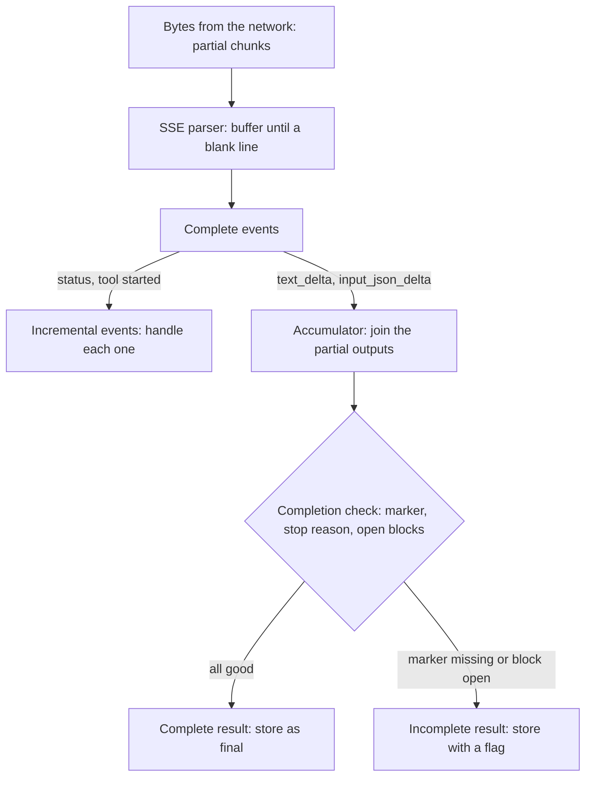

> [!note] The last lesson of module 5
> This lesson names the kinds of "partial" data that lessons [5.1](/notes/ai/ai-engineering/01-software-engineering-fundamentals/m05-streaming-and-agent-events/l1-streaming-and-server-sent-events) to [5.5](/notes/ai/ai-engineering/01-software-engineering-fundamentals/m05-streaming-and-agent-events/l5-case-study-the-run-bridge) show. The [roadmap](/notes/ai/ai-engineering/01-software-engineering-fundamentals/roadmap) shows the full learning order.

## 1. The question this idea answers

The word "partial" appears in many places of an agent service:

- the Agent SDK option `include_partial_messages`
- the field `partial_json` in a model stream
- "the user saw a partial answer"
- `functools.partial` in Python
- "a partial update" with HTTP PATCH

These are not the same thing. A bug follows when code treats one kind as another kind. Three real examples:

1. A screen shows each text delta as a new chat bubble, because the code treats a piece of a message as a message.
2. A service runs a tool with arguments from half a JSON string, because the code parsed too early.
3. A database stores a cut answer as the final answer, because the stream ended without an error.

The question: **what exactly is "partial" in each case, and what must the code do with it?**

## 2. Mental model

> [!analogy] A book from a printing press
> A press prints a 300-page book and ships it to a reader.
>
> 1. **Partial output:** the pages come out one at a time. Each page is a piece of the book. A reader can read along, but the book is not done.
> 2. **Incremental event:** a note from the press: "Chapter 3 is printed." The note is complete in itself. It reports progress.
> 3. **Incomplete result:** the press stopped at page 120, and somebody shipped the box anyway. It looks like a book, but it is not the whole book.
> 4. **Partial chunk:** the courier splits one page between two envelopes. Neither envelope holds a readable page.
>
> **Where it stops working:** a printed page is readable on its own. A text delta can be half a word, and a partial JSON string cannot be parsed at all. In software, the pieces are often smaller and less useful than a page.

## 3. Terms

| Term | Plain meaning |
|---|---|
| partial output | A piece of a result that is still being made, for example some tokens of an answer. |
| delta | One partial output in a stream: the change since the last piece, for example `{"type": "text_delta", "text": "ello"}`. |
| accumulator | Code that joins the deltas into the full value. |
| incremental event | An event that is complete in itself and reports one step: "tool started", "120 of 500 rows". |
| incomplete result | A result that ended before it was done, for example after a disconnect, an error or a token limit. |
| completion marker | An event that says "this part ended", for example `message_stop`, a `ResultMessage` or your own `done` event. A marker alone does not prove success: check its stop reason or status too. |
| stop reason | The reason why the model stopped writing, for example `end_turn`, `tool_use` or `max_tokens`. |
| partial chunk | A piece of the byte stream that the network delivers. Its edges do not match the edges of events or characters. |
| framing | The rule that marks where one message ends in a byte stream, for example the blank line of SSE. |
| partial JSON | The beginning of a JSON text that is not complete yet, so a normal parser rejects it. |
| partial validation | Validation that accepts an incomplete JSON text and checks only the complete parts. |
| partial application | `functools.partial(f, x)`: a new function with some arguments of `f` fixed in advance. |
| partial update | A request that changes only some fields of a resource, usually with HTTP PATCH. |
| partial failure | A batch where some parts succeed and some parts fail. |

## 4. How it works

### 4.1 Four meanings in a stream

| Meaning | Complete on its own? | Example | What the code must do |
|---|---|---|---|
| Partial output | no | `text_delta` "ello frien", `input_json_delta` `{"line": "L` | Accumulate. Show text as it grows. Never act on half of it. |
| Incremental event | yes | `{"type": "status", "text": "Querying"}` | Handle each event as it arrives. Use `seq` for order. |
| Incomplete result | looks complete, is not | 2 of 8 messages, then a normal end | Detect it with a completion marker and a stop reason. Mark it as incomplete. |
| Partial chunk | no | `'event: status\ndat'` | Buffer bytes and text until the framing rule completes an event or a character. |

The four are layers. Partial chunks carry events. Some events carry partial outputs. A result made of partial outputs can still be incomplete.



### 4.2 Partial outputs: deltas

A model writes one token at a time, so a streaming API sends deltas. The Anthropic streaming docs (checked on 2026-10-19) describe the flow of one message:

1. "`message_start`: contains a `Message` object with empty `content`."
2. "A series of content blocks, each of which has a `content_block_start`, one or more `content_block_delta` events, and a `content_block_stop` event."
3. "One or more `message_delta` events, indicating top-level changes to the final `Message` object."
4. "A final `message_stop` event."

A text delta:

```text
event: content_block_delta
data: {"type": "content_block_delta","index": 0,"delta": {"type": "text_delta", "text": "ello frien"}}
```

The full text is the join of all text deltas of the block. Measured in a sandbox run:

```text
delta 'Line 3 '    -> text so far 'Line 3 '
delta 'had 2 '     -> text so far 'Line 3 had 2 '
delta 'stops '     -> text so far 'Line 3 had 2 stops '
delta 'today.'     -> text so far 'Line 3 had 2 stops today.'
```

**In the Claude Agent SDK.** By default, the SDK does not yield deltas. The streaming-output docs (checked on 2026-10-19) say: "By default, the Agent SDK yields a complete `AssistantMessage` for each non-empty content block". The docs add that this happens "after Claude finishes generating that block." With `include_partial_messages=True`, the SDK "yield[s] `StreamEvent` messages containing raw API events as they arrive, in addition to the usual `AssistantMessage` and `ResultMessage`."

```python
from claude_agent_sdk import ClaudeAgentOptions, query
from claude_agent_sdk.types import StreamEvent

options = ClaudeAgentOptions(include_partial_messages=True)
async for message in query(prompt="Summarize the stops of line 3", options=options):
    if isinstance(message, StreamEvent):
        event = message.event                      # a raw API stream event, a dict
        if event.get("type") == "content_block_delta":
            delta = event.get("delta", {})
            if delta.get("type") == "text_delta":
                print(delta.get("text", ""), end="", flush=True)
```

The `StreamEvent` dataclass has the fields `uuid`, `session_id`, `event` and `parent_tool_use_id` (SDK 0.2.168 source). The docs add: "Both contain raw Claude API events, not accumulated text. You need to extract and accumulate text deltas yourself." Also: "Stream events are emitted for the main session only". So "token-level deltas from subagents aren't forwarded."

The docs give the order of the messages with partial messages on:

```text
StreamEvent (message_start)
StreamEvent (content_block_start) - text block
StreamEvent (content_block_delta) - text chunks...
AssistantMessage - complete text block
StreamEvent (content_block_stop)
StreamEvent (content_block_start) - tool_use block
StreamEvent (content_block_delta) - tool input chunks...
AssistantMessage - complete tool_use block
StreamEvent (content_block_stop)
StreamEvent (message_delta)
StreamEvent (message_stop)
... tool executes ...
... more streaming events for next turn ...
ResultMessage - final result
```

So one answer arrives twice: once as deltas, and once as complete `AssistantMessage` objects. A screen that shows both shows the text twice. Choose one source for each thing you show: deltas for the live text, complete messages for the stored transcript.

### 4.3 Partial JSON in tool inputs

The arguments of a tool call stream as deltas too. The Anthropic docs: "the deltas are *partial JSON strings*, whereas the final `tool_use.input` is always an *object*." And: "You can accumulate the string deltas and parse the JSON once you receive a `content_block_stop` event". An example delta:

```text
data: {"type": "content_block_delta","index": 1,"delta": {"type": "input_json_delta","partial_json": "{\"location\": \"San Fra"}}}
```

The docs also say: "Current models only support emitting one complete key and value property from `input` at a time. As such, when using tools, there may be delays between streaming events while the model is working."

A test joined three `partial_json` pieces and tried to parse after each one. Measured in a sandbox run (Pydantic 2.14.1, pydantic-core 2.50.1):

```text
buffer '{"line": "L'                              | json.loads fails: Unterminated string starting at | from_json(allow_partial=True) -> {}
buffer '{"line": "L3", "da'                       | json.loads fails: Unterminated string starting at | from_json(allow_partial=True) -> {'line': 'L3'}
buffer '{"line": "L3", "date": "2026-10-19"}'     | parses                              | from_json(allow_partial=True) -> {'line': 'L3', 'date': '2026-10-19'}
```

1. `json.loads` rejects every incomplete buffer.
2. `pydantic_core.from_json(..., allow_partial=True)` returns the complete parts only. An unfinished string value (`"L`) is left out.
3. Pydantic can also validate a model from incomplete JSON: `TypeAdapter(Args).validate_json(text, experimental_allow_partial=True)` gave `line='L3' date=None` for `'{"line": "L3", "da'`. As the name says, the flag is experimental.

> [!key] Show partial JSON, never run it
> Partial parsing is good for a preview on the screen, for example "Searching for line L3...". Run a tool only with the complete input, after `content_block_stop`. The Agent SDK does this for you: it calls your tool handler with the full input object.

### 4.4 Incremental events

An incremental event is a different thing. It is small, but it is complete. `{"type": "status", "text": "Querying the stops table"}` needs no other event to make sense. The events of [5.4](/notes/ai/ai-engineering/01-software-engineering-fundamentals/m05-streaming-and-agent-events/l4-user-visible-event-channels) are incremental events: status, progress, table, chart, error, done.

| | Partial output (delta) | Incremental event |
|---|---|---|
| Alone | meaningless or misleading ("ello frien") | meaningful ("tool started") |
| Client action | append to a buffer | render, replace or append, by type |
| Lost one | the final value is wrong | one step of progress is missing |
| Duplicate one | the text repeats a piece | harmless if the client checks `seq` |

A good design keeps them apart. Send `text_delta` events for the growing text, and separate typed events for each step of the run.

### 4.5 Incomplete results

An incomplete result is the dangerous kind, because it can look complete. Causes:

| Cause | What the consumer sees | Detect it with |
|---|---|---|
| The client disconnects | nothing more | the server knows. The client must not store the answer as final. |
| The network drops | the stream ends | no completion marker arrived |
| A failure in the producer | an `error` event, or an exception | the error |
| A `BaseException` that skips `except Exception` | a normal end after 2 of 8 items ([5.5](/notes/ai/ai-engineering/01-software-engineering-fundamentals/m05-streaming-and-agent-events/l5-case-study-the-run-bridge), section 4.10) | no `ResultMessage`, no `done` |
| The model hit its token limit | a complete stream, but the text stops in mid-sentence | `stop_reason` is `max_tokens` |
| The agent hit its turn limit | a `ResultMessage` | its `subtype`, `is_error` and `terminal_reason` |
| An interrupt | `message_stop`, and the cut text block also gets `content_block_stop`. Then a `ResultMessage`. | no normal `stop_reason` on the message, and a `terminal_reason` such as `aborted_streaming` |

The SDK's `ResultMessage` (0.2.168 source) has the fields `subtype`, `is_error`, `stop_reason`, `terminal_reason` and `errors`, among others. The docstring of `terminal_reason` says: "Why the query loop terminated (e.g. ``"completed"``, ``"max_turns"``, ``"aborted_streaming"``)". It adds that ``"aborted_streaming"`` or ``"aborted_tools"`` "indicates the turn was cancelled".

The streaming-output docs (checked on 2026-10-19) describe a cut stream. A cut can come from an interrupt or a dropped connection: "you still receive that message's `message_stop` before the turn ends. A cut text or thinking block also gets its `content_block_stop`. A cut tool call doesn't, so if `message_stop` arrives while a tool call's block is still open, treat that call's input as incomplete." (Since Claude Code v2.1.290, bundled with the Python SDK from v0.2.164.)

So `message_stop` and closed blocks do not prove that a text answer is complete. A cut text block looks closed. The stop reason tells the difference: a normal end has `end_turn`, `tool_use` or `stop_sequence`. At the level of the run, the `ResultMessage` must have `is_error` false and a `terminal_reason` of `"completed"` (or `None` from an older CLI).

A sandbox run fed the accumulator of section 5 with five streams (2026-10-19):

```text
full text + tool: stop_reason=tool_use complete=True open_tools=[]
cut inside tool: stop_reason=None complete=False open_tools=[1]
cut text (block stop + message_stop, no stop reason): stop_reason=None complete=False open_tools=[]
max_tokens: stop_reason=max_tokens complete=False open_tools=[]
tool with no input deltas: stop_reason=tool_use complete=True open_tools=[] input={}
```

The third line is the case that a check of `message_stop` and open tool blocks misses. Without the stop reason check, it reports a cut text answer as complete.

> [!key] Completeness is a fact that you must check, never assume
> A result is complete only when a completion marker arrived and nothing says otherwise. Check three things for each message. The marker (`message_stop`) arrived. The stop reason is normal: `end_turn`, `tool_use` or `stop_sequence`, never `None` or `max_tokens`. No tool block is open. For the whole run, check the `ResultMessage`: `is_error` false and `terminal_reason` `"completed"` or `None`. Store an incomplete result with a flag, never as the final answer.

### 4.6 Partial chunks on the wire

The network delivers bytes in chunks. Chunks do not respect any boundary of your data. Lesson [5.1](/notes/ai/ai-engineering/01-software-engineering-fundamentals/m05-streaming-and-agent-events/l1-streaming-and-server-sent-events) showed an SSE parser that received `'event: status\ndat'` and had to wait for the rest. Two boundaries can break:

1. **Event boundaries.** A chunk can end in the middle of a line or of an event. The parser keeps a buffer and dispatches an event only at a blank line. At the end of the stream, a pending event is discarded.
2. **Character boundaries.** UTF-8 uses 1 to 4 bytes for one character. A chunk can end inside a character. A test cut `"Température: 21 °C"` inside the 2-byte `é`:

```text
chunk-by-chunk .decode() fails: unexpected end of data
incremental decoder: 'Température: 21 °C'
```

`bytes.decode()` on each chunk failed. `codecs.getincrementaldecoder("utf-8")()` kept the half character until the next chunk and then decoded correctly. HTTP clients offer the same: `httpx` has `iter_text()` and `iter_lines()`, which decode across chunk edges. Use them, not `.decode()` on raw chunks.

### 4.7 Other meanings of "partial"

| Phrase | Meaning | Where |
|---|---|---|
| `functools.partial(f, x)` | Partial application: a new callable with some arguments fixed. It fixes arguments, it does not change the event. So it needs an emit function that takes the run id, for example `def emit_with_run(event, *, run_id): q.put({**event, "run_id": run_id})`. Then `partial(emit_with_run, run_id="r1")` is an emit callback that adds the run id. A call of `partial(q.put, run_id="r1")` raises `TypeError`, because `Queue.put` has no `run_id` parameter. | [2.2 Lambdas and closures](/notes/ai/ai-engineering/01-software-engineering-fundamentals/m02-concurrency-foundations/l2-lambdas-and-closures) |
| Partial update | `PATCH /notes/7` with `{"title": "New"}` changes one field and keeps the others. PATCH is not guaranteed to be idempotent. | [3.2 Methods and retries](/notes/ai/ai-engineering/01-software-engineering-fundamentals/m03-http-rest-json/l2-methods-status-codes-and-retries) |
| Partial failure | 3 of 4 parallel tool calls succeed. Report each result with its own status. Do not report "failed" for all, and do not hide the one failure. | [5.3](/notes/ai/ai-engineering/01-software-engineering-fundamentals/m05-streaming-and-agent-events/l3-mcp-tools-and-tool-execution) |
| Partial validation | Validate the complete parts of an incomplete JSON text (section 4.3). | Pydantic |
| `include_partial_messages` | The Agent SDK option that adds `StreamEvent` deltas (section 4.2). | Agent SDK |

### 4.8 Which "partial" is it?

Ask three questions:

1. **Is this a piece of a bigger value that is still being made?** Then it is a partial output. Accumulate it.
2. **Is it complete on its own, but one step of a longer process?** Then it is an incremental event. Handle it.
3. **Did the process end before it was done?** Then it is an incomplete result. Flag it.

And one question about the transport: **did I receive bytes or text that the framing rule has not completed yet?** Then it is a partial chunk. Buffer it.

## 5. Code walkthrough

An accumulator for raw stream events, as in the test of section 4.5:

```python
import json

NORMAL_STOPS = {"end_turn", "tool_use", "stop_sequence"}

def accumulate(events):
    blocks = {}                                                    # 1
    stop_reason = None
    stopped = False
    for ev in events:
        t = ev["type"]
        if t == "content_block_start":                             # 2
            cb = ev["content_block"]
            blocks[ev["index"]] = {"type": cb["type"], "name": cb.get("name"), "buf": "", "closed": False}
        elif t == "content_block_delta":                           # 3
            d = ev["delta"]
            if d["type"] == "text_delta":
                blocks[ev["index"]]["buf"] += d["text"]
            elif d["type"] == "input_json_delta":
                blocks[ev["index"]]["buf"] += d["partial_json"]
        elif t == "content_block_stop":                            # 4
            b = blocks[ev["index"]]
            b["closed"] = True
            if b["type"] == "tool_use":
                b["input"] = json.loads(b["buf"] or "{}")          # parse only now
        elif t == "message_delta":                                 # 5
            stop_reason = ev["delta"].get("stop_reason")
        elif t == "message_stop":                                  # 6
            stopped = True
    open_tools = [i for i, b in blocks.items() if b["type"] == "tool_use" and not b["closed"]]
    complete = stopped and not open_tools and stop_reason in NORMAL_STOPS   # 7
    return blocks, stop_reason, complete, open_tools
```

| Mark | What it does | Why |
|---|---|---|
| 1 | One buffer for each content block, by its `index`. | Deltas of different blocks must not mix. |
| 2 | A new block starts with an empty buffer. | It records the type and, for tools, the name. |
| 3 | Text deltas and JSON deltas append to the buffer of their block. | Each delta is a partial output. |
| 4 | At `content_block_stop`, the block is closed. A tool input is parsed only now. An empty buffer becomes `{}`. | Partial JSON cannot be parsed. A tool with no arguments can send no input deltas, and `json.loads("")` raises. |
| 5 | `message_delta` brings the stop reason. | `max_tokens` means that the text is cut. |
| 6 | `message_stop` is the completion marker of the message. | Without it, the message is incomplete. |
| 7 | Complete = the marker arrived, no tool block is open and the stop reason is a normal one. | The docs: an open tool block at `message_stop` means its input is incomplete. A cut text block is closed, so only the missing stop reason shows the cut. `max_tokens` means cut text. |

The code ignores event types that it does not know. The Anthropic docs ask for that: "new event types may be added, and your code should handle unknown event types gracefully."

## 6. Exercises

Runs in: a browser lab. [Open a lab for this lesson](/labs/new?note=ai/ai-engineering/01-software-engineering-fundamentals/m05-streaming-and-agent-events/l6-what-partial-means). Hints come in three levels in chat: idea, pseudocode, partial code.

**Exercise 5.6.1: an accumulator.** Write your own `accumulate(events)` for the event shapes of section 4.2. Do not copy section 5. Close the page and write it from the rules.

Acceptance tests:

- The full stream of section 5 gives the text `"Let me check."` and the tool input `{"line": "L3"}`.
- The same stream cut after the first `input_json_delta`, plus `message_stop`, reports the tool block as incomplete and does not raise.
- An unknown event type, for example `{"type": "ping"}`, is ignored.
- A stream whose `message_delta` has `stop_reason` `max_tokens` is reported as "complete stream, cut text".
- A text block that gets `content_block_stop` and then `message_stop`, with no `message_delta`, is reported as incomplete.
- A tool block with no `input_json_delta` gives the input `{}` and does not raise.

**Exercise 5.6.2: classify a run.** Write `classify(envelopes) -> str` for a list of your own event envelopes ([5.4](/notes/ai/ai-engineering/01-software-engineering-fundamentals/m05-streaming-and-agent-events/l4-user-visible-event-channels)). It returns `"complete"`, `"failed"`, `"cut"` or `"truncated"`.

Acceptance tests:

- A list that ends with `done` gives `"complete"`.
- A list with an `error` event gives `"failed"`, also when a `done` follows.
- A list without `done` and without `error` gives `"cut"`.
- A list whose `done` envelope has `stop_reason` `max_tokens` gives `"truncated"`.
- A list that ends with an `error` envelope with `terminal_reason` `aborted_streaming` gives `"failed"`.

**Exercise 5.6.3: UTF-8 across chunks.** Write `decode_chunks(chunks: list[bytes]) -> str`.

Acceptance tests:

- `"Température: 21 °C"` encoded and split at every byte position into two chunks always gives the same text.
- A 4-byte character (an emoji) split into four 1-byte chunks gives the character.
- An invalid byte sequence raises `UnicodeDecodeError` at the end, not earlier.

## 7. Common mistakes

1. **Each delta as a new message.** Deltas are pieces. Append them to one buffer for each block.
2. **Showing deltas and complete messages.** With `include_partial_messages=True`, the same text arrives twice. Choose one source for each view.
3. **Parsing tool input before `content_block_stop`.** `json.loads` fails, or a partial parser gives a value that will change.
4. **Running a tool on partial input.** Show a preview only. Run with the complete input.
5. **"No error = complete."** Check the completion marker, the stop reason and open blocks.
6. **Storing a cut answer as final.** Store it with an "incomplete" flag.
7. **`chunk.decode()` on raw network chunks.** A chunk can end inside a character. Use an incremental decoder or the client's text iterator.
8. **One word for four things.** Say "delta", "event", "incomplete result" or "chunk". Say "partial" only with its noun.

## 8. One-minute explanation

"Partial" has four meanings in a stream. A partial output, or delta, is a piece of a value that is still being made, such as `text_delta` text or `input_json_delta` JSON. You accumulate deltas into one buffer for each block, and you parse tool input only at `content_block_stop`. An incremental event, such as "tool started", is complete on its own, and you handle it at once. An incomplete result ended before it was done, after a disconnect, an error, a token limit or an interrupt, and it can look complete. So you check the completion marker (`message_stop`), a normal stop reason, open tool blocks, and a `ResultMessage` with `is_error` false and `terminal_reason` `"completed"`. A partial chunk is a network piece whose edges ignore event and character edges. You buffer it until the framing rule completes an event, and you decode it with an incremental UTF-8 decoder. In the Agent SDK, `include_partial_messages=True` adds raw `StreamEvent` deltas next to the complete `AssistantMessage` objects. Outside streams, "partial" also means `functools.partial`, a PATCH update or a partial failure.

## 9. Check questions

```check
{
  "question": "With include_partial_messages=True, your chat screen shows every answer twice. Why?",
  "answer": "The SDK yields StreamEvent deltas in addition to the usual complete AssistantMessage objects. The screen renders the text from the deltas and again from the complete messages. Choose one source for the live text (the deltas) and use the complete messages only for the stored transcript."
}
```

```check
{
  "question": "You receive the tool input deltas '{\"line\": \"L' and '3\", \"da'. Can you call the tool now with line L3? What does the stream still have to send?",
  "answer": "No. The input is partial JSON. A partial parser can show line L3 as a preview, but the date field is not complete, and more fields can follow. Wait for content_block_stop of that block and parse the full buffer. The Agent SDK calls your handler only with the complete input object."
}
```

```check
{
  "question": "A run sends text events and then the stream ends normally, without an error and without a done event. Is the answer complete? How do you decide?",
  "answer": "You cannot treat it as complete. A normal end without the completion marker means an incomplete result, for example after a BaseException in the producer or a dropped connection. Mark it as cut. A complete result needs the marker (message_stop for the message, and a done event that your code sends only for a successful ResultMessage), a normal stop reason (end_turn, tool_use or stop_sequence), and no open tool block."
}
```

```check
{
  "question": "Name the kind of 'partial' in each case: (a) {\"type\": \"progress\", \"done\": 120, \"total\": 500}; (b) a chunk 'data: {\"n\": 1'; (c) a text_delta 'ello'; (d) an answer whose stop_reason is max_tokens.",
  "answer": "(a) An incremental event: complete on its own, one step of a process. (b) A partial chunk: bytes that the SSE framing rule has not completed. Buffer them. (c) A partial output (a delta): accumulate it. (d) An incomplete result: the stream is complete, but the answer text was cut by the token limit."
}
```

```check
{
  "question": "Why can chunk.decode('utf-8') fail on a valid UTF-8 stream, and what do you use instead?",
  "answer": "UTF-8 uses up to 4 bytes for one character, and a network chunk can end inside a character. Decoding that chunk alone raises UnicodeDecodeError (unexpected end of data). Use codecs.getincrementaldecoder('utf-8')(), which keeps the incomplete bytes until the next chunk, or a client method such as httpx iter_text or iter_lines."
}
```

## 10. Links

- Before: [5.5 Case study: the _run bridge, line by line](/notes/ai/ai-engineering/01-software-engineering-fundamentals/m05-streaming-and-agent-events/l5-case-study-the-run-bridge)
- Back to the part: [L0 Software Engineering Fundamentals](/notes/ai/ai-engineering/01-software-engineering-fundamentals)
- Deeper: [Stream events](/notes/ai/llm-apis/02-streaming-and-thinking/l1-stream-events), [Message and block types](/notes/ai/claude-agent-sdk/02-options-and-messages/l2-message-and-block-types), [Async generators](/notes/software-engineering/python/01-asyncio/l2-async-generators)
- [Glossary](/notes/ai/ai-engineering/glossary)

Sources (checked on 2026-10-19): [Anthropic streaming messages](https://platform.claude.com/docs/en/build-with-claude/streaming), [Agent SDK, Stream responses in real-time](https://code.claude.com/docs/en/agent-sdk/streaming-output), [Python docs, codecs](https://docs.python.org/3/library/codecs.html), the source code of claude-agent-sdk 0.2.168 and pydantic-core 2.50.1.
