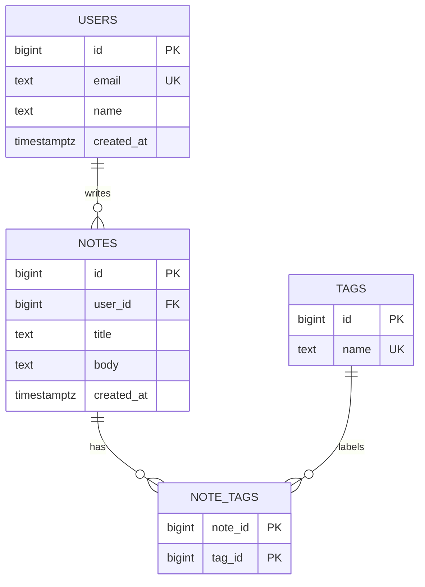

## 1. The question this idea answers

Your notes API keeps its notes in a Python list. When the process stops, the list disappears, and every note is lost. You also want rules that never break:

- Each note belongs to exactly one user.
- No note points to a user that does not exist.
- Two users never share one email address.
- A note always has a title.

Python code can check these rules, but every code path must remember to check them. A relational database stores the data on disk and checks the rules itself, for every program that writes to it. This lesson shows how to describe the data so that the database can protect it.

## 2. Mental model

> [!analogy] A set of strict spreadsheets with ID numbers
> Think of a database as a set of spreadsheets. Each sheet is a **table**. Each line of a sheet is a **row**. Each column has a name and accepts only one type of value. Every row has an ID number. When a row in one sheet must refer to a row in another sheet, it stores that ID number, not a copy of the data.
>
> **Where it stops working:** a normal spreadsheet accepts anything in any cell. A database refuses a value of the wrong type and a missing required value. It also refuses a forbidden duplicate and an ID that points to nothing. A database also lets many programs read and change the data at the same time without damage. A spreadsheet file does not.

## 3. Terms

| Term | Plain meaning |
|---|---|
| database | An organized store of data that a program can query and change. |
| database server | The program that owns the data files and answers requests, for example PostgreSQL. |
| relational database | A database that stores data in tables and links tables through key values. |
| table | A named set of rows that all have the same columns. |
| row | One record in a table, for example one note. |
| column | One named field of every row, with one data type, for example `title`. |
| schema | The design of the tables: names, columns, types, keys and constraints. |
| data type | The kind of value that a column accepts, for example `bigint`, `text` or `timestamptz`. |
| `NULL` | A special marker for "no value". It is not zero and not an empty string. |
| primary key | A column (or columns) whose value is unique and not `NULL` in every row. It identifies the row. |
| identity column | A column whose values the database makes automatically: 1, 2, 3 and so on. |
| foreign key | A column whose value must match a primary key value in another table. |
| constraint | A rule that the database checks on every insert and update, for example `NOT NULL`, `UNIQUE` or `CHECK`. |
| one-to-many | A relationship where one row in table A links to many rows in table B, for example one user has many notes. |
| many-to-many | A relationship where rows on both sides link to many rows on the other side, for example notes and tags. |
| junction table | A table that holds pairs of keys to make a many-to-many relationship. |
| normalization | A design method: store each fact in one place only. |
| SQL | Structured Query Language: the language that you use to define, query and change relational data. |
| DDL | Data Definition Language: the SQL statements that create and change the schema, for example `CREATE TABLE`. |

## 4. How it works

### 4.1 From a Python list to a table

This is the data of a small notes app in Python:

```python
users = [
    {"id": 1, "email": "ana@example.com", "name": "Ana"},
    {"id": 2, "email": "ben@example.com", "name": "Ben"},
]
notes = [
    {"id": 1, "user_id": 1, "title": "Shift plan"},
    {"id": 2, "user_id": 1, "title": "Line 3 downtime"},
    {"id": 3, "user_id": 2, "title": "Packaging spec"},
]
```

Each list becomes a table. Each dictionary becomes a row. Each key becomes a column. The value of `user_id` in a note is the `id` of a user. That number is the link between the two tables. The note does not store a copy of the user's name or email.

| Python | Relational database |
|---|---|
| a list of dictionaries | a table |
| one dictionary | one row |
| one key | one column |
| `note["user_id"] == user["id"]` | a foreign key that references a primary key |
| a check in your own code | a constraint that the database enforces |

### 4.2 Columns and data types

Every column has one data type. The database refuses a value that does not fit the type. These types cover most of the capstone:

| Type | Holds | Example |
|---|---|---|
| `bigint` | whole numbers up to about 9.2 × 10^18 | `42` |
| `text` | a string of any length | `'Shift plan'` |
| `boolean` | `true` or `false` | `true` |
| `numeric(10, 2)` | exact decimal numbers, for money | `19.99` |
| `timestamptz` | a moment in time with a time zone | `'2026-10-19 10:00+00'` |
| `jsonb` | a JSON document in binary form | `'{"source": "api"}'` |

Use `timestamptz` (timestamp with time zone) for moments, not `timestamp`. The database stores the moment in UTC and converts it when it shows it. Use `numeric` for money, never a floating-point type, because floating-point values cannot hold most decimal fractions exactly. The lesson [Column types](/notes/databases/postgres/01-relational-basics/l2-column-types) goes deeper.

### 4.3 Primary keys

A primary key identifies one row. The database guarantees two things for it: the value is never `NULL`, and no two rows have the same value. PostgreSQL also creates an index for it automatically ([6.3](/notes/ai/ai-engineering/01-software-engineering-fundamentals/m06-postgresql/l3-indexes-and-explain)).

```sql
id bigint GENERATED ALWAYS AS IDENTITY PRIMARY KEY
```

- `bigint` gives room for billions of rows.
- `GENERATED ALWAYS AS IDENTITY` tells PostgreSQL to make the values 1, 2, 3 and so on. Your code does not choose them.
- `PRIMARY KEY` adds the "unique and not NULL" rule.

> [!note] Surrogate keys and natural keys
> A **surrogate key** is a number with no meaning outside the database, like the identity `id`. A **natural key** is a real-world value, like an email address. Use a surrogate key as the primary key. Emails change, and a change to a primary key must change every row that refers to it. Keep the natural key unique with a separate `UNIQUE` constraint instead.

### 4.4 Foreign keys and one-to-many

One user has many notes. The notes table stores the user's id in the column `user_id`, and a foreign key makes the database check it.

```sql
user_id bigint NOT NULL REFERENCES users (id) ON DELETE CASCADE
```

A sandbox run tried to insert a note for user 99, who does not exist (PostgreSQL 16.15, 2026-10-19):

```text
ERROR:  insert or update on table "notes" violates foreign key constraint "notes_user_id_fkey"
DETAIL:  Key (user_id)=(99) is not present in table "users".
```

The insert failed, and the table did not change. No code path can create an orphan note, not even a script that someone writes next year.

The `ON DELETE` part decides what happens to the notes when their user is deleted:

| Option | What happens to the notes of a deleted user | Use it when |
|---|---|---|
| `NO ACTION` (the default) or `RESTRICT` | The delete of the user fails while notes exist. | The child rows are valuable and a person must decide. |
| `CASCADE` | The database deletes the notes too. | The child rows have no meaning without the parent. |
| `SET NULL` | The database writes `NULL` into `user_id`. | The child rows stay useful without the parent. The column must allow `NULL`. |

The sandbox run deleted user Ben, who had 3 notes, with `ON DELETE CASCADE`:

```text
 ben_notes
-----------
         3
DELETE 1
 ben_notes_after
-----------------
               0
```

> [!trap] PostgreSQL does not index a foreign key column for you
> PostgreSQL makes an index for a primary key and for a `UNIQUE` constraint. It does not make one for the referencing column of a foreign key. The table description in the sandbox showed only `"notes_pkey" PRIMARY KEY, btree (id)`. A query such as "the notes of user 42" then reads the whole table. Lesson [6.3](/notes/ai/ai-engineering/01-software-engineering-fundamentals/m06-postgresql/l3-indexes-and-explain) measures this and adds the index.

### 4.5 Constraints: the rules that the database checks

A constraint is a rule that the database checks on every insert and every update. The sandbox run broke three rules on purpose:

```text
ERROR:  duplicate key value violates unique constraint "users_email_key"
DETAIL:  Key (email)=(ana@example.com) already exists.

ERROR:  new row for relation "notes" violates check constraint "title_not_blank"

ERROR:  null value in column "title" of relation "notes" violates not-null constraint
```

| Constraint | Rule | Example |
|---|---|---|
| `NOT NULL` | The column must have a value. | `title text NOT NULL` |
| `UNIQUE` | No two rows have the same value. | `email text NOT NULL UNIQUE` |
| `CHECK (...)` | A condition must be true for every row. | `CHECK (length(trim(title)) > 0)` |
| `PRIMARY KEY` | `UNIQUE` and `NOT NULL` together. | `id ... PRIMARY KEY` |
| `FOREIGN KEY` / `REFERENCES` | The value must exist in the other table. | `REFERENCES users (id)` |
| `DEFAULT` | The value to use when the insert gives none. This is not a rule, but it often goes with one. | `created_at timestamptz NOT NULL DEFAULT now()` |

> [!key] Put the rule where every writer must pass
> Validate input in your API with Pydantic ([1.8](/notes/ai/ai-engineering/01-software-engineering-fundamentals/m01-python-foundations/l8-type-annotations-and-pydantic)). Also put the important rules in the database. The API check gives users a clear error message. The database check protects the data from every other program, from a bug, and from a script that skips the API.

### 4.6 Many-to-many: notes and tags

A note can have many tags, and a tag can label many notes. Neither table can hold one foreign key for this. A junction table holds the pairs:

```sql
CREATE TABLE tags (
    id   bigint GENERATED ALWAYS AS IDENTITY PRIMARY KEY,
    name text NOT NULL UNIQUE
);
CREATE TABLE note_tags (
    note_id bigint NOT NULL REFERENCES notes (id) ON DELETE CASCADE,
    tag_id  bigint NOT NULL REFERENCES tags (id) ON DELETE CASCADE,
    PRIMARY KEY (note_id, tag_id)
);
```

The primary key has two columns. So one pair of note and tag can exist only once. The sandbox run joined the three tables and tried to add one pair twice:

```text
 id |      title      |        tags
----+-----------------+---------------------
  2 | Line 3 downtime | maintenance
  6 | Oven checks     | maintenance, safety
  7 | Label error     | quality
  8 | Safety walk     | safety

ERROR:  duplicate key value violates unique constraint "note_tags_pkey"
DETAIL:  Key (note_id, tag_id)=(2, 2) already exists.
```

### 4.7 The diagram of the schema

An entity-relationship diagram shows the tables, their columns and the links. A line with a "crow's foot" means "many".



Read the first line as: one user writes zero or more notes, and each note has exactly one user.

### 4.8 Normalization: store each fact in one place

Here is a design that stores everything in one table:

| note_id | title | author_email | author_name | tags |
|---|---|---|---|---|
| 1 | Shift plan | ana@example.com | Ana | `planning` |
| 2 | Line 3 downtime | ana@example.com | Ana | `maintenance` |
| 6 | Oven checks | ana@example.com | Ana | `maintenance, safety` |

It looks simple, but it has three problems:

1. **Update problem.** Ana changes her name. Your code must change every one of her rows. If it misses one row, the data disagrees with itself.
2. **Delete problem.** Ana deletes her last note. Her email and name disappear from the database too.
3. **List-in-a-cell problem.** The `tags` cell holds a list as text. The database cannot check the tags, cannot index one tag, and a query for "all notes with the tag safety" must search inside strings.

Normalization fixes this. Each fact goes to the table that owns it:

- Facts about a user (email, name) go into `users`, once.
- Facts about a note (title, body) go into `notes`, with the user's id.
- Each tag goes into `tags`, and each note-tag pair goes into `note_tags`.

The formal names are "normal forms". In plain words, first normal form means one value per cell. Second and third normal forms mean that every non-key column describes the key of its own table and nothing else.

> [!note] Interpretation: when to copy data on purpose
> Analytics tables and caches sometimes copy data on purpose, so that reads need fewer joins. This is called denormalization. Do it only after you measure a slow read, and keep one table as the owner of the truth. For an API like the capstone, start normalized.

### 4.9 Why an AI engineer needs this

Later levels store data with the same tools. A chat app stores chats, messages and message parts in related tables, with foreign keys between them ([Chats, messages and parts](/notes/ai/conversation-state/02-chat-history-model/l1-chats-messages-and-parts)). A usage log stores one row per model call, with a foreign key to the user. An NL2SQL agent must read a schema like the one in this lesson and choose the right joins. A clear schema makes all of these easier.

## 5. Code walkthrough

This is the schema that the sandbox ran, in full:

```sql
CREATE TABLE users (
    id         bigint GENERATED ALWAYS AS IDENTITY PRIMARY KEY,
    email      text NOT NULL UNIQUE,
    name       text NOT NULL,
    created_at timestamptz NOT NULL DEFAULT now()
);
CREATE TABLE notes (
    id         bigint GENERATED ALWAYS AS IDENTITY PRIMARY KEY,
    user_id    bigint NOT NULL REFERENCES users (id) ON DELETE CASCADE,
    title      text NOT NULL,
    body       text NOT NULL DEFAULT '',
    created_at timestamptz NOT NULL DEFAULT now()
);
```

| Line | What it does | What breaks without it |
|---|---|---|
| `CREATE TABLE users (` | Makes a new table named `users`. | Nothing exists to store users. |
| `id bigint GENERATED ALWAYS AS IDENTITY PRIMARY KEY` | The database makes a unique number for each user. | Your code must invent ids, and two requests can choose the same one. |
| `email text NOT NULL UNIQUE` | Every user has an email, and no email appears twice. PostgreSQL makes an index named `users_email_key` for it. | Two accounts can share one email. Login by email becomes ambiguous. |
| `name text NOT NULL` | Every user has a name. | Rows with no name appear, and the UI must handle them. |
| `created_at timestamptz NOT NULL DEFAULT now()` | The database writes the time of the insert. | Each code path must remember to set the time. |
| `user_id bigint NOT NULL REFERENCES users (id) ON DELETE CASCADE` | Each note belongs to an existing user. The notes go when the user goes. | Orphan notes, or a failed user delete, depending on your choice. |
| `body text NOT NULL DEFAULT ''` | An empty body is allowed, but `NULL` is not. | Your code must handle two kinds of "empty": `NULL` and `''`. |

The order of the two statements matters. The `notes` table refers to `users`, so `users` must exist first. To drop them, drop `notes` first.

## 6. Exercises

Runs in: your local practice project, with a local PostgreSQL. The lesson [Local PostgreSQL with Docker](/notes/databases/postgres/05-local-setup/l1-local-postgres-with-docker) shows one way to start a server. Hints come in three levels in chat: idea, pseudocode, partial code.

**Exercise 6.1a: the notes schema.** Write `schema.sql` with the tables `users` and `notes` (one user has many notes). Do not copy section 5. Write it from the rules in section 1.

Acceptance tests:

- An insert of a note for a user id that does not exist fails with a foreign key error.
- A second user with the same email fails with a unique error.
- A note with the title `'   '` (three spaces) fails with a check error.
- `\d notes` in `psql` shows every constraint that you planned.

**Exercise 6.1b: your capstone domain.** Pick the domain of your capstone ([10.1](/notes/ai/ai-engineering/01-software-engineering-fundamentals/m10-capstone/l1-capstone-spec-and-checklist)), for example tasks, bookmarks, expenses or inventory. Draw an `erDiagram` with at least one one-to-many and one many-to-many relationship. Then write the `CREATE TABLE` statements.

Acceptance tests:

- Each table has a surrogate primary key.
- Each foreign key has an `ON DELETE` choice, and you can say why in one sentence.
- No column holds a list as text.
- Money columns use `numeric`, and moments use `timestamptz`.

## 7. Common mistakes

1. **A list in one cell.** Tags stored as `'maintenance, safety'` in a text column. The database cannot check, index or join them. Use a junction table.
2. **The email as the primary key.** Emails change. Use a surrogate key and a `UNIQUE` constraint.
3. **No foreign key "because the code checks it".** Each new code path, script or bug can then create orphan rows.
4. **The default `ON DELETE` without a thought.** The default refuses the delete. That can be right, but choose it on purpose.
5. **No index on the foreign key column.** PostgreSQL does not create it. Queries by `user_id` read the whole table ([6.3](/notes/ai/ai-engineering/01-software-engineering-fundamentals/m06-postgresql/l3-indexes-and-explain)).
6. **`timestamp` instead of `timestamptz`.** The value has no time zone, and servers in two zones disagree about the moment.
7. **A floating-point type for money.** Use `numeric`.

## 8. One-minute explanation

A relational database stores data in tables. A table has columns with fixed types, and each row is one record. A primary key identifies each row, and an identity column lets the database make the key values. A foreign key stores the primary key of a row in another table, and the database refuses a value that points to nothing. With one foreign key you get one-to-many, for example one user with many notes. With a junction table of key pairs you get many-to-many, for example notes and tags. Constraints such as `NOT NULL`, `UNIQUE` and `CHECK` let the database enforce the rules of the data for every program that writes to it. Normalization means that each fact lives in one place, so an update changes one row and the data never disagrees with itself.

## 9. Check questions

```check
{
  "question": "A teammate stores each note's tags as the text 'safety, quality' in a column named tags. Name two problems with this design and the fix.",
  "hint": "Think about checks, indexes and queries for one tag.",
  "answer": "The database cannot check that each tag is valid, and it cannot index a single tag. A query for 'all notes with the tag safety' must search inside strings, and it can match 'safety-walk' by mistake. Renaming a tag means editing many strings. The fix: a tags table with one row per tag and a junction table note_tags(note_id, tag_id) with a composite primary key."
}
```

```check
{
  "question": "notes.user_id has REFERENCES users (id) with no ON DELETE clause. What happens when you run DELETE FROM users WHERE id = 1 and user 1 has notes?",
  "answer": "The default is NO ACTION, so the delete fails with a foreign key error while notes of user 1 exist. Nothing is deleted. To delete the notes too, the constraint needs ON DELETE CASCADE. To keep the notes without an owner, it needs ON DELETE SET NULL and a nullable user_id."
}
```

```check
{
  "question": "Why should users.email have a UNIQUE constraint even if the sign-up endpoint already checks for an existing email?",
  "hint": "Two requests arrive at the same moment.",
  "answer": "Two sign-up requests with the same email can both pass the check in the API before either one inserts, so both insert. Other programs and scripts can also skip the API. The UNIQUE constraint is checked by the database for every insert, so the second insert fails no matter which program sends it. Keep the API check for a clear error message and the constraint for the guarantee."
}
```

```check
{
  "question": "A table is created with `CREATE TABLE notes (id bigint GENERATED ALWAYS AS IDENTITY PRIMARY KEY, user_id bigint NOT NULL REFERENCES users (id), ...)`. Which index does PostgreSQL create automatically? Which useful index is missing?",
  "answer": "It creates notes_pkey for the primary key id. It does not create an index on the foreign key column user_id. A query such as 'the notes of user 42' then scans the whole table until you create an index on user_id (or a composite index that starts with user_id)."
}
```

## 10. Links

- Next: [6.2 SQL queries: SELECT to GROUP BY](/notes/ai/ai-engineering/01-software-engineering-fundamentals/m06-postgresql/l2-sql-queries)
- Module: [M6 PostgreSQL persistence](/notes/ai/ai-engineering/01-software-engineering-fundamentals/m06-postgresql)
- Deeper: [Tables, keys and constraints](/notes/databases/postgres/01-relational-basics/l1-tables-keys-and-constraints), [Column types](/notes/databases/postgres/01-relational-basics/l2-column-types)
- Later use: [Chats, messages and parts](/notes/ai/conversation-state/02-chat-history-model/l1-chats-messages-and-parts)
- Source: PostgreSQL 18 documentation, Chapter 5 "Data Definition", https://www.postgresql.org/docs/current/ddl.html (the current major version is 18, checked on 2026-10-19)
- [Glossary](/notes/ai/ai-engineering/glossary)
