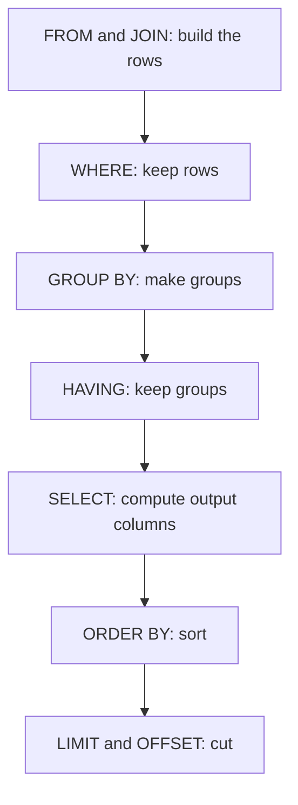
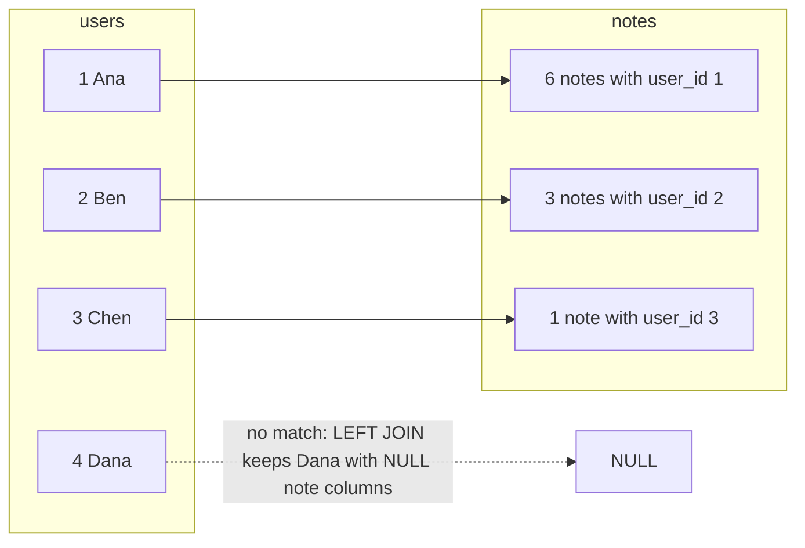

## 1. The question this idea answers

The notes API from [6.1](/notes/ai/ai-engineering/01-software-engineering-fundamentals/m06-postgresql/l1-relational-data-modeling) stores users and notes in two tables. Now it must answer questions:

- Show the 3 newest notes of user 2.
- Show the 5 newest notes of anybody, with the author's name.
- Count the notes of each user, and include users with no notes.
- List the users who wrote more than 3 notes.
- Create, edit and delete a note, and return the changed row to the client.

SQL answers each one in a few lines. This lesson teaches the statements, the order in which the database evaluates their parts, and the traps around `NULL` and counting.

## 2. Mental model

> [!analogy] An order form for a librarian
> A SQL query is an order form. You write **what** you want: "the titles of the notes of user 2, newest first, 3 of them". You do not write **how** to find them. The librarian (the database's query planner) chooses the method: read every card, or use an index.
>
> **Where it stops working:** a human librarian notices a silly order. The database does not. It runs `DELETE FROM notes` with no condition and deletes every row. Also, the librarian's speed depends on the indexes that you built ([6.3](/notes/ai/ai-engineering/01-software-engineering-fundamentals/m06-postgresql/l3-indexes-and-explain)), not only on the words of the query.

## 3. Terms

| Term | Plain meaning |
|---|---|
| statement | One complete SQL command, for example one `SELECT`. It ends with `;` in `psql`. |
| query | A statement that reads data, usually a `SELECT`. People also use the word for any statement. |
| clause | One part of a statement, for example `WHERE` or `ORDER BY`. |
| declarative language | A language where you say what result you want, and the system chooses the steps. SQL is one. |
| `SELECT` | Reads rows and returns a result table. |
| `WHERE` | Keeps only the rows for which a condition is true. |
| `ORDER BY` | Sorts the result. Without it, the order of the rows is not defined. |
| `LIMIT` / `OFFSET` | Return at most N rows, after skipping M rows. |
| `INSERT` / `UPDATE` / `DELETE` | Add rows, change rows, remove rows. |
| `RETURNING` | Makes `INSERT`, `UPDATE` or `DELETE` return the rows that it changed. |
| join | A step that combines rows of two tables when a condition matches, for example `n.user_id = u.id`. |
| inner join | Keeps only the pairs of rows that match. Written `JOIN`. |
| left join | Keeps every row of the left table, with `NULL` values where the right table has no match. Written `LEFT JOIN`. |
| alias | A short name for a table in one query, for example `users u`. |
| aggregate function | A function that makes one value from many rows: `count`, `sum`, `avg`, `min`, `max`. |
| `GROUP BY` | Splits the rows into groups with equal values, so that an aggregate runs once per group. |
| `HAVING` | Keeps only the groups for which a condition is true. It runs after `GROUP BY`. |
| three-valued logic | In SQL, a condition is true, false or unknown. A comparison with `NULL` gives unknown. |

## 4. How it works

All outputs in this lesson come from one sandbox run (PostgreSQL 16.15, 2026-10-19, time zone UTC).

### 4.1 The seed data

The schema is the one from [6.1](/notes/ai/ai-engineering/01-software-engineering-fundamentals/m06-postgresql/l1-relational-data-modeling). The seed has 4 users and 10 notes:

| User id | Name | Notes |
|---|---|---|
| 1 | Ana | 6: Shift plan, Line 3 downtime, Order backlog, Oven checks, Safety walk, Weekly summary |
| 2 | Ben | 3: Packaging spec, Label error, Freezer alarm |
| 3 | Chen | 1: Supplier call |
| 4 | Dana | 0 |

Note `id` values 1 to 10 follow the dates 2026-10-01 to 2026-10-10. Note 10 is the newest.

### 4.2 SELECT, WHERE, ORDER BY and LIMIT

"The 3 newest notes of user 2":

```sql
SELECT id, title, created_at
FROM notes
WHERE user_id = 2
ORDER BY created_at DESC
LIMIT 3;
```

```text
 id |     title      |       created_at
----+----------------+------------------------
  9 | Freezer alarm  | 2026-10-09 16:00:00+00
  7 | Label error    | 2026-10-07 14:00:00+00
  3 | Packaging spec | 2026-10-03 10:00:00+00
(3 rows)
```

- `SELECT id, title, created_at` names the output columns. `SELECT *` returns every column, but an API should name the columns it needs.
- `FROM notes` names the table.
- `WHERE user_id = 2` keeps only the rows where the condition is true.
- `ORDER BY created_at DESC` sorts newest first. `ASC` (the default) sorts oldest first.
- `LIMIT 3` stops after 3 rows.

> [!trap] No ORDER BY means no order
> Without `ORDER BY`, the database returns the rows in an unspecified order. The order often looks stable on a small table and then changes after updates or with more data. Every API endpoint that returns a list, or uses `LIMIT`, needs an `ORDER BY`.

For page 2 of a list with 3 items per page, add `OFFSET 3`. The run returned notes 7, 6 and 5 for `ORDER BY created_at DESC LIMIT 3 OFFSET 3`. Two rows can have the same `created_at`. Then add a second sort column, for example `ORDER BY created_at DESC, id DESC`. The pages then never repeat or skip a row.

### 4.3 The order in which the database evaluates a SELECT

You write the clauses in one order. The database evaluates them in another order. This explains many error messages.



`WHERE` runs before the groups exist. So `WHERE` cannot use an aggregate. The run tried:

```sql
SELECT u.name FROM users u JOIN notes n ON n.user_id = u.id
WHERE count(*) > 3 GROUP BY u.name;
```

```text
ERROR:  aggregate functions are not allowed in WHERE
```

A condition on a group belongs in `HAVING` (section 4.7).

### 4.4 INSERT, UPDATE and DELETE with RETURNING

Each statement changes rows. `RETURNING` returns the changed rows, so the API can send the new row without a second query.

```sql
INSERT INTO notes (user_id, title) VALUES (4, 'First note') RETURNING id, user_id, title;
UPDATE notes SET title = 'First note (edited)' WHERE id = 11 RETURNING id, title;
DELETE FROM notes WHERE id = 11 RETURNING id;
```

```text
 id | user_id |   title
----+---------+------------
 11 |       4 | First note
INSERT 0 1
 id |        title
----+---------------------
 11 | First note (edited)
UPDATE 1
 id
----
 11
DELETE 1
```

The `INSERT` gave no `id` and no `created_at`. The identity column and the `DEFAULT now()` filled them. The last line of each block is the command tag: the number of rows that the statement changed. An `UPDATE 0` means that no row matched the `WHERE`. An API answers that case with a 404 response.

> [!trap] UPDATE or DELETE without WHERE changes every row
> The run executed `UPDATE notes SET title = 'oops'` with no `WHERE`, inside a transaction:
>
> ```text
> BEGIN
> UPDATE 10
> ROLLBACK
> ```
>
> All 10 rows changed. Only the `ROLLBACK` saved the data. When you change data by hand, start with `BEGIN`, check the command tag, and then `COMMIT` or `ROLLBACK`. [Transactions](/notes/databases/postgres/02-transactions/l1-transactions) explains `BEGIN`, `COMMIT` and `ROLLBACK` in depth.

### 4.5 JOIN: combine two tables

"The 5 newest notes, with the author's name". The title is in `notes`, the name is in `users`. A join builds pairs of rows where `n.user_id = u.id`:

```sql
SELECT n.title, u.name AS author, n.created_at
FROM notes n
JOIN users u ON u.id = n.user_id
ORDER BY n.created_at DESC
LIMIT 5;
```

```text
     title      | author |       created_at
----------------+--------+------------------------
 Weekly summary | Ana    | 2026-10-10 17:00:00+00
 Freezer alarm  | Ben    | 2026-10-09 16:00:00+00
 Safety walk    | Ana    | 2026-10-08 15:00:00+00
 Label error    | Ben    | 2026-10-07 14:00:00+00
 Oven checks    | Ana    | 2026-10-06 13:00:00+00
(5 rows)
```

- `notes n` and `users u` give each table a short alias.
- `JOIN users u ON u.id = n.user_id` is the join condition. For each note, the database finds the user row with the matching id.
- `u.name AS author` renames the output column.

An inner join (`JOIN`) drops the rows that have no match. Dana has no notes, so she never appears in an inner join with `notes`. A left join keeps every row of the left table:



### 4.6 Aggregates and GROUP BY

"Count the notes of each user, including users with no notes":

```sql
SELECT u.name, count(n.id) AS note_count
FROM users u
LEFT JOIN notes n ON n.user_id = u.id
GROUP BY u.name
ORDER BY u.name;
```

```text
 name | note_count
------+------------
 Ana  |          6
 Ben  |          3
 Chen |          1
 Dana |          0
(4 rows)
```

Step by step:

1. `LEFT JOIN` makes 11 rows: 6 for Ana, 3 for Ben, 1 for Chen, and 1 for Dana with `NULL` in every note column.
2. `GROUP BY u.name` makes 4 groups.
3. `count(n.id)` counts the rows in each group where `n.id` is not `NULL`. For Dana that is 0.

> [!trap] count(*) counts rows, count(column) counts values
> The same query with `count(*)` gave Dana **1**, not 0:
>
> ```text
>  name | rows_counted
> ------+--------------
>  Dana |            1
> ```
>
> `count(*)` counts rows, and the left join made one row for Dana. `count(n.id)` skips `NULL` values. A small test showed the rule: over the values 1, `NULL` and 3, `count(*)` gave 3 and `count(user_id)` gave 2. With a `LEFT JOIN`, count a column of the right table.

Every output column must be either in the `GROUP BY` or inside an aggregate. The run tried to show one title per user:

```text
ERROR:  column "n.title" must appear in the GROUP BY clause or be used in an aggregate function
```

A group of 6 notes has 6 titles, so "the title of the group" has no single value. Use an aggregate such as `string_agg(n.title, ', ')`, or do not group.

### 4.7 HAVING: keep only some groups

"The users who wrote more than 3 notes":

```sql
SELECT u.name, count(*) AS note_count
FROM users u
JOIN notes n ON n.user_id = u.id
GROUP BY u.name
HAVING count(*) > 3
ORDER BY u.name;
```

```text
 name | note_count
------+------------
 Ana  |          6
(1 row)
```

`WHERE` filters rows before the groups. `HAVING` filters groups after `GROUP BY`. Here an inner join is correct, because a user with 0 notes can never have more than 3.

### 4.8 NULL and three-valued logic

`NULL` means "no value" or "unknown". A comparison with an unknown value gives an unknown result:

```sql
SELECT NULL = NULL AS eq, NULL IS NULL AS is_null, 1 = NULL AS one_eq_null;
```

```text
 eq | is_null | one_eq_null
----+---------+-------------
    | t       |
```

The empty cells are `NULL`, not false. `WHERE` keeps only the rows where the condition is **true**. So `WHERE user_id = NULL` returns no rows, always: the run returned `(0 rows)`. Write `WHERE user_id IS NULL` to find missing values, and `IS NOT NULL` for the opposite.

| Expression | Result |
|---|---|
| `1 = 1` | true |
| `1 = 2` | false |
| `1 = NULL` | NULL (unknown) |
| `NULL = NULL` | NULL (unknown) |
| `NULL IS NULL` | true |
| `true AND NULL` | NULL |
| `false AND NULL` | false |
| `true OR NULL` | true |

### 4.9 Worked example: predict before you run

> [!example] Predict the counts on the seed set
> Before you run a query, predict its result by hand. Then compare. A wrong prediction shows a gap in your model of SQL, and that gap is worth more than the query.
>
> 1. "Notes per user, inner join": Ana 6, Ben 3, Chen 1. Dana is missing, because an inner join drops users with no match. Total rows: 3.
> 2. "Notes per user, left join, count(n.id)": Ana 6, Ben 3, Chen 1, Dana 0. Total rows: 4.
> 3. "Users with more than 3 notes": only Ana (6). Ben has 3, and 3 > 3 is false.
> 4. "Five newest notes with author": notes 10, 9, 8, 7, 6, with authors Ana, Ben, Ana, Ben, Ana.
>
> The sandbox outputs in sections 4.5 to 4.7 match all four predictions.

## 5. Code walkthrough

The `HAVING` query from section 4.7, one line at a time, in evaluation order:

| Evaluation step | Line | Rows or groups after this step |
|---|---|---|
| 1 | `FROM users u` | 4 user rows |
| 2 | `JOIN notes n ON n.user_id = u.id` | 10 pairs (Dana has no pair) |
| 3 | `GROUP BY u.name` | 3 groups: Ana (6 rows), Ben (3), Chen (1) |
| 4 | `HAVING count(*) > 3` | 1 group: Ana |
| 5 | `SELECT u.name, count(*) AS note_count` | 1 output row: Ana, 6 |
| 6 | `ORDER BY u.name` | the same row |

What breaks if you change one line:

- Move the condition to `WHERE count(*) > 3`: an error, because groups do not exist at step 2.
- Remove `GROUP BY u.name`: an error, because `u.name` is neither grouped nor aggregated.
- Change `JOIN` to `LEFT JOIN`: the same result here, because Dana's group of 1 row fails `HAVING`.
- Group by `u.name` when two users can share a name: two people merge into one group. Group by `u.id, u.name` to be safe.

## 6. Exercises

Runs in: your local practice project, with a local PostgreSQL. Hints come in three levels in chat: idea, pseudocode, partial code.

**Exercise 6.2a: the three questions (from the roadmap exercise for M0.4).** Use the tables `users` and `notes` from your exercise 6.1a. Insert your own seed set of 10 notes. Write the SQL by hand, with no ORM, for:

1. The number of notes per user, with users who have no notes.
2. The 5 newest notes with the author's name (a `JOIN`).
3. The users with more than 3 notes (`GROUP BY` and `HAVING`).

Acceptance tests:

- Before you run each query, write your predicted result in a comment above it.
- Each query returns exactly the result that you predicted. If not, write one sentence on why your prediction was wrong.
- A user with zero notes appears in query 1 with the count 0, not 1.

**Exercise 6.2b: pages of notes.** Write a query that returns page `p` of a user's notes, newest first. Page 1 is the first page, and each page holds `size` notes.

Acceptance tests:

- With 7 notes and `size = 3`, pages 1, 2 and 3 return 3, 3 and 1 rows. Page 4 returns 0 rows.
- Give two notes the same `created_at`. The union of all pages still holds every note exactly once.

**Exercise 6.2c: a safe manual change.** In `psql`, start a transaction. Run an `UPDATE` that changes one note. Read the command tag. Then run `ROLLBACK`.

Acceptance tests:

- The command tag is `UPDATE 1`.
- After `ROLLBACK`, a `SELECT` shows the old title.

## 7. Common mistakes

1. **`UPDATE` or `DELETE` without `WHERE`.** Every row changes. Use `BEGIN`, check the command tag, then decide.
2. **`= NULL` instead of `IS NULL`.** The condition is never true, so no row matches.
3. **`count(*)` after a `LEFT JOIN`.** Users with no match count as 1. Count a column of the right table.
4. **An aggregate in `WHERE`.** Use `HAVING` for conditions on groups.
5. **No `ORDER BY` with `LIMIT`.** The "first 5 rows" are then any 5 rows.
6. **Pagination with a sort key that is not unique.** Rows repeat or disappear between pages. Add a unique column, such as `id`, as the last sort key.
7. **Grouping by a column that is not unique,** such as a name. Two different users merge into one group.
8. **Values pasted into the SQL text.** This opens SQL injection. Lesson [6.4](/notes/ai/ai-engineering/01-software-engineering-fundamentals/m06-postgresql/l4-connecting-python-to-postgres) shows the safe way.

## 8. One-minute explanation

SQL is declarative: you describe the result, and the database chooses how to compute it. A `SELECT` reads rows `FROM` a table, keeps the rows that pass `WHERE`, sorts them with `ORDER BY` and cuts them with `LIMIT`. `INSERT`, `UPDATE` and `DELETE` change rows, and `RETURNING` returns the changed rows. A `JOIN` combines rows of two tables when a condition matches. An inner join drops rows without a match, and a left join keeps them with `NULL` values. `GROUP BY` makes groups so that `count` or `sum` runs once for each group, and `HAVING` keeps only some groups. The database evaluates `FROM`, `WHERE`, `GROUP BY`, `HAVING`, `SELECT`, `ORDER BY` and `LIMIT` in that order, which explains why `WHERE` cannot use `count`. A comparison with `NULL` is unknown, so test for it with `IS NULL`.

## 9. Check questions

```check
{
  "question": "The query `SELECT u.name, count(*) FROM users u LEFT JOIN notes n ON n.user_id = u.id GROUP BY u.name` shows 1 note for a user who has none. Why, and how do you fix it?",
  "answer": "The LEFT JOIN keeps the user with one row whose note columns are NULL. count(*) counts that row, so the result is 1. count(n.id) counts only non-NULL values, so it gives 0. Replace count(*) with count(n.id)."
}
```

```check
{
  "question": "Why does SELECT * FROM notes WHERE user_id = NULL return zero rows even when some rows have user_id NULL?",
  "hint": "What is the value of NULL = NULL?",
  "answer": "Any comparison with NULL gives NULL (unknown), not true. WHERE keeps only rows where the condition is true, so no row passes. Use WHERE user_id IS NULL."
}
```

```check
{
  "question": "Put these clauses in the order in which PostgreSQL evaluates them: SELECT, HAVING, FROM/JOIN, LIMIT, WHERE, ORDER BY, GROUP BY. Then explain why WHERE count(*) > 3 is an error.",
  "answer": "FROM/JOIN, WHERE, GROUP BY, HAVING, SELECT, ORDER BY, LIMIT. WHERE runs before GROUP BY, so at that step no groups exist and an aggregate such as count(*) has nothing to count. A condition on a group goes into HAVING."
}
```

```check
{
  "question": "An endpoint runs UPDATE notes SET title = %s WHERE id = %s and the database answers UPDATE 0. What does this mean, and what should the API return?",
  "answer": "No row had that id, so nothing changed. The API should return 404 Not Found (with the standard error body), not 200. RETURNING makes this easy: no returned row means not found."
}
```

## 10. Links

- Previous: [6.1 Relational data modeling](/notes/ai/ai-engineering/01-software-engineering-fundamentals/m06-postgresql/l1-relational-data-modeling)
- Next: [6.3 Indexes and EXPLAIN ANALYZE](/notes/ai/ai-engineering/01-software-engineering-fundamentals/m06-postgresql/l3-indexes-and-explain)
- Deeper: [Transactions](/notes/databases/postgres/02-transactions/l1-transactions)
- Status codes for "not found": [3.2 Methods, status codes, idempotency and safe retries](/notes/ai/ai-engineering/01-software-engineering-fundamentals/m03-http-rest-json/l2-methods-status-codes-and-retries)
- Sources: PostgreSQL 18 documentation, Chapter 7 "Queries", https://www.postgresql.org/docs/current/queries.html, and the tutorial page "Joins Between Tables", https://www.postgresql.org/docs/current/tutorial-join.html (current major version 18, checked on 2026-10-19)
- [Glossary](/notes/ai/ai-engineering/glossary)
