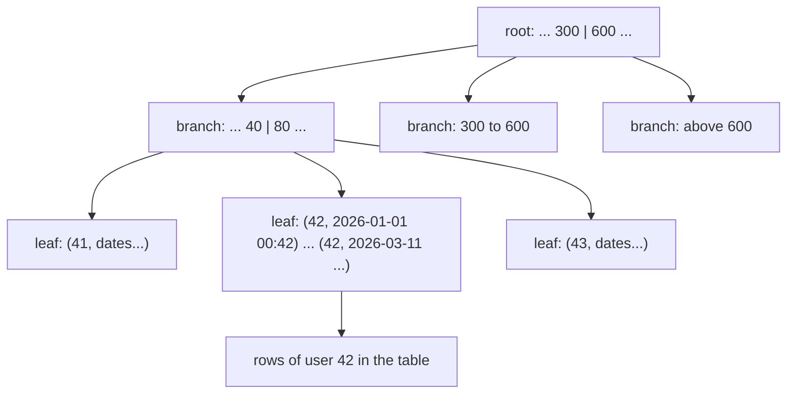
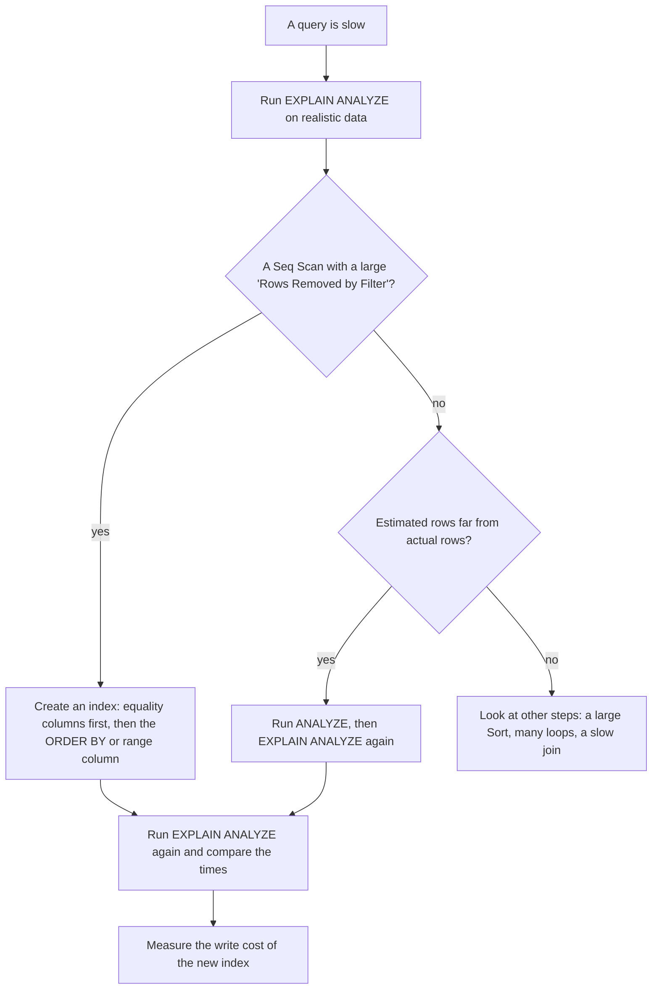

## 1. The question this idea answers

The query "the 20 newest notes of user 42" took a fraction of a millisecond with 10 rows. With 100,000 rows it reads the whole table. With 10 million rows, every request of your API waits for it. Two questions follow:

1. How do you see **what** the database does for a query, instead of guessing?
2. How do you make the query fast, and what does that cost?

An index answers the second question. `EXPLAIN ANALYZE` answers the first. This lesson measures both on a table of 100,000 notes.

## 2. Mental model

> [!analogy] The index at the back of a book
> To find every page about "kiln" in a 500-page book, you can read all 500 pages. Or you can open the index at the back, find "kiln" in alphabetical order, and go straight to pages 41, 217 and 380. A database index is the same idea: a sorted list of column values, and for each value, where its rows are.
>
> **Where it stops working:** a book index is printed once. A database index must change on every insert, update and delete, so it makes writes slower and takes disk space. A book index also helps only for the words it lists, in its order. A database index on `(user_id, created_at)` helps queries that filter on `user_id` first, and much less those that filter only on `created_at`. Finally, the database decides whether to use the index. When a query needs most of the rows, reading the whole table is faster.

## 3. Terms

| Term | Plain meaning |
|---|---|
| sequential scan (Seq Scan) | The database reads every row of the table and tests each one. |
| index | A separate, sorted structure of column values that points to the rows that hold them. |
| B-tree | The default index type of PostgreSQL. A balanced tree of sorted keys, so a lookup needs only a few steps. |
| index scan | The database walks the index to find the matching entries, then reads only those rows. |
| bitmap index scan | The database collects all matching row positions from the index first, then reads those rows in disk order. |
| query planner | The part of the database that chooses how to run a query. |
| query plan | The tree of steps that the planner chose, for example "index scan, then limit". |
| `EXPLAIN` | Shows the plan and the planner's estimates. It does not run the query. |
| `EXPLAIN ANALYZE` | Runs the query and shows the plan with the real row counts and real times. |
| cost | The planner's estimate of the work, in arbitrary units. It is not time. |
| composite index | An index on two or more columns, for example `(user_id, created_at)`. Also called a multicolumn index. |
| leading column | The first column of a composite index. |
| statistics | Facts about the data that the planner uses for its estimates, for example how many distinct `user_id` values exist. `ANALYZE` updates them. |

## 4. How it works

All outputs come from one sandbox run (PostgreSQL 16.15, 2026-10-19). The table `notes` had 100,000 rows for 1,000 users, so each user had 100 notes. The table used 26 MB on disk. The `body` of each note had 200 characters.

### 4.1 Without an index: the sequential scan

The query:

```sql
EXPLAIN ANALYZE
SELECT id, title, created_at FROM notes
WHERE user_id = 42
ORDER BY created_at DESC
LIMIT 20;
```

The table had only its primary key index. The plan:

```text
 Limit  (cost=4586.66..4586.71 rows=20 width=26) (actual time=10.076..10.087 rows=20 loops=1)
   ->  Sort  (cost=4586.66..4586.91 rows=100 width=26) (actual time=10.073..10.075 rows=20 loops=1)
         Sort Key: created_at DESC
         Sort Method: top-N heapsort  Memory: 27kB
         ->  Seq Scan on notes  (cost=0.00..4584.00 rows=100 width=26) (actual time=0.015..10.024 rows=100 loops=1)
               Filter: (user_id = 42)
               Rows Removed by Filter: 99900
 Planning Time: 0.163 ms
 Execution Time: 10.112 ms
```

Read a plan from the most indented line outward. Each arrow `->` is a step whose output feeds the step above it.

1. **Seq Scan on notes**: read all 100,000 rows. Keep the 100 rows where `user_id = 42`. `Rows Removed by Filter: 99900` says that 99.9% of the reading was wasted.
2. **Sort**: sort the 100 rows by `created_at DESC`. "top-N heapsort" means the sort keeps only the best 20.
3. **Limit**: return 20 rows.

The total was 10.1 ms. That sounds small. But the time of a sequential scan grows with the number of rows, and every request pays it. At 10 million rows, expect roughly 100 times more. This is an estimate, not a measurement.

### 4.2 How a B-tree index finds rows

A B-tree index keeps the values of its columns in sorted order, in a shallow tree. Each node holds many keys. To find `user_id = 42`, the database starts at the root and follows one branch per level. It reaches the leaf entries for 42 in a few steps, and the leaf entries point to the rows.



> [!example] Worked example: why a few steps are enough
> A sorted list of 100,000 values needs about log2(100,000) ≈ 16.6, so 17 halvings to find one value. A B-tree is better still: each node holds hundreds of keys, so the tree for 100,000 entries has only a few levels. Compare that with 100,000 row tests in a sequential scan. The exact number of levels depends on the key size and the page size. Treat "a few" as the right order of size, not as an exact count.

The leaf entries of a composite index `(user_id, created_at)` are sorted by `user_id` first, then by `created_at` inside each `user_id`. So the 100 entries of user 42 sit next to each other, already in date order.

### 4.3 EXPLAIN and EXPLAIN ANALYZE

The PostgreSQL 18 documentation, "Using EXPLAIN" (checked on 2026-10-19), gives the rules:

- Each plan line shows the estimated start-up cost, the estimated total cost, the estimated rows and the estimated row width in bytes.
- "The costs are measured in arbitrary units determined by the planner's cost parameters." A cost is not milliseconds.
- `EXPLAIN ANALYZE` "actually executes the query, and then displays the true row counts and true run time". The "actual time" values are in milliseconds.
- Because it executes the statement, "any side-effects will happen as usual". To analyze an `UPDATE` or `DELETE` without changing data, wrap it in `BEGIN` and `ROLLBACK`.

`EXPLAIN` alone gives only estimates:

```text
 Aggregate  (cost=4584.00..4584.01 rows=1 width=8)
   ->  Seq Scan on notes  (cost=0.00..4334.00 rows=100000 width=0)
```

| Field | Example | Meaning |
|---|---|---|
| `cost=0.00..4584.00` | Seq Scan | estimated start-up cost .. estimated total cost |
| `rows=100` | Seq Scan | estimated rows that this step outputs |
| `width=26` | Seq Scan | estimated average row size in bytes |
| `actual time=0.015..10.024` | Seq Scan | real time to the first row .. real time to the last row, in ms |
| `rows=100` (in the actual part) | Seq Scan | real rows output |
| `loops=1` | Seq Scan | how many times this step ran |

> [!trap] Estimates far from the real rows
> Compare the estimated `rows=` with the actual `rows=` of each step. When they differ by a factor of 10 or more, the planner works with wrong facts and can choose a bad plan. Run `ANALYZE notes` to refresh the statistics, then look again. Large data loads are a common cause.

### 4.4 With a composite index

```sql
CREATE INDEX notes_user_created_idx ON notes (user_id, created_at);
ANALYZE notes;
```

The same query:

```text
 Limit  (cost=0.42..80.76 rows=20 width=26) (actual time=0.042..0.075 rows=20 loops=1)
   ->  Index Scan Backward using notes_user_created_idx on notes  (cost=0.42..398.10 rows=99 width=26) (actual time=0.041..0.072 rows=20 loops=1)
         Index Cond: (user_id = 42)
 Planning Time: 0.207 ms
 Execution Time: 0.090 ms
```

| | Without the index | With `(user_id, created_at)` |
|---|---|---|
| Plan | Seq Scan, Sort, Limit | Index Scan Backward, Limit |
| Rows read | 100,000 | 20 |
| Sort step | yes | none: the index is already in order |
| Execution time | 10.112 ms | 0.090 ms |

The query became about 110 times faster (10.112 / 0.090 ≈ 112). Three facts explain it:

1. `Index Cond: (user_id = 42)`: the leading column matches the equality condition, so the scan starts directly at the entries of user 42.
2. `Backward`: the entries of user 42 are sorted by `created_at` ascending. Reading them backward gives `DESC` order with no sort step.
3. `Limit`: the scan stops after 20 entries.

The index used 3,104 kB of disk space, next to 26 MB for the table.

### 4.5 Column order matters

The run replaced the index with `(created_at, user_id)`, the same columns in the other order:

```text
 Limit  (cost=0.42..501.11 rows=20 width=26) (actual time=0.067..0.762 rows=20 loops=1)
   ->  Index Scan Backward using notes_created_user_idx on notes  (cost=0.42..2478.84 rows=99 width=26) (actual time=0.066..0.758 rows=20 loops=1)
         Index Cond: (user_id = 42)
 Execution Time: 0.777 ms
```

It was about 8.6 times slower than the right order (0.777 ms against 0.090 ms). The index is sorted by `created_at` first. So the database walks the index from the newest entry backward and tests `user_id` on each entry until it finds 20 matches. In this data, user 42 owns every 1,000th note, so it found 20 matches after about 20,000 entries.

> [!note] Interpretation: the wrong order can be much worse
> The test data spread each user's notes evenly over time, which is the best case for the wrong order. For a user whose notes are all old, the walk from the newest entry passes almost the whole index before the first match. The right order, `(user_id, created_at)`, does not depend on the data in this way.

The PostgreSQL documentation states the rule in "Multicolumn Indexes" (checked on 2026-10-19). A multicolumn B-tree index "is most efficient when there are constraints on the leading (leftmost) columns". It also says: "Multicolumn indexes should be used sparingly. In most situations, an index on a single column is sufficient". Indexes with more than three columns "are unlikely to be helpful unless the usage of the table is extremely stylized."

> [!key] The rule of thumb for a composite index
> Put the columns of the equality conditions first (`user_id = 42`). Put the column of the range condition or of the `ORDER BY` last (`created_at`).

### 4.6 What stops an index from helping

A function or a calculation on the column hides the index. The run compared two plans:

```text
EXPLAIN SELECT id FROM notes WHERE user_id + 0 = 42;
 Seq Scan on notes  (cost=0.00..4834.00 rows=500 width=8)
   Filter: ((user_id + 0) = 42)

EXPLAIN SELECT id FROM notes WHERE user_id = 42;
 Bitmap Heap Scan on notes  (cost=5.19..351.26 rows=100 width=8)
   Recheck Cond: (user_id = 42)
   ->  Bitmap Index Scan on notes_user_created_idx  (cost=0.00..5.17 rows=100 width=0)
         Index Cond: (user_id = 42)
```

The index holds values of `user_id`, not values of `user_id + 0`. Common forms of the same trap are `lower(email) = ...` against an index on `email`, and `date(created_at) = ...` against an index on `created_at`. The fix is to write the condition on the bare column (for a date: `created_at >= '2026-10-01' AND created_at < '2026-10-02'`), or to create an index on the expression.

The second plan shows a **bitmap** scan. With no `ORDER BY` and no `LIMIT`, the planner collected all 100 row positions from the index first, then read the rows in disk order. That is a normal, good plan.

Other reasons why the planner reads the whole table:

1. The condition matches a large part of the table. Reading everything in order is then cheaper than many jumps through an index.
2. The table is tiny. With 10 rows a sequential scan is the fastest plan, so a test on the seed data never shows the index.
3. The statistics are old. Run `ANALYZE`.

### 4.7 The cost of an index

The docs say it in one sentence (PostgreSQL 18, Chapter 11, checked on 2026-10-19). Indexes "add overhead to the database system as a whole, so they should be used sensibly". Every insert must also insert into every index of the table. The run inserted the same 100,000 rows twice in each setup:

| Indexes on `notes` | Insert of 100,000 rows (two runs) |
|---|---|
| primary key only | 1,063 ms and 1,075 ms |
| primary key + 3 more indexes | 1,438 ms and 1,599 ms |

The three extra indexes made the load about 35% to 50% slower. Updates of indexed columns and deletes pay a similar price. Each index also uses disk space and memory for its cache.

> [!key] Index for the queries that you run
> Create an index for a query that runs often and reads few rows of a large table. Do not create an index "just in case" on every column. Check that a new index is used with `EXPLAIN ANALYZE`, and drop the indexes that no query uses.

### 4.8 A method for a slow query



## 5. Code walkthrough

```sql
CREATE INDEX notes_user_created_idx ON notes (user_id, created_at);
ANALYZE notes;
EXPLAIN ANALYZE SELECT id, title, created_at FROM notes
WHERE user_id = 42 ORDER BY created_at DESC LIMIT 20;
```

| Line | What it does | What breaks without it |
|---|---|---|
| `CREATE INDEX notes_user_created_idx` | Makes a B-tree index with a name that says what it covers. | A default name is harder to find later in a list of indexes. |
| `ON notes (user_id, created_at)` | Sorts the entries by user, then by date. | With one column `(user_id)`, the database still sorts the 100 rows of the user. With the other order, it walks many entries of other users. |
| `ANALYZE notes` | Refreshes the statistics of the table. | The planner can keep old estimates after a large data change. |
| `EXPLAIN ANALYZE` | Runs the query and prints the plan with real times. | Without `ANALYZE` you see only estimates. Without `EXPLAIN` you see only the rows. |
| `WHERE user_id = 42` | The equality condition on the leading column. | Without it, the index cannot start at one user. |
| `ORDER BY created_at DESC LIMIT 20` | The order that the index already has, read backward, and an early stop. | Without `LIMIT`, the scan reads all 100 entries of the user (still fast). |

## 6. Exercises

Runs in: your local practice project, with a local PostgreSQL. Hints come in three levels in chat: idea, pseudocode, partial code.

**Exercise 6.3a: measure an index (from the roadmap exercise for M0.4).** Insert 100,000 notes into your `notes` table with `generate_series`. Run `EXPLAIN ANALYZE` on "the notes of user X ordered by `created_at`". Add a composite index and run it again.

Acceptance tests:

- The first plan shows `Seq Scan on notes` and a `Rows Removed by Filter` line.
- The second plan shows an index scan on your new index and a lower `Execution Time`.
- You write one sentence that explains why, with the words "leading column" and "sort".

**Exercise 6.3b: break the index on purpose.** Use the same data. Write two versions of a query that cannot use the index. The first has a calculation on the column. The second matches most of the rows.

Acceptance tests:

- Both plans show `Seq Scan`.
- For each one, you write the reason in one sentence, and a version of the query (or an index) that fixes it.

**Exercise 6.3c: the write cost.** Time the insert of 100,000 rows with only the primary key, then with two extra indexes.

Acceptance tests:

- You report both times from at least two runs each.
- You state the extra cost in percent.

## 7. Common mistakes

1. **Testing speed on 10 rows.** The planner reads tiny tables completely, and every query looks fast. Test on realistic data.
2. **Reading `cost` as milliseconds.** Costs are arbitrary units. Use the `actual time` of `EXPLAIN ANALYZE`.
3. **`EXPLAIN ANALYZE` on a `DELETE` without a transaction.** It really deletes. Wrap it in `BEGIN` and `ROLLBACK`.
4. **The wrong column order in a composite index.** Put the equality columns first.
5. **A function on an indexed column** in the `WHERE` clause. The index cannot help.
6. **An index on every column.** Each index slows every write and uses disk space.
7. **No index on a foreign key column** that queries use often ([6.1](/notes/ai/ai-engineering/01-software-engineering-fundamentals/m06-postgresql/l1-relational-data-modeling)).
8. **Old statistics after a large import.** Run `ANALYZE`.

## 8. One-minute explanation

Without an index, PostgreSQL answers "the notes of user 42" with a sequential scan: it reads every row and discards most of them. A B-tree index keeps the values of some columns sorted in a shallow tree. The database reaches the right entries in a few steps and reads only those rows. A composite index on `(user_id, created_at)` holds each user's notes together and in date order. So "the 20 newest notes of user 42" becomes a short backward index scan with no sort. In the sandbox it went from 10.1 ms to 0.09 ms on 100,000 rows. Column order matters: put the equality columns first. `EXPLAIN` shows the plan and estimates, and `EXPLAIN ANALYZE` runs the query and shows real times. Indexes are not free. Every insert, update and delete must change them. The sandbox load became about 35% to 50% slower with three extra indexes.

## 9. Check questions

```check
{
  "question": "A plan shows 'Seq Scan on notes ... Rows Removed by Filter: 99900' for WHERE user_id = 42 ORDER BY created_at DESC LIMIT 20. Which index do you create, and which plan do you expect after it?",
  "answer": "CREATE INDEX ON notes (user_id, created_at). The expected plan is a Limit over an Index Scan Backward on that index, with Index Cond: (user_id = 42). It has no Sort step, because the entries of one user are already sorted by created_at."
}
```

```check
{
  "question": "Why can the index on (created_at, user_id) not start directly at the entries of user 42?",
  "hint": "Which column decides the order of the entries first?",
  "answer": "The entries are sorted by created_at first. The entries of user 42 are spread through the whole index, between the entries of every other user. The database must walk the index and test user_id on each entry. With (user_id, created_at), all entries of user 42 are next to each other."
}
```

```check
{
  "question": "A teammate says 'EXPLAIN shows cost=0.42..80.76, so the query takes about 80 ms'. What is wrong, and how do you get the real time?",
  "answer": "Costs are estimates in arbitrary units determined by the planner's cost parameters, not milliseconds. Run EXPLAIN ANALYZE, which executes the query and shows actual time in milliseconds and the Execution Time line. For a data-changing statement, wrap it in BEGIN and ROLLBACK."
}
```

```check
{
  "question": "Name two costs of adding an index, and one sign that an index is not worth keeping.",
  "answer": "Every insert, every delete and every update of an indexed column must also change the index, so writes get slower. The sandbox load was about 35 to 50 percent slower with three extra indexes. The index also uses disk space and cache memory. An index that no query plan uses, or that only helps a rare query on a table with heavy writes, is a candidate to drop."
}
```

## 10. Links

- Previous: [6.2 SQL queries: SELECT to GROUP BY](/notes/ai/ai-engineering/01-software-engineering-fundamentals/m06-postgresql/l2-sql-queries)
- Next: [6.4 Connecting Python and FastAPI to PostgreSQL](/notes/ai/ai-engineering/01-software-engineering-fundamentals/m06-postgresql/l4-connecting-python-to-postgres)
- Deeper: [Indexes](/notes/databases/postgres/01-relational-basics/l3-indexes)
- Sources (PostgreSQL 18 documentation, checked on 2026-10-19): Chapter 11 "Indexes", https://www.postgresql.org/docs/current/indexes.html, "Multicolumn Indexes", https://www.postgresql.org/docs/current/indexes-multicolumn.html, and "Using EXPLAIN", https://www.postgresql.org/docs/current/using-explain.html
- [Glossary](/notes/ai/ai-engineering/glossary)
