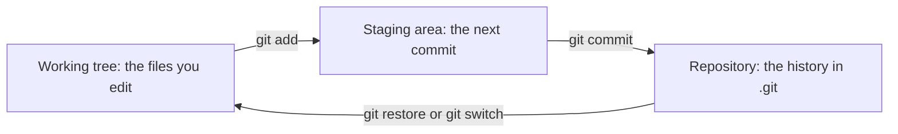
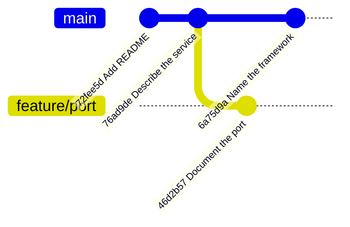
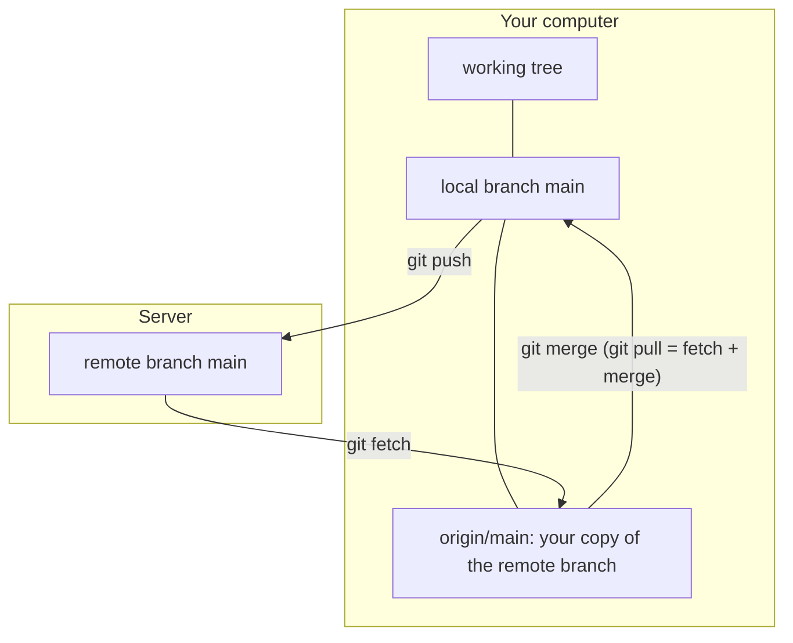

## 1. The question this idea answers

You write a FastAPI service. Then a coding agent edits eight files in one minute. The tests fail. You need answers to simple questions:

- What exactly changed, line by line?
- What did the code look like yesterday, when the tests passed?
- Can I try a risky idea without breaking the working version?
- How does a teammate get my changes, and how do I get theirs?

Copies of the folder named `api-final-v2-fixed` cannot answer these questions. A **version control system** can. Git is the version control system that almost every team uses. This lesson builds a mental model of Git from zero and shows real output for each step.

## 2. Mental model

> [!analogy] An album of snapshots with movable bookmarks
> Each time you commit, Git puts a photo of the whole project into an album. Each photo has a caption (the message), a date, an author, and an arrow to the photo before it. A **branch** is a bookmark that points to one photo. When you commit on a branch, the new photo goes into the album and the bookmark moves to it. A **remote** is a second album on another computer, and you copy photos between the albums.
>
> **Where it stops working:** a photo album is one line of pages. Git history is a graph: two bookmarks can grow from the same photo in two directions, and a merge photo has two arrows back. Also, a Git photo shows only what you placed on the table first, in the staging area. A change that you did not stage is not in the photo.

## 3. Terms

| Term | Plain meaning |
|---|---|
| version control system | A tool that records the changes to files over time, so that you can compare, restore and share versions. |
| Git | A distributed version control system. Every copy holds the full history. |
| repository (repo) | A project folder that Git tracks. The history lives in its hidden `.git` folder. |
| working tree | The files in the folder, as you see and edit them now. |
| staging area (index) | The set of changes that will go into the next commit. |
| commit | A saved snapshot of the staged project, with a message, an author, a time and a link to its parent commit. |
| hash (commit id) | A long hexadecimal name of a commit, computed from its content, for example `25a9e5d...`. A short prefix is enough to name it. |
| parent | The commit that came directly before a commit. A merge commit has two parents. |
| tracked file | A file that Git knows: it was in the last commit or is staged now. |
| untracked file | A file in the working tree that Git does not record yet. |
| diff | A list of the lines that changed between two versions. |
| branch | A named, movable pointer to one commit. |
| `HEAD` | Git's pointer to the branch (and commit) that you work on now. |
| remote | Another copy of the repository, usually on a server such as GitHub. Its default name is `origin`. |
| clone | Copy a remote repository, with its full history, to your computer. |
| fetch | Download new commits from a remote without changing your branch. |
| pull | Fetch, then merge the remote branch into your branch. |
| push | Upload your new commits to a remote branch. |

## 4. How it works

All outputs come from scratch repositories in a sandbox (Git 2.43.0, 2026-10-19). Your hashes will be different.

### 4.1 Three places for a change

A change moves through three places. You decide when it moves.



Pro Git describes `git add` well in "Recording Changes to the Repository" (checked on 2026-10-19). It is "a multipurpose command". Think of it "more as 'add precisely this content to the next commit' rather than 'add this file to the project'". The book also notes that Git stages a file as it is at the moment of `git add`. An edit after `git add` needs another `git add`.

Why have a staging area at all? It lets you make small, clean commits. You can edit five files, then commit the two files of one fix, and commit the other three files of another change.

### 4.2 The first repository

```text
$ git init -b main
Initialized empty Git repository in .../notes-api/.git/
$ git status
On branch main

No commits yet

Untracked files:
  (use "git add <file>..." to include in what will be committed)
	README.md

nothing added to commit but untracked files present (use "git add" to track)
$ git add README.md
$ git status --short
A  README.md
$ git commit -m "Add README"
[main (root-commit) 72fee5d] Add README
 1 file changed, 3 insertions(+)
 create mode 100644 README.md
```

1. `git init -b main` creates the `.git` folder and names the first branch `main`.
2. `git status` says that `README.md` is untracked. Git sees the file but does not record it.
3. `git add README.md` stages it. `git status --short` shows `A`: added to the staging area.
4. `git commit -m "Add README"` saves the snapshot. `root-commit` means that this commit has no parent. `72fee5d` is the short hash.

Then the run changed one line of `README.md` and created `main.py`:

```text
$ git status --short
 M README.md
?? main.py
```

`git status --short` prints two columns. Pro Git explains: "the left-hand column indicates the status of the staging area and the right-hand column indicates the status of the working tree."

| Code | Left column (staging area) | Right column (working tree) | Meaning here |
|---|---|---|---|
| ` M` | nothing staged | modified | `README.md` changed, but the change is not staged |
| `M ` | modified and staged | no further change | the change is ready for the next commit |
| `MM` | modified and staged | modified again | part of the change is staged, a later edit is not |
| `A ` | added | | a new file is staged |
| `??` | | | an untracked file |

### 4.3 Read a diff

`git diff` shows the changes in the working tree that are not staged yet:

```text
$ git diff
diff --git a/README.md b/README.md
index d4b337a..477db5a 100644
--- a/README.md
+++ b/README.md
@@ -1,3 +1,3 @@
 # Notes API
 
-A small REST service.
+A small REST service for team notes.
```

| Line | Meaning |
|---|---|
| `diff --git a/README.md b/README.md` | The old version (`a/`) and the new version (`b/`) of one file. |
| `index d4b337a..477db5a 100644` | The ids of the old and the new file content, and the file mode. |
| `--- a/README.md` and `+++ b/README.md` | Lines with `-` come from the old version, lines with `+` from the new one. |
| `@@ -1,3 +1,3 @@` | A hunk: 3 lines from line 1 in the old file become 3 lines from line 1 in the new file. |
| a line that starts with a space | A context line that did not change. |
| `-A small REST service.` | A removed line. |
| `+A small REST service for team notes.` | An added line. A changed line is one removal and one addition. |

Three forms of the command cover most needs:

- `git diff`: working tree against the staging area (what you have not staged).
- `git diff --staged`: staging area against the last commit (what the next commit holds).
- `git diff main..feature`: the difference between two branches.

> [!key] The diff is your review tool for agent changes
> When a coding agent edits files, read `git diff` before you stage anything. You see every line that it changed, including the lines that it did not mention. Module 8 builds the full review loop on this ([8.1](/notes/ai/ai-engineering/01-software-engineering-fundamentals/m08-ai-assisted-development/l1-from-autocomplete-to-agents)).

### 4.4 What a commit is

Pro Git, "Branches in a Nutshell" (checked on 2026-10-19), says that Git stores "a series of *snapshots*", not a list of differences. A commit object "contains a pointer to the snapshot of the content you staged". It also holds the author's name and email, the message, and "pointers to the commit or commits that directly came before this commit (its parent or parents)".

You can print a commit object. This is a merge commit from lesson 7.2:

```text
$ git cat-file -p HEAD
tree 5b08f19cfe43ec02401c67dd611be37b6a23e648
parent 6a75d9af992536e32014315823de786291c85f29
parent 46d2b5786c2ff3b3b555f14bb40cae8accfc603f
author Learner <learner@example.com> 1792405200 +0000
committer Learner <learner@example.com> 1792405200 +0000

Merge feature/port: keep the framework and the port
```

- `tree` points to the snapshot of all files.
- `parent` points to the previous commit. This one has two parents, because it is a merge.
- `author` and `committer` hold the person and the time (seconds since 1970, and the time zone).
- The last line is the message.

The hash of a commit comes from all of this content. Change one byte of the message or of a parent, and the hash changes. That is why history that other people already have must not be rewritten: their commits would no longer match yours.

### 4.5 Branches and HEAD

Pro Git says: "A branch in Git is simply a lightweight movable pointer to one of these commits." The book calls `HEAD` "a pointer to the local branch you're currently on."

The run made a branch, committed on it, returned to `main`, and committed there too:

```text
$ git switch -c feature/port
Switched to a new branch 'feature/port'
$ git commit -am "Document the port"
$ git switch main
Switched to branch 'main'
$ git commit -am "Name the framework"
$ git log --graph --oneline --all
* 6a75d9a Name the framework
| * 46d2b57 Document the port
|/
* 76ad9de Describe the service and add main.py
* 72fee5d Add README
```

Read the graph from the bottom up. Two commits sit on one line. Then the history splits: `46d2b57` is on `feature/port`, and `6a75d9a` is on `main`. Both share the parent `76ad9de`. Nothing was copied. Each branch is only a name that points to its newest commit.



| Command | What it does |
|---|---|
| `git switch -c name` | Create a branch at the current commit and move `HEAD` to it. |
| `git switch name` | Move `HEAD` to an existing branch and change the working tree to its snapshot. |
| `git branch` | List the local branches. The current one has a `*`. |
| `git commit -am "msg"` | Stage every change to tracked files, then commit. It does not add untracked files. |

> [!trap] git switch with uncommitted changes
> Git changes the working tree when you switch branches. If a file has changes that the other branch would overwrite, Git refuses to switch. Commit the changes first, or store them for a moment with `git stash`. Do not delete changes only to remove the error.

### 4.6 Remotes: clone, fetch, pull and push

A remote is another copy of the repository. The run used a local folder as the remote, so that every step works without a network. With GitHub, only the URL differs.

```text
$ git remote add origin ../remote.git
$ git push -u origin main
To ../remote.git
 * [new branch]      main -> main
branch 'main' set up to track 'origin/main'.
$ git clone remote.git desktop
Cloning into 'desktop'...
done.
```

Then the second copy (`desktop`) committed and pushed a change. Back in the first copy (`laptop`):

```text
$ git status   (laptop, before fetch)
On branch main
Your branch is up to date with 'origin/main'.
$ git fetch
From ../remote
   358b271..4cfd838  main       -> origin/main
$ git status   (laptop, after fetch)
On branch main
Your branch is behind 'origin/main' by 1 commit, and can be fast-forwarded.
$ git pull
Updating 358b271..4cfd838
Fast-forward
 README.md | 1 +
```

> [!trap] "Up to date" means up to date with the last fetch
> Before the fetch, `git status` said "up to date with 'origin/main'", although the remote already had a new commit. Git compares your branch with its local copy of the remote branch, `origin/main`. Only `git fetch` refreshes that copy. Run `git fetch` before you trust this line.



### 4.7 A daily loop

```text
git switch main
git pull                      # get the newest main
git switch -c fix/empty-title # one branch for one change
# ... edit, run the tests ...
git status                    # what changed?
git diff                      # read every line
git add app/routes.py tests/test_routes.py
git diff --staged             # read what the commit will hold
git commit -m "Reject notes with an empty title"
git push -u origin fix/empty-title
```

Then you open a pull request ([7.2](/notes/ai/ai-engineering/01-software-engineering-fundamentals/m07-git/l2-pull-requests-and-merge-conflicts)).

## 5. Code walkthrough

The daily loop of section 4.7, line by line:

| Line | Why it exists | What goes wrong without it |
|---|---|---|
| `git switch main` then `git pull` | Start from the newest shared version. | You build on old code and get conflicts later. |
| `git switch -c fix/empty-title` | Keep one change on its own branch. | Unfinished work lands on `main`, and other people pull it. |
| `git status` | Lists the changed and untracked files. | You commit a file by mistake, for example `.env`. |
| `git diff` | Shows every changed line before staging. | An unwanted change, often from an agent, enters history unseen. |
| `git add <files>` | Stages only the files of this change. | `git add .` stages everything, including files that you did not mean to commit. |
| `git diff --staged` | Shows exactly what the commit will hold. | The commit holds something other than what you think. |
| `git commit -m "..."` | Saves the snapshot with a reason. | Nothing is saved. Work can be lost. |
| `git push -u origin <branch>` | Uploads the branch and links it to the remote branch. | The work exists only on your computer. |

## 6. Exercises

Runs in: your local practice project. Hints come in three levels in chat: idea, pseudocode, partial code.

**Exercise 7.1a: the first history.** Turn your local practice project into a Git repository. Make three commits: the README, the first code file, and one change to the README.

Acceptance tests:

- `git log --oneline` shows exactly three commits, with messages that say why.
- Before each commit you ran `git diff --staged` and can say what it showed.
- Make a change, stage it, and change the same file again. `git status --short` then shows `MM`. You can explain both letters.

**Exercise 7.1b: two copies and a remote.** Do these steps in order:

1. Create a bare repository as a local remote with `git init --bare`.
2. Push your project to it.
3. Clone it into a second folder.
4. Commit and push from the second folder.
5. Bring the change into the first folder.

Acceptance tests:

- Before `git fetch`, the first folder says "up to date". After `git fetch`, it says "behind ... by 1 commit". You can explain why.
- After `git pull`, `git log --oneline` is the same in both folders.

## 7. Common mistakes

1. **`git add .` without `git status` first.** Secrets, virtual environments and generated files go into history.
2. **A commit without reading the diff.** You accept changes that you did not review, often changes from an agent.
3. **Work directly on `main`.** One broken commit blocks everyone who pulls. Use a branch for each change.
4. **Trust "up to date" without `git fetch`.** The status compares with your last copy of the remote, not with the remote now.
5. **Huge commits that mix five changes.** Review and `git bisect` ([7.3](/notes/ai/ai-engineering/01-software-engineering-fundamentals/m07-git/l3-history-gitignore-readme-and-review)) become hard. Commit one logical change at a time.
6. **Think that a branch is a copy of the files.** A branch is only a pointer to a commit. Creating one costs nothing.
7. **Forget that `git commit -am` skips untracked files.** A new file is not in the commit until you `git add` it.

## 8. One-minute explanation

Git records your project as a series of snapshots called commits. A change moves from the working tree to the staging area with `git add`, and from the staging area into history with `git commit`. Each commit stores a pointer to the snapshot, the author, the time, the message and its parent. Its hash comes from all of that content. `git status` lists what changed, and `git diff` shows the exact lines, which is how you review your own work and an agent's work. A branch is a movable pointer to a commit, and `HEAD` points to the branch that you are on. So a new line of work costs nothing. A remote is another copy of the repository. `git push` uploads commits, `git fetch` downloads them into `origin/main`, and `git pull` is fetch plus merge.

## 9. Check questions

```check
{
  "question": "git status --short shows MM app.py. What does each M mean, and what happens if you commit now?",
  "answer": "The left M says that a change to app.py is staged. The right M says that app.py changed again in the working tree after the git add. A commit now holds only the staged version. The later edit stays in the working tree, uncommitted, until you git add it again."
}
```

```check
{
  "question": "Your teammate pushed to main 10 minutes ago. Your git status says 'Your branch is up to date with origin/main'. Is that true? What do you run to know?",
  "hint": "What does git status compare your branch with?",
  "answer": "Not necessarily. git status compares your branch with origin/main, your local copy of the remote branch, which changes only when you fetch. Run git fetch first. After the fetch, git status shows 'behind by 1 commit' if the teammate's commit exists, and git pull brings it in."
}
```

```check
{
  "question": "Why does creating a branch in Git take almost no time and no disk space, even in a large project?",
  "answer": "A branch is only a small named pointer to one commit. Git does not copy any files. The new commits that you make on the branch add new snapshots, and the branch pointer moves to the newest one."
}
```

```check
{
  "question": "A coding agent says 'I changed the error handler in routes.py'. Which two Git commands show you every line that it really changed, before and after you stage?",
  "answer": "git diff shows the unstaged changes in the working tree against the staging area. After git add, git diff --staged shows exactly what the next commit will hold. Read both, because the agent may have changed lines in other files that it did not mention. git status lists every changed file."
}
```

## 10. Links

- Module: [M7 Git and collaboration](/notes/ai/ai-engineering/01-software-engineering-fundamentals/m07-git)
- Next: [7.2 Pull requests, merges and conflicts](/notes/ai/ai-engineering/01-software-engineering-fundamentals/m07-git/l2-pull-requests-and-merge-conflicts)
- Later use: [8.1 From autocomplete to coding agents](/notes/ai/ai-engineering/01-software-engineering-fundamentals/m08-ai-assisted-development/l1-from-autocomplete-to-agents)
- Sources (Pro Git, 2nd edition, checked on 2026-10-19): "Recording Changes to the Repository", https://git-scm.com/book/en/v2/Git-Basics-Recording-Changes-to-the-Repository, and "Branches in a Nutshell", https://git-scm.com/book/en/v2/Git-Branching-Branches-in-a-Nutshell
- [Glossary](/notes/ai/ai-engineering/glossary)
