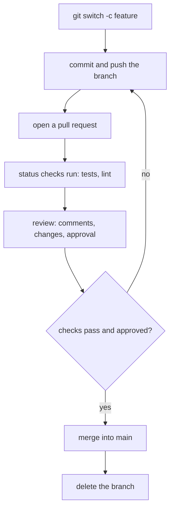

## 1. The question this idea answers

You and a teammate work on the same service. You add a port number to the README. She names the framework in the same line. A coding agent works on a third branch. All three changes must reach `main`, and nobody's work may silently disappear. Three questions follow:

1. How does a change get from a branch into `main` with a second pair of eyes on it?
2. What does Git do when two branches changed the same project?
3. What do you do when Git cannot decide alone, because two branches changed the same lines?

This lesson answers them with a real conflict, made on purpose in a scratch repository.

## 2. Mental model

> [!analogy] Two editors and one printed page
> Two editors take copies of the same page. Each one marks changes. Later, a third person combines the copies onto one page. When the editors changed different paragraphs, combining is easy. When both rewrote the **same sentence** in different ways, the third person must read both versions and decide. Git is that third person for the easy cases. For the hard case, it marks both versions in the file and stops, and you decide.
>
> **Where it stops working:** Git compares lines of text, not meaning. Two branches can change different lines and still break each other. One branch renames a function. The other adds a new call to the old name. Git merges both without a conflict, and the code fails. Only tests and review catch this.

## 3. Terms

| Term | Plain meaning |
|---|---|
| merge | Combine the work of one branch into another branch. |
| fast-forward | A merge where the target branch has no new commits of its own, so Git only moves its pointer to the newer commit. |
| three-way merge | A merge that compares three snapshots: the two branch tips and their common ancestor. |
| merge commit | A commit with two parents that records a three-way merge. |
| merge base (common ancestor) | The newest commit that both branches share. |
| conflict | Two branches changed the same part of a file in different ways, so Git cannot merge it alone. |
| conflict markers | The lines `<<<<<<<`, `=======` and `>>>>>>>` that Git writes into a file to show both versions. |
| squash merge | Combine all commits of a branch into one new commit on the target branch. |
| rebase | Replay the commits of a branch on top of another commit. It creates new commits with new hashes. |
| pull request (PR) | A request on a platform such as GitHub to merge one branch into another, with a diff, discussion and checks. GitLab calls it a merge request. |
| review | A teammate reads the diff of a pull request, comments, and approves it or asks for changes. |
| status check | An automatic job, for example the test suite, whose result appears on a pull request. |

## 4. How it works

All outputs come from scratch repositories in a sandbox (Git 2.43.0, 2026-10-19).

### 4.1 The branch, pull request, merge workflow



1. **Branch.** Make one branch for one change ([7.1](/notes/ai/ai-engineering/01-software-engineering-fundamentals/m07-git/l1-repositories-commits-and-branches)).
2. **Push.** `git push -u origin feature` uploads it.
3. **Open the pull request.** On GitHub, choose the base branch (`main`) and the compare branch (`feature`). Write a title and a description: what changed, why, and how you tested it.
4. **Checks.** Continuous integration runs the tests on the branch and shows the result on the pull request.
5. **Review.** A teammate reads the diff and comments on lines. You push more commits to the same branch to answer. The pull request updates.
6. **Merge.** When the checks pass and the reviewer approves, someone merges. A protected `main` can require these steps ([7.3](/notes/ai/ai-engineering/01-software-engineering-fundamentals/m07-git/l3-history-gitignore-readme-and-review)).

> [!key] A pull request is a review of a diff, not of a story
> The reviewer judges the lines in the diff, not the description. That is why small pull requests get better reviews. A pull request of 50 lines gets read. A pull request of 3,000 lines gets skimmed. The same rule applies to a diff from a coding agent.

### 4.2 Fast-forward: only move the pointer

The run made a branch `docs/usage` with one commit, while `main` did not change. Then it merged:

```text
$ git merge docs/usage
Updating 25a9e5d..834e358
Fast-forward
 README.md | 4 ++++
 1 file changed, 4 insertions(+)
```

Pro Git explains it in "Basic Branching and Merging" (checked on 2026-10-19). The commit that you merge "can be reached by following the first commit's history". So "Git simplifies things by moving the pointer forward because there is no divergent work to merge together". No new commit appears. `main` now points to `834e358`.

### 4.3 Three-way merge and the merge commit

When both branches have new commits, Git cannot only move a pointer. Pro Git says: "Git does a simple three-way merge, using the two snapshots pointed to by the branch tips and the common ancestor of the two."

The result is "a merge commit, and is special in that it has more than one parent."

How does a three-way merge decide, line by line? It compares each branch with the common ancestor:

| Ancestor | Branch A | Branch B | Result |
|---|---|---|---|
| line X | line X | line X | line X (no change) |
| line X | line X2 | line X | line X2 (only A changed it) |
| line X | line X | line X3 | line X3 (only B changed it) |
| line X | line X2 | line X2 | line X2 (both made the same change) |
| line X | line X2 | line X3 | **conflict**: both changed it differently |

The ancestor is what makes this possible. With only two versions, Git could not know which side changed a line.

### 4.4 A real conflict

The run started from a README with the line `A small REST service for team notes.` Then:

- On `feature/port`, the line became `A small REST service for team notes. It listens on port 8000.`
- On `main`, the same line became `A small REST service for team notes, built with FastAPI.`

```text
$ git log --graph --oneline --all
* 6a75d9a Name the framework
| * 46d2b57 Document the port
|/
* 76ad9de Describe the service and add main.py
* 72fee5d Add README
$ git merge feature/port
Auto-merging README.md
CONFLICT (content): Merge conflict in README.md
Automatic merge failed; fix conflicts and then commit the result.
$ git status
On branch main
You have unmerged paths.
  (fix conflicts and run "git commit")
  (use "git merge --abort" to abort the merge)

Unmerged paths:
  (use "git add <file>..." to mark resolution)
	both modified:   README.md
$ cat README.md
# Notes API

<<<<<<< HEAD
A small REST service for team notes, built with FastAPI.
=======
A small REST service for team notes. It listens on port 8000.
>>>>>>> feature/port
```

| Marker | Meaning |
|---|---|
| `<<<<<<< HEAD` | Start of the version of the branch you are on (`main`, because you merged into it). |
| `=======` | The end of your version and the start of theirs. |
| `>>>>>>> feature/port` | End of the version from the branch that you merge in. |

Pro Git says: the version in `HEAD` "is the top part of that block (everything above the `=======`)".

### 4.5 Resolve the conflict step by step

1. **Read both versions.** Decide what the correct result is. It is often a combination, not one side.
2. **Edit the file.** Write the correct text and delete all three marker lines:

   ```text
   # Notes API

   A small REST service for team notes, built with FastAPI. It listens on port 8000.
   ```

3. **Check that no markers remain.** `git diff` and a search for `<<<<<<<` help. A marker that stays in a Python file is a syntax error.
4. **Run the tests.** A text merge can be correct line by line and still break the code (section 2).
5. **Mark it resolved and commit.** Pro Git: "run `git add` on each file to mark it as resolved. Staging the file marks it as resolved in Git."

```text
$ git add README.md
$ git commit -m "Merge feature/port: keep the framework and the port"
$ git log --graph --oneline
*   25a9e5d Merge feature/port: keep the framework and the port
|\
| * 46d2b57 Document the port
* | 6a75d9a Name the framework
|/
* 76ad9de Describe the service and add main.py
* 72fee5d Add README
$ git log -1 --format="%h parents: %p"
25a9e5d parents: 6a75d9a 46d2b57
```

The merge commit `25a9e5d` has two parents: the tip of `main` and the tip of `feature/port`. Both lines of work stay in the history.

> [!trap] Abort when you are lost
> In the middle of a confusing merge, `git merge --abort` returns the files to the state before the merge. Nothing is lost. Start again with a calm head, or ask the author of the other branch.

### 4.6 Three ways to merge a pull request

GitHub offers three buttons for a pull request. The run made the same history three times and merged it in each way. Before the merge:

```text
* 2009c9c Main moved on
| * 51606c7 Feature step 2
| * 781fa01 Feature step 1
|/
* 7a958ab Base
```

After each strategy:

```text
=== merge commit ===
*   9d2a2b6 Merge branch 'feature'
|\
| * 51606c7 Feature step 2
| * 781fa01 Feature step 1
* | 2009c9c Main moved on
|/
* 7a958ab Base

=== squash ===
* 2fe3694 Add the feature (squashed)
* 2009c9c Main moved on
* 7a958ab Base

=== rebase, then fast-forward ===
* 88f9bdd Feature step 2
* 62d4cbc Feature step 1
* 2009c9c Main moved on
* 7a958ab Base
```

| Strategy | History on main | Keeps the individual commits | Changes hashes | Good for |
|---|---|---|---|---|
| Merge commit | a graph with a merge commit | yes, with their old hashes | no | showing exactly how work was combined |
| Squash merge | one new commit for the whole branch | no, only one combined commit | the branch commits are not on main at all | small pull requests with messy "fix typo" commits |
| Rebase | a straight line | yes, but as new copies | yes: `781fa01` became `62d4cbc` | a linear history that is easy to read and bisect |

> [!trap] Never rebase commits that other people already pulled
> A rebase creates new commits with new hashes. If a teammate based work on the old commits, their history and yours now disagree, and a later merge duplicates the commits. Rebase only your own branch that nobody else uses. Teams agree on one strategy per repository, and branch rules can enforce it ([7.3](/notes/ai/ai-engineering/01-software-engineering-fundamentals/m07-git/l3-history-gitignore-readme-and-review)).

### 4.7 Why conflicts happen more with agents

Several coding agents can work in parallel, each on its own branch or worktree. Each agent changes files fast and often touches shared files such as `README.md`, a router module, or a settings file. When their branches meet, conflicts are normal. Treat them as a normal step:

1. Merge or rebase often, so that branches do not drift far apart.
2. Keep each task small, so that each branch touches few files.
3. Resolve conflicts yourself, or review the agent's resolution line by line. An agent that "resolves" a conflict can silently drop one side.

## 5. Code walkthrough

The full conflict session, with the purpose of each command:

```text
git switch main                 # stand on the branch that receives the work
git pull                        # make sure main is current
git merge feature/port          # Git merges what it can and stops at the conflict
git status                      # lists the files with conflicts ("both modified")
# edit README.md: choose the final text, delete the three marker lines
git diff                        # check the result, and that no marker remains
uv run pytest                   # a clean text merge can still break the code
git add README.md               # mark this file as resolved
git commit                      # create the merge commit (Git proposes a message)
git log --graph --oneline       # see the two parents
```

| Step | Input | Output | What breaks without it |
|---|---|---|---|
| `git merge feature/port` | two branch tips and their ancestor | merged files, or conflict markers | nothing merges |
| edit the file | the markers and both versions | one correct version | the markers stay in the code |
| test run | the merged code | pass or fail | a semantic conflict reaches main |
| `git add` | the edited file | "resolved" state | `git commit` refuses: unmerged paths |
| `git commit` | the resolved index | the merge commit with two parents | the merge is not recorded |

## 6. Exercises

Runs in: your local practice project. Hints come in three levels in chat: idea, pseudocode, partial code.

**Exercise 7.2a: a conflict on purpose (from the roadmap exercise for M0.5).** Use a scratch repository. Make two branches that change the same line of `README.md` in different ways. Merge one into the other. Resolve the conflict by hand, and commit.

Acceptance tests:

- `git log --graph --oneline` shows a merge commit with two lines of history.
- `git log -1 --format="%h parents: %p"` prints two parent hashes.
- The final `README.md` holds no marker lines and holds the correct combined text.

**Exercise 7.2b: compare the three strategies.** Make the same small history three times: one base commit, two commits on `feature`, one commit on `main`. Merge it once with a merge commit, once with `git merge --squash`, and once with a rebase followed by a fast-forward.

Acceptance tests:

- You show the three `git log --graph --oneline` outputs.
- You point to the commit whose hash changed after the rebase.
- You write one sentence for each strategy on when you would choose it.

**Exercise 7.2c: a pull request.** Push a branch of your practice project to GitHub and open a pull request against `main`.

Acceptance tests:

- The description says what changed, why, and how you tested it.
- You review your own diff on GitHub and leave at least one comment on a line before you merge.

## 7. Common mistakes

1. **Avoiding merges until the branches are far apart.** Conflicts grow with time. Merge `main` into your branch, or rebase, often.
2. **Choosing "ours" or "theirs" for the whole file without reading.** One side's work disappears silently.
3. **Leaving a conflict marker in the file.** In Python it is a syntax error. In a README it ships to users.
4. **Skipping the tests after a clean merge.** Git checks lines, not meaning.
5. **Rebasing a shared branch.** The new hashes break your teammates' history.
6. **Huge pull requests.** They get skimmed, not reviewed.
7. **Letting an agent resolve a conflict without reading its diff.** It may keep only one side.

## 8. One-minute explanation

A change reaches `main` through a branch and a pull request. You push the branch, the checks run, a teammate reviews the diff, and then it merges. If `main` has no new commits, Git merges by fast-forward: it only moves the pointer. Otherwise it makes a three-way merge. It compares both branch tips with their common ancestor, takes each side's changes, and records a merge commit with two parents. When both sides changed the same lines differently, Git writes conflict markers into the file and stops. You read both versions, write the correct result, delete the markers, run the tests, `git add` the file and commit. Pull requests can also merge by squash (one combined commit) or by rebase (new copies of the commits on a straight line). Never rebase commits that other people already have.

## 9. Check questions

```check
{
  "question": "main is at commit C2. feature was made from C2 and has two new commits, C3 and C4. main has nothing new. What does git merge feature (run on main) do, and does it create a new commit?",
  "answer": "It is a fast-forward. main's history can reach C4 by following feature's history, so Git only moves the main pointer from C2 to C4. No merge commit is created."
}
```

```check
{
  "question": "Why does a three-way merge need the common ancestor? Give the case where two versions alone would not be enough.",
  "hint": "Think about a line that only one branch changed.",
  "answer": "With only the two branch tips, Git sees that a line differs but cannot know which side changed it. The ancestor shows the original line. If branch A changed it and branch B still has the original, Git takes A's version without a conflict. Only when both differ from the ancestor, in different ways, is it a conflict."
}
```

```check
{
  "question": "After a merge with no conflicts, the tests fail with NameError: name 'load_notes' is not defined. How can that happen?",
  "answer": "Git merges by lines, not by meaning. One branch renamed load_notes to read_notes everywhere it existed. The other branch added a new call to load_notes in a different file or a different line. The lines did not overlap, so there was no conflict, but the combined code calls a function that no longer exists. Tests and review catch this, Git does not."
}
```

```check
{
  "question": "Your feature branch exists only on your laptop. A teammate has a long-lived branch that three people pulled. Which one may you rebase, and why not the other?",
  "answer": "You may rebase your own local feature branch, because nobody else has its commits. A rebase creates new commits with new hashes. If you rebase the shared branch, the three people still have the old commits, so their histories disagree with yours and later merges duplicate the work."
}
```

## 10. Links

- Previous: [7.1 Repositories, commits, branches and remotes](/notes/ai/ai-engineering/01-software-engineering-fundamentals/m07-git/l1-repositories-commits-and-branches)
- Next: [7.3 History, .gitignore, README and code review](/notes/ai/ai-engineering/01-software-engineering-fundamentals/m07-git/l3-history-gitignore-readme-and-review)
- Later use: [8.1 From autocomplete to coding agents](/notes/ai/ai-engineering/01-software-engineering-fundamentals/m08-ai-assisted-development/l1-from-autocomplete-to-agents)
- Source: Pro Git, 2nd edition, "Basic Branching and Merging", https://git-scm.com/book/en/v2/Git-Branching-Basic-Branching-and-Merging (checked on 2026-10-19)
- [Glossary](/notes/ai/ai-engineering/glossary)
