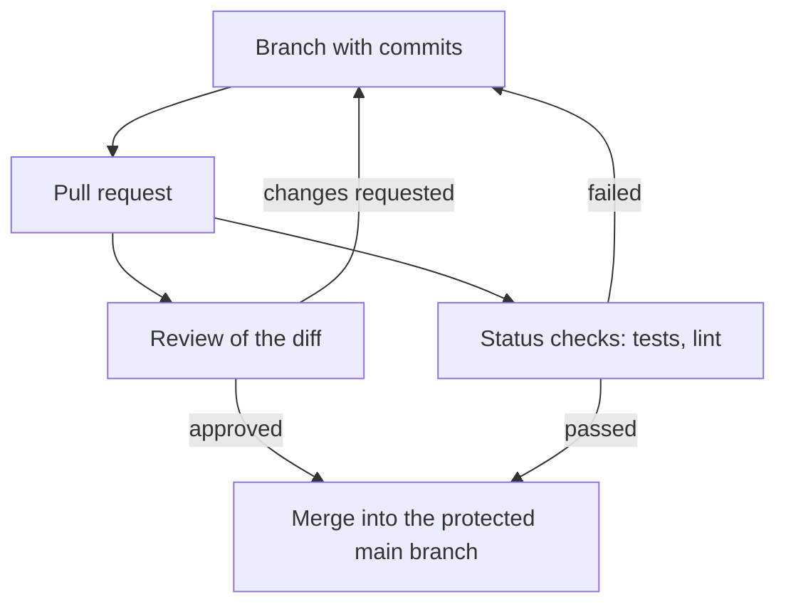

## 1. The question this idea answers

Six months from now, someone opens your repository. Maybe it is a teammate, maybe it is you, maybe it is a coding agent. They need answers:

- Why does this line exist?
- Which commit broke the price calculation?
- Why is there no API key in the repository, and where does the key come from?
- How do I install, configure, run and test this service?
- What stops a broken change from reaching `main`?

Each answer comes from one habit of this lesson: good commit messages, the history tools, `.gitignore`, a README, and review rules.

## 2. Mental model

> [!analogy] A lab notebook
> A good scientist writes a dated entry for each experiment: what changed and **why**. Months later, the notebook explains every result. Git history is your project's lab notebook, and each commit message is an entry.
>
> **Where it stops working:** a paper notebook has one copy. Git history is copied to every clone, every fork and every backup. So a secret written into one commit is in all those copies, even after you delete the file in a later commit. You cannot tear out a page that other people already copied.

## 3. Terms

| Term | Plain meaning |
|---|---|
| commit message | The text of a commit: a short summary line, a blank line, and an optional body that explains why. |
| `git log` | Lists commits. With options it shows the graph, the changes or the history of one file. |
| `git blame` | Shows, for each line of a file, the last commit that changed it. |
| `git bisect` | Finds the first bad commit with a binary search over history. |
| `.gitignore` | A file of patterns. Git does not track untracked files that match them. |
| `git check-ignore -v` | Shows which `.gitignore` rule ignores a path. |
| `git rm --cached` | Stops tracking a file but keeps it on disk. Old commits still hold it. |
| secret | A value that gives access: an API key, a password, a token, a database URL with a password. |
| rotate a secret | Make a new secret, switch the system to it, and disable the old one. |
| history rewrite | Changing old commits (for example with `git filter-repo`). Every hash after the change is new. |
| README | The first file a reader opens: what the project is and how to use it. |
| code review | A second person reads a change before it merges. |
| protected branch | A branch with rules, for example "merge only through an approved pull request with passing checks". |
| ruleset | A named list of GitHub rules for one or many repositories. Several rulesets can apply to one branch. |

## 4. How it works

All outputs come from scratch repositories in a sandbox (Git 2.43.0, 2026-10-19).

### 4.1 Commit messages that say why

The diff already shows **what** changed. The message must say **why**. Pro Git, "Contributing to a Project" (checked on 2026-10-19), gives the rules:

- The first line must be short. The book says: "a single line that's no more than about 50 characters and that describes the changeset concisely, followed by a blank line, followed by a more detailed explanation."
- "Write your commit message in the imperative: 'Fix bug' and not 'Fixed bug' or 'Fixes bug.'"
- "Make each commit a logically separate changeset."
- Before you commit, run `git diff --check`, which "identifies possible whitespace errors and lists them for you."

| Weak message | Better message |
|---|---|
| `fix` | `Return 404 when a note does not exist` |
| `changes` | `Move the database URL into an environment variable` |
| `updated stuff in routes.py` | `Reject notes with an empty title` |
| `WIP` | (do not merge it, or squash it into a real commit) |

A body explains the reason when the summary cannot:

```text
Retry the export call only on 429 and 503

The export API returns 500 for bad input. A retry of a 500 sends the same
bad request again and doubles the load. Only 429 and 503 mean "try later".
```

The imperative form reads like an order to the code base: "this commit will *retry the export call only on 429 and 503*". Git's own messages use the same form, for example "Merge branch 'feature'".

### 4.2 Read the history

| Command | Answers |
|---|---|
| `git log --oneline` | Which commits exist, newest first? |
| `git log --graph --oneline --all` | How do the branches split and join? |
| `git log --oneline -- settings.env` | Which commits touched this file? |
| `git log -p -- app/routes.py` | What exactly did each commit change in this file? |
| `git show <hash>` | What did this one commit change, and why? |
| `git blame README.md` | Which commit last changed each line? |

The run used `git blame` on the README of the scratch repository:

```text
$ git blame README.md
^72fee5d (Learner 2026-10-19 10:00:00 +0000 1) # Notes API
^72fee5d (Learner 2026-10-19 10:00:00 +0000 2)
25a9e5df (Learner 2026-10-19 10:20:00 +0000 3) A small REST service for team notes, built with FastAPI. It listens on port 8000.
834e358c (Learner 2026-10-19 10:25:00 +0000 4)
834e358c (Learner 2026-10-19 10:25:00 +0000 5) ## Run
834e358c (Learner 2026-10-19 10:25:00 +0000 6)
834e358c (Learner 2026-10-19 10:25:00 +0000 7) uv run fastapi dev
```

Each line shows the commit, the author, the time and the line number. The `^` marks the first commit of the repository. Line 3 points to the merge commit `25a9e5d`, where the conflict of [7.2](/notes/ai/ai-engineering/01-software-engineering-fundamentals/m07-git/l2-pull-requests-and-merge-conflicts) was resolved. Then `git show 25a9e5d` gives the message, which says why. `git blame` is a tool for finding context, not for blaming people.

### 4.3 git bisect: find the commit that broke something

A function `vat(100)` returned `113.0` in an old commit and returns `131.0` now. Somewhere in 8 commits, someone typed `1.31` instead of `1.13`. `git bisect` finds that commit by binary search. You mark one bad commit and one good commit. Git puts the files of the middle commit into the working tree, and you test them. Each test halves the range.

`git bisect run` automates the test. The git-bisect manual sets the exit codes of the test command. Code 0 means good. A code from 1 to 127, except 125, means bad. Code 125 means "cannot test, skip this commit". Any other code stops the bisect:

```text
$ git bisect start HEAD <first commit>
Bisecting: 3 revisions left to test after this (roughly 2 steps)
[36fce6f4fafa2323edddad9f0bc6372f74f8ff82] Change 4
$ git bisect run python3 -B -c 'import sys; sys.path.insert(0, "."); from price import vat; sys.exit(0 if vat(100) == 113.0 else 1)'
running 'python3' '-B' '-c' '...'
Bisecting: 1 revision left to test after this (roughly 1 step)
[de4a0ea52cc0213b307658fbc98bf33ebc794116] Change 6
running 'python3' '-B' '-c' '...'
Bisecting: 0 revisions left to test after this (roughly 0 steps)
[871693cb807287acd1411633ff60fd5986adaf9f] Change 5
running 'python3' '-B' '-c' '...'
de4a0ea52cc0213b307658fbc98bf33ebc794116 is the first bad commit
commit de4a0ea52cc0213b307658fbc98bf33ebc794116
    Change 6
 CHANGES.txt | 1 +
 price.py    | 2 +-
bisect found first bad commit
```

Git tested 3 commits (4, 6 and 5) instead of 8. For n commits, binary search needs about log2(n) tests: 10 tests for 1,000 commits. End every session with `git bisect reset`, which returns you to the branch where you started.

> [!trap] A test that reads stale files gives a wrong answer
> The first attempt of this run did not use `python3 -B` and blamed the wrong commit ("Change 8"). Python reused an old compiled file in `__pycache__`, because the two versions of `price.py` had the same size and almost the same time stamp. The `-B` option stops Python from writing compiled files. The lesson is general: a bisect test must build from the checked-out files only, never from a cache.

> [!key] Small commits make bisect useful
> Bisect points to one commit. If that commit holds one logical change, you know the cause at once. If it holds a weekend of mixed changes, you search again by hand.

### 4.4 .gitignore: exclude files from the repository

Some files must never be committed: secrets, virtual environments, caches, build output, local settings. A `.gitignore` file lists patterns for them. Git then excludes matching untracked files.

```text
$ git status --short
?? .env
$ printf '.env\n.venv/\n__pycache__/\n*.pyc\n' > .gitignore
$ git status --short
?? .gitignore
$ git check-ignore -v .env
.gitignore:1:.env	.env
$ git check-ignore -v main.py
(exit code 1)
$ git ls-files
.gitignore
README.md
main.py
```

- Before the `.gitignore`, Git listed `.env` as untracked (`??`), so `git add .` would stage it.
- After it, `.env` disappeared from `git status`.
- `git check-ignore -v .env` names the rule: file `.gitignore`, line 1, pattern `.env`. For `main.py` it printed nothing and exited with code 1: no rule ignores it.
- `git ls-files` lists the tracked files. `.env` is not among them.

Pro Git, "Recording Changes to the Repository" (checked on 2026-10-19), gives the pattern rules:

| Rule | Example |
|---|---|
| Blank lines and lines that start with `#` are ignored. | `# local files` |
| Standard glob patterns work, everywhere in the tree. | `*.pyc` |
| A pattern that starts with `/` matches only at the top level. | `/TODO` |
| A pattern that ends with `/` matches a directory. | `.venv/` |
| A pattern that starts with `!` negates an earlier pattern. | `!lib.a` |

> [!trap] .gitignore does not affect files that Git already tracks
> A pattern stops Git from **adding** an untracked file. If the file is already committed, Git keeps tracking it. Remove it from tracking with `git rm --cached <file>`, and commit. Section 4.5 shows why that is still not enough for a secret.

### 4.5 A secret that was committed

The run committed a file `settings.env` with a fake key, then removed it from tracking and ignored it:

```text
$ git ls-files
.gitignore
README.md
main.py
$ git log --oneline -- settings.env
e4df864 Stop tracking settings.env
6a15b64 Add settings
$ git show HEAD~1:settings.env
API_KEY=sk-fake-second
```

The file is no longer tracked, but `git show` still prints the key from the older commit. Anyone with a clone can read it. If the branch was pushed, so can every fork and every cache.

GitHub Docs, "Removing sensitive data from a repository" (checked on 2026-10-19), gives the order of work:

1. **Revoke or rotate the secret first.** The page says: "as a first step you need to revoke and/or rotate that secret." A disabled key is harmless, even where copies of it remain.
2. **Then, if needed, rewrite history** with `git-filter-repo`.
3. **Know the side effects.** "Rewriting history will change the hashes of the commits that introduced the sensitive data." Old clones must be discarded or cleaned. A commit that exists in a fork "will continue to be accessible there".

> [!key] Prevention costs less than cleanup
> Create `.gitignore` before the first commit. Keep secrets in environment variables ([1.7](/notes/ai/ai-engineering/01-software-engineering-fundamentals/m01-python-foundations/l7-files-paths-env-and-json)). Run `git status` before every `git add`. Module 8 adds a hook that blocks an agent from editing `.env` ([8.4](/notes/ai/ai-engineering/01-software-engineering-fundamentals/m08-ai-assisted-development/l4-hooks-plugins-and-portable-habits)).

### 4.6 A README that lets another person run the code

The README is the first file that GitHub shows. For the capstone, it must let a stranger clone, run, test and call the service without you.

| Section | What it holds |
|---|---|
| Title and one paragraph | What the service does, and for whom. |
| Requirements | Python version, uv, Docker, PostgreSQL. |
| Setup | The exact commands from a fresh clone: `git clone`, `uv sync --locked`, the database start. |
| Configuration | Every environment variable, what it means, and an example value that is not real. Point to a `.env.example` file. |
| Run | The command that starts the service, and the URL of the docs page. |
| Test | The command that runs the tests and the checks, for example `uv run pytest`. |
| Usage | Two or three `curl` examples with real responses. |
| Architecture | A short diagram and the main code paths. |
| Known limits | What does not work yet. |

Test the README the honest way. Clone the repository into a new folder and follow only the README. Note each step where you had to guess.

### 4.7 Code review

Code review is a second person reading a change before it merges. The reviewer reads the diff of the pull request. This checklist works for a teammate's change and for an agent's change:




1. **Purpose.** Does the description say why? Does the diff do only that?
2. **Correctness.** Do the edge cases work: empty input, a missing id, a failed external call?
3. **Tests.** Is there a test that fails without the change and passes with it?
4. **Errors.** Does every failure return a clear status code and a safe body, with no stack trace ([4.2](/notes/ai/ai-engineering/01-software-engineering-fundamentals/m04-fastapi-services/l2-validation-and-error-responses))?
5. **Security.** No secret in the diff. SQL uses parameters ([6.4](/notes/ai/ai-engineering/01-software-engineering-fundamentals/m06-postgresql/l4-connecting-python-to-postgres)). User input is validated.
6. **Readability.** Names say what things are. Nothing is clever without a reason.
7. **Scope.** No unrelated changes, no new dependency without a reason.

Comment on the code, not on the person: "This query has no `ORDER BY`, so the page order can change", not "you forgot again".

### 4.8 Protected branches and rulesets

A team protects `main` so that every change passes the same gate. GitHub Docs, "About protected branches" (checked on 2026-10-19), lists the rule settings, among them:

- "Require pull request reviews before merging"
- "Require status checks before merging"
- "Require conversation resolution before merging"
- "Require signed commits"
- "Require linear history"
- "Require merge queue"
- "Lock branch"
- "Do not allow bypassing the above settings"
- "Allow force pushes" and "Allow deletions" (both off by default for a protected branch)

**Rulesets** are the newer form. GitHub Docs, "About rulesets", defines them (checked on 2026-10-19): "A ruleset is a named list of rules that applies to a repository or to multiple repositories in an organization."

- The main difference: "Multiple rulesets can apply to the same branch at the same time, while only one branch protection rule applies."
- When rulesets and a branch protection rule both apply, "all applicable rules are enforced", and "the most restrictive version of the rule applies".
- A ruleset can be **Active** or **Disabled** without being deleted.
- "Anyone with read access to a repository can view its active rulesets."

A good start for a capstone repository has three rules. Require a pull request. Require the test check to pass. Require a linear history if your team rebases.

## 5. Code walkthrough

A `.gitignore` for a uv and FastAPI project, line by line:

```text
# secrets and local settings
.env
.env.*
!.env.example

# Python
__pycache__/
*.pyc
.venv/

# tools
.pytest_cache/
.ruff_cache/
.mypy_cache/
```

| Line | What it does | What breaks without it |
|---|---|---|
| `.env` | Ignores the file with your real secrets. | `git add .` commits your keys. |
| `.env.*` | Ignores `.env.local`, `.env.prod` and similar files. | A second secrets file slips into a commit. |
| `!.env.example` | Makes an exception for the example file, which holds only fake values and documents the variables. | New developers do not know which variables exist. |
| `__pycache__/` and `*.pyc` | Ignores compiled Python files. | Every run changes binary files in the diff. |
| `.venv/` | Ignores the virtual environment. `uv sync` makes it again from the lock file. | Thousands of package files enter the repository. |
| the cache folders | Ignore the caches of pytest, Ruff and mypy. | Noise in every `git status`. |

## 6. Exercises

Runs in: your local practice project. Hints come in three levels in chat: idea, pseudocode, partial code.

**Exercise 7.3a: exclude a secret (from the roadmap exercise for M0.5).** Use the scratch repository of exercise 7.2a. Add a `.env` file with a fake key. Write a `.gitignore` that excludes it. Prove it with `git status` and `git check-ignore -v .env`.

Acceptance tests:

- `git check-ignore -v .env` prints the rule, with the file name and the line number.
- `git ls-files` does not list `.env`.
- `git log --graph --oneline` still shows the merge commit with two parents from exercise 7.2a.

**Exercise 7.3b: bisect a bug.** Make a repository with at least 10 commits. In one commit in the middle, change a function so that a test fails. Find that commit with `git bisect run`.

Acceptance tests:

- Bisect names the commit that you planted.
- It tests at most 4 commits for a range of 10 to 16 commits.
- You end with `git bisect reset`.

**Exercise 7.3c: a README a stranger can follow.** Write the README of your practice project with the sections of section 4.6. Clone the repository into a new folder and follow only the README.

Acceptance tests:

- You reach a running service and a passing test run without a step that the README omits.
- Every environment variable appears in `.env.example` with a fake value.

## 7. Common mistakes

1. **Messages like "fix" or "update".** Six months later, nobody knows why the change exists.
2. **`git rm --cached` as the fix for a leaked key.** The key stays in history. Rotate it first.
3. **`.gitignore` after the first `git add .`.** The files are already tracked, and the pattern does nothing for them.
4. **A README that lists commands from memory.** Test it from a fresh clone.
5. **A bisect test that uses cached or generated files.** It gives wrong answers. Build from the checked-out files only.
6. **Review by reading the description only.** Read the diff.
7. **No rules on `main`.** One push can break the branch for everyone.

## 8. One-minute explanation

The diff shows what changed, so a commit message must say why. It has a short imperative summary of about 50 characters, a blank line, and a body when needed. `git log` lists history, and `git blame` shows the last commit for each line. `git bisect run` finds the first bad commit with a binary search, in about log2(n) tests for n commits. A `.gitignore` keeps untracked files such as `.env`, `.venv/` and caches out of the repository, and `git check-ignore -v` names the rule that matched. A secret that was ever committed stays in history after `git rm --cached`, so the first step is to rotate it. Then rewrite history only if needed. A README must let a stranger clone, configure, run and test the service. Code review reads the diff for purpose, correctness, tests, errors and security. Protected branches and rulesets make `main` accept only reviewed changes with passing checks.

## 9. Check questions

```check
{
  "question": "You committed config.env with a real API key and pushed it. A teammate says: 'Just run git rm --cached config.env, add it to .gitignore and push.' What is wrong with this plan, and what is the first step?",
  "answer": "git rm --cached only stops tracking the file from the next commit on. The older commit still holds the key, and git show <old commit>:config.env prints it for anyone with a clone, a fork or a cached view. The first step is to revoke or rotate the key, so that the leaked value no longer works. Then stop tracking the file, ignore it, and rewrite history with git-filter-repo only if needed, knowing that the hashes change."
}
```

```check
{
  "question": "A range of 1,000 commits holds one commit that broke a test. About how many test runs does git bisect need, and why?",
  "hint": "Each test halves the range.",
  "answer": "About 10. Each test marks the middle commit good or bad, which halves the range: 1,000, 500, 250, 125, 63, 32, 16, 8, 4, 2, 1. That is about log2(1000) ≈ 10 tests."
}
```

```check
{
  "question": "Your .gitignore holds the line .env, but git status still shows modified: .env. Why, and how do you fix it?",
  "answer": "The file was committed before the pattern existed, so Git tracks it. A .gitignore pattern only stops Git from adding untracked files. Run git rm --cached .env and commit, so Git stops tracking it while the file stays on disk. If the file holds real secrets, rotate them too, because the old commits still contain them."
}
```

```check
{
  "question": "A ruleset requires signed commits and three approvals on main. A branch protection rule on main requires a linear history and two approvals. What does a pull request into main need?",
  "answer": "Rulesets and branch protection rules work together, all applicable rules are enforced, and the most restrictive version of a rule applies. So it needs signed commits, a linear history and three approvals."
}
```

## 10. Links

- Previous: [7.2 Pull requests, merges and conflicts](/notes/ai/ai-engineering/01-software-engineering-fundamentals/m07-git/l2-pull-requests-and-merge-conflicts)
- Next module: [M8 AI-assisted development](/notes/ai/ai-engineering/01-software-engineering-fundamentals/m08-ai-assisted-development)
- Capstone checklist: [10.1 Capstone spec, milestones and checklist](/notes/ai/ai-engineering/01-software-engineering-fundamentals/m10-capstone/l1-capstone-spec-and-checklist)
- Bisect exit codes: the git-bisect manual, https://git-scm.com/docs/git-bisect (read in the Git 2.51.0 manual page on 2026-10-19)
- Sources (checked on 2026-10-19): Pro Git, "Contributing to a Project", https://git-scm.com/book/en/v2/Distributed-Git-Contributing-to-a-Project, and "Recording Changes to the Repository", https://git-scm.com/book/en/v2/Git-Basics-Recording-Changes-to-the-Repository. GitHub Docs: "About protected branches", https://docs.github.com/en/repositories/configuring-branches-and-merges-in-your-repository/managing-protected-branches/about-protected-branches, "About rulesets", https://docs.github.com/en/repositories/configuring-branches-and-merges-in-your-repository/managing-rulesets/about-rulesets, and "Removing sensitive data from a repository", https://docs.github.com/en/authentication/keeping-your-account-and-data-secure/removing-sensitive-data-from-a-repository
- [Glossary](/notes/ai/ai-engineering/glossary)
