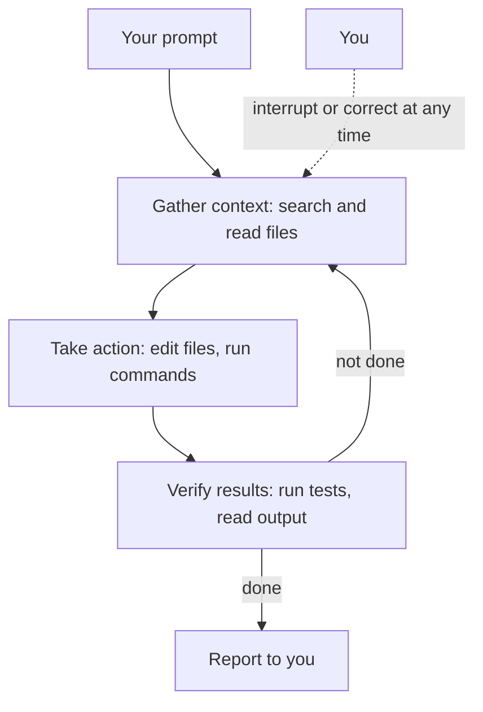
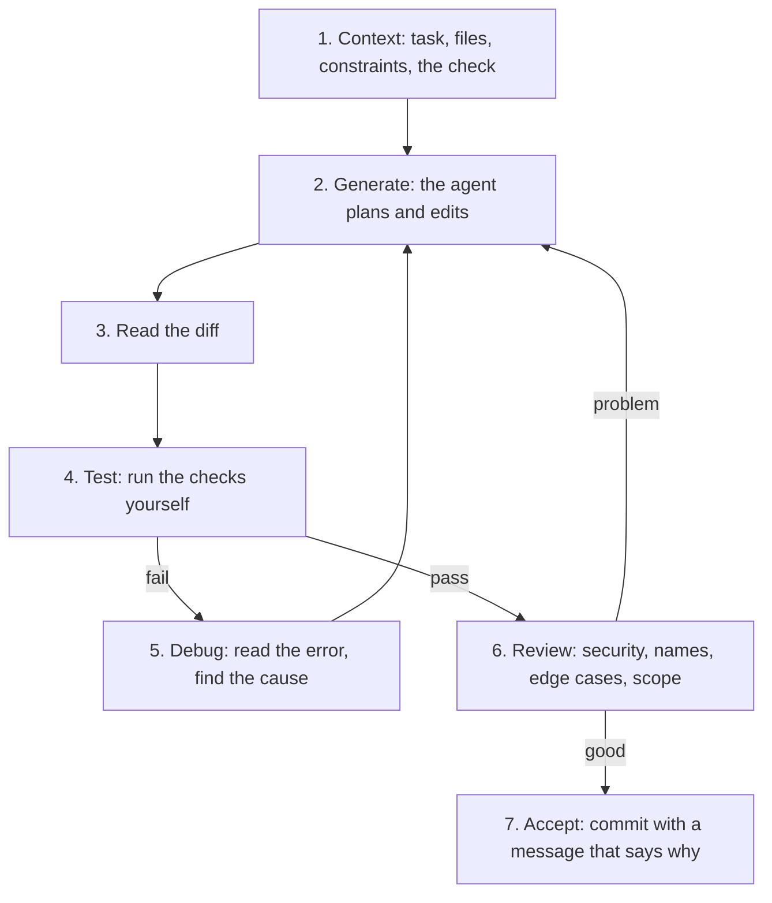

## 1. The question this idea answers

The capstone of this level allows a coding agent to write real parts of your service. An agent writes a hundred lines in a minute. You cannot read code at that speed. So two questions follow:

1. What can each kind of AI coding tool see and do?
2. How do you stay the engineer who is responsible for the result?

This lesson answers both. It gives you one fixed procedure, the verification loop, for every change that an agent makes.

## 2. Mental model

> [!analogy] A fast new colleague with the keys to your laptop
> Think of three colleagues.
>
> - **Autocomplete** is a colleague who reads over your shoulder and finishes your sentence.
> - **A chat assistant** is a colleague at another desk. They see only what you show them. They answer, and you copy the answer.
> - **A coding agent** is a colleague who has the keys to your laptop. They open files, edit them, run commands and try again until they think the job is done.
>
> The third colleague is the fastest. They also make the largest mistakes, because they act without asking.
>
> **Where it stops working:** a human colleague remembers yesterday and tells you when they are unsure. A model starts each session with an empty memory, except for the files that it reads. It writes wrong code with the same confidence as correct code. So you cannot trust its tone. You can trust only checks that you run.

## 3. Terms

| Term | Plain meaning |
|---|---|
| autocomplete | A tool that suggests the next line or block while you type. It sees the current file and some nearby files. |
| chat assistant | A tool that answers questions in a chat window. It sees only the text and files that you give it. |
| coding agent | A program that gives a model tools (read files, edit files, run commands) and lets it call them in a loop until a task is done. |
| tool | A function that the model asks the program to run, for example "read this file" or "run this command". |
| agent loop | The cycle of a coding agent: gather context, take action, check the result, and repeat. |
| harness | The program around the model. It supplies the tools and decides what the model sees. Claude Code is one harness. |
| context window | The text that the model can see in one request: your messages, files it read, command output and instructions. It has a size limit. |
| diff | A listing of the lines that a change removes and adds. `git diff` prints one. |
| verification loop | Your fixed procedure for each change: context, generate, read the diff, test, debug, review, accept. |
| vibe coding | Accepting what the AI writes without reading or testing it. |
| AI-assisted engineering | Directing the AI with clear context and checking every result with tests and review. |
| checkpoint | A saved copy of a file before an agent edits it, so that you can restore it. |

## 4. How it works

### 4.1 Three levels of help

Each level sees more and does more. Each level also needs more checking from you.

| Level | What it sees | What it can do | Who runs the code | Who checks the result |
|---|---|---|---|---|
| Autocomplete | The open file and some nearby files | Suggest text at your cursor | You | You, line by line, as you accept it |
| Chat assistant | Only what you paste or attach | Write text and code in a reply | You, after you copy it | You |
| Coding agent | Your project folder, your terminal, your Git state | Read, edit and create files, run commands, loop | The agent | You, plus the checks that you give the agent |

The jump from level 2 to level 3 is large. At level 2, nothing happens until you copy the code. At level 3, the agent changes files and runs commands by itself.

### 4.2 The agent loop

The Claude Code documentation describes the loop in three phases (checked on 2026-10-19): "When you give Claude a task, it works through three phases: **gather context**, **take action**, and **verify results**."



The same page gives an example of the steps for the prompt "fix the failing tests":

1. Run the test suite to see what fails.
2. Read the error output.
3. Search for the source files that matter.
4. Read those files.
5. Edit the files.
6. Run the tests again.

Each tool call returns new information, and the model uses it to choose the next step. The docs call the program around the model the harness: "Claude Code is the layer around the model that provides the tools and manages the context the model sees."

> [!key] The model only predicts. The harness acts.
> The model never touches your disk. It writes a request such as "run `uv run pytest`". The harness runs it and returns the output as text. So everything that the agent "knows" about your project came from a tool result that you can also read.

### 4.3 What a coding agent can reach

The docs list what Claude Code can access when you start it in a folder (checked on 2026-10-19):

| It can reach | What this means for you |
|---|---|
| Your project files | It can read secrets in files such as `.env`. Do not store secrets in the project folder, or block access with a hook (lesson 8.4). |
| Your terminal | It can run any command that you can run, with your user rights. |
| Your Git state | It sees the branch, the uncommitted changes and recent commits. |
| `CLAUDE.md` or `AGENTS.md` | It reads your project instructions at the start of each session (lesson 8.2). |
| Extensions | Skills, MCP servers, subagents and hooks that you add (lessons 8.3 and 8.4). |

Two safety tools exist. First, Claude Code saves a checkpoint of each file before an edit. Second, the docs warn: "Actions that affect remote systems (databases, APIs, deployments) can't be checkpointed." Permission modes decide which actions need your approval. The mode names and the default mode change between versions. Check them in the docs of the version that you use.

> [!trap] A checkpoint is not a backup of the world
> A checkpoint can restore a file. It cannot restore a dropped database table, a sent email or a deployed service. Treat every command that changes a remote system as permanent.

### 4.4 Vibe coding vs AI-assisted engineering

| | Vibe coding | AI-assisted engineering |
|---|---|---|
| Before the change | A vague wish: "make it work" | A clear task, the files that matter, and a check that proves success |
| During the change | Accept every edit | Watch the plan, stop the agent when it goes the wrong way |
| After the change | Run it once, see no error, ship | Read the diff, run the tests, review the risky lines |
| When it breaks | Ask the AI to fix it again and again | Read the error, form a hypothesis, test it |
| Who can explain the code | Nobody | You |

The roadmap site for this level gives the rule in one line: use AI hard for speed, check hard for correctness. Correctness, architecture, security and maintainability stay your job.

> [!analogy] A multiplier, not a replacement
> AI coding skill multiplies your engineering skill. If your skill is zero, the product is zero. A strong engineer with an agent ships faster. A weak engineer with an agent ships bugs faster.
>
> **Where it stops working:** a multiplier is exact. Real results also depend on the task. An agent helps more with common code (a CRUD endpoint) than with a rare design problem.

### 4.5 The verification loop

Use these seven steps for every meaningful change.



1. **Context.** Say what to build, which files matter, what not to touch, and how success is measured. A test that must pass is the best measure.
2. **Generate.** Let the agent work. For a change across several files, ask for a plan first and read it before any edit (lesson 8.2).
3. **Read the diff.** Read every changed line. Ask: why does this line exist? What data does it take, and what does it return?
4. **Test.** Run the tests, the type checker and the linter yourself. Do not accept "all tests pass" as text. Read the real output.
5. **Debug.** When a check fails, read the error first. Find the line and the values. Then decide if the agent or you makes the fix.
6. **Review.** Look for the problems that tests often miss: secrets, error handling, input validation, changes outside the task, deleted tests.
7. **Accept.** Commit the change with a message that says why it exists (lesson 7.3).

The Claude Code best-practices page explains why step 1 includes a check (checked on 2026-10-19): "Claude stops when the work looks done. Without a check it can run, 'looks done' is the only signal available, and you become the verification loop."

> [!example] Worked example: a fix that is not a fix
> Task: "The test `test_create_note_returns_201` fails. Fix it." The agent reports success. The diff is:
>
> ```diff
> --- a/tests/test_notes.py
> +++ b/tests/test_notes.py
> @@ -14,7 +14,7 @@ def test_create_note_returns_201(client):
>      resp = client.post("/notes", json={"title": "a", "body": "b"})
> -    assert resp.status_code == 201
> +    assert resp.status_code == 200
> ```
>
> 1. The diff touches only the test file. The route did not change.
> 2. The test now expects 200. But a POST that creates a resource should return 201 (lesson 3.2).
> 3. So the agent changed the test to match the bug. It did not fix the bug.
> 4. The correct fix is in the route: `@app.post("/notes", status_code=201)`.
>
> The tests passed after the bad change. Only the diff review found the problem. This is why step 3 comes before step 4.

### 4.6 How to read a diff

A unified diff has a header and one or more hunks.

```diff
diff --git a/app/main.py b/app/main.py
--- a/app/main.py
+++ b/app/main.py
@@ -20,6 +20,9 @@ def get_note(note_id: int):
     note = NOTES.get(note_id)
+    if note is None:
+        raise HTTPException(status_code=404, detail="note not found")
     return note
```

| Part | Meaning |
|---|---|
| `--- a/...` and `+++ b/...` | The file before and after the change |
| `@@ -20,6 +20,9 @@` | The hunk header: the old text starts at line 20 and has 6 lines, the new text starts at line 20 and has 9 lines |
| A line that starts with `+` | An added line |
| A line that starts with `-` | A removed line |
| A line that starts with a space | An unchanged context line |

Read the removed lines first. A removed line is often the risk: a deleted check, a deleted test, a deleted log line.

### 4.7 What stays your job

| Area | The agent can help | You decide |
|---|---|---|
| Correctness | Writes tests, runs them | Which behavior is correct, and which tests prove it |
| Architecture | Proposes a structure | Module boundaries, data flow, what to keep simple |
| Security | Flags obvious problems | Where secrets live, who can call what, what to log |
| Maintainability | Renames, refactors | Whether a teammate can read and change the code next month |
| Scope | Does extra work | What is in and out of the task |

> [!key] If you cannot explain it, it is not done
> The project instructions of this course apply here: a change that you cannot explain line by line is not finished, even when the tests pass.

## 5. Exercises

Hints come in three levels in chat: idea, pseudocode, partial code.

**Exercise 8.1.1: one change through the full loop.** Runs in: your local practice project.

Pick one small change in your M4 FastAPI service, for example a `GET /health` route that returns the app version. Use a coding agent for the change. Follow the seven steps of section 4.5 and keep short notes for each step.

Acceptance tests:

- One commit holds the route and a test for it. `uv run pytest` passes.
- Your notes name one line of the diff that you questioned, and the answer that you found.
- Your notes show the real test output that you ran yourself, not the agent's summary.

**Exercise 8.1.2: review a diff before you run it.** Runs in: your local practice project.

Ask an agent for a change that touches error handling, for example "return 404 for an unknown note id". Before you run anything, write three risks that you see in the diff. Then run the tests.

Acceptance tests:

- You wrote the three risks before you ran the tests.
- For each risk, you wrote "confirmed" or "not a problem", with the evidence: a test, a log line or a line of code.

## 6. Common mistakes

1. **Accepting the agent's summary as proof.** "All tests pass" is text from the model. Run the tests and read the output.
2. **Reading only the added lines.** Deleted checks and deleted tests hide in the removed lines.
3. **No check in the prompt.** Without a test or a command that returns pass or fail, the agent stops when the work "looks done".
4. **Correcting the agent again and again in one long session.** The failed tries fill the context. The docs advise this: after two failed corrections, clear the session and write a better first prompt.
5. **Letting the agent change the tests to make them pass.** A test change needs a reason that you can state.
6. **Running destructive commands without review.** Checkpoints restore files only, not databases or deployments.

## 7. One-minute explanation

AI coding help has three levels. Autocomplete suggests text at your cursor. A chat assistant answers from what you paste. A coding agent has tools: it reads and edits files and runs commands in a loop of gather context, take action and verify results. The model only writes requests. The harness, for example Claude Code, runs them. The agent is fast, and it states wrong code with full confidence. So you use one fixed procedure for each change. Give context with a check. Let the agent generate. Read the diff, run the tests yourself and debug failures. Review for risks such as secrets and deleted tests. Then accept with a clear commit. Correctness, architecture, security and maintainability stay your job.

## 8. Check questions

```check
{
  "question": "An agent says: 'I fixed the bug and all tests pass.' Name the two things that you do before you accept the change, and say why the agent's sentence is not enough.",
  "hint": "Where did the sentence come from?",
  "answer": "Read the diff, and run the tests yourself and read the real output. The sentence is text that the model wrote. The model can be wrong, and it can make tests pass by changing the tests instead of the code. Only the diff and the real test output are evidence."
}
```

```check
{
  "question": "What can a coding agent do that a chat assistant cannot, and what new risk does that bring?",
  "answer": "A coding agent calls tools: it reads and edits files in your project and runs commands in your terminal, in a loop, without you copying anything. The new risk: it acts with your user rights before you review. It can read secret files, delete code or run a command that changes a remote system, which a checkpoint cannot restore."
}
```

```check
{
  "question": "Why should the prompt for a change include a check, for example a test that must pass?",
  "answer": "The agent stops when the work looks done. A check gives it a pass or fail signal, so it can run the check, read the result and try again until the check passes. Without a check, you are the only verification, and every mistake waits for you to notice it."
}
```

```check
{
  "question": "A diff removes the line `assert resp.status_code == 201` and adds `assert resp.status_code == 200` in a test, and changes nothing in the route. What happened, and what is the correct fix?",
  "answer": "The agent changed the test to match the bug. A POST that creates a resource should return 201. The correct fix is in the route, for example status_code=201 on the decorator, and the original assertion stays."
}
```

## 9. Links

- Next: [8.2 Context, CLAUDE.md, AGENTS.md and specs](/notes/ai/ai-engineering/01-software-engineering-fundamentals/m08-ai-assisted-development/l2-context-claude-md-and-specs)
- Reading a diff in Git: [7.1 Repositories, commits, branches and remotes](/notes/ai/ai-engineering/01-software-engineering-fundamentals/m07-git/l1-repositories-commits-and-branches)
- Status codes: [3.2 Methods, status codes, idempotency and safe retries](/notes/ai/ai-engineering/01-software-engineering-fundamentals/m03-http-rest-json/l2-methods-status-codes-and-retries)
- Tests: [1.10 Tests, logging and debugging](/notes/ai/ai-engineering/01-software-engineering-fundamentals/m01-python-foundations/l10-tests-and-debugging)
- Validation loops for agents: [Validation loops](/notes/ai/context-engineering/09-production/l4-validation-loops)
- [Glossary](/notes/ai/ai-engineering/glossary)

Sources (checked on 2026-10-19): [How Claude Code works](https://code.claude.com/docs/en/how-claude-code-works), [Best practices for Claude Code](https://code.claude.com/docs/en/best-practices).
