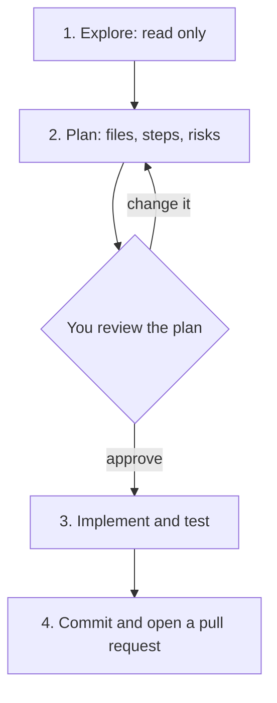

## 1. The question this idea answers

A coding agent starts each session with no memory of your project. It does not know your test command, your folder layout or the mistake that it made yesterday. You must tell it. But the agent also has a limited context window, and its quality drops as the window fills.

So three questions follow:

1. Which facts must the agent see in every session, and where do they live?
2. Which facts belong only to one task?
3. How do you stop the agent from building the wrong thing before it writes any code?

## 2. Mental model

> [!analogy] A contractor who loses their memory every night
> A contractor works on your house. Each morning they arrive with no memory of yesterday. You help them in three ways:
>
> - **A notice on the front door** that they read every morning: "Close the red water valve before work. Never use the back stairs." This is `CLAUDE.md` or `AGENTS.md`.
> - **A task card for today**: "Fix the kitchen tap. Use the parts in box 3. Test it by running the tap for one minute." This is your prompt or a spec.
> - **A binder on the shelf** that they open only for a special job: the wiring plan. These are Skills and reference files (lesson 8.3).
>
> **Where it stops working:** a human reads a long notice once and keeps the important rules. A model reads the whole notice again in each session, and it costs context every time. A long notice also hides its own rules. The Claude Code docs warn: "Bloated CLAUDE.md files cause Claude to ignore your actual instructions!"

## 3. Terms

| Term | Plain meaning |
|---|---|
| context window | All the text that the model can see in one request. It has a size limit, measured in tokens. |
| minimum useful context | The smallest set of facts that lets the agent do the task correctly. |
| project memory | Instructions that load in every session of a project, so that you do not repeat them. |
| `CLAUDE.md` | A Markdown file of project instructions that Claude Code reads at the start of every session. |
| `CLAUDE.local.md` | Your personal project instructions. You do not commit this file to Git. |
| `AGENTS.md` | An open Markdown format for coding-agent instructions. Many agents read it. |
| path-scoped rule | A rule file in `.claude/rules/` with a `paths` list. It loads only when the agent works on matching files. |
| import | A line `@path/to/file` in `CLAUDE.md` that loads another file into the context. |
| spec | A written description of what to build: behavior, interfaces, limits, what is out of scope and how to check it. |
| plan mode | A Claude Code mode in which the agent reads and plans but does not edit your source files. |
| spec-driven development | A workflow: write the spec, review the agent's plan, then let it implement. |

## 4. How it works

### 4.1 Context is a budget

The best-practices page of Claude Code states the main limit (checked on 2026-10-19): "Claude's context window fills up fast, and performance degrades as it fills." Every message, every file that the agent reads and every command output enters the window.

This gives you two rules:

1. Put a fact in the context only if the task needs it.
2. Put a fact in project memory only if almost every task needs it.

The subject [LLM Context Engineering](/notes/ai/context-engineering/02-paradigm-shift/l4-the-quality-curve) shows how answer quality changes with context size. This lesson applies the same idea to coding agents.

### 4.2 Minimum useful context for one task

A good task prompt has five parts.

| Part | Question it answers | Example |
|---|---|---|
| Goal | What must be true when the task is done? | "`GET /notes/{id}` returns 404 with our error shape for an unknown id." |
| Location | Which files matter? | "The route is in `src/notes_api/routes.py`. Errors are in `errors.py`." |
| Pattern | Which existing code shows the style? | "Follow the 404 handling in `get_user`." |
| Constraints | What must not change? | "Do not change the database schema." |
| Check | How do we know that it works? | "Add a test in `tests/test_notes.py` and run `uv run pytest -q`." |

The Claude Code docs give before-and-after pairs of the same kind. For example, "add tests for foo.py" becomes "write a test for foo.py covering the edge case where the user is logged out. avoid mocks."

> [!example] Worked example: from vague to useful
> Vague: "Fix the notes bug."
>
> Useful: "Users get a 500 error when they request a note that does not exist. The route is `get_note` in `src/notes_api/routes.py`. It should return 404 with the body `{"error": {"code": "not_found", "message": ...}}`, like `get_user` does. Write a failing test first, then fix the route. Run `uv run pytest -q` and show me the output."
>
> The useful version names the symptom, the place, the expected result, a pattern and the check. The agent reads fewer files to find the problem, so it uses less context.

### 4.3 Two kinds of context

| | Project memory | Task context |
|---|---|---|
| Where | `CLAUDE.md`, `AGENTS.md`, `.claude/rules/` | Your prompt, a spec file, files that you name |
| When it loads | Every session | Only in this session |
| Good content | Build and test commands, folder layout, conventions, known traps | The goal, the files, the check for this change |
| Bad content | Long tutorials, facts that change every week | Rules that every task needs (move them to project memory) |

The docs give a trigger for project memory: when the agent gets a convention or command wrong twice, add it to `CLAUDE.md`.

### 4.4 How Claude Code loads CLAUDE.md

The memory page lists four places, from broadest to most specific (checked on 2026-10-19):

| Scope | Location | Shared with |
|---|---|---|
| Managed policy | A system folder that your organization controls, for example `/etc/claude-code/CLAUDE.md` on Linux | Everyone on the machine |
| User | `~/.claude/CLAUDE.md` | Only you, all projects |
| Project | `./CLAUDE.md` or `./.claude/CLAUDE.md` | Your team, through Git |
| Local | `./CLAUDE.local.md` | Only you, this project (add it to `.gitignore`) |

The load rules:

1. At launch, Claude Code reads `CLAUDE.md` and `CLAUDE.local.md` in the working directory and in every directory above it.
2. It joins them in order from the file-system root down to the working directory. So the instructions closest to your folder come last.
3. A `CLAUDE.md` in a subdirectory loads later, when the agent reads or edits a file in that subdirectory.
4. The files add to each other. They do not replace each other.

The size advice from the same page: "target under 200 lines per CLAUDE.md file. Longer files consume more context and reduce adherence." The command `/init` writes a first `CLAUDE.md` from your code.

### 4.5 What belongs in CLAUDE.md

The best-practices page gives a test for each line: "Would removing this cause Claude to make mistakes?" If not, delete the line.

| Include | Do not include |
|---|---|
| Commands that the agent cannot guess | Facts that the agent can read from the code |
| Style rules that differ from the defaults | Standard language conventions |
| How to run the tests, and which runner | Long API documentation (link to it) |
| Branch and pull request rules | Facts that change often |
| Project-specific design decisions | File-by-file descriptions |
| Required environment variables and other traps | "Write clean code" |

> [!example] Worked example: a CLAUDE.md for the capstone service
>
> ```markdown
> # Notes API
>
> FastAPI + PostgreSQL service. No AI inside the product.
>
> ## Commands
> - Install: `uv sync --locked`
> - Tests: `uv run pytest -q` (needs no network, no real database)
> - Lint and types: `uv run ruff check . && uv run mypy src`
> - Run locally: `docker compose up` (API on port 8000)
>
> ## Layout
> - `src/notes_api/routes/`: HTTP layer only. No SQL here.
> - `src/notes_api/repo.py`: all SQL. Parameterized queries only.
> - `tests/`: one test file per route module.
>
> ## Rules
> - Every error response uses `ErrorBody` from `errors.py`.
> - Config comes from environment variables through `settings.py`. Never read `os.environ` elsewhere.
> - Never edit `.env` or files in `migrations/` that are already merged.
>
> ## Traps
> - `DATABASE_URL` must be set, or the app exits at startup.
> - Tests use the fake repo in `tests/fakes.py`. Do not connect to PostgreSQL in unit tests.
> ```
>
> Why each block exists:
>
> 1. **Commands**: the agent cannot guess `--locked` or the lint command. Without them, it uses `pip install` or skips the type check.
> 2. **Layout**: it tells the agent where a change belongs, so SQL does not appear in a route.
> 3. **Rules**: they encode decisions that the code alone does not explain.
> 4. **Traps**: each line prevents a mistake that already happened once.
>
> The file has about 25 lines. It omits everything that the agent can read from `pyproject.toml` or the code.

### 4.6 Rules that load only for some files

For a larger project, split instructions into `.claude/rules/*.md`. A rule file with a `paths` list loads only when the agent works on a matching file. This example comes from the memory page:

```markdown
---
paths:
  - "src/api/**/*.ts"
---

# API Development Rules

- All API endpoints must include input validation
- Use the standard error response format
```

A rule without `paths` loads in every session, like `CLAUDE.md`. An import line, for example `@docs/architecture.md`, also loads at launch. The docs say that imports "help you organize a long file but don't reduce its context cost".

### 4.7 AGENTS.md: one file for many agents

`AGENTS.md` is an open format. Its site calls it a "README for agents" (checked on 2026-10-19). The site says that it is "used by over 60k open-source projects". It is "stewarded by the Agentic AI Foundation under the Linux Foundation". Tools that read it include Codex, Cursor, Gemini CLI, Jules, the GitHub Copilot coding agent, Zed and others.

Two rules matter:

1. **Nearest file wins.** The `AGENTS.md` closest to the edited file wins. The site adds that "explicit user chat prompts override everything".
2. **Claude Code reads it as a fallback.** Claude Code reads `AGENTS.md` only when no `CLAUDE.md` or `CLAUDE.local.md` exists in your working directory or above it. This needs Claude Code v2.1.277 or later. If both files exist, the default is to read the `CLAUDE.md` files only.

> [!trap] A CLAUDE.local.md can hide your AGENTS.md
> The memory page notes that `CLAUDE.local.md` counts as a `CLAUDE.md` for this check. So a personal `CLAUDE.local.md` stops Claude Code from reading the team's `AGENTS.md`. Fix it with the **Project instructions** setting `claude-md-and-agents-md`, or import `AGENTS.md` from a `CLAUDE.md`.

A team that uses several agents can use one common layout. Keep the shared rules in `AGENTS.md`. Make `CLAUDE.md` a short file that imports it with `@AGENTS.md` and adds any Claude-only rules.

### 4.8 Instructions are requests, not locks

The memory page is direct about this: Claude "treats them as context, not enforced configuration. To block an action regardless of what Claude decides, use a PreToolUse hook instead." A rule such as "never edit `.env`" in `CLAUDE.md` usually works. It is not a guarantee. Lesson 8.4 shows the hook that makes it a guarantee.

### 4.9 Spec first, then plan, then code

A spec turns a wish into a contract. The best-practices page describes good specs (checked on 2026-10-19): "they name the files and interfaces involved, state what is out of scope, and end with an end-to-end verification step that proves the feature works."

The recommended workflow has four phases:



1. **Explore.** In plan mode, the agent reads files and answers questions. It does not edit source files.
2. **Plan.** The agent writes a plan: which files change, in which order, and how to test.
3. **Review.** You read the plan before any edit. This is the cheapest moment to fix a wrong idea.
4. **Implement.** The agent edits and runs the checks. Then you follow the verification loop of lesson 8.1.

The docs also say when to skip the plan: "If you could describe the diff in one sentence, skip the plan."

> [!example] Worked example: a short spec for one capstone feature
>
> ```markdown
> # Spec: tag filter for GET /notes
>
> ## Behavior
> - GET /notes?tag=work returns only notes that have the tag "work".
> - Tag match is case-insensitive. "Work" and "work" match.
> - No tag parameter: return all notes (current behavior).
> - Unknown tag: return 200 with an empty list, not 404.
>
> ## Interfaces
> - Route: src/notes_api/routes/notes.py, function list_notes.
> - SQL: src/notes_api/repo.py, new function list_by_tag(tag: str).
>
> ## Out of scope
> - No new tables. No change to POST /notes.
>
> ## Check
> - New tests: matching tag, case difference, unknown tag, no tag.
> - uv run pytest -q passes. A curl call against docker compose returns the filtered list.
> ```
>
> A reviewer can test every line of this spec. An agent can test it too.

## 5. Exercises

Hints come in three levels in chat: idea, pseudocode, partial code.

**Exercise 8.2.1: a CLAUDE.md for your practice project.** Runs in: your local practice project.

Write a `CLAUDE.md` of 60 lines or fewer for your M4 service.

Acceptance tests:

- Every command in the file runs without an error when you copy it into a terminal.
- For each line, you can name the mistake that it prevents. Delete lines that prevent nothing.
- A new agent session, with no other prompt than "run the tests and tell me the result", runs the correct test command.
- The file holds no secret values.

**Exercise 8.2.2: spec, plan, review.** Runs in: your local practice project.

Write a spec in the format of section 4.9 for one small feature. Ask the agent for a plan in plan mode. Do not approve it at once.

Acceptance tests:

- Your spec has the four parts: behavior, interfaces, out of scope, check.
- You recorded at least two changes that you made to the agent's plan, with a reason for each.
- The final diff touches only the files that the approved plan named.

## 6. Common mistakes

1. **A CLAUDE.md that grows without limit.** Rules get lost in the noise. Keep it under 200 lines. Move reference material to Skills or rules files.
2. **Facts that the code already shows.** They cost context in every session and add nothing.
3. **Secrets in CLAUDE.md.** It is committed to Git and sent to the model. Put secrets in environment variables.
4. **Trusting a CLAUDE.md rule as a lock.** It is a request. Use a hook for a rule that must hold every time.
5. **Skipping the plan review on a large change.** The agent then builds the wrong design fast, and the fix costs more.
6. **A spec with no check.** Without a verification step, nobody can say when the work is done.

## 7. One-minute explanation

A coding agent remembers nothing between sessions, and its context window is a limited budget. So you split context in two. Project memory holds what nearly every task needs: commands, layout, rules and traps. In Claude Code it lives in `CLAUDE.md`, which loads at the start of every session from your folder and the folders above it. Keep it under 200 lines. `AGENTS.md` is the open format that many agents read, and Claude Code reads it when no `CLAUDE.md` exists. Task context holds the goal, the files, the constraints and the check for one change. For a larger change, write a spec, let the agent plan in plan mode, review the plan, and only then let it edit. Instructions in these files are requests. A rule that must always hold needs a hook.

## 8. Check questions

```check
{
  "question": "Your CLAUDE.md has 600 lines, and the agent keeps breaking one rule in it. Give the most likely cause and two fixes.",
  "answer": "The file is too long, so the rule is lost among other text, and every line costs context in every session. Fixes: cut lines that prevent no mistake (target under 200 lines), move reference material to Skills or path-scoped rules files, and if the rule must always hold, enforce it with a hook instead of a sentence."
}
```

```check
{
  "question": "A repository has an AGENTS.md and no CLAUDE.md. A developer adds a personal CLAUDE.local.md. What changes for Claude Code, and how do you fix it?",
  "hint": "Which files count as a CLAUDE.md for the fallback check?",
  "answer": "CLAUDE.local.md counts as a CLAUDE.md, so Claude Code stops reading AGENTS.md by default. Fix: set the Project instructions setting to claude-md-and-agents-md, or create a CLAUDE.md that imports AGENTS.md with @AGENTS.md."
}
```

```check
{
  "question": "Name the five parts of a useful task prompt and give a one-line example of the most important one.",
  "answer": "Goal, location (files), pattern to follow, constraints, and the check. The check is the most important, for example: add a test in tests/test_notes.py and run uv run pytest -q, then show the output. It lets the agent know when it is done."
}
```

```check
{
  "question": "When should you skip the plan step and ask the agent to edit at once?",
  "answer": "When the change is small and clear: if you can describe the whole diff in one sentence, for example renaming one variable or adding one log line. Planning helps when the approach is uncertain, many files change, or you do not know the code."
}
```

## 9. Links

- Previous: [8.1 From autocomplete to coding agents](/notes/ai/ai-engineering/01-software-engineering-fundamentals/m08-ai-assisted-development/l1-from-autocomplete-to-agents)
- Next: [8.3 Skills, slash commands, subagents and MCP](/notes/ai/ai-engineering/01-software-engineering-fundamentals/m08-ai-assisted-development/l3-skills-subagents-and-mcp)
- The same files from the context side: [The project files](/notes/ai/context-engineering/09-production/l2-the-project-files) and [Rules files](/notes/ai/context-engineering/03-system-layer/l5-rules-files)
- A full spec workflow: [The PRP workflow](/notes/ai/context-engineering/09-production/l3-the-prp-workflow)
- [Glossary](/notes/ai/ai-engineering/glossary)

Sources (checked on 2026-10-19): [How Claude remembers your project](https://code.claude.com/docs/en/memory), [Best practices for Claude Code](https://code.claude.com/docs/en/best-practices), [Extend Claude Code](https://code.claude.com/docs/en/features-overview), [AGENTS.md](https://agents.md).
