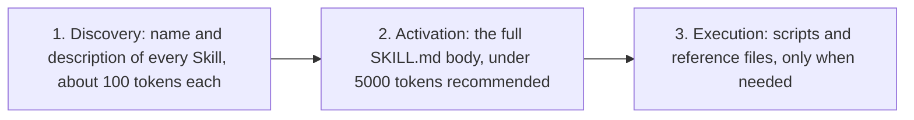
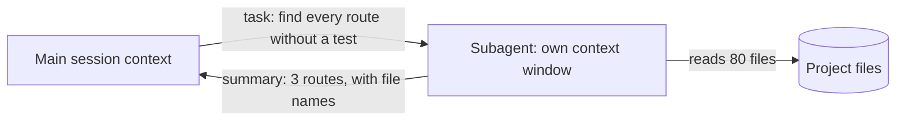

## 1. The question this idea answers

After a few weeks with a coding agent, three problems appear:

1. **Repetition.** You type the same long prompt again and again: "review this diff for secrets, missing tests and changed error handling".
2. **Noise.** A search through 80 files fills your context window with text that you never need again.
3. **Missing data.** The answer lives in a system that the agent cannot see: a database, an issue tracker, a documentation site.

Each problem has its own tool. Skills fix repetition. Subagents fix noise. MCP fixes missing data. This lesson explains each one and when to choose it.

## 2. Mental model

> [!analogy] A workshop with recipe cards, helpers and wall sockets
> - **Skills are recipe cards in a drawer.** Each card has a title and one line on its front. The worker reads only the fronts. When a job matches a front, the worker takes that card from the drawer and follows it.
> - **Subagents are helpers in the next room.** You give a helper a job. The helper works alone, makes a mess on their own bench and returns with a one-page report. Your bench stays clean.
> - **MCP servers are sockets in the wall.** Each socket connects the workshop to an outside system: the warehouse, the order book, the library.
>
> **Where it stops working:** a human picks the right recipe card from its title. A model picks a Skill from its description, and a vague description makes it pick the wrong one or none. A helper's report can also omit a detail that you needed. So you still check the result.

## 3. Terms

| Term | Plain meaning |
|---|---|
| Skill | A folder with a `SKILL.md` file of instructions, and optional scripts and reference files, that an agent loads when a task needs it. |
| `SKILL.md` | The main file of a Skill: frontmatter (name, description) and Markdown instructions. |
| frontmatter | The block of `key: value` lines between two `---` lines at the top of a Markdown file. |
| slash command | A command that you type with a leading `/`, for example `/review-diff`. In Claude Code, each Skill gives one. |
| progressive disclosure | Loading a Skill in steps: first only its name and description, then its body, then its extra files. |
| Agent Skills standard | The open format for Skills. Anthropic first developed it. Many agents now read it. |
| subagent | A second agent with its own context window, own instructions and own tool list. It returns a summary to the main session. |
| MCP | Model Context Protocol: an open protocol that connects an agent to outside tools and data through MCP servers. |
| MCP server | A program that offers tools (and other features) to an agent over MCP. |
| scope | Where a setting applies: only you in one project (local), the whole team in one project (project), or you in all projects (user). |

## 4. How it works

### 4.1 Commands are now Skills

Older versions of Claude Code had separate "custom commands". The Skills page says (checked on 2026-10-19): "Custom commands have been merged into skills. A file at `.claude/commands/deploy.md` and a skill at `.claude/skills/deploy/SKILL.md` both create `/deploy` and work the same way."

So in this course, "slash command" and "Skill" name one thing seen from two sides. You type the slash command. The Skill is the file behind it.

### 4.2 Where Skills live

| Scope | Path | Available in |
|---|---|---|
| Personal | `~/.claude/skills/<skill-name>/SKILL.md` | All your projects on this machine |
| Project | `.claude/skills/<skill-name>/SKILL.md` | This repository. Commit it, and your team gets it. |
| Plugin | `<plugin>/skills/<skill-name>/SKILL.md` | Where the plugin is on, as `/plugin-name:skill-name` (lesson 8.4) |
| Enterprise | In the managed settings folder of your organization | All users on those machines |

### 4.3 The SKILL.md format

The open standard at agentskills.io defines two required fields (checked on 2026-10-19):

| Field | Rule |
|---|---|
| `name` | 1 to 64 characters. Lowercase letters `a-z`, digits and hyphens only. No hyphen at the start or end, no `--`. It must match the folder name. |
| `description` | 1 to 1024 characters. It "Should describe both what the skill does and when to use it". |

Claude Code reads more fields. Three examples:

- `disable-model-invocation: true`: only you can start the Skill.
- `allowed-tools`: tools that run without a permission prompt while the Skill runs.
- `argument-hint`: a hint in the `/` menu.

> [!example] Worked example: a review Skill
> File `.claude/skills/review-diff/SKILL.md`:
>
> ```markdown
> ---
> name: review-diff
> description: Review the current Git diff of a Python web service for secrets, missing tests, changed error handling and scope creep. Use before you accept an agent's change.
> disable-model-invocation: true
> ---
>
> Review the output of `git diff` (and `git diff --staged`).
>
> 1. Secrets: any key, token, password or connection string in the diff? Any change to .env?
> 2. Tests: for each changed function, is there a changed or new test? Was any test deleted or weakened?
> 3. Errors: did any try/except, status code or error body change? Is any exception now swallowed?
> 4. Scope: list every file that changed. Flag files that the task did not need.
> 5. Run `uv run pytest -q` and `uv run ruff check .`. Quote the last line of each output.
>
> Report: a table of findings (file, line, problem, severity). Report only problems that affect correctness, security or the stated task.
> ```
>
> Why each part exists:
>
> 1. The `name` matches the folder `review-diff`, as the standard requires.
> 2. The `description` says what and when. A model uses it to decide relevance.
> 3. `disable-model-invocation: true` stops automatic use of the Skill. You start it with `/review-diff`.
> 4. Step 5 makes the Skill end with real checks, not opinions.
> 5. The last line limits the report. The Claude Code docs warn that a reviewer told to find gaps "will usually report some, even when the work is sound".

### 4.4 Progressive disclosure: why Skills are cheap

The standard describes three stages:



The standard also advises: "Keep your main `SKILL.md` under 500 lines." In Claude Code, the descriptions of model-usable Skills are in the context of every request. The body loads only when the Skill runs. A Skill with `disable-model-invocation: true` costs nothing until you start it.

Compare this with `CLAUDE.md`, which loads in full in every session (lesson 8.2). So long reference material belongs in a Skill, not in `CLAUDE.md`.

### 4.5 Arguments

A Skill can take arguments. The text `$ARGUMENTS` in the body becomes everything that you typed after the command. This example is from the Skills page:

```markdown
---
name: fix-issue
description: Fix a GitHub issue
disable-model-invocation: true
---

Fix GitHub issue $ARGUMENTS following our coding standards.
```

Then `/fix-issue 123` gives the model "Fix GitHub issue 123 following our coding standards". For single arguments, the page names `$ARGUMENTS[N]` or the short form `$N`, for example `$0`.

### 4.6 Skills worth building first

| Skill | What it holds | The check it ends with |
|---|---|---|
| Code review | A checklist for your project (section 4.3) | Test and lint output |
| Test generation | Your test style: fixtures, fakes, naming, one behavior per test | The new tests fail before the fix and pass after it |
| Documentation | README sections and the docstring style of the project | Every command in the README runs |
| Refactoring | Rules: no behavior change, small steps, tests first | The full test suite passes before and after |
| Repository conventions | Layout, error shape, config rules (or keep these in `CLAUDE.md` if they are short) | The linter and type checker pass |

A good first Skill is one that you already typed as a prompt three times. The features page gives that trigger: "You paste the same playbook or multi-step procedure into chat for the third time".

### 4.7 Subagents: work in a separate context

The subagents page says (checked on 2026-10-19): "Each subagent runs in its own context window with a custom system prompt, specific tool access, and independent permissions."



The 80 files enter the subagent's context, not yours. Only the summary returns.

Claude Code has built-in subagents. The page names:

| Subagent | Job |
|---|---|
| Explore | "A fast, read-only agent optimized for searching and analyzing codebases." Write and Edit are denied. |
| Plan | A read-only research agent that gathers context in plan mode. |
| General-purpose | "A capable agent for complex, multi-step tasks that require both exploration and action." |

You can add your own as Markdown files in `.claude/agents/` (project) or `~/.claude/agents/` (personal). Only `name` and `description` are required. The `tools` field limits what the subagent can use. The best-practices page shows this example:

```markdown
---
name: security-reviewer
description: Reviews code for security vulnerabilities
tools: Read, Grep, Glob, Bash
model: opus
---
You are a senior security engineer. Review code for:
- Injection vulnerabilities (SQL, XSS, command injection)
- Authentication and authorization flaws
- Secrets or credentials in code
- Insecure data handling

Provide specific line references and suggested fixes.
```

Claude decides when to delegate from the `description` field and your request. You can also ask directly: "Use a subagent to review this code for security issues."

Good jobs for a subagent:

1. **Investigation** that reads many files but needs only a short answer.
2. **Review in a fresh context.** The reviewer did not write the code, so it is not biased toward it.
3. **Parallel work** on independent parts.

Costs to know:

1. A subagent uses its own tokens, so it is not free.
2. The summary can drop details. Ask for file names and line numbers in the report.
3. By default, a subagent can start its own subagents, "up to three layers below the main conversation".

### 4.8 MCP: connect outside systems

MCP is a protocol. An agent (the MCP client) connects to MCP servers. Each server offers tools, for example "run a read-only SQL query" or "search the documentation". Lesson 5.3 shows how one tool call travels from the model to a tool handler and back.

In Claude Code, you add a server with a command. The best-practices page gives this example:

```bash
claude mcp add --transport http notion https://mcp.notion.com/mcp
```

Three facts matter for daily use:

1. **Scope.** A server can be local (you, this project), project (the team, through a committed `.mcp.json`) or user (you, all projects). When names clash, the features page says the order is "local > project > user".
2. **Context cost.** At session start, Claude Code loads tool names. Full tool schemas load only when needed, through tool search.
3. **Trust.** A server runs with real access to a real system. Data that a tool returns can hold text that tries to steer the model. The lesson [Tool security and prompt injection](/notes/ai/context-engineering/06-tools-and-mcp/l9-tool-security-and-prompt-injection) covers this risk.

The features page puts the split in one sentence: "MCP connects Claude to external services. Skills extend what Claude knows, including how to use those services effectively." The two often work together: an MCP server for a database, and a Skill that describes the schema and safe query patterns.

### 4.9 Which tool for which problem

The features page gives triggers for each feature (checked on 2026-10-19). This table keeps the ones for this module:

| You notice | Add |
|---|---|
| The agent gets a convention or command wrong twice | A line in `CLAUDE.md` (lesson 8.2) |
| You type the same prompt to start a task again and again | A Skill that you start with `/name` |
| You paste the same multi-step procedure for the third time | A Skill |
| You copy data from a system that the agent cannot see | An MCP server |
| A side task floods your context with output that you never read again | A subagent |
| Something must happen every time, without asking | A hook (lesson 8.4) |
| A second repository needs the same setup | A plugin (lesson 8.4) |

### 4.10 Skills travel between agents

The agentskills.io site says that the format "was originally developed by Anthropic, released as an open standard". Its list of clients includes Claude Code, ChatGPT and Codex, Cursor, GitHub Copilot, VS Code, Gemini CLI and Databricks Genie Code (checked on 2026-10-19). Each product can add its own extra fields. The `name` and `description` fields are common to all. So a Skill that uses only the standard fields is the most portable.

## 5. Exercises

Hints come in three levels in chat: idea, pseudocode, partial code.

**Exercise 8.3.1: your first Skill.** Runs in: your local practice project.

Write a project Skill `review-diff` for your service. Do not copy section 4.3. Write the checklist from your own mistakes in 8.1 and 8.2.

Acceptance tests:

- The `name` follows the standard: lowercase, hyphens, 64 characters or fewer, and equal to the folder name. Write a small Python check for these rules and run it on your file.
- The `description` says what the Skill does and when to use it, in 1024 characters or fewer.
- The body is under 60 lines and ends with at least one command that returns pass or fail.
- You started it with `/review-diff` on a real diff, and you recorded one finding and whether it was correct.

**Exercise 8.3.2: a read-only subagent.** Runs in: your local practice project.

Write a subagent `test-gap-finder` in `.claude/agents/`. It lists every route in your service that has no test.

Acceptance tests:

- Its `tools` field holds only read and search tools.
- When you ask it to edit a file, the edit does not happen.
- Its report names each untested route with its file and line. You checked one of them by hand.

**Exercise 8.3.3: one MCP server.** Runs in: your local practice project.

Connect one read-only MCP server, for example a documentation server. Use local scope.

Acceptance tests:

- `/mcp` shows the server as connected. You recorded its tool names.
- You can say which file holds the configuration, and why you chose local scope and not project scope.

## 6. Common mistakes

1. **A vague description.** "Helps with code" matches everything and nothing. Say what the Skill does and when to use it.
2. **A huge SKILL.md.** The whole body loads on use. Move long reference text into files that the body links to.
3. **A Skill name that breaks the standard.** Uppercase letters or a name that does not match the folder can make other agents reject it.
4. **Subagents for small tasks.** A subagent costs its own tokens and returns only a summary. For a two-file change, the main session is cheaper.
5. **A review subagent with edit tools.** A reviewer should read, not change. Limit its `tools`.
6. **Trusting MCP output as instructions.** Tool results are data. Text in them can try to steer the model.
7. **A project-scope MCP server that needs your personal token.** Put personal credentials in local scope or environment variables, never in a committed file.

## 7. One-minute explanation

Three tools solve three problems. A Skill is a folder with a `SKILL.md`: a name, a description that says what and when, and instructions. In Claude Code each Skill is also a slash command, because custom commands merged into Skills. Skills load in steps: only the description at first, the body when used, extra files when needed. So they are cheap to keep. The format is an open standard that many agents read. A subagent is a second agent with its own context window and tool list. It does noisy work, such as reading many files, and returns a short summary, so your main context stays clean. MCP connects the agent to outside systems through MCP servers that offer tools. Use a Skill for repeated procedures, a subagent for isolated work, MCP for outside data, and a hook for anything that must happen every time.

## 8. Check questions

```check
{
  "question": "You type the same 15-line review prompt before every commit. Which feature fits, and which frontmatter field stops the model from starting it on its own?",
  "answer": "A Skill, started as a slash command such as /review-diff. The field disable-model-invocation: true makes it start only when you type the command, and it also removes its description from the context until then."
}
```

```check
{
  "question": "Why does a long reference document cost less as a Skill than as part of CLAUDE.md?",
  "hint": "When does each one load?",
  "answer": "CLAUDE.md loads in full at the start of every session, so every line costs context in every request. A Skill loads in steps: only its name and description at first, and its body only when a task uses it. Extra reference files load only when the Skill needs them."
}
```

```check
{
  "question": "A task needs the agent to read 80 files to answer one question: which routes have no test? Why is a subagent a good fit, and what should you ask for in its report?",
  "answer": "The subagent reads the 80 files in its own context window, so they do not fill the main session. Only its summary returns. Ask for file names and line numbers for each finding, because a summary can drop details and you need to check them."
}
```

```check
{
  "question": "Give the two required fields of the Agent Skills standard and one rule for each.",
  "answer": "name: 1 to 64 characters, lowercase letters, digits and hyphens only, no hyphen at the start or end, no double hyphen, and it must match the folder name. description: 1 to 1024 characters, and it should say what the Skill does and when to use it."
}
```

## 9. Links

- Previous: [8.2 Context, CLAUDE.md, AGENTS.md and specs](/notes/ai/ai-engineering/01-software-engineering-fundamentals/m08-ai-assisted-development/l2-context-claude-md-and-specs)
- Next: [8.4 Hooks, plugins and habits that transfer](/notes/ai/ai-engineering/01-software-engineering-fundamentals/m08-ai-assisted-development/l4-hooks-plugins-and-portable-habits)
- How a tool call runs: [5.3 MCP tools and how a tool call runs](/notes/ai/ai-engineering/01-software-engineering-fundamentals/m05-streaming-and-agent-events/l3-mcp-tools-and-tool-execution)
- Why MCP exists: [Why MCP](/notes/ai/llm-systems/07-mcp/l1-why-mcp)
- The same features from the context side: [Commands, Skills and hooks](/notes/ai/context-engineering/09-production/l5-commands-skills-and-hooks)
- Subagents in the Agent SDK: [Subagents](/notes/ai/claude-agent-sdk/08-hooks-and-subagents/l2-subagents)
- [Glossary](/notes/ai/ai-engineering/glossary)

Sources (checked on 2026-10-19): [Skills](https://code.claude.com/docs/en/skills), [Subagents](https://code.claude.com/docs/en/sub-agents), [Extend Claude Code](https://code.claude.com/docs/en/features-overview), [Best practices](https://code.claude.com/docs/en/best-practices), [Agent Skills overview](https://agentskills.io) and [specification](https://agentskills.io/specification).
