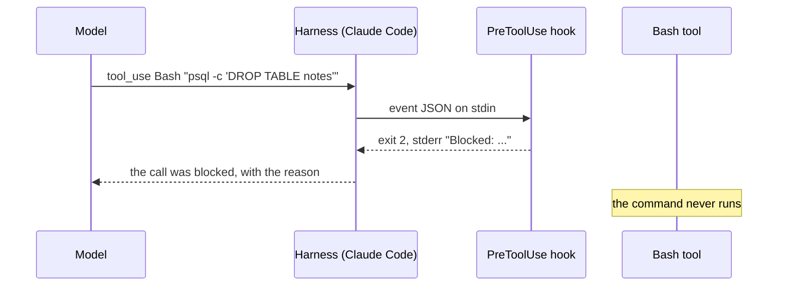
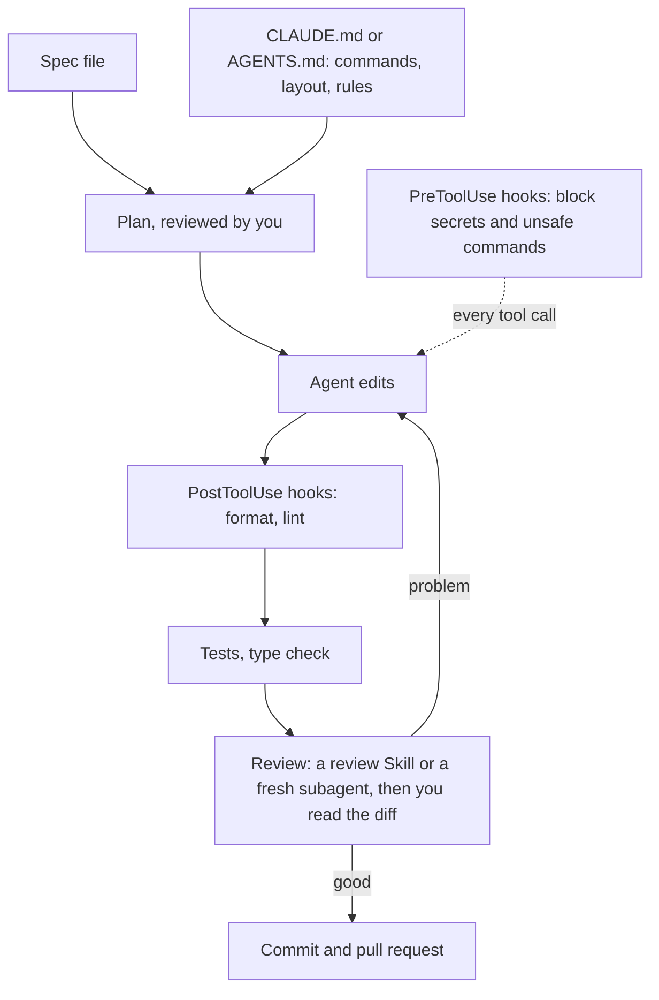

## 1. The question this idea answers

Lesson 8.2 showed that a rule in `CLAUDE.md` is a request. The model usually follows it. Sometimes it does not. Some rules must hold every time:

- Never edit the `.env` file.
- Format every Python file after an edit.
- Do not stop until the tests pass.

How do you make a rule hold every time? How do you give your whole setup to a teammate in one step? And which of these habits still work when you change to another coding agent?

## 2. Mental model

> [!analogy] A sign on a door vs a lock on a door
> A sign says "Do not enter". Most people obey it. A person in a hurry walks past it. A lock does not depend on the person. It checks every attempt to open the door.
>
> A rule in `CLAUDE.md` is a sign. A hook is a lock: a script that the harness runs at a fixed event, for example just before every file edit. The model does not decide whether the hook runs.
>
> **Where it stops working:** a lock protects only its own door. A hook on the "edit a file" event does not see a shell command that writes the same file. A badly written check also gives false safety. So you test hooks like any other code.

## 3. Terms

| Term | Plain meaning |
|---|---|
| hook | A command, HTTP request, MCP tool call, prompt or subagent that Claude Code runs when a fixed event happens. |
| hook event | A point in the life of a session where hooks can run, for example `PreToolUse` (before a tool call). |
| matcher | A pattern in the hook settings that selects which tools fire the hook, for example `Edit` or `Write`. |
| command hook | A hook of type `command`: a shell command that gets the event as JSON on stdin. |
| stdin, stdout, stderr | The standard input, output and error streams of a process. |
| exit code | The number that a process returns when it ends. 0 usually means success. |
| blocking | Stopping the action. For `PreToolUse`, the tool call does not run. |
| deterministic | Same input, same result, every time. A hook is deterministic. A model is not. |
| plugin | A folder of Skills, subagents, hooks, MCP servers and other parts that Claude Code installs and loads as one unit. |
| manifest | The file `.claude-plugin/plugin.json` that gives a plugin its name and metadata. |
| marketplace | A catalog that lists plugins and where to fetch each one. |
| defense in depth | Several independent protections, so that one gap does not cause a failure. |

## 4. How it works

### 4.1 Why a hook beats a written rule

The features page of Claude Code puts it plainly (checked on 2026-10-19): "An instruction like 'never edit `.env`' in CLAUDE.md or a skill is a request, not a guarantee. A `PreToolUse` hook that blocks the edit is enforcement."

| | Rule in `CLAUDE.md` | Hook |
|---|---|---|
| Who decides | The model reads it and decides | The harness runs it on every matching event |
| Result | Usually followed | Same result every time |
| Context cost | Every request | Zero, unless the hook returns text |
| Good for | Conventions that need judgment | Checks that a script can decide |

### 4.2 Hook events

Claude Code has 33 hook events (hooks reference, checked on 2026-10-19). These ones matter most for this level. The last column comes from the table "Exit code 2 behavior per event" in the reference.

| Event | When it fires | What exit code 2 does |
|---|---|---|
| `SessionStart` | A session begins or resumes | Cannot block. Shows stderr to the user only. (On exit 0, its stdout is added to Claude's context.) |
| `UserPromptSubmit` | You send a prompt, before Claude reads it | Blocks the prompt |
| `PreToolUse` | Before a tool call runs | Blocks the tool call |
| `PermissionRequest` | A tool call needs a permission decision | Not honored. Deny through a JSON decision object instead. |
| `PostToolUse` | After a tool call succeeds | Cannot block. Shows stderr to Claude. The tool already ran. |
| `PostToolUseFailure` | After a tool call fails | Cannot block. Shows stderr to Claude. |
| `Stop` | Claude finishes its answer | Stops Claude from stopping. The conversation continues. |
| `SubagentStop` | A subagent finishes | Stops the subagent from stopping |
| `PreCompact` | Before context compaction | Blocks the compaction |
| `SessionEnd` | The session ends | Cannot block. Shows stderr to the user only. |

A hook has a `type`. Most hooks are `command`. The guide names four other types:

- `http`: POST the event to a URL.
- `mcp_tool`: call a tool on an MCP server.
- `prompt`: a one-turn model check.
- `agent`: a multi-turn check with tools. The docs mark it experimental.

### 4.3 Where hooks live

| File | Scope | Shared |
|---|---|---|
| `~/.claude/settings.json` | All your projects | No |
| `.claude/settings.json` | One project | Yes, commit it |
| `.claude/settings.local.json` | One project | No |
| Managed policy settings | The whole organization | Yes, controlled by admins |
| A plugin's `hooks/hooks.json` | When the plugin is on | Yes |
| Skill or subagent frontmatter | While that Skill or subagent runs | Yes |

Hooks from all these places add together. All matching hooks run, in parallel.

### 4.4 The contract: JSON in, exit code out

When an event fires, Claude Code writes a JSON object to the hook's stdin. The hooks guide shows this input for a `PreToolUse` hook on a Bash command:

```json
{
  "session_id": "abc123",
  "cwd": "/Users/sarah/myproject",
  "hook_event_name": "PreToolUse",
  "tool_name": "Bash",
  "tool_input": {
    "command": "npm test"
  }
}
```

For the `Edit` and `Write` tools, the target file is in `tool_input.file_path`.

The hook answers with its exit code:

| Exit code | Meaning for `PreToolUse` |
|---|---|
| 0 | No objection. The normal permission flow still applies. The guide says that exit 0 "doesn't approve it". |
| 2 | Block the tool call. Claude Code sends the hook's stderr text to Claude as feedback, so it can change its approach. |
| Any other | On most events the action continues, as a non-blocking error. |

For more control, a hook can exit with 0 and print JSON on stdout:

```json
{
  "hookSpecificOutput": {
    "hookEventName": "PreToolUse",
    "permissionDecision": "deny",
    "permissionDecisionReason": "Use rg instead of grep for better performance"
  }
}
```

Two facts from the docs matter here:

1. The decision fields belong inside `hookSpecificOutput`. At the top level, Claude Code ignores them and reports no error.
2. A `deny` from a `PreToolUse` hook blocks the tool even in `bypassPermissions` mode. The docs say: "This lets you enforce policy that users can't bypass by changing their permission mode."

The guide advises one approach per hook: exit 2 with a stderr message, or exit 0 with JSON. Do not mix them.

### 4.5 Worked example: block a dangerous shell command

The hooks guide has a Bash example that blocks commands with "drop table". This version is in Python. It is a different rule from the exercise in section 5.

```python
#!/usr/bin/env python3
"""PreToolUse hook: block Bash commands that drop a table."""
import json
import sys

try:
    event = json.load(sys.stdin)
except json.JSONDecodeError as exc:
    print(f"Blocked: hook input is not valid JSON ({exc.msg}).", file=sys.stderr)
    sys.exit(2)

if event.get("tool_name") != "Bash":
    sys.exit(0)

command = event.get("tool_input", {}).get("command", "")
if "drop table" in command.lower():
    print("Blocked: dropping tables is not allowed. Write a migration instead.", file=sys.stderr)
    sys.exit(2)

sys.exit(0)
```

Line by line:

| Lines | What they do | Why |
|---|---|---|
| `json.load(sys.stdin)` | Read the event that Claude Code wrote to stdin | The hook gets all its input this way |
| `except json.JSONDecodeError` then `sys.exit(2)` | Block when the input is broken | A safety check must fail closed: when in doubt, block |
| `if event.get("tool_name") != "Bash"` | Ignore other tools | The matcher should already filter, but the script does not depend on it |
| `.get("tool_input", {}).get("command", "")` | Read the command, with empty defaults | A missing key must not crash the hook |
| `"drop table" in command.lower()` | The rule itself | `lower()` also catches `DROP TABLE` |
| `print(..., file=sys.stderr)` then `sys.exit(2)` | Block, with a reason | The reason returns to Claude, so it can try another way |

Register it in `.claude/settings.json`:

```json
{
  "hooks": {
    "PreToolUse": [
      {
        "matcher": "Bash",
        "hooks": [
          {
            "type": "command",
            "command": "python3 \"$CLAUDE_PROJECT_DIR\"/.claude/hooks/block_drop_table.py"
          }
        ]
      }
    ]
  }
}
```

You can test a hook without any agent. Pipe JSON into it and read the exit code. A sandbox run (Python 3.13.16, 2026-10-19) with four inputs gave:

```text
drop    exit=2 stderr='Blocked: dropping tables is not allowed. Write a migration instead.'
safe    exit=0 stderr=''
edit    exit=0 stderr=''
broken  exit=2 stderr='Blocked: hook input is not valid JSON (Expecting value).'
```

The inputs were: a Bash `DROP TABLE` command, a Bash `uv run pytest -q` command, an `Edit` call and a cut-off JSON text.



> [!trap] A hook covers only its own door
> A hook with the matcher `Edit|Write` sees edits through the Edit and Write tools. It does not see a Bash command such as `echo KEY=x > .env`, which writes the same file. Use defense in depth:
>
> 1. Store real secrets outside the project folder.
> 2. Add a second check on Bash commands, or a permission deny rule.
> 3. Test each gap that you know of.

### 4.6 Hooks that check quality

Two more patterns from the docs:

1. **Format after every edit.** A `PostToolUse` hook with the matcher for edits runs a formatter on the changed file. The guide uses Prettier. For Python, the same idea uses `ruff format`. The hook reads `tool_input.file_path` from stdin.
2. **Do not stop before the tests pass.** The best-practices page calls a `Stop` hook "a deterministic gate". It "runs your check as a script and blocks the turn from ending until it passes."

> [!note] Hook output costs context
> A hook costs no context unless it prints text that returns to Claude. A linter hook that prints 500 lines on every edit fills the context fast. Print only the lines that matter.

### 4.7 Plugins: a setup in one package

The plugins page says (checked on 2026-10-19): "A Claude Code plugin is a directory of skills, agents, hooks, MCP servers, or other components that Claude Code installs and loads as one unit."

```text
my-plugin/
├── .claude-plugin/
│   └── plugin.json        manifest: name, version, description
├── skills/
│   └── review/SKILL.md    becomes /my-plugin:review
├── agents/
│   └── reviewer.md        a subagent
├── hooks/
│   └── hooks.json         hooks that run while the plugin is on
└── .mcp.json              MCP servers that start with the plugin
```

Facts from the same page:

1. **Names.** Plugin Skills are namespaced, for example `/my-plugin:review`. So two plugins can each have a `review` Skill.
2. **Marketplaces.** A marketplace is a repository with `.claude-plugin/marketplace.json` that lists plugins. You install from it by name.
3. **Development.** You do not need a marketplace while you build a plugin. Load it from its folder with `--plugin-dir`.
4. **Cost.** An enabled plugin is in every session. The names and descriptions of its model-usable Skills and agents are in the context on every turn.
5. **Trust.** "What the plugin runs, it runs as you." Review a plugin before you install it.

When do you need one? The features page gives the trigger: "A second repository needs the same setup."

### 4.8 Habits that transfer to any agent

Tools change fast. The habits under them change slowly.

| Habit | In Claude Code | In other agents |
|---|---|---|
| Record project rules in a file | `CLAUDE.md`, `.claude/rules/` | `AGENTS.md` is read by Codex, Cursor, Gemini CLI, Jules, the GitHub Copilot coding agent and others (agents.md, checked on 2026-10-19) |
| Package repeated procedures | Skills | The Agent Skills format is read by Codex, Cursor, GitHub Copilot, VS Code, Gemini CLI and others (agentskills.io, checked on 2026-10-19) |
| Spec and plan before code | Plan mode | Write the spec as a file. Any agent can read a file. |
| Delegate focused work | Subagents | Names and features differ by tool. Check its docs. |
| Connect outside systems | MCP | MCP is an open protocol with many clients |
| Automate checks | Hooks | Hook support differs by tool. Tests, linters and CI work everywhere. |
| Verify every change | The loop of lesson 8.1 | The same loop |

The strongest habit is the last one. A test suite, a type checker and continuous integration check the code no matter which agent wrote it.

### 4.9 The professional loop, all parts together



## 5. Exercises

Hints come in three levels in chat: idea, pseudocode, partial code.

**Exercise 8.4.1: `block_secrets.py` (the M0.6 exercise).** Runs in: your local practice project.

Write a `PreToolUse` hook script `block_secrets.py`. It reads the hook JSON from stdin. It blocks the call when the tool is `Edit` or `Write` and `tool_input.file_path` ends with `.env`. Register it in `.claude/settings.json`.

Acceptance tests (pytest, no agent needed). Use `subprocess.run` to pipe three JSON samples into the script:

- An edit to `app/.env` is blocked: exit code 2 and a clear message on stderr.
- An edit to `app/main.py` passes: exit code 0.
- Malformed JSON fails closed: it blocks, with a clear message.

Then ask the agent to edit `.env`, and confirm that the hook stops it. Write two sentences on one gap that this hook does not cover, and how you would close it.

**Exercise 8.4.2: the full agentic setup (the M0.6 "try it" task).** Runs in: your local practice project.

Build a small multi-file app with an agent. Before any code, write a spec and review a plan. Add one Skill, one subagent, one MCP integration and one hook.

Acceptance tests:

- The repository holds the spec, `CLAUDE.md` or `AGENTS.md`, the Skill, the subagent file and the hook settings.
- You read every diff. Your notes list each commit with one line on what you checked.
- The tests pass, and you ran them yourself.
- Your notes describe at least one mistake that the agent made, how you found it and how you fixed it. This note is the first draft of the capstone's agent-failure write-up (lesson 10.1).

## 6. Common mistakes

1. **A safety rule only in `CLAUDE.md`.** It is a request. Make it a hook.
2. **A hook that fails open.** If the hook crashes or gets bad input and exits with code 1, the action continues on most events. Catch errors and exit 2 for a safety check.
3. **Decision fields at the wrong JSON level.** `permissionDecision` must be inside `hookSpecificOutput`, or Claude Code ignores it.
4. **Mixing exit 2 with JSON output.** Use one approach per hook.
5. **A matcher with a gap.** An `Edit|Write` hook does not see Bash writes. Add a second protection.
6. **Noisy hooks.** Text that a hook returns enters the context. Print only what Claude needs.
7. **Installing plugins without review.** A plugin runs code with your user rights.

## 7. One-minute explanation

A rule in `CLAUDE.md` is a request. A hook is enforcement. Claude Code runs a hook at a fixed event, such as `PreToolUse` before every tool call, and the model does not decide whether it runs. A command hook gets the event as JSON on stdin. Exit code 0 means no objection, and exit code 2 blocks the call and returns the stderr text to Claude. A hook can also print JSON with a `permissionDecision` inside `hookSpecificOutput`. Test hooks by piping JSON into them, make safety hooks fail closed, and remember that a hook sees only its own events. A plugin bundles Skills, subagents, hooks and MCP servers into one installable folder with a manifest. The habits under all this, written rules, packaged procedures, specs, isolated work and automatic checks, transfer to any coding agent.

## 8. Check questions

```check
{
  "question": "A PreToolUse hook prints a reason to stderr and exits with code 2. What happens to the tool call, and where does the reason go?",
  "answer": "The tool call is blocked and does not run. Claude Code sends the stderr text to Claude as feedback, so the model can change its approach."
}
```

```check
{
  "question": "Your safety hook crashes on bad input with an unhandled exception, so Python exits with code 1. On most events, what happens to the action, and how do you fix the hook?",
  "hint": "Which exit codes block?",
  "answer": "Exit code 1 is not 0 or 2, so on most events the action continues as a non-blocking error. The hook failed open. Fix: catch the error (for example json.JSONDecodeError) and exit 2 with a clear message, so the safety check fails closed."
}
```

```check
{
  "question": "A hook with the matcher Edit|Write blocks edits to .env. Name one way the agent can still change .env, and one extra protection.",
  "answer": "A Bash command such as echo KEY=x > .env writes the file without the Edit or Write tool, so the hook never fires. Extra protections: a second PreToolUse hook on Bash that checks for .env in the command, a permission deny rule, and storing real secrets outside the project folder."
}
```

```check
{
  "question": "When should a setup become a plugin, and what does an enabled plugin cost even in a session where you do not use it?",
  "answer": "When a second repository or a teammate needs the same Skills, subagents, hooks and MCP servers. An enabled plugin is in every session: the names and descriptions of its model-usable Skills and agents are in the context on every turn, its MCP servers run, and its hooks fire."
}
```

## 9. Links

- Previous: [8.3 Skills, slash commands, subagents and MCP](/notes/ai/ai-engineering/01-software-engineering-fundamentals/m08-ai-assisted-development/l3-skills-subagents-and-mcp)
- Next module: [9.1 App, environment, machine: images and containers](/notes/ai/ai-engineering/01-software-engineering-fundamentals/m09-docker-and-deployment/l1-images-and-containers)
- The same features from the context side: [Commands, Skills and hooks](/notes/ai/context-engineering/09-production/l5-commands-skills-and-hooks)
- Hooks in the Agent SDK: [Hooks](/notes/ai/claude-agent-sdk/08-hooks-and-subagents/l1-hooks)
- The capstone write-up: [10.1 Capstone spec, milestones and checklist](/notes/ai/ai-engineering/01-software-engineering-fundamentals/m10-capstone/l1-capstone-spec-and-checklist)
- [Glossary](/notes/ai/ai-engineering/glossary)

Sources (checked on 2026-10-19): [Automate actions with hooks](https://code.claude.com/docs/en/hooks-guide), [Extend Claude Code](https://code.claude.com/docs/en/features-overview), [Plugins overview](https://code.claude.com/docs/en/plugins), [Best practices](https://code.claude.com/docs/en/best-practices), [AGENTS.md](https://agents.md), [Agent Skills](https://agentskills.io).
