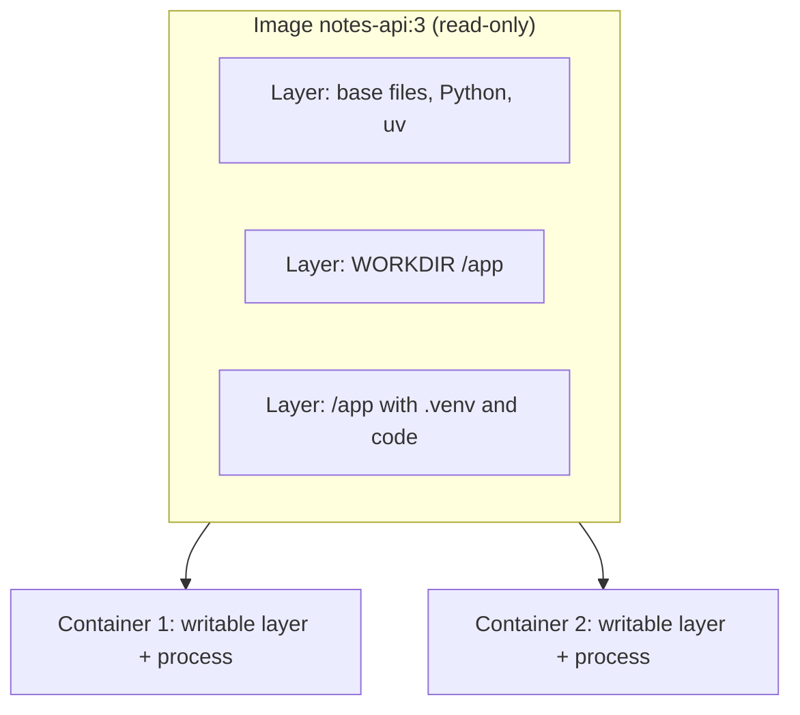

## 1. The question this idea answers

Your FastAPI service runs on your laptop. You copy it to a server, and it fails. Maybe the server has Python 3.11 and your code needs 3.13. Maybe one package is missing. Maybe an environment variable is not set. The code is the same. Everything around the code is different.

How do you ship the environment together with the code, so that the service runs the same way everywhere?

## 2. Mental model

> [!analogy] A recipe, a frozen meal and a plate on the table
> - The **Dockerfile** is a recipe: exact steps to prepare a meal.
> - The **image** is a frozen meal made from the recipe. It holds everything: food, sauce, spices. You can copy it, store it and send it anywhere. Nobody changes a frozen meal after it is packed.
> - A **container** is one plate of that meal, served and hot. You can serve many plates from copies of the same frozen meal. Each plate can get some salt that the others do not have, and the salt is gone when you wash the plate.
>
> **Where it stops working:** a meal needs no oven of a special brand. A container needs a host with a matching operating-system kernel, because a container is not a full machine. A Linux image needs a Linux kernel. On Windows, Docker Desktop runs one inside WSL 2, which Docker describes as "a full Linux kernel built by Microsoft".

## 3. Terms

| Term | Plain meaning |
|---|---|
| app | Your code: the Python files of the service. |
| environment | Everything that the code needs to run: the Python version, packages, system libraries, files and environment variables. |
| machine (host) | The computer that runs the code: its CPU, memory, operating-system kernel and network. |
| kernel | The core of the operating system. It runs processes, files and network for every program. |
| image | A read-only package of files and settings that holds an app and its environment. Docker says: "Images are immutable." |
| layer | One read-only set of file changes inside an image. An image is a stack of layers. |
| container | A running process started from an image, with its own isolated files, network and a thin writable layer. |
| Dockerfile | A text file of instructions that builds an image. |
| Docker Engine | The background service (daemon) that builds images and runs containers. The `docker` command talks to it. |
| registry | A server that stores images, for example Docker Hub or GitHub Container Registry. |
| tag | A name for one image version, for example `python:3.13-slim`. A tag can move to another image. |
| digest | A `sha256:` hash of an image. It always names the same content. |
| volume | Storage that Docker manages outside the container's writable layer. It lives on after the container is removed. |
| virtual machine (VM) | A full emulated computer with its own kernel. |

## 4. How it works

### 4.1 Three layers of every running program

| Layer | Examples | Who controls it |
|---|---|---|
| App | `app/main.py`, `routes.py` | You, in Git |
| Environment | Python 3.13, `fastapi 0.149.0`, `libz.so.1`, `DATABASE_URL` | Often nobody. This is the problem. |
| Machine | 4 CPUs, 8 GB memory, Linux kernel 6.x, port 8000 open | The host or the cloud platform |

"It works on my machine" almost always means "it works in my environment". The app is the same. One piece of the environment differs.

> [!example] A real environment bug from the sandbox test of this module
> The test of lesson 9.2 used a small home-made base image. The app used the `psycopg` PostgreSQL driver. The app started and then failed with:
>
> ```text
> ImportError: couldn't import requested psycopg 'binary' implementation: libz.so.1: cannot open shared object file: No such file or directory
> ```
>
> 1. The Python code was correct.
> 2. The Python packages were correct.
> 3. One system library, `libz.so.1`, was missing from the environment.
> 4. After the library was added to the base image, the same code ran.
>
> A full base image such as `python:3.13-slim` already has this library. The point stays: the environment is part of the program.

### 4.2 Image and container

An image is a stack of read-only layers plus settings: the start command, environment variables, the user and the working folder. A container adds one thin writable layer on top and starts one process.



A sandbox run on 2026-10-19 (Docker Engine 29.8.2) showed the writable layer at work:

```text
$ docker run --name w1 notes-api:3 sh -c 'echo hello > /tmp/note.txt; cat /tmp/note.txt'
hello
$ docker rm w1
$ docker run --rm notes-api:3 sh -c 'cat /tmp/note.txt'
cat: /tmp/note.txt: No such file or directory
```

The second container started from the same image with a new, empty writable layer. The file was gone. With a named volume, the data stays:

```text
$ docker volume create notes-data
$ docker run --rm -v notes-data:/data -u 0 notes-api:3 sh -c 'echo hello > /data/note.txt'
$ docker run --rm -v notes-data:/data notes-api:3 sh -c 'cat /data/note.txt'
hello
```

> [!key] Containers are disposable. Data is not.
> Treat a container as something that you can delete and start again at any time. Docker's best-practices page says that containers should be "as ephemeral as possible". Keep data that must survive in a database or a volume, never in the container's own files.

### 4.3 A container is a process, not a machine

A container is a normal Linux process. The kernel isolates it: it sees its own files, its own process list and its own network. The kernel also limits its CPU and memory. But it shares the host's kernel.

The sandbox shows this. The kernel version inside the container and on the host was the same:

```text
host:      Linux version 6.18.44-fc-v139 ...
container: Linux version 6.18.44-fc-v139 ...
```

| | Container | Virtual machine |
|---|---|---|
| Kernel | Shares the host kernel | Has its own kernel |
| Start time | Usually under a second | Usually tens of seconds |
| Size | Megabytes to a few hundred megabytes | Gigabytes |
| Isolation | Process level | Hardware level, stronger |
| Runs a different OS family | No. A Linux image needs a Linux kernel. | Yes |

The start time and size rows are typical values, not measurements of this course.

### 4.4 Names: registry, repository, tag and digest

A full image name has parts:

```text
docker.io/library/python:3.13-slim
└───┬───┘ └─────┬──────┘ └───┬───┘
 registry   repository      tag
```

A tag is a label, and a publisher can move it to a new image. Docker's best-practices page notes that image tags are mutable. A digest names exact content:

```text
python:3.13-slim@sha256:<64 hex characters>
```

| Pin with | You get | Trade-off |
|---|---|---|
| `python:3` | Whatever is newest | Builds change without warning |
| `python:3.13-slim` | Python 3.13, newest patch | Small changes on each rebuild |
| `python:3.13-slim@sha256:...` | The same bytes every time | You must update it on purpose to get security fixes |

### 4.5 The everyday commands

| Command | What it does |
|---|---|
| `docker build -t notes-api:1 .` | Build an image from the Dockerfile in this folder, and tag it |
| `docker image ls` | List local images |
| `docker image history notes-api:1` | Show the layers of an image and the instruction that made each one |
| `docker run --rm -p 8000:8000 -e DATABASE_URL=... notes-api:1` | Start a container. Remove it when it stops. Map a port. Set a variable. |
| `docker ps` | List running containers (`-a` shows stopped ones too) |
| `docker logs <name>` | Show what the container printed to stdout and stderr |
| `docker stop <name>` | Ask the main process to stop, then force it after a timeout |
| `docker rm <name>` | Remove a stopped container and its writable layer |

The layer history of the sandbox image `notes-api:3`:

```text
CMD ["fastapi" "run" "app/main.py" "--host" … | 0B
EXPOSE [8000/tcp]                             | 0B
USER 10001                                    | 0B
ENV PATH=/app/.venv/bin:/usr/local/bin:/bin   | 0B
COPY /app /app # buildkit                     | 95.1MB
WORKDIR /app                                  | 8.19kB
                                              | 180MB
```

Settings such as `CMD`, `USER` and `ENV` add 0 bytes. They are metadata. Only file changes add size. The last row is the base image.

### 4.6 One image, many environments

The same image can run in development, in testing and in production. Only the configuration changes, and configuration comes from environment variables (lesson 1.7). The sandbox app checks one variable at startup:

```text
$ docker run --rm notes-api:3
ERROR notes-api DATABASE_URL is not set. Set it with -e DATABASE_URL=... and start again.
$ echo $?
1
```

```text
$ docker run -d --rm -p 8000:8000 -e DATABASE_URL=postgresql://app:secret@db:5432/notes notes-api:3
$ curl -s localhost:8000/health
{"status":"ok","user_id":"10001"}
```

The first run failed fast with one clear line and exit code 1. The second run served requests. The `user_id` of 10001 shows that the process does not run as root (lesson 9.2).

> [!note] About the sandbox measurements in this module
> The sandbox had Docker Engine 29.8.2 but could not reach Docker Hub. So the tests used local base images built from the sandbox's own files: Python 3.13.14, uv 0.11.32 and PostgreSQL 16.15. The layer, cache and startup behavior does not depend on the base image. With `python:3.13-slim` from Docker Hub, the sizes are different.

## 5. Exercises

Hints come in three levels in chat: idea, pseudocode, partial code.

**Exercise 9.1.1: two environments, one command.** Runs in: your local practice project (Docker Desktop with WSL 2 on Windows).

Run `python --version` on your computer. Then run `docker run --rm python:3.13-slim python --version`.

Acceptance tests:

- You recorded both versions and explained why they can differ.
- You ran `docker image history python:3.13-slim` and named the largest layer.

**Exercise 9.1.2: the writable layer and a volume.** Runs in: your local practice project.

Repeat section 4.2 with `python:3.13-slim`.

Acceptance tests:

- A file written in one container is missing in a second container from the same image.
- A file written to a named volume is present in a second container that mounts the same volume.
- You removed the volume at the end with `docker volume rm`.

## 6. Common mistakes

1. **Thinking a container is a small VM.** It shares the host kernel. It is a process with isolation.
2. **Storing data in the container's writable layer.** It disappears with the container. Use a database or a volume.
3. **Using `latest` or a loose tag in production.** The image can change under you. Pin a version, or a digest.
4. **Building a different image for each environment.** Build one image. Change only the configuration through environment variables.
5. **Putting secrets in the image.** Anyone with the image can read every layer. Pass secrets at run time (lesson 9.4).

## 7. One-minute explanation

Every running program has three layers: the app (your code), the environment (Python version, packages, system libraries, variables) and the machine. "It works on my machine" is almost always an environment difference. Docker packs the app and its environment into an image: a read-only stack of layers plus settings such as the start command. A container is a process started from an image, with a thin writable layer that disappears when you remove the container. It shares the host's kernel, so it is not a virtual machine. Images live in registries under names with tags, and a digest pins exact content. Build one image, and change only its configuration between environments.

## 8. Check questions

```check
{
  "question": "Two containers run from the same image. Container A writes /tmp/x.txt. Can container B read it? What do you use if the file must survive?",
  "answer": "No. Each container has its own writable layer on top of the read-only image layers. The file exists only in A's writable layer and disappears when A is removed. For data that must survive, use a named volume or a database."
}
```

```check
{
  "question": "Why can you not run a Linux container image directly on the Windows kernel, and how does Docker Desktop solve it?",
  "hint": "What does a container share with the host?",
  "answer": "A container shares the host's kernel, and a Linux image needs a Linux kernel. Docker Desktop on Windows uses WSL 2, which runs a full Linux kernel, so the Linux containers run on that kernel."
}
```

```check
{
  "question": "A teammate tags the base image as python:3 in the Dockerfile. Six months later, a rebuild breaks. What happened, and what are two better choices?",
  "answer": "A tag is mutable. python:3 moved to a newer Python version, so the rebuild got a different environment. Better: pin a version tag such as python:3.13-slim, or pin a digest such as python:3.13-slim@sha256:... and update it on purpose."
}
```

```check
{
  "question": "In docker image history, the USER and CMD rows show 0B. Why?",
  "answer": "USER, CMD, ENV and EXPOSE change only the image settings (metadata). They add no files, so their layer size is 0 bytes. Only instructions that change files, such as COPY and RUN, add size."
}
```

## 9. Links

- Previous module: [8.4 Hooks, plugins and habits that transfer](/notes/ai/ai-engineering/01-software-engineering-fundamentals/m08-ai-assisted-development/l4-hooks-plugins-and-portable-habits)
- Next: [9.2 Dockerfiles, layers, caching and uv](/notes/ai/ai-engineering/01-software-engineering-fundamentals/m09-docker-and-deployment/l2-dockerfiles-layers-and-uv)
- Environment variables: [1.7 Files, paths, environment variables and JSON](/notes/ai/ai-engineering/01-software-engineering-fundamentals/m01-python-foundations/l7-files-paths-env-and-json)
- A database in a container: [Local PostgreSQL with Docker](/notes/databases/postgres/05-local-setup/l1-local-postgres-with-docker)
- Containers for model serving: [Containers and model loading](/notes/ai/llm-systems/05-cloud-hosting/l3-containers-and-model-loading)
- [Glossary](/notes/ai/ai-engineering/glossary)

Sources (checked on 2026-10-19): [What is an image? (Docker docs)](https://docs.docker.com/get-started/docker-concepts/the-basics/what-is-an-image/), [Building best practices (Docker docs)](https://docs.docker.com/build/building/best-practices/), [Docker Desktop WSL 2 backend](https://docs.docker.com/desktop/features/wsl/).
