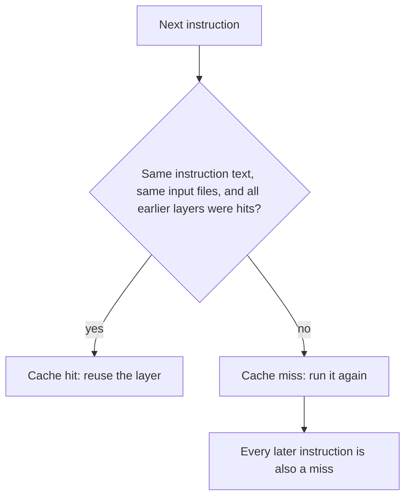
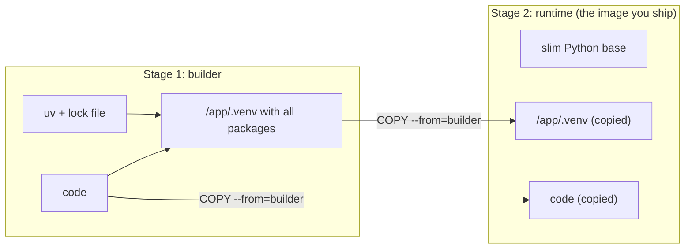

## 1. The question this idea answers

You change one line of Python and rebuild your image. The build installs all 60 packages again and takes minutes. Then the container ignores `docker stop` for 10 seconds and dies without its shutdown log. Then a security review asks why the service runs as root.

All three problems come from the Dockerfile. This lesson shows how a build uses layers and its cache. It shows how to install locked dependencies with uv. It ends with three small choices that matter in production.

## 2. Mental model

> [!analogy] A stack of transparent sheets
> Picture an image as a stack of transparent sheets. Each Dockerfile instruction draws one sheet on top of the last. Docker keeps every sheet that it drew before.
>
> When you build again, Docker goes from the bottom up. If an instruction and its input files are the same as last time, Docker reuses the old sheet. At the first sheet that differs, Docker must draw that sheet and every sheet above it again.
>
> So you put the sheets that rarely change at the bottom: the base system and the dependencies. The sheet that changes often goes at the top: your code.
>
> **Where it stops working:** real sheets do not depend on each other. Layers do. A `RUN` layer can depend on files that an earlier `COPY` copied. A cache mount (section 4.4) also keeps data between builds that is not in any layer at all.

## 3. Terms

| Term | Plain meaning |
|---|---|
| instruction | One line of a Dockerfile, such as `FROM`, `COPY` or `RUN`. |
| build context | The folder that you send to the builder, usually `.`. `COPY` can read only files from it. |
| base image | The image in the `FROM` line that your image starts from. |
| build cache | Layers that the builder kept from earlier builds, so it can reuse them. |
| cache hit, cache miss | A hit reuses an old layer (shown as `CACHED`). A miss builds the layer again. |
| cache mount | A folder that survives between builds but is not part of the image, for example uv's download cache. |
| bind mount (in a build) | A file from the build context, visible to one `RUN` step only. It is not copied into the layer. |
| lock file | `uv.lock`: the exact version of every package, so that every install is the same. |
| multi-stage build | A Dockerfile with several `FROM` lines. A later stage copies only what it needs from an earlier one. |
| exec form | `CMD ["fastapi", "run", ...]`: a JSON list. Docker starts the program directly. |
| shell form | `CMD fastapi run ...`: plain text. Docker starts `/bin/sh -c "..."`, and the shell starts the program. |
| PID 1 | The first process in a container. Docker sends stop signals to it. |
| SIGTERM, SIGKILL | Signals that ask a process to stop (SIGTERM) or force it to stop at once (SIGKILL). |
| non-root user | A user without administrator rights inside the container. |
| `.dockerignore` | A file that lists paths to exclude from the build context. |

## 4. How it works

### 4.1 The instructions you need

| Instruction | What it does | Adds files? |
|---|---|---|
| `FROM image` | Start from a base image | (the base layers) |
| `WORKDIR /app` | Set the working folder, and make it if needed | Very little |
| `COPY src dst` | Copy files from the build context into the image | Yes |
| `RUN command` | Run a command at build time, and keep the file changes | Yes |
| `ENV KEY=value` | Set an environment variable for later steps and for the container | No, metadata |
| `ARG NAME` | A variable for build time only | No |
| `USER 10001` | Run later steps and the container as this user | No, metadata |
| `EXPOSE 8000` | Document the port. It does not publish it. `docker run -p` does. | No, metadata |
| `CMD [...]` | The default command of the container | No, metadata |

### 4.2 How the cache decides



For `COPY`, the input is the content of the copied files. For `RUN`, the input is the command text and the layers below it. So one changed file under a `COPY .` line makes that line a miss, and every line below it runs again.

The FastAPI container docs give the rule for Python services (checked on 2026-10-19): "Copy **only** the file with the requirements first, not the rest of the code." Then "near the end of the `Dockerfile`, we copy all the code. As this is what **changes most frequently**, we put it near the end".

With uv, the dependency list is `pyproject.toml` plus `uv.lock`.

### 4.3 The build context and .dockerignore

Before the build starts, Docker sends the build context to the builder. A `.dockerignore` file excludes paths. The uv Docker guide says to "add `.venv` to a `.dockerignore` file". A sandbox test (2026-10-19, Docker Engine 29.8.2) put 60 MB of files in a local `.venv` folder and built twice:

```text
with .dockerignore (.venv listed):   transferring context: 439B
without .dockerignore:               transferring context: 62.93MB
```

The local `.venv` is also wrong for the image. It was built for your machine. `COPY . /app` would copy it over the environment that the image built.

A good `.dockerignore` for this course:

```text
.venv
__pycache__/
.git
.env
```

The `.env` line matters most. Without it, `COPY .` puts your local secrets into a layer, and anyone with the image can read them.

### 4.4 The uv pattern

The uv Docker guide (checked on 2026-10-19) recommends these steps:

1. **Get the uv binary from its official image, at a pinned version.** The guide's examples use `COPY --from=ghcr.io/astral-sh/uv:0.13.1 /uv /uvx /bin/`. The guide calls pinning a version "best practice".
2. **Install the dependencies in their own layer, before the code.** The command is `uv sync` with `--no-install-project`, which installs the dependencies but not the project itself.
3. **Use a cache mount** for uv's download cache: `--mount=type=cache,target=/root/.cache/uv`. A rebuild after a dependency change then reuses downloaded packages.
4. **Set `UV_COMPILE_BYTECODE=1`** to compile `.pyc` files at build time, so the container starts faster.
5. **Set `UV_LINK_MODE=copy`.** The cache and the target can be on different file systems. The guide says that this setting "silences warnings about not being able to link files".
6. **Put `.venv/bin` on the `PATH`,** so that `fastapi` and `python` come from the project environment.

> [!note] --locked or --frozen?
> `uv sync --help` (uv 0.11.32) says: `--locked` will "Assert that the `uv.lock` will remain unchanged", and `--frozen` will "Sync without updating the `uv.lock` file". So `--locked` checks the lock file against `pyproject.toml` and fails if they differ. `--frozen` uses the lock file without that check. The guide's dependency step uses `--frozen` and mounts only `uv.lock`. The example below mounts both files, so it can use `--locked`.

What `--locked` protects you from, measured in the sandbox. A dependency was added to `pyproject.toml` without running `uv lock`:

```text
error: The lockfile at `uv.lock` needs to be updated, but `--locked` was provided.
hint: To update the lockfile, run `uv lock`.
ERROR: process "/bin/sh -c uv sync --locked --no-install-project --no-dev" did not complete successfully: exit code: 1
```

The build failed instead of silently installing versions that nobody reviewed.

### 4.5 Code walkthrough: a cache-friendly Dockerfile

This single-stage Dockerfile builds the sandbox `notes-api` service. Exercise 9.2.1 changes it to two stages.

```dockerfile
FROM python:3.13-slim
COPY --from=ghcr.io/astral-sh/uv:0.13.1 /uv /uvx /bin/
ENV UV_COMPILE_BYTECODE=1 UV_LINK_MODE=copy
WORKDIR /app
RUN --mount=type=cache,target=/root/.cache/uv \
    --mount=type=bind,source=uv.lock,target=uv.lock \
    --mount=type=bind,source=pyproject.toml,target=pyproject.toml \
    uv sync --locked --no-install-project --no-dev
COPY . /app
RUN --mount=type=cache,target=/root/.cache/uv \
    uv sync --locked --no-dev
ENV PATH="/app/.venv/bin:$PATH"
CMD ["fastapi", "run", "app/main.py", "--host", "0.0.0.0", "--port", "8000"]
```

| Line | What it does | What breaks without it |
|---|---|---|
| `FROM python:3.13-slim` | Pins the Python minor version and a small Debian base | A loose tag can change the Python version on a rebuild |
| `COPY --from=ghcr.io/astral-sh/uv:0.13.1 ...` | Puts a pinned uv binary in `/bin` | No uv, or a different uv version on each build |
| `ENV UV_COMPILE_BYTECODE=1 ...` | Compile `.pyc` at build time. Copy files instead of linking. | Slower first start. Link warnings. |
| `WORKDIR /app` | All later paths are relative to `/app` | Files land in `/` |
| First `RUN` with two bind mounts | Installs only the dependencies, from the lock file | Without this split, every code change reinstalls every package |
| `--no-dev` | Omits development tools such as pytest | A bigger image with tools that production never uses |
| `COPY . /app` | Adds the code, after the dependencies | Placed earlier, it makes every later step a cache miss |
| Second `RUN uv sync --locked --no-dev` | Installs the project itself, if it is a package | Imports of the package fail |
| `ENV PATH=...` | Finds `fastapi` in the project environment | `fastapi: not found` at start |
| `CMD [...]` (exec form) | Starts `fastapi run` as PID 1 | Shell form breaks shutdown (section 4.8) |

> [!note] What the sandbox used
> The sandbox could not reach Docker Hub or GitHub Container Registry. It used a local base image with Python 3.13.14 and uv 0.11.32 in place of the first two lines. The other lines were the same.

Two builds in a row, measured on 2026-10-19:

| Build | What changed | Dependency step (`uv sync --no-install-project`) | Wall time |
|---|---|---|---|
| 1 | Nothing cached | Ran: "Prepared 61 packages in 1.41s", "Installed 61 packages in 614ms" | 13.45 s |
| 2 | One comment added to `app/main.py` | `CACHED` | 1.01 s |

In build 2, the `WORKDIR` step and the dependency step were cache hits. The `COPY . /app` step and the steps after it ran again, because a copied file changed.

### 4.6 Multi-stage builds

A build needs tools that the running service does not: uv, compilers, caches. A multi-stage build excludes them from the final image.



The key line names the earlier stage:

```dockerfile
COPY --from=builder /app/.venv /app/.venv
```

The uv guide's multi-stage example has a comment on this step: "Copy the environment, but not the source code". Then it copies the code in a separate step. The runtime stage has no uv, no build cache and no build tools. A smaller image has fewer files that an attacker can use.

### 4.7 Run as a non-root user

By default, the process in a container runs as root (user id 0). If an attacker takes control of the process, they have root rights inside the container. A `USER` line changes this:

```dockerfile
USER 10001
```

The sandbox image with this line reported its user id from a `/health` route:

```text
{"status":"ok","user_id":"10001"}
```

Two rules come with `USER`:

1. Put it after the steps that need root, for example package installs.
2. The files that the app must read must be readable by that user.

### 4.8 CMD: exec form, signals and shutdown

The FastAPI docs say (checked on 2026-10-19): "Make sure to always use the **exec** form to ensure that FastAPI can shutdown gracefully and lifespan events are triggered."

Why? `docker stop` sends SIGTERM to PID 1 and waits. After the timeout (10 seconds by default), it sends SIGKILL. With the shell form, PID 1 is `/bin/sh`. In the test below, the shell did not pass SIGTERM to the server, so the server never heard it.

Measured in the sandbox:

| CMD form | PID 1 | `docker stop` took | Exit code | Shutdown log |
|---|---|---|---|---|
| Exec: `CMD ["fastapi", "run", ...]` | `fastapi` | 0.52 s | 0 (clean stop) | "Waiting for application shutdown." "Application shutdown complete." |
| Shell: `sh -c "fastapi run ...; echo done"` | `sh` | 10.18 s | 137 | none |

Exit code 137 is 128 + 9, and signal 9 is SIGKILL. The process was killed, so the lifespan shutdown code never ran. Open database connections and buffered log lines can be lost that way.

### 4.9 The best-practices checklist

From Docker's "Building best practices" page (checked on 2026-10-19), plus the points above:

- [ ] Use multi-stage builds, so that the final image holds only what the app needs.
- [ ] Choose a base image from a trusted source and keep it small.
- [ ] Pin the base image version. Tags are mutable.
- [ ] Rebuild often to get security fixes (`docker build --pull`).
- [ ] Keep the build context small with `.dockerignore`. Always list `.env` and `.venv`.
- [ ] Do not install packages that the app does not need.
- [ ] Give each container one concern. One service per container.
- [ ] Order instructions from "changes least" to "changes most".
- [ ] Use `--locked`, so that the build fails on a stale lock file.
- [ ] Run as a non-root user.
- [ ] Use the exec form for `CMD`.
- [ ] Build and test the image in CI.

## 5. Exercises

Hints come in three levels in chat: idea, pseudocode, partial code.

**Exercise 9.2.1: a two-stage Dockerfile for the notes API (the M0.7 exercise).** Runs in: your local practice project.

Write a two-stage Dockerfile for your M4 notes API. The builder stage uses uv. The slim runtime stage copies only `.venv` and the code, and runs as a non-root user. Lesson 9.3 adds `compose.yaml` with PostgreSQL.

Acceptance tests:

- (a) Run `docker build` twice in a row. The second build shows `CACHED` for the dependency layer.
- (b) Change only one `.py` file and build. The dependency step is still `CACHED`.
- (c) Start the container without `DATABASE_URL`. It stops at once with one clear log line, not a stack trace loop.
- (d) With `DATABASE_URL` set, `curl -s -o /dev/null -w "%{http_code}" localhost:8000/docs` prints `200`.
- The process does not run as user 0. Prove it with a command or a route.
- `docker run --rm <image> ls -a /app` shows no `.env` file.
- `docker stop` takes less than 2 seconds, and the logs show the lifespan shutdown.

## 6. Common mistakes

1. **`COPY . .` before the dependency install.** Every code change reinstalls every package.
2. **No `.dockerignore`.** The local `.venv` and `.env` enter the image. Secrets leak, and the environment breaks.
3. **Shell-form `CMD`.** `docker stop` waits 10 seconds and kills the process. Shutdown code never runs.
4. **Running as root.** A break-in gets root rights inside the container.
5. **`uv sync` without `--locked` or `--frozen`.** The build can resolve new versions, so two builds of one commit can differ.
6. **Unpinned uv or base image.** The build changes when a new version appears.
7. **Secrets in `ENV` or `ARG`.** They stay in the image metadata. Pass secrets at run time.

## 7. One-minute explanation

A Dockerfile is a list of instructions. Each one that changes files adds a layer. On a rebuild, Docker reuses a layer when its instruction and inputs did not change and every layer below it was reused. At the first change, that layer and all later ones run again. So you install dependencies before you copy the code. With uv, you mount `uv.lock` and `pyproject.toml`, run `uv sync --locked --no-install-project` with a cache mount, then copy the code. In the sandbox, a code-only change then rebuilt in about 1 second. A `.dockerignore` excludes `.venv` and `.env` from the image. A multi-stage build ships only the environment and the code, without build tools. Run as a non-root user. Use the exec form of `CMD`, so that `docker stop` reaches the server and the shutdown code runs.

## 8. Check questions

```check
{
  "question": "A Dockerfile has COPY . /app on line 3 and RUN uv sync --locked on line 4. Why is every rebuild slow, and how do you fix the order?",
  "answer": "COPY . copies the code, which changes often. Any changed file makes line 3 a cache miss, so line 4 also runs again and reinstalls every package. Fix: install the dependencies first from only pyproject.toml and uv.lock (for example with bind mounts and uv sync --locked --no-install-project), then COPY the code, then a final uv sync."
}
```

```check
{
  "question": "What does uv sync --locked protect you from in a Docker build?",
  "answer": "It fails the build when uv.lock does not match pyproject.toml, for example after someone added a dependency but did not run uv lock. Without it, the build could resolve and install new, unreviewed versions, so two builds of the same commit could differ."
}
```

```check
{
  "question": "With CMD fastapi run app/main.py (shell form), docker stop takes about 10 seconds and the container exits with code 137. Explain each number.",
  "hint": "Who is PID 1, and what does docker stop send?",
  "answer": "In shell form, PID 1 is /bin/sh, and it does not pass SIGTERM to the server. docker stop waits for its default timeout of 10 seconds, then sends SIGKILL. 137 = 128 + 9, and 9 is the number of SIGKILL. The exec form makes fastapi PID 1, so it gets SIGTERM and stops cleanly."
}
```

```check
{
  "question": "Why should .env be in .dockerignore even if the Dockerfile never names it?",
  "answer": "COPY . copies the whole build context. Without the ignore entry, .env goes into an image layer, and anyone who can pull the image can read the secrets in it. Layers keep the file even if a later step deletes it."
}
```

## 9. Links

- Previous: [9.1 App, environment, machine: images and containers](/notes/ai/ai-engineering/01-software-engineering-fundamentals/m09-docker-and-deployment/l1-images-and-containers)
- Next: [9.3 Running containers, logs, startup failures and Compose](/notes/ai/ai-engineering/01-software-engineering-fundamentals/m09-docker-and-deployment/l3-running-logs-and-compose)
- uv projects and lock files: [1.9 Modules, packages and uv projects](/notes/ai/ai-engineering/01-software-engineering-fundamentals/m01-python-foundations/l9-modules-packages-and-uv) and [uv and pyproject.toml](/notes/software-engineering/python/03-tooling/l1-uv-and-pyproject)
- Lifespan events: [4.3 Dependencies, lifespan, settings and middleware](/notes/ai/ai-engineering/01-software-engineering-fundamentals/m04-fastapi-services/l3-dependencies-lifespan-config-and-middleware)
- [Glossary](/notes/ai/ai-engineering/glossary)

Sources (checked on 2026-10-19): [Using uv in Docker](https://docs.astral.sh/uv/guides/integration/docker/), [FastAPI in Containers](https://fastapi.tiangolo.com/deployment/docker/), [Building best practices (Docker docs)](https://docs.docker.com/build/building/best-practices/).
