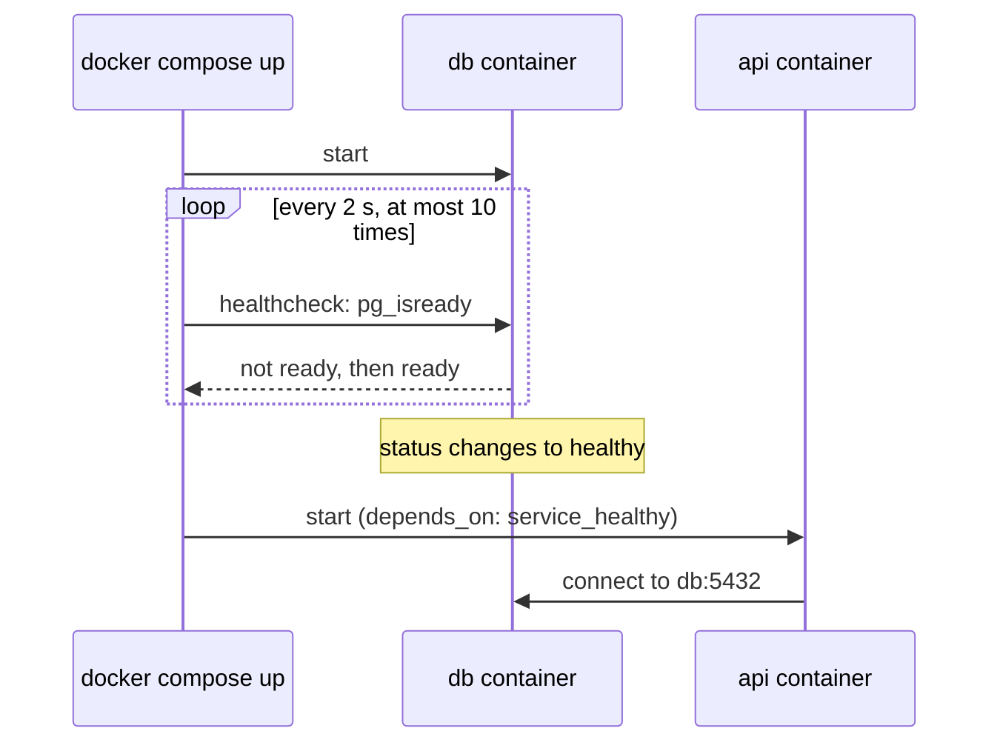

## 1. The question this idea answers

The image builds. You start a container, and `curl` says "connection refused". Or the container stops at once. Or it restarts again and again. Then you need two containers, the API and PostgreSQL, and the API starts before the database is ready.

How do you run a container correctly, read what it says, find the cause of a startup failure, and start several services together?

## 2. Mental model

> [!analogy] A sealed room with one door and one speaker
> A running container is a sealed room. Your program works inside it.
>
> - **The door is a port mapping.** `-p 8000:8000` connects door 8000 of your computer to door 8000 of the room. If the program inside listens at another door, or listens only to people inside the room, nobody outside gets in.
> - **The notes under the door are environment variables.** You pass them in when the room opens.
> - **The speaker is the log.** Everything that the program prints to stdout and stderr comes from it, and `docker logs` replays it.
>
> Compose is a plan for a small building with several rooms, a hallway between them and a rule for which room opens first.
>
> **Where it stops working:** a real room has one door. A container can publish many ports. And the hallway in Compose has its own names: one container reaches another by its service name, such as `db`, not by `localhost`.

## 3. Terms

| Term | Plain meaning |
|---|---|
| port mapping | `-p HOST:CONTAINER`. It forwards a port of your computer to a port inside the container. |
| bind address | The network address that a server listens on. `127.0.0.1` accepts only local connections. `0.0.0.0` accepts connections on every network interface. |
| `localhost` | The name for your own machine. Inside a container, it means the container itself. |
| log | The stdout and stderr output of the container's main process. |
| exit code | The number that the main process returned when it stopped. |
| restart policy | A rule that tells Docker to start a stopped container again, for example `unless-stopped`. |
| Compose | A tool that starts several containers from one YAML file, `compose.yaml`. |
| service | One entry in `compose.yaml`: an image plus its settings. Each service gets a network name. |
| healthcheck | A command that Docker runs inside the container again and again to decide if the service works. |
| `depends_on` | A Compose setting for start order between services. |
| named volume | Storage that Docker manages by name. Compose keeps it when the containers stop. |
| interpolation | Compose fills `${NAME}` in the YAML from your environment or a `.env` file. |

## 4. How it works

### 4.1 The run command, part by part

```bash
docker run -d --name api -p 8000:8000 -e DATABASE_URL=postgresql://app:secret@db:5432/notes notes-api:3
```

| Part | Meaning |
|---|---|
| `-d` | Run in the background (detached) |
| `--name api` | A fixed name, so that `docker logs api` works |
| `-p 8000:8000` | Your port 8000 goes to the container's port 8000 |
| `-e KEY=value` | Set one environment variable |
| `--env-file app.env` | Set every variable from a file (one `KEY=value` per line) |
| `--rm` | Remove the container when it stops |
| `notes-api:3` | The image |

The container's main process must listen on the container side of the port mapping, on address `0.0.0.0`. Both conditions matter. Section 4.3 shows both failures.

### 4.2 Read the logs first

A container prints its logs to stdout and stderr. Docker keeps them.

| Command | Use |
|---|---|
| `docker logs api` | All output so far |
| `docker logs -f api` | Follow new output live |
| `docker logs --tail 50 api` | The last 50 lines |
| `docker ps -a` | Status and exit code of every container, also stopped ones |
| `docker inspect api` | Every setting and state value, as JSON |
| `docker exec -it api sh` | Open a shell inside a running container |

> [!key] Logs before guesses
> For a container that fails, read `docker ps -a` (the status and exit code) and `docker logs` before you change anything. The cause is in the logs almost every time.

### 4.3 The usual startup failures, measured

A sandbox run on 2026-10-19 (Docker Engine 29.8.2) reproduced four failures with the `notes-api` image of lesson 9.2.

**1. A missing environment variable.** The app checks `DATABASE_URL` at import time.

```text
$ docker run --rm notes-api:3
ERROR notes-api DATABASE_URL is not set. Set it with -e DATABASE_URL=... and start again.
$ echo $?
1
```

This is the good kind of failure: fast, one line and a clear fix.

**2. The server listens on 127.0.0.1 inside the container.**

```text
$ docker run -d --rm -p 8001:8000 -e DATABASE_URL=x notes-api:3 fastapi run app/main.py --host 127.0.0.1 --port 8000
$ curl -s -m 3 -o /dev/null -w "%{http_code}\n" localhost:8001/health
000
curl exit 56
```

The log said `Uvicorn running on http://127.0.0.1:8000`. Inside the container, `127.0.0.1` means the container itself. The port mapping arrives on the container's network interface, not on its loopback. So the server never saw the request. The fix is `--host 0.0.0.0`.

**3. The port mapping points at the wrong container port.**

```text
$ docker run -d --rm --name p1 -p 8002:80 -e DATABASE_URL=x notes-api:3
$ curl -s -m 3 -o /dev/null -w "%{http_code}\n" localhost:8002/health
000
$ docker port p1
80/tcp -> 0.0.0.0:8002
```

The app listened on 8000, and the mapping went to 80. `docker port` shows the mapping. Compare it with the port in the log line.

**4. A restart loop.** A restart policy starts the failing container again and again:

```text
$ docker run -d --name loop1 --restart unless-stopped notes-api:3
(8 seconds later)
$ docker ps -a --filter name=loop1 --format '{{.Status}}'
Up 1 second
$ docker inspect loop1 --format 'RestartCount={{.RestartCount}}'
RestartCount=4
```

"Up 1 second" looks healthy, but the restart count tells the truth. The log held the same error line four times.

| Symptom | First check | Usual cause |
|---|---|---|
| Container exits at once | `docker ps -a` (exit code), `docker logs` | Missing variable, import error, wrong command |
| `connection refused` or reset | Log line "running on ...", `docker port` | Bind address `127.0.0.1`, wrong container port |
| Restarts again and again | `RestartCount` in `docker inspect` | The same startup error, hidden by the restart policy |
| Works locally, fails in the container | `docker exec -it ... sh`, then check files and variables | A missing file, library or variable in the image |
| `docker stop` takes 10 s | `CMD` form in the Dockerfile | Shell-form `CMD` (lesson 9.2) |

### 4.4 Compose: the API and PostgreSQL together

The sandbox ran this `compose.yaml`. The image names are the sandbox's local images. In your project, the database image is `postgres` with a pinned version from Docker Hub.

```yaml
services:
  db:
    image: l0lab/postgres:16
    environment:
      POSTGRES_USER: app
      POSTGRES_PASSWORD: ${POSTGRES_PASSWORD:?set POSTGRES_PASSWORD in .env}
      POSTGRES_DB: notes
    healthcheck:
      test: ["CMD", "pg_isready", "-U", "app", "-d", "notes", "-h", "127.0.0.1"]
      interval: 2s
      timeout: 3s
      retries: 10
    volumes:
      - pgdata:/var/lib/postgresql/data

  api:
    image: notes-api:compose
    environment:
      DATABASE_URL: postgresql://app:${POSTGRES_PASSWORD}@db:5432/notes
    ports:
      - "8000:8000"
    depends_on:
      db:
        condition: service_healthy

volumes:
  pgdata:
```

Line by line:

| Part | What it does | Why |
|---|---|---|
| `services: db:` and `api:` | Two containers | One concern per container |
| `${POSTGRES_PASSWORD:?...}` | Read the password from the environment or `.env`. Stop with this message if it is missing. | No password in the committed file |
| `healthcheck` with `pg_isready` | Docker asks PostgreSQL every 2 s if it accepts connections | A running container is not yet a ready database |
| `volumes: - pgdata:/var/lib/postgresql/data` | Keep the database files in a named volume | The data survives `docker compose down` |
| `@db:5432` in `DATABASE_URL` | The API reaches the database by its service name | Inside the Compose network, `localhost` is the API container itself |
| `ports: - "8000:8000"` | Publish only the API | The database stays private to the Compose network |
| `depends_on` with `condition: service_healthy` | Start the API only after the healthcheck passes | Without it, the API can start before the database accepts connections |

The Docker docs explain the last row (checked on 2026-10-19): "On startup, Compose does not wait until a container is 'ready', only until it's running." The condition values are:

| Condition | The dependent service starts when |
|---|---|
| `service_started` | The dependency's container is running |
| `service_healthy` | The dependency passes its healthcheck |
| `service_completed_successfully` | The dependency ran to its end with exit code 0, for example a migration job |




The sandbox run of this file:

```text
 Container notes-api-db-1 Started
 Container notes-api-db-1 Waiting
 Container notes-api-db-1 Healthy
 Container notes-api-api-1 Starting
 Container notes-api-api-1 Started
$ curl -s localhost:8000/health/db
{"db":1}
$ docker compose logs api
api-1  | INFO notes-api database ok: PostgreSQL 16.15 ...
api-1  | INFO:     Application startup complete.
```

The API checks the database once in its lifespan startup. So "database ok" in the log proves that the order worked.

> [!note] The race did not show in this run
> The sandbox also ran the file with a plain `depends_on: [db]`, without a condition. The API still connected, because the small local database started in about 1.5 s, and the API took longer to import its packages. The race is real but depends on timing. A larger database, a slower disk or a first-time initialization makes it appear. Use `service_healthy` so that the order does not depend on luck.

A missing password stops Compose before any container starts:

```text
$ docker compose config
error while interpolating services.db.environment.POSTGRES_PASSWORD: required variable POSTGRES_PASSWORD is missing a value: set POSTGRES_PASSWORD in .env
```

### 4.5 Data: down vs down -v

The sandbox wrote one row, then stopped and started the stack:

```text
$ docker compose exec db psql ... -c "create table t(x int); insert into t values (42);"
INSERT 0 1
$ docker compose down
$ docker compose up -d
$ docker compose exec db psql ... -t -c "select x from t;"
 42
$ docker compose down -v
$ docker compose up -d
$ docker compose exec db psql ... -t -c "select x from t;"
ERROR:  relation "t" does not exist
```

| Command | Containers | Network | Named volumes (your data) |
|---|---|---|---|
| `docker compose stop` | Stopped, kept | Kept | Kept |
| `docker compose down` | Removed | Removed | Kept |
| `docker compose down -v` | Removed | Removed | **Deleted** |

> [!trap] -v deletes the database
> `docker compose down -v` removes the named volumes. On your laptop that is a clean reset. On a shared machine it is data loss. Read the command twice before you press Enter.

### 4.6 The Compose commands you use daily

| Command | Use |
|---|---|
| `docker compose up -d` | Start all services in the background |
| `docker compose up -d --build` | Rebuild images first, then start |
| `docker compose ps` | Status of each service, with health |
| `docker compose logs -f api` | Follow the logs of one service |
| `docker compose exec db psql -U app -d notes` | Run a command in a running service |
| `docker compose config` | Print the final YAML after interpolation. Use it to find YAML and variable errors. |
| `docker compose down` | Stop and remove containers and the network, keep volumes |

## 5. Exercises

Hints come in three levels in chat: idea, pseudocode, partial code.

**Exercise 9.3.1: break it four ways.** Runs in: your local practice project.

With your image from exercise 9.2.1, reproduce the four failures of section 4.3.

Acceptance tests:

- For each failure, you saved the exact log line or `curl` output, and the one command that showed the cause.
- For each failure, you wrote the fix and showed that it works.

**Exercise 9.3.2: the stack in Compose (the M0.7 Compose part).** Runs in: your local practice project.

Write `compose.yaml` for your API and PostgreSQL. Use the official `postgres` image with a pinned version.

Acceptance tests:

- The password comes from `.env`, and `.env` is in `.gitignore` and `.dockerignore`.
- `docker compose config` fails with a clear message when the password is missing.
- The API starts only after the database healthcheck passes. The API log shows a successful database check at startup.
- A row that you insert survives `docker compose down` and `up`. You also showed that `down -v` removes it.
- The database port is not published to your computer, and you can explain why.

## 6. Common mistakes

1. **The server listens on `127.0.0.1` inside the container.** The port mapping cannot reach it. Listen on `0.0.0.0`.
2. **`localhost` in the database URL inside Compose.** It points at the API container itself. Use the service name, such as `db`.
3. **`depends_on` without a condition.** It waits only until the database container runs, not until it accepts connections.
4. **Passwords written into `compose.yaml`.** The file is committed. Use `${VAR}` and a `.env` file that Git ignores.
5. **A restart policy that hides a crash.** "Up 1 second" is not healthy. Check the restart count and the logs.
6. **`docker compose down -v` by habit.** It deletes your database volume.
7. **Changing settings before reading the logs.** Read `docker ps -a` and `docker logs` first.

## 7. One-minute explanation

`docker run` starts a container from an image. `-p HOST:CONTAINER` connects a port of your computer to a port inside, and `-e` or `--env-file` passes configuration. The server inside must listen on `0.0.0.0` and on the container port of the mapping. Otherwise you get "connection refused", as the sandbox showed. When something fails, read `docker ps -a` for the exit code and `docker logs` for the cause before you change anything. A restart policy can hide a crash loop, so check the restart count. Compose starts several services from one `compose.yaml`. Services reach each other by service name. Compose waits only until a dependency runs, so add a healthcheck and `condition: service_healthy`. Keep the database in a named volume, which survives `down` but not `down -v`.

## 8. Check questions

```check
{
  "question": "The log says 'Uvicorn running on http://127.0.0.1:8000' and docker run used -p 8000:8000. curl localhost:8000 fails. Why, and what is the fix?",
  "answer": "Inside the container, 127.0.0.1 is the container's own loopback. Traffic from the port mapping arrives on the container's network interface, so a server bound to 127.0.0.1 never sees it. Fix: start the server with --host 0.0.0.0."
}
```

```check
{
  "question": "In Compose, the API uses DATABASE_URL=postgresql://app:pw@localhost:5432/notes and cannot connect, but the db service is healthy. What is wrong?",
  "answer": "Inside the API container, localhost means the API container itself, where no database runs. Services on the Compose network reach each other by service name, so the host part must be db: postgresql://app:pw@db:5432/notes."
}
```

```check
{
  "question": "What does depends_on with condition: service_healthy add, compared with a plain depends_on list?",
  "hint": "Running vs ready.",
  "answer": "A plain depends_on waits only until the database container is running. Compose does not wait until it is ready. With service_healthy, Compose starts the API only after the database passes its healthcheck, for example pg_isready, so the API does not start before the database accepts connections."
}
```

```check
{
  "question": "docker ps shows 'Up 1 second' for a container every time you look. Is it healthy? What do you check?",
  "answer": "Probably not. A restart policy may be starting a crashing container again and again. Check RestartCount with docker inspect, and read docker logs for the repeated startup error."
}
```

## 9. Links

- Previous: [9.2 Dockerfiles, layers, caching and uv](/notes/ai/ai-engineering/01-software-engineering-fundamentals/m09-docker-and-deployment/l2-dockerfiles-layers-and-uv)
- Next: [9.4 Deploying to a public URL and production config](/notes/ai/ai-engineering/01-software-engineering-fundamentals/m09-docker-and-deployment/l4-deploying-and-production-config)
- PostgreSQL in a container, in more detail: [Local PostgreSQL with Docker](/notes/databases/postgres/05-local-setup/l1-local-postgres-with-docker)
- Connecting the app: [6.4 Connecting Python and FastAPI to PostgreSQL](/notes/ai/ai-engineering/01-software-engineering-fundamentals/m06-postgresql/l4-connecting-python-to-postgres)
- [Glossary](/notes/ai/ai-engineering/glossary)

Sources (checked on 2026-10-19): [Control startup and shutdown order in Compose](https://docs.docker.com/compose/how-tos/startup-order/), [Building best practices (Docker docs)](https://docs.docker.com/build/building/best-practices/).
