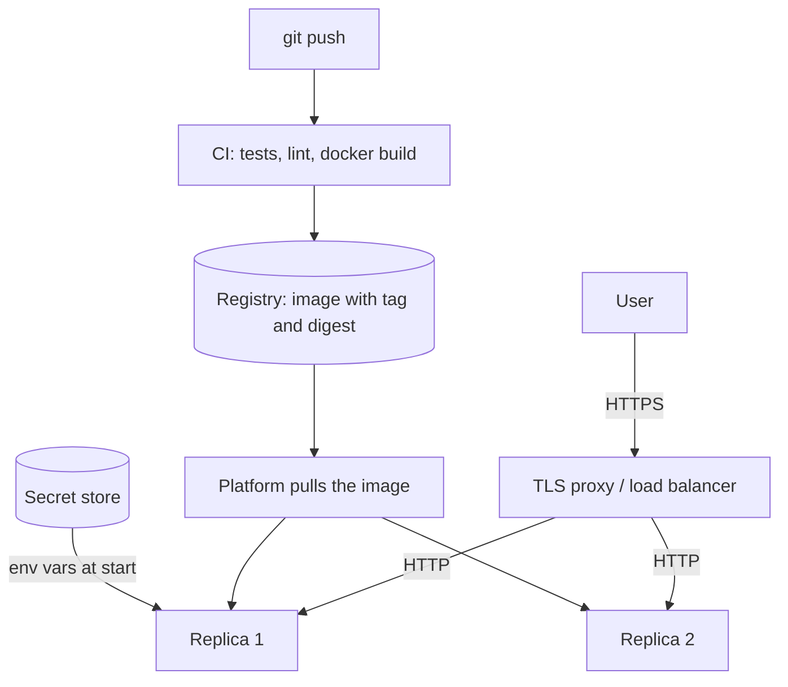

## 1. The question this idea answers

The service runs in a container on your laptop. The capstone needs it at a public HTTPS address that another person can call. Production is a different place. It has other config values and real secrets. A proxy sits in front of your app, several copies of it run, and nobody is at the keyboard when it fails.

So four questions follow:

1. How does an image get from your laptop to a public URL?
2. Where do config values and secrets come from in production?
3. What changes when a proxy sits in front of your app?
4. How do you find the cause of a failure that happens only in production?

## 2. Mental model

> [!analogy] Your sealed room moves into a hotel
> In lesson 9.3, a container was a sealed room on your own street. Deployment moves the room into a large hotel.
>
> - **Reception** receives every guest at the main door, checks the lock (HTTPS) and walks the guest to your room. This is the TLS proxy or load balancer.
> - **The hotel safe** holds the keys and passwords. Staff give your room the ones it needs when it opens. This is the platform's secret store.
> - **The front desk phone** calls each room every few seconds: "Are you OK?" If a room does not answer, the hotel opens a new one. These are health checks.
>
> **Where it stops working:** a hotel room keeps its contents overnight. The platform can stop, move or copy your container at any time, without warning. So the container must hold no data and no state that it cannot lose.

## 3. Terms

| Term | Plain meaning |
|---|---|
| deployment | The steps that put a new version of the service in front of real users. |
| platform | The service that runs your containers for you, for example a managed container service of a cloud provider. |
| public URL | An address on the internet, such as `https://notes.example.com`. |
| TLS | The encryption under HTTPS. |
| TLS termination proxy | A server in front of your app. It handles HTTPS and forwards plain HTTP to your container. |
| load balancer | A proxy that spreads requests over several copies of your service. |
| proxy headers | Headers such as `X-Forwarded-Proto` and `X-Forwarded-For` that a proxy adds to tell the app the original scheme and client address. |
| replica | One running copy of the same service. |
| config | Everything that changes between deploys: URLs, feature flags, log levels, credentials. |
| secret | A config value that gives access: a password, an API key, a token. |
| secret store | A platform service that keeps secrets and gives them to containers at run time. |
| health endpoint | A route that a platform calls to decide if a container works. |
| liveness, readiness | Liveness: "the process runs". Readiness: "the process can serve requests now", for example the database is reachable. |
| rollback | Running the previous version again after a bad deploy. |

## 4. How it works

### 4.1 The path from Git to a public URL



1. You push a commit.
2. Continuous integration runs the tests and builds the image.
3. The image goes to a registry with a tag (for example the commit hash) and a digest.
4. The platform pulls that image and starts one or more replicas.
5. The platform gives each replica its config and secrets as environment variables.
6. A proxy receives HTTPS traffic at the public URL and forwards it to a healthy replica.

The image is the same in every step. Only the config changes.

### 4.2 Choosing a platform for the capstone

| Kind | Examples | Fits when |
|---|---|---|
| Container platform as a service | Platforms that deploy a Dockerfile or an image from a Git repository | You want a public URL with the least setup |
| Managed containers on a large cloud | Google Cloud Run, Azure Container Apps, Amazon ECS on Fargate | You want to learn a cloud that employers use |
| A data platform with app hosting | Databricks Apps (section 4.9) | Your work runs on that platform |
| Your own virtual machine | A small cloud VM with Docker | You want to see every layer, and you accept more work |

Prices, free tiers and limits change often. Check them on the day that you choose. For the capstone, any choice that gives a public HTTPS URL and environment-variable config is enough.

### 4.3 Config lives in the environment

The Twelve-Factor App defines config as "everything that is likely to vary between deploys" (12factor.net, checked on 2026-10-19). It asks for "strict separation of config from code". Its answer: "The twelve-factor app stores config in environment variables." Its test is useful: could you publish the code today "without compromising any credentials"?

| Value | Development | Staging | Production |
|---|---|---|---|
| `DATABASE_URL` | Local Compose database | Staging database | Production database |
| `LOG_LEVEL` | `DEBUG` | `INFO` | `INFO` |
| `EXTERNAL_API_BASE_URL` | A fake server | The vendor's test system | The vendor's live system |
| The image | The same digest | The same digest | The same digest |

Two rules make this work:

1. **Read config in one place.** A settings object (lesson 4.3) reads and validates every variable at startup.
2. **Fail fast.** A missing or invalid value stops the app at startup with one clear line, as in lesson 9.3. A clear failure at deploy time is better than a strange error at 3 a.m.

### 4.4 Secrets

| Rule | Why |
|---|---|
| Never in Git | Git keeps every old version. A deleted secret stays in the history. |
| Never in the image | Anyone who can pull the image can read every layer, `ENV` lines included. |
| Never in logs | Logs go to many people and tools. Log the name of a variable, never its value. |
| From the platform's secret store, at run time | The secret is not in code or images, and access is controlled |
| One secret per purpose, with the smallest rights | A leak of one key opens only one door |
| Rotate after a leak, first | Cleaning Git history does not stop someone who already copied the key (lesson 7.3) |

A `.env` file is for your own machine only. Do not commit it to Git, and do not copy it into the image (lessons 7.3 and 9.2).

### 4.5 Behind a TLS proxy

Most platforms put a proxy in front of your container. The proxy speaks HTTPS to the user and plain HTTP to your app. Without help, your app thinks that every request came over HTTP from the proxy's address. So redirects and generated links use `http://`, and every log line shows the proxy as the client.

The FastAPI container docs say (checked on 2026-10-19): add `--proxy-headers`, to "tell Uvicorn (through the FastAPI CLI) to trust the headers sent by that proxy". There is a second half. The app must trust those headers only from the proxy, because any client can send a fake `X-Forwarded-For`.

A sandbox test (FastAPI 0.149.0, uvicorn 0.54.0, 2026-10-19) sent `X-Forwarded-Proto: https` and `X-Forwarded-For: 203.0.113.7` to a route that returns what the app sees. The request reached the container from the Docker bridge address 172.17.0.1.

| Start options | `request.url.scheme` | `request.client.host` |
|---|---|---|
| `fastapi run ...` (no proxy flag) | `http` | `172.17.0.1` |
| `fastapi run ... --proxy-headers` | `http` | `172.17.0.1` |
| `fastapi run ... --proxy-headers --forwarded-allow-ips '*'` | `https` | `203.0.113.7` |

Why did the second row change nothing? Two facts from the sandbox:

1. `fastapi run --help` shows proxy headers on by default: "[default: proxy-headers]".
2. The uvicorn 0.54.0 source sets the trusted addresses to the variable `FORWARDED_ALLOW_IPS`, or `"127.0.0.1,::1"` when it is not set.

So uvicorn reads proxy headers only from a proxy on the same machine. Behind a platform proxy at another address, set `--forwarded-allow-ips` to that proxy's address or range. Use `'*'` only when the platform guarantees that nothing but its proxy can reach your container.

### 4.6 Health endpoints

Platforms call a route again and again to decide what to do with a replica.

| Kind | Example route | It checks | The platform's action on failure |
|---|---|---|---|
| Liveness | `GET /health` | The process answers HTTP | Restart the container |
| Readiness | `GET /health/db` | The app can reach its database | Stop sending traffic until it passes |

Keep liveness cheap and independent of other systems. If liveness checks the database, a short database outage makes the platform restart every replica at once.

### 4.7 One process per container

The FastAPI docs say: when a cluster handles replication, "you probably would want to have **a single (Uvicorn) process per container**". The platform adds replicas when traffic grows. The `--workers` option is for a single server without such a platform.

### 4.8 Debugging a failure that happens only in production

Use the same order every time. Each step is cheaper than the next.

1. **Read the logs** of the failing replica. Most causes are there.
2. **Check that every config variable exists.** Compare the names, never print the values.
3. **Check which image runs.** Compare the tag and digest with the one that you tested.
4. **Check the network contract.** Host `0.0.0.0`, the port that the platform expects, the health-check path.
5. **Check dependencies.** Can the container reach the database and the external API from inside the platform network?
6. **Check resource limits.** Memory and CPU limits are often smaller than your laptop.

The last step has a clear sign. A sandbox container with a 64 MB memory limit tried to allocate 300 MB:

```text
$ docker run --name oom1 --memory 64m --memory-swap 64m notes-api:3 python -c "x = bytearray(300 * 1024 * 1024)"
$ docker inspect oom1 --format 'exit={{.State.ExitCode}} OOMKilled={{.State.OOMKilled}}'
exit=137 OOMKilled=true
```

| Symptom in production | Most likely cause | Check |
|---|---|---|
| Exits at start, works locally | A variable missing on the platform | Logs, list of variable names |
| Platform says "unhealthy", logs look fine | Wrong port, host `127.0.0.1`, or wrong health path | Startup log line, platform port setting |
| Exit code 137, `OOMKilled=true` | Memory limit | Platform memory setting, memory use at startup |
| Exit code 137 after a stop request, no shutdown log | Shell-form `CMD` | The Dockerfile (lesson 9.2) |
| Links and redirects use `http://` | Proxy headers not trusted | Section 4.5 |
| Timeouts to the database | Network rules, wrong host name | Connect from inside the platform |

### 4.9 Databricks Apps as a work target

The Databricks Apps overview (last updated 2026-09-16, checked on 2026-10-19) says that Databricks Apps "enables developers to build and deploy secure data and AI applications directly on the Databricks platform". Facts from that page:

- "Apps run on the serverless platform."
- It names Streamlit, Dash and Gradio as popular Python frameworks. It says that Node.js frameworks such as React, Angular, Svelte and Express are also supported.
- It lists Unity Catalog, Databricks SQL and OAuth as integrations.
- "Apps are billed per hour of compute time while running, based on provisioned capacity."

The overview page does not cover the app configuration file or the limits. The notes [Databricks Apps](/notes/platforms/databricks/01-apps/l1-databricks-apps) and [App resources and secrets](/notes/platforms/databricks/01-apps/l2-app-resources-and-secrets) go deeper. The habits of this lesson stay the same there: config from the environment, secrets from a store, health checks and logs first.

### 4.10 Rollback

Keep the previous image in the registry. Deploy by an exact tag or digest, not by `latest`. Then a rollback is one step: run the previous digest again. A database change that the old version cannot read breaks this. So make schema changes that the old and the new version can both use.

## 5. Exercises

Hints come in three levels in chat: idea, pseudocode, partial code.

**Exercise 9.4.1: a public URL.** Runs in: your local practice project and a platform of your choice.

Deploy the service from exercises 9.2.1 and 9.3.2 to a public HTTPS URL, with a managed PostgreSQL database.

Acceptance tests:

- `https://<your-url>/docs` returns 200.
- A `curl` round trip against the public URL creates, reads, updates and deletes one note.
- All config comes from environment variables. `docker history` and `docker inspect` of the image show no secret.
- The logs show one line per request with method, path, status and duration.

**Exercise 9.4.2: a production-only failure on purpose.** Runs in: your platform.

Deploy once with one required variable missing.

Acceptance tests:

- You found the cause from the platform logs alone, and you saved the log line.
- You recorded the order of checks that you used, and how long each took.

**Exercise 9.4.3: proxy headers.** Runs in: your platform.

Add a temporary route that returns `request.url.scheme` and `request.client.host`.

Acceptance tests:

- You recorded the values before and after you set `--forwarded-allow-ips` correctly for your platform.
- You can explain why `'*'` is safe or unsafe on your platform.
- You removed the route afterward.

## 6. Common mistakes

1. **A different image per environment.** Build once. Change only the config.
2. **Secrets in the image or in Git.** Use the platform's secret store, and rotate a key that leaked.
3. **Trusting forwarded headers from anyone.** A client can fake `X-Forwarded-For`. Trust only your proxy's address.
4. **A liveness check that depends on the database.** One database outage restarts every replica.
5. **State in the container.** The platform can replace a replica at any time. Keep state in the database.
6. **Deploying by `latest`.** You cannot say which version runs, and a rollback has no target.
7. **Guessing before reading the logs.** Follow the debug order of section 4.8.

## 7. One-minute explanation

Deployment moves one image through CI and a registry to a platform that runs replicas behind a TLS proxy. The image stays the same in every environment. Only the config changes, and config lives in environment variables, read and checked once at startup, so a missing value fails fast. Secrets come from the platform's secret store at run time, never from Git, the image or the logs. Behind a proxy, the app must trust proxy headers from the proxy only. In the sandbox, uvicorn trusted them only from 127.0.0.1 until `--forwarded-allow-ips` was set. Give the platform a cheap liveness route and a readiness route. When production fails, read the logs, then check config names, the image digest, the network contract, dependencies and resource limits, in that order.

## 8. Check questions

```check
{
  "question": "Your container works locally but crashes at startup on the platform. List the first four things that you check, in order.",
  "answer": "1. The logs of the failing replica. 2. That every required config variable exists on the platform (names, not values). 3. That the running image tag or digest is the one you tested. 4. The network contract: host 0.0.0.0, the port the platform expects and the health-check path. Then dependencies and resource limits."
}
```

```check
{
  "question": "Behind the platform's HTTPS proxy, your app builds redirect links with http://, and every log line shows the proxy's address as the client. What is missing, and what is the security trap in the fix?",
  "answer": "The app does not use the X-Forwarded-Proto and X-Forwarded-For headers from the proxy. Uvicorn trusts them only from 127.0.0.1 and ::1 by default, so set --forwarded-allow-ips to the proxy's address. The trap: trusting the headers from everyone ('*') lets any client fake its address and scheme, unless only the proxy can reach the container."
}
```

```check
{
  "question": "Why should a liveness health check not query the database?",
  "hint": "What does the platform do when liveness fails?",
  "answer": "When liveness fails, the platform restarts the container. If liveness depends on the database, a short database outage makes every replica fail liveness at once, and the platform restarts all of them, which makes the outage worse. Check the database in a readiness route, which only stops traffic to that replica."
}
```

```check
{
  "question": "A replica dies with exit code 137 and docker inspect shows OOMKilled=true. What happened, and what do you change?",
  "answer": "The process used more memory than the container's limit, so the kernel killed it with SIGKILL (137 = 128 + 9). Raise the platform's memory limit, or reduce memory use, for example at startup or for large responses."
}
```

## 9. Links

- Previous: [9.3 Running containers, logs, startup failures and Compose](/notes/ai/ai-engineering/01-software-engineering-fundamentals/m09-docker-and-deployment/l3-running-logs-and-compose)
- Next module: [10.1 Capstone spec, milestones and checklist](/notes/ai/ai-engineering/01-software-engineering-fundamentals/m10-capstone/l1-capstone-spec-and-checklist)
- Settings from the environment: [4.3 Dependencies, lifespan, settings and middleware](/notes/ai/ai-engineering/01-software-engineering-fundamentals/m04-fastapi-services/l3-dependencies-lifespan-config-and-middleware)
- Keys and the `Authorization` header: [3.3 Headers, parameters, bodies, cookies and auth](/notes/ai/ai-engineering/01-software-engineering-fundamentals/m03-http-rest-json/l3-headers-parameters-bodies-and-auth)
- Identity headers behind a proxy: [Identity headers behind a proxy](/notes/software-engineering/security-and-operations/01-access-control/l2-identity-headers-behind-a-proxy)
- Operations for model services: [Production operations](/notes/ai/llm-systems/05-cloud-hosting/l8-production-operations)
- [Glossary](/notes/ai/ai-engineering/glossary)

Sources (checked on 2026-10-19): [FastAPI in Containers](https://fastapi.tiangolo.com/deployment/docker/), [The Twelve-Factor App: Config](https://12factor.net/config), [Databricks Apps](https://docs.databricks.com/aws/en/dev-tools/databricks-apps/).
