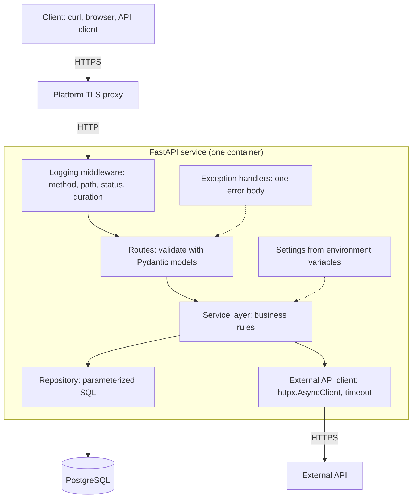

## 1. The question this idea answers

Nine modules taught separate skills. A real service needs all of them at once: Python, HTTP, FastAPI, PostgreSQL, Git, a coding agent, Docker and a deployment. Can you put them together into one service that another person can clone, run, test, call and inspect?

The capstone answers that question. The product has no AI inside it. So no model can hide a weak foundation. Every later level builds an AI service on top of exactly this kind of service.

## 2. Mental model

> [!analogy] A driving test after driving lessons
> During lessons, an instructor sits next to you and can touch the wheel. In the test, the examiner watches you drive and asks you to explain each choice.
>
> In this capstone, the coding agent is the instructor. It may write real parts of the code. But the examiner checks you: can you explain the architecture, read every diff, run every check and find the agent's mistakes?
>
> **Where it stops working:** in a driving test, the instructor leaves the car. Here the agent stays and writes code. What is tested is not "who typed it", but whether you understand, verify and own every line.

## 3. Terms

| Term | Plain meaning |
|---|---|
| capstone | The final project of a level. It uses every skill of the level together. |
| milestone | A checkpoint in the project with a clear output and a check. |
| definition of done | The list of conditions that must all be true before the project counts as finished. |
| acceptance test | A test that proves one condition of the definition of done. |
| architecture diagram | A drawing of the parts of the system and how data flows between them. |
| external API | A service that another organization runs, which your service calls over HTTP. |
| mock | A fake object that replaces a real dependency in a test, for example a fake HTTP transport. |
| smoke test | A short check against a deployed system that shows its main path works. |
| agent-failure write-up | A short report of one case where the coding agent was wrong, and how you found and fixed it. |

## 4. How it works

### 4.1 The spec

**Goal.** Build and deploy a complete service with Python, FastAPI, PostgreSQL, Git, Docker and a real deployment. The product has no LLM or AI dependency. You may use a coding agent while you build it.

**Requirements.**

1. Pick a realistic small domain, for example tasks, bookmarks, expenses, inventory, notes or support tickets.
2. Expose several REST endpoints with validated request and response schemas and persistent create, read, update and delete operations.
3. Integrate at least one external API, with async calls where they make sense.
4. Handle validation errors, missing resources, failures of the external service, and unexpected server errors.
5. Add automated tests, configuration through environment variables, and useful logging.
6. Keep a clean Git repository with a README that explains setup and usage.
7. Package the service with Docker and deploy it to a public URL.
8. Check the deployed API through its OpenAPI docs, `curl` or an API client.

**Process requirements.**

1. Use a coding agent for real parts of the build. "No AI" applies only to the deployed product.
2. Read the Git diff of every meaningful generated change before you accept it.
3. Verify generated code with tests, type checking, linting, logs and manual API calls.
4. Explain the architecture and the key code paths without the agent's help.
5. Write a report on one case where the agent was wrong. Say what it proposed, why it was wrong, how you found the problem, what you changed and the lesson.

**Deliverable.** A real service that another person can clone, run, test, call over HTTP and inspect, with no AI component that hides weak fundamentals.

**Stretch goals.** The roadmap site lists none for this level.

### 4.2 Definition of done

The project is done when every box is true.

- [ ] A fresh clone plus the README steps gives a running stack (API and PostgreSQL) in under 10 minutes on another machine.
- [ ] `uv run pytest` passes, with tests for 400, 404 and 422, a mocked external-API failure and a 500 path with a safe body.
- [ ] Ruff and a type checker run clean, or every ignore line has a comment that says why.
- [ ] No secret is in the Git history. Config comes only from environment variables.
- [ ] The public URL serves `/docs`, and a `curl` create, read, update and delete round trip works against it.
- [ ] The logs show one line per request with method, path, status and duration.
- [ ] The agent-failure write-up and an architecture explanation in your own words are in the repository.

### 4.3 Architecture

The diagram shows a notes service as the example. Your domain changes the names, not the shape.



| Part | Job | Taught in |
|---|---|---|
| Routes | HTTP in, HTTP out. Validation with Pydantic. No SQL. | M4 |
| Service layer | Business rules. Calls the repository and the external client. | M1 (modules), M4 |
| Repository | All SQL, with parameters, never string formatting | M6 |
| External API client | One shared async client, created at startup, with a timeout | M2, M3, M4 |
| Exception handlers | Map every error to one safe JSON body | M4 |
| Settings | Read and check every environment variable at startup | M1, M4, M9 |
| Logging middleware | One line per request | M4 |

### 4.4 A repository layout that fits

```text
notes-service/
├── README.md
├── ARCHITECTURE.md          your explanation, in your own words
├── AGENT-FAILURE.md         the write-up of section 4.8
├── CLAUDE.md                or AGENTS.md (lesson 8.2)
├── pyproject.toml
├── uv.lock
├── Dockerfile
├── .dockerignore
├── compose.yaml
├── .env.example             variable names with fake values, committed
├── .gitignore               lists .env and .venv
├── src/notes_service/
│   ├── main.py              app, lifespan, middleware, handlers
│   ├── settings.py
│   ├── errors.py
│   ├── models.py            Pydantic request and response models
│   ├── routes/
│   ├── service.py
│   ├── repo.py
│   └── external.py
└── tests/
    ├── conftest.py
    ├── fakes.py
    ├── test_routes.py
    ├── test_errors.py
    └── test_external.py
```

This is one fitting layout, not the only one. Keep the boundaries: routes, service, repository and external client in separate modules.

### 4.5 Milestones

| # | Milestone | Module | Output | Check |
|---|---|---|---|---|
| 1 | Repository and tooling | M1, M7 | uv project, Git repository, `.gitignore`, first commit | `uv run pytest` runs (zero tests is fine) |
| 2 | Domain models and in-memory routes | M1, M3, M4 | Pydantic models, CRUD routes with a fake store | Route tests for 201, 200, 404, 422 |
| 3 | One error shape | M4 | Exception handlers, error model | Tests: 422 and 404 in your shape, 500 body without a traceback |
| 4 | PostgreSQL | M6 | Tables, repository with parameterized SQL, session per request | A Compose database and a test against it, or a fake repository in unit tests |
| 5 | External API | M2, M3, M4 | Shared `httpx.AsyncClient`, timeout, error mapping | Tests with `httpx.MockTransport`: success, timeout, 5xx |
| 6 | Config and logging | M1, M4 | Settings object, logging middleware | App stops at startup without a required variable. One log line per request. |
| 7 | Container | M9 | Two-stage Dockerfile, `compose.yaml` | The checks of exercises 9.2.1 and 9.3.2 |
| 8 | Deployment | M9 | A public URL | `/docs` returns 200. A `curl` CRUD round trip works. |
| 9 | Write-ups | M8 | `ARCHITECTURE.md`, `AGENT-FAILURE.md`, README | A friend follows the README on another machine in under 10 minutes |

Commit at the end of each milestone. Each commit message says why the change exists (lesson 7.3).

### 4.6 The error matrix

Requirement 4 asks for four kinds of failure. Each one needs a status, a body and a test.

| Case | Status | Body | Test |
|---|---|---|---|
| A required field is missing | 422 | Your error shape, not the framework's default shape | Send JSON without the field |
| A business rule fails, for example a title that is too long for your rule | 400 | Your error shape, with a clear message | Send the bad value |
| An unknown id | 404 | Your error shape | Request an id that does not exist |
| The external API times out | 504 | Your error shape. No stack trace. | `httpx.MockTransport` that raises a timeout |
| The external API returns 5xx | 502 | Your error shape | A mock that returns 503 |
| Any other exception | 500 | A generic message. No file paths, no "Traceback". The details go to the log only. | A route that raises `RuntimeError` in a test |

Lesson 3.2 explains why a timeout and a bad response from another service map to 504 and 502.

### 4.7 README skeleton

```markdown
# <Service name>

One paragraph: what the service does and for whom.

## Run it
1. Requirements: Docker, uv.
2. `cp .env.example .env` and set the values.
3. `docker compose up -d --build`
4. Open http://localhost:8000/docs

## Test it
`uv run pytest -q`
`uv run ruff check . && uv run mypy src`

## Configuration
| Variable | Required | Meaning |
|---|---|---|
| DATABASE_URL | yes | PostgreSQL connection string |

## API
The main routes, with one curl example each.

## Deployment
Where it runs, how a new version is deployed, how to return to the previous version.

## Design
A link to ARCHITECTURE.md.
```

### 4.8 The agent-failure write-up

Use this template for `AGENT-FAILURE.md`. One case is required. Exercises 8.1.2 and 8.4.2 are good sources.

```markdown
# Agent failure: <one-line title>

## What I asked
The prompt or task, word for word if possible.

## What the agent proposed
The diff, or the key lines of it.

## Why it was wrong
The rule, test, requirement or fact that it broke.

## How I found it
The exact check: a failing test, a review of the diff, a log line, a manual curl call.
How long the mistake lived before I found it.

## What I changed
The final diff, and the test that now protects against this mistake.

## Lesson
One or two sentences: what I now check every time, or what I added to CLAUDE.md, a Skill or a hook.
```

> [!example] Worked example: a short write-up
> **What I asked:** "Make `GET /notes/{id}` return 404 for an unknown id."
>
> **What the agent proposed:** it wrapped the route body in `try: ... except Exception: raise HTTPException(404)`.
>
> **Why it was wrong:** every error became a 404, also a lost database connection. The client then saw "not found" for a server failure, and the log showed nothing.
>
> **How I found it:** while reading the diff, I asked what happens when the repository raises an error that is not "missing". A test with a fake repository that raises `ConnectionError` returned 404.
>
> **What I changed:** the repository returns `None` for a missing row, and the route raises 404 only for `None`. Other errors go to the 500 handler. The new test expects 500 for `ConnectionError`.
>
> **Lesson:** a broad `except Exception` in a diff is a review flag. I added it to my review Skill.

### 4.9 Explain it without help

Before you call the capstone done, explain each item aloud or in writing, with no notes and no agent. If you cannot, the item is not done.

- [ ] The path of one `POST` request from the client to the database row and back, naming each function.
- [ ] Why the HTTP client and the database pool are created once at startup and not per request.
- [ ] What happens in your code when the external API does not answer, and which status the client gets.
- [ ] Why the 500 handler logs the details but returns a generic body.
- [ ] Which index your main query uses, and how you proved it with `EXPLAIN ANALYZE`.
- [ ] Why your Dockerfile installs dependencies before it copies the code.
- [ ] Where each config value comes from in development and in production.
- [ ] How you would return to the previous version after a bad deploy.
- [ ] The agent's mistake in your write-up, and the check that now prevents it.

## 5. Exercises

Hints come in three levels in chat: idea, pseudocode, partial code.

**Exercise 10.1.1: the capstone.** Runs in: your capstone repository (it grows from your local practice project).

Build the service of section 4.1, milestone by milestone (section 4.5).

Acceptance tests: every box of section 4.2 and every box of section 4.9 is true. Ask another person to follow the README on their machine, and time it.

## 6. Common mistakes

1. **Starting with Docker or deployment.** Build the routes and tests first. Package a service that already works.
2. **A broad `except Exception` that hides failures.** Map the errors that you expect. Let the rest reach the 500 handler.
3. **A new HTTP client in every request.** Create one shared client in the lifespan.
4. **Real network calls in tests.** Use `httpx.MockTransport`. Tests must run offline and give the same result every time.
5. **Secrets in the repository "for now".** Git keeps them forever. Use `.env.example` with fake values.
6. **Accepting agent code that you cannot explain.** It fails the process requirements, even when the tests pass.
7. **A write-up that says only "the agent made a mistake".** Name the prompt and the diff. Name the check that found the mistake and the protection that you added.

## 7. One-minute explanation

The capstone of Level 0 is a deployed REST service with no AI inside it. It has CRUD routes with Pydantic validation and PostgreSQL behind a repository with parameterized SQL. It calls one external API through a shared async client with a timeout. It has one error shape for 400, 404, 422, 502, 504 and 500. Config comes from environment variables, and each request gets one log line. It ships as a Docker image to a public URL. A coding agent may write real parts of it. You read every diff, run every check and write a report on one case where the agent was wrong. It is done when another person can clone it, run it in under 10 minutes, run the tests and call the public URL. You must also explain every part without help.

## 8. Check questions

These are the self-check questions of the whole level.

```check
{
  "question": "Ten API calls each take 2 seconds. Explain why asyncio makes the total about 2 seconds, and what goes wrong if one call inside an async def uses a blocking library.",
  "answer": "Each call spends almost all its time waiting for the network. With asyncio, a coroutine returns control to the event loop at each await, so the loop starts all ten requests and they wait at the same time. The total is about the longest single call, 2 seconds. A blocking call inside async def holds the loop thread, so no other coroutine runs until it returns. The calls then run one after another, and every other request on that loop stalls. Use an async library or asyncio.to_thread for the blocking call."
}
```

```check
{
  "question": "A POST request times out, and you do not know if the server processed it. Can you retry it automatically? What would make a retry safe?",
  "answer": "Not blindly. POST is not idempotent, so a retry can create the resource twice. A retry is safe when the operation is idempotent: for example, the client sends an idempotency key that the server stores, so a repeated request with the same key returns the first result instead of creating a second resource. Another option is to check first whether the resource exists."
}
```

```check
{
  "question": "What is the difference between 401 and 403, and between 400 and 422 in a FastAPI app?",
  "answer": "401 Unauthorized: the request has no valid credentials, so the server does not know who you are. 403 Forbidden: the server knows who you are, but you have no permission for this action. In FastAPI, 422 is what request validation returns when the body or parameters do not match the declared model (wrong type, missing field). 400 is for a request that is well formed but breaks a rule that your code checks."
}
```

```check
{
  "question": "Why should a shared HTTP client or database engine be created at startup (lifespan) and not inside each request?",
  "answer": "Both keep pools of open connections. Creating one per request opens new TCP and TLS connections every time, which adds latency and can exhaust sockets or database connections under load. One shared object, created in the lifespan and closed at shutdown, reuses connections across requests and gives one place to set timeouts and limits."
}
```

```check
{
  "question": "Your query was fast with 100 rows and slow with 1 million. What do you check first, and what does an index cost you?",
  "answer": "Run EXPLAIN ANALYZE on the query and look for a sequential scan over the large table on the filter or sort columns. Then add an index that matches the WHERE and ORDER BY columns, in the right order, and check that the plan uses it. An index costs disk space and makes every INSERT, UPDATE and DELETE slower, because the index must change too."
}
```

```check
{
  "question": "Name one thing that belongs in CLAUDE.md or AGENTS.md, one that belongs in a Skill, and one that must be a hook. Why does the third one not work as a written instruction?",
  "answer": "CLAUDE.md or AGENTS.md: the test command, for example uv run pytest -q. A Skill: a review checklist that you start with /review-diff. A hook: blocking edits to .env. A written instruction is context that the model usually follows but can ignore. A PreToolUse hook runs on every matching tool call and blocks it, without the model deciding."
}
```

```check
{
  "question": "Your container works locally but crashes in production at startup. List the first four things that you check, in order.",
  "answer": "1. The logs of the failing container. 2. That every required environment variable exists in production (names, not values). 3. That the running image tag or digest is the one that you tested. 4. The network contract: the server listens on 0.0.0.0, on the port that the platform expects, with the right health-check path. Then dependencies and memory limits."
}
```

```check
{
  "question": "What does uv sync --locked protect you from, and why does the Docker guide install dependencies in a separate layer from your code?",
  "answer": "--locked fails when uv.lock does not match pyproject.toml, so a build never installs versions that nobody locked and reviewed. The dependencies change rarely and the code changes often. In a separate, earlier layer, the dependency install is a cache hit on most rebuilds, and only the code layer runs again."
}
```

## 9. Links

- The level map: [L0 roadmap](/notes/ai/ai-engineering/01-software-engineering-fundamentals/roadmap)
- Error responses: [4.2 Validation, status codes and error responses](/notes/ai/ai-engineering/01-software-engineering-fundamentals/m04-fastapi-services/l2-validation-and-error-responses)
- Tests for endpoints: [4.5 Testing endpoints and OpenAPI docs](/notes/ai/ai-engineering/01-software-engineering-fundamentals/m04-fastapi-services/l5-testing-and-openapi)
- Mock transports: [3.5 Inspecting APIs with curl and httpx](/notes/ai/ai-engineering/01-software-engineering-fundamentals/m03-http-rest-json/l5-inspecting-apis-with-curl-and-httpx)
- Indexes: [6.3 Indexes and EXPLAIN ANALYZE](/notes/ai/ai-engineering/01-software-engineering-fundamentals/m06-postgresql/l3-indexes-and-explain)
- The verification loop: [8.1 From autocomplete to coding agents](/notes/ai/ai-engineering/01-software-engineering-fundamentals/m08-ai-assisted-development/l1-from-autocomplete-to-agents)
- Deployment: [9.4 Deploying to a public URL and production config](/notes/ai/ai-engineering/01-software-engineering-fundamentals/m09-docker-and-deployment/l4-deploying-and-production-config)
- A possible work target: [Databricks Apps](/notes/platforms/databricks/01-apps/l1-databricks-apps)
- [Glossary](/notes/ai/ai-engineering/glossary)

Source: the capstone spec comes from the Level 0 page of the CampusX AI Engineer Roadmap 2026, in our own words: [Level 0](https://ai-engineer-roadmap-2026.vercel.app/level/0/).
